# Workmate · CopyPaste Enterprise Agent · admin

<!-- managed-audio-stage108 -->

Admin now manages immutable speech and transcription model releases: fixed voices/locales and exact rates, durable platform-funded protocol checks, actual background progress, stop controls, independent publication and historical rollback. Existing customer work retains its original model and rates; customer audio authorization remains separate.

229 affected backend checks, six Admin form/money checks and eight actual browser flows passed. A real crashed processor after POST retains the original unknown operation without resubmission. Actual Admin screenshots and GIF/MP4 below show this shared control flow; previous client-specific captures retain their original scope. Models/accounts and audio replies are explicitly synthetic.

The build now bundles its original audio reference files and license. The compiled verifier loads and fully decodes both formats from an unrelated working directory; the original missing-file failure is retained.

Native decoding and timestamp structure do not qualify voice, transcription accuracy or Cantonese quality. Unknown audio costs still require external evidence. Stage106 retains its one unattributed full-run timeout and the passing unchanged two-case replay; this increment is the affected regression, not a new complete-product acceptance.

[Design / 方案](https://github.com/copypasteltd/workmate/blob/docs/docs/technical/108-managed-audio-capabilities.md) · [MP4](assets/verification/managed-audio-108/workmate-managed-audio-01-audio-configuration-and-background-resume.mp4)

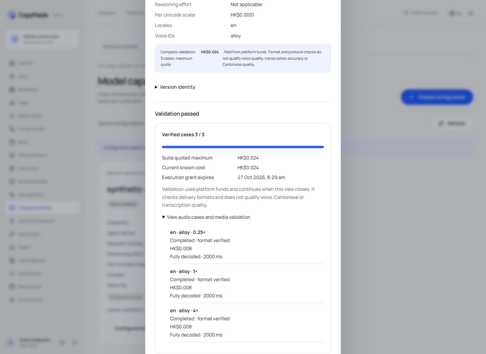

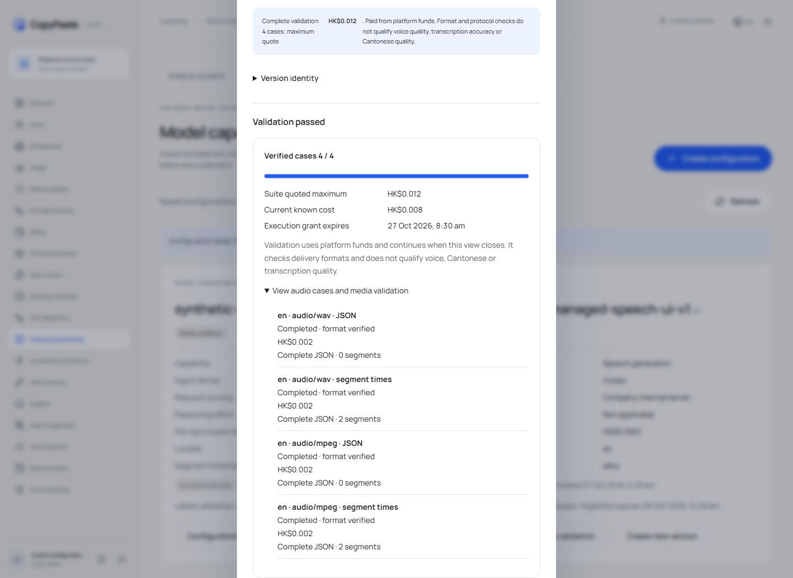

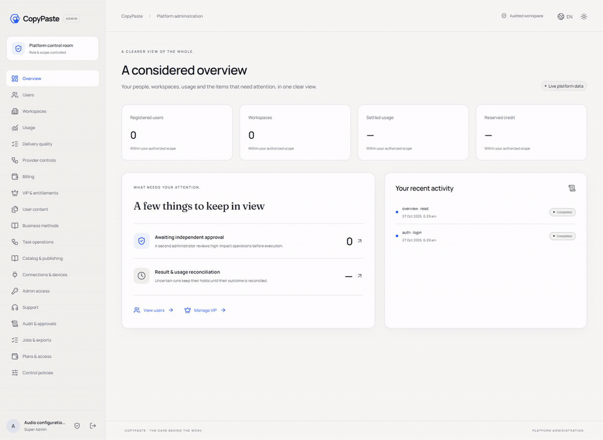


<!-- capability-inventory-stage107 -->

Video, speech and transcription now use their exact implemented protocols and independent verification flags in the customer capability inventory. Changed availability expires the signed page cursor. Revoked versions, mismatched protocols, tenant scope and task execution authorization remain checked.

The repaired capability suites passed 68 actual checks. The original failing reproduction is retained. The Stage106 complete backend attempt and its unchanged-source runtime replay are retained, including one unattributed timeout in the full attempt. This increment reruns the affected capability suites. Models/accounts remain synthetic, with no live professional-quality claim.

Reproduce in Delivery: `node scripts/run-capability-inventory.mjs <new-two-digit-attempt> core`. The customer API correction adds no page. Screenshots and GIF/MP4 below retain their actual Stage106 recording and source scope.

[Design / 方案](https://github.com/copypasteltd/workmate/blob/docs/docs/technical/107-profile-specific-capability-inventory.md)


<!-- platform-integration-stage106 -->

Explicitly selected private file versions now remain usable by subsequent private tasks while unselected files stay isolated. Replaced/revoked inputs still stop execution. Native cloud HTTP checks wait for actual application readiness before starting each request deadline. Web clears a private workflow confirmation after a denied read or source withdrawal.

Desktop strict tool admission now matches the pinned native schema compaction and preserved array constraints; altered or duplicate declarations remain denied. The actual local native request carries all 23 media tools plus browser/program namespaces.

The complete 97-file backend run executed 1230 tests: 1,229 passed and one existing continuation test timed out/cancelled. Both checks in that unchanged runtime file passed independently; the timeout cause remains unattributed. Eleven actual client journeys, 15 screenshots and five GIF/MP4 pairs are retained. Models/accounts are synthetic; Codex, native execution and database operations are actual. Historical failures and exact source copies are retained. Desktop remains customer-local Codex; Extension retains its native right Side Panel and authorized uploads.

Reproduce from the Delivery checkout: `node scripts/run-platform-integration.mjs <new-two-digit-attempt> full`, then `node scripts/run-workflow-view-ui.mjs <new-two-digit-attempt>`. Prepare the pinned Desktop runtime first with `npm run runtime:prepare` in Desktop. The complete runner checks the binary hash and observed version, sets all four native/cloud test variables and owns its native PostgreSQL. Every attempt retains its original evidence.

[Design / 方案](https://github.com/copypasteltd/workmate/blob/docs/docs/technical/106-selected-inputs-and-runtime-readiness.md)

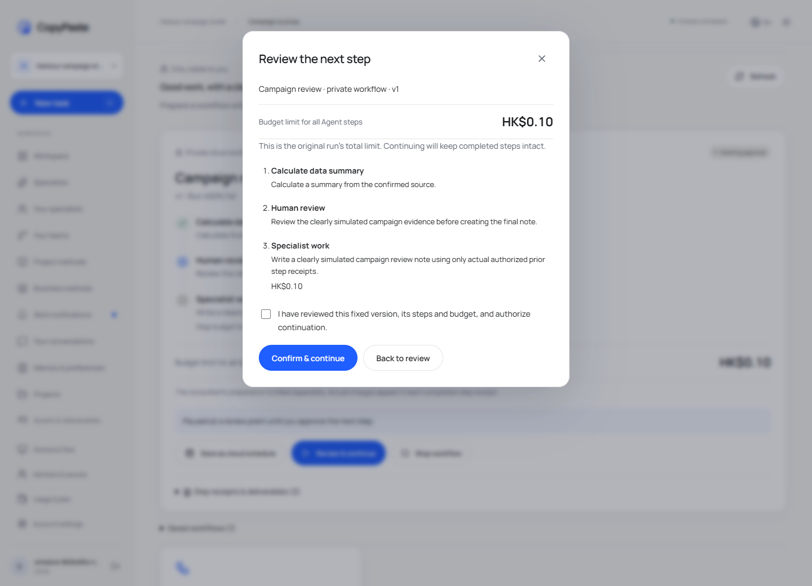

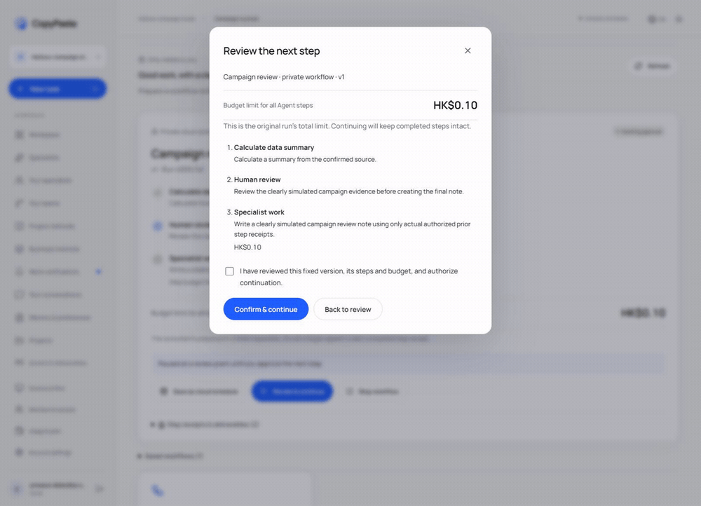

[Actual interaction MP4](assets/screenshots/integration-workmate-workflow-view-03-workflow-view-withdrawal.mp4)


<!-- live-private-views-stage105 -->

Web now clears an already-open private schedule review, editor, action or history when an authoritative read loses access or removes the source. Normal polling preserves readable drafts and exact version confirmation; a recovered read does not reopen discarded private content. Pending immutable requests refresh readiness and expiry.

Nine actual cross-client journeys passed, including a real source quarantine without page reload and an explicitly simulated denied HTTP403 read. Eleven screenshots and four GIF/MP4 pairs are retained. The unchanged backend retains its 78-check baseline; those tests were not rerun. Synthetic model/accounts; no new Desktop qualification. Desktop remains customer-local Codex and Extension remains the native right cloud Side Panel with authorized file upload.

[Design / 方案](https://github.com/copypasteltd/workmate/blob/docs/docs/technical/105-live-private-schedule-views.md)

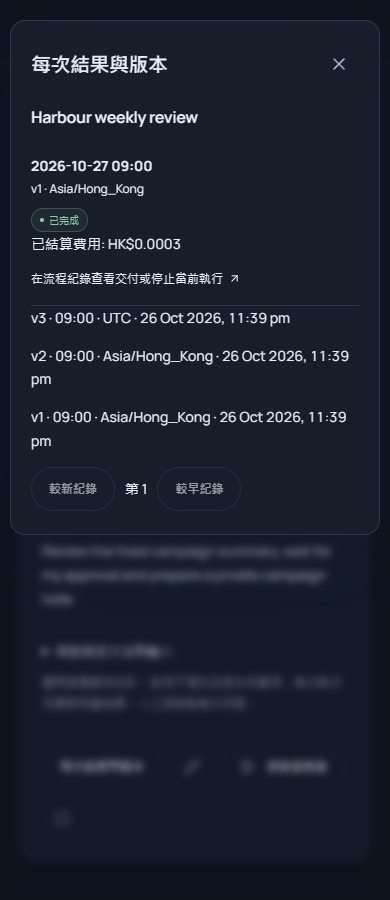

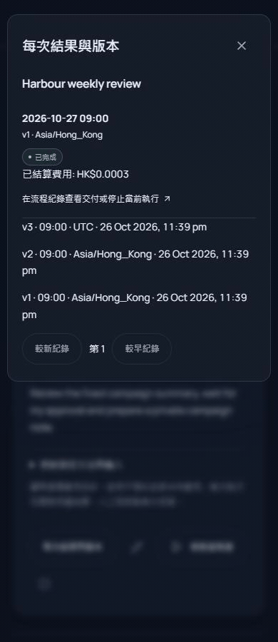

[Actual Web interaction MP4](assets/screenshots/live-views-workmate-private-view-03-private-view-withdrawal.mp4)


<!-- cloud-schedules-stage104 -->

Private cloud schedules now connect consultant conversation or an existing private result to explicit customer review and daily/weekly execution. Review the fixed method, inputs, time zone, outputs and per-run Agent budget → check consent → activate → inspect each independent run, human review point, private deliverable and actual charges. Web and the real Chrome right Side Panel provide confirmation and pause; Admin lists scoped metadata and can pause future times after recent MFA and a recorded reason.

Pause preserves current work; cancel a current run separately. Resumption is confirmed by the customer and skips the paused interval. Editing creates a new pending request and immutable version. Failed or unknown paid work blocks future launches for review. Fixed inputs do not automatically refresh external account data, and activation does not precharge all future runs. Desktop continues running customer-local Codex; its native credentials cannot activate cloud replacement work.

Verified: 78 checks across six related backend suites, eight actual cross-client journeys, eight unedited PNGs and three actual GIF/MP4 pairs, using native PostgreSQL, pinned native Codex, real email/MFA/PKCE and explicitly synthetic model/account data. This scoped increment does not establish live model quality or complete product acceptance.

[Design / 方案](https://github.com/copypasteltd/workmate/blob/docs/docs/technical/104-private-cloud-schedules.md) · [Exact evidence / 确切证据](https://github.com/copypasteltd/workmate/blob/docs/docs/quality/private-cloud-schedules-checkpoint.json)

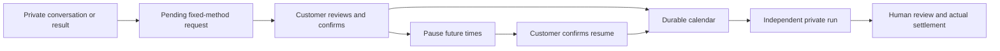

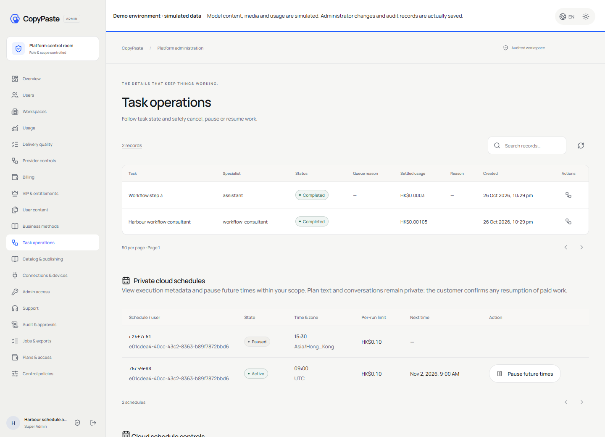

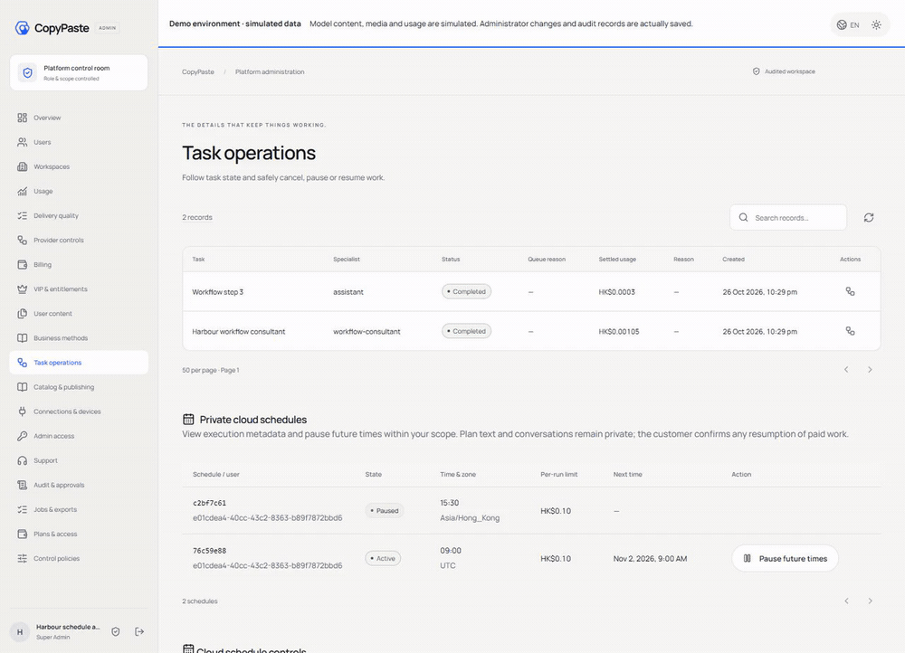

[Actual interaction MP4](assets/screenshots/schedule-copypaste-admin-workmate-cloud-schedule-06-cloud-schedule-pause.mp4)


<!-- admin-data-stage103 -->

Admin now processes persistent account batches and frozen directory, usage, billing and audit exports. Select targets/filters → review exact records, versions and projected fields → explicitly confirm → follow each item → retry only failed targets in a reviewed child or download authorized CSV/manifest. Cancellation preserves committed effects. Existing billing/VIP approval history remains available.

Limits: 100 accounts per batch, 10,000 export rows; oversize selections are rejected. Every item and download rechecks live permissions, explicit denies, recent MFA, versions and field visibility. Previews expire after 5 minutes; encrypted job payloads after 15. Three bounded automatic attempts apply only to transient DB errors.

Verified with native PostgreSQL and actual Admin email/TOTP: 94 checks across six backend suites, seven browser journeys, six unedited PNGs and two actual GIF/MP4 recordings. Synthetic accounts, zero model calls. Customer-local Codex Desktop and native right Chrome Side Panel retain their existing execution model; this increment does not newly qualify those clients or the whole product.

[Design / 方案](https://github.com/copypasteltd/workmate/blob/docs/docs/technical/103-persistent-admin-data-jobs.md) · [Exact evidence / 确切证据](https://github.com/copypasteltd/workmate/blob/docs/docs/quality/admin-data-jobs-checkpoint.json)

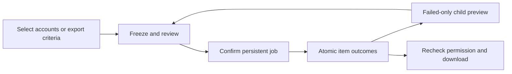

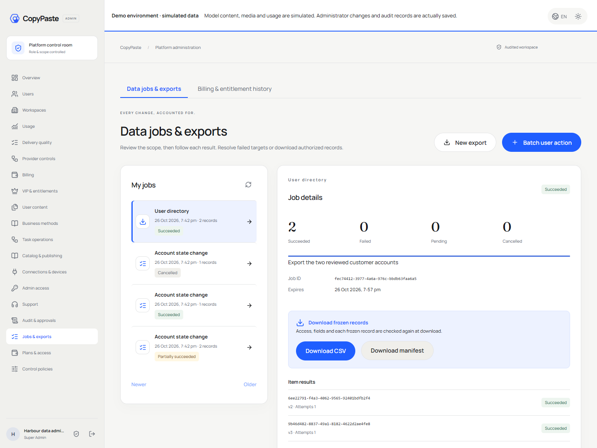

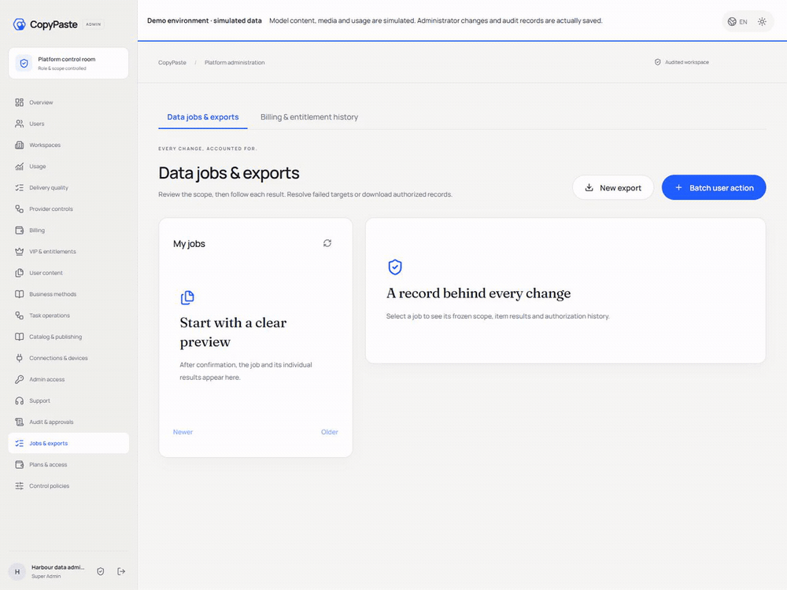

[Actual interaction MP4](assets/screenshots/admin-workmate-03-admin-data-batch.mp4)


<!-- client-content-stage102 -->

Admin provides bilingual editing, directory selection, before/after preview, confirmation, version pagination and rollback.

Usage: sign in to Admin → Catalog → Client content; edit both languages, schedules and existing optional menus; select clients, directory recipients and a stable percentage cohort; save a draft, preview the selected recipient and confirm. Unselected customers keep the exact baseline. Rollback previews a previously published release and appends a new publication. Account, VIP, billing, role and Skill permissions still control execution.

Verified: 79 related backend checks in five suites, seven actual client journey checks, eight unedited screenshots and four real GIF/MP4 recordings. Native PostgreSQL, real email/MFA/PKCE sessions and an unsigned packaged Desktop were used. Accounts/copy are synthetic; this increment makes zero model calls and does not establish live professional quality or complete product acceptance.

[Design / 方案](https://github.com/copypasteltd/workmate/blob/docs/docs/technical/102-client-content-releases.md) · [Exact evidence / 确切证据](https://github.com/copypasteltd/workmate/blob/docs/docs/quality/client-content-checkpoint.json).

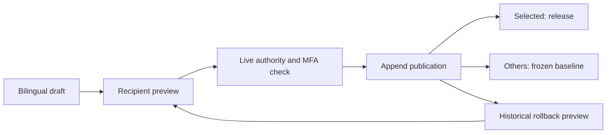

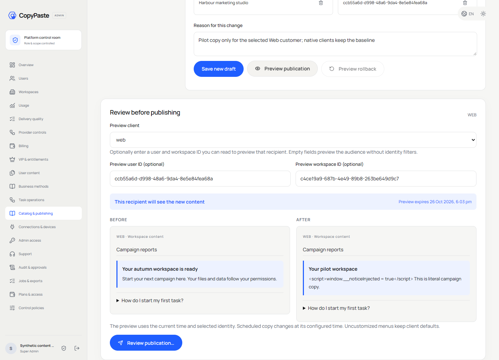

[Actual admin MP4](assets/screenshots/admin-workmate-06-client-content-publication.mp4)

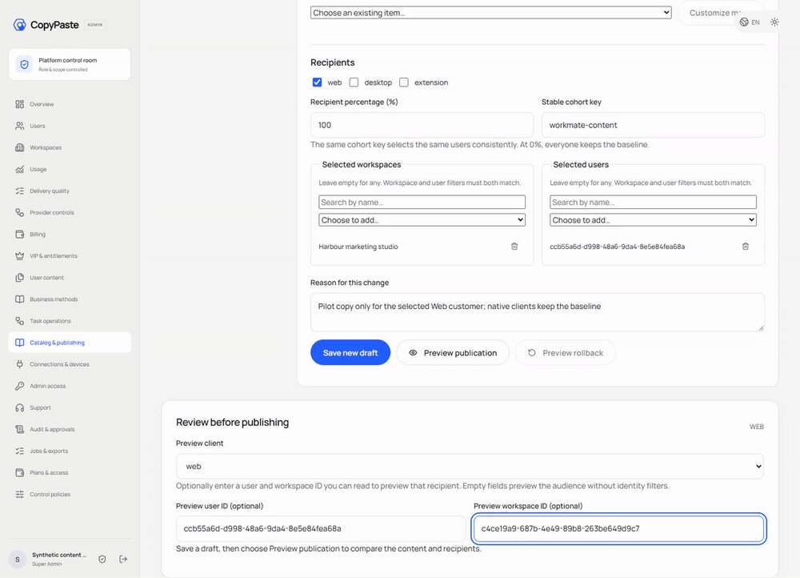


<!-- cloud-browser-stage101 -->

Cloud Codex now performs actual page interactions and DOM checks with a pinned native Chromium runtime, retaining a real screenshot and exact source. Admin uses tenant, source, user and content controls; the images below show an actual customer Web task.

Usage: sign in, select an authorized software role and approve a cloud task/budget. Codex writes an HTML entry and local assets, executes named page checks, repairs failures and repeats. Expand Software checks to see the actual PNG and expected/actual values; download execution files or the matching source package. Four additive Skill packages and six role versions preserve historical approved bindings and do not expand permissions.

Verified: 113 checks in fourteen related suites and four authenticated Web journey checks; actual Codex, browser and downloads, synthetic provider responses and credit. Static task preview and independent API/SQLite checks do not establish a combined deployed application, arbitrary npm/framework support, live professional quality or complete product acceptance. Chromium policy restrictions are separate from an OS-wide no-network guarantee. Earlier notes below keep their historical scope.

[Evidence / 证据](https://github.com/copypasteltd/workmate/blob/docs/docs/quality/cloud-browser-checkpoint.json) · [Design, setup and limits / 方案、安装与边界](https://github.com/copypasteltd/workmate/blob/docs/docs/technical/101-cloud-browser-preview.md).

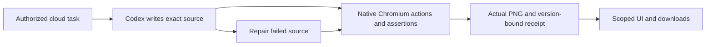

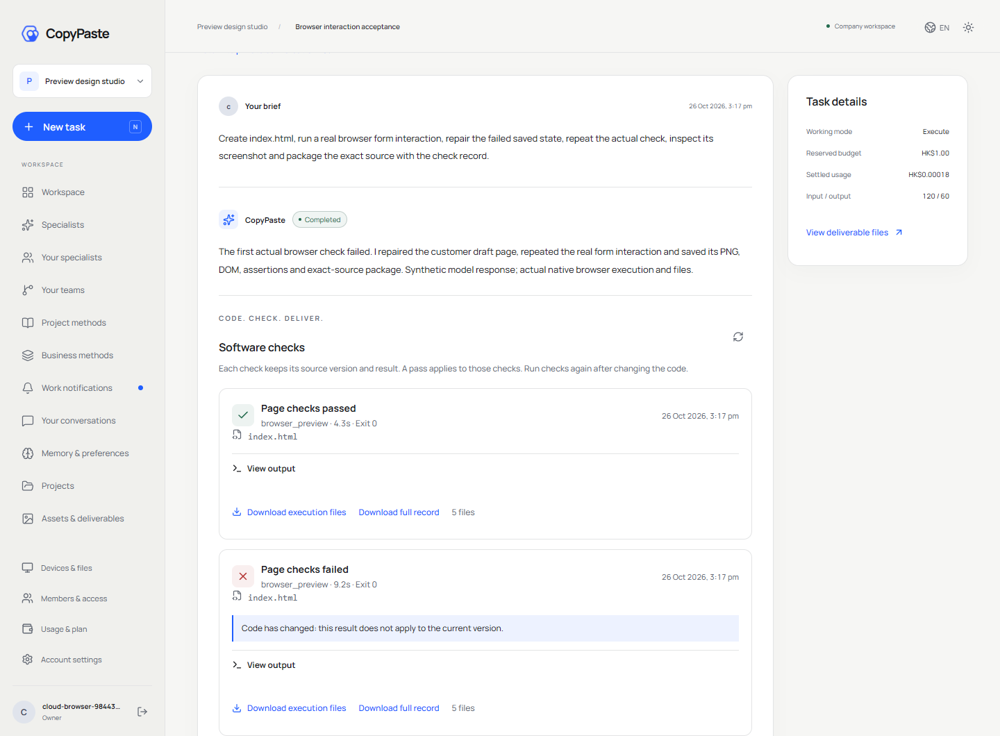

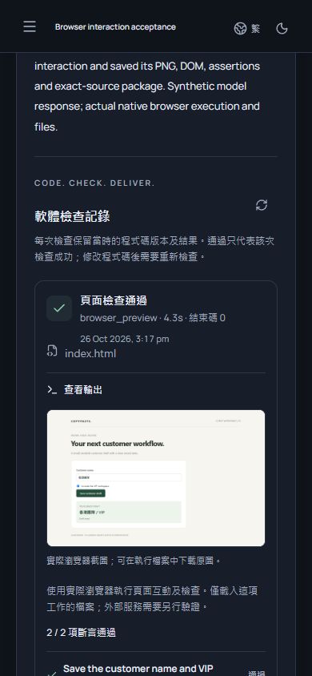

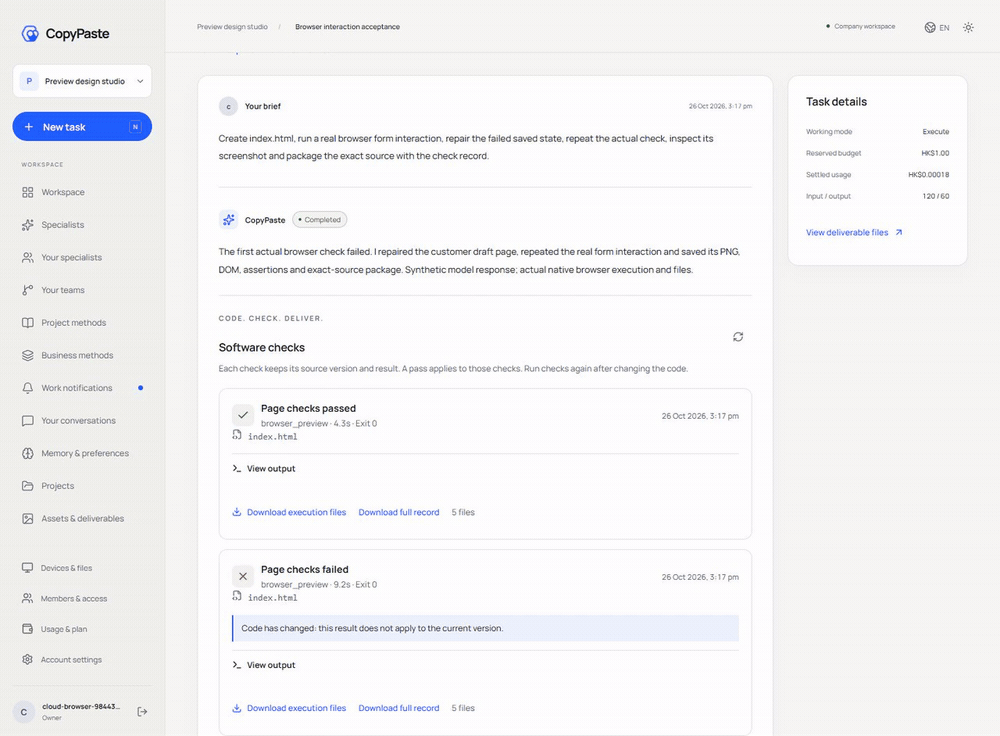

[Actual interaction MP4 / 实际交互录像](assets/screenshots/workmate-01-cloud-browser.mp4)

<!-- cloud-development-stage100 -->

Cloud Codex can now run actual HTTP application requests and native SQLite data/constraint checks. Exact-source receipts retain failures, mark results stale after source changes, and accompany matching code packages. Admin retains existing tenant, source, asset and permission controls; the evidence below shows the actual customer Web integration.

Usage: approve an eligible cloud task and its budget, let Codex write and check the code, inspect Software checks, expand output, then download execution files or the full record. The Windows-only native boundary has no network or child processes; external TCP/TLS endpoints, PostgreSQL/MySQL compatibility, arbitrary npm dependencies and cloud browser preview remain outside this scope.

Earlier implementation notes below retain their historical validation scope; this section describes the current change.

Verified: 96 related checks across eleven suites and four actual authenticated Web journey checks. Synthetic provider responses and credit; actual Codex, native execution and downloads. [Evidence / 证据](https://github.com/copypasteltd/workmate/blob/docs/docs/quality/cloud-development-checkpoint.json) · [Design and limits / 方案与边界](https://github.com/copypasteltd/workmate/blob/docs/docs/technical/100-cloud-development-checks.md).

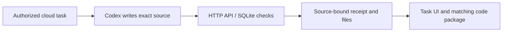

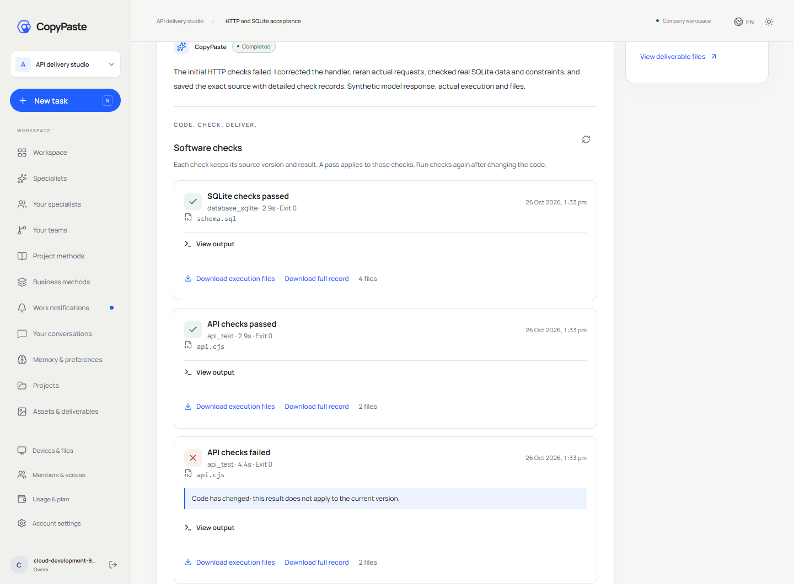

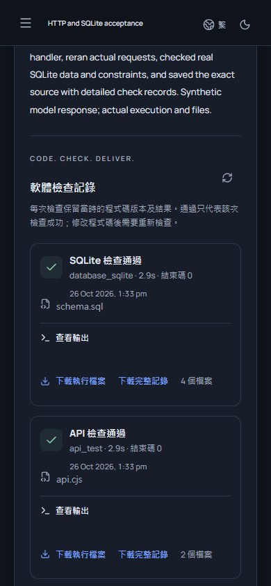

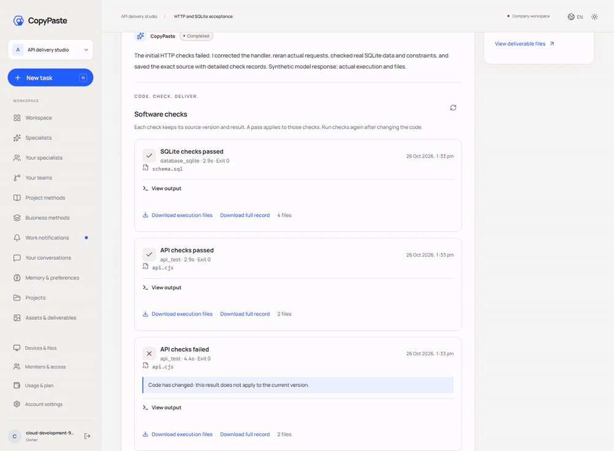

[Actual interaction MP4 / 实际交互录像](assets/screenshots/workmate-06-cloud-development.mp4)

<!-- cloud-program-stage99 -->

Cloud Codex can now run actual pinned Node programs, built-in tests and syntax checks. Exact-source receipts retain failures, mark results stale after source changes, and accompany matching code packages. Admin retains existing tenant, source, asset and permission controls; the evidence below shows the actual customer Web integration.

Usage: approve an eligible cloud task and its budget, let Codex write and check the code, inspect Software checks, expand output, then download execution files or the full record. The Windows-only native boundary has no network or child processes; arbitrary npm dependencies and the other three cloud development tools remain unavailable.

Verified: 83 related checks across ten suites and four actual authenticated Web journey checks. Synthetic provider responses and credit; actual Codex, native execution and downloads. [Evidence / 证据](https://github.com/copypasteltd/workmate/blob/docs/docs/quality/cloud-program-checkpoint.json) · [Design and limits / 方案与边界](https://github.com/copypasteltd/workmate/blob/docs/docs/technical/99-cloud-program-execution.md).

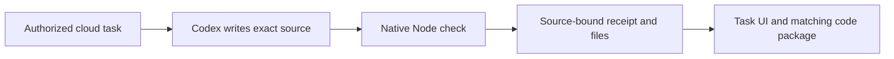

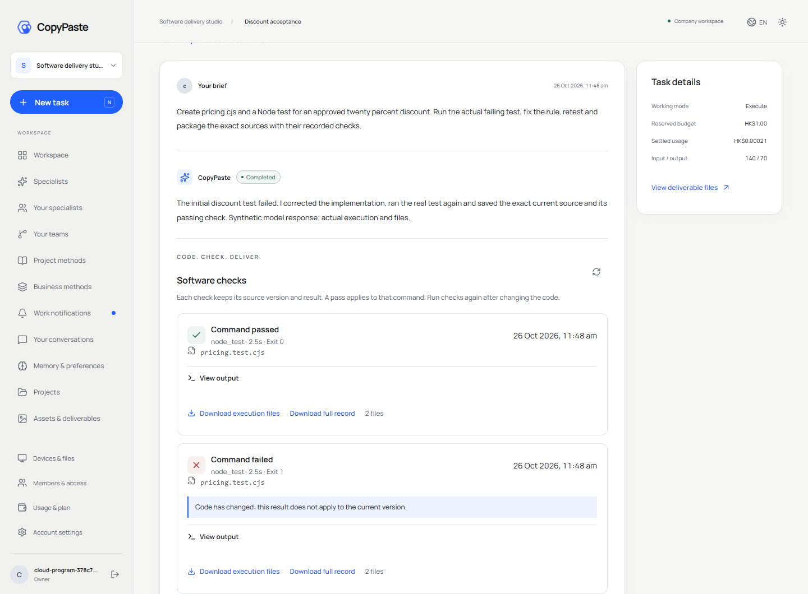

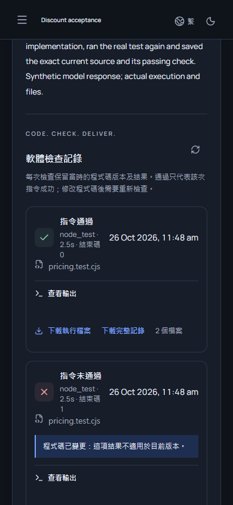

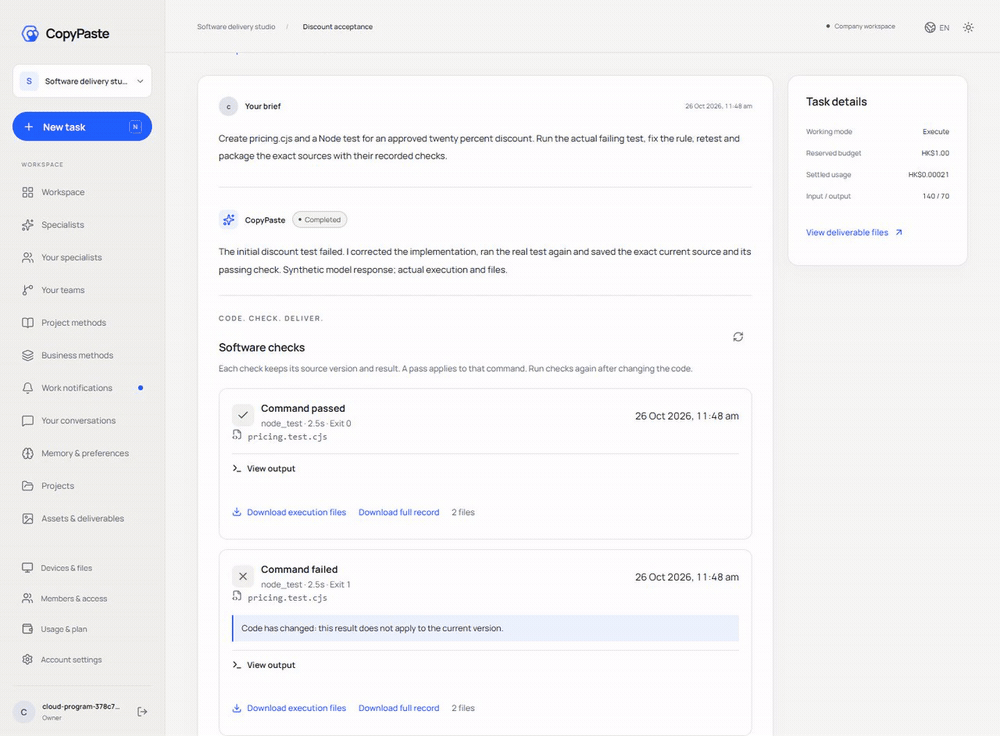

[Actual interaction MP4 / 实际交互录像](assets/screenshots/workmate-03-cloud-program.mp4)

<!-- preset-specialists-stage98 -->

Saved specialists now start local Codex from Desktop. Select a preset, lasting instructions and an exact project brand revision, save it after a free check, then choose a local folder, grant permissions and approve each turn budget. Web and Extension keep cloud execution. Later brand publications and specialist edits do not silently replace an existing native session’s saved version.

Verified: 212 related integration checks, 51 Desktop unit checks, two actual local Codex protocol probes and seven packaged Desktop / authenticated Web journey checks. [Current evidence / 当前证据](https://github.com/copypasteltd/workmate/blob/docs/docs/quality/preset-specialists-checkpoint.json).

<!-- native-methods-stage97 -->

## Native Desktop method trials

Desktop prepares a complete pinned method as local tasks, then runs, stops, reconciles, accepts and publishes those tasks using the customer's local Codex. Select a fresh session, folder and native permission for every specialist, preview approved inputs, and explicitly approve the private brief and total budget. Preparation reserves the exact batch once. Each task starts only on a customer action. The server rejects Desktop-to-cloud trial fallback.

Uncertain admissions reuse the original encrypted journal request and key across renderer reload or application restart. Already executed work cannot silently restart. Acceptance requires every current successful delivery and required source-read fact. Installation copies method references only. Pre-upgrade native conversations retain their original company-tool version.

Isolated acceptance uses synthetic models, accounts and credit with actual local Codex processes, native files and company usage settlement. It does not establish real payment, live provider quality, human native-dialog clicks, signed installers or complete product acceptance. Read the [execution, permission, recovery and data contract](https://github.com/copypasteltd/workmate/blob/docs/docs/technical/97-native-method-trials.md).

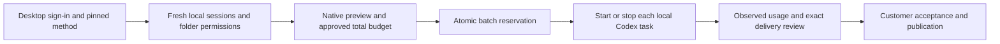


Verified: 124 related integration checks, 49 Desktop unit checks, two actual local Codex protocol probes and six packaged Desktop journey checks. Earlier entries retain their historical validation scope. [Current evidence](https://github.com/copypasteltd/workmate/blob/docs/docs/quality/native-methods-checkpoint.json).

<!-- solution-packages-stage96 -->

## Versioned business methods

Stage 96 implements immutable business-method versions, free dependency previews, private paid trials, exact-delivery acceptance, publication and fresh cross-project rebinding. 122 related integration checks, 45 Desktop unit checks, two actual local Codex checks and eight actual browser checks pass. Model/account data remain explicitly synthetic; files, processes, authorization, accounting and audit execute normally.

1. Sign in, select a project and open Business methods. Save reusable instructions, preset roles, input labels and reporting requirements. This pins template, role, Codex profile and Skill versions; revisions require new trials and acceptance.
2. Select currently approved fixed files and reporting accounts. Preview missing requirements, snapshots, source hashes and task capacity free. Explicitly approve a private brief and total budget; each role gets an independent task in one atomic batch. Insufficient capacity rejects the complete batch.
3. Inspect every actual delivery before acceptance and publication. Browsing file or snapshot metadata cannot qualify required content; exact versions and hashes need separate actual content-read facts. Incomplete or unrelated trials, stale delivery hashes and revoked accounts cannot qualify a version. Unknown responses retain the same body and idempotency key across reload.
4. Installation copies a published method reference only. Source customer files, private briefs, results, memories, accounts and keys are not automatically copied. Upload target-project inputs, save revision-safe bindings and separately approve paid reuse.
5. Admin metadata, body reads and disablement use separate scoped permissions. Body access is audited; disablement requires recent MFA and a reason. Withdrawn methods, inputs and account authority fence dependent content.

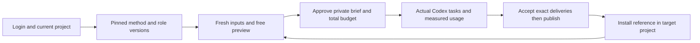

Desktop keeps local Codex with explicit local folder, permission and budget approval. Its generic bridge rejects cloud method-trial admission; exact installed methods are read-only company tools available only to compatible pinned native roles. The cloud default assistant is not a local role. Extension keeps a cloud agent, approved attachment upload and a native right side panel. These new captures show actual Web/Admin; new packaged Desktop method-library visuals are not qualified here. Earlier Desktop screenshots keep their historical scope.

[方案与使用 / Implementation](https://github.com/copypasteltd/workmate/blob/docs/docs/technical/96-versioned-business-solutions.md) · [Exact-source evidence](https://github.com/copypasteltd/workmate/blob/docs/docs/quality/solution-packages-checkpoint.json)

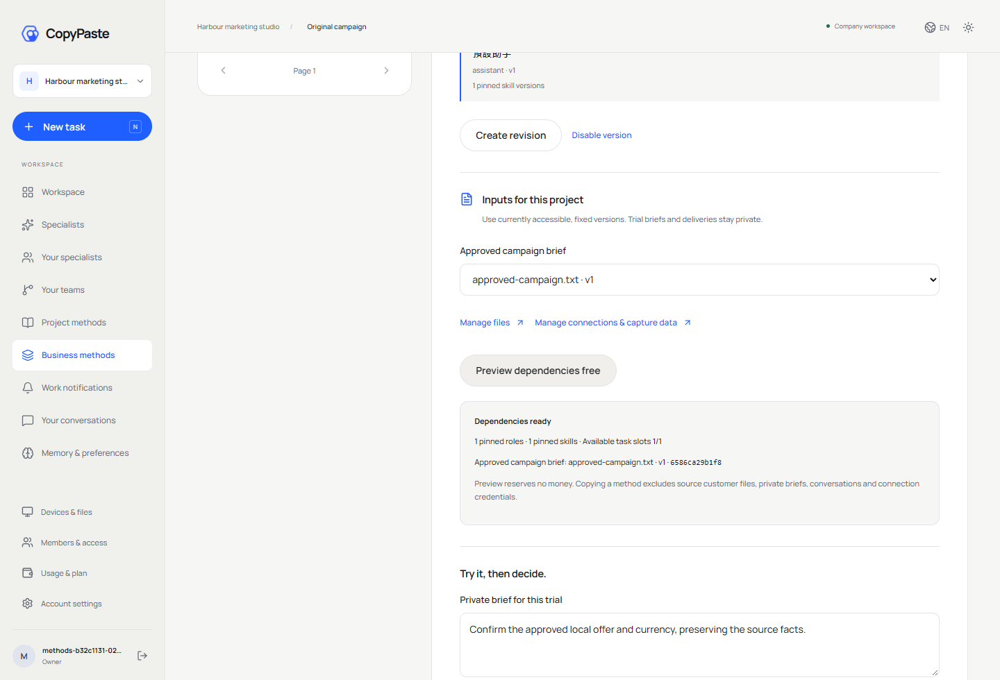

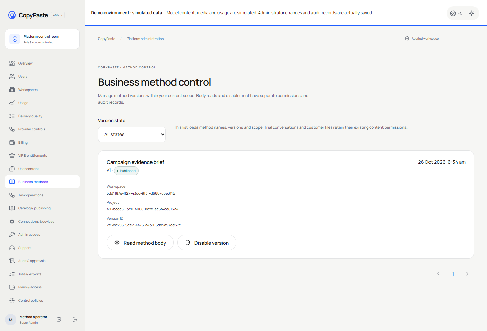

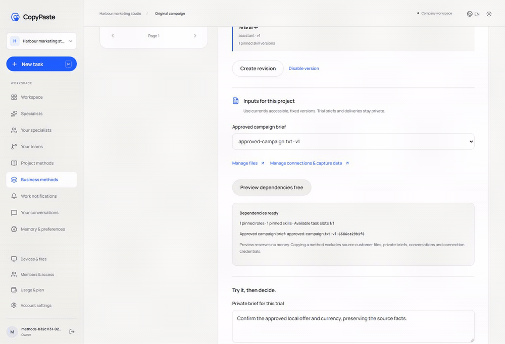

[375px](assets/screenshots/workmate-solution-packages-07-responsive-375.png) · [Published method](assets/screenshots/workmate-solution-packages-07-published-en.png) · [Fresh target requirements](assets/screenshots/workmate-solution-packages-07-installed-missing.png) · [Audited body read](assets/screenshots/workmate-solution-packages-07-admin-body-audited.png) · [Review MP4](assets/screenshots/workmate-solution-packages-07-method-review-and-publish.mp4) · [Copy & rebind GIF](assets/screenshots/workmate-solution-packages-07-copy-rebind-and-trial.gif) · [Copy & rebind MP4](assets/screenshots/workmate-solution-packages-07-copy-rebind-and-trial.mp4)

<!-- media-effects-stage95 -->

## Earlier reviewed native media effects (stage 95)

Stage 95 connects ten versioned native effects: transitions, Chinese animated text, chroma key and cleanup. After reviewing exact source versions, parameters and budget, customers approve Codex to invoke native FFmpeg and deliver actual silent MP4, PNG, source JSON and ZIP. All 106 related regression cases and eight real browser checks pass, including two native Codex processes, eight private downloads and real accounting. Model responses and account capacity are explicitly synthetic.

1. Sign in, select a project and open Motion studio. Inspect ten actual procedural examples and upload authorized PNG/H.264 MP4 inputs through Assets. Choose fixed source versions and hashes.
2. Review output size, duration, text/filter settings and budget, then explicitly consent. Preflight checks actual media, licensed font layout and encoder availability before reserving funds. A lost network acknowledgement can replay the exact saved request and idempotency key after reload.
3. Preview and download the actual silent MP4, PNG, immutable source JSON and ZIP. A revision needs a new approval; completed repeats retain original files. Source withdrawal or output quarantine fences access and prevents automatic regeneration. Normal Codex usage is charged; native rendering adds no extra AI call or fee.
4. Role video-motion@1.5.0 loads media-effects@1.0.0; formal approval exposes only catalog and render tools. SQL110 freezes inputs and source lineage; SQL111 adds the receipt type. Published old migrations, contracts and Skills keep exact bytes. Admin can publish the effects navigation entry; disabled role/Skill admission is rejected before media inspection or budget holds. Existing asset controls apply.

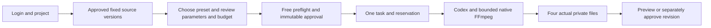

Desktop remains local Codex with customer-controlled permission; Extension remains a cloud-agent native side panel. These captures show Web effects. The native Desktop disables this cloud-only review form; company effect tools remain versioned. Earlier source-wide qualification retains its original stage; this scoped regression is not a full product or live professional-quality acceptance.

[Implementation and usage](https://github.com/copypasteltd/workmate/blob/docs/docs/technical/95-reviewed-media-effects.md) · [Exact-source evidence](https://github.com/copypasteltd/workmate/blob/docs/docs/quality/media-effects-checkpoint.json)

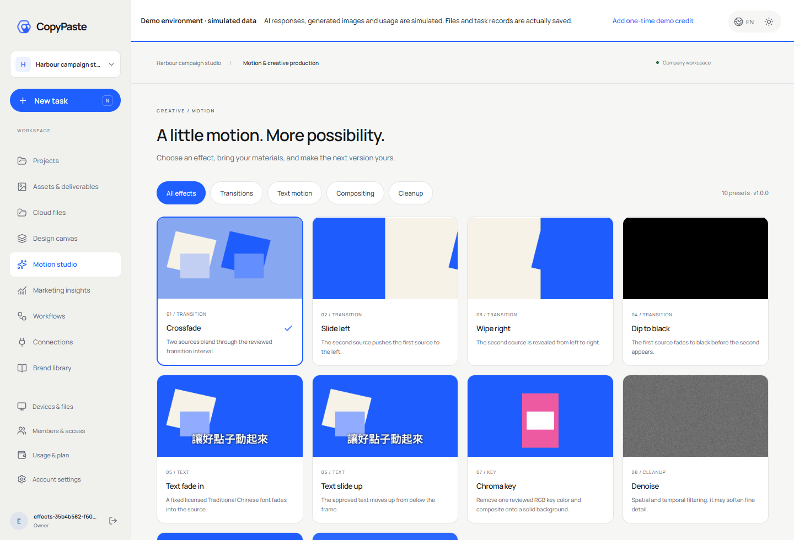

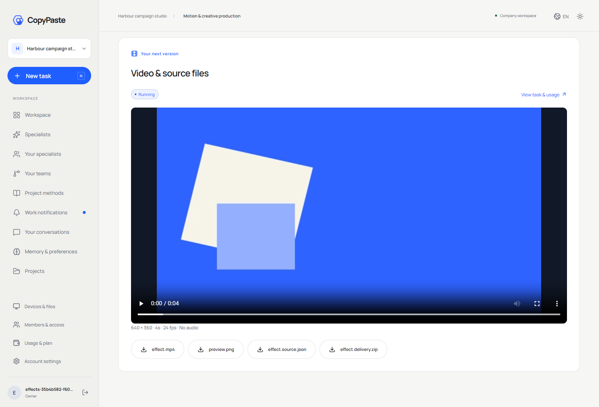

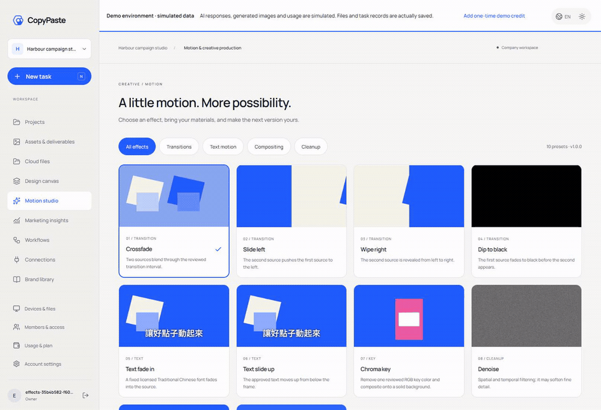

[375px](assets/screenshots/workmate-media-effects-05-responsive-375.png) · [Reviewed input](assets/screenshots/workmate-media-effects-05-reviewed-en.png) · [Review MP4](assets/screenshots/workmate-media-effects-05-effect-review-retry.mp4) · [Actual revision GIF](assets/screenshots/workmate-media-effects-05-effect-delivery-revision.gif) · [Revision MP4](assets/screenshots/workmate-media-effects-05-effect-delivery-revision.mp4)

<!-- team-history-stage94 -->

## Earlier team history and pagination (stage 94)

Stage 94 completes independent team, version and private run pages and fixes newest-run ordering previously based on random UUIDs. History browsing preserves the draft, approval returns to the newest run, and a saved team outside the directory page remains selected. Withdrawn cursors and project switches fence stale bodies. All 18 team cases and 11 real browser checks pass, including three native Codex processes, private files and actual accounting with explicitly synthetic model/account capacity.

1. Select a project and team. Use Previous/Next teams to traverse the directory; saving and refreshing keep the current team even when it falls outside that page.
2. Browse fixed versions and private runs independently. Pages contain at most 20 versions or eight actual runs, newest first by creation time with an exact database tie-breaker. Draft fields survive page changes and polling.
3. Review and explicitly approve new work. Starting from an older page returns to the newest run; stopping releases known unused funds. History navigation creates no task, retry or charge.
4. Withdrawn/expired/private cursor anchors return 404 and clear stale run bodies. Changing user, tenant or project discards late responses. SQL109 only adds a history index and preserves published migrations, contracts and Skills.


Desktop remains local Codex with customer-controlled permission; Extension remains a cloud-agent native side panel. These captures show Web cloud teams. Earlier source-wide qualification retains its original stage; this scoped regression is not a full product or live professional-quality acceptance.

[Implementation and usage](https://github.com/copypasteltd/workmate/blob/docs/docs/technical/94-agent-group-history.md) · [Exact-source evidence](https://github.com/copypasteltd/workmate/blob/docs/docs/quality/agent-group-history-checkpoint.json)

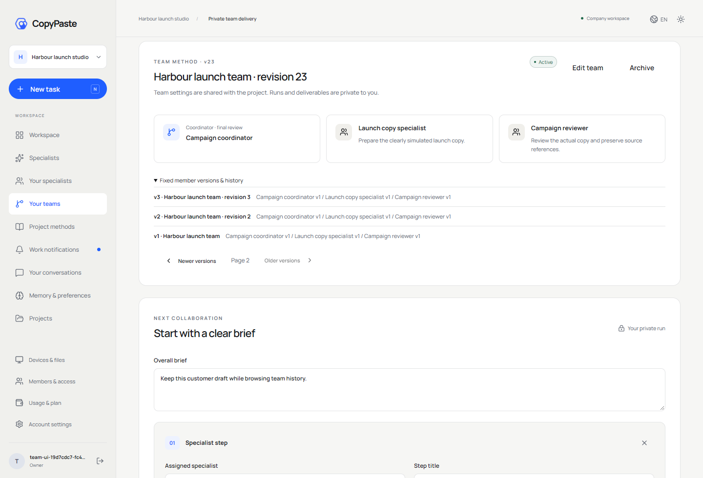

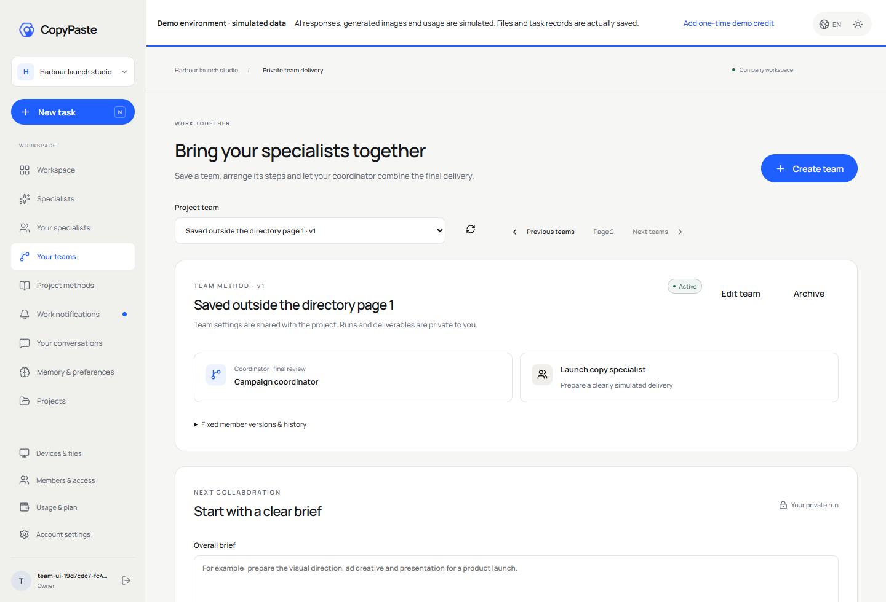

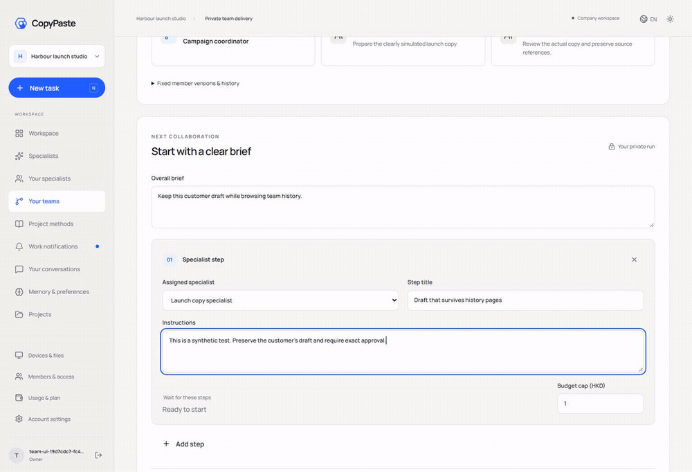

[375px](assets/screenshots/workmate-agent-group-history-02-history-responsive-375.png) · [Newest run](assets/screenshots/workmate-agent-group-history-02-history-newest.png) · [History MP4](assets/screenshots/workmate-agent-group-history-02-team-history.mp4) · [Actual Codex delivery GIF](assets/screenshots/workmate-agent-group-history-02-team-delivery.gif) · [Delivery MP4](assets/screenshots/workmate-agent-group-history-02-team-delivery.mp4)

<!-- agent-groups-stage93 -->

## Earlier persistent team implementation (stage 93)

Stage 93 implements persistent Web teams with a coordinator, distinct specialists, frozen versions, customer-reviewed briefs/dependencies/budgets, bounded actual Codex execution and unified delivery. All 115 relevant backend cases and seven actual browser checks pass. Model/account capacity is explicitly synthetic; authentication, native Codex processes, company tools, private files, budgets and accounting actually run.

1. Sign in and select a project. Create specialists in Your specialists, then save a coordinator and distinct members in Your teams. Team settings are project-shared; runs and files remain private to their customer.
2. Add the brief, step instructions, dependencies, individual caps and parallelism. Review the exact fixed member versions and full plan for free. Only the current customer can explicitly approve the budget and start.
3. Follow actual task links, member states, approved maximum, reserved funds and actual charges. The coordinator waits for all actual members to succeed, then reads their authorized outputs. Stop prevents new dispatch and preserves uncertain-cost reconciliation.
4. Team edits create immutable versions. A repeated request reuses its original run; a new execution needs a new review. Withdrawing a source blocks private derivatives. Admin body access, quarantine, restore and erasure retain independent scoped permissions and audit.


Apply **SQL108** after SQL001–107. A team has one coordinator and up to seven distinct members, with 1–16 acyclic steps and 1–3 concurrent member slots bounded by actual plan capacity. At least two active task slots are required. Reviews expire after 15 minutes; runs have a two-hour deadline. Only each actual task allocation is reserved; the displayed total is a maximum, not another charge. Existing single-task conversation admission remains enforced.

Desktop keeps local Codex and customer-controlled full permission, frameless windows and no native Electron menus. This new team interface is cloud Web work; it is hidden in native Desktop. Extension remains a ChatGPT-style native right Side Panel for authorized uploads and cloud conversations. These recordings do not establish new native team interfaces, professional role quality, live providers or full product acceptance.

Use Content to locate agent_groups / agent_group_runs. Listing does not grant body access. Quarantine cancels admitted work and releases known unused holds; restoring settings cannot restart a cancelled run or silently restore its private body. Permanent deletion removes online content while preserving financial/audit records.

[Implementation and API](https://github.com/copypasteltd/workmate/blob/docs/docs/technical/93-persistent-agent-groups.md) · [Exact-source evidence](https://github.com/copypasteltd/workmate/blob/docs/docs/quality/agent-groups-checkpoint.json)

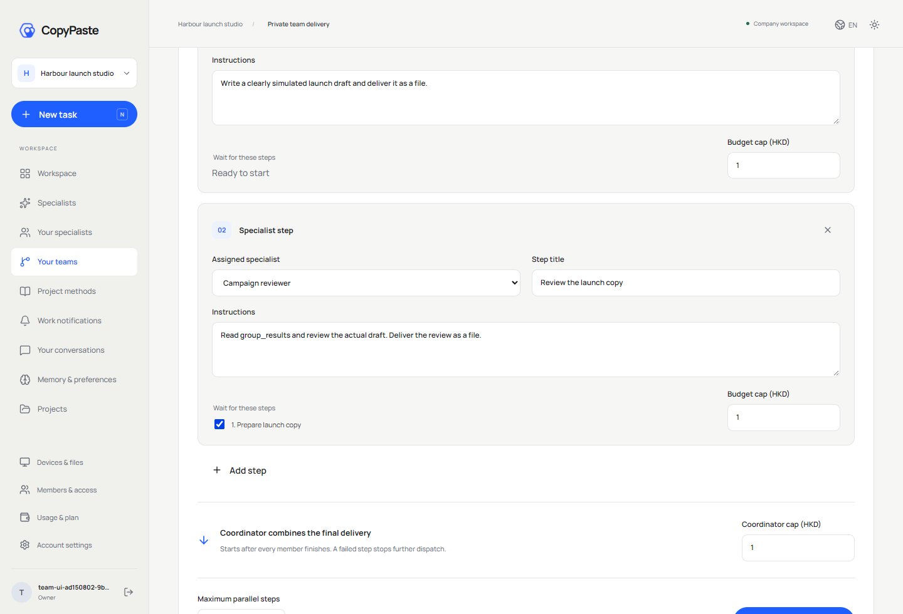

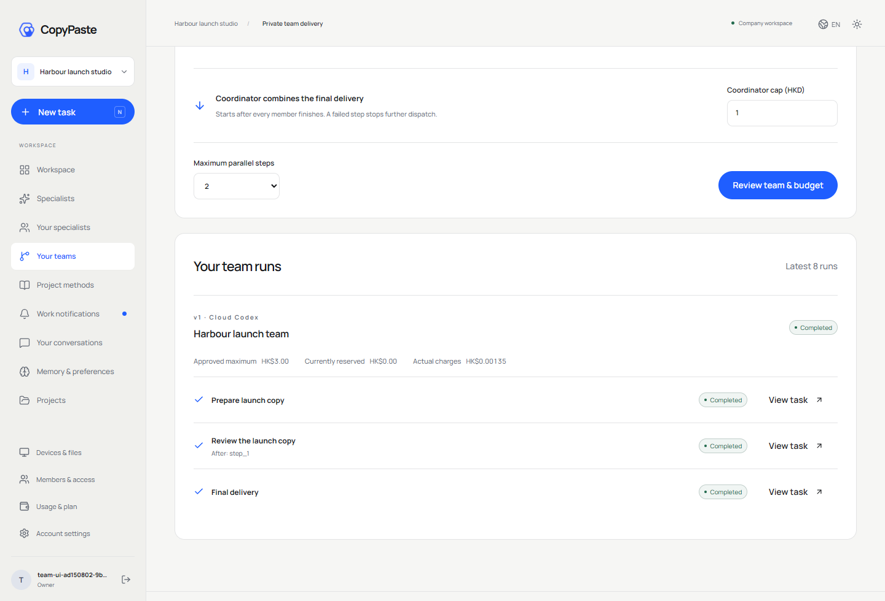

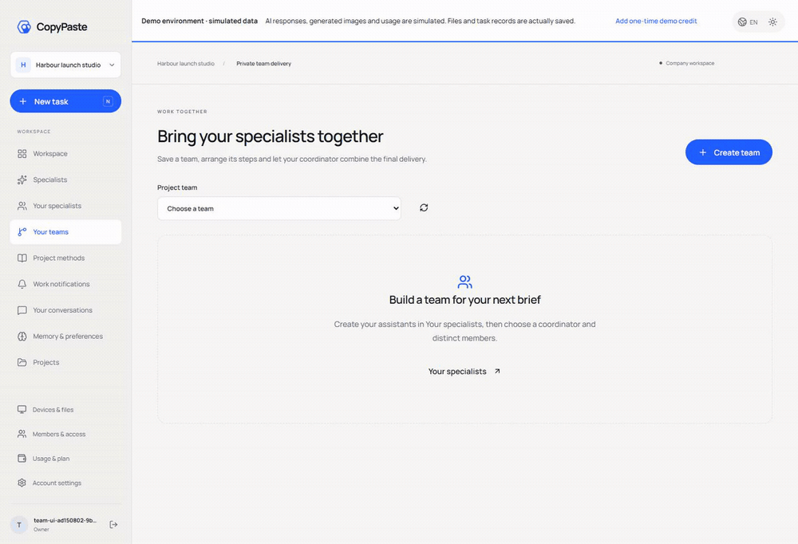

[375px](assets/screenshots/workmate-agent-groups-04-responsive-375.png) · [Delivery GIF](assets/screenshots/workmate-agent-groups-04-team-delivery.gif) · [Authoring MP4](assets/screenshots/workmate-agent-groups-04-team-authoring.mp4) · [Delivery MP4](assets/screenshots/workmate-agent-groups-04-team-delivery.mp4)

<!-- local-programs-stage88 -->

A separate MFA-protected Admin scopes users, content, consumption, fees and VIP by role, company, project, field and operation.

## Product and boundaries

The first customers are existing marketing teams. Scope includes image/design/typography, video/effects, advertising and website analysis, SEO/GEO, repeated business processes and software development. The catalog has 18 candidates with exact Skill bindings; at least twelve individually qualified professional presets remain an acceptance requirement. The designer combines Codex, design Skills and company Image 2. Codex is the only Agent core. All AI uses the company's OpenAI-compatible backend; development currently uses authorized synthetic providers, not a claim of live professional quality.

Uses separately enrolled Admin identities and MFA; customer login grants no administration. Metadata, sensitive bodies, usage/cost, credits/reversals, credit limits, refunds, payment records, VIP, quarantine/restore and irreversible erasure have separate permissions. Preview exact users/workspaces, amounts or entitlements, expiry and reason before confirming the same idempotent operation. Preview changes no balance and replay grants no duplicate credit. Support access does not imply body access; sensitive operations retain independent review, current MFA and audit. Admin cannot grant customer-local full permission or sign a customer's media declaration.

## Setup

### Local startup

Run these commands in the checked-out component. The complete workspace has the six independent repositories side by side under `dev/`; see the [branch and checkout layout](https://github.com/copypasteltd/workmate/blob/docs/docs/governance/04-git-branches-and-publication.md). Use Windows x64, Node.js >=22.14, npm/Git and the documented native PostgreSQL, FFmpeg/FFprobe and pinned Codex resources. Preserve existing local configuration/data. No Docker/WSL/VM is used.

```powershell
Set-Location 'D:/dev/copypasted/自有agent/dev/copypaste-admin'
npm ci
npm run dev
```

Start the backend first, then open `http://localhost:4318`. Use `npm run build` for the static build. Use a separately enrolled Admin account with MFA and assigned permissions.

### Use the current workflow

1. Complete sign-in, company membership/invitation and project selection. Native clients use browser PKCE; Admin uses separate MFA identities. Expired/revoked credentials must not silently change identity or company.
2. Select a specialist and supply the brief and explicitly authorized references/accounts. Missing inputs request customer action. Project owners can save, preview and explicitly publish immutable shared guidance; publication starts no AI and grants no new permission.
3. New tasks pin their accepted role, Skill, brand, reference and guidance versions. Existing work, including an originally absent configuration, retains its original state. Source revocation hides unavailable bodies and blocks later use; history is not a permission bypass.
4. Confirm budget and any required operation/media approval. View genuine status, progress, exact deliverables and original receipts. Continue requested edits in the same task lineage. Unknown usage remains reserved for reconciliation; it is never silently free or blindly replayed.
5. Admin can independently manage authorized user/workspace status, inspect permitted consumption, preview/confirm manual fees or credits and activate scoped VIP/expiry. Balances, recorded payments, credits, budgets and VIP are separate records. Idempotent confirmation and audit prevent duplicate grants.

## Customer-local programs and browser resources

Sign in and select company/project → create a local session → explicitly grant full local permission → open **Local programs** → choose an actual executable and confirm the native dialog, which defaults to Cancel → request work in Conversation → inspect exact arguments, actual output, PID/exit code and the original task bill. Cancelling or declining grants nothing. Approvals pin file identity and SHA-256; the Agent supplies a program ID and argument array, not a replacement shell/environment.

Stopping the original task or revoking the program ends its owned native process tree. Program revocation leaves the separate customer full-access grant intact. Success, failure, cancellation and unknown outcomes remain distinct; an original call ID never replays. After restart, uncertain records remain unknown. Customer review only permits future calls, never rewrites the old record as success. Approved programs run with the customer's OS-user rights, not an additional workspace OS sandbox; Admin/cloud cannot approve on their behalf.

The Windows x64 native Job Object guardian does not pass company inference credentials to programs. Limits are two active programs per executor, 100 approval/200 run records, at most 64 arguments and 120 seconds per invocation, and 32 KiB retained per stdout/stderr with explicit truncation. New sessions pin the program tool version; legacy tool sets remain unchanged. Normal browser opens and popups share three pages per task/two active contexts per executor. A third context is denied without evicting another task; reuse clears cookies/localStorage.

## Customer-local folder work

In Desktop, choose a writable local session and open **Folder work**. Select an input folder inside the workspace and configure extensions, instructions, a quiet period, per-file/total limits and maximum runs. Existing files are excluded unless selected. Saving creates a **paused** rule; **Confirm and activate** opens a separate native automatic-spend confirmation that defaults to Cancel.

Stable native file events and bounded scans feed a persistent serial queue. Each job gets an exact snapshot, separate output directory, original task ID and company cost receipt. An unanswered native question is visible from Folder work; **Answer questions** returns to Conversation and requires the customer's explicit answer. Identical already-processed bytes and product outputs do not create another paid task. Unstarted old versions coalesce to the latest stable input.

Pause stops new dispatch and lets the current file finish. Revoke stops only that rule's owned work while keeping outputs/receipts. App closure stops watching; a real reopen retains the encrypted journal and allocated limits but requires fresh confirmation. Lost replies reuse original dispatch/create/start/finish keys; uncertain native actions block for review. Full OS permission remains the customer's grant, not an additional folder sandbox. Web/Extension keep cloud execution; folder work is a Desktop capability.

Limits: 20 rules; 1,000 history/200 queued items per rule; 1,000 dispatch receipts per session; 2,000 matching files/10,000 entries/12 levels per scan; 20 MiB per file and 64 MiB new reads per scan; at most 100 authorized runs, one scheduled job at a time. Limits do not reset on pause/restart. Outputs are under `.copypaste-local-jobs/<rule>/<job>/output/`. Symlinks/junctions, traversal, outside input, source replacement and conflicts block automatic work. See approved programs above; complete application-operation and crash/sleep/offline matrices remain open.

## Configuration, UI and verification

Apply SQL103 before client upgrades. This increment adds no HTTP route or migration; SQL001–103 and 532 recorded contracts remain byte-preserved. Set company gateways, exact model aliases, verified media capabilities and tariffs on the backend; consult its `.env.example` and the deployment runbook. Never embed company provider keys in a renderer/extension. Unconfigured capability is unavailable rather than silently redirected. Ordinary demo data does not activate every media fixture.

CopyPaste blue/cream, Manrope/Fraunces, English/Traditional Chinese and light/dark themes remain. Desktop has no Electron frame/menu or visible scrollbar rails. Real wheel/focus/last-action access and truthful progress remain. The narrow session guidance card separates its icon/version from the readable name. Focused page Home/End and Ctrl+Home/End act on that page; focused text fields keep caret navigation.

Stage 88 verifies approved pinned customer-local programs, structured argv, owned native process lifecycle/parent loss and original billing; one browser ledger enforces three pages per task/two active contexts with actual destruction and cleared storage on reuse. Fresh scopes: 68 packaged Desktop checks, 114 Desktop unit cases, 18 native Codex cases, 184 client cases, 91 related backend cases and six strict-declaration cases. Synthetic providers/dialog decisions remain explicit. Full product acceptance, twelve qualified professional roles and G01–G10 remain open. All prior 57 Desktop checks, 91 unit and 17 native cases remain. Folder work still checks a real new-PID restart, pinned original thread/versions and separately settled 90/60-micro-HKD tasks. All 14 runtime assets/licenses remain exact and repository recordings stay outside ASAR.

Retained historical stage-86 scopes: 1023 platform, 25 focused, 36 compatibility and 14 actual Web/Admin/native Side Panel checks. Complete platform/cross-client suites were not rerun. Web/Admin/Extension product sources are unchanged; changed backend tool declarations have fresh related checks. Native processes/files/ledgers/database are real; synthetic providers/dialog choices do not qualify live professional quality. Owned browsers/API/previews/test DB close; no Docker/WSL/virtualization.

The original 102 requirements remain **86 partial / 16 unproven / 0 fully accepted**. REQ-040/042 gain bounded evidence without closing their original conditions. At least twelve professional-role qualifications, complete Admin breadth, teams/solution packages, full marketing workflows, live quality, signed installation/update/uninstall, load/restore exercises and G01–G10 remain open. Test counts are not a product-completion percentage. See the complete numbered gap assessment.


[Plan and limits](https://github.com/copypasteltd/workmate/blob/docs/docs/technical/87-desktop-folder-work.md) · [Current-source checkpoint](https://github.com/copypasteltd/workmate/blob/docs/docs/quality/folder-work-checkpoint.json) · [Complete numbered gaps](https://github.com/copypasteltd/workmate/blob/docs/docs/quality/2026-10-25-goal-gap-assessment.md) · [Branch/checkout and publication](https://github.com/copypasteltd/workmate/blob/docs/docs/governance/04-git-branches-and-publication.md)

[Role catalog](https://github.com/copypasteltd/workmate/blob/backend/catalog/role-preset-catalog.json) · [Skill packages](https://github.com/copypasteltd/workmate/blob/backend/catalog/skill-packages.json)

## Architecture

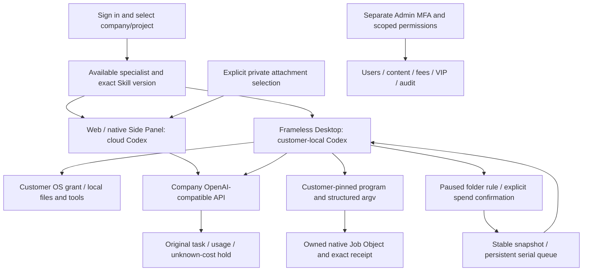

Retained stage-86 media for unchanged product sources; this stage adds no fresh Web/Admin/Side Panel UI qualification.

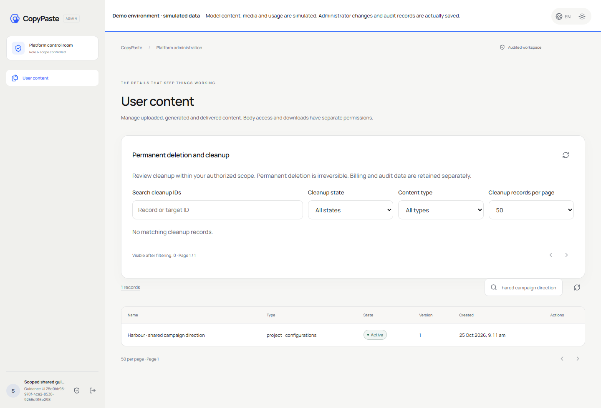

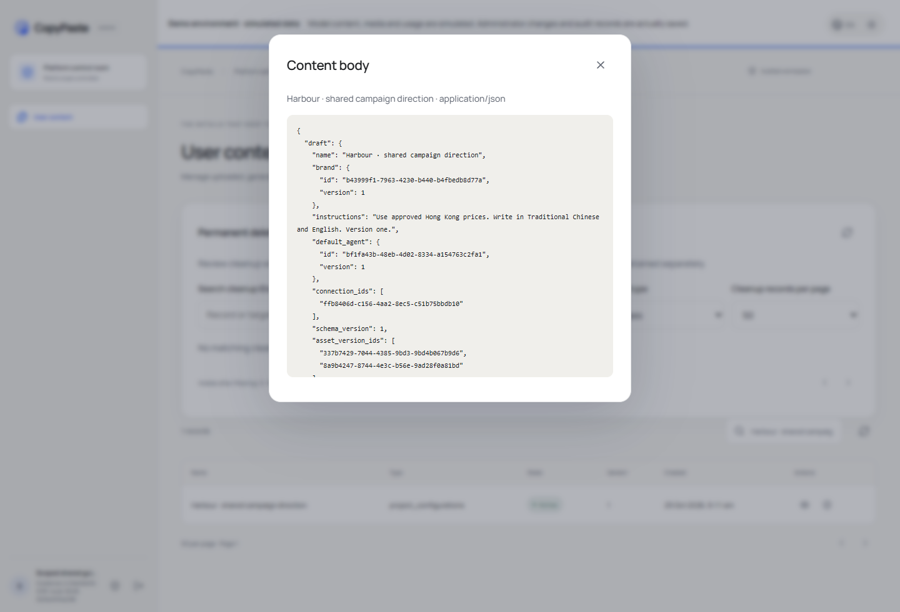

[Original MP4](assets/screenshots/workmate-guidance-14-project-guidance-governance.mp4)

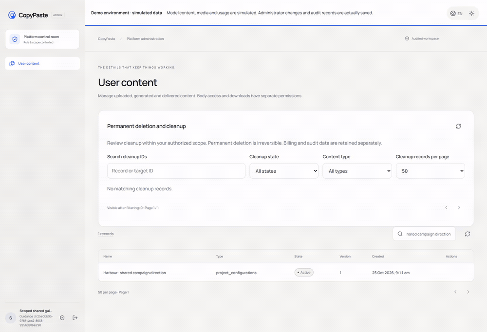

[Local program plan](https://github.com/copypasteltd/workmate/blob/docs/docs/technical/88-approved-local-programs.md) · [Stage 88 checkpoint](https://github.com/copypasteltd/workmate/blob/docs/docs/quality/local-programs-checkpoint.json)
