# CopyPaste Platform

[简体中文](README.md) · Native enterprise Agent services · 0.5.0

This independent repository implements persistent PostgreSQL services, customer/admin identity, workspace/project authorization, Codex execution, marketing assets, analytics, workflows, device commands and the admin control plane. No sibling source checkout is required. The delivery root's `docs/` contains the master requirements and design baseline.

## Prerequisites and local start

Validated on Windows x64 with Node.js 22.14+, npm, Git, native Codex `0.163.0-alpha.10.2`, FFmpeg and FFprobe. Dependencies are pinned. Use native processes; Docker, WSL and virtualization are prohibited. Other operating systems have not been qualified.

```powershell
npm ci
npm run setup:local
npm run db:local
```

Keep the database terminal open. In another terminal:

```powershell
npm run db:migrate
npm run dev
```

API: `http://localhost:4310`; PostgreSQL: `127.0.0.1:55432`. The launcher applies development migrations; `db:migrate` also prepares `copypaste_test`. Migrations use the owner identity, while application connections use restricted, non-owner roles with RLS.

`setup:local` creates unique passwords and a durable MASTER_KEY only when `.env` is absent. `.env.example` is a secret-free reference, not a replacement for an existing installation. An ephemeral ASCII junction works around PostgreSQL bootstrap limitations on Unicode Windows paths; actual data and binaries stay in this repository. Shutdown uses native pg_ctl to checkpoint the cluster before removing the alias; it does not force-kill PostgreSQL.

## Customer lifecycle

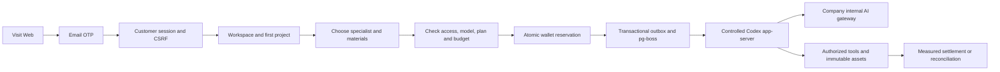

First email verification can create an account. OTPs expire after 10 minutes, permit five failed attempts and have one atomic consumer. Development mail is written to `.data/mailbox/<challenge-id>.json`; inspect it locally. Production requires SMTP. Web and Admin use separate HttpOnly cookie sessions with Origin/CSRF checks. Native clients use PKCE, short-lived access tokens and rotating refresh families. Logout, suspension and session revocation invalidate access.

## Administrator enrollment

```powershell
npm run admin:create -- admin@your-company.example super_admin
```

Import the generated TOTP URI from `.data/enrolment/<id>.json` into an authenticator, then delete that file. Admin login requires both email OTP and TOTP. There are no shared default credentials. Enrollment is a trusted deployment CLI operation.

Eight built-in roles and 68 permission keys support global, tenant and project scope, explicit denies, amount/duration/batch limits and bounded delegation. Sensitive actions require MFA within the last 10 minutes. Administrators cannot grant themselves access or remove the last permanent recovery administrator.

Version 0.3.0 completes subsequent admin invitations, recipient email proof and real TOTP enrollment, profile editing, status CAS, suspend/resume, resend, other-admin MFA reset, self authenticator replacement and session revocation. Capabilities are hashed; setup keys and unmailed invitation material are encrypted and cleared on completion/revocation. Public admin projections never expose keys, tokens or invitation links. See migration `008-admin-identity-lifecycle.sql`, `src/admin-identities.ts` and 14 actual PostgreSQL/API test groups. Trusted CLI bootstrap remains; production SMTP and SSO need separate qualification.

## Implemented scope

| Area              | Implementation                                                                                                                                                                |
| ----------------- | ----------------------------------------------------------------------------------------------------------------------------------------------------------------------------- |
| Identity          | Email OTP, separate Admin MFA, native PKCE, invitations, member/project rights, last-owner protection and PostgreSQL RLS                                                      |
| Agent             | Codex-only version-pinned runtime, 28 hash-checked Skill packages, 18 role presets, tasks/events/cancellation/leases/fencing                                                  |
| Billing           | Integer HKD micros, funding lots, reserve/settle once, manual confirmed payments/gifts/source-bound refunds, personal/workspace VIP and frozen plan versions                  |
| Admin             | Paginated users/workspaces, scoped consumption, preview/commit, independent approvals, content quarantine/share revocation, jobs/exports, configuration publication and audit |
| Creative          | Local/S3 adapters, immutable versions, authorized downloads/thumbnails, brand records, image/text layout projects, SVG/PNG and actual FFmpeg template MP4                     |
| Analytics         | CSV imports, aggregate CTR/CPC/CPA/ROAS, null undefined ratios, submitted-HTML SEO checks, Google/GA4/GSC/Meta OAuth/report adapters                                          |
| Workflows/devices | Bounded eight-step persistent workflows, analysis/Agent/approval steps, registered devices, Ed25519-signed commands, expiring folder grants and single-use results            |

The 18 roles cover full-stack, frontend, backend/API, software QA, UI/UX, general design, brand, advertising, ecommerce, social content, illustration/IP, typography/layout, presentations, landing pages, information design, video/motion, marketing analytics and workflow consulting. Definitions and actual packages are in `catalog/` and `skills/`.

Installed packages are not evidence of qualified live business tasks. All roles currently report `pending_live_validation`. Unconfigured AI fails explicitly instead of returning synthetic success.

### Actual runtime tools

Registered tools include `project_assets`, `asset_text_read`, `deliver_text`, `marketing_metrics`, and role-gated `code_read`, `code_write`, `code_package`, `font_catalog`, `design_render`, `image2_generate`, `image2_edit`. Code tools support hash-based edits and real ZIP manifests without executing untrusted customer code or claiming tests ran. Design tools produce editable JSON, SVG, PNG and bounded template MP4. Image generation/editing uses the internal Images endpoints only.

Other planned tool identifiers in the design catalog are not all registered. AI video and speech are not implemented; roles requiring those capabilities remain unavailable. Manual signed local-file dispatch works; autonomous Codex local-file dispatch is not connected yet.

## Persistent specialists, private conversations and memory

Version 0.2.0 adds project specialists based on installed roles, with instructions, brand binding and a restricted tool subset. Edits create immutable versions. Conversations pin a version and can explicitly adopt an update. Kernel, provider, model and executable Skills remain server-controlled Codex configuration.

Conversation ownership applies to tasks, events, versions and generated files, enforced by API checks and PostgreSQL RLS. Ordinary workspace administrators cannot read another user's conversation. Shared project tasks cannot consume unrelated private artifacts. Publication explicitly creates a shared copy without private context.

Messages can be notes or delegated ask/plan/execute tasks. Ask and plan permit reading tools; execute can create artifacts. Message UUIDs, conversation versions and one active task per conversation prevent duplicate submissions. Plan approval rechecks the input digest, specialist/memory/conversation versions and budget, and creates one execution child.

Memory has workspace, brand, project, conversation and personal scopes, content versions and expiry. Tasks freeze exact references and recheck authorization before subsequent tools. Deletion clears readable content and cached replay responses while retaining idempotency tombstones. Physical object/runtime-cache garbage collection remains unfinished. Conversations with active or unresolved billing work cannot be deleted.


## Internal gateway qualification

Configure server-only `AI_BASE_URL`, `AI_ALLOWED_HOSTS`, `AI_API_KEY`, the exact `AI_MODEL` alias and contracted HKD token rates. The base commonly includes `/v1`. URL-embedded credentials, production HTTP and fallback to external model providers are rejected.

```powershell
npm run codex:probe
```

This probes the actual version, initialize and thread/start without sending a model turn. Before setting `AI_VERIFIED=true`, qualify real `/responses` tool rounds, token usage and failure behavior against the company gateway. Image 2 separately requires its alias, per-image price and `AI_IMAGE_VERIFIED=true`; verify actual PNG generation and multipart edits.

The runtime integration test launches real Codex against a controlled local Responses fixture and observes a tool call and measured usage. It does not qualify the company's live model. No company gateway credentials were supplied for live integration.

## Financial and operational semantics

1 HKD equals 1,000,000 integer micros. Gifts, confirmed payments, reservations, charges and refunds have separate immutable entries. Confirmed payment references are globally unique. VIP does not credit a wallet, and a wallet balance does not grant VIP.

Pilot Starter/Pro/Business defaults allow 1/3/8 concurrent tasks and HK$100/500/5,000 task budgets. These are operational defaults; monthly pricing remains an unpriced zero placeholder, not a commercial free-plan promise. Admin can publish versioned policies.

Financial/VIP writes require a five-minute preview, payload hash, target version and idempotent commit. The default independent-approval threshold is HK$10,000. Uncertain upstream outcomes retain reservations in reconciliation rather than blindly repeating charges. Payments are manual confirmed records; no online payment acquiring is integrated.

Exports are limited to 500 rows, expire after 15 minutes, belong to the creating admin and recheck source authorization. SQL collection queries enforce scope and explicit denies; roles separately gate contact, usage and billing fields.

## Build and validation

```powershell
npm run typecheck
npm run build
npm test
npm run contracts:export
```

The original 0.5.0 release exported 167 Fastify method/path pairs, ten migrations and 84 tests. Those source counts were a historical checkpoint. Current routes are listed in `contracts/implemented-routes.json`; migration files and the current full regression receipt in `../copypaste-delivery/evidence/alignment-platform.json` are authoritative. Route counts do not establish full planned OpenAPI conformance. Tests cover identity, isolation, concurrent/idempotent billing, permissions/VIP, content revocation, actual image/PDF/MP4 output, real Codex controlled protocol turns, source packages and persistent work. Separate delivery tools record browser, extension and Desktop journeys.

| Directory             | Purpose                                                     |
| --------------------- | ----------------------------------------------------------- |
| `src/`                | API domains, Worker, authorization and Codex                |
| `migrations/`         | Ordered migrations and database constraints                 |
| `catalog/`, `skills/` | Roles, permissions and hashed Skill packages                |
| `contracts/`          | Generated Codex protocol and actual route inventory         |
| `scripts/`            | Native startup, migration, admin enrollment and probes      |
| `tests/`              | Real PostgreSQL, media and runtime tests                    |
| `.data/`              | Ignored local state, mail, enrollment secrets and artifacts |

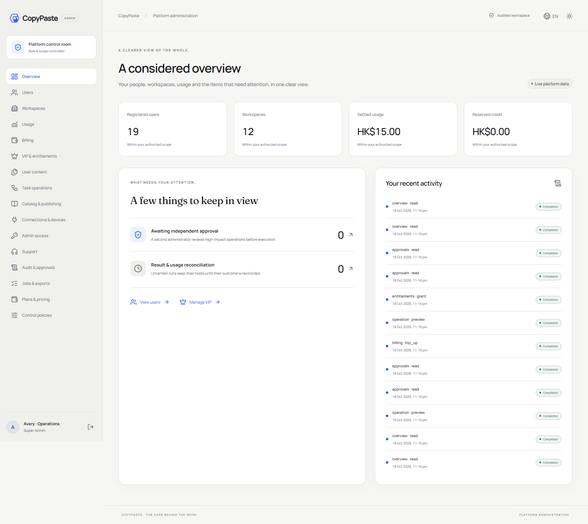

The screenshot comes from the independent Admin client; this service repository does not contain that UI.

## Deployment and remaining work

Production requires HTTPS, SMTP, separate database identities, a durable MASTER_KEY, restricted egress and storage. The local database launcher refuses production. Back up the database, object data and encryption key, and rehearse native restoration before deployment.

Google/Meta need server OAuth credentials, explicit API versions, Ads developer token and callback registration; live platform authorization/report qualification is pending. S3 has not been qualified against a live bucket. SAML/SCIM, mandatory SSO policies, event triggers, parallel specialist teams, collaborative editing, full AI video/speech, production SLOs, Windows signing and strong customer-code isolation remain unfinished. Codex shell, web search and other agents are disabled; production service-account, ACL and network containment still require deployment work.

No additional open-source license is granted for this application. See [third-party notices](THIRD_PARTY_NOTICES.md).

## Daily / weekly cloud workflows

Version 0.4.0 persists server calendars for published workflows; closing the user page does not stop execution. Migration `009-workflow-schedules.sql`, `src/schedule-time.ts`, `src/schedules.ts` and the native Worker retain immutable versions, occurrences and run references. Explicit confirmation pins the workflow version/hash, execution identity and per-run budget. IANA time zones skip nonexistent DST wall times and select the first repeated instant once.

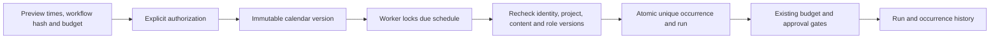

One unfinished run per schedule prevents overlap, including approval gates and uncertain child charges. Missed opportunities catch up only the latest or skip late triggers; older ranges are coalesced. Paused intervals never backfill. User resumption confirms current authorization; Admin resumption retains the original identity and requires scope, recent MFA, CAS and a reason, rejecting revoked authorization. End times are exclusive; projects allow 50 non-retired schedules. This is not a hard real-time SLA. Fourteen additional database/API/calendar test groups cover concurrency and thousand-day downtime; Delivery `qa:schedules` separately waits on the real clock.

## 0.5.0 company identity and unified sign-in

OIDC uses code + PKCE S256, signature verification, state/nonce and a fixed callback. An existing registered account and active workspace membership are required. First binding requires a separate CopyPaste work-email code; domains never auto-enroll users. Configuration changes, disablement or unlinking revoke all linked users’ CopyPaste browser/native/refresh sessions and prior execution authorization. Administrator email and TOTP remain separate.

Global `admin.tenants.sso.write` is one of 68 actions, built into super/security roles only. Writes require recent MFA, reason, CAS and idempotency. Save disables the connection and clears prior verification; discovery/JWKS/PKCE checks do not qualify the client secret or a real company account. Pinned MIT `openid-client` 6.8.8 enables asymmetric ID-token signature checks.

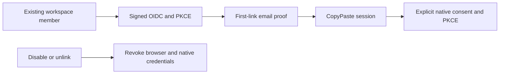

Deployment: use exact HTTPS `SSO_ALLOWED_ORIGINS`. Default callback is `WEB_ORIGIN/v1/auth/sso/callback` through the Web API proxy; `SSO_CALLBACK_ORIGIN=API_ORIGIN` is supported when Web uses that cross-origin `VITE_API_BASE`. Production rejects `SSO_ALLOW_LOCALHOST=true`. For the native fixture only, start the development controller with this environment flag, run `qa:federation`, then stop and restart without it.

Migration 010 invalidates legacy native codes without a source session. Exchanges recheck source expiry/revocation and user revision; refresh inherits federation identity/revision. Revoking a previously listed device session also revokes its rotated credential family. Tests use actual PostgreSQL and signed code/token/JWKS exchanges. SAML/SCIM, mandatory SSO policy and real company-IdP qualification remain outside this increment.


## Implementation repairs in progress

Current source adds a labelled synthetic dependency mode, irreversible erasure journals and physical/runtime cleanup, 90/30 day online retention, seven day replay-result cleanup, resumable 4 MiB parts, streamed downloads, durable SSE and recovery of tasks that failed before execution was claimed. Applied migrations are forward-only with recorded digest validation. The master design and remaining gaps are in docs/technical/17-erasure-transfer-retention-events.md. Existing 0.5.0 archives do not include unpublished source changes.

With the native database configured, set `$env:DEMO_MODE='true'` for the API process and run `npm run dev`, or use `npm run demo` in the independent delivery repository. Synthetic mode is forbidden in production and on non-loopback hosts. The one-time demo gift is not a payment; the Codex kernel and business operations still run.

## Persistent cloud files (current source)

Shared project and private conversation workspaces now support pinned file references, search, moves, erasure and explicit publication of independent copies. In private conversations, Codex source tools read, compare hashes, persist updates and package actual working files. The asset.read capability provides authorized node/version reads. Forward migrations 023/024 add the model; Admin content management includes nodes.

The current 139-test regression passes, including five cloud-file integration groups. Synthetic dependencies do not qualify live providers or professional roles. Source limits are 500 files / 20 MB, with 1 MB per file. Removing an entry preserves independent source assets; permanent asset deletion is separate. See the master technical/18-persistent-cloud-files.md for detailed behavior and limits.

## Project Skill lifecycle (current source)

Project methods now have exact installation and specialist/task bindings. Ordinary disable affects new work; uninstall and permanent security revocation block subsequent calls, including old tasks. Reinstallation creates a new identity and requires explicit adoption by a new specialist version. Current plan access is checked before tools and final output; measured usage settles against the original reservation.

Historical platform regression: **185/185**. `npm run qa:skills` in the delivery repository passed three browser groups; 31 captured HTTP request/response payloads passed the strict design schemas. Custom package review/publication and complete live-role qualification remain pending. Existing 0.5.0 installers are historical.

## Default assistant and in-app notifications (current source)

The built-in assistant uses fixed Codex, the internal text profile and delivery-core; it is separate from the 18 professional roles. POST /delegations atomically creates a private conversation, message, task, exact method bindings and reservation. Repeating client_message_id returns the accepted result. Ordinary writes/deletion cannot alter the shared default. Owner/Admin explicitly adopt reinstalled methods through a checked new version; moderation cannot be bypassed by automatic recreation.

Forward migrations 026/027 add the behavior. Notifications observe final task state at transaction commit, recheck current recipient/private/project access, support microsecond cursors and read updates, and expire after 30 days. Titles come from the currently authorized task. GET/PATCH /v1/notifications and compatible tenant routes are available; no external messages are sent.

Six assistant and four notification integration groups are in the 139-test regression. Web assistant/inbox journeys each pass four groups; Chrome passes eight and source Desktop eight, using real Codex with clearly synthetic dependencies. Full template APIs, paid-step checkpoint continuation and live-role qualification remain unfinished. See master technical/20 and technical/21.

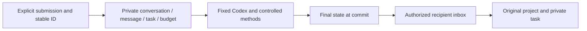

## Explicit inputs before execution (current source)

Migration 028 introduces an explicit file/connection checkpoint before the first model turn. A task keeps its original private conversation, ID and single budget reservation while `needs_input`; it has no worker outbox entry or model charge until every required input is selected. Resolution uses current project access, current file versions, a declared connection provider, CAS and idempotency. Shared tasks cannot consume even their creator’s private files. Candidate search is paginated and never exposes credentials.

Resource revocation before claim returns ordinary tasks to the checkpoint. An approved plan cannot silently accept replacement sources: changed inputs invalidate approval or cancel unstarted execution. Admin retries inherit private ownership and inputs; separately authorized, audited body reads include input metadata. Ten dependency integration groups and one retry group contribute to the 139 passing tests. Three dependency response samples and two scoped Admin cleanup pages contribute to 17 strict runtime-schema checks. This covers declared initial prerequisites; automatic discovery, paid-step continuation and device dependencies remain unfinished.

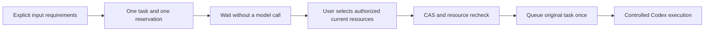

## Execution capacity and fair dispatch (current source)

Migration 029 atomically checks global, workspace, current-user and capability limits across native Workers. Defaults are 10 handlers, two workspace slots, two image slots and two media slots, with one media slot per workspace. Started reconciliation keeps its slot. Active-work admission is separate from actual execution capacity. A busy task retains its ID, attempt zero and single budget hold; a delayed outbox retries it automatically. Dispatch interleaves workspace queue positions. Seven isolated-database/native-queue groups pass. Full NFR load qualification and per-provider request limits remain unfinished.

## Admin records and repeatable native integration tests

Cleanup pages now filter state/type/literal IDs within current authorization before counting and pagination. Admin lists default to 50, capped at 100. Migration 030 adds query indexes; applied migration bytes remain immutable. Per-page progress uses batched queries. Ordinary pages exclude object locators and lease credentials; direct read-only retries return 403.

Application integration suites and migration checks each create a native `copypaste_suite_<random UUID>` PostgreSQL database and an owned `.data/test-runs/<random UUID>` directory, apply all migrations and close the application before removing only that fixture. A local native PostgreSQL server and loopback `OWNER_DATABASE_URL` are required. Neither the demonstration database nor historical `copypaste_test` is reset. Reconciliation fixtures cannot consume the next run's execution slots. Delivery evidence preserves the original failure and repair verification.

## Persisted role templates and Codex versions

Migration 031 adds real template, Codex-profile and internal-capability identities. The canonical template directory, detail, preflight and instance APIs enforce current project access, plan, methods and implemented tools. A five-minute preflight receipt creates no task, installation or wallet hold. Instance creation rechecks dependencies and atomically pins versions; kernel, gateway and Skill identity overrides are rejected. Stale bindings fail before a new budget reservation and are checked again at claim, tools and publication. Legacy records retain their original history; complete publication and upgrade flows remain pending.


Six new platform groups and eight real Web/Electron journeys passed; 21 captured HTTP responses passed strict schemas. All 18 professional presets still require live business qualification. The minimum of 12 qualified roles remains unchanged. Unsupported tools are explicit dependencies.


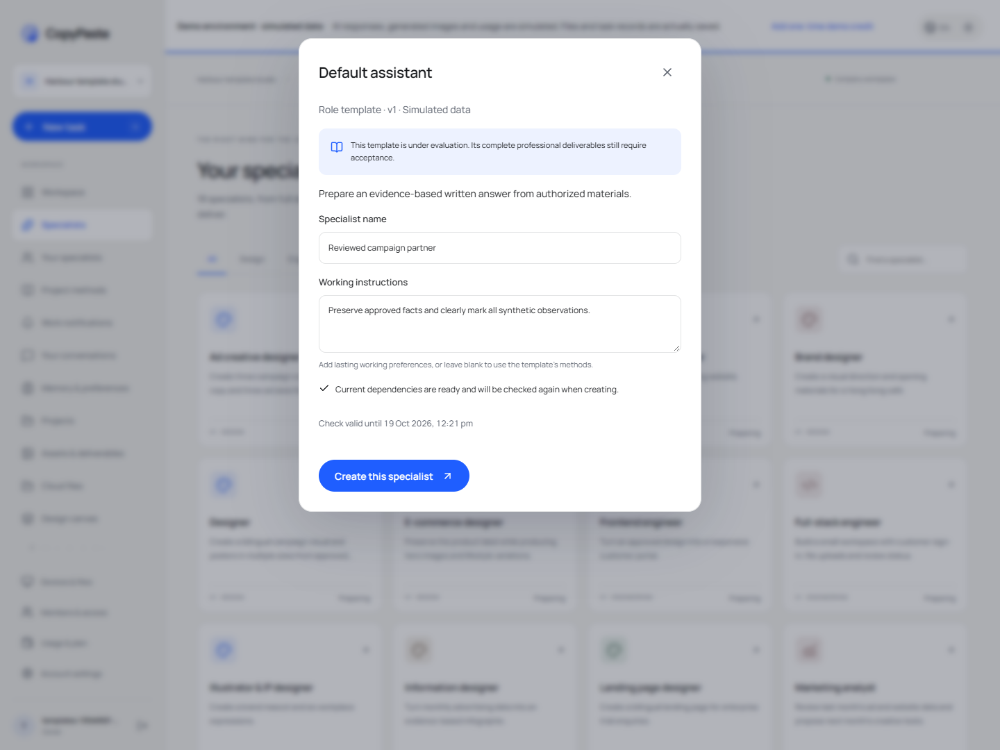

## PDF review delivery (current source)

The canvas and Codex `design_render` produce actual single-page PDFs. Editable layers remain in the source project or separate editable JSON; PDFs are raster review copies. `layout.render`, `document.render` and `video.render` independently restrict formats. Visible-version checks refuse stale exports, and lost accepted replies retry with the same key and original source snapshot.

The historical native regression passed **185/185**. Seven delivery Web/current-source Electron groups cover downloads, native saves, independent pypdf/Poppler parsing/rendering and file hashes. Models remain simulated while file logic is real. Complete review packages, print standards and at least 12 qualified live roles remain pending.

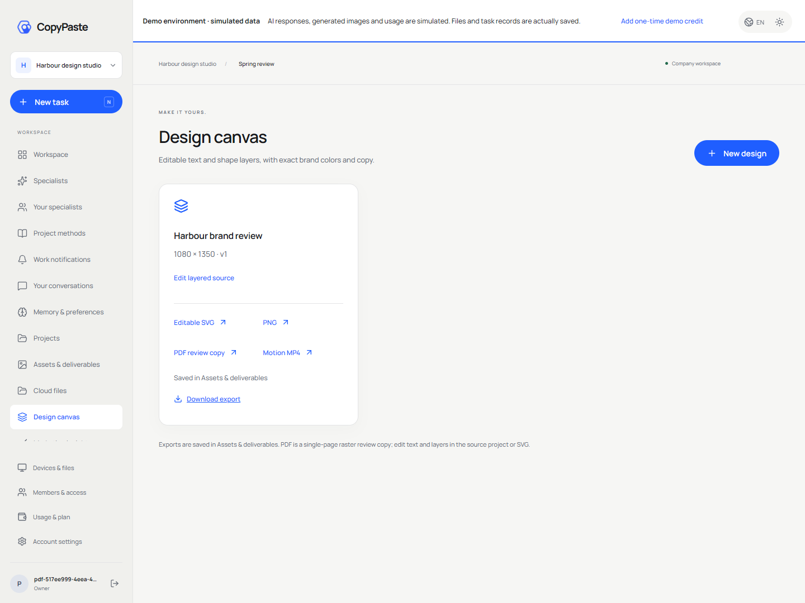

## Marketing CSV, exact metrics and provenance (current source)

Preview and confirm the account, currency, timezone, entity level, attribution and conversion definitions before import. Generic CSV and candidate Google/Meta-style headers support explicit column mapping. Actual UTF-8/BOM source bytes, SHA-256, definitions and computed results are retained. Duplicate requests, including a lost accepted response, return one project snapshot. Quarantine prevents reimport bypass. Unknown conversions stay unknown; exact decimal CTR/CPC/CPM/CVR/CPA/ROAS use aggregate totals and historical results are frozen.

Download the original CSV, normalized CSV, JSON calculation report with 11 evidence references and an actual SVG chart. Data dates are shown; upload time is not presented as the platform extraction cutoff. Official account sync, cross-platform conversion deduplication, FX and complete AI narrative acceptance remain pending. The marketing role is still unqualified. Authorized model dependencies are simulated; database and file behavior are real. Historical installers have not been rebuilt.

Migrations 032/033 add provenance and frozen metrics while preserving older migration bytes. That historical checkpoint passed **185/185**, including four documented metric vectors, four CSV checks and four PostgreSQL integration groups. Administrative source inspection retains scoped body permission and audit; erasure clears source, facts, definitions and metrics. See the delivery root's docs/technical/27-marketing-import-metrics-and-evidence.md.

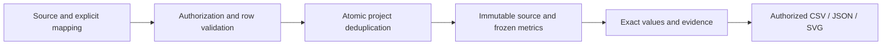

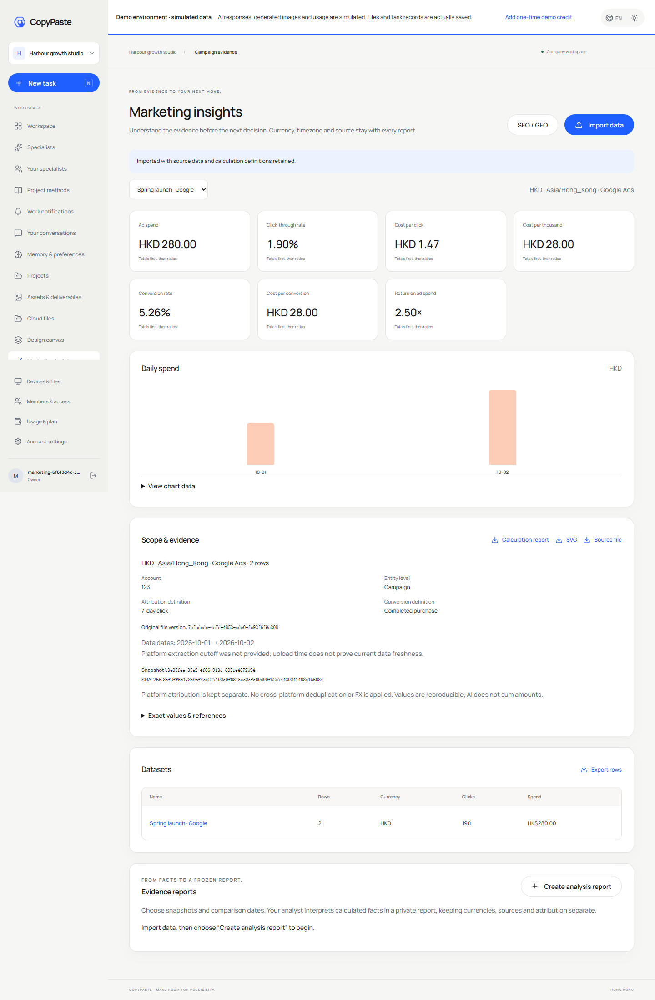

## Private AnalysisSpec reports (current source)

Select saved snapshots, a business question, current/comparison dates, metrics, dimensions and a maximum HKD budget in Marketing insights. Preview neither calls a model nor reserves credit. Explicit confirmation atomically creates a private Codex task, frozen calculations/evidence and one reservation. Sources, accounts, currencies, timezones and attribution stay independent; identical facts deduplicate, conflicts reject, and zero/missing comparison values retain reasons. Retrying a lost accepted response returns the same report.

Real Codex reads paginated frozen evidence. The server validates evidence placeholders and numeric literals before publishing an immutable HTML asset; JSON preserves full calculations. Natural-language meaning and professional quality still require acceptance. Model dependencies are explicitly simulated. Source quarantine/erasure and project revocation block reads and downloads. All 102 complete acceptance cases, official connectors, live-role qualification and production release remain pending. Historical installers have not been rebuilt.

Forward migration 034 adds database guards for reports, source dependencies, Snapshot/Evidence, restricted specialists and private artifacts. Canonical `POST /v1/reports`, `GET /v1/reports/:report`, `GET /v1/snapshots/:snapshot` and `GET /v1/evidence/:evidence` require current identity and tenant headers; writes also require CSRF/idempotency. Native regression: **185/185**, **247** actual method/path pairs, **35** migrations. Route counts are not full contract acceptance. `node --env-file=.env --import tsx scripts/verify-analysis-index.ts` compares the lookup index to existing frozen metrics without recalculation.

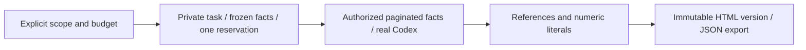


## File-backed CSV/XLSX and correction history (current source)

Marketing inputs are uploaded as immutable shared project-file versions before reviewing the sheet, header row, mapping and account definitions. Google/Meta use canonical `POST /v1/dataset-imports`; generic tables use the compatible nested endpoint. Preview calls no model and reserves no credit. Duplicate content and retries after a lost accepted reply reuse the snapshot. Original CSV/XLSX downloads verify actual bytes and SHA-256.

The bounded read-only XLSX parser accepts up to 5,000,000 bytes, 50 worksheets, 100 columns and 10,000 data rows. Multiple visible sheets require explicit selection; header rows range from 1 to 100. Shared/inline strings, XML Unicode references, exact decimals and 1900/1904 dates are supported. Money inputs allow six decimal places; frozen metric values retain eight. Formulas, including cached results, macros, external links, encrypted files and merged data cells are rejected. Errors identify actual worksheet cells. The UI explains that a failed preview still retains the explicitly uploaded original project file.

Corrections create new immutable snapshots and a complete ancestor chain; prior metrics and reports retain their original values. AnalysisSpec rejects selecting an ancestor with its correction before creating a task or budget hold. Source quarantine/erasure prevents dependent data, reports and downloads. Recovery closes only unclaimed unavailable tasks and releases unused holds; started or uncertain charges keep reconciliation rules. Private files require explicit publication as a shared copy first.

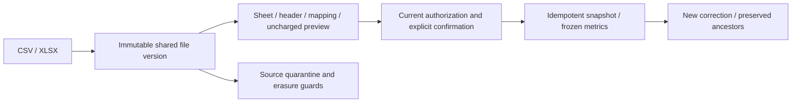

The full platform regression passes **185/185**; strict captured HTTP samples pass **31/31**. Four file-import and six existing CSV Web/source Electron groups pass, along with native type checks and four unit tests. Model/media dependencies are authorized synthetic data; database, Codex, files and authorization are real. All 102 complete acceptance cases, the complete official export matrix, live connectors, professional qualification and production release remain pending. Historical 0.5.0 installers have not been rebuilt. See master `docs/technical/29-file-imports-and-correction-lineage.md` for detailed limits.

Migration 035 binds source versions and correction ancestry. The actual route inventory has 247 method/path pairs and 35 forward-only migrations. Eight workbook parser groups and five isolated native-database groups cover this increment.


Current source supports pause/resume at the initial unclaimed checkpoint, sharing domain guards with Admin. It retains the original task/reservation and rechecks beneficiary access, inputs and versions; running or uncertain operations cannot replay. Real Codex continuation tests preserve thread history/tools across processes, charge incremental usage, and retain measured spend on interruption or receipt I/O failure. Paid-step continuation is not connected to the business Worker. Full regression: 185/185. See master `docs/technical/31-task-controls-and-native-continuation.md`.

## Cross-client session revocation repair

`GET /v1/me/sessions` distinguishes Web, Desktop and Extension, marks the current session and retains devices with expired access but valid refresh credentials. It returns no credentials. `POST /v1/auth/native/revoke` uses the matching client_id and refresh proof to revoke the whole family without valid access or token rotation. Unknown/already revoked credentials receive the same receipt. Refresh/logout/revocation use the same user-first lock order; an older inventory ID still revokes its rotated family. Removing a company membership denies new calls to that company; refresh cannot restore the removed authority.

`tests/auth-sessions.test.ts` exercises native isolated databases, expiry/replay, actual refresh/revocation races, ownership/CSRF, invitations and removed-member browser/native/device ingress, with no model calls. This implemented endpoint does not rewrite the canonical contract or close complete identity/production gates.

## Admin membership control

Canonical membership changes return durable 202 AdminOperation resources. Current scope/MFA, admin suspension, revisions, last-owner protection and invitation revocation share domain guards. Privileged changes require independent approval by default. Each new operation pins a real immutable policy snapshot; historical unrecorded policy IDs are never fabricated. Delivery retains database and real HTTP evidence. Full Admin/native and production acceptance remain pending.

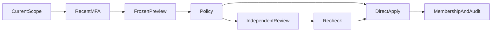

Final stable-source platform regression: **233/233**, including **13/13** Admin membership groups. Current real Admin membership HTTP checks: **5/5**; captured original-contract samples: **43/43**. Delivery `evidence/` retains original receipts. Current UI, production and complete native gates remain separate.


## Account lifecycle and cancellation charges (current source)

Four canonical POST commands manage global user profile/state, all-session revocation and workspace state, returning strict 202 AdminOperation responses; obsolete PATCH routes are removed. Migration 039 adds real revisions, labels and a distinct closure marker. Commands recheck current scope/denies, recent MFA, CSRF, idempotency and revision. Closure/reopening defaults to independent review tied to the original session, frozen target, deadline and immutable actual policy. Global suspension revokes sessions, refresh credentials, pending native codes and relevant unused invitations; workspace suspension preserves access elsewhere. Batch state jobs cannot reopen closed accounts through a review bypass.

User, Admin and account cancellation share one domain guard. Attempted work or external charges retain their reservation for reconciliation; a non-running state does not prove zero cost. Twelve isolated native PostgreSQL groups exercise scopes, credentials, revisions, approval changes, concurrent workspace creation and cancellation accounting. Delivery receipts describe the cumulative regression. Canonical list/detail, financial/VIP flows and full acceptance remain outstanding.


## Canonical user and workspace directory increment

`GET /v1/admin/users`, `GET /v1/admin/users/{user_id}` and `GET /v1/admin/tenants` now return the original strict DTOs. Users are deduplicated by global identity. Canonical q/limit/cursor queries support user, workspace, project, state, effective VIP and confirmed-charge period filters. Contact, usage and VIP fields independently intersect current scope and explicit denies, including search and filter inference protection. Signed cursors bind the actor, session, permissions and filters, preserve timestamp microseconds and expire after 15 minutes. Lists do not invent total counts.

Migration 040 persists a separate wallet account UUID. Successful email and enterprise federation sign-ins update last_login_at; native token refresh does not. Confirmed charges come from actual charge ledger entries, scoped through their tasks and a half-open settlement interval, with decimal micros strings. Missing authorization is not represented as zero. The scoped management-context supplement supplies rich detail display without changing canonical response shapes.

Run `node --env-file=.env --import tsx --test --test-concurrency=1 tests/admin-directory.test.ts` against native PostgreSQL: eleven directory/export groups pass, comparing all seven fixture schemas and the original OpenAPI digest. No Docker/WSL. Complete financial/VIP write contracts, consumption drilldown and full product acceptance remain outstanding.

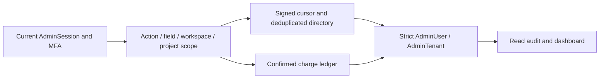

User export now consumes canonical user cursors. It rejects collections above the existing synchronous 500-row bound instead of silently truncating, and rechecks the full current authorization digest under MFA/access locks before sending. Added coverage checks actual redacted CSV, 501-row refusal and revoked download rights; the complete canonical asynchronous export workflow remains outstanding.


## Personal and enterprise billing subjects

Migrations 042–044 give existing enterprise wallets and separately provisioned personal wallets genuine account identities. Personal configured-service and simulated accounts are separate and initially unfunded. Tasks can freeze an explicitly authorized payer through `X-Billing-Account-ID` on direct task creation; the payer is part of idempotency. Other workflows reject this header until their payer context is implemented. User selection interfaces remain pending.

`GET /v1/me/billing-accounts` exposes only the current user’s account in the active mode. The three canonical Admin account/list/ledger reads use the unchanged original strict schemas, real paid/promotional lots, reserved funds and actual debt. Whole enterprise finance needs a global or enterprise grant; project grants cannot expose the aggregate, and overlapping project denies block it. Personal finance requires a global grant and respects every overlapping membership deny. Existing enterprise billing lists exclude personally funded charges.

Immutable financial actors, operations and journal rows retain actual users, administrators, system services and source references. New holds, consumption, unused releases and credit-limit changes have persistent events. Registration timestamps do not invent old creation dates. Historical unknown provenance is explicit; it is not filled with fabricated policy or actor IDs. Database guards prevent reassigning accounts, task payers, reservations, funding identities or journal provenance.

Eight new account groups, eleven directory groups and twelve settlement groups passed together in an isolated native PostgreSQL database. Raw initial failures and the final focused TAP are retained in the delivery repository; the latest complete regression receipt is authoritative. Three canonical financial commands, independent review and the actual Admin forms are described below. Payment evidence and confirmation, cash/refund reconciliation, product refunds, immutable plan versions, full entitlement grants and remaining client consumers still require implementation and acceptance.

## Canonical fees and actual approval requests

Account gift/debit/credit-limit commands now bind pure previews, exact amounts, account/source versions, Hong Kong daily limits separated by execution mode, idempotent receipts and independent review. Migration 047 persists distinct real requests and immutable decisions. The normative approval endpoint uses the actual request UUID; journals retain the original administrator and real policy. Legacy paths for these three commands cannot bypass the guards. Audit failures roll back the financial change.

Sixteen focused fee/migration groups pass. The final full-source result is Delivery's `evidence/alignment-platform.json/.tap`, with before/after source and verifier hashes. The initial 045 preview-field error is repaired by new migration 046, retaining old SQL and failure evidence. Both native databases apply 001–047; historical unknown execution digests for 001–015 remain unknown.

These three commands do not accept full payments, refunds, VIP, financial outbox or the complete approval directory. Actual Admin browser consumers and exact-money tests are included. Central scope: `docs/technical/41-canonical-fee-commands-and-independent-approvals.md`.

## Shared approval requests (2026-10-20)

Existing fee, membership, account and legacy pending operations now use distinct persisted approval requests. The normative directory uses scoped signed cursors; decisions require the actual request revision, hash, reason and idempotency key and return 202 AdminOperation. The transaction checks current business and approval authority, recent MFA, the exact original session, policy and target snapshot. Business changes, decisions, audit and receipts commit together; maintenance persists expiry. Migration 048 preserves original financial request/decision identities and records cancellation of old commands whose original authority was never captured.

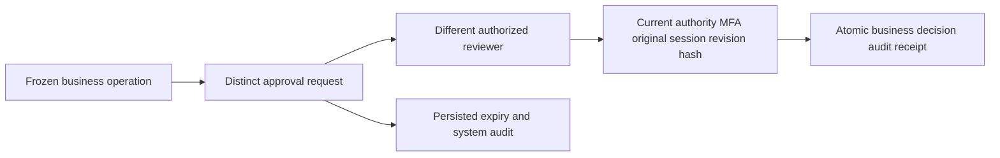

The original OpenAPI and migrations 001–047 retain their bytes. The old operation decision endpoint refuses to invent a reviewed version. Complete payments, evidence, refunds, VIP, notifications and full Admin acceptance remain tracked.

The stage 43 full platform regression passed **303/303** with all 669 source hashes unchanged. Raw TAP SHA-256: `1615f06e75496988f37cb30872ee35ba7f981c23c7e8d98b3f8e409f16df612f`. The separate 53/53 approval/upgrade run is retained and is not added again to the platform total.

## Manual payment evidence and exact posting (2026-10-20)

The original payment list/create/confirmation contracts now retain actual evidence versions and digests. A different authorized administrator verifies the receipt; neither registration nor verification credits a wallet. Exact top-ups use an unposted verified receipt from the same subject and mode, with existing preview, MFA, limits and independent approval rules. Posting, actual credit-debt repayment, source linkage, audit and idempotent receipt commit atomically. Payment facts and operation intent are immutable; the old top-up bypass is blocked.

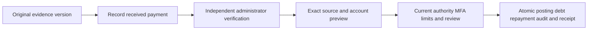

Both native databases contain appended migrations 049–052. Original failed migration bytes and failure receipts remain; 051/052 repair the preview-field and historical-alias defects. The financial suite passes 21/21 and actual browser groups 5/5; use the latest Delivery JSON/TAP for the full platform result. This does not establish payment-provider, complete refund/VIP or all 102 acceptance conditions. Central specification: `docs/technical/44-manual-payment-evidence-and-exact-posting.md`.

The final current-source regression passes **310/310**, with all 676 participating source/verifier files unchanged. Raw TAP SHA-256: `5b499c16a50ec57427ed7ff7cf4681ba2e0cef0330e97159dde7e9d25e291119`. The four updated-journey and 21 financial checks overlap the full suite and are not added twice. The original 306/310 failure and 303-test historical snapshot remain unchanged.
