# CopyPaste Web

<!-- stage65-current-history-source-lineage:start -->
The customer workspace continues using the shared Backend for authorized conversations and tasks.

## Sources of conversations and actual reads (stage 65)

Actual model reads now retain immutable file-version, cloud-reference and marketing-dataset provenance. Historical assistant results, pinned memories and approved plans remain subject to current source checks before further model input, cached tools, events and artifact persistence. A new paid delegation rejects unavailable history before creating a task or reserving funds. Conversations show an unavailable placeholder; task lists and details retain state and cost metadata while fencing unavailable acceptance bodies. Existing PLAN_STALE / PLAN_INPUT_CHANGED and initial input-selection semantics remain intact. Controlled deletion explicitly scrubs provenance; a missing erasure flag never authorizes an ordinary provenance rewrite.

Explicit publication creates an independent copy with a frozen set of known inputs. Removing the original private conversation preserves that published copy. Revocation of an input file, dataset or pinned memory still fences derived copies and public shares. Restoration preserves current project, user and private-scope authorization.

Validation: **765/765 Platform tests**, retaining all **746** prior named tests; **51/51 focused tests** and **13 checks across six repositories**. Actual HTTP SSE, Worker tools, downloads, plans, holds and public shares run with authorized synthetic AI/business data. Native SQL081→087 preserves row digests for all 168 original public tables, prior migrations and original function definitions. The added provenance table starts empty; historical reads are never invented.

Desktop remains frameless with custom window controls and no Electron default or Alt menu. The extension uses a real Chrome native Side Panel, right by default while respecting browser preferences. Existing packages receive a read-only byte check; screenshots and native journeys retain their historical Backend source scope. Current Backend UI qualification, signed installation, store release and production acceptance remain pending.

Codex is the only kernel. All AI requests use the company internal OpenAI-compatible gateway. All 102 original requirements and TC/NFR/G01–G10 remain: 81 partially verified, 21 without proven completion, zero fully accepted.

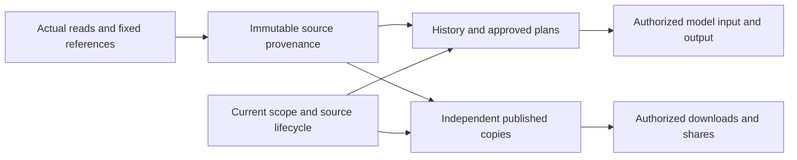
<!-- stage65-current-history-source-lineage:end -->

<!-- stage64-current-report-task-source-fences:start -->
The customer workspace uses the shared Backend source and identity checks. Existing polling and event handling clear displayed content after access is denied.

## Current source fences for reports and task history (stage 64)

Marketing analysis and original SEO audit task details, project lists, historical JSON messages and both SSE routes now share current source checks with their dedicated reports. When a source is quarantined or expires, an open stream stops emitting message bodies and closes at its next batch. Restoration still requires current workspace, project, private-owner and session authorization; retained reports and events remain immutable.

Analysis dataset, original CSV, output artifact and terminal analysis-task retention applies before cleanup. Expired analysis inputs are rejected before task creation or budget reservation. Reads that wait for ordinary task updates recheck the actor's current authorization version before responding.

Validation: **746/746 Platform tests**, retaining all **734** prior named tests; **12/12 focused tests** and **13 checks across six repositories**. Actual HTTP streams and Worker-persisted model messages run, including locked Codex through the internal synthetic gateway. AI and business data remain synthetic as authorized. Native SQL080→081 preserves every row digest in **168** prior public tables, old migrations and table ownership/RLS in both databases; only two report-access functions change.

**Desktop remains frameless with no Electron application or Alt menu.** The extension toolbar toggles **Chrome's native Side Panel**, right by default and subject to browser preferences. Existing sources, ASAR, extension ZIP and stage 63 preview packages were rechecked read-only. The actual screenshots and native executions below retain their original Backend scope; this stage adds no browser/native journey qualification of the changed Backend. Installation, signing, store publication and production remain open.

Codex remains the only kernel; every AI request uses the company's internal OpenAI-compatible server. All original 102 requirements and TC/NFR/G01–G10 remain: 81 partially verified, 21 not proven complete, zero fully accepted.

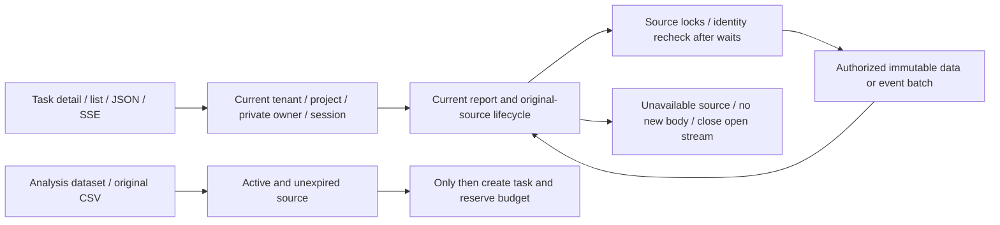
<!-- stage64-current-report-task-source-fences:end -->

<!-- stage63-source-governed-website-changes:start -->
This repository is the customer cloud workspace. Sign in and select a workspace/project, then save change tasks from website findings, review drafts, download and explicitly recheck.

## Source-governed website change tasks (stage 63)

Open Marketing insights → Website audits & rechecks. Select 1–20 findings, confirm the frozen original evidence, change objective and separate AI budget, then save a private task. Pause/resume unclaimed work, cancel, inspect original evidence and download JSON/HTML drafts. Explicitly request a same-scope recheck after separately implementing and authorizing website changes. Drafts require human review; unchanged fixture pages correctly retain persistent findings.

**Codex is the only kernel**, with every AI request sent through the company's internal OpenAI-compatible gateway. Business and AI data remain **synthetic as authorized**. Authentication, authorization, native HTTP fixtures, Codex processes, metering receipts and saved files actually run. Drafts must cover every selected, actually read finding; fabricated, unread, missing or duplicated references cannot publish artifacts. Original sources, cache ancestors, quarantine, retention, revocation and erasure govern private drafts and explicitly published copies. Admin metadata, private-body access and content actions retain separate permissions.

**Desktop remains frameless**, with custom dragging and window controls, no Electron application or Alt menu. Downloads use the current tenant's restricted authenticated bridge and native save dialog. The extension toolbar toggles **Chrome's native Side Panel**, right by default and subject to browser preferences; its fixed company link opens the website workspace.

Validation: **734/734 Platform tests**, retaining all **716** prior named tests; **18 actual Web/Admin and 23 newly packaged native checks**, plus 13 checks across six repositories. Native SQL079→080 preserves every row digest in **167** prior public tables and SQL001–079 in both databases. The new table is empty with FORCE RLS. Desktop previews: `release/seo-changes-63-02/`; extension: `release/seo-changes-63-02/CopyPaste-0.5.0-sidepanel.zip`.

The current unpacked Desktop and real Chrome Side Panel were exercised. Setup/Portable remain unsigned; installation, store publication, live websites/models and full product acceptance remain open. All original 102 requirements and TC/NFR/G01–G10 remain: 81 partially verified, 21 not proven complete and zero fully accepted. Earlier sections, screenshots and receipts retain their historical source/package scope.

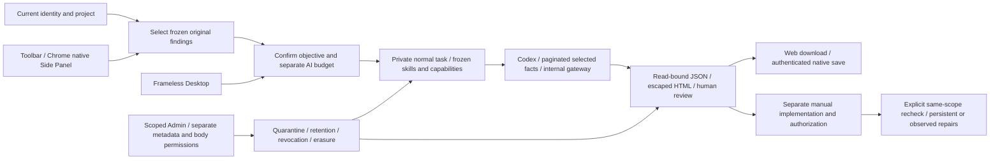


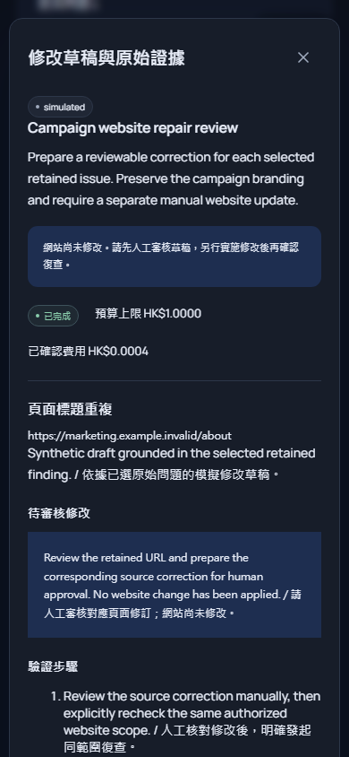
<!-- stage63-source-governed-website-changes:end -->

This repository is the customer cloud workspace. Sign in, choose a workspace/project, then open Marketing insights → Website audits & rechecks to confirm scope and inspect evidence, reports and recheck history.

## Scoped website audits and rechecks (stage 62)

Open Marketing insights → Website audits & rechecks. Confirm seed URLs, exact hosts, path prefixes, page-request and AI budgets, then explicitly authorize collection. Inspect progress, uncovered URLs, access limits and URL findings with original quotes, capture times, HTTP/charset facts and hashes. Download actual JSON/HTML attachments. An explicitly requested same-scope recheck creates immutable new history and confirms changes only for pages actually inspected.

Business and AI data remain **synthetic as authorized**. The non-production fixture performs actual native HTTP; a real locked Codex process interprets retained facts through the company's internal OpenAI-compatible synthetic gateway. Public deployment and live model quality remain unqualified. Every DNS answer and redirect is scoped. Collection submits no credentials/forms and executes no scripts. Robots, login pages, errors, unvisited scope and sequential collection limits stay explicit. Storage exhaustion stops collection and releases the unused inference reservation.

Private sources, cache ancestors, recheck history, reports and deliberately published copies retain current authorization, retention, quarantine and erasure controls. Identity is checked again after storage I/O. Admin tenant/project scope, metadata, body access and content operations remain separate. Quarantining a source fences derived customer evidence. Saved website change tasks, Search Console connection metrics, GEO observations, canonical TaskDTO and complete original acceptance remain tracked.

**Desktop stays frameless**, with custom dragging and minimize/maximize/close controls, no Electron native frame, application menu or Alt menu. Email-code sessions use local test mailbox delivery, with actual PKCE identity and tenant-bound authenticated native saves. The extension toolbar toggles **Chrome's native Side Panel**, right by default and subject to Chrome preferences. Its Website audits & rechecks action opens only the fixed company workspace. Owned temporary test tabs are closed.

Validation: **45/45 focused checks, 716/716 Platform tests**, retaining all **674** previous named tests; **13 actual Web/Admin and 20 newly packaged native checks**. Both native databases upgrade SQL077→079 while retaining all rows in **164** prior public tables and SQL001–077. Three added tables are empty with FORCE RLS. Original product tracking remains 81 partially verified, 21 not proven complete and zero fully accepted requirements.

Current localhost previews: Desktop `release/scoped-seo-62-02/`; Extension `release/scoped-seo-62-02/CopyPaste-0.5.0-sidepanel.zip`. The unpacked Desktop and actual native Side Panel were run. Setup/Portable remain unsigned and were not installed, published or production-qualified. Earlier sections retain historical source/package scope.

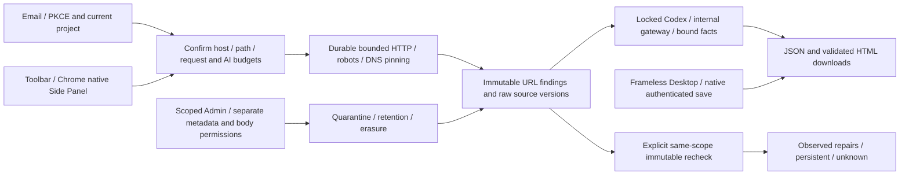

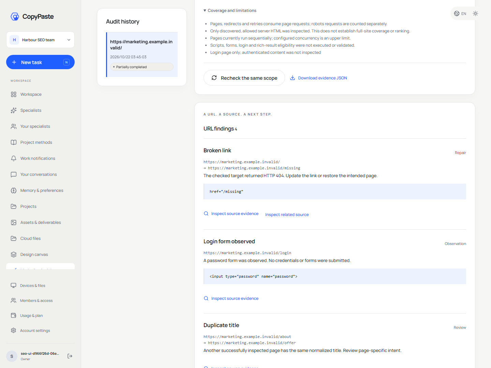

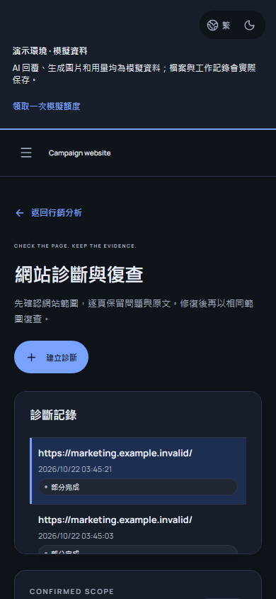

## Marketing accounts and native clients (stage 61)

Connections supports Google Ads, Meta Ads, Google Analytics 4 and Search Console. Select a provider, complete the clearly labelled synthetic consent, wait for account/property/site discovery, then confirm discovered accounts and the projects allowed to use snapshots. Select dates and explicitly create a snapshot. The workbench shows durable pages, errors, rate-limit retry time and immutable history. Queued/running jobs can be cancelled; an explicit retry creates a new linked job.

As requested, business data remains synthetic. The supplier fixture runs only in non-production loopback development mode, using actual HTTP, one-use OAuth state, Google S256 PKCE and pagination. UI, facts and snapshots identify this mode; no real marketing account was accessed. Live application approval, actual account permissions, versions and reporting definitions require separate verification. AI requests continue through the company's OpenAI-compatible server, with Codex as the only agent kernel.

Only discovered authorized accounts can be bound. Google manager paths, GA4 reporting identity/timezone, GSC site permissions and Meta ad-read scope are retained. Snapshots distinguish capture time, source dates/grains, currencies, query digests and coverage limits. Missing cutoff times and metrics remain unknown. Overlapping Meta purchase types are not summed, GA4 traffic/event grains remain separate, and GSC pagination does not claim exhaustive detail. Inspect facts or download actual JSON/CSV. Normalized Google/Meta datasets retain immutable source-asset lineage.

Connection and history directories use bounded pagination; scope changes check their expected version. Revocation clears credentials, cancels unfinished work and fences late publication. Existing snapshots retain original project permissions, retention and content governance. Admin metadata is scoped by tenant/project. Body reading and fresh-MFA revocation are separate permissions; revocation returns a durable audited operation without revealing tokens. Source quarantine, expiry and physical deletion constrain derived analysis, downloads and shares while retaining content-free historical receipts.

Desktop is **frameless**, with a custom drag region and minimize/maximize/close controls, no native frame, Electron application menu or Alt menu. Provider authorization opens only a fixed company page in the browser and returns to the native workspace. Protected JSON passes through the current authenticated bridge into the native save dialog. The extension toolbar toggles **Chrome's native Side Panel**, right by default and subject to the user's Chrome preference. Its Marketing accounts & sync entry opens only the fixed company workspace.

Validation: **39/39 focused checks within 674/674 Platform tests**, retaining all 638 prior named tests; **17 actual Web/Admin checks and 16 newly packaged native checks** passed. Independent suites: web 8, admin 3, desktop 27, extension 21, delivery 12. Both native databases upgraded SQL071→077 while retaining every row digest in 157 prior public tables and SQL001–071. Seven new tables force RLS; legacy connections receive directory-only profiles without invented account/project grants or business history.

Current localhost previews: Desktop `release/connectors-61/`, Extension `release/connectors-61/CopyPaste-0.5.0-sidepanel.zip`. The unpacked executable was run. Setup/Portable remain unsigned and were not installed by these checks. All original 102 requirements and complete TC/NFR/G01–G10, professional-role and production acceptance remain tracked. Earlier receipts and screenshots below retain their original execution scope.

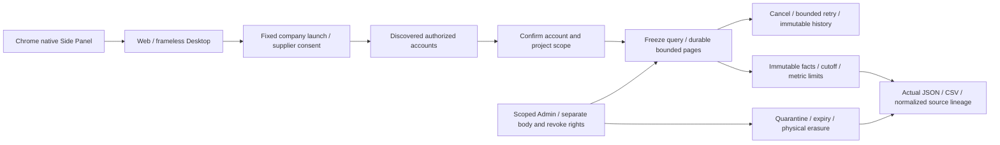

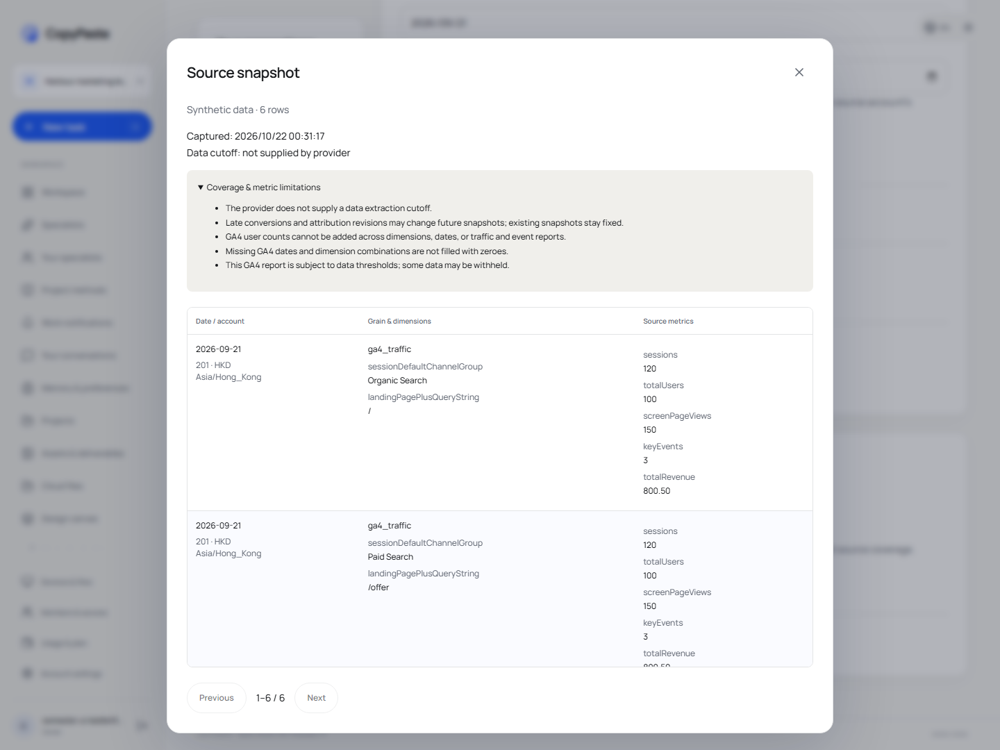

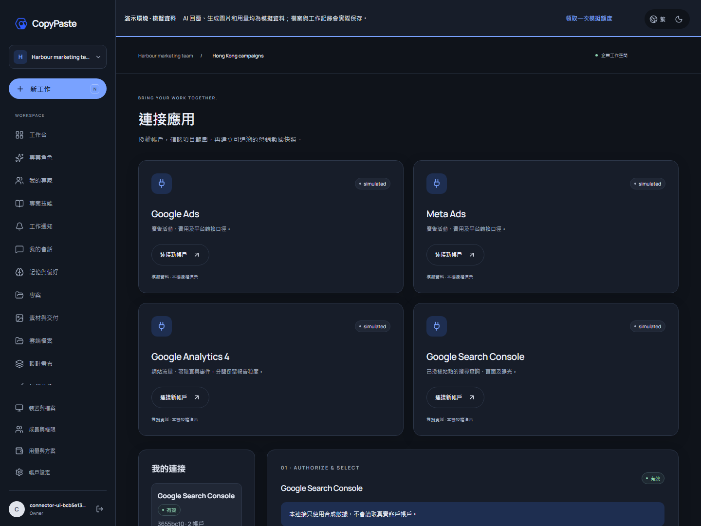

## Template video and current clients (stage 60)

Open Design canvas → Video production. Save independent scripts, scene/storyboard tracks, branding, captions and fixed shared project PNG versions. Optionally select a fixed WAV/MP3, its in point/gain and an ownership or license statement. Save the project, explicitly render, then play or download six files: MP4, project JSON, script, storyboard, WebVTT and media probe. Edits append versions; failed receipts remain visible and retries are explicit. Queued and running renders can be cancelled.

`campaign-cuts-1` supports 3–60 seconds, 24/25/30/30000÷1001 fps and even dimensions from 256 to 1920 px within a total pixel/frame budget. Integer-frame timelines are encoded by native FFmpeg as H.264/yuv420p and optional AAC/48 kHz. Actual frames, duration, complete decoding and post-encode audio volume are verified. The bundled Noto Sans TC font includes its OFL, pinned source commit and full SHA. Missing glyphs, overflowing text, missing/quarantined/expired sources and short audio fail explicitly. Encoder fingerprints hash version output. Exported projects reference fixed source media: rebuilding requires those original versions and the recorded environment; byte-identical cross-environment output is not claimed.

The durable queue has immutable input versions, leases, bounded concurrency, cancellation and final authority/source checks. Admin scope, body reading and content actions remain independent permissions. Shared and authenticated downloads recheck derived source availability. Deletion physically erases objects and content copies. Composition makes no AI call; AI HK$0 excludes upstream source creation costs.

New R16 video preset v1.1.0 exposes the implemented `video.render` composition tool. Controlled Codex execute-mode calls can idempotently create and queue a project. Ask/plan and private conversations do not expose this shared writer. The 29th preset skill, `template-video-composition`, preserves the earlier 28 packages and complete acceptance conditions of all 18 roles; earlier installed versions remain unchanged. Generated video, effects, TTS/ASR and complete professional-role qualification retain separate requirements.

Validation: **34/34 focused checks within 638/638 full Platform tests**, retaining all 607 previous named tests; **10 actual Web checks and 17 newly packaged native checks** passed. Independent suites: Web 8, Desktop 25, Extension 21 and Delivery 12. Both native databases upgraded 069→071 while preserving all row digests in 154 prior public tables and SQL001–069; three new tables force RLS.

Desktop remains frameless, with custom controls and no Electron or Alt menu. Protected video bytes pass through the existing authenticated bridge into the local player. The extension toolbar still toggles Chrome's native Side Panel, right by default and subject to the user's Chrome setting, with a new video workspace entry. Current previews: Desktop `release/video-60/`, Extension `release/video-60/CopyPaste-0.5.0-sidepanel.zip`. The unpacked runtime was executed. Setup/Portable remain unsigned localhost previews without installer execution acceptance. All original 102 requirements and TC/NFR/G01–G10 retain their complete acceptance conditions.

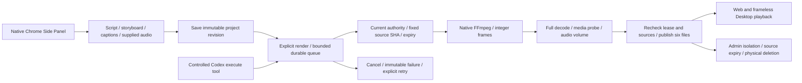

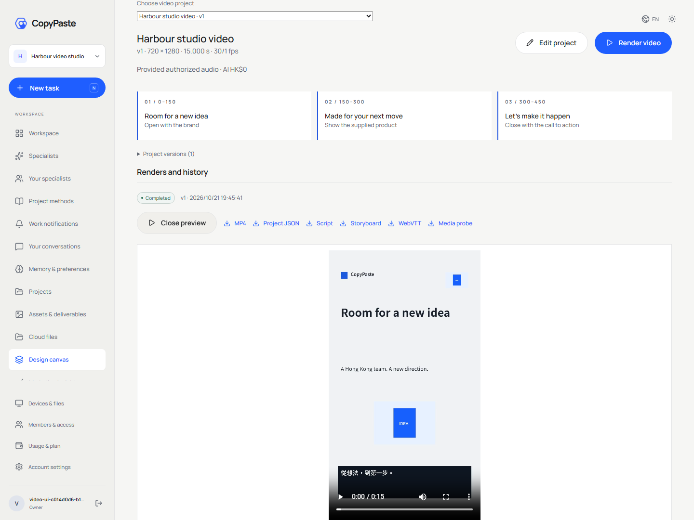

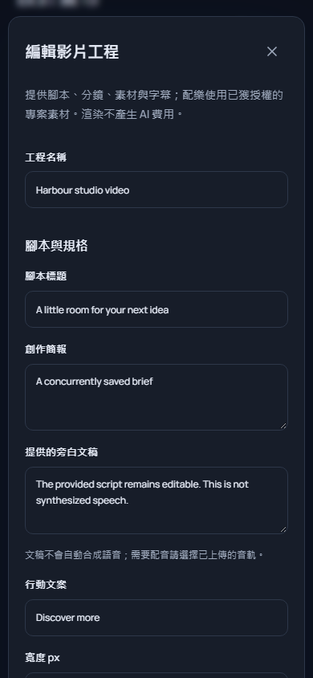

## Batch designs and current clients (stage 59)

Design canvas now creates a creative × language × size matrix, capped at 60 independent delivery units. Supply Traditional Chinese/English copy, a fixed shared project PNG and preset or custom dimensions. Each size receives its own layout and actual PNG, SVG and editable JSON files. Edits, retries, failures and output history belong to individual units. Layout makes no AI calls: its recorded AI cost is HK$0 from local composition, excluding upstream source creation costs.

Claims and publication recheck current authority, input revision and source access. Cancellation, revocation and expired leases fence late output. Existing scoped Admin body permissions apply. Source quarantine blocks derived downloads; deletion physically erases embedded copies. SVG references server fonts; custom font distribution and commercial font qualification remain separate work.

Validation: **22/22 focused checks within 607/607 complete Platform tests**, retaining all original 588 named tests; **10 actual Web journeys and 13 new packaged/native journeys** passed. Independent unit suites passed Web 8, Desktop 25, Extension 21 and Delivery 12. Both native databases upgraded 068→069 while preserving every row digest in 151 prior public tables and SQL001–068; three new tables force RLS.

Desktop remains frameless with custom controls and no default Electron menu. The extension toolbar opens the native Side Panel and toggles it closed; its batch-design entry opens the full company workspace. Current previews are Desktop `release/matrices-59-02/` and Extension `release/matrices-59-02/CopyPaste-0.5.0-sidepanel.zip`. Earlier packages remain intact. These unsigned localhost previews have not passed installer execution or store distribution acceptance. Other professional workflows, live services, all original 102 requirements and TC/NFR/G01–G10 remain independently tracked.

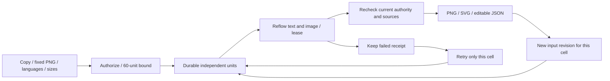


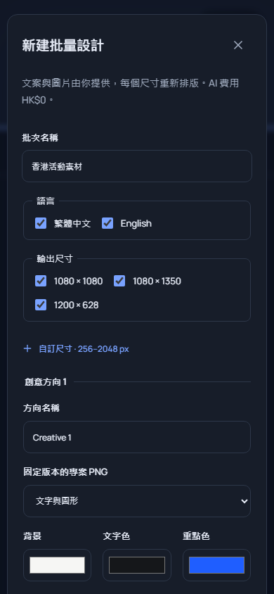

## Explicit adoption (stage 54)

Default assistant updates, specialist settings and conversation adoption now compare the exact models, effort, unit rates and Skill versions before explicit consent. Five-minute comparisons bind the real session and current configuration; stale comparisons are rejected. Retries use one persistent operation key. Previously accepted tasks keep their original versions and prices.

Current backend regression: **484/484**, including all 462 prior named tests; focused **93/93** overlaps that total. Actual built Web: **12/12**; new packaged frameless Desktop and real native Chrome Side Panel: **11/11**. AI/media use the authorized simulated dependencies; identity, PostgreSQL, permissions and version transactions execute normally. All 102 original requirements remain tracked. Earlier sections below retain their historical source and artifact scope.

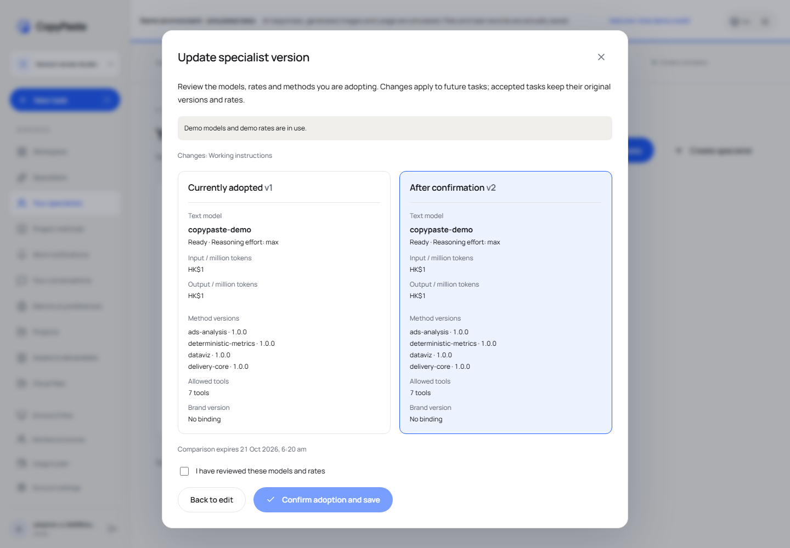


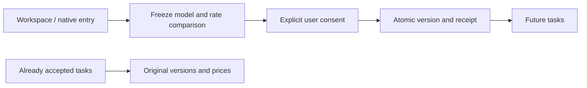

## Controlled support update / 受控客服协助

Account settings now provides explicit support grants: choose projects, reason and deadline, then inspect, copy the ID or revoke. Read-only assistance retains the administrator identity; an empty project selection covers metadata only.

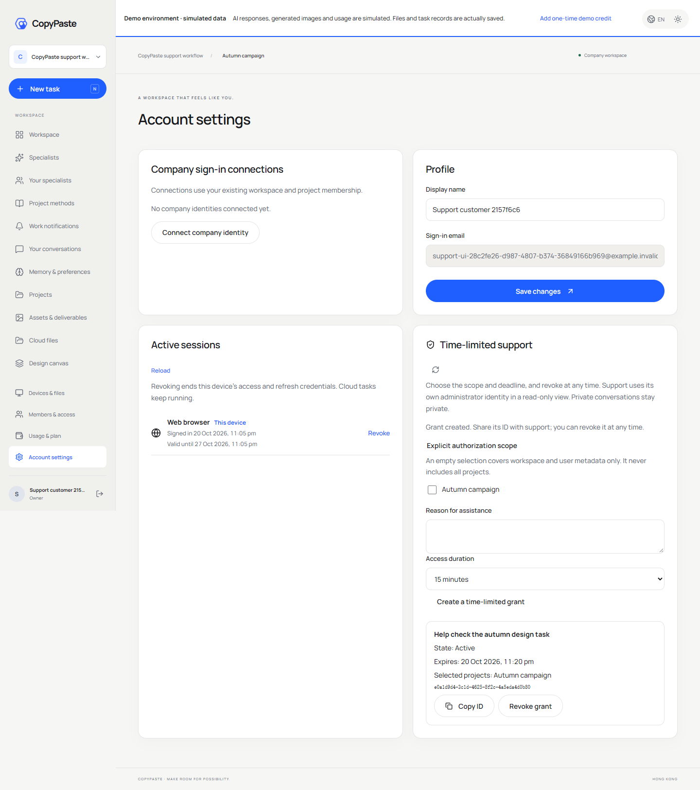

Stage 51 current regression: 424/424 with 711 source files; controlled-support browser workflows: 8/8 with 816 source files and 9 unedited captures. The 14 support tests, original contract checks, migration preservation and separate native checks are bounded evidence, not completion of all 102 acceptance cases. Current binaries are rebuilt; stage 50 binaries remain unchanged in their archive.

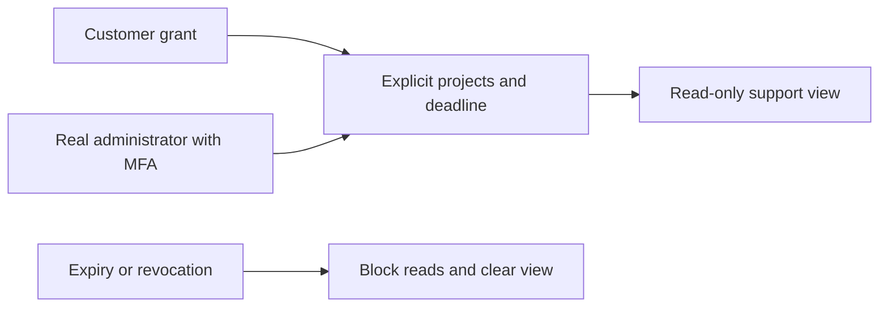


[简体中文](README.md) · Enterprise cloud workspace · 0.5.0

A Web client for Hong Kong enterprise marketing teams, using CopyPaste's warm white, ink and blue palette, serif display typography, Traditional Chinese/English and light/dark/system themes. Customer deliverables retain the customer's brand. This repository builds independently and obtains data from the platform API.


The platform and Admin now provide atomic VIP plus explicit credit. Web reads effective rights and the independent gift balance through its existing real user session; the two expiries remain separate. The server handles the combined write, authority and approval. This capture is an actual signed-in user page with authorized simulated dependencies, not evidence of a live model or payment integration.

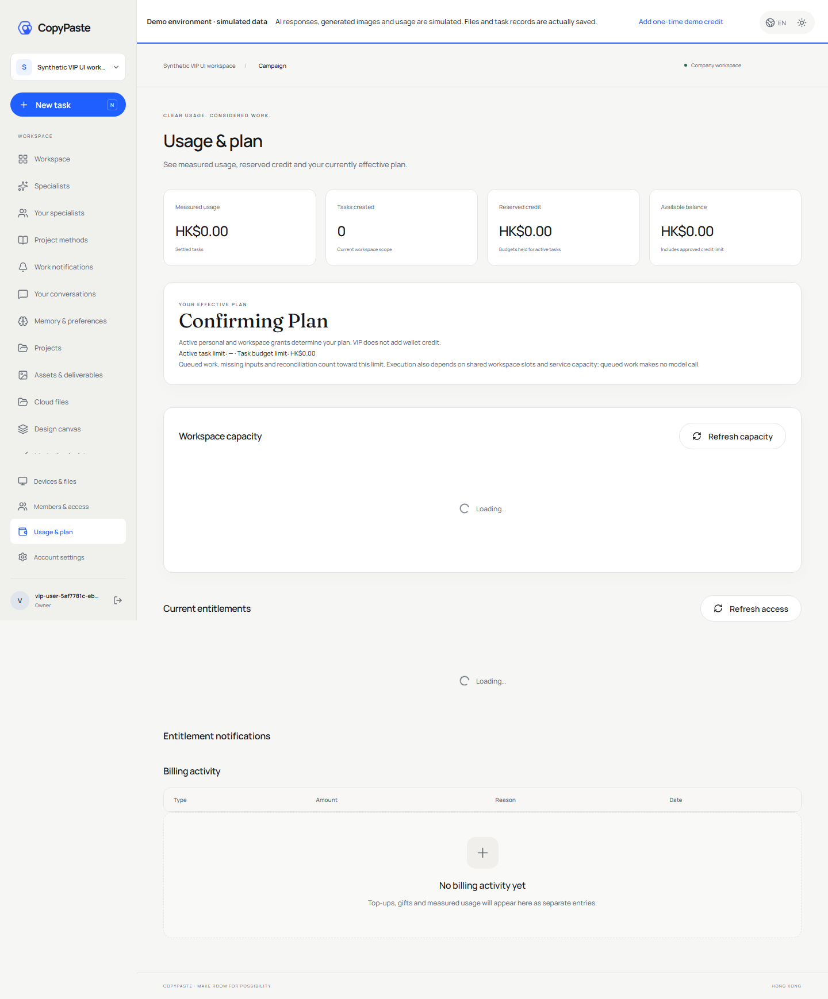

## Durable financial notifications and three-client accounts (stage 50)

Usage now includes personal paid/promotional/reserved balances, credit limit and used credit, with exact six-decimal HKD formatting. The financial inbox supports account/work events, unread filtering, pagination and read-state changes. Payment evidence/confirmation is distinct from posting; an unknown refund stays unknown. Failed reads, workspace changes, revoked access and sign-out clear stale financial content. Polling and current-session guards reject late responses.

Stage 50 historical platform regression: 410/410; actual three-client financial workflows: 8/8. AI/media and payment evidence are authorized local simulations; authentication, database, authorization, ledger and notification paths execute for real. This does not complete the original 102 acceptance cases, production banking or the full installation/system matrix.

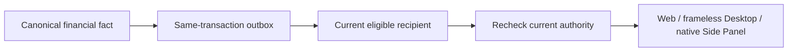


## Run and deploy

Requires Node.js 22.14+. Start the platform database/API first, then:

```powershell
npm ci
npm run dev
```

Visit `http://localhost:4317`. Vite proxies `/v1` and `/health` to `127.0.0.1:4310`. All tools run natively; Docker, WSL and virtualization are prohibited.

```powershell
npm run typecheck
npm run build
npm run preview
```

Deploy `dist/` as static assets over HTTPS, preferably reverse-proxying `/v1` on the Web origin to the API. SPA pages fall back to `index.html`; API paths must not. Optional build-time `VITE_API_BASE` is documented in `.env.example`. If using a separate API origin, configure exact `WEB_ORIGIN`, cookie and CORS rules. Never place AI keys in public `VITE_*` variables.

## Customer journey

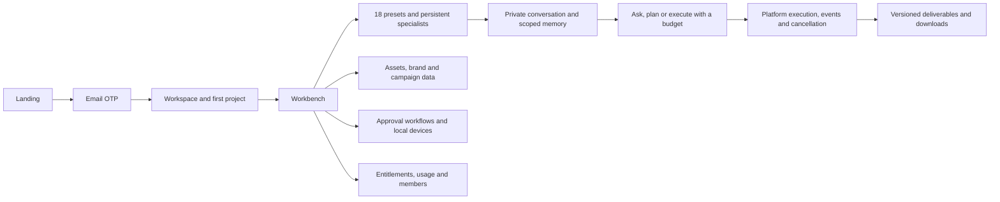

New customers verify a work email, create their organization and first project, then enter the workbench. Returning customers select an existing workspace/project. Invitations bind email and project. Expired/invalid codes, throttling, expired sessions, inaccessible resources and unavailable models surface real API errors.

Development OTPs are available only in platform `.data/mailbox/`; production uses SMTP. No default user credentials exist. Native authorization reuses this identity through an independent PKCE flow rather than converting browser cookies to bearer tokens.

## Pages

| Area           | Working behavior                                                                                    |
| -------------- | --------------------------------------------------------------------------------------------------- |
| Workbench      | Project selection, specialists, recent tasks, published help/announcements and service availability |
| Specialists    | 18 presets with bound Skills, inputs, outputs and current availability                              |
| Projects/tasks | Project creation, budgeted tasks, status/events/output and cancellation                             |
| Creative       | Editable JSON text/shape/pinned-PNG layers, versioned edits, SVG/PNG/template MP4 export            |
| Assets         | Explicit uploads, thumbnails, immutable versions, downloads, rename and expiring/revocable shares   |
| Analytics      | CSV ingestion, exact aggregate metrics, dataset detail and submitted-HTML SEO checks                |
| Workflows      | Bounded analytics/Codex/approval steps, publish/run/approve                                         |
| Brand          | Colors, tone, fonts and approved copy                                                               |
| Members        | Invitations, organization roles, project scope, updates/removal and last-owner protection           |
| Connections    | Google Ads/GA4/Search Console/Meta OAuth and explicit-account report synchronization                |
| Devices        | Paired devices, expiring folder grants, explicit local command dispatch and results                 |
| Usage/settings | Separate wallet and effective plan limits, charges, language/theme/profile                          |


## Specialists and private work

Create a specialist from an installed role, set instructions, brand and tools, then start a private conversation. Specialist edits are versioned; conversations retain their selected version until you explicitly adopt an update. Notes save without AI. Ask and plan use reading tools, while execute can create deliverables. Execution of a plan requires approval against the current context and budget.

Conversations support search, pin, rename, archive/unarchive and version-checked deletion. Messages, tasks and outputs remain owner-private. Explicit publication creates a shared project copy. Workspace/brand/project/conversation/personal memories have content versions and optional expiry. Personal and conversation memory remain private. Deletion requires confirmation and completed or cancelled/settled work.

The 390px mobile layout and dark theme were exercised in a real browser. A closed mobile sidebar is removed from keyboard navigation. The platform rechecks authentication, access and billing on each request.


## Product and authorization rules

The API is authoritative for access, billing and entitlements. Hidden controls are not authorization. VIP and wallet balances are separate; personal/workspace entitlements use actual validity timestamps. Unconfigured company AI is explicitly unavailable. Installed presets are not proof of qualified live business work.

All AI requests run through the platform and company internal gateway. This client holds no model keys. Browsers do not gain silent disk access: files require a user picker, and persistent folder access requires the Desktop native bridge with individual grants.

`api.ts` uses credentialed requests/CSRF on Web and narrow IPC in the Desktop snapshot. Local storage contains theme/locale preferences, not authentication or model secrets. Published help/announcements render as text rather than injected HTML.

## Verification and maintenance

`npm test` performs type checking. The delivery repository's `npm run qa:web` and `npm run qa:persistent` exercise actual email login/onboarding, 13 workspace modules, 16 Admin pages, dark/light and mobile viewports. Screenshots use real UI/API/PostgreSQL with fictional fixture businesses and `.invalid` emails.

Routes/pages live in `src/main.tsx`; context handles identity/workspace/theme/locale; `api.ts` owns transport; `native-files.tsx` is the native-file panel; `ui.tsx` and `style.css` are self-contained UI foundations. Desktop imports an explicit renderer snapshot rather than requiring sibling source during builds.

Company gateway, SMTP, advertising OAuth and S3 still require deployment configuration and live qualification. SAML/SCIM, mandatory SSO policies, event triggers, parallel specialist teams, collaborative editing and full AI video/speech are unfinished. Polling is not full planned SSE. Submitted-HTML SEO checks do not promise GEO rankings.

Self-hosted Manrope/Fraunces, Lucide icons and the generated blue-fold artwork are documented in [third-party notices](THIRD_PARTY_NOTICES.md). Master requirements remain in the delivery root's `docs/`.

## Cloud schedules

Version 0.4.0 adds daily/weekly calendars to Workflows. Select a published workflow, IANA zone, weekdays and missed-run policy, preview local/UTC times and per-run budget, then explicitly authorize. The server continues after the page closes and retains version/occurrence history. One unfinished run prevents overlap, including approval gates and uncertain charges.

Users can edit, pause, reauthorize/resume or retire calendars. Pausing preserves current work; run history provides separate cancellation. Changes affect future work and paused intervals are skipped. End dates are exclusive; nonexistent DST times are skipped and repeated times run once at their first instant. Platform checks enforce these rules. See `src/schedules.tsx`; Delivery `qa:schedules` verifies actual-clock execution with the user page closed and mobile controls.


## 0.5.0 company identity and unified sign-in

OIDC uses code + PKCE S256, signature verification, state/nonce and a fixed callback. An existing registered account and active workspace membership are required. First binding requires a separate CopyPaste work-email code; domains never auto-enroll users. Configuration changes, disablement or unlinking revoke all linked users’ CopyPaste browser/native/refresh sessions and prior execution authorization. Administrator email and TOTP remain separate.

`/login` offers company identity; `/sso` accepts a company sign-in key and work email; `/sso/confirm` performs first-link email proof. Account settings list owned connections and explicitly confirm signing out everywhere on disconnect. Native `/authorize` callback and PKCE parameters survive SSO, followed by explicit user consent.

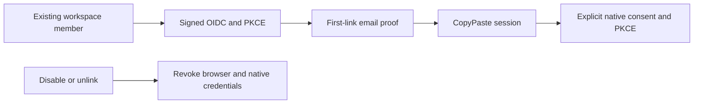


## File and execution repairs in progress

A persistent banner identifies synthetic data and lets a workspace Owner claim one demo gift. Uploads verify part and whole-file SHA-256, support pause/cancel and resume after a lost connection and reload. Limits are 100 MiB for ordinary files and 1 GiB for media. Assets show retention expiry; permanent deletion requires confirmation and has queryable cleanup progress. Task activity uses durable SSE with sequence-based reconnection and current authorization checks.

These are unpublished source changes. Full 1 GiB transfers, all clients and S3 remain to be qualified. The master alignment report records exact coverage and outstanding work.


## Cloud files (current source)

Shared project and private conversation workspaces support search, folders, exact asset-version references, rename/move, text and small bitmap previews, authorized downloads, confirmed publication of copies and entry removal. Conversation uploads remain private; coding roles can continue persistent working sources in later tasks.

Four browser QA groups cover these flows, two real Codex tasks driven by synthetic dependencies, four viewport widths, dark theme and Traditional Chinese. Captured responses receive separate strict schema checks. Live model quality and every file-preview format remain outside this evidence.


## Project methods (current source)

Project methods now have exact installation and specialist/task bindings. Ordinary disable affects new work; uninstall and permanent security revocation block subsequent calls, including old tasks. Reinstallation creates a new identity and requires explicit adoption by a new specialist version. Current plan access is checked before tools and final output; measured usage settles against the original reservation.

Platform regression: **185/185**. `npm run qa:skills` in the delivery repository passed three browser groups; 31 captured HTTP request/response payloads passed the strict design schemas. Custom package review/publication and complete live-role qualification remain pending. Existing 0.5.0 installers are historical.


## Default assistant and work notifications (current source)

New work selects the text assistant by default. Edit a sample, explicitly submit and continue in a private conversation. Selecting a sample or creating an empty conversation makes no AI call. Choose professional roles for image/code specialties. An open form retains its submission identity after an unknown response, so retry does not duplicate work. The default is protected from ordinary edits/deletion; copy it for customization or explicitly adopt current methods as a project manager.

The inbox supports all/unread filters, pagination, read changes and original-task navigation, switching projects first when needed. Authorization refresh failures remove stale items and the unread indicator. Assistant and inbox browser journeys each pass four groups across 375/768/1024/1440 widths, both themes and Traditional Chinese/English; this is bounded UI evidence.


## Initial file and connection requests (current source)

New work can explicitly require a file or connected account before execution. The original private conversation shows the request, current-version search, pagination and an unselected picker. Uploads from that conversation retain private ownership. Refresh and confirmation recheck access; an authorization error removes stale candidates. Resolving all inputs resumes the same task and its existing budget hold. Nothing is selected or submitted automatically.

Delivery `qa:task-dependencies` passes five real browser groups, including private upload, real Codex with labelled synthetic model data, a persisted result, four widths, both themes/languages and failure recovery. These checks cover initial prerequisites, not automatic discovery or continuation after a paid step.

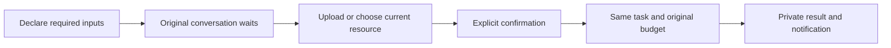


## Shared execution slots (current source)

Conversation/task pages explain capacity waits. Usage distinguishes active-work admission from shared execution slots. Queued work makes no model call; the same task and original hold resume automatically. Delivery `qa:execution-capacity` covers the actual wait, Admin queue reason, four widths/themes/languages and one real private-file result/settlement through Codex with a synthetic model. Occupancy is an explicitly synthetic fixture limited to its fresh workspace, not a load benchmark.


## Create specialists from persisted templates

The specialist directory reads 18 professional presets and the default helper from real versioned records. Categories, literal search, versioned methods and deliverable details lead to a project preflight and an explicit create action. Checking starts no AI task and reserves no budget. Editing invalidates the check; lost responses reuse the instance idempotency key. Missing tools, disabled methods and pending qualification remain visible.

Eight Web/current-source Electron checks cover real sign-in, response-loss retries, rechecking restored methods, authorization errors, four widths, both themes and Traditional Chinese/English. Live professional qualification remains pending. Historical installers have not been rebuilt; this does not add an extension template editor.


## PDF export and original-version retries

The design canvas exports and downloads actual single-page PDF review copies, also available from Assets. The UI explains that PDFs are rasterized; text and layers remain editable in the project/SVG. Stale versions offer a refresh. Retrying a lost accepted reply preserves the same file identity.

Seven Web/current-source Desktop groups cover email sign-in, the canvas, version conflicts, both languages/themes, four widths and independent PDF parsing/rendering. Model dependencies remain simulated; print certification and live-role qualification are pending.


## Marketing CSV, exact metrics and provenance (current source)

Preview and confirm the account, currency, timezone, entity level, attribution and conversion definitions before import. Generic CSV and candidate Google/Meta-style headers support explicit column mapping. Actual UTF-8/BOM source bytes, SHA-256, definitions and computed results are retained. Duplicate requests, including a lost accepted response, return one project snapshot. Quarantine prevents reimport bypass. Unknown conversions stay unknown; exact decimal CTR/CPC/CPM/CVR/CPA/ROAS use aggregate totals and historical results are frozen.

Download the original CSV, normalized CSV, JSON calculation report with 11 evidence references and an actual SVG chart. Data dates are shown; upload time is not presented as the platform extraction cutoff. Official account sync, cross-platform conversion deduplication, FX and complete AI narrative acceptance remain pending. The marketing role is still unqualified. Authorized model dependencies are simulated; database and file behavior are real. Historical installers have not been rebuilt.

CSV errors identify physical lines and columns. A denied selected dataset clears metrics and downloads instead of falling back to another snapshot. Four widths, both themes/languages and lost-response retry were exercised. Shared polling waits for each response and clears stale data after failure.

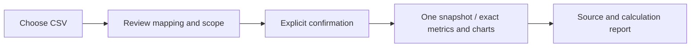


## Private AnalysisSpec reports (current source)

Select saved snapshots, a business question, current/comparison dates, metrics, dimensions and a maximum HKD budget in Marketing insights. Preview neither calls a model nor reserves credit. Explicit confirmation atomically creates a private Codex task, frozen calculations/evidence and one reservation. Sources, accounts, currencies, timezones and attribution stay independent; identical facts deduplicate, conflicts reject, and zero/missing comparison values retain reasons. Retrying a lost accepted response returns the same report.

Real Codex reads paginated frozen evidence. The server validates evidence placeholders and numeric literals before publishing an immutable HTML asset; JSON preserves full calculations. Natural-language meaning and professional quality still require acceptance. Model dependencies are explicitly simulated. Source quarantine/erasure and project revocation block reads and downloads. All 102 complete acceptance cases, official connectors, live-role qualification and production release remain pending. Historical installers have not been rebuilt.

The list polls actual task state and opens evidence details. Denied reads clear prose and download controls. Four widths, both themes and both languages passed; mobile select overflow and stale evidence after switching/denial were repaired. Delivery `qa:analysis-reports` verifies actual HTML/JSON downloads and retry after a lost accepted reply. Builds pass; Vite still warns about the approximately 511 kB main chunk.

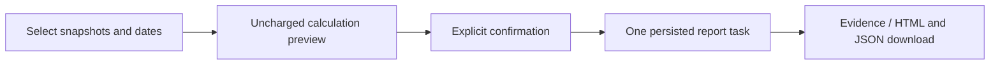


## File-backed CSV/XLSX and correction history (current source)

Marketing inputs are uploaded as immutable shared project-file versions before reviewing the sheet, header row, mapping and account definitions. Google/Meta use canonical `POST /v1/dataset-imports`; generic tables use the compatible nested endpoint. Preview calls no model and reserves no credit. Duplicate content and retries after a lost accepted reply reuse the snapshot. Original CSV/XLSX downloads verify actual bytes and SHA-256.

The bounded read-only XLSX parser accepts up to 5,000,000 bytes, 50 worksheets, 100 columns and 10,000 data rows. Multiple visible sheets require explicit selection; header rows range from 1 to 100. Shared/inline strings, XML Unicode references, exact decimals and 1900/1904 dates are supported. Money inputs allow six decimal places; frozen metric values retain eight. Formulas, including cached results, macros, external links, encrypted files and merged data cells are rejected. Errors identify actual worksheet cells. The UI explains that a failed preview still retains the explicitly uploaded original project file.

Corrections create new immutable snapshots and a complete ancestor chain; prior metrics and reports retain their original values. AnalysisSpec rejects selecting an ancestor with its correction before creating a task or budget hold. Source quarantine/erasure prevents dependent data, reports and downloads. Recovery closes only unclaimed unavailable tasks and releases unused holds; started or uncertain charges keep reconciliation rules. Private files require explicit publication as a shared copy first.

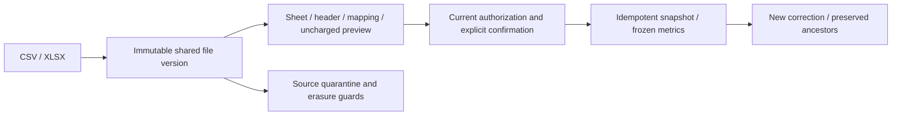

The full platform regression passes **185/185**; strict captured HTTP samples pass **31/31**. Four file-import and six existing CSV Web/source Electron groups pass, along with native type checks and four unit tests. Model/media dependencies are authorized synthetic data; database, Codex, files and authorization are real. All 102 complete acceptance cases, the complete official export matrix, live connectors, professional qualification and production release remain pending. Historical 0.5.0 installers have not been rebuilt. See master `docs/technical/29-file-imports-and-correction-lineage.md` for detailed limits.

Upload-allocation keys persist first and are scoped by user, tenant, project and file digest; choosing the same file resumes it. Editing any input invalidates preview and confirmation. Four widths, both themes and both languages passed all 16 combinations.


Task details now offer Pause queued task / Resume task before the first model call, using the current task version and refreshing conflicts. The original task and reservation are retained. Running tasks retain cancellation; paid-step continuation remains unfinished. Delivery `qa:task-controls` verifies Web, source Desktop and MV3 controls, including one settlement after resumption.


## Device sessions and sign-out

Account settings distinguishes Web, Desktop and Chrome Extension, marks this device and shows validity, including refreshable devices whose access has expired. Revocation has confirmation, pending feedback and reloadable errors. Revoking the current Web session clears its cookie. Credential-free cross-tab events clear the browser workspace; late responses cannot restore the previous data. Native clients use the same renderer snapshot.


The delivery repository's `npm run qa:sessions` covers actual Web, source Electron and MV3 login/revocation, expired-access sign-out, offline feedback and delayed responses. Complete identity, device/system matrices and production release remain governed by the master acceptance plan.

## Admin suspension feedback

Authorized member directories identify administrative suspension separately. A suspended member cannot access the workspace, and owner edits, removal/rejoin or new invitations cannot lift the hold. An authorized administrator must restore access. Strict Member.state remains active/removed; the management directory provides the additional label. Six current Admin UI groups now verify the owner notice, immediate suspension denial and notice removal on restoration; the complete native/admin matrix remains outstanding.

## Current membership and cross-client sessions (2026-10-20)

Delivery `qa:membership` passes 6/6 actual email invitation, resend, join, removal, revocation and delayed-context groups. Four actual Invite/Member/MemberList/Ack payloads pass the original strict schemas. `qa:admin-membership-ui` separately passes six groups including suspension/restoration and the owner's notice. `qa:sessions` passes twelve Web/source Electron/MV3 groups for committed exchange/refresh receipt recovery, remote revocation, account replacement, expired/offline sign-out and cross-tab cleanup. Owned instances and test credentials are cleared, with zero model calls. Original failures remain unchanged. Complete packaged, enterprise identity, system and native membership acceptance remain outstanding.


The 2026-10-20 payment increment rerun retains Web membership 6/6 (164 source files), Admin membership 6/6 (190) and cross-client authentication 12/12 (769). Before/after hashes match, and owned sessions and browsers are closed. Complete release/system acceptance remains separately tracked.

After the refund increment, current-source Web membership passes 6/6 (169 sources), Admin membership 6/6 (196), and Web/source Electron/MV3 authentication 12/12 (775), with unchanged source hashes and owned credential/process cleanup. The initial Electron debugging connection timeout is retained; the same source passed the rerun. Frameless Desktop and native Side Panel preview bytes are unchanged. Full packaged authentication and system acceptance remain separate.

Current-source verification after the immutable-plan increment (2026-10-20): Web membership 6/6 (172 source files), Admin membership 6/6 (200), and Web/source Electron/MV3 authentication 12/12 (779). Source digests match before and after each run; owned browsers, Electron and extension instances are closed and test credentials cleared. Immutable definitions and frozen legacy bindings do not change the native preview packages. Complete VIP/quota behavior, packaged authentication and system acceptance remain tracked in the main documentation.

## Effective access and entitlement notifications (stage 47)

Usage consumes the original EffectiveEntitlements response: active personal/current-workspace features, server confirmation time, entitlement revision and the next activation/expiry boundary. Local consent, project authorization and budget remain independent checks. Supplementary notifications retain the actual change, grant revision and read state, with explicit pagination. Without active VIP the current free plan applies; VIP does not add wallet credit.

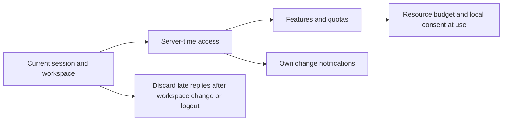

The page refreshes within fifteen seconds and at the next boundary. Failures clear old rights; late responses cannot restore a signed-out account. Actual Admin grant/independent approval and suspension are checked against customer canonical reads. English light desktop and 375px Traditional Chinese dark screenshots come from real browser pages. Full native installer journeys and system acceptance remain independently tracked.


The native screenshot review exposed a stale plan heading after a rights update. Plan name, task/budget limits and effective rights now refresh together and render only when the subject revision and pinned plan IDs agree. Boundary refresh uses the server confirmation time rather than the device clock.

## Enterprise seat and storage enforcement (stage 48)

Usage and Members now show confirmed workspace seats, retained bytes, pending upload reservations, capacity and over-limit status. The view refreshes manually and every 15 seconds, clearing stale totals after scope/session changes or failed reads. Workspace plans govern shared capacity; personal VIP does not expand it. Downgrades preserve existing resources while the server rejects additional allocation.


