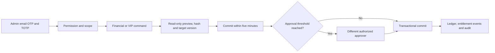

# CopyPaste Admin Dashboard

[简体中文](README.md) · Independent operations console · 0.1.0

An independent Git repository and admin client with separate identity, cookies and entry point from customer Web. It manages customers, workspaces, consumption, funding, VIP, content, execution, access and published product configuration. It shares CopyPaste branding, Traditional Chinese/English and light/dark themes. The platform enforces all authorization, auditing and transactions.


## Run

Requires Node.js 22.14+ and a running platform/database. Enroll an administrator and import TOTP using the platform CLI:

```powershell
# Run in the platform checkout
npm run admin:create -- admin@your-company.example super_admin
```

Then in this repository:

```powershell
npm ci
npm run dev
npm run typecheck
npm run build
```

Visit `http://localhost:4318`. Deploy `dist/` with HTTPS, an exact Admin origin and `/v1` reverse proxy; keep SPA fallbacks separate from API responses. Optional public `VITE_API_BASE` is in `.env.example`. Never embed AI/database secrets. Docker, WSL and virtualization are prohibited.

Every admin login requires email OTP and TOTP. Sensitive writes require MFA in the last 10 minutes; sign in again when it expires. Development codes are in the platform's local mailbox. There is no shared default administrator.

## Sixteen pages

| Page        | Implementation                                                                                                |
| ----------- | ------------------------------------------------------------------------------------------------------------- |
| Overview    | Separately authorized workspace/user/usage/reservation/reconciliation summaries                               |
| Users       | Database pagination/search, contact permissions, profile, memberships, consumption, status/session operations |
| Workspaces  | Status, member count and separately authorized financial fields                                               |
| Usage       | User/workspace/project-scoped task, token and charge aggregates                                               |
| Billing     | Immutable ledger, confirmed funding, gifts, source-bound refunds/debits and reconciliation                    |
| VIP         | Personal/workspace grants, actual start/end times, suspend/resume/extend/revoke                               |
| Content     | Unified metadata, separate body/download permissions, quarantine/restore and version checks                   |
| Execution   | Status, cancellation, reconciliation and eligible child-task retries                                          |
| Catalog     | Installed role/Skill enablement and presentation, versioned help/announcements/navigation                     |
| Connections | Connected provider scope and revocation                                                                       |
| Access      | Eight roles, 67 permissions, bounded custom roles, scoped/expiring bindings and revocation                    |
| Support     | Time-limited support-session metadata; no silent impersonation                                                |
| Audit       | Attributable operations, outcomes and timestamps                                                              |
| Jobs        | Preview/commit user-status batches and restricted CSV exports                                                 |
| Plans       | Versioned capabilities/roles/concurrency/task-budget policies                                                 |
| Policy      | Versioned approval thresholds and maximum VIP duration                                                        |


## Sensitive operations



HKD values use integer micros. Confirmed-payment references are unique; this console does not acquire online payments. VIP is separate from wallet funds. Default monthly fees remain commercially unpriced.

Global/tenant/project scope, explicit denies, amount/duration/batch limits and expiry constrain operations. Delegation cannot exceed the grantor's own grants. Self-grants and removal of the last permanent recovery administrator are rejected. Contacts, consumption, balances, content bodies and downloads are separate permissions.

Published role JSON can only enable/disable installed definitions and adjust presentation; Skills can only be enabled/disabled. It cannot replace executable tools, kernel or model configuration. Quarantine affects customer visibility, sharing and subsequent execution. Collection filtering happens in authorized SQL before pagination.

## Verification and limits

`npm test` is type checking. Delivery `npm run qa:web` exercises all 16 pages, actual OTP/TOTP, funding/VIP submission and customer detail. Platform tests cover access denial, concurrency, financial replay, VIP, bounded delegation and recovery-admin protection.

Exports are limited to 500 rows and 15 minutes, with source authorization rechecked at download. Initial admin enrollment/MFA is a trusted CLI operation; the UI supports roles, bindings and sessions but not full principal enrollment/suspension management. Support sessions expose metadata, not customer impersonation or delegated body access. Online payments, SSO and large exports remain unfinished.

`src/main.tsx` contains pages/commands, `api.ts` handles Cookie/CSRF, and UI foundations are a self-contained snapshot recorded in `shared-source.json`. Screenshots use real development records with fictional fixtures. Master documents are in the delivery root's `docs/`; see [notices](THIRD_PARTY_NOTICES.md).
