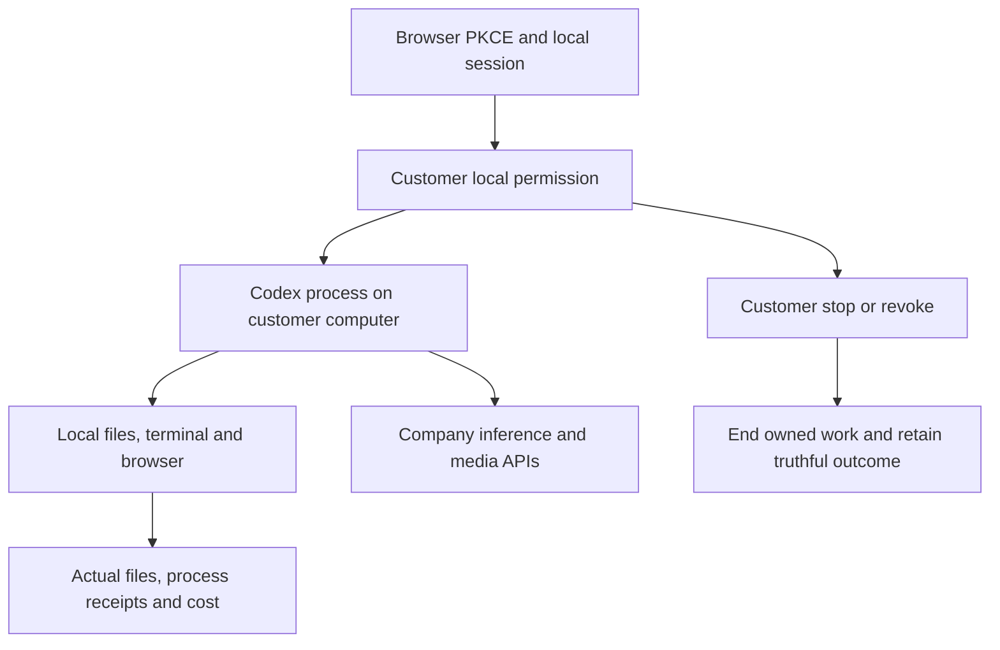

# Workmate · CopyPaste Enterprise Agent · desktop

[简体中文](README.md) · [English](README.en.md)

## Product and boundaries

The first customers are existing marketing teams. Scope includes image/design/typography, video/effects, advertising and website analysis, SEO/GEO, repeated business processes and software development. The catalog has 18 candidates with exact Skill bindings; at least twelve individually qualified professional presets remain an acceptance requirement. The designer combines Codex, design Skills and company Image 2. Codex is the only Agent core. All AI uses the company's OpenAI-compatible backend; development currently uses authorized synthetic providers, not a claim of live professional quality.

The Electron main process owns OS grants, encrypted local sessions, pinned Codex children, files/terminal, browser tools and IPC; the React renderer has no generic Node/arbitrary-process API. Select a specialist/workspace and read-only, workspace-write or full local permission; native consent defaults to Cancel. Codex runs on the customer device while reasoning/image/video/audio requests use the company server. Questions start unselected, and explicit answers continue the same task/thread/turn. Stop/revoke clears prompts and ends owned children.

## Repositories and execution

| Branch | Directory | Runtime |
| --- | --- | --- |
| [backend](https://github.com/copypasteltd/workmate/tree/backend) | `dev/copypaste-platform` | Fastify / PostgreSQL / cloud Codex |
| [web](https://github.com/copypasteltd/workmate/tree/web) | `dev/copypaste-web` | React / Vite / cloud workspace |
| [admin](https://github.com/copypasteltd/workmate/tree/admin) | `dev/copypaste-admin` | React / separate Admin identity |
| [desktop](https://github.com/copypasteltd/workmate/tree/desktop) | `dev/copypaste-desktop` | Electron / customer-local Codex |
| [extension](https://github.com/copypasteltd/workmate/tree/extension) | `dev/copypaste-extension` | Chrome MV3 / native Side Panel / cloud Codex |
| [delivery](https://github.com/copypasteltd/workmate/tree/delivery) | `dev/copypaste-delivery` | Native development, QA and publication tools |

The component is an independent Git repository. Keep the sibling layout and use the documented native tools; Docker, WSL and VMs are prohibited.

## User workflow

1. Launch/install the frameless client, complete browser PKCE and select company, project and local workspace.
2. Choose read-only, workspace-write or full local authority. The customer explicitly confirms full permission; Cancel is the default and revocation stays available.
3. Local Codex operates local files, terminal and browser. An external program must be selected and confirmed by the customer.
4. Inspect original-thread questions, actual output, files, artifacts and billing. Stop/revocation ends owned work; uncertain outcomes stay uncertain.
5. Folder rules save paused and need a separate automatic-spend confirmation. Reopening retains queue/limits and requires confirmation to resume.



## Setup

### Local startup

Run these commands in the checked-out component. The complete workspace has the six independent repositories side by side under `dev/`; see the [branch and checkout layout](https://github.com/copypasteltd/workmate/blob/docs/docs/governance/04-git-branches-and-publication.md). Use Windows x64, Node.js >=22.14, npm/Git and the documented native PostgreSQL, FFmpeg/FFprobe and pinned Codex resources. Preserve existing local configuration/data. No Docker/WSL/VM is used.

```powershell
Set-Location 'D:/dev/copypasted/自有agent/dev/copypaste-desktop'
npm ci
$env:COPYPASTE_LOCAL_CODEX_BIN = 'D:/approved-runtime/codex.exe'
npm run runtime:prepare
npm run build
npm start
```

Start the backend first. The binary path is an example: supply the exact approved binary and adjacent helpers matching `contracts/local-codex-runtime.json`. Configure company origins in `deployment.json`. `npm run package:dir` builds an unpacked candidate; `npm run package` builds the installers. Current evidence covers an unsigned unpacked candidate; signing and human install/upgrade/uninstall remain open. The renderer builds independently; preserve its native overlays.

### Use the current workflow

1. Complete sign-in, company membership/invitation and project selection. Native clients use browser PKCE; Admin uses separate MFA identities. Expired/revoked credentials must not silently change identity or company.
2. Select a specialist and supply the brief and explicitly authorized references/accounts. Missing inputs request customer action. Project owners can save, preview and explicitly publish immutable shared guidance; publication starts no AI and grants no new permission.
3. New tasks pin their accepted role, Skill, brand, reference and guidance versions. Existing work, including an originally absent configuration, retains its original state. Source revocation hides unavailable bodies and blocks later use; history is not a permission bypass.
4. Confirm budget and any required operation/media approval. View genuine status, progress, exact deliverables and original receipts. Continue requested edits in the same task lineage. Unknown usage remains reserved for reconciliation; it is never silently free or blindly replayed.
5. Admin can independently manage authorized user/workspace status, inspect permitted consumption, preview/confirm manual fees or credits and activate scoped VIP/expiry. Balances, recorded payments, credits, budgets and VIP are separate records. Idempotent confirmation and audit prevent duplicate grants.

## Customer-local programs and browser resources

Sign in and select company/project → create a local session → explicitly grant full local permission → open **Local programs** → choose an actual executable and confirm the native dialog, which defaults to Cancel → request work in Conversation → inspect exact arguments, actual output, PID/exit code and the original task bill. Cancelling or declining grants nothing. Approvals pin file identity and SHA-256; the Agent supplies a program ID and argument array, not a replacement shell/environment.

Stopping the original task or revoking the program ends its owned native process tree. Program revocation leaves the separate customer full-access grant intact. Success, failure, cancellation and unknown outcomes remain distinct; an original call ID never replays. After restart, uncertain records remain unknown. Customer review only permits future calls, never rewrites the old record as success. Approved programs run with the customer's OS-user rights, not an additional workspace OS sandbox; Admin/cloud cannot approve on their behalf.

The Windows x64 native Job Object guardian does not pass company inference credentials to programs. Limits are two active programs per executor, 100 approval/200 run records, at most 64 arguments and 120 seconds per invocation, and 32 KiB retained per stdout/stderr with explicit truncation. New sessions pin the program tool version; legacy tool sets remain unchanged. Normal browser opens and popups share three pages per task/two active contexts per executor. A third context is denied without evicting another task; reuse clears cookies/localStorage.

## Customer-local folder work

In Desktop, choose a writable local session and open **Folder work**. Select an input folder inside the workspace and configure extensions, instructions, a quiet period, per-file/total limits and maximum runs. Existing files are excluded unless selected. Saving creates a **paused** rule; **Confirm and activate** opens a separate native automatic-spend confirmation that defaults to Cancel.

Stable native file events and bounded scans feed a persistent serial queue. Each job gets an exact snapshot, separate output directory, original task ID and company cost receipt. An unanswered native question is visible from Folder work; **Answer questions** returns to Conversation and requires the customer's explicit answer. Identical already-processed bytes and product outputs do not create another paid task. Unstarted old versions coalesce to the latest stable input.

Pause stops new dispatch and lets the current file finish. Revoke stops only that rule's owned work while keeping outputs/receipts. App closure stops watching; a real reopen retains the encrypted journal and allocated limits but requires fresh confirmation. Lost replies reuse original dispatch/create/start/finish keys; uncertain native actions block for review. Full OS permission remains the customer's grant, not an additional folder sandbox. Web/Extension keep cloud execution; folder work is a Desktop capability.

Limits: 20 rules; 1,000 history/200 queued items per rule; 1,000 dispatch receipts per session; 2,000 matching files/10,000 entries/12 levels per scan; 20 MiB per file and 64 MiB new reads per scan; at most 100 authorized runs, one scheduled job at a time. Limits do not reset on pause/restart. Outputs are under `.copypaste-local-jobs/<rule>/<job>/output/`. Symlinks/junctions, traversal, outside input, source replacement and conflicts block automatic work. See approved programs above; complete application-operation and crash/sleep/offline matrices remain open.

## Configuration and authority

The candidate requires the complete additive SQL001–129 history. API/worker schema admission rejects missing, changed or unsupported versions; recovery identity is fenced independently. Company model aliases, verified media capabilities, exact tariffs and provider secrets live on the backend. Unconfigured capabilities remain unavailable. Current development uses explicitly authorized synthetic data.

Web/Admin use `VITE_API_BASE` or their same-origin proxy; default development ports are 4317/4318. Desktop/Extension compile fixed `COPYPASTE_API_ORIGIN` and `COPYPASTE_WEB_ORIGIN` values; Desktop also pins `COPYPASTE_EXTENSION_ID`. HTTPS is required outside the allowed loopback-development case. No renderer or extension receives company provider secrets.

Files remain private unless the customer explicitly shares them. Authorization is checked on new requests, worker claims, tools and downloads. Source/body revocation is not bypassed by old history. Money uses exact HKD micros; budget, balance, credits, recorded payments and VIP are distinct. Stable request identities prevent duplicate grants, tasks and reservations. Unknown usage or physical cleanup retains its reconciliation hold.

## Preset roles and Skills

The catalog defines 18 professional presets plus the default assistant. Every run pins exact Skill versions and registered tools. These definitions are not a claim that twelve full professional qualifications have passed.

| ID | Role | Required Skill bindings |
| --- | --- | --- |
| R01 | Full-stack developer | `fullstack-engineering@1.0.0`, `frontend-implementation@1.0.0`, `backend-api@1.0.0`, `qa-testing@1.0.0`, `delivery-core@1.0.0` |
| R02 | Frontend developer | `frontend-implementation@1.0.0`, `ui-system@1.0.0`, `qa-testing@1.0.0`, `delivery-core@1.0.0` |
| R03 | Backend/API engineer | `backend-api@1.0.0`, `qa-testing@1.0.0`, `delivery-core@1.0.0` |
| R04 | Software QA engineer | `qa-testing@1.0.0`, `frontend-implementation@1.0.0`, `delivery-core@1.0.0` |
| R05 | UI/UX designer | `ux-research@1.0.0`, `ui-system@1.0.0`, `frontend-implementation@1.0.0`, `delivery-core@1.0.0` |
| R06 | Designer | `creative-direction@1.0.0`, `image-art-direction@1.0.0`, `image2-production@1.0.0`, `typography-layout@1.0.0`, `delivery-core@1.0.0` |
| R07 | Brand visual designer | `brand-system@1.1.0`, `image-art-direction@1.0.0`, `image2-production@1.0.0`, `typography-layout@1.0.0`, `delivery-core@1.0.0` |
| R08 | Ad creative designer | `ad-creative@1.0.0`, `image-art-direction@1.0.0`, `image2-production@1.0.0`, `typography-layout@1.0.0`, `delivery-core@1.0.0` |
| R09 | E-commerce designer | `ecommerce-visual@1.0.0`, `image-art-direction@1.0.0`, `image2-production@1.0.0`, `typography-layout@1.0.0`, `delivery-core@1.0.0` |
| R10 | Social content designer | `social-content@1.0.0`, `image2-production@1.0.0`, `typography-layout@1.0.0`, `delivery-core@1.0.0` |
| R11 | Illustration/IP designer | `illustration-ip@1.0.0`, `image-art-direction@1.0.0`, `image2-production@1.0.0`, `delivery-core@1.0.0` |
| R12 | Typography/layout designer | `typography-layout@1.0.0`, `image-art-direction@1.0.0`, `image2-production@1.0.0`, `delivery-core@1.0.0` |
| R13 | Presentation designer | `presentation-production@1.1.0`, `typography-layout@1.0.0`, `dataviz@1.1.0`, `delivery-core@1.0.0`, `deterministic-metrics@1.1.0` |
| R14 | Landing-page designer | `landing-page@1.0.0`, `ui-system@1.0.0`, `frontend-implementation@1.0.0`, `image2-production@1.0.0`, `delivery-core@1.0.0` |
| R15 | Information/data designer | `dataviz@1.1.0`, `deterministic-metrics@1.1.0`, `typography-layout@1.0.0`, `delivery-core@1.0.0` |
| R16 | Video/motion designer | `video-storyboard@1.0.0`, `template-video-composition@1.0.0`, `video-generation@1.1.0`, `speech-production@1.2.0`, `delivery-core@1.0.0` |
| R17 | Marketing analyst | `ads-analysis@1.1.0`, `deterministic-metrics@1.1.0`, `dataviz@1.1.0`, `delivery-core@1.0.0` |
| R18 | Workflow consultant | `workflow-design@1.1.0`, `workflow-execution@1.1.0`, `delivery-core@1.0.0` |

Designer combines Codex, design Skills and the company Image 2 capability. Optional R19 computer-operator work needs its own confirmed cloud lease and AI budget; native Desktop excludes it and retains customer-local execution.

[Role contract](https://github.com/copypasteltd/workmate/blob/backend/catalog/role-preset-catalog.json) · [Skill packages](https://github.com/copypasteltd/workmate/blob/backend/catalog/skill-packages.json)

## Actual interface and interaction

These are actual unretouched product screenshots and wall-clock recordings. Customer/model/media responses are explicit fixtures; native Codex, files, database and billing paths run where stated. Synthetic node pixels do not qualify an actual remote Linux desktop.


[Original MP4](assets/screenshots/workmate-dedicated-desktop-06-local-cloud-boundary.mp4)

## Verification and delivery status

The integrated clients/tool inventory passed 338 checks: Web 20, Admin 9, Extension 63, Desktop 180, actual local Codex 22 and Delivery 44; corresponding types/builds passed. Native Desktop, Web/Admin and native Side Panel each have eight bounded actual UI checks, with 29 screenshots and five GIF/MP4 pairs. Complete backend success requires its final complete-inventory report; the checkpoint records actual outcomes and retains failed attempts.

Run this component’s `npm run typecheck`, `npm run build` and documented test scripts with installed native prerequisites. Delivery’s default `npm test` covers native-surface integrity; the complete Delivery unit inventory is `node --test --test-concurrency=1 tests/*.test.mjs`. `node scripts/qualify-delivered-clients-v1.mjs NN` uses a fresh two-digit attempt and the sibling layout for all integrated client inventories. Candidate-specific historical runners preserve their original directory requirements.

Full product acceptance remains open: twelve professional-role qualifications, complete permissions/business/compatibility matrices, live service quality, signed installers/updates, production load/restore and customer business acceptance. Use the numbered inventory rather than test counts as a completion claim. Owned browsers/processes are closed; user resources are preserved.

[Implementation / 方案](https://github.com/copypasteltd/workmate/blob/docs/docs/technical/121-dedicated-cloud-and-client-execution.md) · [Checkpoint / 证据](https://github.com/copypasteltd/workmate/blob/docs/docs/quality/dedicated-cloud-checkpoint.json) · [Open requirements / 未完成项](https://github.com/copypasteltd/workmate/blob/docs/docs/quality/remaining-work-2026-10-29.md) · [Branch layout / 检出布局](https://github.com/copypasteltd/workmate/blob/docs/docs/governance/04-git-branches-and-publication.md)
