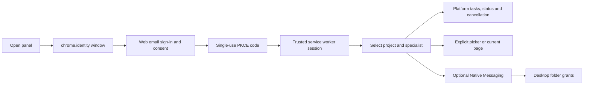
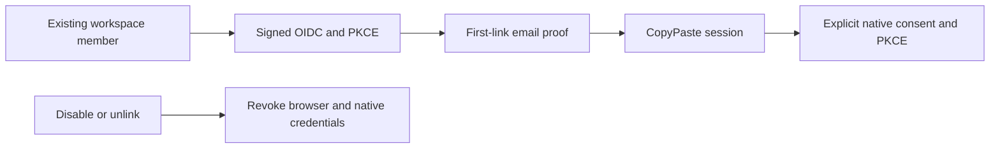
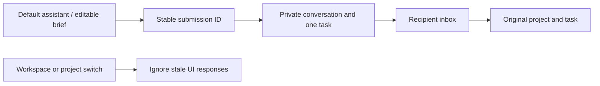

# CopyPaste Chrome Extension

[简体中文](README.md) · Chrome MV3 side panel and native bridge · 0.5.0

An independent repository for project/specialist tasks, explicitly selected files and user-triggered current-page capture. Persistent folder operations use the installed Desktop native helper. Execution and billing stay on the platform; this extension contains no AI credentials.


## Build and load

Requires Node.js 22.14+ and Chrome 120+. Native Chromium was used for qualification. Start platform and Web first:

```powershell
npm ci
npm run typecheck
npm run build
```

Enable developer mode at `chrome://extensions`, load `dist/` unpacked and open the CopyPaste side panel. Stable unpacked ID: `fffkcnmfdhahlnifgdilabheppkgnlok`. `manifest-key.txt` is a public SPKI key, not an AI credential or store private key. Match platform `EXTENSION_ID` and Desktop `deployment.json`.

Defaults are API `http://localhost:4310` and Web `http://localhost:4317`. For production:

```powershell
$env:COPYPASTE_API_ORIGIN='https://api.your-company.example'
$env:COPYPASTE_WEB_ORIGIN='https://agent.your-company.example'
npm run build
```

Only HTTPS company origins or localhost development origins are accepted, without embedded credentials, paths or queries. Host permissions contain only the API origin. The extension has not been published to the Chrome Web Store. Docker, WSL and virtualization are prohibited.

## Authentication and use



The exact callback is registered to Chrome identity. Access/refresh tokens stay in trusted-context `chrome.storage.session`, not the panel, localStorage or `storage.local`. Closing the browser ends that session. Local extension storage only retains locale. The platform handles refresh rotation and logout.

Uploads require a user picker and are limited to 5 MB by the extension; the server rechecks project rights. Current-page capture requires a click and activeTab/scripting, excludes forms/editable/hidden content and does not run continuous site-wide capture.

## Web and Desktop integration

Version 0.2.0 uses the same platform identity, permissions and task API. The build derives the manifest version from package.json. The panel provides lightweight tasks/materials; configure persistent specialists, full private conversations and memory in Web or Desktop. Private outputs require explicit publication before project sharing.

## Native folders

The extension cannot silently scan the local disk. Install Desktop using the Windows Setup package, explicitly connect the Chrome helper in its device page, then grant optional nativeMessaging permission in the extension. Registration is per Windows user and allowlists the official extension origin.

Each folder needs separate native consent, expires after one hour and is read-only by default. Creating new files requires extra consent. List, preview, upload, create-only text output and revoke operations reject traversal, links/junctions, device names, ADS, overwrite and remote shell. Responses are capped at 900 KB; use the file picker for larger transfers.

## Verification and source

- `background.ts`: PKCE, token rotation, limited API/native messages and current-page capture.
- `panel.ts`: workspaces/projects/roles/tasks, upload, folder tools and locale.
- `build.mjs`: public deployment origins, manifest and stable ID.
- Delivery `npm run qa:extension`: real MV3 loading, chrome.identity login, upload, token privacy and logout; browser contexts close in finally.
- Delivery `npm run qa:desktop`: packaged native-host framing, allowlist, folder grants and local operations. QA does not overwrite the user's existing registry registration.

Static interface text supports Chinese/English; some dynamic statuses remain Traditional Chinese. Without live internal AI qualification, executable AI tasks remain unavailable. New organizations are initialized on Web. Daily/weekly cloud schedules are managed in Web or Desktop; full AI video/speech remain outside this release. See [notices](THIRD_PARTY_NOTICES.md).

## 0.5.0 company identity and unified sign-in

OIDC uses code + PKCE S256, signature verification, state/nonce and a fixed callback. An existing registered account and active workspace membership are required. First binding requires a separate CopyPaste work-email code; domains never auto-enroll users. Configuration changes, disablement or unlinking revoke all linked users’ CopyPaste browser/native/refresh sessions and prior execution authorization. Administrator email and TOTP remain separate.

Company identity reuses the system-browser authorization page: choose company sign-in, complete identity and any required email proof, then explicitly authorize the Chrome callback. Independent PKCE, short access tokens and rotating refresh credentials remain. Server codes bind to the issuing session and user revision; source logout or identity revocation invalidates outstanding codes. Local file and Native Messaging folder grants still require explicit actions.



## Default assistant and inbox (current source)

The panel offers a default text assistant alongside professional roles. Stable submission IDs preserve the original private conversation/task after an unknown response. Stale responses cannot overwrite lists/tasks after a workspace or project switch. Simulated workspaces display a persistent notice. The recipient inbox lists the latest 20 notifications, toggles read state and opens the original project/task; full pagination and conversation continuation remain in the workspace.

Delivery qa:extension passes seven real MV3 groups: PKCE; retry after an accepted response is lost and real Codex text-file creation; notification navigation; 320/420/768 widths, both themes/languages; explicit upload; credential privacy/logout; project switching while an accepted response is delayed. Model dependencies are synthetic and do not qualify live roles. Historical ZIPs are unchanged.




