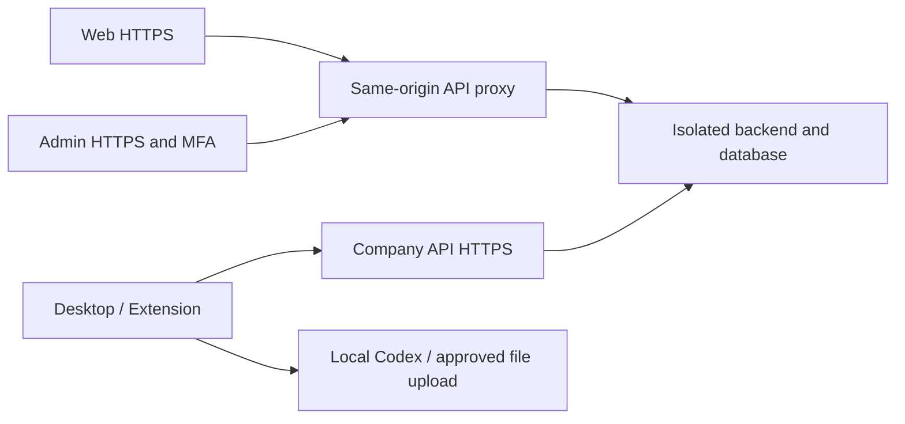
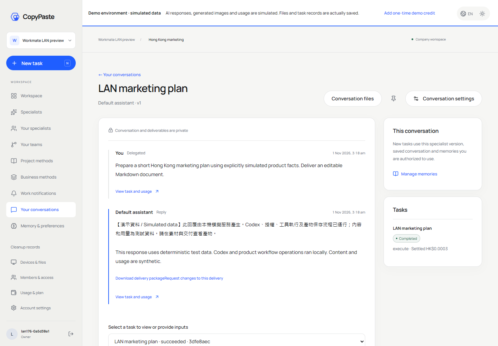
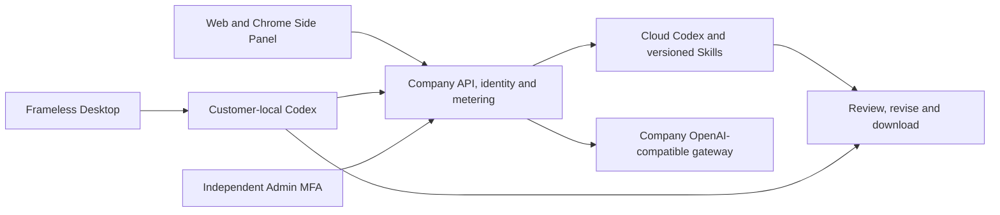

# Workmate · web · v0.1.0

<!-- public-domains-177 -->
## Public HTTPS deployment · stage177

[Web](https://agent.copypaste.hk) · [Admin](https://agent-dashboard.copypaste.hk) · [API readiness](https://ai-api.copypaste.hk/health/ready)

Same-origin /v1 proxy: email code → workspace/project → simulated credit → specialist task → delivery/download.

[Current deployment, login and operations / 当前部署、登录与运维](https://github.com/copypasteltd/workmate/blob/docs/docs/releases/domains-177.md)

Credentials are unchanged: server `/root/cfg/workmate/credentials.txt`, root `0600`. Admin: `admin@workmate.local` + email OTP + TOTP. Test mailbox: [protected operator inbox](https://agent-dashboard.copypaste.hk/ops/mailbox/). AI/media/ads/payment remain synthetic; records/files persist. 凭据保留，测试收件箱使用独立操作口令，外部服务仍为假数据。

[Desktop 0.7.2 Setup](https://agent.copypaste.hk/downloads/CopyPaste-0.7.2-x64-Setup.exe) · [Portable](https://agent.copypaste.hk/downloads/CopyPaste-0.7.2-x64-Portable.exe) · [Extension 0.5.3 ZIP](https://agent.copypaste.hk/downloads/CopyPaste-Extension-0.5.3.zip) · [Source increment / 源码增量](https://agent.copypaste.hk/downloads/workmate-domains-177.zip)

Windows installers are unsigned. Extract the Extension ZIP and load it unpacked in Chrome developer mode; the extension ID stays `fffkcnmfdhahlnifgdilabheppkgnlok`. Desktop AI access uses company services; supplier keys are not embedded. Windows 未签名，扩展采用已解压加载，固定 ID 不变。




[MP4 recording](assets/demos/177-public-domains.mp4)

---

Earlier releases and deployment history / 以下为历史版本及部署记录。

<!-- lan-deployment-176 -->
## LAN HTTP deployment · stage176

Web: http://192.168.31.20:63070 · Admin: http://192.168.31.20:63071 · API: http://192.168.31.20:63072

LAN HTTP supports login, workspace creation, secure digests, tasks and uploads; 19 role templates are available.

Server plaintext credentials: `/root/cfg/workmate/credentials.txt` (root `0600`). Email OTP is retrieved through the protected test mailbox; Admin additionally requires TOTP. Synthetic services remain explicitly labeled.

[部署、登录与运维 / Deployment and login guide](https://github.com/copypasteltd/workmate/blob/docs/docs/releases/lan-176.md)




[实际操作录像 / Actual recording](assets/demos/176-lan-http.mp4)


## v0.1.3 · 当前完整交付 / Current complete delivery

[Release / 下载](https://github.com/copypasteltd/workmate/releases/tag/v0.1.3) · [中英使用手册 / Bilingual guide](https://github.com/copypasteltd/workmate/blob/v0.1.3/docs/releases/v0.1.3.md)

本轮完整包包含六仓源码和全部端，纳入团队/单次运行费用报表、原成员/协调员账目、交叉筛选和同快照CSV。当前源码与假数据冻结交付按使用者要求收口；服务器资料和正式服务接入后续提供。AI/媒体/广告/支付使用假数据，Windows未签名；完整专业/生产台账保持。

All six source trees/clients are delivered, including team/run financial reports, original member/coordinator entries, intersecting filters and matching snapshot CSV. This current source/synthetic frozen delivery closes as requested; server/live configuration follows later. External services are synthetic and Windows is unsigned. Full professional/production qualification remains tracked.


## Current complete frozen delivery · v0.1.2

The complete bundle includes every client, six source trees and the current posting-period reports. Desktop runs Codex locally with explicitly granted full local permission; the native Extension Side Panel reads/uploads authorized files for cloud Codex. Schema156, authorized synthetic AI/media/ads/payments and unsigned Windows.

[完整下载 / Complete release](https://github.com/copypasteltd/workmate/releases/tag/v0.1.2) · [安装、登录和使用 / Setup and flows](https://github.com/copypasteltd/workmate/blob/v0.1.2/docs/releases/v0.1.2.md)

本轮重新构建Backend/Admin；其余运行产物及Windows分发核对后复用。继承源码一致的阶段172定向验证，阶段173不重跑功能测试。Backend/Admin rebuilt; unchanged runtimes/Windows distributions verified and reused. Exact-source stage172 focused checks inherited; no functional tests rerun at173. Older entries below retain their historical scope.

## Frozen delivery v0.1.1

The complete bundle includes local-Codex frameless Windows Desktop, Web, independent Admin, native Chrome Side Panel, backend, six buildable source trees and pinned runtime. Authorized synthetic services, unsigned Windows and schema156.

[完整发行包 / Complete release](https://github.com/copypasteltd/workmate/releases/tag/v0.1.1) · [安装及流程 / Setup and flows](https://github.com/copypasteltd/workmate/blob/v0.1.1/docs/releases/v0.1.1.md)


[中文](README.md) · [Complete release](https://github.com/copypasteltd/workmate/releases/tag/v0.1.0) · [Bilingual setup guide](https://github.com/copypasteltd/workmate/blob/v0.1.0/docs/releases/v0.1.0.md)

Workmate serves Hong Kong enterprises, beginning with existing marketing teams. This independent **web** component uses **React / TypeScript / Vite**. Business areas include design/media, advertising and website/SEO/GEO analytics, repeatable workflows and software development. CopyPaste's warm background, dark text, brand accents and editorial typography guide the interface.

## Current frozen release · v0.1.0

All clients, backend and six source trees are delivered together, including the latest creator-filtered Admin tasks/content. Six components are rebuilt. Rebuilt Desktop outputs match the qualified Windows app/Portable/Setup byte for byte, so those verified binaries are reused. Stage166's eight SQL/API cases and eight actual UI checks retain their source-bound original evidence; broad historical regression is not rerun.

Branch`web`, frozen tag`v0.1.0-web`. [Source and installers](https://github.com/copypasteltd/workmate/releases/tag/v0.1.0) · [Freeze record](https://github.com/copypasteltd/workmate/blob/v0.1.0/docs/quality/release-freeze-checkpoint-167.json) · [Open work](https://github.com/copypasteltd/workmate/blob/v0.1.0/docs/quality/remaining-work-stage167.md). AI/media/ads/payments use the authorized synthetic mode; Windows is unsigned. Existing screenshots/GIF/MP4 retain their actual capture scope and do not imply new full installation/professional qualification.

## Architecture and responsibilities

Entry points: `src/main.tsx, src/context.tsx, src/workspace-creation-form.tsx`. Codex is the only agent kernel. All AI calls use the company's OpenAI-compatible gateway; provider secrets remain server-side. Presets pin Skills, tools and configuration versions. The designer combines Codex, design Skills and company Image 2.

Web runs cloud agents. Chrome MV3 provides conversation and attachments in its native right Side Panel; customers explicitly select files and consent to upload for cloud execution. Desktop is frameless without Electron's default menu, runs Codex on the customer's computer and supports explicitly granted full local permission, stop/revocation and account/directory isolation.

Admin has independent email OTP plus TOTP and scoped permissions for users/organizations, usage, billing, VIP, roles/Skills and content. User detail passes the actual target ID; fee accounts are subject-filtered and VIP locks that target. Switching users unmounts previous dialogs/previews. Amounts use HKD micro-units. Budgets, balances, receipts, gifts, credit and VIP are distinct. Manual changes require preview, confirmation, current MFA/policy/approval, audited idempotency and current authority.



## Setup and commands

Place six independent repositories beside each other under `dev/`: platform, web, admin, desktop, extension and delivery, each with the `copypaste-` prefix. Use Windows x64, Node.js 22.14+, Git and native PostgreSQL. Media requires FFmpeg/FFprobe. Pinned Codex ships in the runtime archive. Docker, WSL and virtualization are prohibited.

Read the release guide. Before first configuration, choose an available database port. From Delivery run `demo:preflight`, `bootstrap:demo`, `demo:check`, then `demo`. Preserve existing configuration/data. Run Delivery `npm run stop` to close owned services.

Individual component development after supporting dependencies/backend are ready:

```powershell
npm ci
npm run dev
```

API uses localhost4310, Web4317 and Admin4318. Development OTP messages are in platform `.data/mailbox/`. Enroll an administrator with platform `npm run admin:create -- admin@example.com super_admin` and configure TOTP from its one-time material. Desktop uses browser PKCE, a chosen local directory and explicit permission. Load the extension unpacked in Chrome developer mode and click its icon to open the side panel.

## Customer and operator workflow

1. Sign in and accept an invitation or create a workspace/initial project. An uncertain creation keeps its original request. Check & continue after reload reconciles that operation; unavailable/removed receipts never silently create a replacement company.
2. Select a project/preset, provide the brief, approved files/brand/accounts, budget and permission. Supply missing inputs within the original task. Execution pins accepted configuration and Skill versions.
3. Review durable progress, approvals, delivery versions, costs and consumption. Download original files or request revisions. Unknown costs stay under reconciliation instead of being treated as free or blindly repeated.
4. From Admin user detail, verify the billing/VIP subject, inspect its preview and confirm under current policy. Directory filters survive refresh/return. User detail opens creator-filtered tasks/content with separate body authority and preserved navigation.

## Configuration and authority

Web/Admin use `VITE_API_BASE` or a same-origin proxy. Native deployment settings pin allowed origins and extension ID. Use HTTPS outside approved loopback development. SQL history is001–155; API/Worker check schema and environment identity. Sources exclude secrets, private `.env`, user databases, dependencies and Git metadata.

Expired sessions clear the previous workspace. Delayed responses cannot replace a newer sign-in. Files are private by default. Requests, worker claims, tools and downloads recheck authority. Saved responses confer no permanent access. Explicit sign-out removes private workspace-draft names while retaining an owner-scoped opaque recovery key.

## Preset and Skill bindings

Eighteen professional presets are defined; this count does not prove complete professional qualification of twelve roles.

| ID | Role | Required Skill bindings |
| --- | --- | --- |
| R01 | Full-stack engineer | `fullstack-engineering@1.0.0`, `frontend-implementation@1.0.0`, `backend-api@1.0.0`, `qa-testing@1.0.0`, `delivery-core@1.0.0` |
| R02 | Frontend engineer | `frontend-implementation@1.0.0`, `ui-system@1.0.0`, `qa-testing@1.0.0`, `delivery-core@1.0.0` |
| R03 | Backend/API engineer | `backend-api@1.0.0`, `qa-testing@1.0.0`, `delivery-core@1.0.0` |
| R04 | QA engineer | `qa-testing@1.0.0`, `frontend-implementation@1.0.0`, `delivery-core@1.0.0` |
| R05 | UI/UX designer | `ux-research@1.0.0`, `ui-system@1.0.0`, `frontend-implementation@1.0.0`, `delivery-core@1.0.0` |
| R06 | Designer | `creative-direction@1.0.0`, `image-art-direction@1.0.0`, `image2-production@1.0.0`, `typography-layout@1.0.0`, `delivery-core@1.0.0` |
| R07 | Brand designer | `brand-system@1.1.0`, `image-art-direction@1.0.0`, `image2-production@1.0.0`, `typography-layout@1.0.0`, `delivery-core@1.0.0` |
| R08 | Advertising creative designer | `ad-creative@1.0.0`, `image-art-direction@1.0.0`, `image2-production@1.0.0`, `typography-layout@1.0.0`, `delivery-core@1.0.0` |
| R09 | E-commerce designer | `ecommerce-visual@1.0.0`, `image-art-direction@1.0.0`, `image2-production@1.0.0`, `typography-layout@1.0.0`, `delivery-core@1.0.0` |
| R10 | Social content designer | `social-content@1.0.0`, `image2-production@1.0.0`, `typography-layout@1.0.0`, `delivery-core@1.0.0` |
| R11 | Illustration/IP designer | `illustration-ip@1.0.0`, `image-art-direction@1.0.0`, `image2-production@1.0.0`, `delivery-core@1.0.0` |
| R12 | Typography/layout designer | `typography-layout@1.0.0`, `image-art-direction@1.0.0`, `image2-production@1.0.0`, `delivery-core@1.0.0` |
| R13 | Presentation designer | `presentation-production@1.1.0`, `typography-layout@1.0.0`, `dataviz@1.1.0`, `delivery-core@1.0.0`, `deterministic-metrics@1.1.0` |
| R14 | Landing page designer | `landing-page@1.0.0`, `ui-system@1.0.0`, `frontend-implementation@1.0.0`, `image2-production@1.0.0`, `delivery-core@1.0.0` |
| R15 | Data visualization designer | `dataviz@1.1.0`, `deterministic-metrics@1.1.0`, `typography-layout@1.0.0`, `delivery-core@1.0.0` |
| R16 | Video/motion designer | `video-storyboard@1.0.0`, `template-video-composition@1.0.0`, `video-generation@1.1.0`, `speech-production@1.2.0`, `delivery-core@1.0.0` |
| R17 | Marketing analyst | `ads-analysis@1.1.0`, `deterministic-metrics@1.1.0`, `dataviz@1.1.0`, `delivery-core@1.0.0` |
| R18 | Workflow automation consultant | `workflow-design@1.1.0`, `workflow-execution@1.1.0`, `delivery-core@1.0.0` |


[Role contract](https://github.com/copypasteltd/workmate/blob/backend/catalog/role-preset-catalog.json) · [Skill contract](https://github.com/copypasteltd/workmate/blob/backend/catalog/skill-packages.json)

## Actual screenshots and interaction

The shared media shows this release's actual Web/SQL recovery and Admin MFA/target checks with synthetic business facts. It does not claim fresh installation acceptance of other native clients.


[Actual MP4](assets/screenshots/workmate-functional-closure-165-01-recover-original-workspace.mp4)

## Historical rc.5 qualification and publication

Historical rc.5 record: seven focused SQL cases, four draft-state cases and actual Web/Admin interactions accompanied six builds and Windows unpacked/Portable/Setup packaging. Current ASAR bytes and pinned Codex hashes are checked. Repeated broad regression is omitted as requested; the release checkpoint records actual results.

Branch `web`, frozen tag `v0.1.0-rc.5-web`. Later changes advance branches and notes while frozen bytes/tags remain. AI/media/ads/payments use the authorized synthetic mode. Windows is unsigned. All102 IDs and88 required whole-acceptance scopes remain;88 is not a count of missing modules. Production providers, signed updates, other OSes and full professional acceptance remain tracked.

[Checkpoint](https://github.com/copypasteltd/workmate/blob/v0.1.0-rc.5/docs/quality/release-freeze-checkpoint-165.json) · [Original acceptance ledger](https://github.com/copypasteltd/workmate/blob/v0.1.0-rc.5/docs/quality/remaining-work-stage165.md) · [Historical README](https://github.com/copypasteltd/workmate/blob/v0.1.0-rc.5/docs/history/readme-before-rc5/web-en.md)
