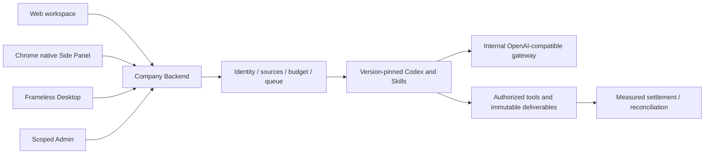

# Workmate · CopyPaste Desktop

[中文](README.md) · [Documentation](https://github.com/copypasteltd/workmate/blob/docs/docs/README.en.md)

[Backend](https://github.com/copypasteltd/workmate/tree/backend) · [Web](https://github.com/copypasteltd/workmate/tree/web) · [Admin Dashboard](https://github.com/copypasteltd/workmate/tree/admin) · [Desktop](https://github.com/copypasteltd/workmate/tree/desktop) · [Chrome Extension](https://github.com/copypasteltd/workmate/tree/extension) · [Delivery](https://github.com/copypasteltd/workmate/tree/delivery)

An enterprise Agent product whose Desktop target runs Codex locally. This repository owns **Desktop** and publishes to `desktop`.

<!-- client01-direction -->
## Current client direction — implementation gap

CLIENT01 (2026-10-22) requires **Desktop to run Codex on the customer's computer**, with a real user-opt-in **full local access** mode and Codex Desktop as the operation benchmark. The **Extension uses a ChatGPT-style conversation and attachment layout in Chrome's native right Side Panel**, reads user-selected files and uploads them for cloud Codex execution. All product AI calls still use the company gateway.

**Current implementation:** The independent Desktop local Codex supervisor has passed nine native tests; product consent, billing and bundled distribution still need integration. The Extension now provides native Side Panel conversations, history, a bottom composer and immutable-version attachments. All 32 Extension tests and seven real Side Panel journey checks passed, with explicitly synthetic model turns. The original 102 requirements and full client acceptance remain open. [Extension implementation](https://github.com/copypasteltd/workmate/blob/docs/docs/technical/71-extension-cloud-conversations.md).

The architecture diagram below describes the implemented cloud/file-bridge baseline; it is not the target Desktop local-agent architecture.

Native supervisor scope, actual permission checks and remaining integration: [implementation details](https://github.com/copypasteltd/workmate/blob/docs/docs/technical/70-desktop-native-codex-supervisor.md).

<!-- /client01-direction -->

## Architecture and constraints

Codex is the only Agent kernel. All AI calls use the company's internal OpenAI-compatible server. Web, Desktop, extension and Admin share server identity, permissions, sources and billing controls. UI follows CopyPaste brand assets, colors, typography and bilingual patterns.



## Native window and architecture

A frameless Electron window uses `frame:false` and `thickFrame:false`, removes the application menu and disables default/Alt menus. A custom 40px title bar provides dragging, minimize, maximize/restore and close. Actual packaged-window state transitions are verified.

`src/main.ts` owns lifecycle, authorization, native saves and restricted IPC. `src/preload.cts` exposes only approved bridge functions; `src/window-controls.ts` validates window actions. `renderer/` is a self-contained React snapshot and builds without sibling Web sources.

contextIsolation and sandbox are enabled; nodeIntegration is disabled. The renderer cannot freely call Admin, arbitrary URLs or system files. Company API/Web origins are compiled; model credentials remain server-side.

## Usage flow

Launch → fixed company login page → email verification/PKCE authorization → localhost callback → workspace/project selection → tasks, inputs, conversations and deliverables. Sessions and refresh families are revocable; requests carry current scope.

Local work requires explicit file/folder selection and time-bounded grants. Device commands, signatures, hashes, expiry and single-use results are checked by Backend and the local bridge. Downloads use the current tenant's authenticated bridge and native save dialog; cancellation does not create a fake success file. Autonomous Codex local-file dispatch and strongly isolated customer-code execution remain incomplete.

## Develop and package

```powershell
npm ci
npm run build
npm start
```

```powershell
npm run typecheck
npm test
npm run package
```

`COPYPASTE_API_ORIGIN`, `COPYPASTE_WEB_ORIGIN`, `COPYPASTE_EXTENSION_ID` or `deployment.json` configure deployment. `scripts/configure-deployment.mjs` compiles the configuration. Production uses HTTPS. Local NSIS Setup and Portable outputs are ignored under `release/`.

The qualified preview executes `release/paid-input-66-03/win-unpacked/CopyPaste.exe`. Setup/Portable are generated but unsigned; installation, upgrade/uninstall, signing and distribution matrices remain unqualified.

## Files and extension companion

Register the Native Messaging companion according to the runbook; the extension ID must match its fixed allowlist. Models and ordinary webpages cannot enlarge grants. Desktop and Side Panel share company identity and Backend business services without embedded independent AI-provider secrets.

## Checkout and prerequisites

Clone this branch into a fresh working directory; update an existing repository without reinitializing it.

```powershell
git clone --single-branch --branch desktop git@github.com:copypasteltd/workmate.git copypaste-desktop
cd copypaste-desktop
```

Use Node.js ≥22.14, npm and Git with pinned lockfiles. The qualified local environment is Windows x64. Backend/full delivery also needs native PostgreSQL launcher resources, pinned Codex `0.163.0-alpha.10.2` and FFmpeg/FFprobe. No local Docker, WSL or virtualization. Run components in separate directories; see [workspace](https://github.com/copypasteltd/workmate/blob/docs/docs/governance/04-git-branches-and-publication.md).

## Checks and evidence scope

```powershell
npm run typecheck
npm test
npm run build
```

**802/802** full Platform tests and **52/52** focused task tests pass, with **13 checks** across six repositories and **32** actual packaged Desktop/native Side Panel checks. All prior 782 named regression cases remain. Task checks exercise actual PostgreSQL, identity, ledger and Worker; separate real Codex child processes use a synthetic internal gateway. UI turns/business data are synthetic as authorized. The original 102 requirements remain: 81 partially verified, 21 without proven completion and zero fully accepted.

Canonical TaskDTO/task creation, arbitrary in-flight pause, unknown-effect recovery, independent complete role workflows, GEO, live suppliers and production/signing/store qualification remain tracked.

This revision adds canonical task APIs and atomic original-task inputs. Current UIs continue to use their existing project/conversation interfaces over the same execution domain. The refreshed actual recordings verify compatibility; they do not claim migration of every UI to canonical task APIs. See [the implementation and limits](https://github.com/copypasteltd/workmate/blob/docs/docs/technical/68-canonical-task-contracts-and-input-transactions.md) for exact money, idempotency, source revocation and unsupported business parameters.

## Actual screens and interactions

Actual recordings preserve capture timing. AI turns/business data are explicitly synthetic. Admin form demonstrations do not claim a financial commit.


[MP4](assets/screenshots/workmate-10-interaction.mp4) · [Capture/source evidence](https://github.com/copypasteltd/workmate/blob/docs/docs/quality/workmate-media-10.json)

## Detailed design and updates

### Native Codex supervisor increment (product UI integration pending)

[LocalCodexSession](src/local-codex.ts) directly starts the pinned native Codex and manages threads, turns, terminal/file events and shutdown over stdio. Modes are read-only, workspace-write and full local access; full access actually uses `danger-full-access` / `never`. Separate native tests exercise existing/outside-workspace file writes, real Skill loading, same-thread continuation, read-only downgrade, obsolete grants, revocation/shutdown and account/project isolation. Company gateway receipts must govern billing; native tokenUsage is observational.

Prepare a Windows native Codex binary matching [the version/hash lock](contracts/local-codex-runtime.json), and set the task-specific `COPYPASTE_LOCAL_CODEX_TEST_BIN` to its absolute path. Tests do not search PATH or skip missing prerequisites. From this repository run:

```powershell
npm run test:local
npm run build
node scripts/package-client-direction.mjs
```

The final command creates the unsigned localhost candidate in `release/client-direction-70-01/` and refuses to overwrite an existing directory. It contains the compiled supervisor library, while **the UI still runs the existing cloud/file-bridge flow**. Bundled Codex distribution, local consent UI, main-process IPC, scoped company credentials/billing and complete tool qualification remain open. Current captures do not qualify a local-Agent user flow. See the [integration details](https://github.com/copypasteltd/workmate/blob/docs/docs/technical/70-desktop-native-codex-supervisor.md) and [latest checkpoint](https://github.com/copypasteltd/workmate/blob/docs/docs/quality/local-codex-supervisor-checkpoint.json).

### Requirements, architecture and historical updates

- [Product](https://github.com/copypasteltd/workmate/blob/docs/docs/product/01-prd.md)
- [Architecture](https://github.com/copypasteltd/workmate/blob/docs/docs/technical/01-architecture-and-stack.md)
- [Identity and permissions](https://github.com/copypasteltd/workmate/blob/docs/docs/technical/07-security-and-permissions.md)
- [Task continuation](https://github.com/copypasteltd/workmate/blob/docs/docs/technical/66-paid-native-input-checkpoints.md)
- [Admin](https://github.com/copypasteltd/workmate/blob/docs/docs/product/08-admin-dashboard.md)
- [Native clients](https://github.com/copypasteltd/workmate/blob/docs/docs/technical/30-native-window-and-browser-sidepanel.md)
- [Canonical task update](https://github.com/copypasteltd/workmate/blob/docs/docs/changes/2026-10-22-canonical-task-repair.en.md)
- [Local Codex update](https://github.com/copypasteltd/workmate/blob/docs/docs/changes/2026-10-22-native-codex-supervisor.en.md)

Every later change updates both READMEs, affected actual captures/GIFs, release notes and its mapped branch. Verify remote SHAs through Delivery publishing; do not force-push collaborator history. Keep environment secrets, databases, sessions, dependencies and installers out of Git. Exact historical README bytes are retained in [archive](https://github.com/copypasteltd/workmate/blob/docs/docs/quality/history/stage66-before-workmate-readmes/manifest.json).
