# CopyPaste Desktop

[简体中文](README.md) · Windows enterprise Agent client · 0.3.0

An independent Electron repository bundling the Web workspace and a narrow local bridge. It supports system-browser login, Windows user-level encrypted credentials, explicit folder grants, platform-signed local file dispatch and Chrome Native Messaging. Codex execution remains on the company platform; the client never connects directly to model providers.


## Run and package

Windows x64, Node.js 22.14+ and npm are required. macOS/Linux packages have not been built or qualified. Start platform and Web first:

```powershell
npm ci
npm run typecheck
npm test
npm run build
npm start
```

Public `deployment.json` contains API/Web origins and the official extension ID. `COPYPASTE_API_ORIGIN` / `COPYPASTE_WEB_ORIGIN` can override at build or runtime. Only HTTPS or localhost is accepted. Delivered binaries target local demonstration at `localhost:4310/4317`; rebuild with company cloud origins for deployment.

```powershell
npm run package
```

Outputs include `release/CopyPaste-0.3.0-x64-Setup.exe`, `release/CopyPaste-0.3.0-x64-Portable.exe` and `release/win-unpacked/CopyPaste.exe`. `package:dir` produces only the unpacked app for QA. Packages are unsigned and are not store-published. Docker, WSL and virtualization are prohibited.

## Identity and local files

```mermaid
flowchart LR
  D[Launch Desktop] --> B[System browser and PKCE]
  B --> E[Email verification and consent]
  E --> L[Single-use loopback callback]
  L --> V[DPAPI-protected local session]
  V --> W[Workspace and cloud deliverables]
  W --> F[Native folder selection]
  F --> G[One-hour read-only grant]
  G --> P[Device pairing and pinned public key]
  P --> C[Verify signature, nonce and expiry]
  C --> R[Limited file execution and result]
```



State, PKCE, exact loopback callbacks and single-use codes protect sign-in. Short-lived access tokens use rotating refresh families. Logout revokes the platform session and local folder grants. Windows DPAPI CurrentUser wraps a local profile key; AES-256-GCM authenticates encrypted state. Credentials never persist as plaintext. The key does not depend on concurrent Chromium profiles, so Desktop and native-host processes share grants safely. A fixed native Windows PowerShell/.NET helper invokes DPAPI using stdin for secret bytes; it never executes customer commands.

Normal user state is `%APPDATA%/CopyPaste/`; QA uses isolated `COPYPASTE_USER_DATA`. Installed application user state is distinct from source/build artifacts, which remain in this repository.

Roots stay local. Grants default to list/read, require separate consent for create-only writes, expire after one hour and are limited to 20. Reads are limited to 5 MB, text creates to 2 MB and listings to 500 items. Traversal, links/junctions, ADS, Windows device names, trailing dots/spaces and overwrites are rejected. Revocation/expiry is checked before journal replay; journal size/count are bounded and cross-process writes are serialized.

Downloads use the company API and native save dialog with create-only semantics. Uploads require chosen files or authorized folders. Commands verify Ed25519 signatures, pinned keys, nonces and expiry. Results currently use native bearer tokens plus nonce, not client-signed result envelopes.

## Specialists and conversations

Version 0.2.0 bundles persistent specialists, private conversations, five memory scopes and ask/plan/execute modes. Notes persist through the limited native API bridge and survive renderer reloads. Desktop and Web share platform user/permission rules. Private task outputs become shared project copies through explicit publication.


## Chrome helper

Install Setup to a stable path, then explicitly connect the Chrome helper from the device page. This writes the current user's `HKCU/Software/Google/Chrome/NativeMessagingHosts/hk.copypaste.agent` registration and only permits the configured official extension. The extension separately requests nativeMessaging and individual folder grants. Use Setup for persistent registration; portable paths may change.

Trusted deployment staff may also use:

```powershell
npm run native:register -- fffkcnmfdhahlnifgdilabheppkgnlok 'C:\YourStableInstall\CopyPaste.exe'
```

Point registration only at a stable trusted executable. QA does not overwrite existing user registry settings. The helper implements Chrome length-prefixed JSON with responses capped at 900 KB.

## Independent renderer

Committed `renderer/` is a self-contained Web source snapshot. Normal builds do not require a neighboring Web checkout. Explicit refresh:

```powershell
npm run renderer:sync -- 'D:\path\to\copypaste-web'
npm run build
```

`renderer-source.json` records provenance and hashes. Context isolation and sandboxing are enabled; Node integration and webviews are disabled. CSP prevents direct renderer networking; a limited IPC API handles requests. Extra permissions, arbitrary external origins and navigation are denied. Native-host mode creates no browser window.

## Validation and remaining scope

`npm test` covers path confinement, revocation, replay, create-only behavior, fixed API origin and actual Windows DPAPI cross-process decryption/tamper rejection. Delivery `qa:desktop` uses the packaged application for real OTP/PKCE, specialist creation/private-note persistence, encrypted credentials, folder access, signed cloud dispatch and native-host framing. Test dialogs select fixture paths; they do not authorize real user folders. `qa:packaged` separately checks packaging, version and launch.

The company AI gateway and external advertising platforms still require live qualification. Arbitrary desktop UI control, customer shell execution, full AI video/speech and cloud schedules are not implemented. This release does not certify every long-term requirement. QA closes its browser/application processes in finally. See [third-party notices](THIRD_PARTY_NOTICES.md); master documents remain under the delivery root's `docs/`.

Chrome Host launches the bundled Node-mode script through `resources/native-host.cmd`; its source is `src/native-host.ts`. This keeps Chrome's binary stdin/stdout independent of the GUI process.
