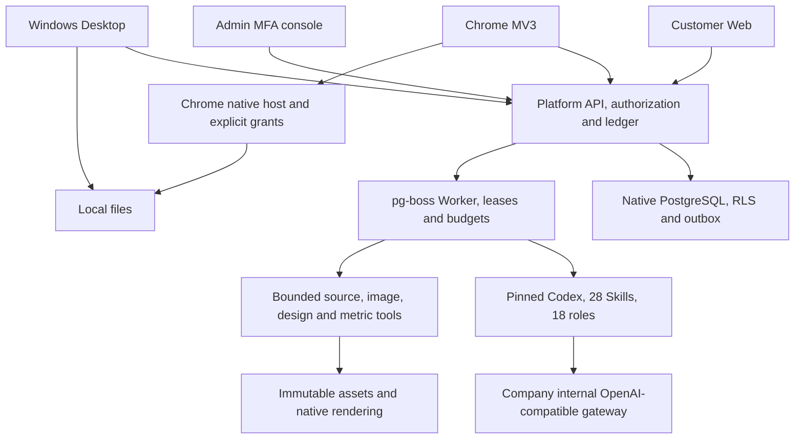
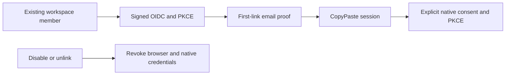

# CopyPaste Delivery and Integration

[简体中文](README.md) · Native lifecycle controller and qualification · 0.5.0

This repository is independently versioned alongside five product repositories. The working root is `D:\dev\copypasted\自有agent\`; source/dependencies/artifacts live under `dev/`, and master requirements/design/quality documents remain under `docs/`. Each repository includes bilingual READMEs, diagrams, screenshots and notices.


## Repositories

| Sibling directory     | Responsibility                                                                                         | Default entry    |
| --------------------- | ------------------------------------------------------------------------------------------------------ | ---------------- |
| `copypaste-platform`  | Identity, authorization, API/Worker, Codex, billing/VIP, assets/analytics/workflows and admin services | `localhost:4310` |
| `copypaste-web`       | Customer visit, sign-in, onboarding and workspace                                                      | `localhost:4317` |
| `copypaste-admin`     | Independent MFA console with 16 operations pages                                                       | `localhost:4318` |
| `copypaste-extension` | Chrome MV3, PKCE, explicit files/pages and native bridge                                               | Load `dist/`     |
| `copypaste-desktop`   | Windows client, folder grants, signed dispatch and Chrome Host                                         | Setup/Portable   |
| `copypaste-delivery`  | This controller, integrated QA, evidence and release manifests                                         | CLI              |

Each has its own package/lock files and main branch. Client builds do not need sibling source. Integration startup/build supports this sibling layout or `COPYPASTE_DEV_ROOT`; browser QA currently expects the documented sibling layout and local ports.

## View the existing installation

```powershell
npm start
```

Visit `http://localhost:4317` or `http://localhost:4318`. Leave the terminal open. From another terminal in this repository:

```powershell
npm run stop
```

The controller starts real native PostgreSQL, API, Web and Admin after checking ports and actual readiness. A local authenticated control port at 4319 closes only owned processes, API first and database last. Existing listeners cause startup to fail without killing them. Shutdown uses native pg_ctl to checkpoint. Clean restarts preserve specialist/conversation/memory records and preexisting listener PIDs on 5173/5174. Private controller tokens/logs live only in ignored `.data/`.

## Reproduce from clean source

Use native Windows x64, Node.js 22.14+, npm, Git, FFmpeg/FFprobe and approved Codex `0.163.0-alpha.10.2`. Docker, WSL and virtualization are prohibited. First dependency installation may download platform PostgreSQL/Electron binaries. Place all six checkouts as siblings and stop previous development services:

```powershell
npm ci
npm run bootstrap
npm start
```

Once ready, use another terminal in the platform repository:

```powershell
npm run db:migrate
npm run admin:create -- admin@your-company.example super_admin
```

Import the generated TOTP URI, then remove its enrollment file. Customers self-register through email; no shared default credentials exist. Development OTPs are in platform `.data/mailbox/`, while production requires SMTP.

Bootstrap does not install personal global tools or overwrite `.env`. Preserve the durable MASTER_KEY with database and object backups. QA uses fictional fixtures and must not stand in for real customer records.

## Runtime architecture



AI credentials remain server-only. Without the company base URL, exact aliases, key and contracted pricing, non-AI workflows run but AI tasks explicitly remain unavailable.

## Verification and evidence

```powershell
npm run verify
npm run qa:web
npm run qa:persistent
npm run qa:admin-identities
npm run qa:schedules
npm run qa:extension
# Build Desktop package:dir or package first
npm run qa:desktop
npm run qa:packaged
python -X utf8 scripts/review-repositories.py
```

Browser QA requires native Chromium. Set `CHROME_BIN` to an existing executable or install Playwright Chromium using `npx playwright install chromium`. Tests close their own tabs/contexts/processes in finally and preserve user-owned browsers.

| Evidence                 | Meaning                                                                                        |
| ------------------------ | ---------------------------------------------------------------------------------------------- |
| `verification.json`      | Six type checks/builds, 84 platform tests, three Desktop tests and route inventory             |
| `web-admin.json`         | Actual email onboarding, PNG/layer/media/data/workflows, 16 Admin pages and funding/VIP        |
| `persistent-work.json`   | Eight browser checks for specialists/private conversations/memory, mobile/dark themes and admin governance |
| `admin-identities.json` | Six browser groups for admin invitations, email/real MFA, replacement, least privilege, suspension/resumption and resend |
| `schedules.json` | Five actual-clock/closed-page report, pause/resume, time-zone edit, Admin and mobile groups |
| `federation.json` | Six signed OIDC, first-mailbox-proof, packaged Desktop and cross-client revocation groups |
| `extension.json`         | Real MV3/identity PKCE, upload, token privacy and logout                                       |
| `desktop.json`           | Actual packaged client, PKCE/encryption, real folder, signed dispatch and host framing         |
| `packaged-windows.json`  | Packaged launch/version/isPackaged and screenshot                                              |
| `native-controller.json` | Controller startup/shutdown and preservation of preexisting services                           |
| `repository-review.json` | Repository boundaries, bilingual READMEs/diagrams/screenshots, secret exclusion and provenance |
| `release-manifest.json`  | Final repository commits and binary SHA-256 hashes                                             |

Files are under `evidence/`. Results describe only executed checks. A controlled Responses fixture drives real Codex through a tool round but does not qualify the company's live model. The master baseline's 102 long-term cases are not blanket-marked passed. Documentation validation is separate: run `python -X utf8 docs/tools/validate_docs.py` at the project root.

## Database lifecycle check

Stop an existing CopyPaste controller before `npm run qa:lifecycle`. It starts, stops and restarts its own native stack, checks PostgreSQL checkpointing, readiness at the current version, persistent specialist/conversation/memory metadata and unchanged preexisting listener PIDs, then stops its stack. Run `npm start` afterwards to reopen the product. It starts no browser or virtualization.

Historical 0.1.0, 0.2.0, 0.3.0 and 0.4.0 evidence remains under `evidence/versions/`; current reports describe 0.5.0. Unfinished requirements remain tracked in repository and master documents.

## Binaries and demonstration

After validation and clean commits in all six repositories, run `npm run release`. It checks the evidence and creates `release/` with six independently cloneable Git bundles, Web/Admin/Chrome ZIP builds, Windows Setup/Portable and an exact-commit/SHA-256 manifest. Restore a repository with `git clone <file.bundle> <directory>`. Release artifacts and `evidence/release-manifest.json` are ignored to avoid a commit self-reference; their generator and validation reports remain in source control.

Run `python -X utf8 scripts/verify-release.py` to check artifact hashes and ZIP CRC/entries, then actually restore all six bundles offline and compare commits, branches, trees, source indexes and clean checkouts. It creates and removes only its own temporary directories under `.data/release-restore/`; its report is ignored at `evidence/release-restore.json`.

Desktop packaging produces unsigned Windows x64 Setup, Portable and unpacked applications configured for localhost. Load extension `dist/` manually. Production needs company origins, matching extension registration and explicit native-helper consent. No app installation, store publication, live acquiring or production deployment was performed automatically.

Suggested demonstration: email signup → workspace/project → specialist/private conversation/memory → brand/assets → editable SVG/PNG/MP4 → CSV analytics → workflow approval → Admin detail/funding/VIP → extension login/upload → Desktop login/folder/signed file command. Live Agent generation requires internal gateway qualification.

## Remaining release work

Company AI/SMTP/advertising OAuth/S3 require actual credentials and live validation. Windows signing, native production service identities/ACL/egress, restore drills and SLOs require deployment qualification. SAML/SCIM, mandatory SSO policies, event triggers, parallel specialist teams, collaborative editing, full AI video/speech, online acquiring and strong untrusted-code isolation are unfinished. The 18 installed role/28 Skill presets still need live business acceptance and must not be advertised as qualified merely because they are installed.

The long-term requirements remain intact. This delivery records working implementation and evidence rather than treating page presence as full acceptance. See each repository's bilingual instructions and [third-party notices](THIRD_PARTY_NOTICES.md).

## Cloud calendar qualification

`npm run qa:schedules` uses actual email sign-in, a new workspace, CSV and a published workflow. It previews/confirms a calendar through the UI, closes the user page, waits for the real clock and verifies the native Worker's persisted HKD/ROAS report. It then checks user pause/resume, weekly/Hong Kong edits, separate Admin MFA and a 390px layout: five groups in `evidence/schedules.json`. It makes no AI call and closes its browser, retires the calendar and cancels the fixture run in finally.

Packaged Desktop separately checks native bearer creation, rendering and retirement. `qa:lifecycle` checks database-side calendar/history digests and persistence across native restarts. Current version 0.5.0 includes 84 platform tests and three Desktop unit tests; browser and packaged journeys are reported separately.

## 0.5.0 company identity and unified sign-in

OIDC uses code + PKCE S256, signature verification, state/nonce and a fixed callback. An existing registered account and active workspace membership are required. First binding requires a separate CopyPaste work-email code; domains never auto-enroll users. Configuration changes, disablement or unlinking revoke all linked users’ CopyPaste browser/native/refresh sessions and prior execution authorization. Administrator email and TOTP remain separate.

`npm run qa:federation` runs a native signed OIDC IdP and checks email onboarding, admin save/check/enable, first-link email proof, real packaged Desktop browser SSO + loopback PKCE, 390px layout and cross-client revocation. Fixture, browser and Electron close in finally; the report is `evidence/federation.json`. This does not qualify a real company IdP or internal AI gateway.



Deployment: use exact HTTPS `SSO_ALLOWED_ORIGINS`. Default callback is `WEB_ORIGIN/v1/auth/sso/callback` through the Web API proxy; `SSO_CALLBACK_ORIGIN=API_ORIGIN` is supported when Web uses that cross-origin `VITE_API_BASE`. Production rejects `SSO_ALLOW_LOCALHOST=true`. For the native fixture only, start the development controller with this environment flag, run `qa:federation`, then stop and restart without it.
