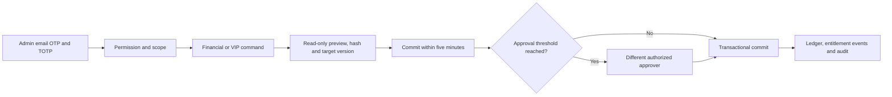
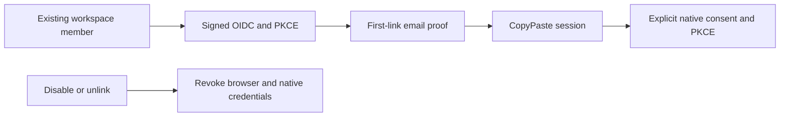

# CopyPaste Admin Dashboard

[简体中文](README.md) · Independent operations console · 0.5.0

An independent Git repository and admin client with separate identity, cookies and entry point from customer Web. It manages customers, workspaces, consumption, funding, VIP, content, execution, access and published product configuration. It shares CopyPaste branding, Traditional Chinese/English and light/dark themes. The platform enforces all authorization, auditing and transactions.


## Run

Requires Node.js 22.14+ and a running platform/database. Enroll an administrator and import TOTP using the platform CLI:

```powershell
# Run in the platform checkout
npm run admin:create -- admin@your-company.example super_admin
```

Then in this repository:

```powershell
npm ci
npm run dev
npm run typecheck
npm run build
```

Visit `http://localhost:4318`. Deploy `dist/` with HTTPS, an exact Admin origin and `/v1` reverse proxy; keep SPA fallbacks separate from API responses. Optional public `VITE_API_BASE` is in `.env.example`. Never embed AI/database secrets. Docker, WSL and virtualization are prohibited.

Every admin login requires email OTP and TOTP. Sensitive writes require MFA in the last 10 minutes; sign in again when it expires. Development codes are in the platform's local mailbox. There is no shared default administrator.

## Sixteen pages

| Page        | Implementation                                                                                                |
| ----------- | ------------------------------------------------------------------------------------------------------------- |
| Overview    | Separately authorized workspace/user/usage/reservation/reconciliation summaries                               |
| Users       | Database pagination/search, contact permissions, profile, memberships, consumption, status/session operations |
| Workspaces  | Status, member count and separately authorized financial fields                                               |
| Usage       | User/workspace/project-scoped task, token and charge aggregates                                               |
| Billing     | Immutable ledger, confirmed funding, gifts, source-bound refunds/debits and reconciliation                    |
| VIP         | Personal/workspace grants, actual start/end times, suspend/resume/extend/revoke                               |
| Content     | Unified metadata, separate body/download permissions, quarantine/restore and version checks                   |
| Execution   | Status, cancellation, reconciliation and eligible child-task retries                                          |
| Catalog     | Installed role/Skill enablement and presentation, versioned help/announcements/navigation                     |
| Connections | Connected provider scope and revocation                                                                       |
| Access      | Eight roles, 68 permissions, bounded custom roles, scoped/expiring bindings and revocation                    |
| Support     | Time-limited support-session metadata; no silent impersonation                                                |
| Audit       | Attributable operations, outcomes and timestamps                                                              |
| Jobs        | Preview/commit user-status batches and restricted CSV exports                                                 |
| Plans       | Versioned capabilities/roles/concurrency/task-budget policies                                                 |
| Policy      | Versioned approval thresholds and maximum VIP duration                                                        |


## Administrator identity lifecycle

Version 0.3.0 adds Access-page invitations with an optional initial role, scope, amount/duration/batch limits and expiry. Account creation and initial delegation are atomic. Every delegated permission and limit must fit the inviter's current grants. Only the recipient receives the invitation link. Enrolled accounts without business permissions see an access-assignment waiting screen.

```mermaid
flowchart LR
  Bootstrap[Trusted first-admin CLI] --> Invite[Invite and bounded initial role]
  Invite --> Mail[Recipient-only email link]
  Mail --> OTP[Recipient verifies email]
  OTP --> MFA[Recipient confirms new authenticator]
  MFA --> Session[Independent admin session]
  Session --> Scope[Scoped dashboard access]
  Scope --> Control[Suspend / reset / revoke]
  Control --> Fresh[Old sessions invalidated]
```



The page removes the URL fragment immediately and keeps the invitation only in component memory. Email codes and MFA setups expire, limit attempts and have one consumer. New keys are returned only to the verified person. Account detail contains safe session metadata, roles/scopes, MFA and mail status. Resending invalidates the previous link/setup; failed delivery is shown explicitly. Resuming never revives old sessions.

Sidebar authenticator settings require a recent admin sign-in and fresh email proof. The old key remains valid until the new TOTP is confirmed; success revokes old sessions and creates a current session. Account status, another administrator's MFA reset and session revocation require the matching permission, expected version and reason. Self-reset/self-suspension and removal of the last enrolled permanent recovery super administrator are rejected, including concurrent changes. Pending invitees do not count as recovery administrators. Role changes revoke sessions; pending recipients keep their invitation but must verify email and restart MFA setup.


Removing a deny restores access, so the server checks delegation permissions, scope intersections, limits and expiry. Operators cannot remove their own deny or delegate broader access over an explicit restriction in a smaller scope. Binding deletion supports same-key retries without repeated session revocation.

`src/admin-identities.tsx` implements enrollment, self MFA and account detail. Delivery `npm run qa:admin-identities` runs six actual browser groups, backed by 14 PostgreSQL/API test groups. Screenshots mask keys and verification codes. Production SMTP and enterprise SSO require separate live qualification.

## Sensitive operations



HKD values use integer micros. Confirmed-payment references are unique; this console does not acquire online payments. VIP is separate from wallet funds. Default monthly fees remain commercially unpriced.

Global/tenant/project scope, explicit denies, amount/duration/batch limits and expiry constrain operations. Delegation cannot exceed the grantor's own grants. Self-grants and removal of the last permanent recovery administrator are rejected. Contacts, consumption, balances, content bodies and downloads are separate permissions.

Published role JSON can only enable/disable installed definitions and adjust presentation; Skills can only be enabled/disabled. It cannot replace executable tools, kernel or model configuration. Quarantine affects customer visibility, sharing and subsequent execution. Collection filtering happens in authorized SQL before pagination.

## Private-content governance

The content inventory includes specialists, private conversations and memory alongside existing resources. Metadata and body reads require separate scoped permissions; body inspection is audited. Customer workspace administration does not provide platform-admin access to another user's private work.

Quarantine affects customer APIs, RLS reads and subsequent running-task tools. Conversation deletion checks active work, then clears readable messages, task content, memory versions and cached replays. Deleted conversations/memory have no restore action. Instructions change through the versioned specialist API, preserving frozen task definitions. Retried work retains private ownership/context and rechecks authorization and entitlements.


## Verification and limits

`npm test` is type checking. Delivery `npm run qa:web` exercises all 16 pages, actual OTP/TOTP, funding/VIP submission and customer detail. Delivery `npm run qa:persistent` also checks private-body reads and quarantine/restore. Platform tests cover access denial, concurrency, financial replay, VIP, bounded delegation and recovery-admin protection.

Exports are limited to 500 rows and 15 minutes, with source authorization rechecked at download. A trusted CLI bootstraps the first recovery super administrator; the UI handles subsequent invitations, MFA enrollment/replacement, suspension/resumption, resend and session revocation. Support sessions expose metadata, not customer impersonation or delegated body access. Online payments, SAML/SCIM and large exports remain unfinished.

`src/main.tsx` contains pages/commands, `api.ts` handles Cookie/CSRF, and UI foundations are a self-contained snapshot recorded in `shared-source.json`. Screenshots use real development records with fictional fixtures. Master documents are in the delivery root's `docs/`; see [notices](THIRD_PARTY_NOTICES.md).

## Cloud schedule controls

Version 0.4.0 adds scoped search and pagination for calendars on Execution, displaying metadata. Pause and resume separately require `execution.pause` / `execution.resume`, recent MFA, the current record version and a reason. Pausing preserves current work; resuming starts now without backfilling. Original user authorization is retained. Revoked authorization requires a project administrator to confirm a fresh one; an Admin cannot create new user authority through this operation.

Content governance can quarantine or delete calendars. Deletion scrubs configuration bodies and replay responses while retaining audit metadata. Quarantining the parent workflow stops future triggers and cancels current runs. `src/schedules.tsx` supplies the UI; platform queries enforce scope and authorization.


## 0.5.0 company identity and unified sign-in

OIDC uses code + PKCE S256, signature verification, state/nonce and a fixed callback. An existing registered account and active workspace membership are required. First binding requires a separate CopyPaste work-email code; domains never auto-enroll users. Configuration changes, disablement or unlinking revoke all linked users’ CopyPaste browser/native/refresh sessions and prior execution authorization. Administrator email and TOTP remain separate.

The workspace identity action configures OIDC callback URI, email domains, client ID, write-only secret, signature and email policy. Save, check, enable and disable are separate commands. Global `admin.tenants.sso.write` excludes ordinary user operators. The UI explains metadata-only checks and the all-device sign-out impact of changes or disablement.




## Lifecycle repairs in progress

Content management now shows durable deletion progress, failed cleanup items and retries guarded by scope, recent MFA, reason and idempotency. Permanently deleted assets cannot be restored or renamed, and download streams recheck authorization after opening. A persistent banner identifies synthetic mode; demo gifts are distinct from payments. Tiny nonzero charges display up to six decimals.

These source changes have not been repackaged; 0.5.0 archives retain their original contents. Full requirements and outstanding conditions remain in the master alignment report.


## Cloud directory governance (current source)

Workspace nodes are included in the content resource inventory. Existing scope, body-access, version, reason and audit checks govern metadata inspection, quarantine, restoration and deletion. Quarantining a folder hides descendants from user search and model reads. Entry removal preserves independent source assets; permanent asset erasure remains a separate lifecycle action.

## Waiting-task input governance (current source)

Authorized task-body inspection now includes requested input descriptions, provider, scope, state, selected IDs and version. Body reads retain their separate permission, data scope and audit; support-role metadata access does not expose private requests or credentials. Execution cancellation can release the original hold of an unstarted waiting task without a model charge. Retry preserves private ownership and requirements, then rechecks current resources.

Delivery `qa:admin-task-inputs` passes three actual browser groups. Platform negative tests also reject support-role body access. Screenshots use synthetic task data; browser instances close after verification.


