<!-- integrated-round-205 -->

## 205 · 0.7.18 · Exact per-call delivery and durable correction

[Evidence and limits / 证据与边界](https://github.com/copypasteltd/workmate/blob/docs/docs/quality/integrated-round-205/README.md) · [Downloads / 下载](https://agent.copypaste.hk/downloads)

1. Install setup or start portable, authorize using browser S256, then choose a local workspace and specialist. Codex runs on the customer computer with explicitly granted/revocable full local permission. Keep frameless windows and no default Electron menu.

2. The native main process confirms actual available company audio/video deliverables before completion. Preserve native authentication, company API bridge, encrypted storage and save implementation; renderer:sync was not run.

3. Cloud-task review shares per-call summaries and activity identity. Qualify final0.7.18 pinned Codex, fresh native S256, actual pages and identical Web/native export bytes. Full general persistent recovery for every local tool remains within original acceptance scope.

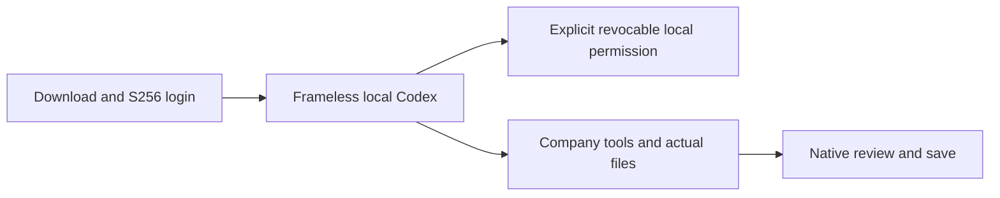

790 qualified related cases, including 675 executed in this round and unchanged Admin/Extension evidence. Four full public files passed exact size/SHA for the explicitly recorded QA path; default direct egress and DNS failover remain separate checks. The original102 requirements/32 groups, professional19-role/50-Skill sign-off, real external media/marketing/IdP services, device/concurrency/long-run/DR matrices and blind WorkBuddy comparison remain explicit. Server networking is read-only. Current exact-call rules supersede historical tool-name-only recovery descriptions below.


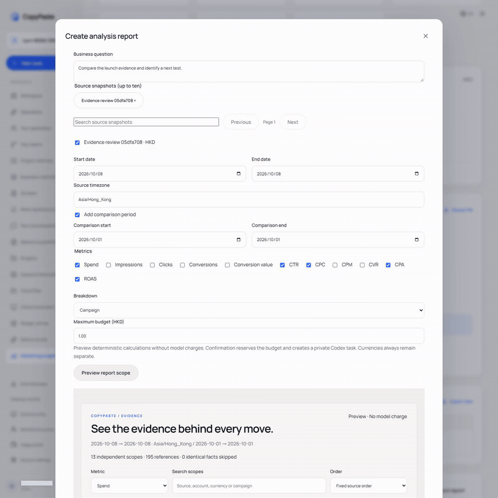

[Recorded interaction / 实际录影](assets/screenshots/workmate-205-v1-marketing-review-live.mp4)

The complete setup/usage guide and explicitly historical release notes follow.

<!-- integrated-round-204 -->

## 204 · 0.7.17 · Safe tool feedback and durable cloud ownership

[Evidence and limits / 证据与边界](https://github.com/copypasteltd/workmate/blob/docs/docs/quality/integrated-round-204/README.md) · [Downloads / 下载](https://agent.copypaste.hk/downloads)

1. Use browser S256 authorization after download. Codex runs locally on the customer computer with explicitly granted/revocable full local permission, a frameless window and no default Electron menu.

2. Cloud task review uses the shared safe feedback/current-activity behavior. Preserve native authentication, company API bridge, encrypted storage and save implementation; do not run renderer:sync.

3. Verify final 0.7.17 setup/portable packages, pinned Codex bytes, fresh native authorization, actual UI and identical-byte saves. Distinguish controlled error UI scenarios from actual deployed Web/final native Desktop journeys.

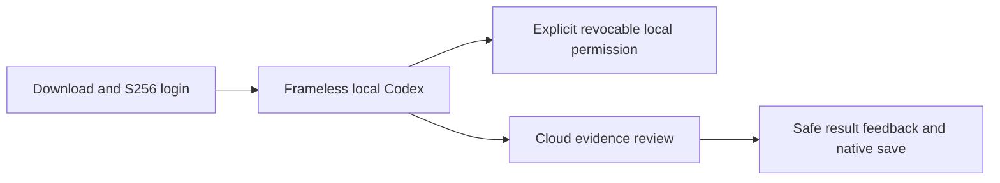

725 qualified related cases distinguish current tests from identical-source retention. One linked marketing sample delivered actual files. All four inner files passed full byte/SHA checks. Public installer transfers remain incomplete; the complete public-download gate has NOT passed. This release update and Git synchronization do not close that check. Original102 requirements/32 groups, professional19-role/50-Skill acceptance, external media/marketing/IdP setup, long-run/device/concurrency/DR qualification and blind WorkBuddy comparison remain explicit. Original generic failure/lease root causes, default public HTTP/2 and normal DNS-address failover remain unproven; QA alone selects another current public address without changing server networking; no full-product acceptance claim.

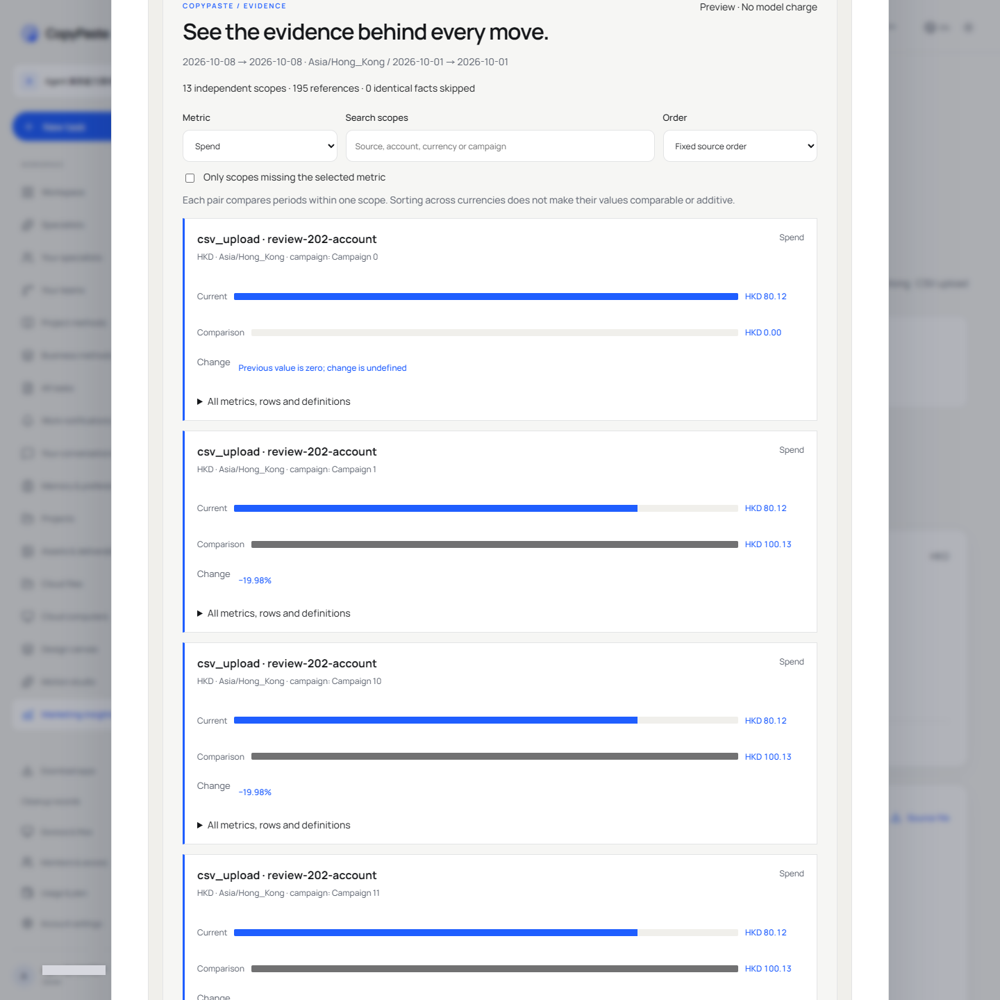

[Recorded interaction / 实际录影](assets/screenshots/workmate-204-v1-marketing-review-live.mp4)

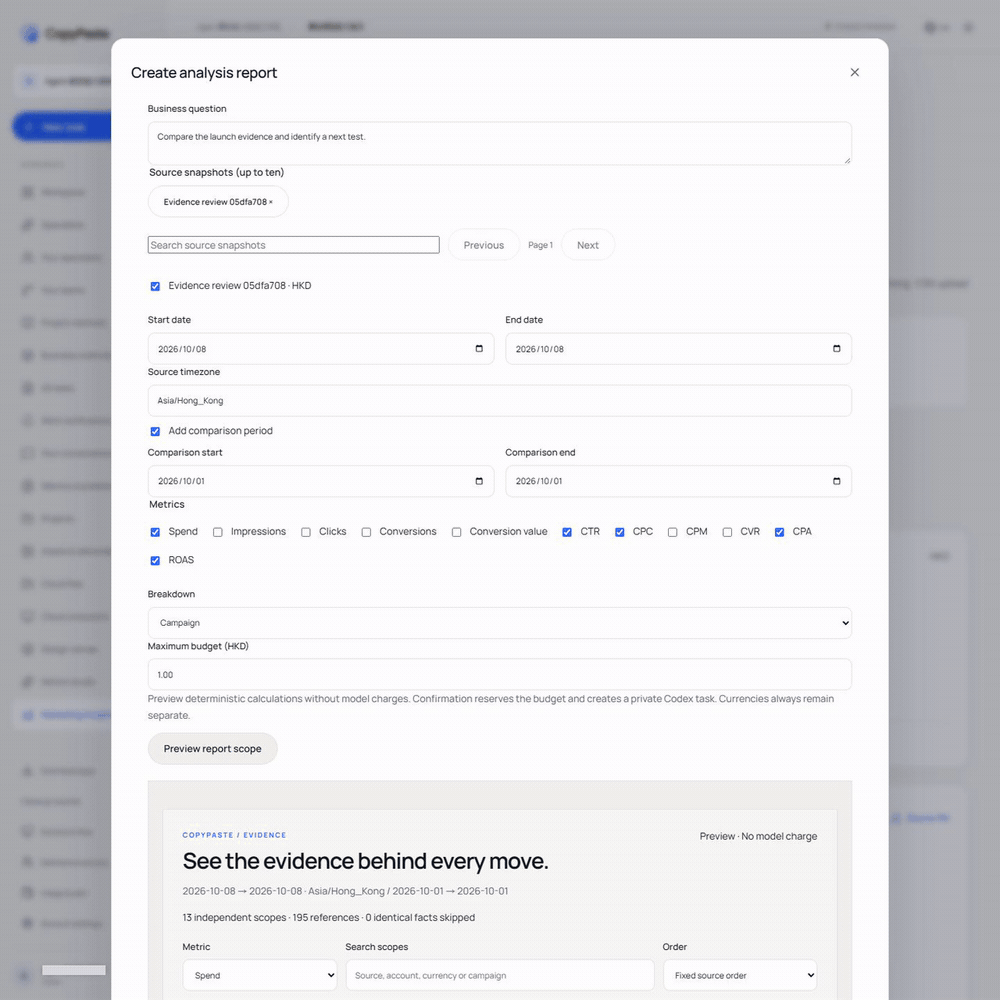

Historical release notes and the complete setup/usage guide follow.

<!-- integrated-round-203 -->

## 203 · 0.7.16 · Pinned specialist intake and reliable delivery

[Evidence and limits / 证据与边界](https://github.com/copypasteltd/workmate/blob/docs/docs/quality/integrated-round-203/README.md) · [Downloads / 下载](https://agent.copypaste.hk/downloads)

1. Install Setup or run Portable0.7.16 from Downloads and complete fresh browser S256 authorization. Pinned Codex0.163.0-alpha.11 runs on the customer computer, with explicitly granted/revocable full local permission; all AI uses company services. Keep the frameless window and no native Electron menu.

2. Open Marketing insights in the current project. The wide review rearranges controls/evidence by container width and preserves Comparison labels. Original native save dialogs export HTML/CSV/JSON with current-session, size/SHA checks and atomic writes; all six Web/native exports are byte-identical.

3. Selectively update review components and optional source validation only. Preserve native login/auth/API/crypto/local-Agent implementation. All current318 cases pass serially; the original parallel timeout remains failed. This is not a full new local-operation, OS installation/upgrade or machine matrix.

4. 203-v4 below records the actual final package/deployed service at a wider window. Original TLS HTTP/1.1 is selected only in QA processes, without server protocol changes. Trusted Windows signing is excluded by user instruction. Downloads use immutable20301 paths.

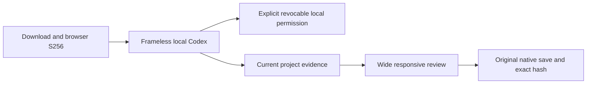

Open delivery: marketing-analyst returned no chart files; technical succeeded does not qualify it. The exact generic tool failure remains unverified. Default public HTTP/2 stalls and one worker-lease investigation also stay open. See the evidence report; no full-product acceptance is claimed.

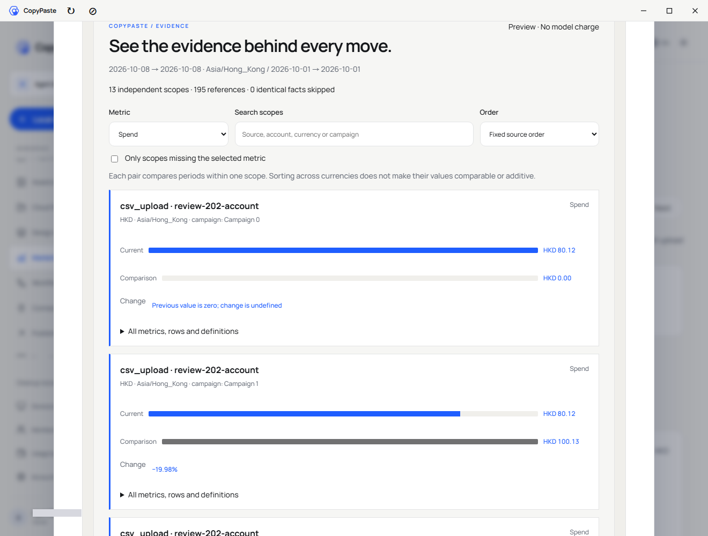

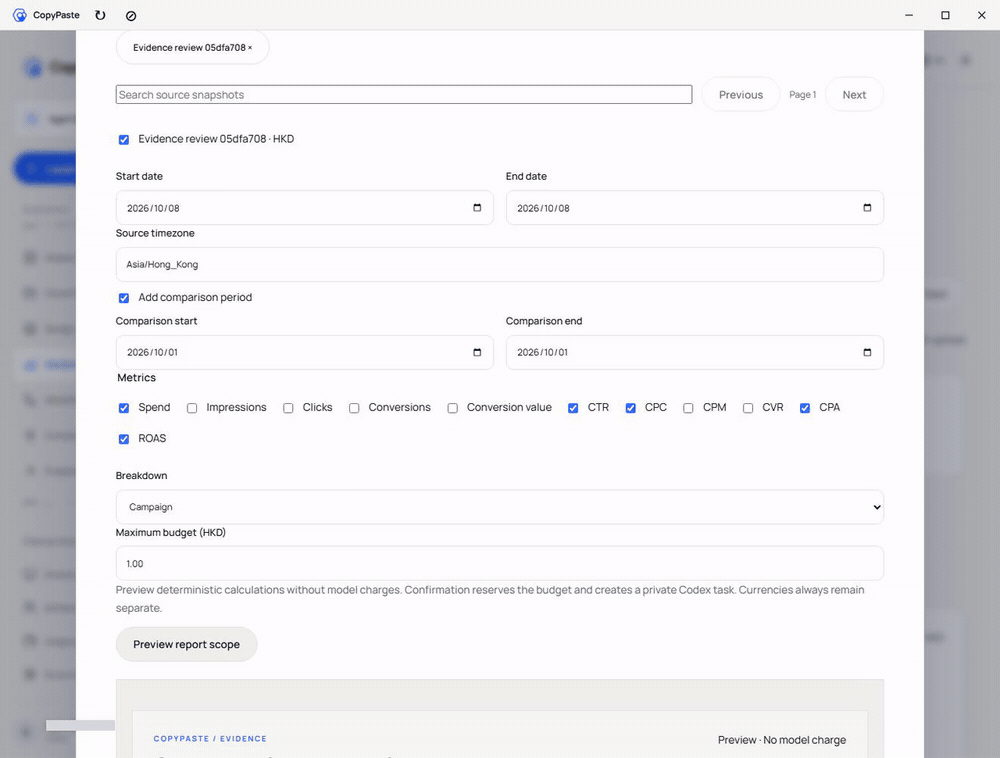

[Actual recording / 实际录影](assets/screenshots/workmate-203-v4-marketing-review-live.mp4)

The complete architecture, setup and usage guide follows.

<!-- integrated-round-202 -->

## 202 · 0.7.15 · Evidence review, delivery and safe request recovery

[Evidence and limits / 证据与边界](https://github.com/copypasteltd/workmate/blob/docs/docs/quality/integrated-round-202/README.md) · [Downloads / 下载](https://agent.copypaste.hk/downloads)

1. Download Setup/Portable and complete S256 browser authorization. Final0.7.15 remains frameless with no Electron menu; pinned Codex0.163.0-alpha.11 runs locally. Full permission is explicit and revocable; AI uses company APIs.

2. Continue the same project review in Marketing insights with native main-process saving. Only the exact authorized project review POST, formats/digest/bounded body are allowed. After the save dialog selects a destination, verify8MiB/length/SHA/current session generation and atomically save; no arbitrary POST/path is exposed.

3. The actual final package completes fresh S256/no-menu/frameless checks,13-scope review and all three native saves matching Web bytes/hashes. QA automates only its owned save-dialog destination; actual main/IPC/company requests are unchanged. This does not qualify OS installation or arbitrary applications. Pinned local Codex binary hashes are verified.

4. Setup/Portable0.7.15 and checksums are available at /downloads/releases/20201/ through the site. Older releases remain. Trusted signing stays excluded by user instruction; full machine/install/update/long-run matrices retain their original scope.

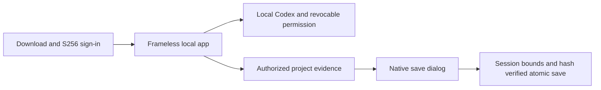

Actual deployed services with controlled acceptance CSV / 正式服务与明确验收CSV

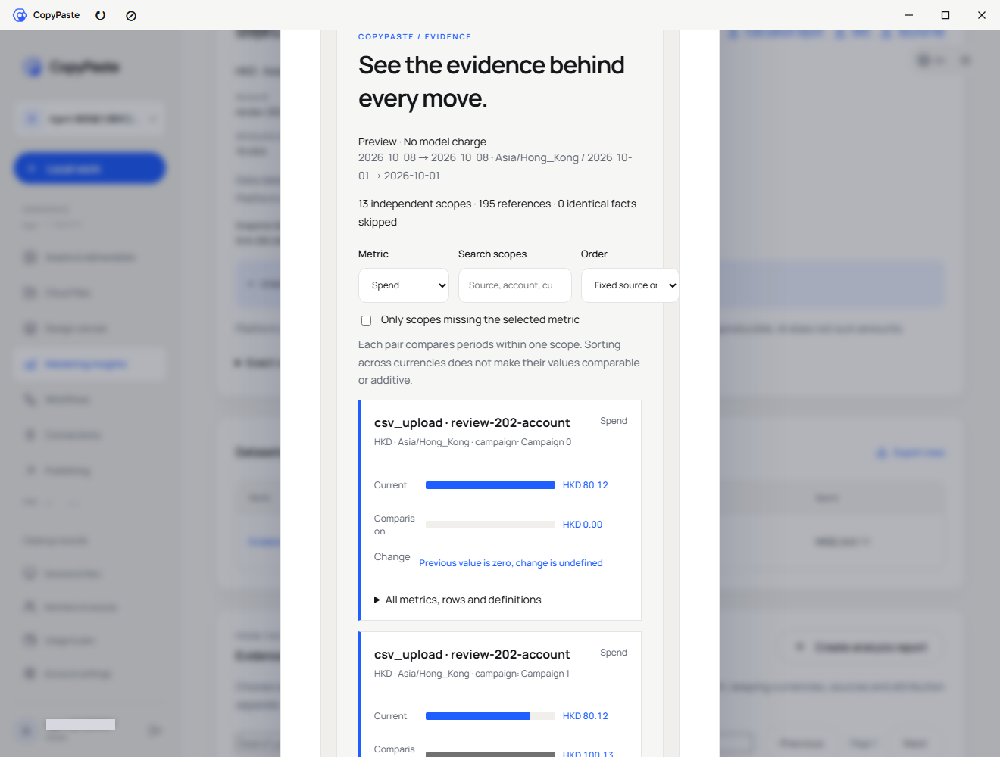

[Actual recording / 实际录影](assets/screenshots/workmate-202-v7-marketing-review-live.mp4)

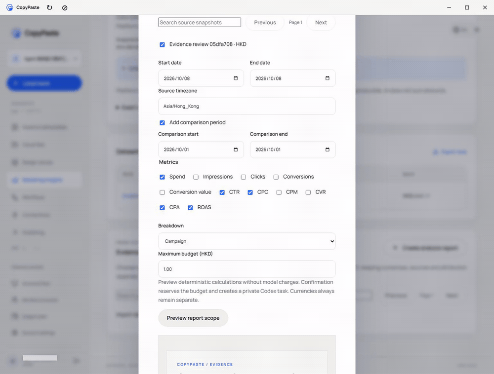

Earlier architecture, setup and complete use details remain below.

<!-- integrated-round-201 -->

## 201 · 0.7.14 · Motion production and actual delivery

[Evidence and limits / 證據與邊界](https://github.com/copypasteltd/workmate/blob/docs/docs/quality/integrated-round-201/README.md) · [Downloads / 下載](https://agent.copypaste.hk/downloads)

1. Download Setup/Portable and complete browser S256 authorization. The final package is frameless with no Electron menu. Codex runs locally; customers can explicitly grant/revoke full local permission. AI still uses company APIs.

2. Continue the same project video in Design canvas: six bilingual starters, atomic scene/caption timing, real transitions, fixed shared sources, actual frame preview, undo/redo and scoped drafts. Company media rendering does not replace the local agent.

3. The final actual0.7.14 package completes fresh authorization/no-menu/frameless checks and continues Web video v1 into v2 while retaining its original render. Main process/pinned Codex0.163.0-alpha.11 bytes match the previously qualified package. Full arbitrary-app/machine/install/update matrices remain open.

4. Setup/Portable/checksums are linked at the download page and/releases/20101/; full inner/public original-TLS bytes and hashes are checked. Trusted code signing remains excluded by user instruction; full OS installation acceptance is not claimed.

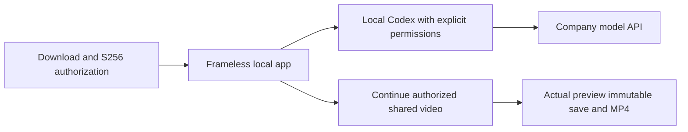

Actual final0.7.14 package / 最終實際0.7.14包

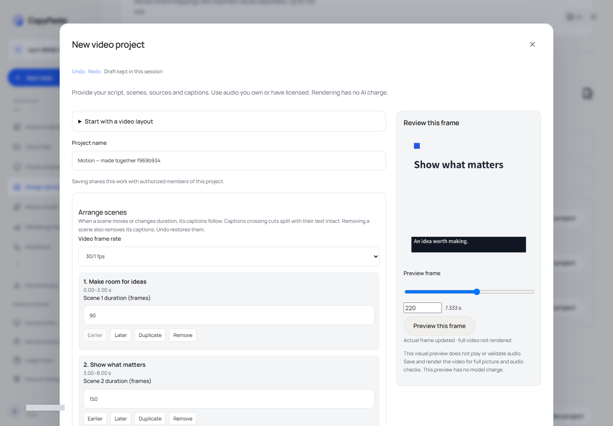

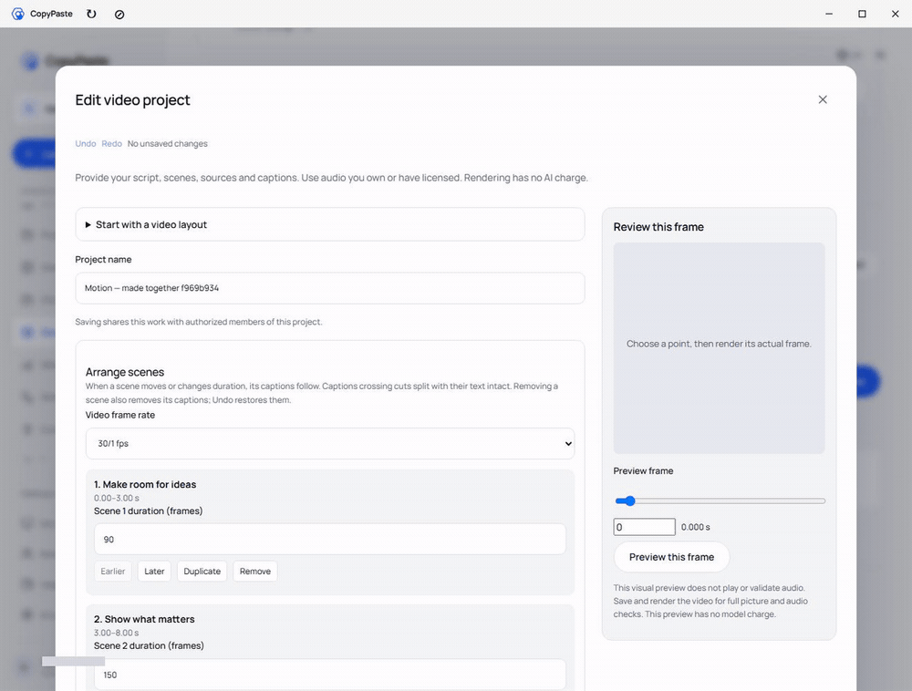

[Actual recording / 實際錄影](assets/screenshots/workmate-201-v3-motion-production-live.mp4)

Earlier installation, architecture and use details remain below.

<!-- integrated-round-200 -->

## 200 · 0.7.13 · Local Codex and complete design production

[Delivery and limits / 交付與邊界](https://github.com/copypasteltd/workmate/blob/docs/docs/quality/integrated-round-200/README.md) · [Downloads / 下載](https://agent.copypaste.hk/downloads)

1. Download Setup/Portable and authorize in the system browser. The app stays frameless without Electron menus. Codex executes locally with explicit, revocable full native access; all model requests use company APIs.

2. Shared design matches Web six layouts, fixed images/data charts, new slides, whole-document adaptation, undo/drafts and immutable delivery. Local tasks and shared cloud designs retain their execution locations.

3. The final0.7.13 package passes fresh S256PKCE, frameless/no-menu/no-root-or-horizontal-scrollbar checks and actual Web version2→native version3→Web readback. Every main-process/pinned Codex0.163.0-alpha.11 byte matches0.7.12. This round does not repeat paid native execution.

4. Earlier local execution/revocation evidence stays. Arbitrary applications, other machines, offline/sleep, update failures and long-running acceptance remain open. Trusted Windows signing is excluded by user instruction.

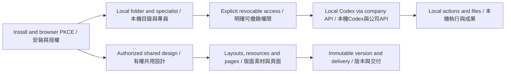

Final actual0.7.13 package / 最終實際0.7.13包

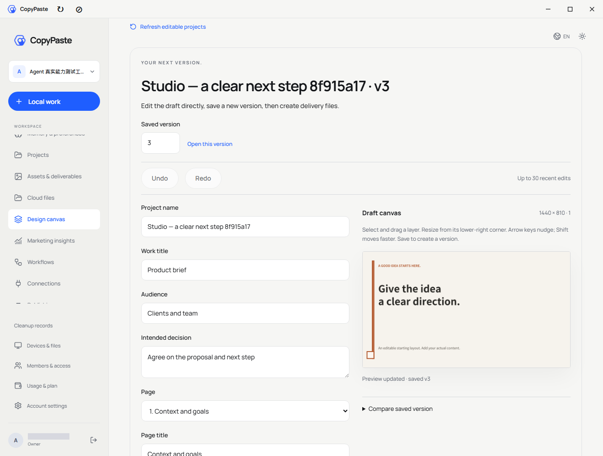

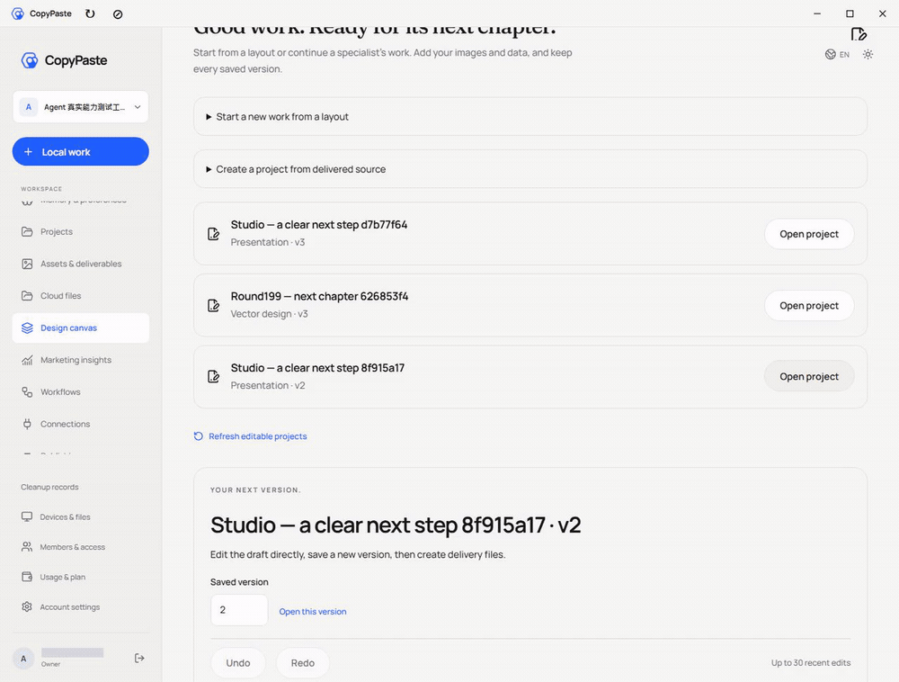

[Actual recording / 實際錄影](assets/screenshots/workmate-200-v2-native-production.mp4)

Earlier release/setup instructions remain below; full original acceptance stays open.

<!-- integrated-round-199 -->

## 199 · 0.7.11 · Local Codex and design continuity

[Delivery and limits / 交付與邊界](https://github.com/copypasteltd/workmate/blob/docs/docs/quality/integrated-round-199/README.md) · [Downloads / 下載](https://agent.copypaste.hk/downloads)

1. Download Setup or Portable and authorize in the system browser. The app remains frameless without Electron menus; Codex runs locally with explicit, revocable native full-access consent. Company servers still carry all model calls/billing.

2. Design canvas matches Web direct editing, actual draft previews, saved versions and recovery. Shared cloud designs and local tasks retain their execution locations; shared editing does not replace the local agent.

3. The actual final0.7.11 package passes fresh PKCE, real-source version2→3 saving, frameless/no-menu and root/horizontal scrollbar checks. Every main-process and pinned Codex0.163.0-alpha.11 runtime byte matches the accepted0.7.10 native implementation. No repeated paid native execution is claimed this round.

4. Earlier197/198 local execution/revocation evidence remains. Arbitrary applications, other machines, offline/sleep and upgrade-failure matrices still require acceptance. Trusted Windows signing remains excluded by user instruction, not claimed complete.

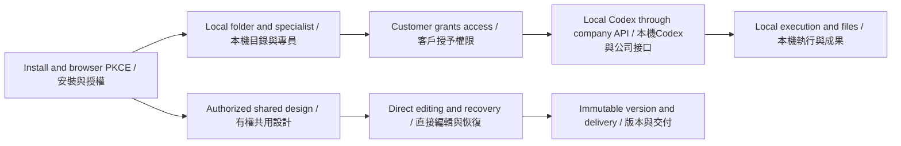

Current final packaged0.7.11 / 本輪最終實際包

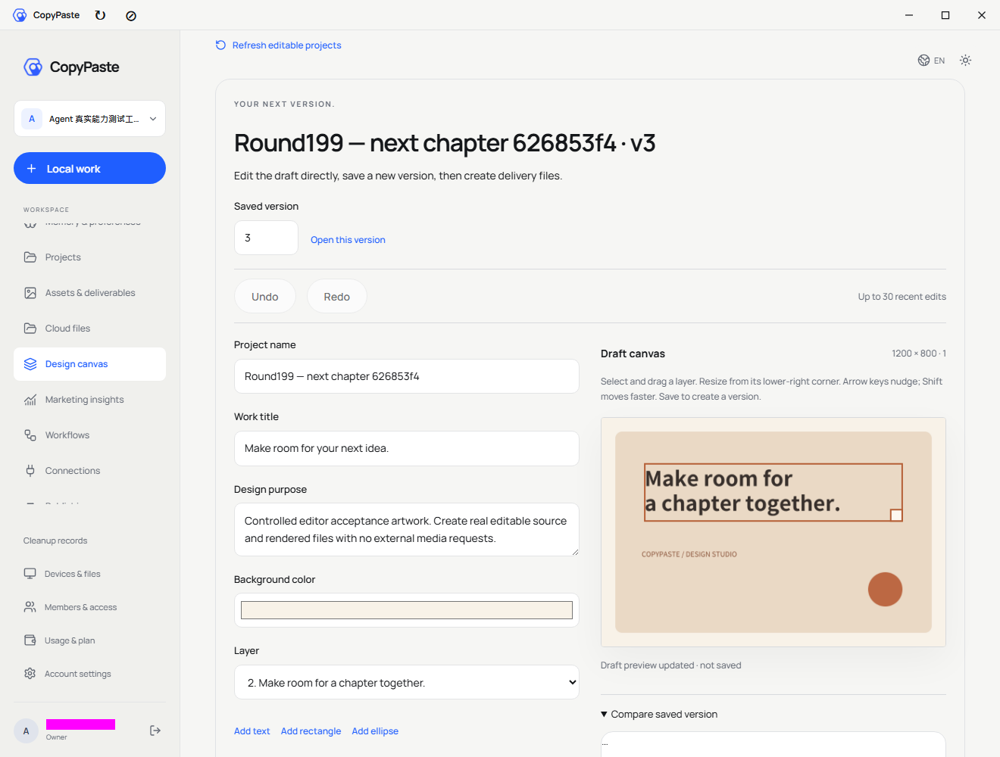

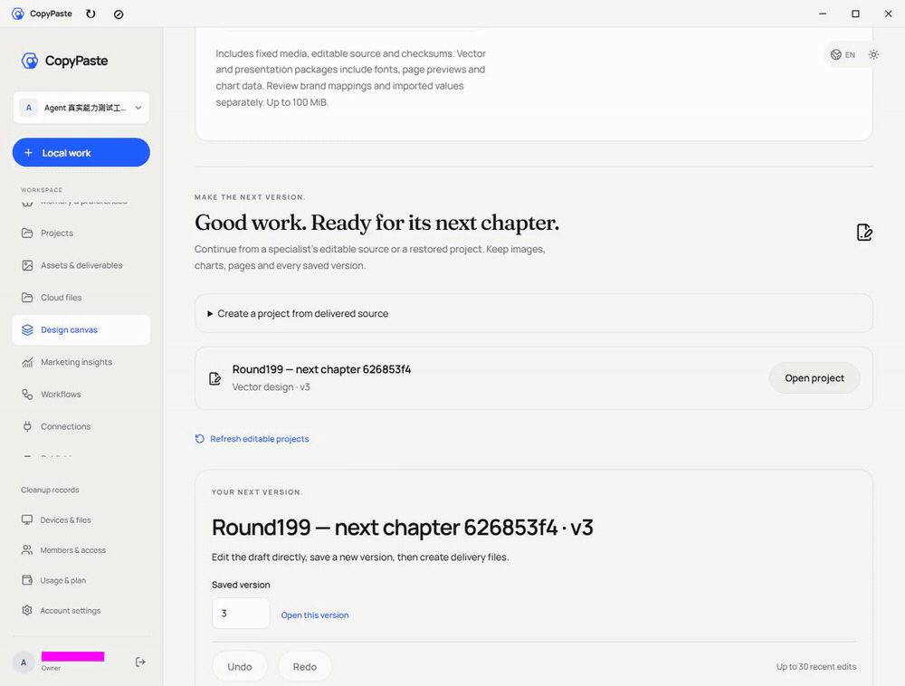

[Actual recording / 實際錄影](assets/screenshots/workmate-199-v2-native-review.mp4)

Earlier release/setup sections remain below. This batch does not close full original acceptance.

<!-- integrated-round-198 -->

## 198 · 0.7.10 · Resume local work and results

[Delivery and limits / 交付與範圍](https://github.com/copypasteltd/workmate/blob/docs/docs/quality/integrated-round-198/README.md) · [Downloads / 下載](https://agent.copypaste.hk/downloads)

1. Install Setup or run Portable and authorize in the system browser. The app is frameless without Electron menus. Choose a local folder/specialist; full local access requires explicit native consent and can be revoked. Codex reads, executes and writes on the customer computer; AI/billing uses company servers.
2. All tasks finds cloud/local work. Open locally returns to the original session on this computer. Session, results panel, selected tab and scoped return state restore. Current-file preview still rechecks permission/canonical paths; withdrawal prevents further reads.
3. Cloud-work opening accepts resource IDs only; the main process builds company-origin organization/project URLs. Arbitrary URLs are rejected. Company browser requests retain a separate memory-only session without cookies or redirects; local Codex inference continues through its company gateway.
4. The actual 0.7.9 package completes PKCE, private file transfer, full access, real PowerShell result.json work, HK$0.032730 settlement, revocation and directory return. Commands/output stay collapsed with exit status; root/horizontal overflow checks pass. Final 0.7.10 corrects directory amounts to Recorded usage and passes actual PKCE/directory/return checks. Every main-process/runtime byte matches 0.7.9; no repeated paid task is claimed. Current GIF records the final directory; the 0.7.9 execution PNG/receipt remain. Arbitrary-app/offline/sleep compatibility remains open.

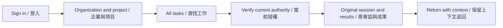

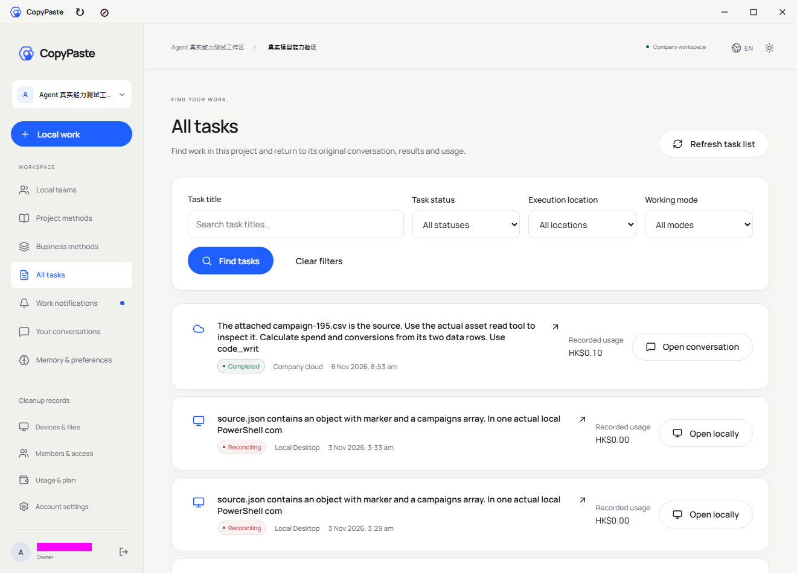

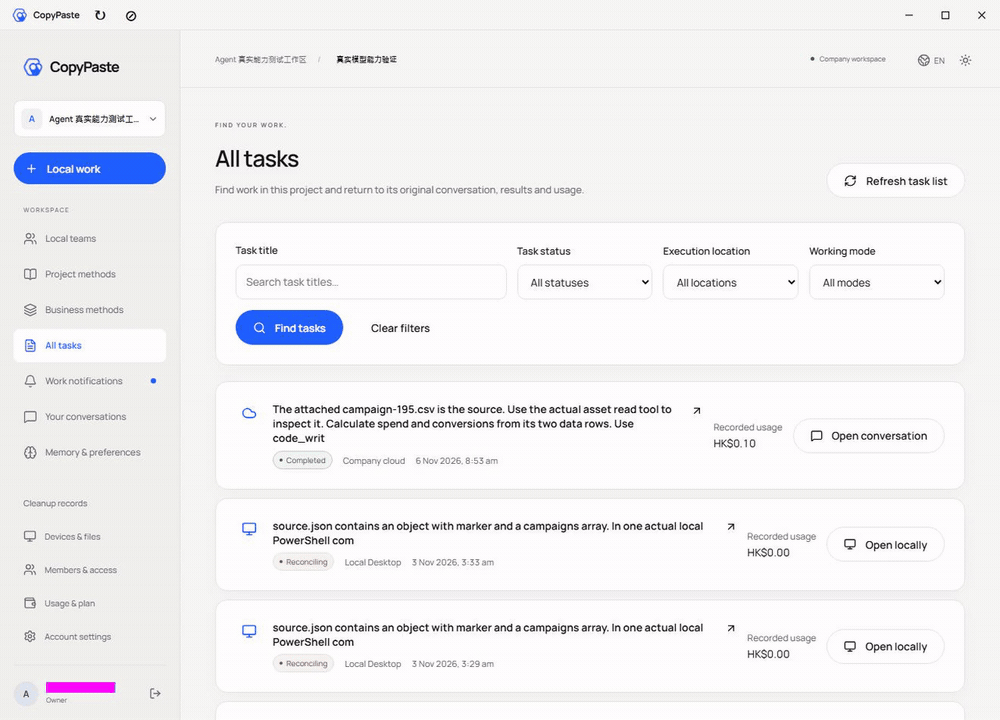

[Actual recording / 實際錄影](assets/screenshots/workmate-198-v3-desktop-directory.mp4)

Earlier sections retain previous release/setup history. Current delivery does not close full original acceptance.

<!-- integrated-round-197 -->

## 197 · 0.7.8 · Local connection and execution review

[Delivery and limits / 交付與範圍](https://github.com/copypasteltd/workmate/blob/docs/docs/quality/integrated-round-197/README.md) · [Downloads / 下載](https://agent.copypaste.hk/downloads)

1. Install Windows Setup or run Portable, authorize in the system browser, then choose a local folder, specialist and permission. Full local access requires explicit native consent, can be revoked and ends on sign-out. The app is frameless without Electron menus.
2. Local Codex reads files, runs commands, operates authorized apps/browser and writes results. Models and billing use company servers. Results use the original company task ID and actual native events without rerunning commands.
3. Company control, authentication, uploads, downloads, media and updates use a separate memory-only Chromium Session with a fixed company origin, no cookies and no redirects. Codex inference retains its original company gateway connection.
4. Commands/output start collapsed; exit status, failure and truncation stay visible. Current-file previews recheck local permission and canonical paths. Heartbeat recovery is bounded by the last confirmed live lease and cannot replay inference or tools.
5. The actual0.7.7 package completes PKCE, real company file transfer, native Codex file/command work, HK$0.035904 billing and revocation. Final0.7.8 passes fresh sign-in and timing UI delta checks; all packaged main-process JavaScript/native runtime bytes match the qualified native journey. No second paid task is claimed. A single successful journey does not establish long-term network SLA or arbitrary-app compatibility.

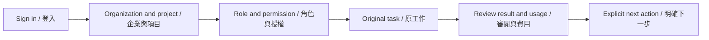

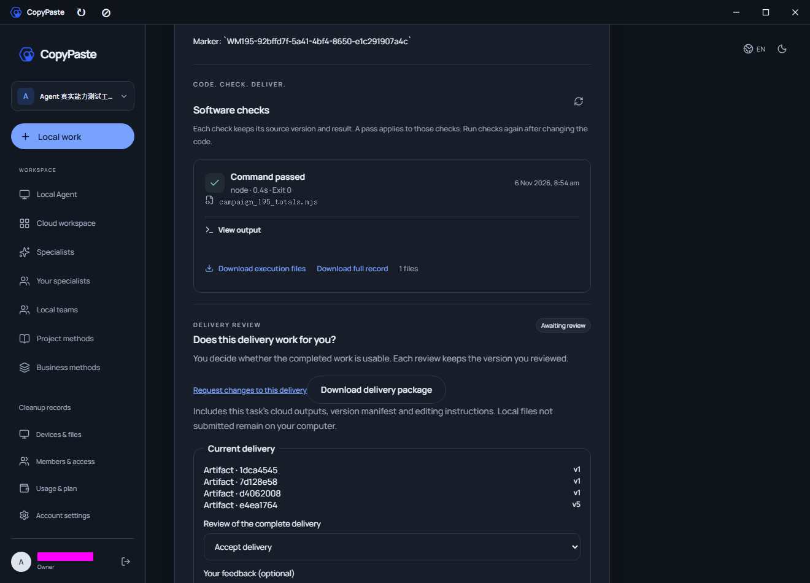

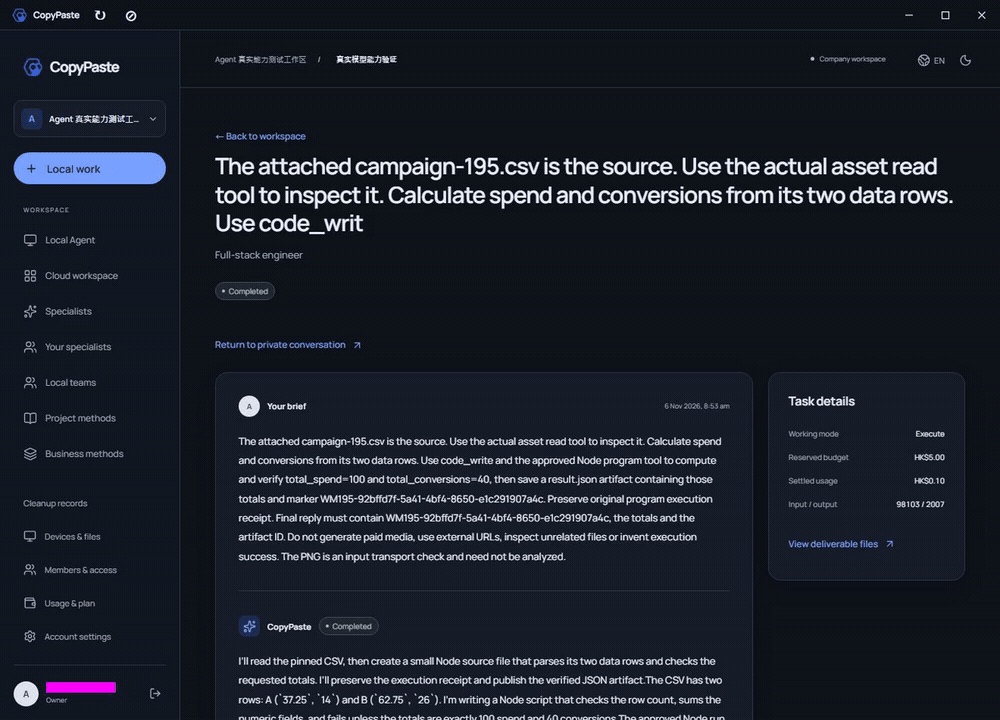

[Actual recording / 實際錄影](assets/screenshots/workmate-197-v4-desktop-review.mp4)

Earlier sections are retained release history. Full external/professional/production acceptance remains open.

<!-- integrated-round-196 -->

## 196 · 0.7.6 · Local Codex and execution results

[完整交付與限制 / Delivery and limits](https://github.com/copypasteltd/workmate/blob/docs/docs/quality/integrated-round-196/README.md) · [下載 / Downloads](https://agent.copypaste.hk/downloads)

1. Install0.7.6 or run its Portable build from the product download page. Authorize in the system browser. The application is frameless with no Electron menu.
2. Choose a local folder and specialist, then grant permission in the native confirmation. Explicit customer full access can read beyond the working folder and can be revoked.
3. Choose/drop local references and submit work. Local Codex reads files, executes commands and writes results; company servers handle all model calls and billing. The actual release build completed native commands/results andHK$0.057310 settlement.
4. Open the current task result workspace for execution records and current files. Records require an explicit company taskID; outputs, exit codes and file/tool events are retained. Older unbound events are never assigned by guess.
5. Main-process preview rechecks the grant, canonical path, boundary and read consistency. It supports selected images up to4MiB or UTF-8text up to256KiB. This is current local content, possibly different from historical edits. Preview does not upload/execute a file and is rejected after revocation.

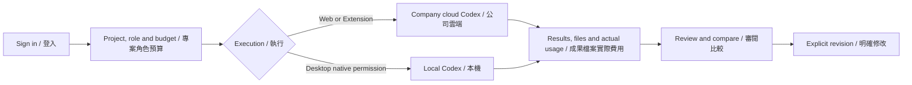

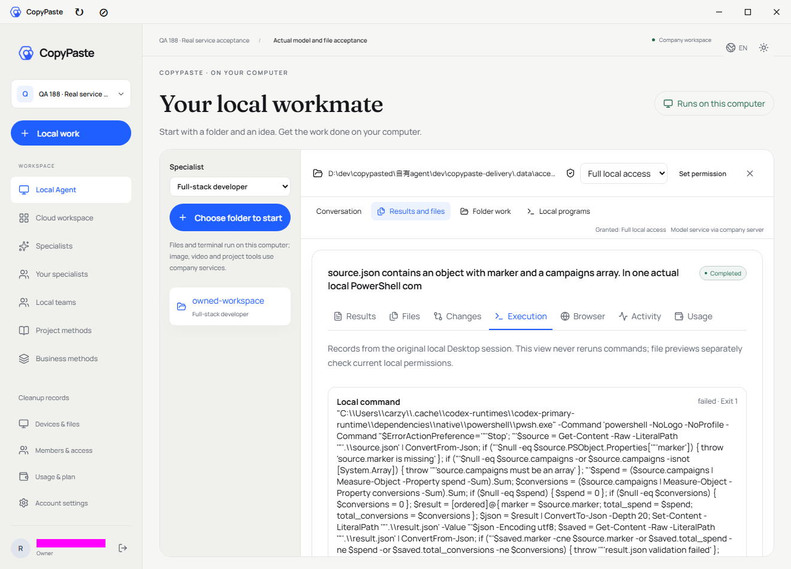

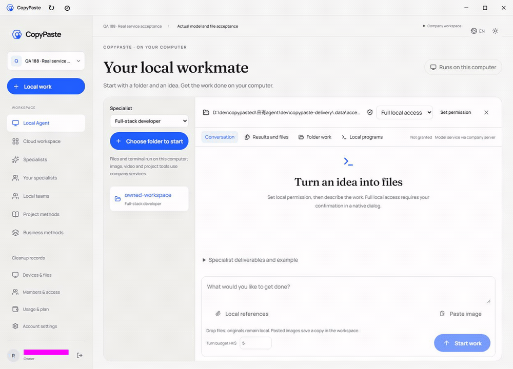

[Actual MP4 / 實際錄影](assets/screenshots/workmate-196-v2-local-workspace.mp4) · [Additional view / 其他頁面](assets/screenshots/196-local-workspace.png)

Scope: selected current journeys pass; original failures remain. Intermittent public HTTPS timeouts, professional outcomes, external integrations and full production/compatibility acceptance remain open. Earlier sections below describe historical releases.

<!-- integrated-round-195 -->

## 195 · 0.7.5 · 本机客户端 / Local desktop

Local Codex with native full access, local file selection/drop and approved image copies; frameless, no Electron menu, scrollable content and hidden rails.

[Round delivery / 本輪交付](https://github.com/copypasteltd/workmate/blob/docs/docs/quality/integrated-round-195/README.md) · [Download / 下載](https://agent.copypaste.hk/downloads)

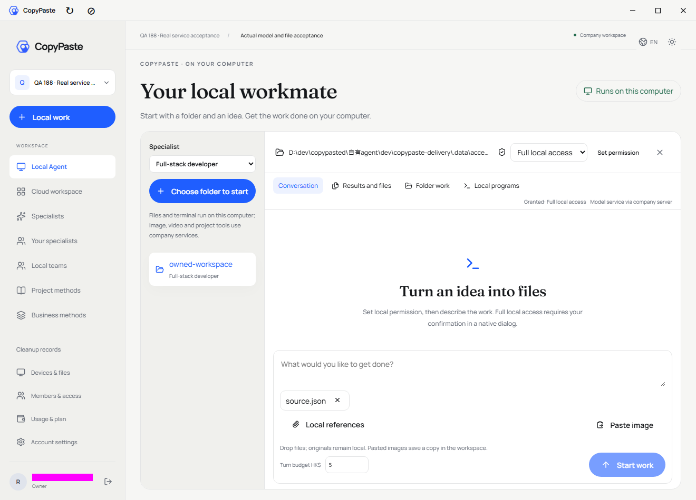

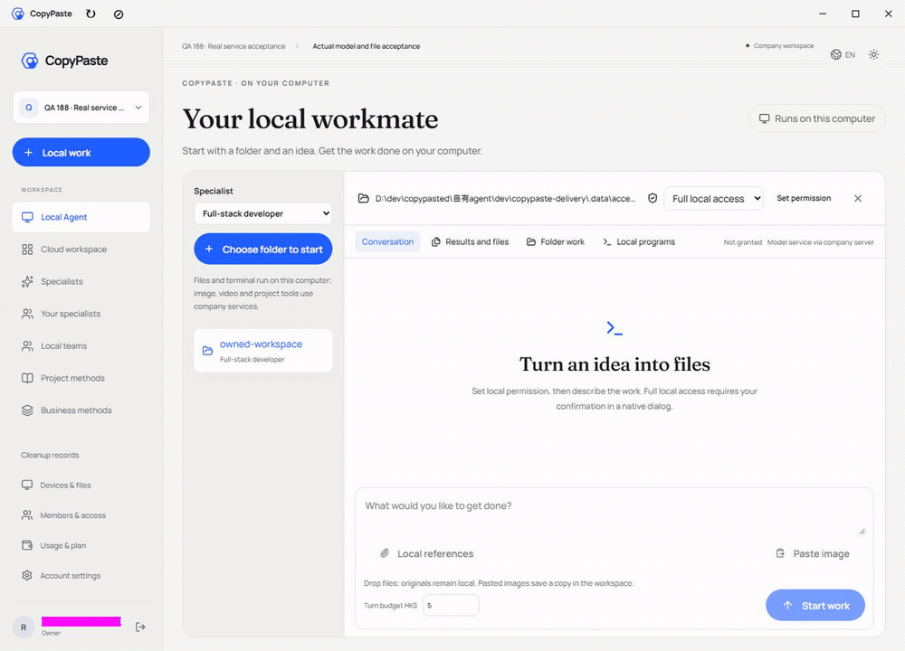

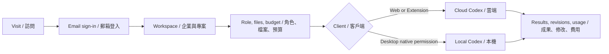

<!-- usage-195 -->

Using this release:

1. Download the0.7.5 Setup or Portable build and complete account authorization in the system browser.
2. Choose a local working directory and approve native permissions. Full local access requires explicit confirmation and can be revoked.
3. Choose/drop local file references. Image paste requires directory write permission and creates an approved copy; referencing an original file does not automatically upload it.
4. Local Codex reads, executes and writes results on the customer machine while models/billing use company services. Revocation prevents new operations under the old grant.

[Actual recording MP4 / 实际录像](assets/screenshots/workmate-195-v1-local-workspace.mp4)

<!-- /usage-195 -->

本輪實際測試與旅程見報告；保留歷史失敗，不以代碼量替代全部專業/生產驗收。影片/語音/Google/Meta真實配置、至少12角色專業驗收及完整兼容/運營矩陣仍開放。測試郵箱及未簽名安裝按已確認範圍保留。

Selected regression and real journeys are in the report. Historical failures remain. Real video/audio/Google/Meta configuration, at least12 professional role evaluations and the full compatibility/operations matrix remain open. The requested test mailbox and unsigned manual installation remain.

<!-- product-downloads-193 -->

## Public product downloads · 193

[Open the download page](https://agent.copypaste.hk/downloads). Desktop 0.7.4 (Windows Setup/Portable), Chrome extension 0.5.4 ZIP and file checksums download directly from the company site without signing in.

Download Windows Setup or Portable 0.7.4. Complete account verification in the system browser, choose a local folder and permissions, and run Codex on the customer computer. Existing release binaries and hashes are retained.

The Windows build is unsigned. The extension is installed manually and is not listed in the Chrome Web Store. macOS/Linux installers are not available.

[方案 / Implementation](https://github.com/copypasteltd/workmate/blob/docs/docs/development/193-product-downloads.md) · [驗證 / Verification](https://github.com/copypasteltd/workmate/blob/docs/docs/quality/193-product-downloads.md)


[實際手機下載頁 / Actual mobile download page](assets/screenshots/193-downloads-mobile-zh.png)


<!-- native-recheck-192 -->

## Recheck and native error visibility · 192

Keeps the published 0.7.4 local Codex binaries unchanged. The complete native workflow and revocation passed; a separate post-deployment native task also completed and settled. Its wrapper BOM parsing failure is retained and independently checked against the unchanged result file and real task without paid replay.

Final regressions: backend91, Web30, Admin22, Extension89, Desktop controller74; native Linux8 passed. Ordinary direct-browser GETs returned200 on all three domains; direct Python GETs returned403. This does not certify a zero-defect complete product. Item12 is excluded; unselected video/audio, Google/Meta, Linux Office and full-matrix scope remains open.

[方案 / Implementation](https://github.com/copypasteltd/workmate/blob/docs/docs/development/192-native-error-observability.md) · [复查 / Recheck](https://github.com/copypasteltd/workmate/blob/docs/docs/quality/192-native-recheck.md)


<!-- selected-repairs-191 -->

## Selected execution repairs and Desktop handoff · 191

0.7.4 runs pinned Codex locally; actual files/PowerShell, measured settlement and permission revocation passed. Add bounded periodic renewal and durable original errors. Selected issues02/03/04/05/07 have current evidence. The owner removed12; the new Windows build is unsigned and installed manually. Unknown supplier fees/reservations remain unresolved; execution-capacity release does not settle a bill.

The final Desktop uses the installer default company HTTPS origin through raw CONNECT forwarding, preserving end-to-end TLS verification, requests, model output and accounting. Browser PKCE uses the canonical HTTPS domain. This real workflow passed; a single acceptance does not establish long-term public-route reliability, so issue01 remains open. Fresh scopes: backend40/40, streaming gateway24/24, Windows cloud compatibility38/38, Desktop controller74/74, actual pinned-Codex disconnect1/1 and native Linux8/8; actual cloud task HK$0.126067 and final-build Desktop task HK$0.035144. These are separate checks, not a fresh whole-product acceptance. Public reliability and other unselected190 items retain their gaps. Older entries below are historical.

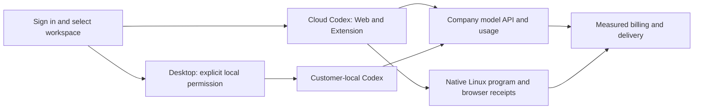

[方案 / Implementation](https://github.com/copypasteltd/workmate/blob/docs/docs/development/191-native-execution-and-capacity.md) · [证据 / Evidence](https://github.com/copypasteltd/workmate/blob/docs/docs/quality/191-selected-repairs.json) · [Desktop0.7.4手动下载 / Manual download](https://github.com/copypasteltd/workmate/releases/tag/desktop-v0.7.4)


Actual Web download recording excerpt; identity labels redacted. 这是Web实际录像节选，不代表其他端的新交互录像。


<!-- live-acceptance-189 -->

## Real image deployment and acceptance · 189

`gpt-image-2` passed actual generation and editing and is published with the same upstream URL/key as text. An actual Web Designer task generated persisted files, downloaded verified hashes and settled measured usage. Larger1254-square PNGs are decoded and normalized to1024 while exact originals remain downloadable. Image tools now resolve their frozen per-model connection without a duplicate global key; unrecovered image-tool failures cannot become successful tasks.

Development version0.7.3 retries one body-free read after a transport failure, never writes or received responses. Local Codex, frameless/menu-free UI and explicit full-access consent remain. Actual supplier-backed local completion is still unqualified; frozen installers were not replaced.

The full backend run recorded1950 tests:1949 passed and one failed; that browser deadline issue subsequently passed14/14 focused checks. Web28/28, Admin20/20, Extension89/89, Desktop269/269 and all builds passed. Separate image normalization48/48, per-model image/original persistence and discovery36/36, and actual native protocol image failure/recovery2/2 passed; overlapping runs are not summed into a new full-pass result.

Actual supplier-backed Desktop completion, public reliability, video/audio/Google/Meta credentials, SMTP and Linux native executor qualification remain open. The requested protected test mailbox remains. This is not full-product acceptance. See the [design, usage, original failures and rollback guide](https://github.com/copypasteltd/workmate/blob/docs/docs/development/189-real-image-and-acceptance.md).

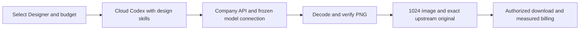

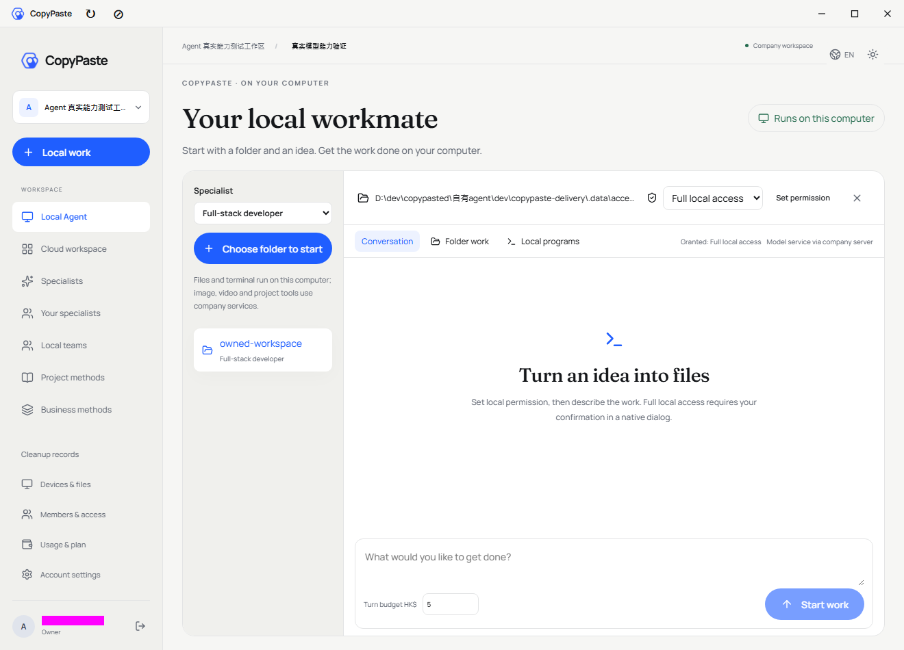

Actual Web download interaction excerpt. Reuse in other client repositories remains Web evidence.


<!-- live-acceptance-188 -->

## Real-service acceptance and deployment · 188

Real text service is deployed. Web and the native Chrome right Side Panel completed email sign-in, authorized file upload, actual cloud Codex analysis, file delivery/download and measured billing. Actual admin checks cover user/workspace creation and deletion, atomic bulk changes, per-model API/key editing and deletion, VIP grants/revocation and audit records. See the [complete evidence and usage guide](https://github.com/copypasteltd/workmate/blob/docs/docs/development/188-live-acceptance.md).

Desktop runs pinned Codex on the customer's computer with explicit folder and full-access consent. Recognized GPT model exec compatibility is repaired; actual local command/file/company-tool operations passed a labelled protocol fixture. Final real-supplier Desktop acceptance remains blocked by intermittent public connectivity. The original full backend regression recorded 1,936 tests: 1,834 passed, 101 failed and one skipped. Subsequent targeted checks are separate evidence, not a replacement full-pass certificate.

To configure service, administrators enter each model's upstream URL, API key, alias and rates in Model capabilities, then qualify and publish its version. Users verify email, select a real workspace/project and submit bounded work. The protected test mailbox remains enabled. Actual image generation returned403; video/audio and Google/Meta credentials are absent and remain unqualified.

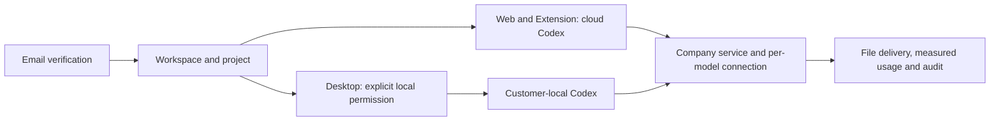

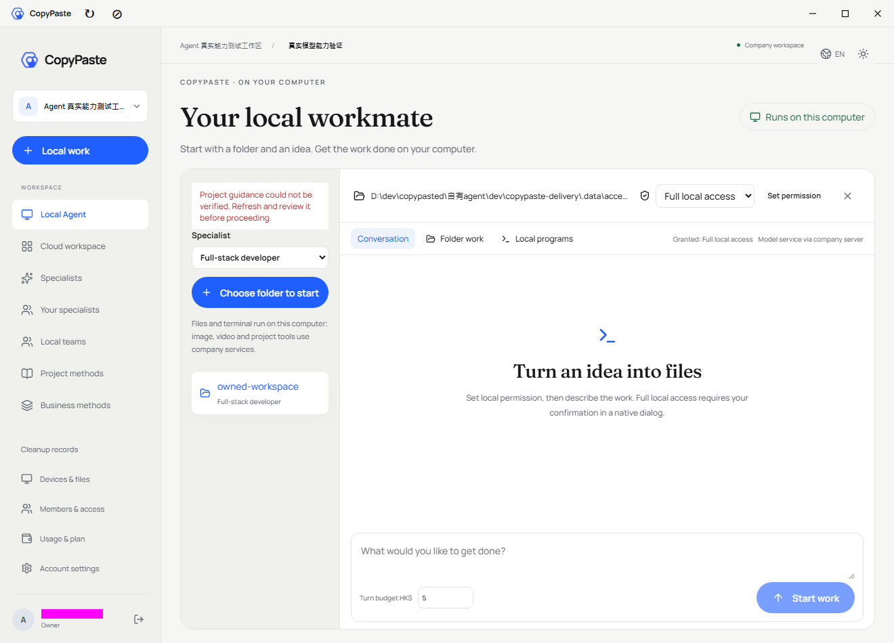

Actual read-only scrolling through the completed Web task, not new inference or a certificate for every client:


# Workmate · desktop · v0.1.0

<!-- public-domains-177 -->
## Public HTTPS deployment · stage177

[Web](https://agent.copypaste.hk) · [Admin](https://agent-dashboard.copypaste.hk) · [API readiness](https://ai-api.copypaste.hk/health/ready)

Desktop 0.7.2 runs pinned Codex locally. Browser PKCE returns to its frameless workspace; local permission is explicit and scroll rails stay hidden.

[Current deployment, login and operations / 当前部署、登录与运维](https://github.com/copypasteltd/workmate/blob/docs/docs/releases/domains-177.md)

Credentials are unchanged: server `/root/cfg/workmate/credentials.txt`, root `0600`. Admin: `admin@workmate.local` + email OTP + TOTP. Test mailbox: [protected operator inbox](https://agent-dashboard.copypaste.hk/ops/mailbox/). AI/media/ads/payment remain synthetic; records/files persist. 凭据保留，测试收件箱使用独立操作口令，外部服务仍为假数据。

[Desktop 0.7.2 Setup](https://agent.copypaste.hk/downloads/CopyPaste-0.7.2-x64-Setup.exe) · [Portable](https://agent.copypaste.hk/downloads/CopyPaste-0.7.2-x64-Portable.exe) · [Extension 0.5.3 ZIP](https://agent.copypaste.hk/downloads/CopyPaste-Extension-0.5.3.zip) · [Source increment / 源码增量](https://agent.copypaste.hk/downloads/workmate-domains-177.zip)

Windows installers are unsigned. Extract the Extension ZIP and load it unpacked in Chrome developer mode; the extension ID stays `fffkcnmfdhahlnifgdilabheppkgnlok`. Desktop AI access uses company services; supplier keys are not embedded. Windows 未签名，扩展采用已解压加载，固定 ID 不变。

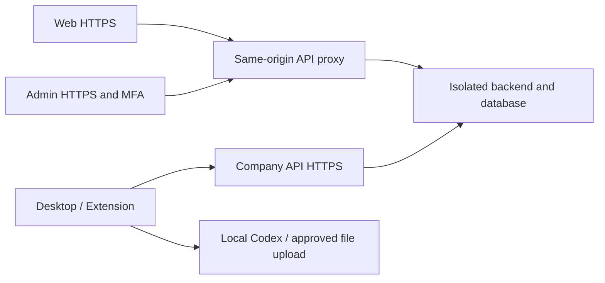

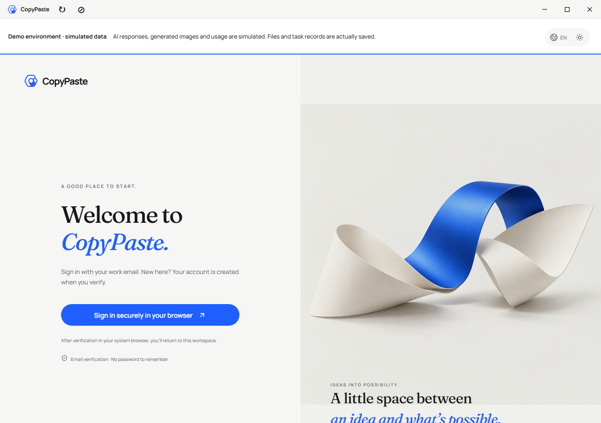

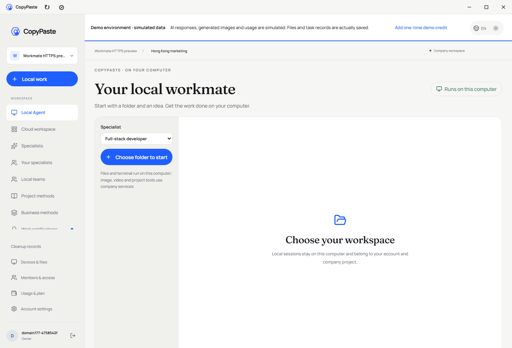

[Actual public Web and Admin recordings](https://github.com/copypasteltd/workmate/blob/docs/docs/releases/domains-177.md#实际页面与核查--actual-pages-and-validation)

---

Earlier releases and deployment history / 以下为历史版本及部署记录。

<!-- lan-deployment-176 -->
## LAN HTTP deployment · stage176

Web: http://192.168.31.20:63070 · Admin: http://192.168.31.20:63071 · API: http://192.168.31.20:63072

Customer-local Codex, explicit full permission and frameless behavior remain. Frozen installers are not repointed to this HTTP LAN endpoint; a client endpoint build follows the intended official address.

Server plaintext credentials: `/root/cfg/workmate/credentials.txt` (root `0600`). Email OTP is retrieved through the protected test mailbox; Admin additionally requires TOTP. Synthetic services remain explicitly labeled.

[部署、登录与运维 / Deployment and login guide](https://github.com/copypasteltd/workmate/blob/docs/docs/releases/lan-176.md)

[实际 Web 交互 / Actual Web recording](https://github.com/copypasteltd/workmate/blob/web/assets/demos/176-lan-http.gif) · [后台截图 / Admin capture](https://github.com/copypasteltd/workmate/blob/admin/assets/screenshots/176e-lan-users.png)


## v0.1.3 · 当前完整交付 / Current complete delivery

[Release / 下载](https://github.com/copypasteltd/workmate/releases/tag/v0.1.3) · [中英使用手册 / Bilingual guide](https://github.com/copypasteltd/workmate/blob/v0.1.3/docs/releases/v0.1.3.md)

本轮完整包包含六仓源码和全部端，纳入团队/单次运行费用报表、原成员/协调员账目、交叉筛选和同快照CSV。当前源码与假数据冻结交付按使用者要求收口；服务器资料和正式服务接入后续提供。AI/媒体/广告/支付使用假数据，Windows未签名；完整专业/生产台账保持。

All six source trees/clients are delivered, including team/run financial reports, original member/coordinator entries, intersecting filters and matching snapshot CSV. This current source/synthetic frozen delivery closes as requested; server/live configuration follows later. External services are synthetic and Windows is unsigned. Full professional/production qualification remains tracked.


## Current complete frozen delivery · v0.1.2

The complete bundle includes every client, six source trees and the current posting-period reports. Desktop runs Codex locally with explicitly granted full local permission; the native Extension Side Panel reads/uploads authorized files for cloud Codex. Schema156, authorized synthetic AI/media/ads/payments and unsigned Windows.

[完整下载 / Complete release](https://github.com/copypasteltd/workmate/releases/tag/v0.1.2) · [安装、登录和使用 / Setup and flows](https://github.com/copypasteltd/workmate/blob/v0.1.2/docs/releases/v0.1.2.md)

本轮重新构建Backend/Admin；其余运行产物及Windows分发核对后复用。继承源码一致的阶段172定向验证，阶段173不重跑功能测试。Backend/Admin rebuilt; unchanged runtimes/Windows distributions verified and reused. Exact-source stage172 focused checks inherited; no functional tests rerun at173. Older entries below retain their historical scope.

## Frozen delivery v0.1.1

The complete bundle includes local-Codex frameless Windows Desktop, Web, independent Admin, native Chrome Side Panel, backend, six buildable source trees and pinned runtime. Authorized synthetic services, unsigned Windows and schema156.

[完整发行包 / Complete release](https://github.com/copypasteltd/workmate/releases/tag/v0.1.1) · [安装及流程 / Setup and flows](https://github.com/copypasteltd/workmate/blob/v0.1.1/docs/releases/v0.1.1.md)


[中文](README.md) · [Complete release](https://github.com/copypasteltd/workmate/releases/tag/v0.1.0) · [Bilingual setup guide](https://github.com/copypasteltd/workmate/blob/v0.1.0/docs/releases/v0.1.0.md)

Workmate serves Hong Kong enterprises, beginning with existing marketing teams. This independent **desktop** component uses **Electron / customer-local Codex**. Business areas include design/media, advertising and website/SEO/GEO analytics, repeatable workflows and software development. CopyPaste's warm background, dark text, brand accents and editorial typography guide the interface.

## Current frozen release · v0.1.0

All clients, backend and six source trees are delivered together, including the latest creator-filtered Admin tasks/content. Six components are rebuilt. Rebuilt Desktop outputs match the qualified Windows app/Portable/Setup byte for byte, so those verified binaries are reused. Stage166's eight SQL/API cases and eight actual UI checks retain their source-bound original evidence; broad historical regression is not rerun.

Branch`desktop`, frozen tag`v0.1.0-desktop`. [Source and installers](https://github.com/copypasteltd/workmate/releases/tag/v0.1.0) · [Freeze record](https://github.com/copypasteltd/workmate/blob/v0.1.0/docs/quality/release-freeze-checkpoint-167.json) · [Open work](https://github.com/copypasteltd/workmate/blob/v0.1.0/docs/quality/remaining-work-stage167.md). AI/media/ads/payments use the authorized synthetic mode; Windows is unsigned. Existing screenshots/GIF/MP4 retain their actual capture scope and do not imply new full installation/professional qualification.

## Architecture and responsibilities

Entry points: `src/main.ts, src/local-agent.ts, src/local-codex.ts, renderer/src/`. Codex is the only agent kernel. All AI calls use the company's OpenAI-compatible gateway; provider secrets remain server-side. Presets pin Skills, tools and configuration versions. The designer combines Codex, design Skills and company Image 2.

Web runs cloud agents. Chrome MV3 provides conversation and attachments in its native right Side Panel; customers explicitly select files and consent to upload for cloud execution. Desktop is frameless without Electron's default menu, runs Codex on the customer's computer and supports explicitly granted full local permission, stop/revocation and account/directory isolation.

Admin has independent email OTP plus TOTP and scoped permissions for users/organizations, usage, billing, VIP, roles/Skills and content. User detail passes the actual target ID; fee accounts are subject-filtered and VIP locks that target. Switching users unmounts previous dialogs/previews. Amounts use HKD micro-units. Budgets, balances, receipts, gifts, credit and VIP are distinct. Manual changes require preview, confirmation, current MFA/policy/approval, audited idempotency and current authority.

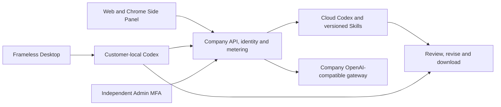

## Setup and commands

Place six independent repositories beside each other under `dev/`: platform, web, admin, desktop, extension and delivery, each with the `copypaste-` prefix. Use Windows x64, Node.js 22.14+, Git and native PostgreSQL. Media requires FFmpeg/FFprobe. Pinned Codex ships in the runtime archive. Docker, WSL and virtualization are prohibited.

Read the release guide. Before first configuration, choose an available database port. From Delivery run `demo:preflight`, `bootstrap:demo`, `demo:check`, then `demo`. Preserve existing configuration/data. Run Delivery `npm run stop` to close owned services.

Individual component development after supporting dependencies/backend are ready:

```powershell
npm ci
npm run build
npm start
```

API uses localhost4310, Web4317 and Admin4318. Development OTP messages are in platform `.data/mailbox/`. Enroll an administrator with platform `npm run admin:create -- admin@example.com super_admin` and configure TOTP from its one-time material. Desktop uses browser PKCE, a chosen local directory and explicit permission. Load the extension unpacked in Chrome developer mode and click its icon to open the side panel.

## Customer and operator workflow

1. Sign in and accept an invitation or create a workspace/initial project. An uncertain creation keeps its original request. Check & continue after reload reconciles that operation; unavailable/removed receipts never silently create a replacement company.
2. Select a project/preset, provide the brief, approved files/brand/accounts, budget and permission. Supply missing inputs within the original task. Execution pins accepted configuration and Skill versions.
3. Review durable progress, approvals, delivery versions, costs and consumption. Download original files or request revisions. Unknown costs stay under reconciliation instead of being treated as free or blindly repeated.
4. From Admin user detail, verify the billing/VIP subject, inspect its preview and confirm under current policy. Directory filters survive refresh/return. User detail opens creator-filtered tasks/content with separate body authority and preserved navigation.

## Configuration and authority

Web/Admin use `VITE_API_BASE` or a same-origin proxy. Native deployment settings pin allowed origins and extension ID. Use HTTPS outside approved loopback development. SQL history is001–155; API/Worker check schema and environment identity. Sources exclude secrets, private `.env`, user databases, dependencies and Git metadata.

Expired sessions clear the previous workspace. Delayed responses cannot replace a newer sign-in. Files are private by default. Requests, worker claims, tools and downloads recheck authority. Saved responses confer no permanent access. Explicit sign-out removes private workspace-draft names while retaining an owner-scoped opaque recovery key.

## Preset and Skill bindings

Eighteen professional presets are defined; this count does not prove complete professional qualification of twelve roles.

| ID | Role | Required Skill bindings |
| --- | --- | --- |
| R01 | Full-stack engineer | `fullstack-engineering@1.0.0`, `frontend-implementation@1.0.0`, `backend-api@1.0.0`, `qa-testing@1.0.0`, `delivery-core@1.0.0` |
| R02 | Frontend engineer | `frontend-implementation@1.0.0`, `ui-system@1.0.0`, `qa-testing@1.0.0`, `delivery-core@1.0.0` |
| R03 | Backend/API engineer | `backend-api@1.0.0`, `qa-testing@1.0.0`, `delivery-core@1.0.0` |
| R04 | QA engineer | `qa-testing@1.0.0`, `frontend-implementation@1.0.0`, `delivery-core@1.0.0` |
| R05 | UI/UX designer | `ux-research@1.0.0`, `ui-system@1.0.0`, `frontend-implementation@1.0.0`, `delivery-core@1.0.0` |
| R06 | Designer | `creative-direction@1.0.0`, `image-art-direction@1.0.0`, `image2-production@1.0.0`, `typography-layout@1.0.0`, `delivery-core@1.0.0` |
| R07 | Brand designer | `brand-system@1.1.0`, `image-art-direction@1.0.0`, `image2-production@1.0.0`, `typography-layout@1.0.0`, `delivery-core@1.0.0` |
| R08 | Advertising creative designer | `ad-creative@1.0.0`, `image-art-direction@1.0.0`, `image2-production@1.0.0`, `typography-layout@1.0.0`, `delivery-core@1.0.0` |
| R09 | E-commerce designer | `ecommerce-visual@1.0.0`, `image-art-direction@1.0.0`, `image2-production@1.0.0`, `typography-layout@1.0.0`, `delivery-core@1.0.0` |
| R10 | Social content designer | `social-content@1.0.0`, `image2-production@1.0.0`, `typography-layout@1.0.0`, `delivery-core@1.0.0` |
| R11 | Illustration/IP designer | `illustration-ip@1.0.0`, `image-art-direction@1.0.0`, `image2-production@1.0.0`, `delivery-core@1.0.0` |
| R12 | Typography/layout designer | `typography-layout@1.0.0`, `image-art-direction@1.0.0`, `image2-production@1.0.0`, `delivery-core@1.0.0` |
| R13 | Presentation designer | `presentation-production@1.1.0`, `typography-layout@1.0.0`, `dataviz@1.1.0`, `delivery-core@1.0.0`, `deterministic-metrics@1.1.0` |
| R14 | Landing page designer | `landing-page@1.0.0`, `ui-system@1.0.0`, `frontend-implementation@1.0.0`, `image2-production@1.0.0`, `delivery-core@1.0.0` |
| R15 | Data visualization designer | `dataviz@1.1.0`, `deterministic-metrics@1.1.0`, `typography-layout@1.0.0`, `delivery-core@1.0.0` |
| R16 | Video/motion designer | `video-storyboard@1.0.0`, `template-video-composition@1.0.0`, `video-generation@1.1.0`, `speech-production@1.2.0`, `delivery-core@1.0.0` |
| R17 | Marketing analyst | `ads-analysis@1.1.0`, `deterministic-metrics@1.1.0`, `dataviz@1.1.0`, `delivery-core@1.0.0` |
| R18 | Workflow automation consultant | `workflow-design@1.1.0`, `workflow-execution@1.1.0`, `delivery-core@1.0.0` |


[Role contract](https://github.com/copypasteltd/workmate/blob/backend/catalog/role-preset-catalog.json) · [Skill contract](https://github.com/copypasteltd/workmate/blob/backend/catalog/skill-packages.json)

## Actual screenshots and interaction

The shared media shows this release's actual Web/SQL recovery and Admin MFA/target checks with synthetic business facts. It does not claim fresh installation acceptance of other native clients.


[Actual MP4](assets/screenshots/workmate-functional-closure-165-01-recover-original-workspace.mp4)

## Historical rc.5 qualification and publication

Historical rc.5 record: seven focused SQL cases, four draft-state cases and actual Web/Admin interactions accompanied six builds and Windows unpacked/Portable/Setup packaging. Current ASAR bytes and pinned Codex hashes are checked. Repeated broad regression is omitted as requested; the release checkpoint records actual results.

Branch `desktop`, frozen tag `v0.1.0-rc.5-desktop`. Later changes advance branches and notes while frozen bytes/tags remain. AI/media/ads/payments use the authorized synthetic mode. Windows is unsigned. All102 IDs and88 required whole-acceptance scopes remain;88 is not a count of missing modules. Production providers, signed updates, other OSes and full professional acceptance remain tracked.

[Checkpoint](https://github.com/copypasteltd/workmate/blob/v0.1.0-rc.5/docs/quality/release-freeze-checkpoint-165.json) · [Original acceptance ledger](https://github.com/copypasteltd/workmate/blob/v0.1.0-rc.5/docs/quality/remaining-work-stage165.md) · [Historical README](https://github.com/copypasteltd/workmate/blob/v0.1.0-rc.5/docs/history/readme-before-rc5/desktop-en.md)

## 本端界面与录制 / Component interface and recording

此前已记录的实际原生界面，保留原测试范围；本次构建不等于重复现场验收。Previously recorded native interface with its original scope; this rebuild is not a repeat installation test.

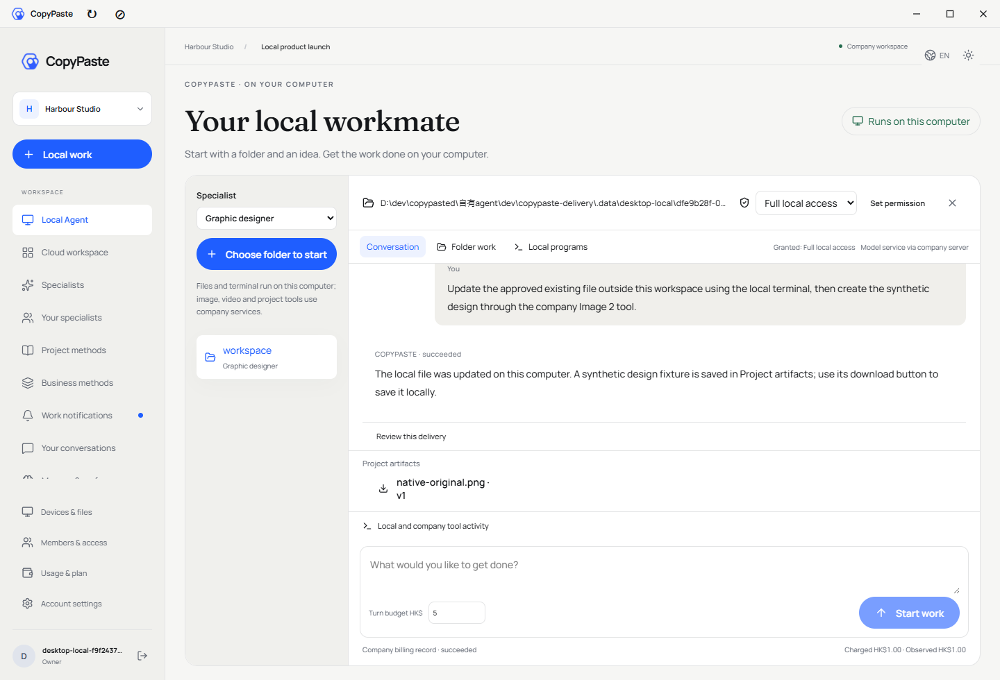

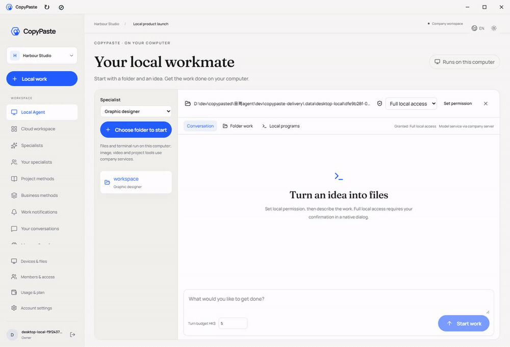

[MP4](assets/screenshots/workmate-runtime-startup-desktop-02-local-cloud-boundary.mp4)
