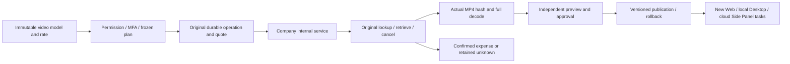
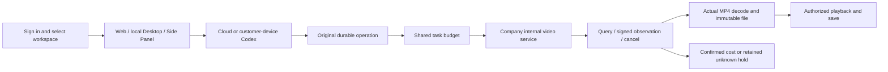
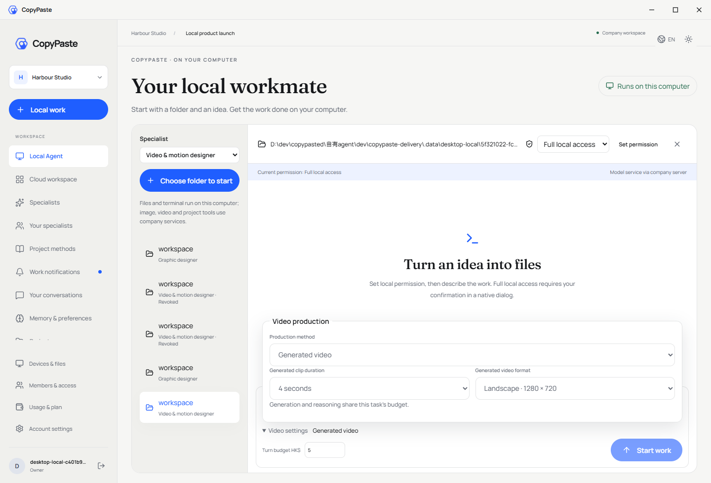
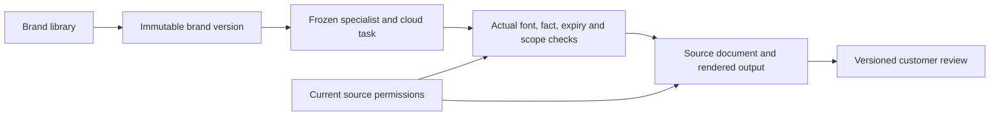
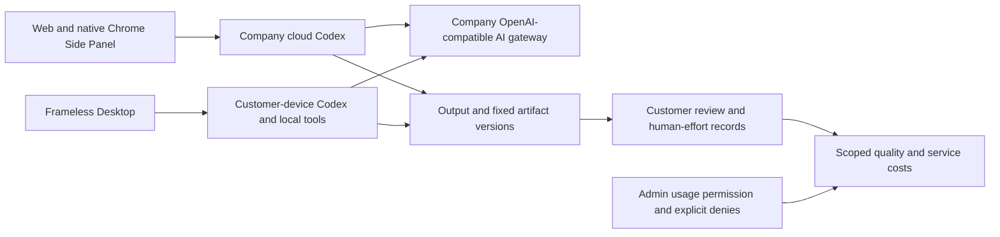
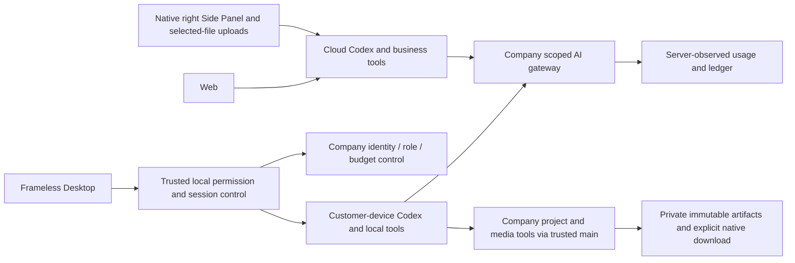
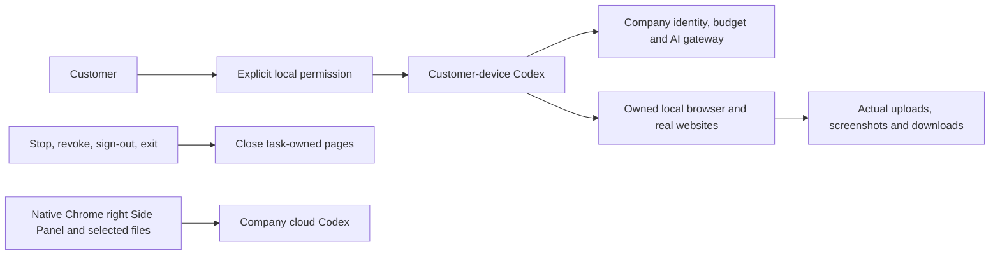
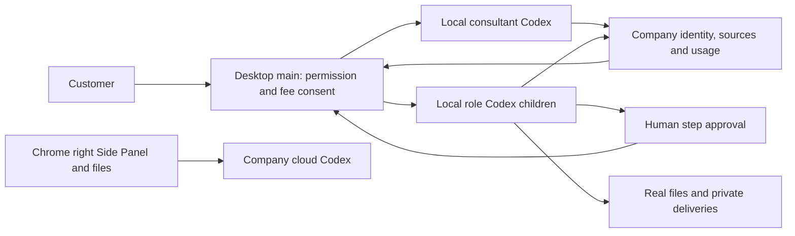

# Workmate · CopyPaste Desktop

<!-- managed-video-stage81 -->
## Managed video capabilities and current delivery

This repository is one independently versioned part of Workmate. Admin can now manage video models through the same immutable draft, actual verification, independent approval, publication and rollback flow as text and images. Web, local Desktop and the native Chrome Side Panel consume published versions; existing tasks keep their frozen model and rates.

### Local startup

Run these commands in the checked-out component. The complete workspace has the six independent repositories side by side under `dev/`; see the [branch and checkout layout](https://github.com/copypasteltd/workmate/blob/docs/docs/governance/04-git-branches-and-publication.md). Use Windows x64, Node.js >=22.14, npm/Git and the documented native PostgreSQL, FFmpeg/FFprobe and pinned Codex resources. Preserve existing local configuration/data. No Docker/WSL/VM is used.

```powershell
Set-Location 'D:/dev/copypasted/自有agent/dev/copypaste-desktop'
npm ci
$env:COPYPASTE_LOCAL_CODEX_BIN = 'D:/approved-runtime/codex.exe'
npm run runtime:prepare
npm run build
npm start
```

Start the backend first. The binary path is an example: supply the exact approved binary and adjacent helpers matching `contracts/local-codex-runtime.json`. Configure company origins in `deployment.json`. `npm run package:dir` builds an unpacked candidate; `npm run package` builds the installers. Current evidence covers an unsigned unpacked candidate; signing and human install/upgrade/uninstall remain open. The renderer builds independently; preserve its native overlays.

### Use the current workflow

1. Sign in to Admin using its separate email/TOTP identity. Open **Catalog → Model capabilities → Create configuration**, select **Video generation**, enter the company model alias, a positive HKD price per billable second and an operation reason. Codex and the company internal gateway are fixed; a draft cannot add an endpoint, secret or another kernel.
2. Open **Configuration & validation**, enter the reason and run validation. The API immediately saves a durable receipt. Its 16 cases quote up to 184 seconds from the **platform verification budget**. Closing this view does not stop execution. Progress counts actually verified cases, with actual size/duration, full MP4/H264 decoding and observed cancellation; no simulated percentage represents real service progress.
3. **Recheck original job** queries the existing operation. **Stop this validation suite** stops new calls and checks already-dispatched usage. An unknown result keeps its budget/capacity hold and blocks another validation in this view. Once expense is known, an explicitly new validation creates a new receipt and new billable calls. The live cost and the receipt at the immutable eligibility decision remain distinct.
4. After all cases pass, **Preview publication** compares the model and price. Current permission, recent MFA, exact version and reason are checked again; another administrator must approve. Requesters cannot approve themselves. Rollback appends a new publication fact. Scoped access and explicit denies retain priority; read-only administrators cannot mutate configurations.
5. A stopped worker resumes original operations and confirmed content, without another generation POST. SQL098 preserves the old budget functions' identities and all prior shared accounting. Apply SQL098 using backend `npm run db:migrate` before deployment. SQL001–097 and both original OpenAPI files retain their own bytes. Company gateway credentials remain server-side. Managed publication can provide a verified video capability while the legacy environment switch is false; a live supplier still requires its own qualification.

Desktop remains frameless, runs Codex on the customer's own device and supports explicit revocable full local permission. No visible vertical/horizontal scrollbar rails appear; wheel, keyboard, focus and truthful task/video progress remain available. Extension opens in Chrome's native right Side Panel, uses ChatGPT-style chat/attachments, reads/uploads authorized files and runs its Agent in the cloud without a Desktop dependency.

Current platform qualification: **929/929** cases, all previous 912 retained, 71 files/18 batches. Separate checks: **106/106** legacy capability/gateway/customer-video compatibility, **7** contract checks and **7** actual Admin browser checks. Captures below show the **Admin** component, including when copied into a client repository for the shared setup workflow. Historical stage-80 client sources/captures retain their original scope; they are not relabeled as a new full-stack browser run. The new Admin journey uses real authentication, PostgreSQL, native pinned Codex version checks and actual MP4 decoding with an explicit synthetic company service/video fixture.

Original **102 REQ/102 TC remain 83 partially verified, 19 unproven and zero fully accepted**; G01–G10 remain open. Live company service, all professional roles, full original video acceptance, signed installers and complete Codex Desktop operation parity are still unproven. All owned browser contexts/instances, previews and native databases close; no Docker/WSL/VM is used.

The first combined qualification failed because its synthetic HTTP fixture received port 2049, which this Node Fetch runtime rejects before HTTP. That failed TAP, live port witness and owned-worker/fixture cleanup remain retained. The fixture now uses the existing safe loopback listener and a bounded test-arrival wait; no product source, assertion or test name changed for this repair. The complete platform run and 17-case core run execute the repaired harness afresh. Earlier compatibility/UI recordings retain their exact product and verifier bytes, with the two later harness-only changes explicitly reviewed rather than presented as a fresh browser recording.

[Design and authority](https://github.com/copypasteltd/workmate/blob/docs/docs/technical/81-managed-video-capability-releases.md) · [Exact evidence](https://github.com/copypasteltd/workmate/blob/docs/docs/quality/managed-video-checkpoint.json) · [Supplemental API](https://github.com/copypasteltd/workmate/blob/docs/docs/contracts/capability-releases.openapi.json)




[Admin interaction GIF](assets/screenshots/stage81-admin-workmate-managed-video-02-video-cancellation-and-cost-recovery.gif) · [Actual recorded MP4](assets/screenshots/stage81-admin-workmate-managed-video-02-video-cancellation-and-cost-recovery.mp4)

<details>
<summary>Historical stage-80 usage and installation reference; counts keep their original scope</summary>

<!-- generated-video-stage80 -->
## Generated video, scoped costs and compact Desktop

Desktop runs Codex on the customer device. Video settings start collapsed and expand into a compact panel; customers explicitly grant and can revoke full local permission.

### Local startup

Run these commands in the checked-out component. The complete workspace has the six independent repositories side by side under `dev/`; see the [branch and checkout layout](https://github.com/copypasteltd/workmate/blob/docs/docs/governance/04-git-branches-and-publication.md). Use Windows x64, Node.js >=22.14, npm/Git and the documented native PostgreSQL, FFmpeg/FFprobe and pinned Codex resources. Preserve existing local configuration/data. No Docker/WSL/VM is used.

```powershell
Set-Location 'D:/dev/copypasted/自有agent/dev/copypaste-desktop'
npm ci
$env:COPYPASTE_LOCAL_CODEX_BIN = 'D:/approved-runtime/codex.exe'
npm run runtime:prepare
npm run build
npm start
```

Start the backend first. The binary path is an example: supply the exact approved binary and adjacent helpers matching `contracts/local-codex-runtime.json`. Configure company origins in `deployment.json`. `npm run package:dir` builds an unpacked candidate; `npm run package` builds the installers. Current evidence covers an unsigned unpacked candidate; signing and human install/upgrade/uninstall remain open. The renderer builds independently; preserve its native overlays.

### Use the current workflow

1. Sign in using the existing email/OTP flow, select a workspace/project and start a **Video and motion** task. New tasks use the versioned R16 1.2.0 role and its `video-generation` Skill. Frozen older tasks retain their original role/Skill; start a new task to use generation.
2. In Web or Desktop select **Generate a video**, a supported duration (4/8/12/16/20 seconds) and format (landscape, portrait or square), then supply the brief and confirm the task budget. Template/FFmpeg composition remains a separate option. Desktop settings start collapsed so the conversation and composer retain space. In Extension, open the existing cloud video task from the same workspace/project's task history to review its status, play it and save the result.
3. Codex uses the company's internal service. The server persists an immutable original operation and a quote before HTTP, sharing the same budget with reasoning/image requests. Input counting, reasoning, image and video also share admission limits; completed calls retain their rolling-minute rate charge after concurrency slots release. Independently reviewed termination facts affect slot usage while preserving the original requests. Only service-reported progress is shown. Pending or unknown usage retains the original hold; missing usage is never free.
4. **Stop this generation** requests cancellation of that same operation. A later confirmed usage observation can still report a charge. Retries/recovery query the original operation and do not submit another generation. A real state change rejects a stale control revision; leases and unchanged polls do not invalidate it.
5. A completed status becomes a deliverable only after real SHA/size, format, dimensions, duration and full native decode checks. Play and save the actual MP4. Withdrawal, source quarantine or lost authority removes the current preview/download; no fabricated success file is supplied. Inline preview is bounded to 20 MB.
6. Admin opens **Provider controls → Generated video jobs**. Metadata, cost reads and original-job rechecks require separate scoped permissions; recheck requires current MFA and an audited reason. It cannot create a replacement video or grant access to the prompt/reference/media. Original task settlement retains independent approval and immutable provider facts.

Apply the additive **SQL097** with backend `npm run db:migrate` before upgrading clients. Existing SQL001–096 and each original OpenAPI file keep their own published bytes. Set the company's `AI_BASE_URL`, allowed hosts/key, exact `AI_VIDEO_MODEL`, explicit `AI_VIDEO_VERIFIED`, positive `AI_VIDEO_HKD_MICROS_PER_SECOND` and optional signed-callback secret. Until a company capability is explicitly configured/verified, generation remains unavailable. No vendor key belongs in a renderer or Extension. Public Sora 2/Videos API retired on 2026-09-24; `company-video-jobs-v1` is an internal contract, with no silent public-provider fallback. Complete managed video capability verification/publication is still outstanding.

Desktop is frameless with no native Electron menu. No visible vertical or horizontal scrollbar rails appear in the product; content still scrolls and reflows, with wheel, Home/End, keyboard focus and actual last-action access. Actual 800×600, 1280×800 and 1440×980 windows, English/Traditional Chinese and light/dark themes are exercised. Truthful task/video progress remains. Desktop Codex runs locally with explicit revocable full local permission. Extension keeps the native right Side Panel and cloud Codex; it requires no Desktop/local-Agent dependency.

Validation: **912/912** platform cases, all previous 874 retained; **60/60** focused video/gateway cases; **69** client unit cases; **32** packaged Desktop, **5** Web/Admin and **9** native Side Panel checks; **17/17** native supervisor cases. These are separate scopes, not an additive acceptance count. Native Codex, identity, database, storage, media decode and ledger are real; reasoning, video content, customer data and selected native consent decisions are explicit fixtures. All owned browsers/databases close; no Docker/WSL/VM is used. The original **102 REQ/102 TC remain 83 partially verified, 19 unproven, zero fully accepted**. Live company media, full TC-019/TC-056, all professional roles and G01–G10 remain open.

The complete 70-file/18-batch platform inventory uses a reviewed same-source re-execution: Windows error 1455 interrupted one batch; all four files passed on a fresh owned database, while the other seventeen complete passing batches retain exactly the same source, tests, harness and native binary. The original failed attempt stays failed and contributes no passing coverage. Each selected receipt retains its own plan hash; raw TAP files are neither combined nor relabeled.

[Design and protocol](https://github.com/copypasteltd/workmate/blob/docs/docs/technical/80-generated-video-jobs.md) · [Exact evidence](https://github.com/copypasteltd/workmate/blob/docs/docs/quality/generated-video-checkpoint.json) · [Additive API](https://github.com/copypasteltd/workmate/blob/docs/docs/contracts/generated-video-openapi.json)





[Interaction GIF](assets/screenshots/workmate-local-38-local-agent.gif) · [Recorded MP4](assets/screenshots/workmate-local-38-local-agent.mp4)

<details>
<summary>Previous stage-79 documentation and full installation reference; historical counts retain their original scope</summary>

[中文](README.md) · [Documentation](https://github.com/copypasteltd/workmate/blob/docs/docs/README.en.md) · [Desktop branch](https://github.com/copypasteltd/workmate/tree/desktop)

<!-- brand-production-stage79 -->

## Fixed brand versions and production checks

Customer-device Codex and the frameless window remain; the new brand form is exercised with compact-window hidden scrollbar rails and keyboard access.

1. Sign in, select the tenant/project, and open **Brand library** in Web or Desktop. Add identity, colors, fonts and declared usage rights, approved product facts/prices, promotion expiry, channels/locales and optional fixed Logo files. Uploaded fonts must be shared in the selected project.
2. Publish an immutable version. Further edits publish a new version; stale concurrent edits conflict. Existing specialists and tasks retain their pinned version. Explicitly adopt a newer specialist version when desired.
3. Select a historical version and check sample text or a fixed fact. Missing glyphs identify their Unicode codepoint; expired offers or font declarations block new production. Price facts supply the stored text and amount; no silent font or price substitution.
4. Brand-bound cloud design tasks must carry the matching brand/version and channel/locale. Text uses the fixed declared font configuration; explicit fact keys produce the stored statement and price. Outputs retain source dependencies and editable JSON; SVG text is outlined, PNG and the limited single-page PDF review output are actual renders. Font declarations do not prove copyright ownership.

Apply **SQL096** with `npm run db:migrate` in the configured backend before starting dependent clients. Published SQL001–095 and each original OpenAPI file retain their own bytes. The additive brand contract documents four operations; the configured service inventory has 438 operations plus one demo-credit operation only when `DEMO_MODE=true`. Legacy brand bodies remain readable under current access rules, without invented history or rights. Publish explicit schema-v2 guidance and adopt a new specialist version before fixed-font production; existing tasks stay pinned.

Desktop runs Codex on the customer's machine with explicit revocable full local permission, no native frame/menu, and no visible vertical or horizontal scrollbar rails. Wheel, keyboard and focus access remain functional, including actual 800×600, 1280×800 and 1440×980 windows. Truthful progress feedback remains. Extension runs cloud Codex through the native right Side Panel. All AI requests use the company gateway. Testing creates and closes only owned browser instances; no Docker/WSL/VM is used.

Current separate results: **874/874 platform cases** in 68 files/17 batches (all prior 861 retained, 13 new), 68 client unit cases, 30 packaged Desktop checks, four brand Web checks, four Web/Admin quality checks and eight native Side Panel checks. Retained native supervisor evidence has 17 cases and all 57 bound sources unchanged. Real database/auth/files/ledger/local Codex run with explicit model/customer/business fixtures. Original 102 REQ/102 TC remain: 82 partially verified, 20 not proven, zero fully accepted; G01–G10 and real TC-056 blind review remain unproven. Desktop brand UI evidence does not establish every local professional role's brand enforcement.

Desktop33, brand Web02 and Web/Admin08 retain their actual receipts with one explicitly reviewed later difference: an unrelated extension test file now waits for document readiness and logs login failures. Their application/UI and executing journey/verifier bytes are unchanged. The selected fresh extension run and full platform23 use the updated harness. Exact before/after bytes and scope are recorded in the checkpoint.




[MP4](assets/screenshots/workmate-brand-33-brand-library.mp4) · [Design / 方案](https://github.com/copypasteltd/workmate/blob/docs/docs/technical/79-versioned-brand-production.md) · [Contract / 契约](https://github.com/copypasteltd/workmate/blob/docs/docs/contracts/brand-production-openapi.json) · [Evidence / 证据](https://github.com/copypasteltd/workmate/blob/docs/docs/quality/brand-production-checkpoint.json) · [Changes / 更新](https://github.com/copypasteltd/workmate/blob/docs/docs/changes/2026-10-24-versioned-brand-production.md)

<details>
<summary>Previous stage-78 delivery and installation reference; older counts retain their original scope</summary>

<!-- business-quality-stage78 -->

## Current delivery review and usage

Frameless Windows app running Codex, files, terminal and browser tools on the customer device. Reviews now retain the exact current delivery version, with accept, changes requested and discard decisions. Customers can report baseline minutes, cumulative human effort and revisions independently. Project usage and the scoped Admin quality dashboard distinguish technical success, customer acceptance, recorded reuse and company service costs.

Desktop remains customer-local Codex with explicit revocable full local access, no Electron menu/frame, no visible vertical or horizontal scrollbar rails, and real wheel/keyboard access. Content reflows, focused inputs remain visible at 800×600, and the composer and receipt stay accessible. The previous progress-bar constraint is withdrawn; truthful progress remains. Extension remains independent native right Side Panel chat/file upload to cloud Codex. Every AI request uses the company gateway.

1. Sign in, choose a tenant/project and create a task in its correct execution location. Desktop needs an explicit folder and local permission; the Extension needs no Desktop installation.
2. Inspect the actual result and open “Review this delivery” (Desktop) or the task review form. Save acceptance, requested changes or discard with optional feedback. Task/version or delivery changes return a conflict requiring reload.
3. Optionally record cumulative human figures. Blank means unknown; zero means explicitly none. Refresh preserves the open effort form and visible input access.
4. Inspect project usage or Admin → Delivery quality within your permission scope. Incomplete costs stay incomplete; service costs exclude refund offsets, outside services and labor. No ROI or retention is inferred.

Apply additive SQL095 before publishing the dependent API/UI; published SQL001–094 and the original task OpenAPI are unchanged. Legacy acceptance without a delivery snapshot requires a new customer review. The original review endpoint remains compatible; current forms require both task version and delivery digest plus idempotency. Customer review requires project approval authority. Admin can read scoped aggregates under `admin.usage.read` but cannot accept for a customer, read feedback through aggregates or grant OS access.

Build independently with `npm ci`, the approved `COPYPASTE_LOCAL_CODEX_BIN`, `npm run runtime:prepare`, `npm run build` and `npm start`. Use `npm run package:dir` for the unsigned candidate. Runtime version/hash, company origins and native setup details remain in the full guide below. Signing and human installation/upgrade acceptance remain pending.



Current source qualification: 861/861 platform cases across 67 files/17 batches, 68 client units, 26 actual packaged-Desktop checks, four Web/Admin checks and 8 native Side Panel checks. The retained 17-case native-supervisor proof has all 57 bound files unchanged. These scopes are separate and not additive. Actual auth, database, files, billing and local Codex run; model/business/customer inputs and native-dialog decisions are explicit fixtures. TC-056 real-task baselines/blind review, all 18 roles/29 Skills, complete OS/Codex Desktop parity and production gates remain unproven. Original 102 requirements/102 cases and 81 partial / 21 unproven / 0 fully accepted remain.

The Desktop31 and Web/Admin07 journeys retain their original bytes. Their only later bound-file difference is two migration-test expectations updated from 94 to 95, archived and checked exactly; all runtime, UI and journey sources remain unchanged. Platform21 freshly reruns the updated tests. See the checkpoint for this explicit qualification.


[MP4](assets/screenshots/workmate-local-31-local-agent.mp4)

[Design](https://github.com/copypasteltd/workmate/blob/docs/docs/technical/78-business-delivery-quality.md) · [Contract](https://github.com/copypasteltd/workmate/blob/docs/docs/contracts/business-quality-openapi.json) · [Exact source and media evidence](https://github.com/copypasteltd/workmate/blob/docs/docs/quality/business-quality-checkpoint.json) · [Changes](https://github.com/copypasteltd/workmate/blob/docs/docs/changes/2026-10-23-business-delivery-quality.md)

<details>
<summary>Full setup, architecture and historical verification records (earlier counts/captures retain their original scope)</summary>

**Historical stage-77 implementation:** Desktop runs Codex on the customer device with explicit full access, local files/terminal, persistent threads, native questions, company design/video tools and native workflow children. Twelve local browser tools now perform actual navigation, interaction, upload, screenshots and downloads; Stop/revoke reclaim owned pages. Desktop hides scrollbar rails and reflows artifacts, code and tables while preserving vertical scrolling and keyboard access. The previous progress-bar constraint is withdrawn; truthful progress feedback remains. Separate qualification covers 851 platform, 68 client, 17 native-supervisor, 10 standalone Electron-browser and 25 packaged-journey checks; counts are not additive. Full professional delivery across 18 roles/29 Skills, complete OS-application/Codex Desktop parity, live models and production remain pending. Extension retains independent ChatGPT-style native right Side Panel cloud chat and authorized-file upload; its UI was not rerun. See [design](https://github.com/copypasteltd/workmate/blob/docs/docs/technical/77-desktop-native-browser.md), [layout requirements](https://github.com/copypasteltd/workmate/blob/docs/docs/requirements/04-desktop-layout-and-scroll.md) and [source/media checkpoint](https://github.com/copypasteltd/workmate/blob/docs/docs/quality/desktop-browser-checkpoint.json).

## Product and execution location

A frameless Windows Desktop Agent whose Codex process, session loop, file tools and terminal run on the customer computer. Inference uses the company internal OpenAI-compatible server. The Web application and Chrome Extension run cloud Codex; their file-upload service is not a substitute for the local Desktop kernel.



## Sign-in and usage

1. Open Desktop, complete email/enterprise identity in the fixed company browser page, then return through localhost PKCE. Choose a company and project.
2. Choose a supported local specialist and a workspace using the native directory chooser. Folder selection grants no execution permission.
3. Choose read-only, workspace-write or full local access and confirm the native permission dialog. Full access defaults to Cancel and explicitly covers resources outside the workspace under the current OS user.
4. Enter the request and per-turn budget. Main reserves once, receives a task-scoped credential and launches the pinned bundled Codex. Watch messages, terminal output, file changes and company billing receipts.
5. Use company image/design/data tools allowed by the current specialist. Artifact buttons identify exact versions; choose their local destination in the native save dialog. Files and commands still run on this computer.
6. Continue the same local thread. Stop a running turn; change permission while idle or revoke at any time. Signing out revokes local grants. Network retries never blindly rerun accepted local actions.

Company Admin can manage service access, VIP and fees, but cannot grant local OS permission. Full access is `danger-full-access` / `never`, without repeated command approval after consent; it does not elevate the OS account. Grants last until revocation/sign-out, independent of the optional legacy file bridge's one-hour/create-only grants.

## Implementation and recovery

- `src/main.ts`: trusted identity, native dialogs, IPC and lifecycle.
- `src/local-agent.ts`: encrypted journal, stable request keys, ownership, permission and result synchronization.
- `src/local-codex.ts`: native app-server, pinned Skills, checkpoint, sandbox, streaming, interruption and owned-process shutdown.
- `src/preload.cts` / `renderer/src/local-agent.tsx`: restricted bridge and local work UI; no credential or executable path crosses IPC.
- `src/window-controls.ts`: custom 40px title bar; `frame:false`, `thickFrame:false`, no Electron/Alt menu.

Each native turn has an immutable desktop execution owner. Desktop-native authentication cannot enqueue a cloud Agent task; unsupported local tools require an explicit Web handoff. Native output is client-reported; fees use only server-observed usage. A lost settlement response retries only the saved receipt. Unknown effects, expired leases or missing provider usage keep a reconciliation hold and block automatic replay.

contextIsolation and sandbox are enabled, nodeIntegration is disabled. The generic renderer API rejects native execution/inference routes and encoded path aliases. Local history is encrypted, scoped to account/session epoch/company/project; sign-out stops owned runtimes. Renderer-only reload preserves the same-account history. No Docker, WSL, VM, PATH fallback or alternate kernel.

## Checkout, configure and run

```powershell
git clone --single-branch --branch desktop git@github.com:copypasteltd/workmate.git copypaste-desktop
cd copypaste-desktop
npm ci
$env:COPYPASTE_LOCAL_CODEX_BIN = 'D:\approved-runtime\codex.exe'
npm run runtime:prepare
npm run build
npm start
```

Use Windows x64, Node.js ≥22.14 and the exact version/hash in `contracts/local-codex-runtime.json` (`0.163.0-alpha.11`). The path above is an explicit example: supply your approved binary with its adjacent native helpers. Preparation verifies version/hash, copies native resources into ignored `.data/runtime/windows-x64` and writes a resource manifest. Nothing is downloaded or read from PATH. The cloud runtime has its own independent version lock.

Company origins and extension ID are configured through `deployment.json` or `COPYPASTE_API_ORIGIN`, `COPYPASTE_WEB_ORIGIN`, `COPYPASTE_EXTENSION_ID`. Production requires company HTTPS origins. Provider master keys stay on the server. Backend migration 092 must be applied by the native migration runbook.

```powershell
npm run typecheck
npm test
$env:COPYPASTE_LOCAL_CODEX_TEST_BIN = $env:COPYPASTE_LOCAL_CODEX_BIN
npm run test:local
npm run package:dir
npm run package
```

Packaging includes Codex and native helpers in `resources/local-codex`. `package` builds NSIS Setup and Portable under ignored `release/`; current automated evidence qualifies a separate unsigned unpacked candidate whose exact path/ASAR/native hashes are in the checkpoint. Signing, human install/upgrade/uninstall and production provider qualification remain open. Do not copy local credentials or state into Git.

The native renderer is maintained in this repository and builds independently. `renderer:sync` refuses to overwrite it with the Web snapshot; merge shared changes explicitly and run `node scripts/record-renderer.mjs` to record actual source hashes.

## Current screenshots and interaction

Actual packaged Electron and native Codex; real auth, database, local files, sandbox and ledger. Model/image responses and native chooser/consent/save decisions are explicit fixtures, not human-click or live-provider acceptance.


[MP4](assets/screenshots/workmate-local-19-local-agent.mp4) · [Source and capture checkpoint](https://github.com/copypasteltd/workmate/blob/docs/docs/quality/desktop-video-checkpoint.json) · [Design and recovery](https://github.com/copypasteltd/workmate/blob/docs/docs/technical/75-desktop-private-video.md)

## Coverage and remaining work

All 18 roles now admit customer-device Codex; the workflow consultant uses actual native specialist children. Protocol admission and Skill hashes are not complete professional qualification. Current evidence covers 848 platform tests, 75 overlapping focused checks, 3 real workflow cases, 17 supervisor regressions, 56 client tests and 19 packaged checks. All 18 roles/29 Skills, full browser/application operation and the original 102 REQ/TC, NFR and G01–G10 remain in scope at 81 partial / 21 unproven / zero fully accepted.

The optional Native Messaging file companion remains separate. It does not confer full local Agent access and is not required for the Extension's selected-file upload/cloud conversation flow. Close task-owned browser pages after use and preserve user tabs.

[Update notes](https://github.com/copypasteltd/workmate/blob/docs/docs/changes/2026-10-23-desktop-company-tools.en.md) · [Repository and branch policy](https://github.com/copypasteltd/workmate/blob/docs/docs/governance/04-git-branches-and-publication.md) · [Requirements](https://github.com/copypasteltd/workmate/blob/docs/docs/requirements/03-client-execution-amendment.md)

Keep bilingual README, affected captures and release notes in sync, commit and push the mapped branch, then verify remote SHAs. No force-push. Local state, dependencies, native binaries and installers stay ignored.

## Native company-tool contract

The Agent loop stays on the customer device. Main registers trusted `copypaste` dynamic tools for the pinned native runtime, binds each call to its task/call/thread/turn, and rechecks company permissions before effects and disclosure. Local read-only denies company mutations. Original business validation remains enforced after the native schema projection. Same-call retries reuse durable results; unknown accepted image operations stop further calls and retain reconciliation holds. Private artifact downloads use exact versions and a native save selection.

Stage 73 company-tool update: [release notes](https://github.com/copypasteltd/workmate/blob/docs/docs/changes/2026-10-23-desktop-company-tools.en.md) · [source-bound checkpoint](https://github.com/copypasteltd/workmate/blob/docs/docs/quality/desktop-company-tools-checkpoint.json). Earlier reports and media retain their historical source scopes.

## Native questions and continuing work

Questions appear inside the local conversation without a preselected answer. Answer every question, then choose **Answer and continue**; the same native task/thread/turn and reservation continue. Renderer reload preserves a live question. Stop, revocation, sign-out and app close cancel it; stale or duplicate answers are rejected. Question/answer fields are temporary main-process state, but submitted answers still reach native Codex history and company model context. At the minimum window size the inactive composer and large page heading collapse to leave room for questions; fixed Stop and the budget remain available.

The narrow `answer` IPC carries only the session id, one-time request id and validated answers. `src/local-input.ts` bounds the protocol; `local-codex.ts` keeps human waiting outside the event queue; `local-agent.ts` rechecks ownership, permission and the company execution before delivery.

Stage 74 native-input update: [release notes](https://github.com/copypasteltd/workmate/blob/docs/docs/changes/2026-10-23-desktop-native-input.en.md) · [current checkpoint](https://github.com/copypasteltd/workmate/blob/docs/docs/quality/desktop-native-input-checkpoint.json). Earlier reports/media retain their original source scopes.

During stage 74, the unbundled renderer hash index was refreshed after qualification; all other covered sources and the actual package are unchanged. See the [separate metadata check](https://github.com/copypasteltd/workmate/blob/docs/docs/quality/desktop-native-input-renderer-manifest-01.json). This adds no native/UI test count.

## Private video projects

Choose **Video & motion designer**, select a folder and grant the local access you want. Local Codex uses seven company tools: list, read, queue, status, edit, render and cancel. Queued means the composition is still pending; no download appears until all six private deliveries are available. The actual MP4 plays inline; authenticated MP4/timeline/script/storyboard/subtitle/check downloads use the native save chooser.

Follow-up edits freeze a new expected version and preserve the earlier MP4. Explicit retries create a new render; status refresh never rerenders. Active task stop or revocation cancels only that task's pending origin jobs and fences late encoder publication. Revoking idle OS permission does not revoke an already accepted remote composition: its card can still cancel using current company project permissions. Same-project members cannot read the private definition or outputs.

The company service uses actual FFmpeg composition with zero AI media charge in this flow. Native reasoning retains its original server-observed budget and usage. Renderer profile 2 fixes minimum-landscape CTA layout; frozen profile 1 remains readable and requires an explicit new version to change its renderer. `renderer/src/local-video.tsx` owns the bounded state cards; `src/local-codex.ts` projects only safe ids and versions from actual tool results.

Stage 75 private-video update: [release notes](https://github.com/copypasteltd/workmate/blob/docs/docs/changes/2026-10-23-desktop-private-video.en.md) · [current checkpoint](https://github.com/copypasteltd/workmate/blob/docs/docs/quality/desktop-video-checkpoint.json). Earlier reports retain their actual source scopes; platform/main-process qualification and later UI qualification are explicitly separated.

<!-- desktop-native-browser-stage77 -->

## Native browser and scrollbar-free Desktop

Start a new local session, select a folder and explicitly grant Full local access. Ask the local Codex to work in a browser. The trusted frameless address bar and remote page run in separate customer-device renderers. The tool namespace `copypaste_browser` v1 includes tabs/open/navigate/history/snapshot/screenshot/interact/evaluate/wait/dialog/downloads/close; interact supports real click, fill/type/select, keys, scroll/drag and exact local-file upload. Completed downloads remain in the selected workspace’s browser-downloads directory. Model screenshots capture the actual page; README browser media uses actual OS window capture, with no compositing.

Current local permission, company identity, project access, origin and budget are rechecked. Web content cannot grant OS access or acquire company inference credentials. Call IDs bind exact operations; unknown accepted actions never replay automatically. Stop, revoke, sign-out or exit close owned pages and pending downloads, preserving completed files and the customer’s original windows. Existing threads retain their original tool binding; create a new session for browser tools.

The previous progress-bar constraint is withdrawn. Truthful upload/task/workflow/video feedback remains. Hidden scrollbar rails do not disable native scrolling. Artifacts wrap into rows, code and tables reflow, scroll areas have keyboard focus, and the composer/receipt remain usable in actual 800×600, 1280×800 and 1440×980 windows. Real wheel/Home/End and last-download focus are verified, alongside compact billing/devices/account pages and English/Traditional Chinese light/dark controls. Physical touchpad hardware and every display-scaling configuration are not claimed by these automated checks.

Current complete inventory: 66 test files / 17 batches / 851 passing cases, retaining all 848 prior cases. SQL001–094 and all 428 HTTP routes remain unchanged. The isolated UI fixture alone allocates 32 user/platform/tenant slots and appends immutable provider-policy version 2 with 32 slots and 10,000 requests/minute, retaining intentional unknown cancellation holds. Bootstrap policy and production defaults/enforcement remain unchanged. Synthetic Responses, campaign content and native-dialog choices are explicit. Original 102 REQ/102 TC, NFR and G01–G10 remain at 81 partial / 21 unproven / 0 fully accepted. Extension product/verifier bytes are unchanged; no new Extension UI claim.




[MP4](assets/screenshots/workmate-local-28-local-agent.mp4) · [Browser GIF](assets/screenshots/workmate-local-28-native-browser.gif) · [Browser MP4](assets/screenshots/workmate-local-28-native-browser.mp4) · [繁中深色](assets/screenshots/workmate-local-28-layout-compact-zh-dark.png)

[Design](https://github.com/copypasteltd/workmate/blob/docs/docs/technical/77-desktop-native-browser.md) · [Requirements](https://github.com/copypasteltd/workmate/blob/docs/docs/requirements/04-desktop-layout-and-scroll.md) · [Evidence](https://github.com/copypasteltd/workmate/blob/docs/docs/quality/desktop-browser-checkpoint.json) · [Changes](https://github.com/copypasteltd/workmate/blob/docs/docs/changes/2026-10-23-desktop-native-browser.md)

<details>
<summary>Stage 76 historical implementation and captures (previous scrollbar layout)</summary>

<!-- desktop-native-workflow-stage76 -->

## Native workflows and verification

Choose Workflow consultant, select a folder and explicitly grant the desired local permission. Describe the work and agree its frozen steps. Review the separate per-child budgets and approve the exact version before a child can reserve money or run. Approve any concrete human step before the next specialist starts. Review real files, private SOP/workflow JSON/recovery downloads and company usage; this conversation and incomplete steps have separate charges. Stop or revoke to terminate local parent and child processes; unknown accepted actions retain reconciliation state and never replay automatically.

The first workflow subset permits up to eight sequential native Codex, human approval or analytics-summary steps. Every child uses its own approved role Skills, company tools and scoped credentials while retaining the current explicit local grant. Local full access does not grant another customer's data, project rights or unlimited budget. Company cloud Workers and schedules cannot take over native workflows. Each immutable version freezes actual external input provenance across new sessions and derived SOPs, without depending on the creator task lifetime. Source withdrawal also governs first reads, cached calls, child admission and private or explicitly published derivatives; administrators use existing permission/MFA/reason/audit controls. Closing the app fences requests still waiting for their local journal write.

Historical stage-76 inventory: 65 actual test files / 17 complete batches / 848 passing tests; all 830 stage-75 cases remain covered. SQL001–093 remain unchanged; SQL094 adds native workflow provenance and immutable versions. The actual 428-route inventory retains all prior 415 routes. Original 102 REQ/102 TC, NFR and G01–G10 remain open at 81 partial / 21 unproven / 0 fully accepted. Earlier evidence and media retain their original source scope.




[MP4](assets/screenshots/workmate-local-21-local-agent.mp4) · [800×600](assets/screenshots/workmate-local-21-workflow-compact-en.png)

[Design and lifecycle](https://github.com/copypasteltd/workmate/blob/docs/docs/technical/76-desktop-native-workflows.md) · [Bound evidence](https://github.com/copypasteltd/workmate/blob/docs/docs/quality/desktop-workflow-checkpoint.json) · [Change notes](https://github.com/copypasteltd/workmate/blob/docs/docs/changes/2026-10-23-desktop-native-workflows.md)

</details>

</details>


</details>

</details>

</details>
