# Workmate · CopyPaste Enterprise Agent · admin

<!-- creative-packages-stage140 -->
## Project packages & restore · Stage140

Restored projects and media use existing dashboard content management, project scopes and separate body permissions. Import never changes fees, VIP, user permissions or connector grants.

Export and restore make no AI request. Confirm project sharing before upload and media rights before restoring. Sources remain intact; an interrupted restore retains its original receipt. The supported slice covers ordinary layered canvases and campaign-cuts videos. Canvas system-font differences, brand rebinding, all-format and cross-machine restoration remain open.

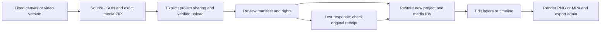

- [Format, APIs & usage / 格式、接口及使用](https://github.com/copypasteltd/workmate/blob/docs/docs/development/140-creative-project-packages.md)
- [Actual qualification / 实际验证](https://github.com/copypasteltd/workmate/blob/docs/docs/quality/creative-packages-checkpoint-140.json)
- [Open acceptance scopes / 未完成验收](https://github.com/copypasteltd/workmate/blob/docs/docs/quality/remaining-work-stage140.md)


- [Actual web interaction .MP4](https://github.com/copypasteltd/workmate/blob/web/assets/screenshots/workmate-creative-packages-140-07-project-restore.mp4)


- [Actual web interaction .GIF](https://github.com/copypasteltd/workmate/blob/web/assets/screenshots/workmate-creative-packages-140-07-project-restore.gif)
- [Actual desktop interaction .MP4](https://github.com/copypasteltd/workmate/blob/desktop/assets/screenshots/workmate-creative-packages-140-07-project-restore.mp4)
- [Actual desktop interaction .GIF](https://github.com/copypasteltd/workmate/blob/desktop/assets/screenshots/workmate-creative-packages-140-07-project-restore.gif)
- [Actual extension interaction .MP4](https://github.com/copypasteltd/workmate/blob/extension/assets/screenshots/workmate-creative-packages-140-07-project-restore.mp4)
- [Actual extension interaction .GIF](https://github.com/copypasteltd/workmate/blob/extension/assets/screenshots/workmate-creative-packages-140-07-project-restore.gif)

<!-- native-teams-stage139 -->
## Native specialist teams · Stage139

Each native member enters the existing task, customer-usage, wallet and audit system with local execution placement and exact role versions. Plan changes, disabled roles/Skills and account restrictions remain effective. Admins cannot grant OS access for customers, and private content retains the controlled support flow. Actual customer Desktop captures follow; dashboard, users, fees and VIP guidance remains below.

Up to 16 steps, seven members plus one assistant coordinator and three concurrent members share one explicitly approved folder. Keep concurrent edits in separate files. Review is free; exact budgets are immutable, holds and actual charges remain separate, and unknown accepted operations are never rerun. Revocation stops native tools first and leaves unsynchronized receipts visible. Only submitted outputs enter the team ZIP; local-only files remain local.

60 backend, 36 extension and 81 native controller/download checks, plus six actual Windows journey checks passed. Four screenshots, one GIF/MP4 pair, three layouts and an independently extracted complete team archive bind 1756 exact source files.

Business/model responses and native folder/consent/save decisions are controlled fixtures. Actual OTP/PKCE, native Codex processes, Windows file operations, company metering, revocation and ZIP extraction execute for real. The package is unsigned. Full professional-role quality, signed installation coverage, real company models/ad accounts and portable project recovery remain separately open.

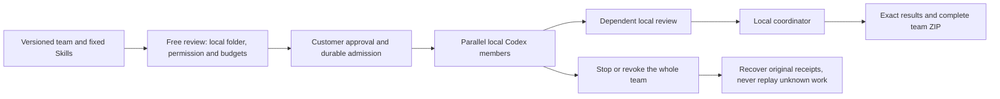

[Requirements](https://github.com/copypasteltd/workmate/blob/main/docs/requirements/16-desktop-native-teams.md) · [API, permissions, recovery and delivery](https://github.com/copypasteltd/workmate/blob/main/docs/technical/139-desktop-native-teams.md) · [Source and evidence](https://github.com/copypasteltd/workmate/blob/main/docs/quality/native-teams-checkpoint-139.json) · [All original identities](https://github.com/copypasteltd/workmate/blob/main/docs/quality/remaining-work-stage139.md)

Actual Desktop workflow, synthetic business content:


- [workmate-native-teams-139-05-review-before-local-run-en.png](https://github.com/copypasteltd/workmate/blob/desktop/assets/screenshots/workmate-native-teams-139-05-review-before-local-run-en.png)
- [workmate-native-teams-139-05-completed-local-team-zh.png](https://github.com/copypasteltd/workmate/blob/desktop/assets/screenshots/workmate-native-teams-139-05-completed-local-team-zh.png)
- [workmate-native-teams-139-05-whole-team-access-revoked-zh.png](https://github.com/copypasteltd/workmate/blob/desktop/assets/screenshots/workmate-native-teams-139-05-whole-team-access-revoked-zh.png)
- [workmate-native-teams-139-05-local-team.mp4](https://github.com/copypasteltd/workmate/blob/desktop/assets/screenshots/workmate-native-teams-139-05-local-team.mp4)

<!-- delivery-revision-stage138 -->
## Source-bound revisions and new delivery · Stage138

Revisions enter the existing task, usage and audit system as separate customer tasks with parent and source identities. The same wallet, plan and project limits control spending. Admins retain granular permissions and private-content access procedures; this endpoint cannot grant local OS permission for a customer. Existing dashboard, users, fees and VIP management guidance follows below.

Choose a complete delivery, answer, file, Unicode text quote, image region or verified video interval. Previewing does not call AI or reserve money. Confirming a revision creates a separate budgeted task with the fixed original role and source; original files and charges remain. Changed or withdrawn sources fence later reads and completion. Shared project editors may revise authorized shared work; private conversations retain their original owner. Unknown-outcome retries retain their original immutable request.

Text previews are limited to 1 MiB and inline image/MP4 previews to 4 MiB. Larger or unsupported previews can still be downloaded and revised as complete files. Complete-delivery references allow at most 20 files; video intervals require retained valid duration. Image/video anchors identify requested locations and do not approve an editing operation or prove professional output quality. Specialist workflows retain their own approvals.

34 current backend checks including 13 new revision cases, 36 extension checks, 73 native controller/download checks and nine actual client journey checks passed. Eleven actual screenshots, three GIF/MP4 pairs, seven layouts and three independently extracted revised archives bind 1732 exact source files.

Business/model responses and native dialog selections are explicitly controlled fixtures. Login, database permissions, exact files, actual packaged local Codex, native Windows surfaces, Chrome SIDE_PANEL and revised ZIP downloads run for real. The Windows package is unsigned. Real company models/accounts, full professional-role output quality, installation matrices and complete project recovery remain separately open.

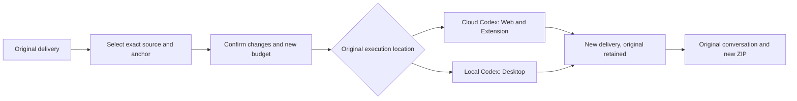

[Requirements](https://github.com/copypasteltd/workmate/blob/main/docs/requirements/15-delivery-revisions.md) · [Architecture and usage](https://github.com/copypasteltd/workmate/blob/main/docs/technical/138-source-bound-delivery-revisions.md) · [Exact source and evidence](https://github.com/copypasteltd/workmate/blob/main/docs/quality/delivery-revision-checkpoint-138.json) · [All original identities](https://github.com/copypasteltd/workmate/blob/main/docs/quality/remaining-work-stage138.md)

Actual product interaction, with synthetic business content:


Additional actual screenshots and MP4 recording:

- [workmate-delivery-revision-138-06-lost-response-retained.png](https://github.com/copypasteltd/workmate/blob/web/assets/screenshots/workmate-delivery-revision-138-06-lost-response-retained.png)
- [workmate-delivery-revision-138-06-image-anchor-en.png](https://github.com/copypasteltd/workmate/blob/web/assets/screenshots/workmate-delivery-revision-138-06-image-anchor-en.png)
- [workmate-delivery-revision-138-06-video-anchor-en.png](https://github.com/copypasteltd/workmate/blob/web/assets/screenshots/workmate-delivery-revision-138-06-video-anchor-en.png)
- [workmate-delivery-revision-138-06-revised-delivery-zh.png](https://github.com/copypasteltd/workmate/blob/web/assets/screenshots/workmate-delivery-revision-138-06-revised-delivery-zh.png)
- [workmate-delivery-revision-138-06-delivery-revision.mp4](https://github.com/copypasteltd/workmate/blob/web/assets/screenshots/workmate-delivery-revision-138-06-delivery-revision.mp4)

<!-- delivery-package-stage137 -->
## Complete delivery and original-chat download · Stage137

The main journey is goal → missing inputs → execution → review → download → revision in the original conversation. Web and the genuine native Chrome right SIDE_PANEL now download a complete current task delivery directly from chat. Delivery review also exposes it. Desktop uses the company API and its native save dialog; cancellation sends no export request and shows no success. Panel receipts survive live refresh and language changes.

The ZIP contains actual output files, task text when present, exact task/artifact versions, SHA-256 checksums and bilingual editing instructions. Identical filenames remain separate; stopped/failed task outputs remain explicitly partial. Instructions distinguish source ZIPs, SVG/PPTX, project JSON and flattened outputs. They never invent a missing editable project. Local files not submitted remain local, and Desktop continues running its own local Codex with customer-granted permissions.

The requested task version and delivery digest must match. The backend verifies real file size and digest while streaming sequentially into a disk-backed ZIP, then repeats current authority, source, retention and version checks before sending any download headers. Corruption, revocation or a changed delivery fails the whole package. Project readers may download authorized shared results; approval remains separate. Admin identity alone does not grant private conversation access. Exporting creates no AI call, new task or AI charge. Capacity is 16 GiB / 10,000 output/text entries; excess is rejected without silent omissions.

No new SQL migration is needed beyond existing SQL135. Rebuild Backend and all three clients. Extension adds Chrome `downloads` permission and uses the browser download location with conflict renaming; authorization stays in company request headers. Backend `contracts/delivery-package-v1.json` specifies the endpoint. From Delivery run `npm run qa:delivery-package-backend -- <new two-digit attempt>` or `npm run qa:delivery-package -- <new two-digit attempt>`; the latter performs full builds, creates an unsigned Windows package and drives actual native client downloads.

21 current backend checks including eleven new export cases, 37 extension checks, 1 native download regression, twelve boundary checks and ten actual client journey checks passed. Nine actual screenshots, three GIF/MP4 pairs, seven layouts and three independently extracted archives bind 1,713 exact source files. Business content and the Codex adapter are controlled; OTP/PKCE, stored files, authorization, native windows and Chrome downloads run for real. Desktop save-dialog selection is directed to an owned fixture destination. This increment does not requalify every local Codex tool, real company model, professional output quality or full project restoration across environments. A separate stage-local 52-case backend/source regression retains its exact original scope rather than being presented as a full current-platform rerun.

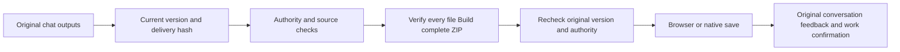

[Requirements](https://github.com/copypasteltd/workmate/blob/main/docs/requirements/14-complete-delivery-package.md) · [Architecture and usage](https://github.com/copypasteltd/workmate/blob/main/docs/technical/137-complete-delivery-package.md) · [Exact source and evidence](https://github.com/copypasteltd/workmate/blob/main/docs/quality/delivery-package-checkpoint-137.json) · [All original identities](https://github.com/copypasteltd/workmate/blob/main/docs/quality/remaining-work-stage137.md)

Actual customer workflow captures (synthetic content):


<!-- business-inputs-stage136 -->
## Business questions and original-task continuation · Stage136

When an essential canvas size, audience or business definition is missing, the Agent can ask in the original conversation. Customers may choose and edit a suggestion or write a different answer, then explicitly confirm it. Nothing is preselected or automatically submitted. Partial answers remain saved; completing all inputs continues the same task, conversation and original budget hold. Measured usage is settled cumulatively. Each confirmed question becomes one original-conversation note; identical retry adds no duplicate.

Web and the actual native Chrome right Side Panel show these questions inside the existing chat; Desktop supports answers in its existing cloud-task detail view. English/Traditional Chinese switching preserves drafts and a failed submission retains its text. Extension clears drafts on identity/conversation changes and removes protected questions when sources become unreadable. An answer grants no files, advertising accounts, tools, local access or additional spending permission.

The server strictly distinguishes `question`, `file` and `connection`: up to eight suggestions and 4,000 answer characters, with version, current authority, source and complete-batch validation before any update. Confirmed answers are immutable. Paid questions wait at a completed, measured Codex boundary and resume the original thread; cancellation settles known usage only. Private-conversation erasure removes questions, answers, checkpoints and text while retaining necessary accounting facts.

Apply SQL135 before API/Worker startup with Backend `npm run db:migrate`. Original SQL001–134, twenty baseline task definitions and the primary OpenAPI remain byte-identical. `contracts/business-inputs-v1.schema.json` adds strict versioned definitions to the existing create/input endpoints. File/connection requests retain their shape; questions use `answer` rather than `resource_ids`.

122 backend integration checks (including eleven new question cases), 61 extension state checks, twelve delivery binding tests and fourteen actual three-client checks passed. Nine actual screenshots, three GIF/MP4 pairs and seven layout checks bind to exact sources. Native integration uses the actual pinned Codex executable with synthetic Responses; UI journeys use scripted tools and synthetic business replies. Initial full client builds passed. Corrected journeys explicitly reuse byte-identical product source and the same unsigned Windows package; original failures remain. From Delivery, run `npm run qa:business-inputs-backend -- <new two-digit attempt>` or `npm run qa:business-inputs -- <new two-digit attempt>`; the latter performs full builds and creates an isolated native test database.

Desktop retains its separate local Codex and explicitly granted full-local-permission flow; this increment extends its cloud-task view. Actual native windows remain frameless with no Electron menu, visible vertical rails or horizontal overflow. Extension retains the genuine native right SIDE_PANEL. Data are synthetic and the Windows package is unsigned. Production models and complete specialist delivery remain open. Full acceptance retains 88 required records, twelve unconfirmed suggestions and one optional record; original REQ-095 remains accepted.

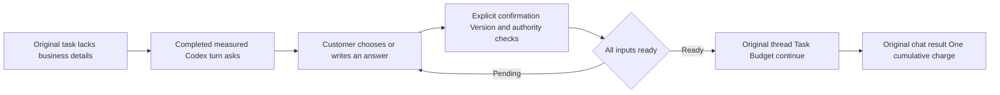

[Requirements](https://github.com/copypasteltd/workmate/blob/main/docs/requirements/13-business-brief-inputs.md) · [Implementation and usage](https://github.com/copypasteltd/workmate/blob/main/docs/technical/136-business-brief-clarification.md) · [All 102 identities](https://github.com/copypasteltd/workmate/blob/main/docs/quality/remaining-work-stage136.md) · [Exact source and evidence](https://github.com/copypasteltd/workmate/blob/main/docs/quality/business-inputs-checkpoint-136.json)


<!-- client-errors-stage135 -->
## Connection and session recovery across four clients · Stage135

Web, Admin, Desktop and Extension show connection guidance in the current language while retaining valid sign-in. A write with a lost or unreadable reply is explicitly unconfirmed: check its result before retrying. The application does not retry the write automatically. Browser transport retransmissions retain the same message identity and are deduplicated by the server. Support grants retain their fixed request key and deadline; extension delegations retain their original message identity, so explicit retry creates no second task. Background polling preserves an unconfirmed-write notice. Switching English/Traditional Chinese updates the same notice without exposing Electron internals, URLs or response bodies.

A current protected HTTP401 clears the current identity even when the body is HTML or empty. An obsolete request cannot sign out a newer identity or replace its CSRF token. Admin immediately removes its independent shell. Support-list connection errors are separate from form and revoked-access notices; successful list recovery clears only its own connection notice.

15 transport/identity tests (including actual HTTP faults), 12 delivery-file binding tests, one native bridge test and 30 actual four-client journey checks passed. Twenty screenshots and seven actual GIF/MP4 pairs bind to exact sources, including a real right-docked Chrome SIDE_PANEL, customer OTP/PKCE, independent administrator TOTP and an actual committed extension write with a lost reply and identical-message retry. Attempt09 rebuilds current Extension and Delivery. Backend/Web/Admin/Desktop source and Windows package bytes exactly match full build02, whose ten corresponding build steps and unchanged-source unit results are explicitly reused. Original failed attempts remain. Delivery `npm test` includes strict compilation, binding and transport checks; `npm run qa:client-errors -- <new two-digit attempt>` performs a full build by default.

Desktop continues to run Codex locally with separate explicit local permission, a frameless window, no Electron menus or visible rails. Extension keeps the native Chrome toolbar/Side Panel, approved-file uploads and cloud execution. Business fixtures are synthetic, no models ran and the Windows package is unsigned. Full acceptance still has 88 required records, 12 unconfirmed suggestions and one optional record open; original REQ-095 remains accepted.

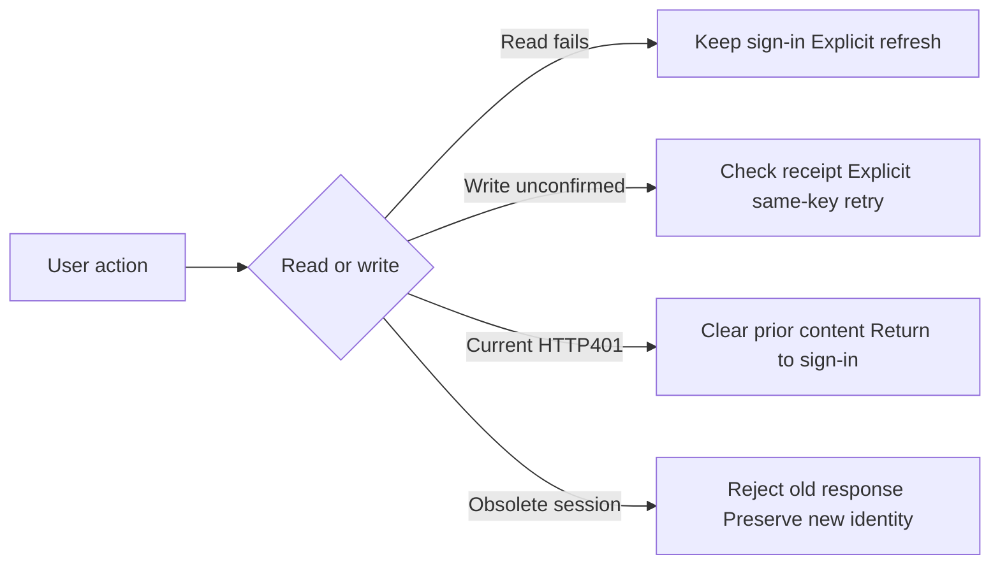

[Behavior and implementation](https://github.com/copypasteltd/workmate/blob/main/docs/technical/135-client-connection-and-session-recovery.md) · [All 102 requirement identities](https://github.com/copypasteltd/workmate/blob/main/docs/quality/remaining-work-stage135.md) · [Source-bound verification](https://github.com/copypasteltd/workmate/blob/main/docs/quality/client-errors-checkpoint-135.json)


<!-- support-recovery-stage134 -->
## Safe support-grant recovery and accepted support scope · Stage134

In **Web or Desktop → Account settings → Time-limited support**, choose explicit projects, the reason and duration. An empty project selection means metadata only. The first submission now fixes its request key and deadline. If its response is lost, use **Check previous request** or retry the same details; refreshing retrieves the existing result without automatically submitting again. Different details cannot replace an unresolved request. A recovered grant shows its current active, revoked or expired state and never gains extra time. You can revoke it from the list at any time.

Recovery stores only an opaque key, an intent digest and the fixed deadline in the current browser session. It does not persist the reason, project IDs, content or credentials. With storage disabled, recovery is limited to the running renderer; committed grants remain visible in the server list. Switching accounts or workspaces prevents late results from filling the new form. The native Desktop bridge permits only the customer receipt GET, alongside existing customer grant operations; it exposes no administrator impersonation route.

**Original REQ-095 / TC-095 is now accepted** against twelve individually mapped conditions and current source-bound evidence: real administrator identity and a read-only banner, explicit scope, independent body permission, write/payment/VIP/credential refusal, no hidden customer login, real-clock expiry, revocation and audit failure rollback. This closes one original requirement. REQ-055 whole-platform accessibility and REQ-094 whole-platform permission/concurrency matrices remain separate open work.

65 related backend checks, one native bridge boundary check and 18 actual Admin/Web/packaged Desktop journey checks passed. Ten build commands passed. The evidence includes real HTTP response loss before/after commit, reload, an actual workspace switch, identical retries, current-receipt recovery, real expiry and native customer revocation; user/native sessions, refresh-token and native-code row counts remain unchanged during support activity. Nine screenshots and five actual GIF/MP4 pairs are bound to the exact sources. Support controls work with keyboard input and enlarged text; Web/Admin use CSS zoom=2 and Desktop uses actual native webContents zoom=2. This does not constitute full browser/screen-reader accessibility acceptance.

Desktop continues to run Codex on the customer's computer, with separate explicit full local permission and a frameless window without Electron menus or visible scroll rails. Extension retains the native Chrome Side Panel for approved file uploads and cloud execution. Models did not run; business fixtures and retained output are synthetic. The Windows package is unsigned. All owned test browsers, native clients and databases closed.

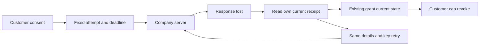

[方案 / Behavior](https://github.com/copypasteltd/workmate/blob/main/docs/technical/134-support-grant-recovery-and-acceptance.md) · [TC-095 acceptance](https://github.com/copypasteltd/workmate/blob/main/docs/quality/tc095-acceptance-134.json) · [Checkpoint](https://github.com/copypasteltd/workmate/blob/main/docs/quality/support-recovery-checkpoint-134.json) · [完整编号清单 / Remaining work](https://github.com/copypasteltd/workmate/blob/main/docs/quality/remaining-work-stage134.md)


[Recovery recording](https://github.com/copypasteltd/workmate/blob/web/assets/screenshots/workmate-support-recovery-134-04-grant-result-recovery.mp4) · [Retry recording](https://github.com/copypasteltd/workmate/blob/web/assets/screenshots/workmate-support-recovery-134-04-fixed-intent-retry.mp4) · [Native grant](https://github.com/copypasteltd/workmate/blob/desktop/assets/screenshots/workmate-support-recovery-134-04-customer-grant.mp4) · [Native revocation](https://github.com/copypasteltd/workmate/blob/desktop/assets/screenshots/workmate-support-recovery-134-04-customer-revocation.gif) · [200% Admin](assets/screenshots/workmate-support-recovery-134-04-support-en-200.png) · [Chinese dark Admin](assets/screenshots/workmate-support-recovery-134-04-support-zh-dark.png)

One requirement is accepted; 88 required records, 12 unconfirmed suggestions and one optional record remain open. These are acceptance records, not 101 uncoded modules. Complete source-delivery reproduction, signed installation, production integration and the remaining business acceptance continue in the numbered ledger. Earlier sections retain their original historical scope.

---

<!-- support-access-stage133 -->
## Controlled support and native customer authorization · Stage133

In **Web or Desktop → Account settings → Time-limited support**, choose the actual projects, a reason and a 15/30/60-minute deadline. An empty selection grants workspace/customer metadata only. Share the grant ID with support and revoke it from the same customer form at any time.

In **Admin → Support**, the administrator signs in with their own email and TOTP, chooses the customer, workspace, explicit projects, deadline and optional customer grant. The read-only banner keeps the real identities and deadline visible. Shared task bodies also require independent current body permission; private conversations stay private. The view provides no editing, billing, VIP or customer-login authority.

Support now checks original task sources before returning retained text. A quarantined/expired source or erased version blocks the body and masks its diagnostic title. Selected bodies use a current revision condition; changes during the audit are rejected. The page cancels old requests, rejects late task/session replies and clears bodies on changed revisions, source withdrawal, hidden views, failure, revocation or expiry. The server decides access on every read; visible Admin polling is approximately two seconds.

59 related backend tests and 13 actual Admin/Web/packaged native Desktop journey checks passed. The current source bytes bind 6 screenshots and 3 real-time GIF/MP4 pairs. Actual OTP/PKCE, email/TOTP, customer grants/revocation, delayed authorized responses, source withdrawal, real expiry, Chinese dark theme, four Admin widths and three frameless native widths were exercised. All owned browsers, the native client and test databases closed. Models did not run; business data, retained results and fixture file reads are explicitly synthetic. The Windows package remains unsigned.

Desktop continues to run Codex locally with the customer's separate explicit local-permission flow. Its support form uses customer-only routes; the administrator view stays in Admin. Extension continues to use the native Chrome Side Panel for approved file uploads and cloud execution. This increment changes no Extension execution code.

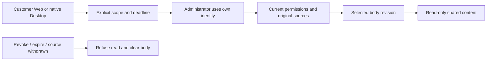

[Behavior](https://github.com/copypasteltd/workmate/blob/main/docs/technical/133-controlled-support-source-and-native-access.md) · [Checkpoint](https://github.com/copypasteltd/workmate/blob/main/docs/quality/support-access-checkpoint-133.json) · [Numbered remaining work](https://github.com/copypasteltd/workmate/blob/main/docs/quality/remaining-work-stage133.md)


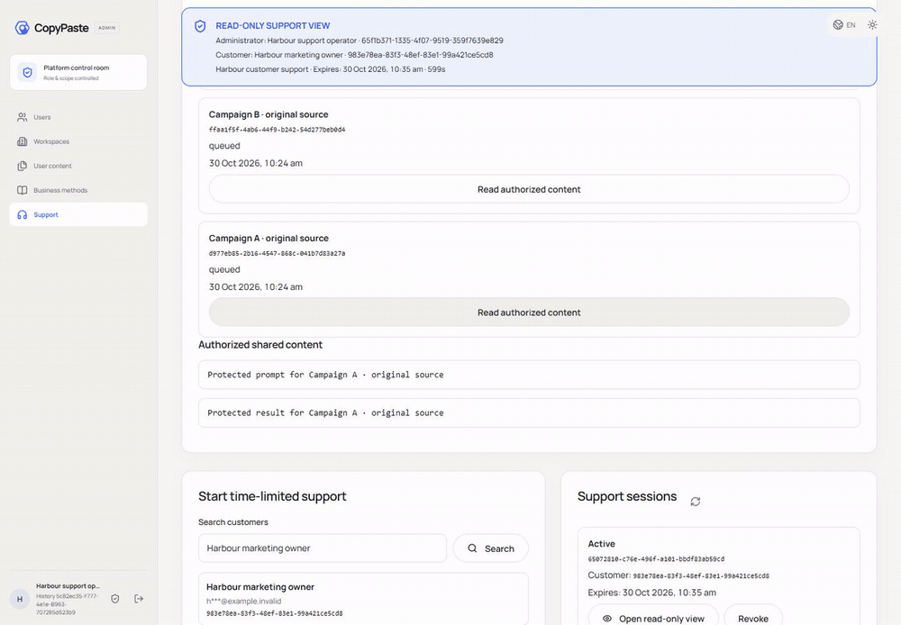


[Native grant recording](https://github.com/copypasteltd/workmate/blob/desktop/assets/screenshots/workmate-support-access-133-02-customer-grant.mp4) · [Selection recording](assets/screenshots/workmate-support-access-133-02-task-selection.mp4) · [Revocation recording](https://github.com/copypasteltd/workmate/blob/desktop/assets/screenshots/workmate-support-access-133-02-customer-revocation.mp4) · [Web metadata-only grant](https://github.com/copypasteltd/workmate/blob/web/assets/screenshots/workmate-support-access-133-02-metadata-grant-en.png) · [Chinese dark Admin](assets/screenshots/workmate-support-access-133-02-support-zh-dark.png) · [Source withdrawn](assets/screenshots/workmate-support-access-133-02-source-withdrawn-en.png)

89 required full-acceptance records, 12 unconfirmed suggestions and 1 optional record remain open. They are not 102 uncoded modules. Full permission/concurrency matrices, all-page accessibility, signed installation and production integration remain in the numbered ledger. Earlier sections retain their original historical scope.

---

<!-- content-history-stage132 -->
## Complete administrator content history · Stage132

Open **User content → Read content** on a conversation, specialist or memory. Read up to 50 original records per page, move in either direction or jump to the first/last page. Specialist and memory versions start with the newest and distinguish **Customer version** from **Administrator revision**. Expand a version to inspect its complete record.

The server rechecks the current MFA session, both content-reading permissions, tenant/project scope and explicit denials on every request. Signed cursors reject stale content. The visible reader rechecks every 15 seconds and on focus; failed authorization or changed readable sources clears its private state. Closing or changing resources aborts old requests and rejects late bodies. Bodies and cursors are not saved to browser storage. Unavailable assistant sources are masked.

The new GET `/v1/admin/content/:kind/:id/history` accepts `edge=first|last` or a returned `cursor`, with a fixed page size of 50. SQL134 maintains the message-history revision. Legacy body responses retain their limit and add `truncated` plus `history_url`. Ordinary customer conversations still have their existing 80-input limit.

54 related backend tests and 9 actual browser journey checks passed. Real API fixtures contain 205 specialist versions, 205 memory versions and 66 customer messages. Native PostgreSQL, email/MFA, actual administrator revision, source withdrawal, permission denial, late responses and 375/768/1440 layouts were exercised. Business data and retained assistant output are explicitly synthetic; no model ran. Original failed attempts and their exact sources remain available. Current captures contain 5 screenshots and 2 real-time GIF/MP4 pairs. All owned test resources closed.

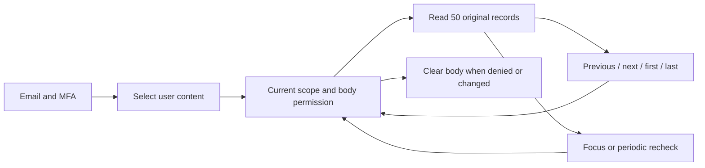

[Behavior](https://github.com/copypasteltd/workmate/blob/main/docs/technical/132-admin-content-history.md) · [Checkpoint](https://github.com/copypasteltd/workmate/blob/main/docs/quality/content-history-checkpoint-132.json) · [Numbered open work](https://github.com/copypasteltd/workmate/blob/main/docs/quality/remaining-work-stage132.md) · [API supplement](https://github.com/copypasteltd/workmate/blob/backend/contracts/admin-content-history-route-additions.json)

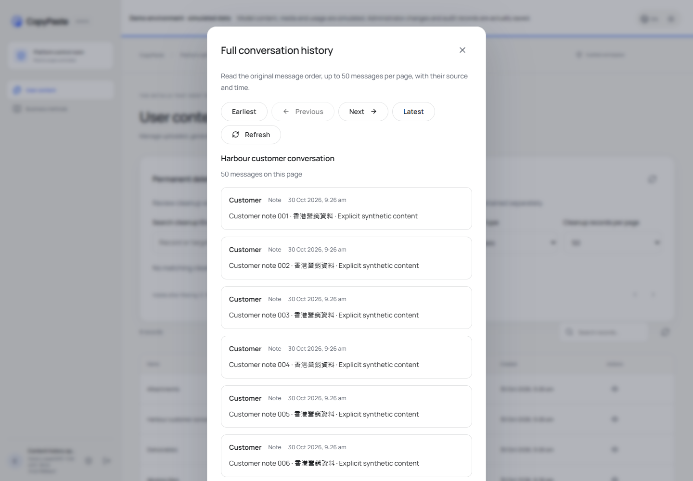

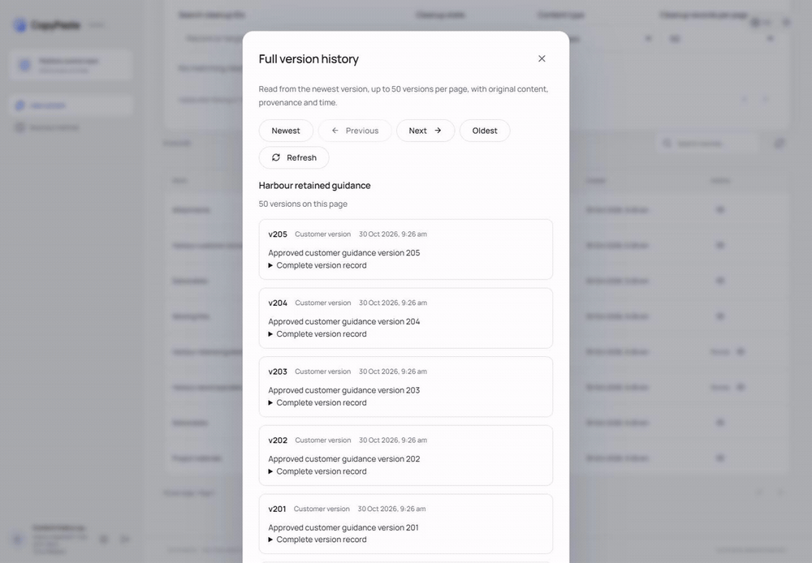

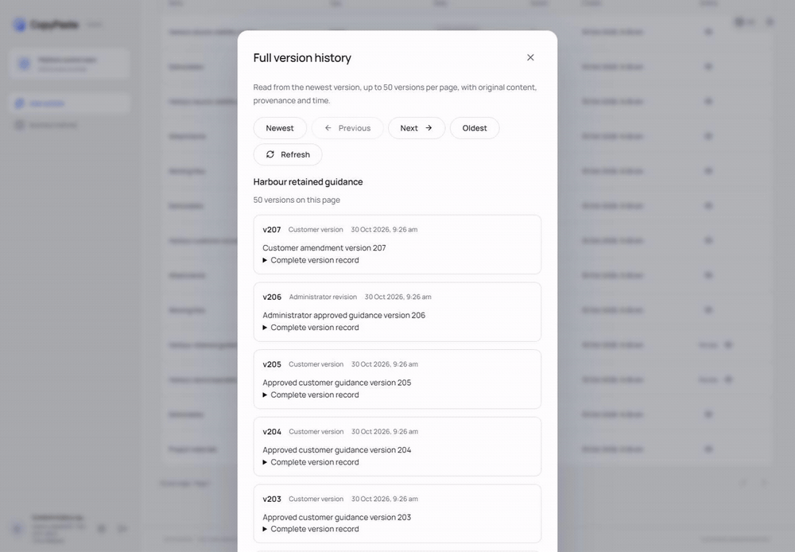

[Oldest memory version](assets/screenshots/workmate-content-history-132-02-oldest-memory-en.png) · [Administrator provenance](assets/screenshots/workmate-content-history-132-02-administrator-provenance-en.png) · [中文页面](assets/screenshots/workmate-content-history-132-02-memory-history-zh.png) · [Permission denied](assets/screenshots/workmate-content-history-132-02-permission-withdrawn-en.png) · [Navigation MP4](assets/screenshots/workmate-content-history-132-02-complete-version-navigation.mp4) · [Withdrawal MP4](assets/screenshots/workmate-content-history-132-02-permission-withdrawal.mp4)

89 required, 12 unconfirmed suggested and 1 optional full-acceptance records remain open. This is bounded history-reader qualification; full operations, all roles, production models/connectors and signed desktop installation remain in the numbered ledger. Historical sections below keep their original scope.

---

[简体中文](README.md) · [English](README.en.md)

<!-- controlled-publications-stage125 -->


## Publishing administration and independent authority · Stage125

The directory fetches metadata by default. Explicit private-body/media review requires independent body-read permission, current source access and recent MFA. Administrators may change scoped policy, cancel unsent operations, observe unknown results and record manual closure; they cannot confirm for the customer.

| Action | Permission, within current scope |
| --- | --- |
| Metadata | `admin.publication.read` |
| Private body/media | Above plus `admin.content.body.read` |
| Policy | `admin.publication.policy.write` |
| Cancellation/unknown resolution | `admin.publication.resolve` |

Mutations bind expected versions and original request keys. Lost responses are checked against the original administrator, object and request, without issuing a replacement mutation. Explicit new authorization atomically revokes old sessions; repetition/concurrency does not duplicate grants. Current denies, source expiry and revocation withdraw content.

Actual Web/Admin checks pass 14/14: independent email/TOTP, private-content opt-in, four widths, keyboard dismissal, policy, lost-response recovery and revocation. The complete Admin permission matrix remains open.


[Actual interaction MP4](assets/screenshots/workmate-publications-12-private-review-and-request-recovery.mp4)


<!-- admin-profile-revisions-124 -->
## Structured specialist, brand and private memory editing · Stage 124

Sign in with the separate Admin identity and MFA, then choose **Revise** for a customer specialist, brand or memory in Content. Specialist fields cover name, instructions and a tool subset from the pinned role. Brand fields cover font sources/permitted use, shared Logos, products, precise prices and offers. Memory edits retain the owner and scope while changing content and expiry. Legacy brand guidance requires explicit font/use declarations; rights are never invented.

Provide a reason, preview exact differences and pinned sources, check consent and save a new version. Currency precision is respected and comparisons display `HK$128.90`; review dates explicitly use Hong Kong time (`HKT`) while input pickers use the device's local timezone. Pinned models/Skills/brands and existing conversation inputs are retained; editing never starts customer work.

All three content permissions must intersect at the current object scope; explicit restrictions take precedence. Live withdrawal clears private content, preview and history. A lost response recovers the original outcome after reload without storing body/reason or mutating twice. Existing team, project-brief and method editors retain their respective publication workflows.

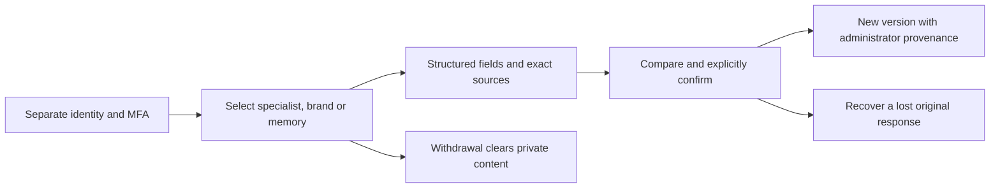

All **68 related backend checks**, **11 Admin unit checks**, **eight actual UI flows** and **14 boundary observations** at four widths passed. Initial recording/viewport-race failures remain unchanged; attempt 03 is a historical pass for its source, and the following use attempt 04 with readable money/time. All owned browsers/services/native databases were closed. Full product, live professional quality and production deployment retain separate acceptance.

| Actual screen | Capture |
| --- | --- |
| Specialist instructions and tool selection | [Specialist form](assets/screenshots/workmate-admin-profiles-04-specialist-form-en.png) |
| New specialist version and provenance | [Specialist receipt](assets/screenshots/workmate-admin-profiles-04-specialist-receipt-en.png) |
| Exact price and shared source selection | [Brand fields](assets/screenshots/workmate-admin-profiles-04-brand-price-and-sources-en.png) |
| Brand comparison with readable money | [Brand review](assets/screenshots/workmate-admin-profiles-04-brand-review-en.png) |
| Committed new brand version | [Brand receipt](assets/screenshots/workmate-admin-profiles-04-brand-receipt-en.png) |
| Chinese at 375px private memory and Hong Kong time | [Narrow review](assets/screenshots/workmate-admin-profiles-04-memory-review-zh-375.png) |
| Genuinely dropped committed response | [Original-request recovery](assets/screenshots/workmate-admin-profiles-04-memory-lost-response.png) |
| Actual scope withdrawal clears content | [Withdrawn scope](assets/screenshots/workmate-admin-profiles-04-memory-authority-withdrawn.png) |


[SpecialistMP4](assets/screenshots/workmate-admin-profiles-04-specialist-revision.mp4) · [BrandMP4](assets/screenshots/workmate-admin-profiles-04-brand-revision.mp4) · [MemoryMP4](assets/screenshots/workmate-admin-profiles-04-private-memory-revision.mp4) · [Design and evidence](https://github.com/copypasteltd/workmate/blob/docs/docs/technical/124-admin-profile-revisions.md)

<!-- admin-content-revisions-123 -->
## Structured content editing and recovery · Stage 123

Sign in with an independent Admin identity and MFA. Choose **Revise** for a team or shared project brief, or **Create revision draft** for a method. Edit names, instructions, member responsibilities, exact references or required materials. Search authorized references by name while retaining existing selections.

Provide a reason, inspect the before/after comparison and pinned dependency versions, then check the explicit confirmation. A shared brief publishes a new version and replaces its draft. A method revision creates a draft subject to the customer's existing trial and publication process. HKD budgets use exact decimal conversion.

Unknown responses retain the original request key and signed digests for recovery after reload; browser storage contains no content body or reason. Authority withdrawal clears the open body, preview and history, and late responses cannot restore cleared content. The editor retains CopyPaste typography, blue palette and neutral workspace; narrow layouts present editing, review and history in order.

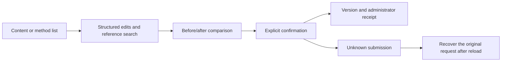

See the [structured editor](src/content-revisions.tsx) and [responsive styles](src/content-revisions.css). All **75 checks across five complete related backend files** and **seven actual UI flows** passed. Dialog and field bounds fit 375/768/1024/1440px. After an unknown response, the recovered receipt remains open until dismissed and the original request does not mutate content twice. Initial failures and older captures remain historical; the following use attempt 03. Owned browsers, services and the test database were closed. Full product acceptance is tracked separately.

| Actual screen | Capture |
| --- | --- |
| English team diff and unchecked confirmation | [Team preview](assets/screenshots/workmate-admin-content-03-team-preview-en.png) |
| Committed version receipt | [Saved result](assets/screenshots/workmate-admin-content-03-team-saved-en.png) |
| Traditional Chinese, exact HKD and 375px layout | [Narrow confirmation](assets/screenshots/workmate-admin-content-03-brief-preview-zh-375.png) |
| Method materials and draft preview | [Method revision](assets/screenshots/workmate-admin-content-03-method-preview-zh.png) |
| Committed request with a deliberately lost response | [Original request recovery](assets/screenshots/workmate-admin-content-03-unknown-response-recovery.png) |
| Current authority withdrawal clears the private body | [Withdrawal result](assets/screenshots/workmate-admin-content-03-authority-withdrawn.png) |


[Team MP4](assets/screenshots/workmate-admin-content-03-team-revision.mp4) · [Brief and method MP4](assets/screenshots/workmate-admin-content-03-brief-method-revisions.mp4) · [Behavior and evidence](https://github.com/copypasteltd/workmate/blob/docs/docs/technical/123-admin-content-revisions.md)

## Product and boundaries

The first customers are existing marketing teams. Scope includes image/design/typography, video/effects, advertising and website analysis, SEO/GEO, repeated business processes and software development. The catalog has 18 candidates with exact Skill bindings; at least twelve individually qualified professional presets remain an acceptance requirement. The designer combines Codex, design Skills and company Image 2. Codex is the only Agent core. All AI uses the company's OpenAI-compatible backend; development currently uses authorized synthetic providers, not a claim of live professional quality.

Uses separately enrolled Admin identities and MFA; customer login grants no administration. Metadata, sensitive bodies, usage/cost, credits/reversals, credit limits, refunds, payment records, VIP, quarantine/restore and irreversible erasure have separate permissions. Preview exact users/workspaces, amounts or entitlements, expiry and reason before confirming the same idempotent operation. Preview changes no balance and replay grants no duplicate credit. Support access does not imply body access; sensitive operations retain independent review, current MFA and audit. Admin cannot grant customer-local full permission or sign a customer's media declaration.

## Repositories and execution

| Branch | Directory | Runtime |
| --- | --- | --- |
| [backend](https://github.com/copypasteltd/workmate/tree/backend) | `dev/copypaste-platform` | Fastify / PostgreSQL / cloud Codex |
| [web](https://github.com/copypasteltd/workmate/tree/web) | `dev/copypaste-web` | React / Vite / cloud workspace |
| [admin](https://github.com/copypasteltd/workmate/tree/admin) | `dev/copypaste-admin` | React / separate Admin identity |
| [desktop](https://github.com/copypasteltd/workmate/tree/desktop) | `dev/copypaste-desktop` | Electron / customer-local Codex |
| [extension](https://github.com/copypasteltd/workmate/tree/extension) | `dev/copypaste-extension` | Chrome MV3 / native Side Panel / cloud Codex |
| [delivery](https://github.com/copypasteltd/workmate/tree/delivery) | `dev/copypaste-delivery` | Native development, QA and publication tools |

The component is an independent Git repository. Keep the sibling layout and use the documented native tools; Docker, WSL and VMs are prohibited.

## User workflow

1. Sign in with a separate administrator identity and MFA; a customer session grants no Admin access.
2. Search scoped users/workspaces and inspect permitted projects, tasks, content and consumption; sensitive bodies require separate access.
3. Preview exact subject, amount, funding source and reason before confirming the same idempotency key. Balance, cash, credit and VIP remain separate.
4. Grant, extend, suspend or revoke subject-specific VIP with explicit expiry/entitlements; a VIP change does not silently grant money.
5. Perform permitted content/task/batch/capability/node actions with current MFA, reason, version checks and independent approval where required.

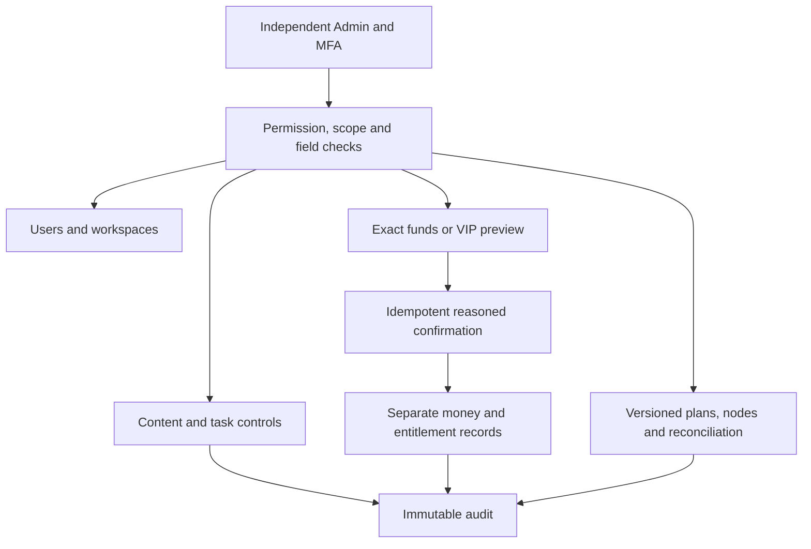

## Setup

### Local startup

Run these commands in the checked-out component. The complete workspace has the six independent repositories side by side under `dev/`; see the [branch and checkout layout](https://github.com/copypasteltd/workmate/blob/docs/docs/governance/04-git-branches-and-publication.md). Use Windows x64, Node.js >=22.14, npm/Git and the documented native PostgreSQL, FFmpeg/FFprobe and pinned Codex resources. Preserve existing local configuration/data. No Docker/WSL/VM is used.

```powershell
Set-Location 'D:/dev/copypasted/自有agent/dev/copypaste-admin'
npm ci
npm run dev
```

Start the backend first, then open `http://localhost:4318`. Use `npm run build` for the static build. Use a separately enrolled Admin account with MFA and assigned permissions.

### Use the current workflow

1. Complete sign-in, company membership/invitation and project selection. Native clients use browser PKCE; Admin uses separate MFA identities. Expired/revoked credentials must not silently change identity or company.
2. Select a specialist and supply the brief and explicitly authorized references/accounts. Missing inputs request customer action. Project owners can save, preview and explicitly publish immutable shared guidance; publication starts no AI and grants no new permission.
3. New tasks pin their accepted role, Skill, brand, reference and guidance versions. Existing work, including an originally absent configuration, retains its original state. Source revocation hides unavailable bodies and blocks later use; history is not a permission bypass.
4. Confirm budget and any required operation/media approval. View genuine status, progress, exact deliverables and original receipts. Continue requested edits in the same task lineage. Unknown usage remains reserved for reconciliation; it is never silently free or blindly replayed.
5. Admin can independently manage authorized user/workspace status, inspect permitted consumption, preview/confirm manual fees or credits and activate scoped VIP/expiry. Balances, recorded payments, credits, budgets and VIP are separate records. Idempotent confirmation and audit prevent duplicate grants.

## Configuration and authority

The candidate requires the complete additive SQL001–133 history. API/worker schema admission rejects missing, changed or unsupported versions; recovery identity is fenced independently. Company model aliases, verified media capabilities, exact tariffs and provider secrets live on the backend. Unconfigured capabilities remain unavailable. Current development uses explicitly authorized synthetic data.

Web/Admin use `VITE_API_BASE` or their same-origin proxy; default development ports are 4317/4318. Desktop/Extension compile fixed `COPYPASTE_API_ORIGIN` and `COPYPASTE_WEB_ORIGIN` values; Desktop also pins `COPYPASTE_EXTENSION_ID`. HTTPS is required outside the allowed loopback-development case. No renderer or extension receives company provider secrets.

Files remain private unless the customer explicitly shares them. Authorization is checked on new requests, worker claims, tools and downloads. Source/body revocation is not bypassed by old history. Money uses exact HKD micros; budget, balance, credits, recorded payments and VIP are distinct. Stable request identities prevent duplicate grants, tasks and reservations. Unknown usage or physical cleanup retains its reconciliation hold.

### Admin control matrix

| Scope | Controls |
| --- | --- | --- |
| Identity | Separate session, MFA, revocation, CSRF, scoped roles and explicit deny |
| Users / workspaces | Search, membership, freeze/restore and permitted task/content links |
| Funds / consumption | Exact usage, grants, credits, recorded payments, compensation, refund and reconciliation |
| VIP / entitlements | Subject, plan version, start/expiry, extension, suspension and revocation |
| Content / tasks | Separate metadata/body access, revisions, quarantine, erasure, pause/cancel and batch outcomes |
| Platform | Versioned models/skills/content releases; distinct infrastructure/read/stop/reconcile permissions |
| Sensitive changes | Reason, current MFA, compare-and-swap, idempotency, audit and independent approval when required |

Node credentials are shown once and cleared on close/unmount. Resource metadata access grants no customer pixels or private body access.

## Preset roles and Skills

The catalog defines 18 professional presets plus the default assistant. Every run pins exact Skill versions and registered tools. These definitions are not a claim that twelve full professional qualifications have passed.

| ID | Role | Required Skill bindings |
| --- | --- | --- |
| R01 | Full-stack developer | `fullstack-engineering@1.0.0`, `frontend-implementation@1.0.0`, `backend-api@1.0.0`, `qa-testing@1.0.0`, `delivery-core@1.0.0` |
| R02 | Frontend developer | `frontend-implementation@1.0.0`, `ui-system@1.0.0`, `qa-testing@1.0.0`, `delivery-core@1.0.0` |
| R03 | Backend/API engineer | `backend-api@1.0.0`, `qa-testing@1.0.0`, `delivery-core@1.0.0` |
| R04 | Software QA engineer | `qa-testing@1.0.0`, `frontend-implementation@1.0.0`, `delivery-core@1.0.0` |
| R05 | UI/UX designer | `ux-research@1.0.0`, `ui-system@1.0.0`, `frontend-implementation@1.0.0`, `delivery-core@1.0.0` |
| R06 | Designer | `creative-direction@1.0.0`, `image-art-direction@1.0.0`, `image2-production@1.0.0`, `typography-layout@1.0.0`, `delivery-core@1.0.0` |
| R07 | Brand visual designer | `brand-system@1.1.0`, `image-art-direction@1.0.0`, `image2-production@1.0.0`, `typography-layout@1.0.0`, `delivery-core@1.0.0` |
| R08 | Ad creative designer | `ad-creative@1.0.0`, `image-art-direction@1.0.0`, `image2-production@1.0.0`, `typography-layout@1.0.0`, `delivery-core@1.0.0` |
| R09 | E-commerce designer | `ecommerce-visual@1.0.0`, `image-art-direction@1.0.0`, `image2-production@1.0.0`, `typography-layout@1.0.0`, `delivery-core@1.0.0` |
| R10 | Social content designer | `social-content@1.0.0`, `image2-production@1.0.0`, `typography-layout@1.0.0`, `delivery-core@1.0.0` |
| R11 | Illustration/IP designer | `illustration-ip@1.0.0`, `image-art-direction@1.0.0`, `image2-production@1.0.0`, `delivery-core@1.0.0` |
| R12 | Typography/layout designer | `typography-layout@1.0.0`, `image-art-direction@1.0.0`, `image2-production@1.0.0`, `delivery-core@1.0.0` |
| R13 | Presentation designer | `presentation-production@1.1.0`, `typography-layout@1.0.0`, `dataviz@1.1.0`, `delivery-core@1.0.0`, `deterministic-metrics@1.1.0` |
| R14 | Landing-page designer | `landing-page@1.0.0`, `ui-system@1.0.0`, `frontend-implementation@1.0.0`, `image2-production@1.0.0`, `delivery-core@1.0.0` |
| R15 | Information/data designer | `dataviz@1.1.0`, `deterministic-metrics@1.1.0`, `typography-layout@1.0.0`, `delivery-core@1.0.0` |
| R16 | Video/motion designer | `video-storyboard@1.0.0`, `template-video-composition@1.0.0`, `video-generation@1.1.0`, `speech-production@1.2.0`, `delivery-core@1.0.0` |
| R17 | Marketing analyst | `ads-analysis@1.1.0`, `deterministic-metrics@1.1.0`, `dataviz@1.1.0`, `delivery-core@1.0.0` |
| R18 | Workflow consultant | `workflow-design@1.1.0`, `workflow-execution@1.1.0`, `delivery-core@1.0.0` |

Designer combines Codex, design Skills and the company Image 2 capability. Optional R19 computer-operator work needs its own confirmed cloud lease and AI budget; native Desktop excludes it and retains customer-local execution.

[Role contract](https://github.com/copypasteltd/workmate/blob/backend/catalog/role-preset-catalog.json) · [Skill packages](https://github.com/copypasteltd/workmate/blob/backend/catalog/skill-packages.json)

## Optional dedicated cloud computer

Review an immutable plan/quote, payer, fixed duration, exact private files and separate terminal/visual/Agent scopes. Agent control defaults off. Explicit consent reserves resource cost; a later Codex instruction has a separate exact AI ceiling. No automatic renewal occurs. Stop/expiry/revocation fences subsequent actions; measured usage and verified cleanup settle, uncertainty reconciles.

The Linux physical-node source uses native Node22/systemd, cgroups, XFS project quotas and bounded desktop tools. No Linux host was started for the local Windows qualification. Build a fresh numbered source bundle with `node native/build-package.mjs NN` in Delivery; verify the externally pinned bundle digest before installation. The installer defaults to no service start and supports exact-UUID recovery.

## Actual interface and interaction

These are actual unretouched product screenshots and wall-clock recordings. Customer/model/media responses are explicit fixtures; native Codex, files, database and billing paths run where stated. Synthetic node pixels do not qualify an actual remote Linux desktop.


[Original MP4](assets/screenshots/workmate-12-dedicated-cloud-plan.mp4)

## Verification and delivery status

The integrated clients/tool inventory passed 338 checks: Web 20, Admin 9, Extension 63, Desktop 180, actual local Codex 22 and Delivery 44; corresponding types/builds passed. Native Desktop, Web/Admin and native Side Panel each have eight bounded actual UI checks, with 29 screenshots and five GIF/MP4 pairs. Complete backend success requires its final complete-inventory report; the checkpoint records actual outcomes and retains failed attempts.

Run this component’s `npm run typecheck`, `npm run build` and documented test scripts with installed native prerequisites. Delivery’s default `npm test` covers native-surface integrity; the complete Delivery unit inventory is `node --test --test-concurrency=1 tests/*.test.mjs`. `node scripts/qualify-delivered-clients-v1.mjs NN` uses a fresh two-digit attempt and the sibling layout for all integrated client inventories. Candidate-specific historical runners preserve their original directory requirements.

Full product acceptance remains open: twelve professional-role qualifications, complete permissions/business/compatibility matrices, live service quality, signed installers/updates, production load/restore and customer business acceptance. Use the numbered inventory rather than test counts as a completion claim. Owned browsers/processes are closed; user resources are preserved.

[Implementation / 方案](https://github.com/copypasteltd/workmate/blob/docs/docs/technical/121-dedicated-cloud-and-client-execution.md) · [Checkpoint / 证据](https://github.com/copypasteltd/workmate/blob/docs/docs/quality/dedicated-cloud-checkpoint.json) · [Open requirements / 未完成项](https://github.com/copypasteltd/workmate/blob/docs/docs/quality/remaining-work-2026-10-29.md) · [Branch layout / 检出布局](https://github.com/copypasteltd/workmate/blob/docs/docs/governance/04-git-branches-and-publication.md)
