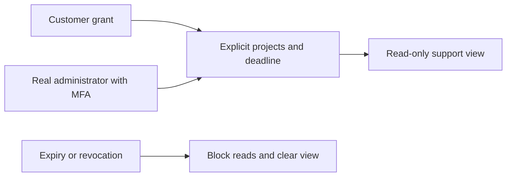
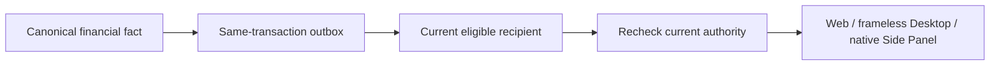
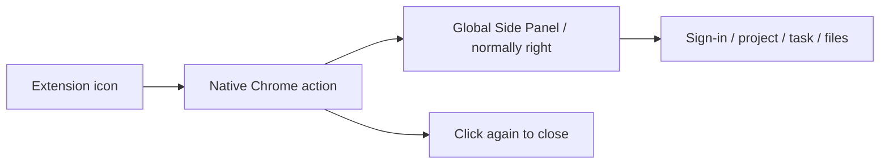
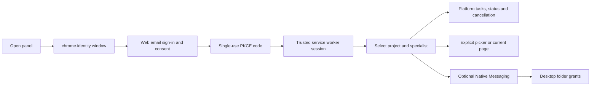
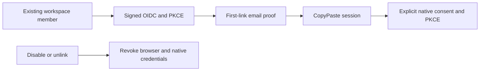
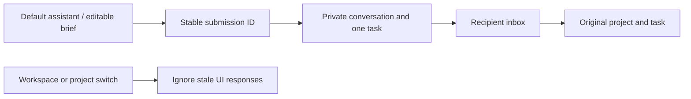
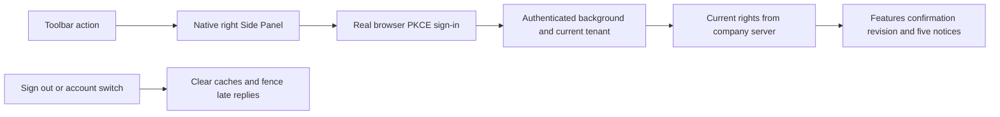

# CopyPaste Chrome Extension

## Controlled support update / 受控客服协助

The toolbar action continues to open the native Chrome Side Panel on the right. Customers manage support grants in Web account settings; the panel does not acquire administrator support sessions or other customer login credentials.

Stage 51 current regression: 424/424 with 711 source files; controlled-support browser workflows: 8/8 with 816 source files and 9 unedited captures. The 14 support tests, original contract checks, migration preservation and separate native checks are bounded evidence, not completion of all 102 acceptance cases. Current binaries are rebuilt; stage 50 binaries remain unchanged in their archive.




[简体中文](README.md) · Chrome MV3 side panel and native bridge · 0.5.0

An independent repository for project/specialist tasks, explicitly selected files and user-triggered current-page capture. Persistent folder operations use the installed Desktop native helper. Execution and billing stay on the platform; this extension contains no AI credentials.


The historical stage 49 recheck verified frameless Desktop, the native Chrome right Side Panel, live rights/notifications and sign-out while retaining that stage's installer bytes. Stage 50 below rebuilds the current previews with financial views. Complete installation, signing, SSO and system acceptance remain separate.

## Durable financial notifications and three-client accounts (stage 50)

The toolbar continues to open the real native Chrome Side Panel, normally on the right and subject to Chrome’s placement preference. It adds exact personal balances, the latest five account notices, unread filtering and read-state controls; Web provides full history/work events. Workspace changes, failed reads, revocation and sign-out clear stale content, and workspace/request revisions reject late results. Actual dark-theme hint contrast measures 11.59:1. Only owned browsers were used and closed.

Stage 50 historical platform regression: 410/410; actual three-client financial workflows: 8/8. AI/media and payment evidence are authorized local simulations; authentication, database, authorization, ledger and notification paths execute for real. This does not complete the original 102 acceptance cases, production banking or the full installation/system matrix.




## Open in the browser side panel

The entry follows the current MetaMask pattern: select CopyPaste from Chrome's extension menu or pin and click its icon to open the native global Side Panel, normally on the right. Clicking again closes it. It stays across page/tab navigation, and closing it does not cancel cloud tasks. Installation and browser startup do not open it automatically.

The manifest uses `side_panel.default_path` without `action.default_popup`. Every worker start, install/update and browser startup restores `openPanelOnActionClick: true` and trusted storage access. The extension uses Chrome's panel rather than an overlay, popup or extra tab. Chrome controls the left/right preference; users with a left-side preference can change it in Chrome's appearance/side-panel settings. Chrome 120 remains supported; newer `getLayout()` is used only by QA.




The image captures the real SIDE_PANEL document through CDP, showing its content only. Delivery `qa:native-surfaces` invokes `Extensions.triggerAction` on the actual browser tab and verifies right alignment, SIDE_PANEL identity, reduced webpage width, no new normal tab, navigation persistence and toggle close. The 2026-10-20 rerun binds the current extension's entire dist tree and source bytes to that actual QA report. The previous eight `qa:extension` groups remain historical authentication/business evidence; the full authentication matrix has separate acceptance requirements. Owned browsers close in finally.

The current loadable ZIP is `release/sidepanel/CopyPaste-0.5.0-sidepanel.zip`; extract it and load the directory from `chrome://extensions`. Earlier preview bytes are preserved in `release/sidepanel-stage30/`. Delivery records the new archive's SHA-256. This preview uses localhost origins; production configuration and store publication require a separate release.

## Build and load

Requires Node.js 22.14+ and Chrome 120+. Native Chromium was used for qualification. Start platform and Web first:

```powershell
npm ci
npm run typecheck
npm run build
```

Enable developer mode at `chrome://extensions`, load `dist/` unpacked and open the CopyPaste side panel. Stable unpacked ID: `fffkcnmfdhahlnifgdilabheppkgnlok`. `manifest-key.txt` is a public SPKI key, not an AI credential or store private key. Match platform `EXTENSION_ID` and Desktop `deployment.json`.

Defaults are API `http://localhost:4310` and Web `http://localhost:4317`. For production:

```powershell
$env:COPYPASTE_API_ORIGIN='https://api.your-company.example'
$env:COPYPASTE_WEB_ORIGIN='https://agent.your-company.example'
npm run build
```

Only HTTPS company origins or localhost development origins are accepted, without embedded credentials, paths or queries. Host permissions contain only the API origin. The extension has not been published to the Chrome Web Store. Docker, WSL and virtualization are prohibited.

## Authentication and use



The exact callback is registered to Chrome identity. Access/refresh tokens stay in trusted-context `chrome.storage.session`, not the panel, localStorage or `storage.local`. Closing the browser ends that session. Local extension storage only retains locale. The platform handles refresh rotation and logout.

Uploads require a user picker and are limited to 5 MB by the extension; the server rechecks project rights. Current-page capture requires a click and activeTab/scripting, excludes forms/editable/hidden content and does not run continuous site-wide capture.

## Web and Desktop integration

Version 0.2.0 uses the same platform identity, permissions and task API. The build derives the manifest version from package.json. The panel provides lightweight tasks/materials; configure persistent specialists, full private conversations and memory in Web or Desktop. Private outputs require explicit publication before project sharing.

## Native folders

The extension cannot silently scan the local disk. Install Desktop using the Windows Setup package, explicitly connect the Chrome helper in its device page, then grant optional nativeMessaging permission in the extension. Registration is per Windows user and allowlists the official extension origin.

Each folder needs separate native consent, expires after one hour and is read-only by default. Creating new files requires extra consent. List, preview, upload, create-only text output and revoke operations reject traversal, links/junctions, device names, ADS, overwrite and remote shell. Responses are capped at 900 KB; use the file picker for larger transfers.

## Verification and source

- `background.ts`: PKCE, token rotation, limited API/native messages and current-page capture.
- `panel.ts`: workspaces/projects/roles/tasks, upload, folder tools and locale.
- `build.mjs`: public deployment origins, manifest and stable ID.
- Delivery `npm run qa:extension`: real MV3 loading, chrome.identity login, upload, token privacy and logout; browser contexts close in finally.
- Delivery `npm run qa:desktop`: packaged native-host framing, allowlist, folder grants and local operations. QA does not overwrite the user's existing registry registration.

Static interface text supports Chinese/English; some dynamic statuses remain Traditional Chinese. Without live internal AI qualification, executable AI tasks remain unavailable. New organizations are initialized on Web. Daily/weekly cloud schedules are managed in Web or Desktop; full AI video/speech remain outside this release. See [notices](THIRD_PARTY_NOTICES.md).

## 0.5.0 company identity and unified sign-in

OIDC uses code + PKCE S256, signature verification, state/nonce and a fixed callback. An existing registered account and active workspace membership are required. First binding requires a separate CopyPaste work-email code; domains never auto-enroll users. Configuration changes, disablement or unlinking revoke all linked users’ CopyPaste browser/native/refresh sessions and prior execution authorization. Administrator email and TOTP remain separate.

Company identity reuses the system-browser authorization page: choose company sign-in, complete identity and any required email proof, then explicitly authorize the Chrome callback. Independent PKCE, short access tokens and rotating refresh credentials remain. Server codes bind to the issuing session and user revision; source logout or identity revocation invalidates outstanding codes. Local file and Native Messaging folder grants still require explicit actions.



## Default assistant and inbox (current source)

The panel offers a default text assistant alongside professional roles. Stable submission IDs preserve the original private conversation/task after an unknown response. Stale responses cannot overwrite lists/tasks after a workspace or project switch. Simulated workspaces display a persistent notice. The recipient inbox lists the latest 20 notifications, toggles read state and opens the original project/task; full pagination and conversation continuation remain in the workspace.

Delivery qa:extension passes eight real MV3 groups: PKCE; retry after an accepted response is lost and real Codex text-file creation; notification navigation; 320/420/768 widths, both themes/languages; explicit upload; credential privacy/logout; project switching while an accepted response is delayed. Model dependencies are synthetic and do not qualify live roles. Historical ZIPs are unchanged.




## Initial input requests (current source)

The side panel can declare a required file before the first model turn, then search and select a current project version explicitly. Existing connected-account requests are also selectable; the panel never creates OAuth authorization or synchronizes a report automatically. Workspace/project changes discard stale responses. Authorization errors clear candidates and prevent confirmation. Resolving the final request resumes the same task and its single reservation.

The explicit local picker uploads shared project files up to 5 MiB. Use the full workspace for private uploads and connection authorization. The eighth real MV3 journey verifies a waiting task, an actual upload, no automatic selection, the original task’s result and three widths in both themes. This covers initial prerequisites only; historical ZIPs are unchanged.


## Shared-slot waits (current source)

The panel explains server capacity waits: no model call yet, the original budget remains held and the same task resumes automatically. All clients share the server queue/database; the extension does not duplicate the task or reservation. Historical ZIPs are unchanged.

## Relationship to the persisted template directory

Web and Desktop now provide template preflight and instance creation. The extension retains its verified default text delegation, notifications and explicitly authorized file flow; this change does not add an extension template editor. Professional presets still require live business qualification. Connecting to the same API does not qualify those roles.

The panel now supports initial queued pause/resume, keeping the original task/reservation and synchronizing recent-task status. Delivery `qa:task-controls` verifies the business flow in real MV3/PKCE; running pause remains unavailable. These are source changes; the previous `release/sidepanel/` ZIP is unchanged. Native right-side SIDE_PANEL appearance retains its separately verified behavior.


## Session expiry and sign-out

The background coalesces refreshes and fences late login/refresh writes. A definitive 401 clears the matching credential and notifies open trusted panels; obsolete account requests cannot clear a later sign-in. Expiry clears account/task/file/notification views and stops polling. Sign-out clears session storage before revoking its family through refresh proof, including with expired access. Offline feedback explicitly reports unconfirmed remote revocation.


`npm test` has ten session race/fault groups. Delivery `qa:sessions` uses real MV3 and identity PKCE for remote revocation and expired-access sign-out. Its isolated MV3 document does not replace the native SIDE_PANEL appearance test. The previous sidebar preview ZIP retains its original manifest and does not include this repair.

## Current MV3 session recovery (2026-10-20)

Delivery `qa:sessions` now passes all 12 Web/source Electron/MV3 groups: actual identity S256 login, same-key recovery of committed exchange/refresh responses, real session-storage revocation, automatic sign-in/account replacement in two existing business pages, stale previous-account 401 isolation and expired-access sign-out. All 769 source/runtime files match; owned instances and credentials are cleared. Old failures remain unchanged and model calls are zero.


These are actual MV3 business documents. The separate 10/10 native SIDE_PANEL action evidence covers right-side appearance; these screenshots do not replace it. The recorded side-panel ZIP remains byte-identical. Complete packaged, identity, system and membership acceptance is still outstanding.

After the refund increment, current-source Web membership passes 6/6 (169 sources), Admin membership 6/6 (196), and Web/source Electron/MV3 authentication 12/12 (775), with unchanged source hashes and owned credential/process cleanup. The initial Electron debugging connection timeout is retained; the same source passed the rerun. Frameless Desktop and native Side Panel preview bytes are unchanged. Full packaged authentication and system acceptance remain separate.

Current-source verification after the immutable-plan increment (2026-10-20): Web membership 6/6 (172 source files), Admin membership 6/6 (200), and Web/source Electron/MV3 authentication 12/12 (779). Source digests match before and after each run; owned browsers, Electron and extension instances are closed and test credentials cleared. Immutable definitions and frozen legacy bindings do not change the native preview packages. Complete VIP/quota behavior, packaged authentication and system acceptance remain tracked in the main documentation.

## Current native right Side Panel and entitlement sync

Clicking the toolbar action opens a real browser `SIDE_PANEL` on the right and reduces the page width, without a popup or additional ordinary tab. Another click closes it. Navigation and tab changes retain the same panel document, and a browser restart restores its entry behavior. The rebuilt extension and frameless Desktop pass ten native-surface checks and six actual login/VIP integration groups.



Manual and 15-second refresh show server-merged personal/current-workspace rights. Project/file authorization and budget still apply. Reading a notice does not grant capabilities. Actual integration verifies that a Desktop read action updates the same persistent notification observed from the panel, suspension restores the real free plan, and sign-out clears credentials. Nineteen unit checks pass; full Native Host large-file, installation/publication and production acceptance remain open.


Verification triggers the actual browser action and attaches CDP to the native panel; an ordinary `sidepanel.html` tab is not substituted. Build with `npm run build`, then load `dist/` from Chrome's extension manager. The adjacent Delivery repository records the current ZIP and byte digests with `package:surfaces`.

## Enterprise seat and storage enforcement (stage 48)

The actual native Side Panel entitlement summary now includes workspace seats, retained bytes, pending upload reservations, limits and over-limit state. Byte values use BigInt. Existing workspace/project/session guards remain active, and personal VIP does not change shared workspace capacity. Clicking the extension action still opens the browser side panel; owned QA pages and browsers are closed afterward.


