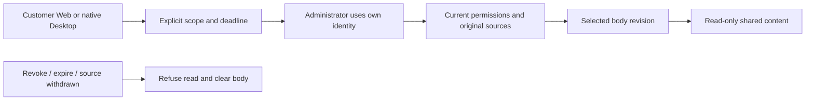
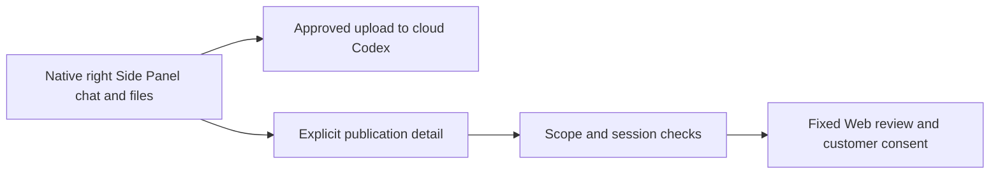
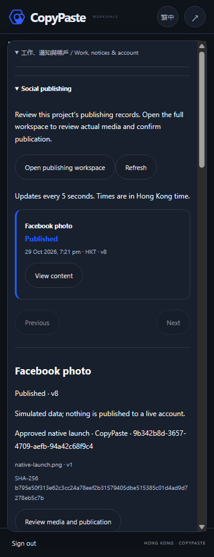
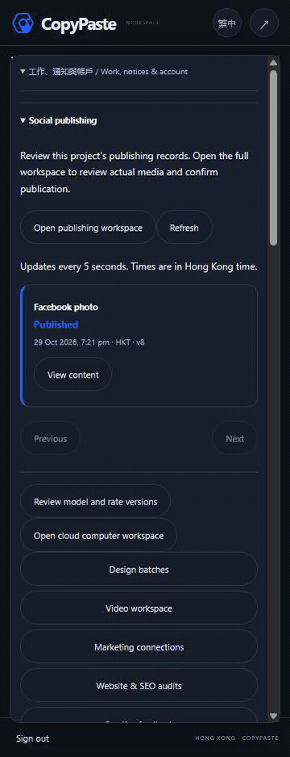
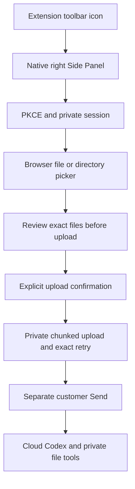
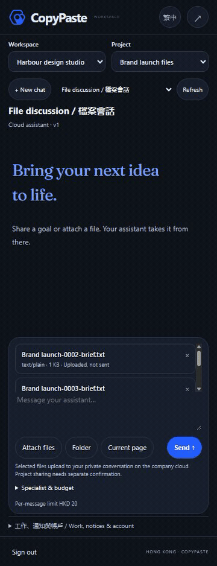

# Workmate · CopyPaste Enterprise Agent · extension

<!-- support-access-stage133 -->
## Controlled support and native customer authorization · Stage133

In **Web or Desktop → Account settings → Time-limited support**, choose the actual projects, a reason and a 15/30/60-minute deadline. An empty selection grants workspace/customer metadata only. Share the grant ID with support and revoke it from the same customer form at any time.

In **Admin → Support**, the administrator signs in with their own email and TOTP, chooses the customer, workspace, explicit projects, deadline and optional customer grant. The read-only banner keeps the real identities and deadline visible. Shared task bodies also require independent current body permission; private conversations stay private. The view provides no editing, billing, VIP or customer-login authority.

Support now checks original task sources before returning retained text. A quarantined/expired source or erased version blocks the body and masks its diagnostic title. Selected bodies use a current revision condition; changes during the audit are rejected. The page cancels old requests, rejects late task/session replies and clears bodies on changed revisions, source withdrawal, hidden views, failure, revocation or expiry. The server decides access on every read; visible Admin polling is approximately two seconds.

59 related backend tests and 13 actual Admin/Web/packaged native Desktop journey checks passed. The current source bytes bind 6 screenshots and 3 real-time GIF/MP4 pairs. Actual OTP/PKCE, email/TOTP, customer grants/revocation, delayed authorized responses, source withdrawal, real expiry, Chinese dark theme, four Admin widths and three frameless native widths were exercised. All owned browsers, the native client and test databases closed. Models did not run; business data, retained results and fixture file reads are explicitly synthetic. The Windows package remains unsigned.

Desktop continues to run Codex locally with the customer's separate explicit local-permission flow. Its support form uses customer-only routes; the administrator view stays in Admin. Extension continues to use the native Chrome Side Panel for approved file uploads and cloud execution. This increment changes no Extension execution code.



[Behavior](https://github.com/copypasteltd/workmate/blob/main/docs/technical/133-controlled-support-source-and-native-access.md) · [Checkpoint](https://github.com/copypasteltd/workmate/blob/main/docs/quality/support-access-checkpoint-133.json) · [Numbered remaining work](https://github.com/copypasteltd/workmate/blob/main/docs/quality/remaining-work-stage133.md)


[Native grant recording](https://github.com/copypasteltd/workmate/blob/desktop/assets/screenshots/workmate-support-access-133-02-customer-grant.mp4) · [Selection recording](https://github.com/copypasteltd/workmate/blob/admin/assets/screenshots/workmate-support-access-133-02-task-selection.mp4) · [Revocation recording](https://github.com/copypasteltd/workmate/blob/desktop/assets/screenshots/workmate-support-access-133-02-customer-revocation.mp4) · [Web metadata-only grant](https://github.com/copypasteltd/workmate/blob/web/assets/screenshots/workmate-support-access-133-02-metadata-grant-en.png) · [Chinese dark Admin](https://github.com/copypasteltd/workmate/blob/admin/assets/screenshots/workmate-support-access-133-02-support-zh-dark.png) · [Source withdrawn](https://github.com/copypasteltd/workmate/blob/admin/assets/screenshots/workmate-support-access-133-02-source-withdrawn-en.png)

89 required full-acceptance records, 12 unconfirmed suggestions and 1 optional record remain open. They are not 102 uncoded modules. Full permission/concurrency matrices, all-page accessibility, signed installation and production integration remain in the numbered ledger. Earlier sections retain their original historical scope.

---

[简体中文](README.md) · [English](README.en.md)

<!-- controlled-publications-stage125 -->
## Publishing review in the native right Side Panel · Stage125

Keeps ChatGPT-style chat/attachments, Chrome's native right Side Panel and approved local-file reading/upload, with cloud Agent execution. Expand Social publishing in workspace tools to list project metadata; private body is fetched only after View content. Confirmation stays in the full Web workspace.

Review media and publication validates tenant/project/operation UUIDs, current access and session continuity after asynchronous requests, then opens only the configured Web origin. URLs exclude credentials and arbitrary destinations. Folding, hiding or changing account/project clears private detail and stops reading. Five-second updates preserve focus; the panel cannot publish for the customer.



Typecheck, build and all 70 logic checks pass. The actual packaged Desktop/native Chrome Side Panel journey passes 10/10, including toolbar docking, independent PKCE, private-content opt-in, fixed Web handoff, folding and source revocation. Complete installation, file continuation and professional acceptance remain open.





[Actual interaction MP4](assets/screenshots/workmate-native-publications-02-native-panel-review-and-handoff.mp4)


## Product and boundaries

The first customers are existing marketing teams. Scope includes image/design/typography, video/effects, advertising and website analysis, SEO/GEO, repeated business processes and software development. The catalog has 18 candidates with exact Skill bindings; at least twelve individually qualified professional presets remain an acceptance requirement. The designer combines Codex, design Skills and company Image 2. Codex is the only Agent core. All AI uses the company's OpenAI-compatible backend; development currently uses authorized synthetic providers, not a claim of live professional quality.

The Chrome MV3 extension opens the native right Side Panel from its toolbar icon, rather than injecting an in-page overlay. Sign in and select a workspace/project independently of Desktop. Attachments first create the actor's private conversation, then use exact-byte/SHA-256 resumable chunks; errors never fall back to project sharing. Another editor in the same project cannot list/read versions/download/open that private conversation. Project sharing is separate and explicit; files/current-page content are read only after customer selection or authorization.

## Repositories and execution

| Branch | Directory | Runtime |
| --- | --- | --- |
| [backend](https://github.com/copypasteltd/workmate/tree/backend) | `dev/copypaste-platform` | Fastify / PostgreSQL / cloud Codex |
| [web](https://github.com/copypasteltd/workmate/tree/web) | `dev/copypaste-web` | React / Vite / cloud workspace |
| [admin](https://github.com/copypasteltd/workmate/tree/admin) | `dev/copypaste-admin` | React / separate Admin identity |
| [desktop](https://github.com/copypasteltd/workmate/tree/desktop) | `dev/copypaste-desktop` | Electron / customer-local Codex |
| [extension](https://github.com/copypasteltd/workmate/tree/extension) | `dev/copypaste-extension` | Chrome MV3 / native Side Panel / cloud Codex |
| [delivery](https://github.com/copypasteltd/workmate/tree/delivery) | `dev/copypaste-delivery` | Native development, QA and publication tools |

The component is an independent Git repository. Keep the sibling layout and use the documented native tools; Docker, WSL and VMs are prohibited.

## User workflow

1. Click the extension icon to open Chrome’s native right Side Panel; sign in and choose a workspace without Desktop.
2. Use chat and attachments. Review selected relative paths, exact sizes and checkboxes before any directory upload.
3. Confirm chunked upload into the customer’s private session. Failures expose recovery; lost responses retry the original upload identity.
4. Finish attachments or remove failed items, then separately press Send to create cloud Codex work. Private attachments never become shared implicitly.
5. The optional computer entry opens only the fixed company Web page. Ordinary Send cannot forge computer-operator work or bypass cost consent.



## Setup

### Local startup

Run these commands in the checked-out component. The complete workspace has the six independent repositories side by side under `dev/`; see the [branch and checkout layout](https://github.com/copypasteltd/workmate/blob/docs/docs/governance/04-git-branches-and-publication.md). Use Windows x64, Node.js >=22.14, npm/Git and the documented native PostgreSQL, FFmpeg/FFprobe and pinned Codex resources. Preserve existing local configuration/data. No Docker/WSL/VM is used.

```powershell
Set-Location 'D:/dev/copypasted/自有agent/dev/copypaste-extension'
npm ci
npm run build
```

Start the backend and Web first. In Chrome 120+, open `chrome://extensions`, enable Developer mode and load this repository's `dist/` as an unpacked extension. Pin/click its icon to open the native right Side Panel. Keep the built Extension ID aligned with backend authorization; configure company HTTPS origins through `COPYPASTE_API_ORIGIN`/`COPYPASTE_WEB_ORIGIN` before production builds. Sign in, select a workspace/project and attach authorized files. Desktop installation is unnecessary.

### Use the current workflow

1. Complete sign-in, company membership/invitation and project selection. Native clients use browser PKCE; Admin uses separate MFA identities. Expired/revoked credentials must not silently change identity or company.
2. Select a specialist and supply the brief and explicitly authorized references/accounts. Missing inputs request customer action. Project owners can save, preview and explicitly publish immutable shared guidance; publication starts no AI and grants no new permission.
3. New tasks pin their accepted role, Skill, brand, reference and guidance versions. Existing work, including an originally absent configuration, retains its original state. Source revocation hides unavailable bodies and blocks later use; history is not a permission bypass.
4. Confirm budget and any required operation/media approval. View genuine status, progress, exact deliverables and original receipts. Continue requested edits in the same task lineage. Unknown usage remains reserved for reconciliation; it is never silently free or blindly replayed.
5. Admin can independently manage authorized user/workspace status, inspect permitted consumption, preview/confirm manual fees or credits and activate scoped VIP/expiry. Balances, recorded payments, credits, budgets and VIP are separate records. Idempotent confirmation and audit prevent duplicate grants.

## Configuration and authority

The candidate requires the complete additive SQL001–133 history. API/worker schema admission rejects missing, changed or unsupported versions; recovery identity is fenced independently. Company model aliases, verified media capabilities, exact tariffs and provider secrets live on the backend. Unconfigured capabilities remain unavailable. Current development uses explicitly authorized synthetic data.

Web/Admin use `VITE_API_BASE` or their same-origin proxy; default development ports are 4317/4318. Desktop/Extension compile fixed `COPYPASTE_API_ORIGIN` and `COPYPASTE_WEB_ORIGIN` values; Desktop also pins `COPYPASTE_EXTENSION_ID`. HTTPS is required outside the allowed loopback-development case. No renderer or extension receives company provider secrets.

Files remain private unless the customer explicitly shares them. Authorization is checked on new requests, worker claims, tools and downloads. Source/body revocation is not bypassed by old history. Money uses exact HKD micros; budget, balance, credits, recorded payments and VIP are distinct. Stable request identities prevent duplicate grants, tasks and reservations. Unknown usage or physical cleanup retains its reconciliation hold.

## Preset roles and Skills

The catalog defines 18 professional presets plus the default assistant. Every run pins exact Skill versions and registered tools. These definitions are not a claim that twelve full professional qualifications have passed.

| ID | Role | Required Skill bindings |
| --- | --- | --- |
| R01 | Full-stack developer | `fullstack-engineering@1.0.0`, `frontend-implementation@1.0.0`, `backend-api@1.0.0`, `qa-testing@1.0.0`, `delivery-core@1.0.0` |
| R02 | Frontend developer | `frontend-implementation@1.0.0`, `ui-system@1.0.0`, `qa-testing@1.0.0`, `delivery-core@1.0.0` |
| R03 | Backend/API engineer | `backend-api@1.0.0`, `qa-testing@1.0.0`, `delivery-core@1.0.0` |
| R04 | Software QA engineer | `qa-testing@1.0.0`, `frontend-implementation@1.0.0`, `delivery-core@1.0.0` |
| R05 | UI/UX designer | `ux-research@1.0.0`, `ui-system@1.0.0`, `frontend-implementation@1.0.0`, `delivery-core@1.0.0` |
| R06 | Designer | `creative-direction@1.0.0`, `image-art-direction@1.0.0`, `image2-production@1.0.0`, `typography-layout@1.0.0`, `delivery-core@1.0.0` |
| R07 | Brand visual designer | `brand-system@1.1.0`, `image-art-direction@1.0.0`, `image2-production@1.0.0`, `typography-layout@1.0.0`, `delivery-core@1.0.0` |
| R08 | Ad creative designer | `ad-creative@1.0.0`, `image-art-direction@1.0.0`, `image2-production@1.0.0`, `typography-layout@1.0.0`, `delivery-core@1.0.0` |
| R09 | E-commerce designer | `ecommerce-visual@1.0.0`, `image-art-direction@1.0.0`, `image2-production@1.0.0`, `typography-layout@1.0.0`, `delivery-core@1.0.0` |
| R10 | Social content designer | `social-content@1.0.0`, `image2-production@1.0.0`, `typography-layout@1.0.0`, `delivery-core@1.0.0` |
| R11 | Illustration/IP designer | `illustration-ip@1.0.0`, `image-art-direction@1.0.0`, `image2-production@1.0.0`, `delivery-core@1.0.0` |
| R12 | Typography/layout designer | `typography-layout@1.0.0`, `image-art-direction@1.0.0`, `image2-production@1.0.0`, `delivery-core@1.0.0` |
| R13 | Presentation designer | `presentation-production@1.1.0`, `typography-layout@1.0.0`, `dataviz@1.1.0`, `delivery-core@1.0.0`, `deterministic-metrics@1.1.0` |
| R14 | Landing-page designer | `landing-page@1.0.0`, `ui-system@1.0.0`, `frontend-implementation@1.0.0`, `image2-production@1.0.0`, `delivery-core@1.0.0` |
| R15 | Information/data designer | `dataviz@1.1.0`, `deterministic-metrics@1.1.0`, `typography-layout@1.0.0`, `delivery-core@1.0.0` |
| R16 | Video/motion designer | `video-storyboard@1.0.0`, `template-video-composition@1.0.0`, `video-generation@1.1.0`, `speech-production@1.2.0`, `delivery-core@1.0.0` |
| R17 | Marketing analyst | `ads-analysis@1.1.0`, `deterministic-metrics@1.1.0`, `dataviz@1.1.0`, `delivery-core@1.0.0` |
| R18 | Workflow consultant | `workflow-design@1.1.0`, `workflow-execution@1.1.0`, `delivery-core@1.0.0` |

Designer combines Codex, design Skills and the company Image 2 capability. Optional R19 computer-operator work needs its own confirmed cloud lease and AI budget; native Desktop excludes it and retains customer-local execution.

[Role contract](https://github.com/copypasteltd/workmate/blob/backend/catalog/role-preset-catalog.json) · [Skill packages](https://github.com/copypasteltd/workmate/blob/backend/catalog/skill-packages.json)

## Actual interface and interaction

These are actual unretouched product screenshots and wall-clock recordings. Customer/model/media responses are explicit fixtures; native Codex, files, database and billing paths run where stated. Synthetic node pixels do not qualify an actual remote Linux desktop.




[Original MP4](assets/screenshots/workmate-dedicated-extension-03-folder-response.mp4)

## Verification and delivery status

The integrated clients/tool inventory passed 338 checks: Web 20, Admin 9, Extension 63, Desktop 180, actual local Codex 22 and Delivery 44; corresponding types/builds passed. Native Desktop, Web/Admin and native Side Panel each have eight bounded actual UI checks, with 29 screenshots and five GIF/MP4 pairs. Complete backend success requires its final complete-inventory report; the checkpoint records actual outcomes and retains failed attempts.

Run this component’s `npm run typecheck`, `npm run build` and documented test scripts with installed native prerequisites. Delivery’s default `npm test` covers native-surface integrity; the complete Delivery unit inventory is `node --test --test-concurrency=1 tests/*.test.mjs`. `node scripts/qualify-delivered-clients-v1.mjs NN` uses a fresh two-digit attempt and the sibling layout for all integrated client inventories. Candidate-specific historical runners preserve their original directory requirements.

Full product acceptance remains open: twelve professional-role qualifications, complete permissions/business/compatibility matrices, live service quality, signed installers/updates, production load/restore and customer business acceptance. Use the numbered inventory rather than test counts as a completion claim. Owned browsers/processes are closed; user resources are preserved.

[Implementation / 方案](https://github.com/copypasteltd/workmate/blob/docs/docs/technical/121-dedicated-cloud-and-client-execution.md) · [Checkpoint / 证据](https://github.com/copypasteltd/workmate/blob/docs/docs/quality/dedicated-cloud-checkpoint.json) · [Open requirements / 未完成项](https://github.com/copypasteltd/workmate/blob/docs/docs/quality/remaining-work-2026-10-29.md) · [Branch layout / 检出布局](https://github.com/copypasteltd/workmate/blob/docs/docs/governance/04-git-branches-and-publication.md)
