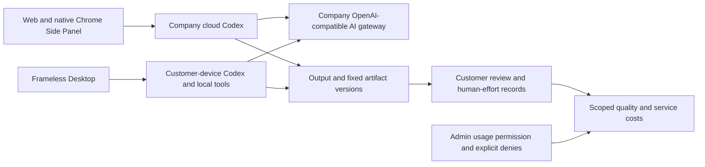
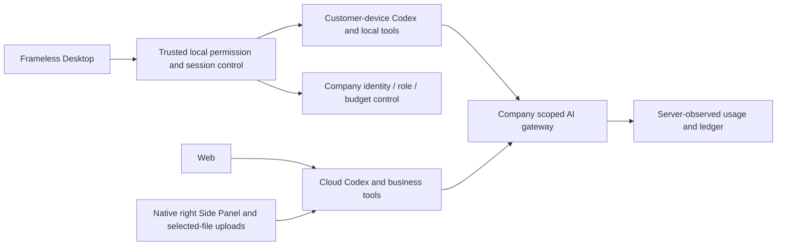
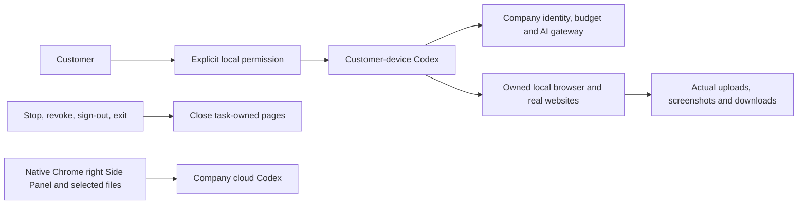
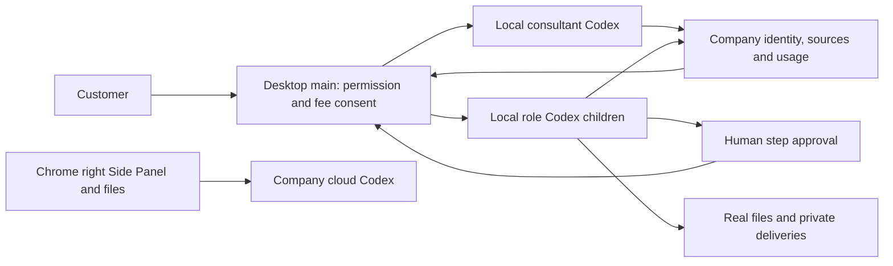

# Workmate · CopyPaste Delivery

[中文](README.md) · [Documentation](https://github.com/copypasteltd/workmate/blob/docs/docs/README.en.md)

<!-- business-quality-stage78 -->

## Current delivery review and usage

Native service startup, complete tests, actual captures and independent-branch publication tooling. Reviews now retain the exact current delivery version, with accept, changes requested and discard decisions. Customers can report baseline minutes, cumulative human effort and revisions independently. Project usage and the scoped Admin quality dashboard distinguish technical success, customer acceptance, recorded reuse and company service costs.

Desktop remains customer-local Codex with explicit revocable full local access, no Electron menu/frame, no visible vertical or horizontal scrollbar rails, and real wheel/keyboard access. Content reflows, focused inputs remain visible at 800×600, and the composer and receipt stay accessible. The previous progress-bar constraint is withdrawn; truthful progress remains. Extension remains independent native right Side Panel chat/file upload to cloud Codex. Every AI request uses the company gateway.

1. Sign in, choose a tenant/project and create a task in its correct execution location. Desktop needs an explicit folder and local permission; the Extension needs no Desktop installation.
2. Inspect the actual result and open “Review this delivery” (Desktop) or the task review form. Save acceptance, requested changes or discard with optional feedback. Task/version or delivery changes return a conflict requiring reload.
3. Optionally record cumulative human figures. Blank means unknown; zero means explicitly none. Refresh preserves the open effort form and visible input access.
4. Inspect project usage or Admin → Delivery quality within your permission scope. Incomplete costs stay incomplete; service costs exclude refund offsets, outside services and labor. No ROI or retention is inferred.

Apply additive SQL095 before publishing the dependent API/UI; published SQL001–094 and the original task OpenAPI are unchanged. Legacy acceptance without a delivery snapshot requires a new customer review. The original review endpoint remains compatible; current forms require both task version and delivery digest plus idempotency. Customer review requires project approval authority. Admin can read scoped aggregates under `admin.usage.read` but cannot accept for a customer, read feedback through aggregates or grant OS access.

Use fresh two-digit attempts: `node scripts/run-quality-ui.mjs NN`, `node scripts/run-extension-chat.mjs NN`, and `node scripts/run-desktop-local-ui.mjs NN` with the pinned absolute `COPYPASTE_LOCAL_CODEX_BIN`. Full platform qualification uses `run-desktop-platform-resumable.mjs NN --init`, one `--next` per planned batch and `--finish`, with `COPYPASTE_LOCAL_CODEX_TEST_BIN`. Run database/visual owners sequentially and keep bound sources frozen.



Current source qualification: 861/861 platform cases across 67 files/17 batches, 68 client units, 26 actual packaged-Desktop checks, four Web/Admin checks and 8 native Side Panel checks. The retained 17-case native-supervisor proof has all 57 bound files unchanged. These scopes are separate and not additive. Actual auth, database, files, billing and local Codex run; model/business/customer inputs and native-dialog decisions are explicit fixtures. TC-056 real-task baselines/blind review, all 18 roles/29 Skills, complete OS/Codex Desktop parity and production gates remain unproven. Original 102 requirements/102 cases and 81 partial / 21 unproven / 0 fully accepted remain.

The Desktop31 and Web/Admin07 journeys retain their original bytes. Their only later bound-file difference is two migration-test expectations updated from 94 to 95, archived and checked exactly; all runtime, UI and journey sources remain unchanged. Platform21 freshly reruns the updated tests. See the checkpoint for this explicit qualification.


[MP4](https://github.com/copypasteltd/workmate/blob/desktop/assets/screenshots/workmate-local-31-local-agent.mp4)

[Design](https://github.com/copypasteltd/workmate/blob/docs/docs/technical/78-business-delivery-quality.md) · [Contract](https://github.com/copypasteltd/workmate/blob/docs/docs/contracts/business-quality-openapi.json) · [Exact source and media evidence](https://github.com/copypasteltd/workmate/blob/docs/docs/quality/business-quality-checkpoint.json) · [Changes](https://github.com/copypasteltd/workmate/blob/docs/docs/changes/2026-10-23-business-delivery-quality.md)

<details>
<summary>Full setup, architecture and historical verification records (earlier counts/captures retain their original scope)</summary>

[Backend](https://github.com/copypasteltd/workmate/tree/backend) · [Web](https://github.com/copypasteltd/workmate/tree/web) · [Admin Dashboard](https://github.com/copypasteltd/workmate/tree/admin) · [Desktop](https://github.com/copypasteltd/workmate/tree/desktop) · [Chrome Extension](https://github.com/copypasteltd/workmate/tree/extension) · [Delivery](https://github.com/copypasteltd/workmate/tree/delivery)

A cloud Agent product for Hong Kong enterprises. This repository owns **Delivery** and publishes to `delivery`.

<!-- client01-direction -->
## Current client direction and qualified scope

CLIENT01 (2026-10-22) requires **Desktop to run Codex on the customer's computer**, with a real user-opt-in **full local access** mode and Codex Desktop as the operation benchmark. The **Extension uses a ChatGPT-style conversation and attachment layout in Chrome's native right Side Panel**, reads user-selected files and uploads them for cloud Codex execution. All product AI calls still use the company gateway.

**Historical stage-77 implementation:** Desktop runs Codex on the customer device with explicit full access, local files/terminal, persistent threads, native questions, company design/video tools and native workflow children. Twelve local browser tools now perform actual navigation, interaction, upload, screenshots and downloads; Stop/revoke reclaim owned pages. Desktop hides scrollbar rails and reflows artifacts, code and tables while preserving vertical scrolling and keyboard access. The previous progress-bar constraint is withdrawn; truthful progress feedback remains. Separate qualification covers 851 platform, 68 client, 17 native-supervisor, 10 standalone Electron-browser and 25 packaged-journey checks; counts are not additive. Full professional delivery across 18 roles/29 Skills, complete OS-application/Codex Desktop parity, live models and production remain pending. Extension retains independent ChatGPT-style native right Side Panel cloud chat and authorized-file upload; its UI was not rerun. See [design](https://github.com/copypasteltd/workmate/blob/docs/docs/technical/77-desktop-native-browser.md), [layout requirements](https://github.com/copypasteltd/workmate/blob/docs/docs/requirements/04-desktop-layout-and-scroll.md) and [source/media checkpoint](https://github.com/copypasteltd/workmate/blob/docs/docs/quality/desktop-browser-checkpoint.json).

Desktop runs the native Agent locally; the Web and Extension run cloud Codex. The linked stage 73 proof states the tested scope.

Native supervisor scope, actual permission checks and remaining integration: [implementation details](https://github.com/copypasteltd/workmate/blob/docs/docs/technical/70-desktop-native-codex-supervisor.md).

<!-- /client01-direction -->

To repeat the native Side Panel conversation journey, configure the existing Platform `.env` and native runtime resources, then run `node scripts/run-extension-chat.mjs NN` with an unused two-digit attempt. The runner requires free ports 4310/4317/55432, runs 32 Extension tests and type/build checks, starts only its own native PostgreSQL/preview/browser, and verifies shutdown plus isolated fixture reclamation. Model turns are synthetic; the native panel, upload, cloud Worker and ledger are real. See the [Extension checkpoint](https://github.com/copypasteltd/workmate/blob/docs/docs/quality/extension-chat-checkpoint.json).

## Architecture and constraints

Codex is the only Agent kernel. All AI calls use the company's internal OpenAI-compatible server. Web, Desktop, extension and Admin share server identity, permissions, sources and billing controls. UI follows CopyPaste brand assets, colors, typography and bilingual patterns.



## Responsibility and layout

This repository starts native development services, verifies cross-client behavior, preserves raw results, checks package bytes, captures actual interactions and synchronizes mapped branches. It coordinates sibling repositories rather than containing another business kernel.

| Directory | Responsibility |
| --- | --- |
| `scripts/` | Bootstrap, native process control, migration checks, client/API/permission/media verification, recording and publishing |
| `tests/` | Integrity checks for native-package and Side Panel verifiers |
| `evidence/` | Per-execution raw TAP/logs, source bindings, cleanup and actual screenshot digests |
| `assets/screenshots/` | Actual README screenshots, MP4 and GIF |
| `.data/` | Ignored owned process state, browser profiles, raw recordings and temporary data |

## Workspace layout

Check out docs at the project root. Place component branches under `dev/copypaste-platform`, `copypaste-web`, `copypaste-admin`, `copypaste-desktop`, `copypaste-extension` and this `copypaste-delivery` repository. Use separate working directories when running components together.

## Install, start and stop

```powershell
npm ci
npm run bootstrap
npm run demo
```

Ports: Web `4317`, Admin `4318`, API `4310`, controller `4319` and native PostgreSQL `55432`. `npm run stop` only stops controller-owned processes and requests a normal database checkpoint. Occupied ports fail startup while preserving existing processes.

`demo` explicitly enables local synthetic mode, which production and non-loopback hosts reject. Authorized synthetic data does not qualify live model quality, prices or production services. Original errors/failures remain intact.

## Actual interaction recording

```powershell
node scripts/run-paid-input-native.mjs NN --media
```

Use a fresh two-digit ID for a new recording. The command starts owned native PostgreSQL, isolated fixtures, Web/Admin previews, actual unpacked Desktop and a native Chrome Side Panel. All owned browsers/previews close and isolated fixtures are reclaimed afterward. First reproduce the local Desktop/Extension previews named by the script using the packaging runbook; source branches do not include installers or dist.

Replace `NN` with a fresh two-digit ID. `qa-workmate-media.ts` hooks actual UI operations. `record-workmate-media.ts` encodes captured wall-clock intervals into MP4/GIF. Captures come directly from the confirmed native SIDE_PANEL document viewport and exclude the browser toolbar. The same journey independently asserts right-side layout, reduced main-page width and no popup/extra tab. Evidence binds synthetic-turn scope, source/media hashes and exit receipts.

## Branch publication

After committing the six components, run `python docs/tools/finalize_workmate_manifest.py --update` at the main documentation root to explicitly refresh component SHAs. Review the media attempt and release notes, then commit docs. The publisher accepts local `codex/*` working branches and published branch names created by the README clone commands. With all repositories clean:

```powershell
node scripts/publish-workmate.mjs --check
node scripts/publish-workmate.mjs --push
```

The publisher updates only the eight mapped branches atomically, checks remote ancestry and verifies post-push SHAs. It never force-pushes or deletes other branches. Preflight calls the documentation audit for historical objects, credentials, README links and media. Ignored runtime receipts live in `.data/publication/`; failures remain available and stop publication.

The current manifest generator binds retained Stage 66/journey 06 evidence. Product source changes require rerunning checks and selecting matching new reports; changing component SHAs alone cannot reuse passing results from older source.

## Verification boundaries

`npm run typecheck` and `npm test` check this repository. Backend runs full platform tests; cross-client/native scripts enforce their own prerequisites. Applied migration bytes are immutable. Pre-upgrade snapshots, first failures and later read-only corrections remain separate. Docker/WSL/virtualization are prohibited for all tests and captures.

## Checkout and prerequisites

Clone this branch into a fresh working directory; update an existing repository without reinitializing it.

```powershell
git clone --single-branch --branch delivery git@github.com:copypasteltd/workmate.git copypaste-delivery
cd copypaste-delivery
```

Use Node.js ≥22.14, npm and Git with pinned lockfiles. The qualified local environment is Windows x64. Backend/full delivery also needs native PostgreSQL launcher resources, cloud-pinned Codex `0.163.0-alpha.10.2` and FFmpeg/FFprobe; Desktop independently pins `0.163.0-alpha.11` in its runtime manifest. No local Docker, WSL or virtualization. Run components in separate directories; see [workspace](https://github.com/copypasteltd/workmate/blob/docs/docs/governance/04-git-branches-and-publication.md).

## Checks and evidence scope

```powershell
npm run typecheck
npm test
```

Historical-source **802/802** full Platform tests and **52/52** focused task tests pass, with **13 checks** across six repositories and **32** actual packaged Desktop/native Side Panel checks. All prior 782 named regression cases remain. Task checks exercise actual PostgreSQL, identity, ledger and Worker; separate real Codex child processes use a synthetic internal gateway. UI turns/business data are synthetic as authorized. The original 102 requirements remain: 81 partially verified, 21 without proven completion and zero fully accepted.

Canonical TaskDTO/task creation, arbitrary in-flight pause, unknown-effect recovery, independent complete role workflows, GEO, live suppliers and production/signing/store qualification remain tracked.

This revision adds canonical task APIs and atomic original-task inputs. Current UIs continue to use their existing project/conversation interfaces over the same execution domain. The refreshed actual recordings verify compatibility; they do not claim migration of every UI to canonical task APIs. See [the implementation and limits](https://github.com/copypasteltd/workmate/blob/docs/docs/technical/68-canonical-task-contracts-and-input-transactions.md) for exact money, idempotency, source revocation and unsupported business parameters.

## Actual screens and interactions

This service has no independent customer page. The following captures show the actual Desktop client connected to the service.

Actual recordings preserve capture timing. AI turns/business data are explicitly synthetic. Admin form demonstrations do not claim a financial commit.


[MP4](assets/screenshots/workmate-10-interaction.mp4) · [Capture/source evidence](https://github.com/copypasteltd/workmate/blob/docs/docs/quality/workmate-media-10.json)

## Detailed design and updates

- [Product](https://github.com/copypasteltd/workmate/blob/docs/docs/product/01-prd.md)
- [Architecture](https://github.com/copypasteltd/workmate/blob/docs/docs/technical/01-architecture-and-stack.md)
- [Identity and permissions](https://github.com/copypasteltd/workmate/blob/docs/docs/technical/07-security-and-permissions.md)
- [Task continuation](https://github.com/copypasteltd/workmate/blob/docs/docs/technical/66-paid-native-input-checkpoints.md)
- [Admin](https://github.com/copypasteltd/workmate/blob/docs/docs/product/08-admin-dashboard.md)
- [Native clients](https://github.com/copypasteltd/workmate/blob/docs/docs/technical/30-native-window-and-browser-sidepanel.md)
- [Canonical task update](https://github.com/copypasteltd/workmate/blob/docs/docs/changes/2026-10-22-canonical-task-repair.en.md)
- [Local Codex update](https://github.com/copypasteltd/workmate/blob/docs/docs/changes/2026-10-22-native-codex-supervisor.en.md)

Every later change updates both READMEs, affected actual captures/GIFs, release notes and its mapped branch. Verify remote SHAs through Delivery publishing; do not force-push collaborator history. Keep environment secrets, databases, sessions, dependencies and installers out of Git. Exact historical README bytes are retained in [archive](https://github.com/copypasteltd/workmate/blob/docs/docs/quality/history/stage66-before-workmate-readmes/manifest.json).

Canonical task verification:

```powershell
node scripts/run-canonical-task-checks.mjs NN
node scripts/run-canonical-task-checks.mjs NN --full
```

Use a new two-digit attempt ID every time. Retain failures; successful reports require actual native database shutdown and owned-fixture cleanup.

For the independent native supervisor checks, set the task-specific `COPYPASTE_LOCAL_CODEX_TEST_BIN` to the absolute native binary matching the Desktop lock, then run `node scripts/run-local-codex-checks.mjs NN`. It starts no cloud task, database or browser; actual terminal operations use owned isolated files. The historical compatibility `node scripts/run-paid-input-native.mjs NN --media` UI journey uses Desktop's `release/client-direction-70-01/` candidate: first run `npm run build` and `node scripts/package-client-direction.mjs` in Desktop, preserving old packages. This UI journey still verifies cloud/file-bridge compatibility and is distinct from full local-Agent product acceptance.

Stage 73 Desktop local execution: [design](https://github.com/copypasteltd/workmate/blob/docs/docs/technical/73-desktop-native-company-tools.md) · [source-bound proof](https://github.com/copypasteltd/workmate/blob/docs/docs/quality/desktop-company-tools-checkpoint.json). Prior recordings below retain their original source scopes.

## Local Desktop verification

Set explicit locked `COPYPASTE_LOCAL_CODEX_BIN` and `COPYPASTE_LOCAL_CODEX_TEST_BIN`. Run `node scripts/run-desktop-execution-checks.mjs NN`, `node scripts/run-local-codex-checks.mjs NN`, and `node scripts/run-desktop-local-ui.mjs NN` using fresh two-digit attempt IDs. Reports refuse overwrite, bind before/after source hashes and retain failed attempts. The UI runner packages a new unsigned candidate under Desktop `.data/local-candidates/`, uses an isolated native PostgreSQL fixture, actual Electron and an owned browser, then closes them and proves fixture cleanup. Never run database-owning suites on occupied ports. Native dialog decisions/provider messages are fixtures; real local tools and billing are exercised.

## Native company-tool contract

The Agent loop stays on the customer device. Main registers trusted `copypaste` dynamic tools for the pinned native runtime, binds each call to its task/call/thread/turn, and rechecks company permissions before effects and disclosure. Local read-only denies company mutations. Original business validation remains enforced after the native schema projection. Same-call retries reuse durable results; unknown accepted image operations stop further calls and retain reconciliation holds. Private artifact downloads use exact versions and a native save selection.

The historical stage-73 company-tool checkpoint selected a complete Platform run with `node scripts/run-desktop-execution-checks.mjs NN --full-platform`, plus the native and actual packaged UI runners. Use a new attempt ID, explicit pinned binaries and free owned ports; failed receipts remain immutable. Never modify covered source while a bound run is active.

For execution environments that interrupt long runs, the selected checkpoint uses the resumable runner: `node scripts/run-desktop-platform-resumable.mjs NN --init`, then `--next` for each planned batch, and `--finish`. It fixes the complete actual test-file inventory and source hashes before execution, verifies six recovery-rule tests, and records 17 independently owned batches for the current inventory. Every file must pass with unchanged source, separate complete TAP, fixture cleanup and database shutdown. Interrupted attempts contribute no coverage; only their unfinished batch is retried. A failed batch requires review and a new qualification. The final index sums the complete inventory without fabricating a single TAP stream.

Stage 73 company-tool update: [release notes](https://github.com/copypasteltd/workmate/blob/docs/docs/changes/2026-10-23-desktop-company-tools.en.md) · [source-bound checkpoint](https://github.com/copypasteltd/workmate/blob/docs/docs/quality/desktop-company-tools-checkpoint.json). Earlier reports and media retain their historical source scopes.

Stage 74 native-input update: [release notes](https://github.com/copypasteltd/workmate/blob/docs/docs/changes/2026-10-23-desktop-native-input.en.md) · [current checkpoint](https://github.com/copypasteltd/workmate/blob/docs/docs/quality/desktop-native-input-checkpoint.json). Earlier reports/media retain their original source scopes.

Stage 75 private-video update: [release notes](https://github.com/copypasteltd/workmate/blob/docs/docs/changes/2026-10-23-desktop-private-video.en.md) · [current checkpoint](https://github.com/copypasteltd/workmate/blob/docs/docs/quality/desktop-video-checkpoint.json). Earlier reports retain their actual source scopes; platform/main-process qualification and later UI qualification are explicitly separated.

For the 58 overlapping private-video checks, run `node scripts/run-desktop-video-checks.mjs NN` with a fresh attempt. The stage-75 full Platform inventory was 64 files/16 batches/830 tests. Actual native window sizes remain strict 800x600 assertions; failed attempts remain available and contribute no successful journey coverage.

<!-- desktop-native-browser-stage77 -->

## Native browser and scrollbar-free Desktop

Start a new local session, select a folder and explicitly grant Full local access. Ask the local Codex to work in a browser. The trusted frameless address bar and remote page run in separate customer-device renderers. The tool namespace `copypaste_browser` v1 includes tabs/open/navigate/history/snapshot/screenshot/interact/evaluate/wait/dialog/downloads/close; interact supports real click, fill/type/select, keys, scroll/drag and exact local-file upload. Completed downloads remain in the selected workspace’s browser-downloads directory. Model screenshots capture the actual page; README browser media uses actual OS window capture, with no compositing.

Current local permission, company identity, project access, origin and budget are rechecked. Web content cannot grant OS access or acquire company inference credentials. Call IDs bind exact operations; unknown accepted actions never replay automatically. Stop, revoke, sign-out or exit close owned pages and pending downloads, preserving completed files and the customer’s original windows. Existing threads retain their original tool binding; create a new session for browser tools.

The previous progress-bar constraint is withdrawn. Truthful upload/task/workflow/video feedback remains. Hidden scrollbar rails do not disable native scrolling. Artifacts wrap into rows, code and tables reflow, scroll areas have keyboard focus, and the composer/receipt remain usable in actual 800×600, 1280×800 and 1440×980 windows. Real wheel/Home/End and last-download focus are verified, alongside compact billing/devices/account pages and English/Traditional Chinese light/dark controls. Physical touchpad hardware and every display-scaling configuration are not claimed by these automated checks.

Current complete inventory: 66 test files / 17 batches / 851 passing cases, retaining all 848 prior cases. SQL001–094 and all 428 HTTP routes remain unchanged. The isolated UI fixture alone allocates 32 user/platform/tenant slots and appends immutable provider-policy version 2 with 32 slots and 10,000 requests/minute, retaining intentional unknown cancellation holds. Bootstrap policy and production defaults/enforcement remain unchanged. Synthetic Responses, campaign content and native-dialog choices are explicit. Original 102 REQ/102 TC, NFR and G01–G10 remain at 81 partial / 21 unproven / 0 fully accepted. Extension product/verifier bytes are unchanged; no new Extension UI claim.

Run `node scripts/run-desktop-browser-checks.mjs NN` for the real standalone browser. Set the pinned absolute `COPYPASTE_LOCAL_CODEX_TEST_BIN` for `node scripts/run-local-codex-checks.mjs NN` and the resumable full platform verifier (`--init`, one `--next` per batch, then `--finish`). Set `COPYPASTE_LOCAL_CODEX_BIN` for `node scripts/run-desktop-local-ui.mjs NN`. Use a fresh two-digit attempt, run database/visual owners sequentially, and keep covered sources frozen. Only UUID-owned test resources are reclaimed; no Docker/WSL.




[Design](https://github.com/copypasteltd/workmate/blob/docs/docs/technical/77-desktop-native-browser.md) · [Requirements](https://github.com/copypasteltd/workmate/blob/docs/docs/requirements/04-desktop-layout-and-scroll.md) · [Evidence](https://github.com/copypasteltd/workmate/blob/docs/docs/quality/desktop-browser-checkpoint.json) · [Changes](https://github.com/copypasteltd/workmate/blob/docs/docs/changes/2026-10-23-desktop-native-browser.md)

<details>
<summary>Stage 76 historical implementation and captures (previous scrollbar layout)</summary>

<!-- desktop-native-workflow-stage76 -->

## Native workflows and verification

Choose Workflow consultant, select a folder and explicitly grant the desired local permission. Describe the work and agree its frozen steps. Review the separate per-child budgets and approve the exact version before a child can reserve money or run. Approve any concrete human step before the next specialist starts. Review real files, private SOP/workflow JSON/recovery downloads and company usage; this conversation and incomplete steps have separate charges. Stop or revoke to terminate local parent and child processes; unknown accepted actions retain reconciliation state and never replay automatically.

The first workflow subset permits up to eight sequential native Codex, human approval or analytics-summary steps. Every child uses its own approved role Skills, company tools and scoped credentials while retaining the current explicit local grant. Local full access does not grant another customer's data, project rights or unlimited budget. Company cloud Workers and schedules cannot take over native workflows. Each immutable version freezes actual external input provenance across new sessions and derived SOPs, without depending on the creator task lifetime. Source withdrawal also governs first reads, cached calls, child admission and private or explicitly published derivatives; administrators use existing permission/MFA/reason/audit controls. Closing the app fences requests still waiting for their local journal write.

Historical stage-76 inventory: 65 actual test files / 17 complete batches / 848 passing tests; all 830 stage-75 cases remain covered. SQL001–093 remain unchanged; SQL094 adds native workflow provenance and immutable versions. The actual 428-route inventory retains all prior 415 routes. Original 102 REQ/102 TC, NFR and G01–G10 remain open at 81 partial / 21 unproven / 0 fully accepted. Earlier evidence and media retain their original source scope.

Run each database-owning verifier sequentially with a fresh two-digit NN and an absolute pinned `COPYPASTE_LOCAL_CODEX_TEST_BIN`. Use `node scripts/run-desktop-workflow-checks.mjs NN` for focused API/provenance checks, add `--native` for the three actual workflow cases, and use `node scripts/run-local-codex-checks.mjs NN` for supervisor regressions. For the complete inventory, initialize `node scripts/run-desktop-platform-resumable.mjs NN --init`, run `--next` once per planned batch and then `--finish`; do not edit covered sources during a run. For actual packaged interaction, set `COPYPASTE_LOCAL_CODEX_BIN` to that same pinned binary and run `node scripts/run-desktop-local-ui.mjs NN`. These owned checks refuse occupied ports and reclaim only their UUID fixtures. Failures remain immutable.




[Design and lifecycle](https://github.com/copypasteltd/workmate/blob/docs/docs/technical/76-desktop-native-workflows.md) · [Bound evidence](https://github.com/copypasteltd/workmate/blob/docs/docs/quality/desktop-workflow-checkpoint.json) · [Change notes](https://github.com/copypasteltd/workmate/blob/docs/docs/changes/2026-10-23-desktop-native-workflows.md)

</details>

</details>
