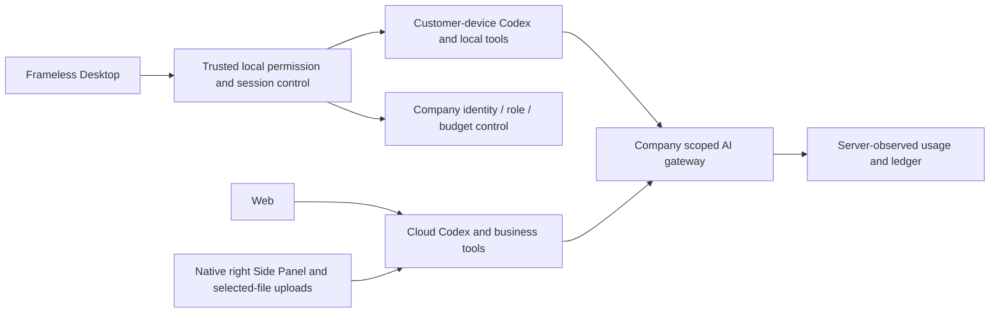
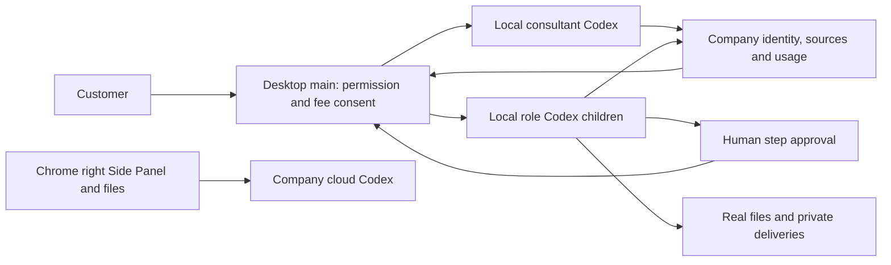

# Workmate · CopyPaste Chrome Extension

[中文](README.md) · [Documentation](https://github.com/copypasteltd/workmate/blob/docs/docs/README.en.md)

[Backend](https://github.com/copypasteltd/workmate/tree/backend) · [Web](https://github.com/copypasteltd/workmate/tree/web) · [Admin Dashboard](https://github.com/copypasteltd/workmate/tree/admin) · [Desktop](https://github.com/copypasteltd/workmate/tree/desktop) · [Chrome Extension](https://github.com/copypasteltd/workmate/tree/extension) · [Delivery](https://github.com/copypasteltd/workmate/tree/delivery)

A cloud Agent product for Hong Kong enterprises. This repository owns **Chrome Extension** and publishes to `extension`.

<!-- client01-direction -->
## Current client direction and qualified scope

CLIENT01 (2026-10-22) requires **Desktop to run Codex on the customer's computer**, with a real user-opt-in **full local access** mode and Codex Desktop as the operation benchmark. The **Extension uses a ChatGPT-style conversation and attachment layout in Chrome's native right Side Panel**, reads user-selected files and uploads them for cloud Codex execution. All product AI calls still use the company gateway.

**Current implementation:** Desktop runs Codex on the customer device with explicit full access, local files/terminal, persistent threads, native questions and governed image/design/video tools. The workflow consultant now uses immutable private workflows, separate child-step fee consent, human step approvals and actual native specialist children, with real SOP/JSON/recovery downloads, Stop/revoke and source governance. Qualification covers 848 platform tests, 75 overlapping focused checks, 3 real parent/child workflow checks, 17 native-supervisor regressions, 56 client tests and 19 actual packaged-journey checks; scopes are separate and not additive. All 18 roles have native protocol admission. Full professional delivery across 18 roles/29 Skills, complete browser/third-party application operations and Codex Desktop parity, live models and production acceptance remain pending. Model responses and native-dialog choices are explicit fixtures. Extension retains ChatGPT-style right Side Panel cloud chat and selected-file reading/upload without Desktop; its UI was not rerun this stage. See [design](https://github.com/copypasteltd/workmate/blob/docs/docs/technical/76-desktop-native-workflows.md) and [source/media checkpoint](https://github.com/copypasteltd/workmate/blob/docs/docs/quality/desktop-workflow-checkpoint.json).

Desktop runs the native Agent locally; the Web and Extension run cloud Codex. The linked stage 73 proof states the tested scope.

Native supervisor scope, actual permission checks and remaining integration: [implementation details](https://github.com/copypasteltd/workmate/blob/docs/docs/technical/70-desktop-native-codex-supervisor.md).

<!-- /client01-direction -->

## Architecture and constraints

Codex is the only Agent kernel. All AI calls use the company's internal OpenAI-compatible server. Web, Desktop, extension and Admin share server identity, permissions, sources and billing controls. UI follows CopyPaste brand assets, colors, typography and bilingual patterns.



## Native Side Panel

Chrome Manifest V3 uses `side_panel.default_path` and `chrome.sidePanel.setPanelBehavior({openPanelOnActionClick:true})`. The toolbar opens the real browser Side Panel and can close it again, without an action popup or simulated sidebar tab. It is right by default and respects Chrome's selected side.

`src/background.ts` handles lifecycle, company authorization and panel behavior. `src/panel.ts` owns workspace/project, tasks, inputs and results. `public/sidepanel.html` and `public/panel.css` provide the local UI. `scripts/build.mjs` generates fixed origins, CSP and the stable extension ID.

## Usage flow

1. Build/load the extension and pin its toolbar icon.
2. Click the icon to open the native workspace. Complete email verification and PKCE authorization at the fixed company webpage.
3. Choose a workspace/project and start or restore a conversation. Specialist and per-message budget settings are collapsible; ordinary messages need no task title.
4. Select or drop files, wait for “Uploaded, not sent”, then send. Only this message's immutable versions are attached. Network retries and reopening reuse the original request and budget.
5. Continue asking in the same cloud conversation, observe actual incremental events, deliverables and costs, or request Stop. Source denial clears old content. Basic chat/upload requires no Desktop.

An extension cannot arbitrarily read every local path. Uploads require explicit selection; persistent folder/device work requires grants and a Native Messaging companion. `nativeMessaging` is optional. Models cannot grant local permissions.

## Build and load

```powershell
npm ci
npm run build
```

Open `chrome://extensions`, enable developer mode, choose Load unpacked and select this repository's `dist/`. Pin and click the icon. Chrome 120+ is required; retained native evidence identifies the actual Chromium used.

Set `COPYPASTE_API_ORIGIN` and `COPYPASTE_WEB_ORIGIN` at build time. Defaults are localhost 4310/4317; production requires company HTTPS origins. Preserve `manifest-key.txt` to retain the ID; it contains a public key, not a signing private key. `extension-id.txt` is used for Backend/companion registration.

The branch contains reproducible source. The local preview ZIP is ignored under `release/paid-input-66-03/`. Store submission, signing, other browser/system matrices and live supplier integration require separate qualification.

## Checkout and prerequisites

Clone this branch into a fresh working directory; update an existing repository without reinitializing it.

```powershell
git clone --single-branch --branch extension git@github.com:copypasteltd/workmate.git copypaste-extension
cd copypaste-extension
```

Use Node.js ≥22.14, npm and Git with pinned lockfiles. The qualified local environment is Windows x64. Backend/full delivery also needs native PostgreSQL launcher resources, cloud-pinned Codex `0.163.0-alpha.10.2` and FFmpeg/FFprobe; Desktop independently pins `0.163.0-alpha.11` in its runtime manifest. No local Docker, WSL or virtualization. Run components in separate directories; see [workspace](https://github.com/copypasteltd/workmate/blob/docs/docs/governance/04-git-branches-and-publication.md).

## Checks and evidence scope

```powershell
npm run typecheck
npm test
npm run build
```

Historical-source **802/802** full Platform tests and **52/52** focused task tests pass, with **13 checks** across six repositories and **32** actual packaged Desktop/native Side Panel checks. All prior 782 named regression cases remain. Task checks exercise actual PostgreSQL, identity, ledger and Worker; separate real Codex child processes use a synthetic internal gateway. UI turns/business data are synthetic as authorized. The original 102 requirements remain: 81 partially verified, 21 without proven completion and zero fully accepted.

Canonical TaskDTO/task creation, arbitrary in-flight pause, unknown-effect recovery, independent complete role workflows, GEO, live suppliers and production/signing/store qualification remain tracked.

This revision adds canonical task APIs and atomic original-task inputs. Current UIs continue to use their existing project/conversation interfaces over the same execution domain. The refreshed actual recordings verify compatibility; they do not claim migration of every UI to canonical task APIs. See [the implementation and limits](https://github.com/copypasteltd/workmate/blob/docs/docs/technical/68-canonical-task-contracts-and-input-transactions.md) for exact money, idempotency, source revocation and unsupported business parameters.

## Actual screens and interactions

Actual recordings preserve capture timing. AI turns/business data are explicitly synthetic. Admin form demonstrations do not claim a financial commit.


[MP4](assets/screenshots/workmate-chat-05-conversation.mp4) · [Capture/source evidence](https://github.com/copypasteltd/workmate/blob/docs/docs/quality/extension-chat-checkpoint.json)

## Detailed design and updates

- [Product](https://github.com/copypasteltd/workmate/blob/docs/docs/product/01-prd.md)
- [Architecture](https://github.com/copypasteltd/workmate/blob/docs/docs/technical/01-architecture-and-stack.md)
- [Identity and permissions](https://github.com/copypasteltd/workmate/blob/docs/docs/technical/07-security-and-permissions.md)
- [Task continuation](https://github.com/copypasteltd/workmate/blob/docs/docs/technical/66-paid-native-input-checkpoints.md)
- [Admin](https://github.com/copypasteltd/workmate/blob/docs/docs/product/08-admin-dashboard.md)
- [Native clients](https://github.com/copypasteltd/workmate/blob/docs/docs/technical/30-native-window-and-browser-sidepanel.md)
- [Canonical task update](https://github.com/copypasteltd/workmate/blob/docs/docs/changes/2026-10-22-canonical-task-repair.en.md)
- [Local Codex update](https://github.com/copypasteltd/workmate/blob/docs/docs/changes/2026-10-22-native-codex-supervisor.en.md)

Every later change updates both READMEs, affected actual captures/GIFs, release notes and its mapped branch. Verify remote SHAs through Delivery publishing; do not force-push collaborator history. Keep environment secrets, databases, sessions, dependencies and installers out of Git. Exact historical README bytes are retained in [archive](https://github.com/copypasteltd/workmate/blob/docs/docs/quality/history/stage66-before-workmate-readmes/manifest.json).

## Conversation and attachment flow

Choose a company/project and start or restore a chat. Ordinary messages need no task title. Attach or drop files, wait for “Uploaded, not sent”, then send. Only confirmed immutable versions bind this message. The browser reads the selected file; cloud Codex executes through the company gateway. Basic upload/chat needs no Desktop or Native Messaging. Per-message budgets and specialists are in settings; accounts and standalone business forms are collapsed.

Lost acceptance responses retain the original payload, budget and idempotency key across panel reopening. Actual incremental events update the conversation. Current source denial clears old content and blocks sending. Unsaved attachments are not restored after closing; uploaded files remain in the project. Current limits: 20 attachments, each non-empty and up to 5 MiB.

Validation: 32 tests, successful type/build checks and seven native right Side Panel journey checks using real email/PKCE, uploads, Worker, files and billing. Model turns are synthetic. Earlier four-client media below keep their original scope.


[Source-bound chat evidence](https://github.com/copypasteltd/workmate/blob/docs/docs/quality/extension-chat-checkpoint.json) · [Design and recovery rules](https://github.com/copypasteltd/workmate/blob/docs/docs/technical/71-extension-cloud-conversations.md)

Stage 73 Desktop local execution: [design](https://github.com/copypasteltd/workmate/blob/docs/docs/technical/73-desktop-native-company-tools.md) · [source-bound proof](https://github.com/copypasteltd/workmate/blob/docs/docs/quality/desktop-company-tools-checkpoint.json). Prior recordings below retain their original source scopes.

Stage 73 company-tool update: [release notes](https://github.com/copypasteltd/workmate/blob/docs/docs/changes/2026-10-23-desktop-company-tools.en.md) · [source-bound checkpoint](https://github.com/copypasteltd/workmate/blob/docs/docs/quality/desktop-company-tools-checkpoint.json). Earlier reports and media retain their historical source scopes.

Stage 74 native-input update: [release notes](https://github.com/copypasteltd/workmate/blob/docs/docs/changes/2026-10-23-desktop-native-input.en.md) · [current checkpoint](https://github.com/copypasteltd/workmate/blob/docs/docs/quality/desktop-native-input-checkpoint.json). Earlier reports/media retain their original source scopes.

Stage 75 private-video update: [release notes](https://github.com/copypasteltd/workmate/blob/docs/docs/changes/2026-10-23-desktop-private-video.en.md) · [current checkpoint](https://github.com/copypasteltd/workmate/blob/docs/docs/quality/desktop-video-checkpoint.json). Earlier reports retain their actual source scopes; platform/main-process qualification and later UI qualification are explicitly separated.

<!-- desktop-native-workflow-stage76 -->

## Native workflows and verification

Choose Workflow consultant, select a folder and explicitly grant the desired local permission. Describe the work and agree its frozen steps. Review the separate per-child budgets and approve the exact version before a child can reserve money or run. Approve any concrete human step before the next specialist starts. Review real files, private SOP/workflow JSON/recovery downloads and company usage; this conversation and incomplete steps have separate charges. Stop or revoke to terminate local parent and child processes; unknown accepted actions retain reconciliation state and never replay automatically.

The first workflow subset permits up to eight sequential native Codex, human approval or analytics-summary steps. Every child uses its own approved role Skills, company tools and scoped credentials while retaining the current explicit local grant. Local full access does not grant another customer's data, project rights or unlimited budget. Company cloud Workers and schedules cannot take over native workflows. Each immutable version freezes actual external input provenance across new sessions and derived SOPs, without depending on the creator task lifetime. Source withdrawal also governs first reads, cached calls, child admission and private or explicitly published derivatives; administrators use existing permission/MFA/reason/audit controls. Closing the app fences requests still waiting for their local journal write.

Current platform inventory: 65 actual test files / 17 complete batches / 848 passing tests; all 830 stage-75 cases remain covered. SQL001–093 remain unchanged; SQL094 adds native workflow provenance and immutable versions. The actual 428-route inventory retains all prior 415 routes. Original 102 REQ/102 TC, NFR and G01–G10 remain open at 81 partial / 21 unproven / 0 fully accepted. Earlier evidence and media retain their original source scope.




[Design and lifecycle](https://github.com/copypasteltd/workmate/blob/docs/docs/technical/76-desktop-native-workflows.md) · [Bound evidence](https://github.com/copypasteltd/workmate/blob/docs/docs/quality/desktop-workflow-checkpoint.json) · [Change notes](https://github.com/copypasteltd/workmate/blob/docs/docs/changes/2026-10-23-desktop-native-workflows.md)
