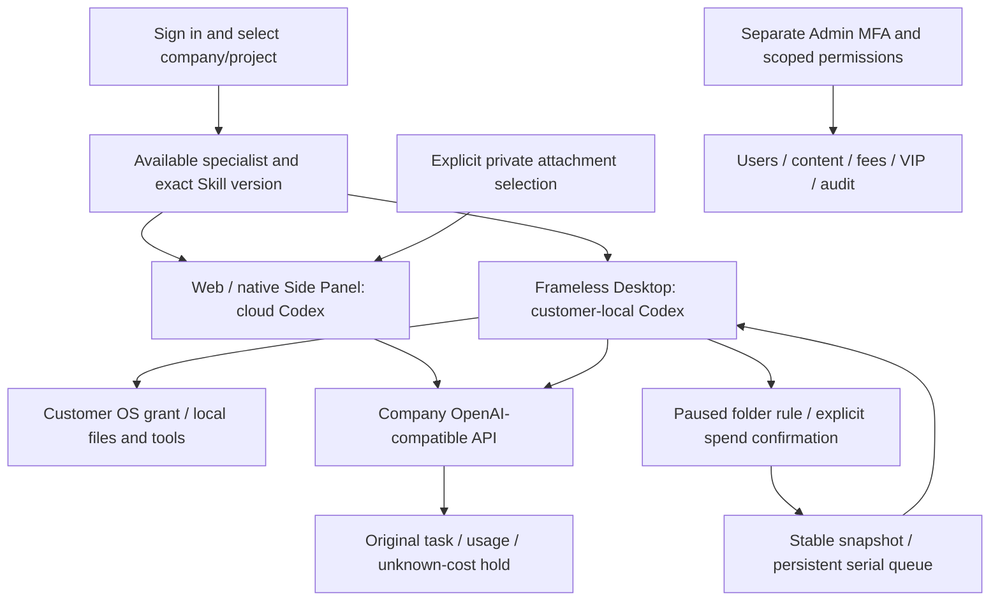

# Workmate · CopyPaste Enterprise Agent · extension

<!-- folder-work-stage87 -->

ChatGPT-style chat and attachments in Chrome's native right Side Panel provide explicitly selected private files to cloud Codex.

## Product and boundaries

The first customers are existing marketing teams. Scope includes image/design/typography, video/effects, advertising and website analysis, SEO/GEO, repeated business processes and software development. The catalog has 18 candidates with exact Skill bindings; at least twelve individually qualified professional presets remain an acceptance requirement. The designer combines Codex, design Skills and company Image 2. Codex is the only Agent core. All AI uses the company's OpenAI-compatible backend; development currently uses authorized synthetic providers, not a claim of live professional quality.

The Chrome MV3 extension opens the native right Side Panel from its toolbar icon, rather than injecting an in-page overlay. Sign in and select a workspace/project independently of Desktop. Attachments first create the actor's private conversation, then use exact-byte/SHA-256 resumable chunks; errors never fall back to project sharing. Another editor in the same project cannot list/read versions/download/open that private conversation. Project sharing is separate and explicit; files/current-page content are read only after customer selection or authorization.

## Setup

### Local startup

Run these commands in the checked-out component. The complete workspace has the six independent repositories side by side under `dev/`; see the [branch and checkout layout](https://github.com/copypasteltd/workmate/blob/docs/docs/governance/04-git-branches-and-publication.md). Use Windows x64, Node.js >=22.14, npm/Git and the documented native PostgreSQL, FFmpeg/FFprobe and pinned Codex resources. Preserve existing local configuration/data. No Docker/WSL/VM is used.

```powershell
Set-Location 'D:/dev/copypasted/自有agent/dev/copypaste-extension'
npm ci
npm run build
```

Start the backend and Web first. In Chrome 120+, open `chrome://extensions`, enable Developer mode and load this repository's `dist/` as an unpacked extension. Pin/click its icon to open the native right Side Panel. Keep the built Extension ID aligned with backend authorization; configure company HTTPS origins through `COPYPASTE_API_ORIGIN`/`COPYPASTE_WEB_ORIGIN` before production builds. Sign in, select a workspace/project and attach authorized files. Desktop installation is unnecessary.

### Use the current workflow

1. Complete sign-in, company membership/invitation and project selection. Native clients use browser PKCE; Admin uses separate MFA identities. Expired/revoked credentials must not silently change identity or company.
2. Select a specialist and supply the brief and explicitly authorized references/accounts. Missing inputs request customer action. Project owners can save, preview and explicitly publish immutable shared guidance; publication starts no AI and grants no new permission.
3. New tasks pin their accepted role, Skill, brand, reference and guidance versions. Existing work, including an originally absent configuration, retains its original state. Source revocation hides unavailable bodies and blocks later use; history is not a permission bypass.
4. Confirm budget and any required operation/media approval. View genuine status, progress, exact deliverables and original receipts. Continue requested edits in the same task lineage. Unknown usage remains reserved for reconciliation; it is never silently free or blindly replayed.
5. Admin can independently manage authorized user/workspace status, inspect permitted consumption, preview/confirm manual fees or credits and activate scoped VIP/expiry. Balances, recorded payments, credits, budgets and VIP are separate records. Idempotent confirmation and audit prevent duplicate grants.

## Customer-local folder work

In Desktop, choose a writable local session and open **Folder work**. Select an input folder inside the workspace and configure extensions, instructions, a quiet period, per-file/total limits and maximum runs. Existing files are excluded unless selected. Saving creates a **paused** rule; **Confirm and activate** opens a separate native automatic-spend confirmation that defaults to Cancel.

Stable native file events and bounded scans feed a persistent serial queue. Each job gets an exact snapshot, separate output directory, original task ID and company cost receipt. An unanswered native question is visible from Folder work; **Answer questions** returns to Conversation and requires the customer's explicit answer. Identical already-processed bytes and product outputs do not create another paid task. Unstarted old versions coalesce to the latest stable input.

Pause stops new dispatch and lets the current file finish. Revoke stops only that rule's owned work while keeping outputs/receipts. App closure stops watching; a real reopen retains the encrypted journal and allocated limits but requires fresh confirmation. Lost replies reuse original dispatch/create/start/finish keys; uncertain native actions block for review. Full OS permission remains the customer's grant, not an additional folder sandbox. Web/Extension keep cloud execution; folder work is a Desktop capability.

Limits: 20 rules; 1,000 history/200 queued items per rule; 1,000 dispatch receipts per session; 2,000 matching files/10,000 entries/12 levels per scan; 20 MiB per file and 64 MiB new reads per scan; at most 100 authorized runs, one scheduled job at a time. Limits do not reset on pause/restart. Outputs are under `.copypaste-local-jobs/<rule>/<job>/output/`. Symlinks/junctions, traversal, outside input, source replacement and conflicts block automatic work. Complete approved-program/structured-argv and crash/sleep/offline matrices remain open.

## Configuration, UI and verification

Apply SQL103 before client upgrades. This increment adds no HTTP route or migration; SQL001–103 and 532 recorded contracts remain byte-preserved. Set company gateways, exact model aliases, verified media capabilities and tariffs on the backend; consult its `.env.example` and the deployment runbook. Never embed company provider keys in a renderer/extension. Unconfigured capability is unavailable rather than silently redirected. Ordinary demo data does not activate every media fixture.

CopyPaste blue/cream, Manrope/Fraunces, English/Traditional Chinese and light/dark themes remain. Desktop has no Electron frame/menu or visible scrollbar rails. Real wheel/focus/last-action access and truthful progress remain. The narrow session guidance card separates its icon/version from the readable name. Focused page Home/End and Ctrl+Home/End act on that page; focused text fields keep caret navigation.

Fresh stage-87 scopes: **91 Desktop unit tests, 161 client unit tests and 57 actual packaged Desktop checks**, retaining all previous 50 native checks and 69 Desktop unit cases. Folder work executes real customer-local Codex, explicit same-turn answers, exact CSV outputs, an actual new-PID application restart, separately settled 90/60-micro-HKD tasks, original thread/version continuity and zero cloud replacement tasks. All 14 runtime assets/licenses match source bytes; repository screenshots/recordings stay outside the runtime ASAR. The archive shrinks from 837,577,925 to 41,487,145 bytes.

Retained stage-86 scopes: **1023 platform, 25 focused, 36 compatibility and 14 actual Web/Admin/native Side Panel checks**. Backend/Web/Admin/Extension product sources remain exact; this stage does not claim those complete suites were rerun. Native processes/files/database/ledger are real; model replies, ad/customer facts and selected native-dialog decisions are explicit fixtures. All owned browsers, API, previews and test DB close; no Docker/WSL/virtualization is used.

The original 102 requirements remain **86 partial / 16 unproven / 0 fully accepted**. REQ-040/042 gain bounded evidence without closing their original conditions. At least twelve professional-role qualifications, complete Admin breadth, teams/solution packages, full marketing workflows, live quality, signed installation/update/uninstall, load/restore exercises and G01–G10 remain open. Test counts are not a product-completion percentage. See the complete numbered gap assessment.


[Plan and limits](https://github.com/copypasteltd/workmate/blob/docs/docs/technical/87-desktop-folder-work.md) · [Current-source checkpoint](https://github.com/copypasteltd/workmate/blob/docs/docs/quality/folder-work-checkpoint.json) · [Complete numbered gaps](https://github.com/copypasteltd/workmate/blob/docs/docs/quality/2026-10-25-goal-gap-assessment.md) · [Branch/checkout and publication](https://github.com/copypasteltd/workmate/blob/docs/docs/governance/04-git-branches-and-publication.md)

[Role catalog](https://github.com/copypasteltd/workmate/blob/backend/catalog/role-preset-catalog.json) · [Skill packages](https://github.com/copypasteltd/workmate/blob/backend/catalog/skill-packages.json)

## Architecture



Retained stage-86 media for unchanged product sources; this stage adds no fresh Web/Admin/Side Panel UI qualification.


[Original MP4](assets/screenshots/workmate-guidance-14-project-guidance-sidepanel.mp4)


