# Workmate · CopyPaste Backend

<!-- creative-feedback-stage82 -->
## Confirmed creative feedback and native layout

Creative assets now have an explicit feedback loop: a user confirms the exact asset version, ad identity and date range before any advertising facts contribute. Same-name creatives in different accounts remain separate. Identity is user-attested; the current official connectors provide campaign-level facts and cannot establish creative performance automatically.

### Local startup

Run these commands in the checked-out component. The complete workspace has the six independent repositories side by side under `dev/`; see the [branch and checkout layout](https://github.com/copypasteltd/workmate/blob/docs/docs/governance/04-git-branches-and-publication.md). Use Windows x64, Node.js >=22.14, npm/Git and the documented native PostgreSQL, FFmpeg/FFprobe and pinned Codex resources. Preserve existing local configuration/data. No Docker/WSL/VM is used.

```powershell
Set-Location 'D:/dev/copypasted/自有agent/dev/copypaste-platform'
npm ci
npm run setup:local
npm run db:local
```

Keep that database terminal open. In a second terminal in the same repository, run `npm run db:migrate` and then `npm run dev`. API: `http://localhost:4310`. SQL099 must be applied before upgrading clients. Create/enrol an administrator with the existing `admin:create` runbook and current MFA; no shared default Admin credentials are supplied.

### Use the current workflow

1. Sign in using the existing email flow and choose the enterprise/project. In **Marketing insights → Creative & ad feedback**, upload a shared creative first and import an ad-level Google/Meta CSV with an explicit account, currency, timezone, attribution and conversion definition. Campaign-only or incomplete sources are not selectable. Source choices show at most 100 recent eligible items; mappings and reports have explicit pagination.
2. **New candidate** pins one shared asset version, dataset, exact ad/channel/campaign, creative ID, date range and review note. A similar name or user-supplied provider metadata is a candidate basis only. Review the frozen hashes and scope, then explicitly check the initially unchecked single-creative attestation and give a reason. Incorrect identity requires withdrawal and a new candidate; confirmed history is immutable.
3. Select up to 40 confirmed mappings and create a dated feedback report. BigInt-derived decimal strings preserve exact amounts. Account/platform/currency/timezone/attribution/conversion/creative/version scopes stay separate. Identical ad-days are deduplicated; conflicting facts, competing allocations and overlapping correction snapshots reject. Missing conversions stay unknown and unobserved days are not zero. No cross-scope total or causal uplift is inferred.
4. Download the actual frozen JSON or select its shared file as an explicit input to the next Codex task. Actual model reads and downstream managed outputs retain source lineage. Withdrawal, quarantine, source expiry or lost authorization stop managed reads/downloads and queued reuse. Copies already exported outside the service remain the customer's responsibility.
5. Admin content metadata, independent `admin.content.body.read`, scoped quarantine/restore/delete and auditable actions cover mappings and feedback reports. Metadata access does not grant body access. Restoring a mapping does not silently republish an old quarantined report. Retention defaults to 90 days; the existing erasure journal orders report-file cleanup before clearing parent bodies. Admin cannot rewrite frozen identity or the original confirmation through metadata controls.

Desktop runs Codex locally with explicit, revocable full local permission. It stays frameless with no Electron menu or visible vertical/horizontal scrollbar rails. Wrapping tables/code and compact layouts preserve wheel, Home/End, focus and actual task/video progress. Native packaged windows at 800×600, 1280×800 and 1440×980 were exercised. Extension remains ChatGPT-style chat/attachments in Chrome's native right Side Panel, uploading authorized files to cloud Codex; its new feedback entry opens the full cloud workspace without depending on Desktop.

Apply **SQL099** through backend `npm run db:migrate` before deployment. Published SQL001–098 and both original OpenAPI files retain their bytes. Seven additive feedback operations have their own contract; the observed inventory is 454 configured operations plus the retained conditional demo operation. Company gateway secrets stay server-side.

Current bounded qualification: platform **946/946**, all previous **929** cases retained; feedback core **17/17**, separate legacy analytics/source compatibility **43/43**, client checks **124**, actual Web journey **4** and actual packaged Desktop journey **36**. Each count has its own scope. Screenshots and GIF/MP4 below are **Desktop** captures, including copies in other component repositories. Advertising identities/facts and model content are explicit fixtures; native execution, files, identity, database, arithmetic and media capture are actual.

Original **102 REQ/102 TC remain 83 partial, 19 unproven, 0 fully accepted**; NFR and G01–G10 remain open. Live provider creative verification, professional marketing quality, signed installers and complete Codex Desktop operation parity require further evidence. Owned browsers, previews and native databases are closed; no Docker/WSL/VM is used.

All selected core, compatibility, client, Web/native UI and complete-platform receipts execute the current exact source bytes. A separate review binds the native sidebar/preferences repair, capture serialization, settled-theme report framing and Windows whole-page Ctrl+Home. Focused native-log Home/End and existing reachability conditions remain; additional end-of-page checks require navigation and preferences to remain visible. Earlier and failed attempts keep their original scopes and do not supply current-source coverage.

[Design and permissions](https://github.com/copypasteltd/workmate/blob/docs/docs/technical/82-confirmed-creative-feedback.md) · [Exact evidence](https://github.com/copypasteltd/workmate/blob/docs/docs/quality/creative-feedback-checkpoint.json) · [Additive API](https://github.com/copypasteltd/workmate/blob/docs/docs/contracts/creative-feedback-openapi.json)

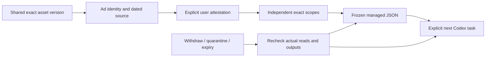

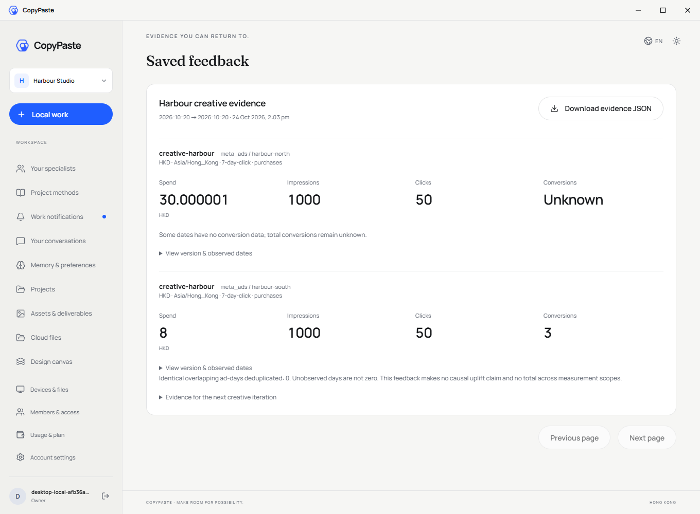

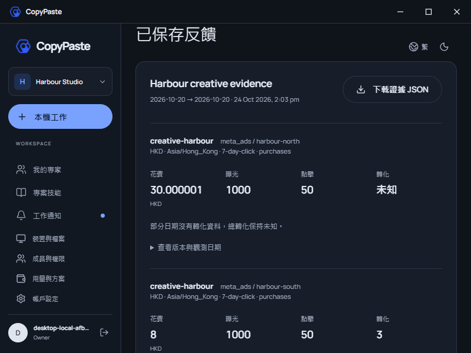


[Recorded MP4](assets/screenshots/stage82-desktop-workmate-feedback-44-creative-feedback.mp4)


<details>
<summary>Historical stage 81 usage and complete setup reference; original scopes retained</summary>

<!-- managed-video-stage81 -->
## Managed video capabilities and current delivery

This repository is one independently versioned part of Workmate. Admin can now manage video models through the same immutable draft, actual verification, independent approval, publication and rollback flow as text and images. Web, local Desktop and the native Chrome Side Panel consume published versions; existing tasks keep their frozen model and rates.

### Local startup

Run these commands in the checked-out component. The complete workspace has the six independent repositories side by side under `dev/`; see the [branch and checkout layout](https://github.com/copypasteltd/workmate/blob/docs/docs/governance/04-git-branches-and-publication.md). Use Windows x64, Node.js >=22.14, npm/Git and the documented native PostgreSQL, FFmpeg/FFprobe and pinned Codex resources. Preserve existing local configuration/data. No Docker/WSL/VM is used.

```powershell
Set-Location 'D:/dev/copypasted/自有agent/dev/copypaste-platform'
npm ci
npm run setup:local
npm run db:local
```

Keep that database terminal open. In a second terminal in the same repository, run `npm run db:migrate` and then `npm run dev`. API: `http://localhost:4310`. SQL098 must be applied before upgrading clients. Create/enrol an administrator with the existing `admin:create` runbook and current MFA; no shared default Admin credentials are supplied.

### Use the current workflow

1. Sign in to Admin using its separate email/TOTP identity. Open **Catalog → Model capabilities → Create configuration**, select **Video generation**, enter the company model alias, a positive HKD price per billable second and an operation reason. Codex and the company internal gateway are fixed; a draft cannot add an endpoint, secret or another kernel.
2. Open **Configuration & validation**, enter the reason and run validation. The API immediately saves a durable receipt. Its 16 cases quote up to 184 seconds from the **platform verification budget**. Closing this view does not stop execution. Progress counts actually verified cases, with actual size/duration, full MP4/H264 decoding and observed cancellation; no simulated percentage represents real service progress.
3. **Recheck original job** queries the existing operation. **Stop this validation suite** stops new calls and checks already-dispatched usage. An unknown result keeps its budget/capacity hold and blocks another validation in this view. Once expense is known, an explicitly new validation creates a new receipt and new billable calls. The live cost and the receipt at the immutable eligibility decision remain distinct.
4. After all cases pass, **Preview publication** compares the model and price. Current permission, recent MFA, exact version and reason are checked again; another administrator must approve. Requesters cannot approve themselves. Rollback appends a new publication fact. Scoped access and explicit denies retain priority; read-only administrators cannot mutate configurations.
5. A stopped worker resumes original operations and confirmed content, without another generation POST. SQL098 preserves the old budget functions' identities and all prior shared accounting. Apply SQL098 using backend `npm run db:migrate` before deployment. SQL001–097 and both original OpenAPI files retain their own bytes. Company gateway credentials remain server-side. Managed publication can provide a verified video capability while the legacy environment switch is false; a live supplier still requires its own qualification.

Desktop remains frameless, runs Codex on the customer's own device and supports explicit revocable full local permission. No visible vertical/horizontal scrollbar rails appear; wheel, keyboard, focus and truthful task/video progress remain available. Extension opens in Chrome's native right Side Panel, uses ChatGPT-style chat/attachments, reads/uploads authorized files and runs its Agent in the cloud without a Desktop dependency.

Current platform qualification: **929/929** cases, all previous 912 retained, 71 files/18 batches. Separate checks: **106/106** legacy capability/gateway/customer-video compatibility, **7** contract checks and **7** actual Admin browser checks. Captures below show the **Admin** component, including when copied into a client repository for the shared setup workflow. Historical stage-80 client sources/captures retain their original scope; they are not relabeled as a new full-stack browser run. The new Admin journey uses real authentication, PostgreSQL, native pinned Codex version checks and actual MP4 decoding with an explicit synthetic company service/video fixture.

Original **102 REQ/102 TC remain 83 partially verified, 19 unproven and zero fully accepted**; G01–G10 remain open. Live company service, all professional roles, full original video acceptance, signed installers and complete Codex Desktop operation parity are still unproven. All owned browser contexts/instances, previews and native databases close; no Docker/WSL/VM is used.

The first combined qualification failed because its synthetic HTTP fixture received port 2049, which this Node Fetch runtime rejects before HTTP. That failed TAP, live port witness and owned-worker/fixture cleanup remain retained. The fixture now uses the existing safe loopback listener and a bounded test-arrival wait; no product source, assertion or test name changed for this repair. The complete platform run and 17-case core run execute the repaired harness afresh. Earlier compatibility/UI recordings retain their exact product and verifier bytes, with the two later harness-only changes explicitly reviewed rather than presented as a fresh browser recording.

[Design and authority](https://github.com/copypasteltd/workmate/blob/docs/docs/technical/81-managed-video-capability-releases.md) · [Exact evidence](https://github.com/copypasteltd/workmate/blob/docs/docs/quality/managed-video-checkpoint.json) · [Supplemental API](https://github.com/copypasteltd/workmate/blob/docs/docs/contracts/capability-releases.openapi.json)

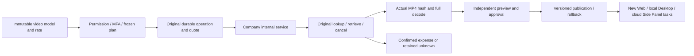


[Admin interaction GIF](assets/screenshots/stage81-admin-workmate-managed-video-02-video-cancellation-and-cost-recovery.gif) · [Actual recorded MP4](assets/screenshots/stage81-admin-workmate-managed-video-02-video-cancellation-and-cost-recovery.mp4)

<details>
<summary>Historical stage-80 usage and installation reference; counts keep their original scope</summary>

<!-- generated-video-stage80 -->
## Generated video, scoped costs and compact Desktop

The backend adds durable generated-video jobs, shared task budgets, original-operation queries/cancellation, authenticated observations and actual MP4 validation.

### Local startup

Run these commands in the checked-out component. The complete workspace has the six independent repositories side by side under `dev/`; see the [branch and checkout layout](https://github.com/copypasteltd/workmate/blob/docs/docs/governance/04-git-branches-and-publication.md). Use Windows x64, Node.js >=22.14, npm/Git and the documented native PostgreSQL, FFmpeg/FFprobe and pinned Codex resources. Preserve existing local configuration/data. No Docker/WSL/VM is used.

```powershell
Set-Location 'D:/dev/copypasted/自有agent/dev/copypaste-platform'
npm ci
npm run setup:local
npm run db:local
```

Keep that database terminal open. In a second terminal in the same repository, run `npm run db:migrate` and then `npm run dev`. API: `http://localhost:4310`. SQL097 must be applied before upgrading clients. Create/enrol an administrator with the existing `admin:create` runbook and current MFA; no shared default Admin credentials are supplied.

### Use the current workflow

1. Sign in using the existing email/OTP flow, select a workspace/project and start a **Video and motion** task. New tasks use the versioned R16 1.2.0 role and its `video-generation` Skill. Frozen older tasks retain their original role/Skill; start a new task to use generation.
2. In Web or Desktop select **Generate a video**, a supported duration (4/8/12/16/20 seconds) and format (landscape, portrait or square), then supply the brief and confirm the task budget. Template/FFmpeg composition remains a separate option. Desktop settings start collapsed so the conversation and composer retain space. In Extension, open the existing cloud video task from the same workspace/project's task history to review its status, play it and save the result.
3. Codex uses the company's internal service. The server persists an immutable original operation and a quote before HTTP, sharing the same budget with reasoning/image requests. Input counting, reasoning, image and video also share admission limits; completed calls retain their rolling-minute rate charge after concurrency slots release. Independently reviewed termination facts affect slot usage while preserving the original requests. Only service-reported progress is shown. Pending or unknown usage retains the original hold; missing usage is never free.
4. **Stop this generation** requests cancellation of that same operation. A later confirmed usage observation can still report a charge. Retries/recovery query the original operation and do not submit another generation. A real state change rejects a stale control revision; leases and unchanged polls do not invalidate it.
5. A completed status becomes a deliverable only after real SHA/size, format, dimensions, duration and full native decode checks. Play and save the actual MP4. Withdrawal, source quarantine or lost authority removes the current preview/download; no fabricated success file is supplied. Inline preview is bounded to 20 MB.
6. Admin opens **Provider controls → Generated video jobs**. Metadata, cost reads and original-job rechecks require separate scoped permissions; recheck requires current MFA and an audited reason. It cannot create a replacement video or grant access to the prompt/reference/media. Original task settlement retains independent approval and immutable provider facts.

Apply the additive **SQL097** with backend `npm run db:migrate` before upgrading clients. Existing SQL001–096 and each original OpenAPI file keep their own published bytes. Set the company's `AI_BASE_URL`, allowed hosts/key, exact `AI_VIDEO_MODEL`, explicit `AI_VIDEO_VERIFIED`, positive `AI_VIDEO_HKD_MICROS_PER_SECOND` and optional signed-callback secret. Until a company capability is explicitly configured/verified, generation remains unavailable. No vendor key belongs in a renderer or Extension. Public Sora 2/Videos API retired on 2026-09-24; `company-video-jobs-v1` is an internal contract, with no silent public-provider fallback. Complete managed video capability verification/publication is still outstanding.

Desktop is frameless with no native Electron menu. No visible vertical or horizontal scrollbar rails appear in the product; content still scrolls and reflows, with wheel, Home/End, keyboard focus and actual last-action access. Actual 800×600, 1280×800 and 1440×980 windows, English/Traditional Chinese and light/dark themes are exercised. Truthful task/video progress remains. Desktop Codex runs locally with explicit revocable full local permission. Extension keeps the native right Side Panel and cloud Codex; it requires no Desktop/local-Agent dependency.

Validation: **912/912** platform cases, all previous 874 retained; **60/60** focused video/gateway cases; **69** client unit cases; **32** packaged Desktop, **5** Web/Admin and **9** native Side Panel checks; **17/17** native supervisor cases. These are separate scopes, not an additive acceptance count. Native Codex, identity, database, storage, media decode and ledger are real; reasoning, video content, customer data and selected native consent decisions are explicit fixtures. All owned browsers/databases close; no Docker/WSL/VM is used. The original **102 REQ/102 TC remain 83 partially verified, 19 unproven, zero fully accepted**. Live company media, full TC-019/TC-056, all professional roles and G01–G10 remain open.

The complete 70-file/18-batch platform inventory uses a reviewed same-source re-execution: Windows error 1455 interrupted one batch; all four files passed on a fresh owned database, while the other seventeen complete passing batches retain exactly the same source, tests, harness and native binary. The original failed attempt stays failed and contributes no passing coverage. Each selected receipt retains its own plan hash; raw TAP files are neither combined nor relabeled.

[Design and protocol](https://github.com/copypasteltd/workmate/blob/docs/docs/technical/80-generated-video-jobs.md) · [Exact evidence](https://github.com/copypasteltd/workmate/blob/docs/docs/quality/generated-video-checkpoint.json) · [Additive API](contracts/generated-video-openapi.json)

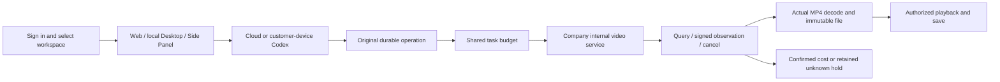

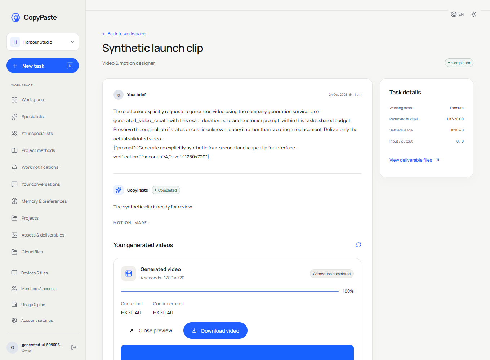

[Interaction GIF](assets/screenshots/stage80-web-workmate-generated-08-generated-video.gif) · [Recorded MP4](assets/screenshots/stage80-web-workmate-generated-08-generated-video.mp4)

<details>
<summary>Previous stage-79 documentation and full installation reference; historical counts retain their original scope</summary>

[中文](README.md) · [Documentation](https://github.com/copypasteltd/workmate/blob/docs/docs/README.en.md)

<!-- brand-production-stage79 -->

## Fixed brand versions and production checks

The backend implements immutable brand versions, production checks, task binding and source governance.

1. Sign in, select the tenant/project, and open **Brand library** in Web or Desktop. Add identity, colors, fonts and declared usage rights, approved product facts/prices, promotion expiry, channels/locales and optional fixed Logo files. Uploaded fonts must be shared in the selected project.
2. Publish an immutable version. Further edits publish a new version; stale concurrent edits conflict. Existing specialists and tasks retain their pinned version. Explicitly adopt a newer specialist version when desired.
3. Select a historical version and check sample text or a fixed fact. Missing glyphs identify their Unicode codepoint; expired offers or font declarations block new production. Price facts supply the stored text and amount; no silent font or price substitution.
4. Brand-bound cloud design tasks must carry the matching brand/version and channel/locale. Text uses the fixed declared font configuration; explicit fact keys produce the stored statement and price. Outputs retain source dependencies and editable JSON; SVG text is outlined, PNG and the limited single-page PDF review output are actual renders. Font declarations do not prove copyright ownership.

Apply **SQL096** with `npm run db:migrate` in the configured backend before starting dependent clients. Published SQL001–095 and each original OpenAPI file retain their own bytes. The additive brand contract documents four operations; the configured service inventory has 438 operations plus one demo-credit operation only when `DEMO_MODE=true`. Legacy brand bodies remain readable under current access rules, without invented history or rights. Publish explicit schema-v2 guidance and adopt a new specialist version before fixed-font production; existing tasks stay pinned.

Desktop runs Codex on the customer's machine with explicit revocable full local permission, no native frame/menu, and no visible vertical or horizontal scrollbar rails. Wheel, keyboard and focus access remain functional, including actual 800×600, 1280×800 and 1440×980 windows. Truthful progress feedback remains. Extension runs cloud Codex through the native right Side Panel. All AI requests use the company gateway. Testing creates and closes only owned browser instances; no Docker/WSL/VM is used.

Current separate results: **874/874 platform cases** in 68 files/17 batches (all prior 861 retained, 13 new), 68 client unit cases, 30 packaged Desktop checks, four brand Web checks, four Web/Admin quality checks and eight native Side Panel checks. Retained native supervisor evidence has 17 cases and all 57 bound sources unchanged. Real database/auth/files/ledger/local Codex run with explicit model/customer/business fixtures. Original 102 REQ/102 TC remain: 82 partially verified, 20 not proven, zero fully accepted; G01–G10 and real TC-056 blind review remain unproven. Desktop brand UI evidence does not establish every local professional role's brand enforcement.

Desktop33, brand Web02 and Web/Admin08 retain their actual receipts with one explicitly reviewed later difference: an unrelated extension test file now waits for document readiness and logs login failures. Their application/UI and executing journey/verifier bytes are unchanged. The selected fresh extension run and full platform23 use the updated harness. Exact before/after bytes and scope are recorded in the checkpoint.

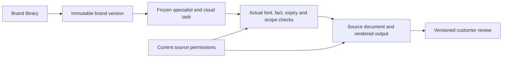

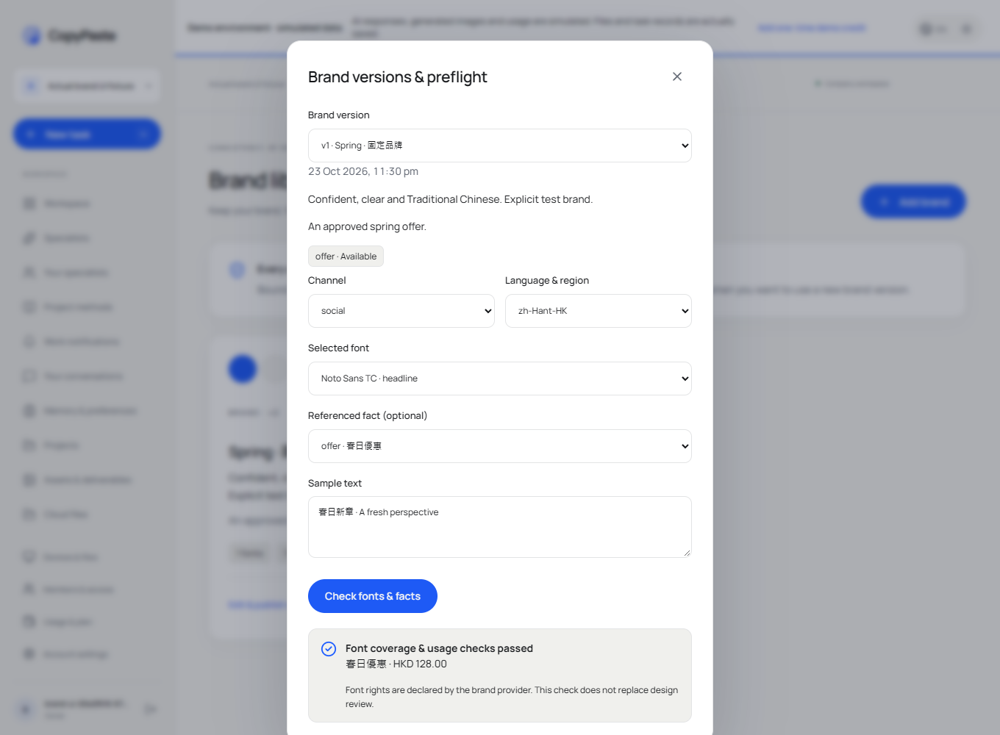

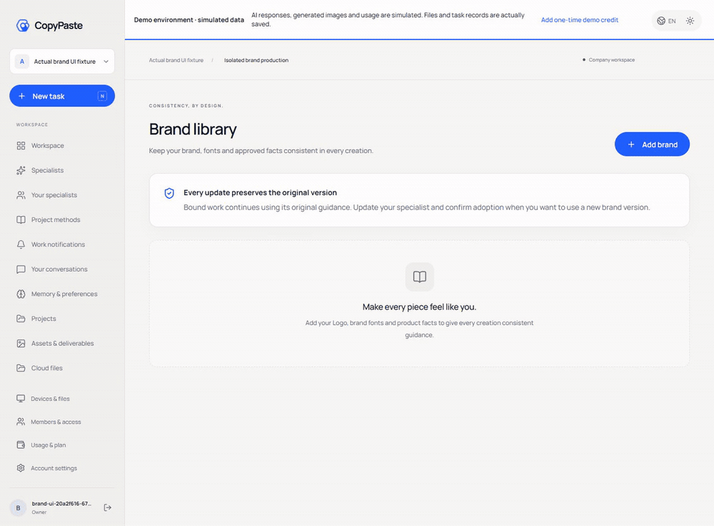

[MP4](assets/screenshots/stage79-web-workmate-brand-02-brand-library.mp4) · [Design / 方案](https://github.com/copypasteltd/workmate/blob/docs/docs/technical/79-versioned-brand-production.md) · [Contract / 契约](https://github.com/copypasteltd/workmate/blob/docs/docs/contracts/brand-production-openapi.json) · [Evidence / 证据](https://github.com/copypasteltd/workmate/blob/docs/docs/quality/brand-production-checkpoint.json) · [Changes / 更新](https://github.com/copypasteltd/workmate/blob/docs/docs/changes/2026-10-24-versioned-brand-production.md)

<details>
<summary>Previous stage-78 delivery and installation reference; older counts retain their original scope</summary>

<!-- business-quality-stage78 -->

## Current delivery review and usage

Company API, Codex control, identity, durable business logic and metered ledgers. Reviews now retain the exact current delivery version, with accept, changes requested and discard decisions. Customers can report baseline minutes, cumulative human effort and revisions independently. Project usage and the scoped Admin quality dashboard distinguish technical success, customer acceptance, recorded reuse and company service costs.

Desktop remains customer-local Codex with explicit revocable full local access, no Electron menu/frame, no visible vertical or horizontal scrollbar rails, and real wheel/keyboard access. Content reflows, focused inputs remain visible at 800×600, and the composer and receipt stay accessible. The previous progress-bar constraint is withdrawn; truthful progress remains. Extension remains independent native right Side Panel chat/file upload to cloud Codex. Every AI request uses the company gateway.

1. Sign in, choose a tenant/project and create a task in its correct execution location. Desktop needs an explicit folder and local permission; the Extension needs no Desktop installation.
2. Inspect the actual result and open “Review this delivery” (Desktop) or the task review form. Save acceptance, requested changes or discard with optional feedback. Task/version or delivery changes return a conflict requiring reload.
3. Optionally record cumulative human figures. Blank means unknown; zero means explicitly none. Refresh preserves the open effort form and visible input access.
4. Inspect project usage or Admin → Delivery quality within your permission scope. Incomplete costs stay incomplete; service costs exclude refund offsets, outside services and labor. No ROI or retention is inferred.

Apply additive SQL095 before publishing the dependent API/UI; published SQL001–094 and the original task OpenAPI are unchanged. Legacy acceptance without a delivery snapshot requires a new customer review. The original review endpoint remains compatible; current forms require both task version and delivery digest plus idempotency. Customer review requires project approval authority. Admin can read scoped aggregates under `admin.usage.read` but cannot accept for a customer, read feedback through aggregates or grant OS access.

The backend independently typechecks and compiles. Full integration qualification also compares local contracts with the authoritative sibling `docs/contracts`; check out the documented complete workspace before running that suite. Native PostgreSQL only; never adopt an occupied test database or use Docker/WSL.

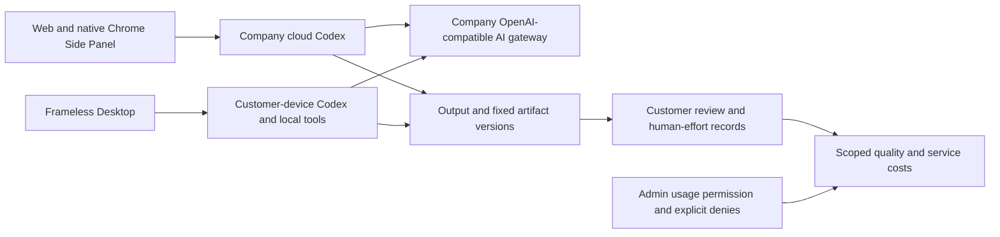

Current source qualification: 861/861 platform cases across 67 files/17 batches, 68 client units, 26 actual packaged-Desktop checks, four Web/Admin checks and 8 native Side Panel checks. The retained 17-case native-supervisor proof has all 57 bound files unchanged. These scopes are separate and not additive. Actual auth, database, files, billing and local Codex run; model/business/customer inputs and native-dialog decisions are explicit fixtures. TC-056 real-task baselines/blind review, all 18 roles/29 Skills, complete OS/Codex Desktop parity and production gates remain unproven. Original 102 requirements/102 cases and 81 partial / 21 unproven / 0 fully accepted remain.

The Desktop31 and Web/Admin07 journeys retain their original bytes. Their only later bound-file difference is two migration-test expectations updated from 94 to 95, archived and checked exactly; all runtime, UI and journey sources remain unchanged. Platform21 freshly reruns the updated tests. See the checkpoint for this explicit qualification.


[MP4](https://github.com/copypasteltd/workmate/blob/desktop/assets/screenshots/workmate-local-31-local-agent.mp4)

[Design](https://github.com/copypasteltd/workmate/blob/docs/docs/technical/78-business-delivery-quality.md) · [Contract](https://github.com/copypasteltd/workmate/blob/docs/docs/contracts/business-quality-openapi.json) · [Exact source and media evidence](https://github.com/copypasteltd/workmate/blob/docs/docs/quality/business-quality-checkpoint.json) · [Changes](https://github.com/copypasteltd/workmate/blob/docs/docs/changes/2026-10-23-business-delivery-quality.md)

<details>
<summary>Full setup, architecture and historical verification records (earlier counts/captures retain their original scope)</summary>

[Backend](https://github.com/copypasteltd/workmate/tree/backend) · [Web](https://github.com/copypasteltd/workmate/tree/web) · [Admin Dashboard](https://github.com/copypasteltd/workmate/tree/admin) · [Desktop](https://github.com/copypasteltd/workmate/tree/desktop) · [Chrome Extension](https://github.com/copypasteltd/workmate/tree/extension) · [Delivery](https://github.com/copypasteltd/workmate/tree/delivery)

A cloud Agent product for Hong Kong enterprises. This repository owns **Backend** and publishes to `backend`.

<!-- client01-direction -->
## Current client direction and qualified scope

CLIENT01 (2026-10-22) requires **Desktop to run Codex on the customer's computer**, with a real user-opt-in **full local access** mode and Codex Desktop as the operation benchmark. The **Extension uses a ChatGPT-style conversation and attachment layout in Chrome's native right Side Panel**, reads user-selected files and uploads them for cloud Codex execution. All product AI calls still use the company gateway.

**Historical stage-77 implementation:** Desktop runs Codex on the customer device with explicit full access, local files/terminal, persistent threads, native questions, company design/video tools and native workflow children. Twelve local browser tools now perform actual navigation, interaction, upload, screenshots and downloads; Stop/revoke reclaim owned pages. Desktop hides scrollbar rails and reflows artifacts, code and tables while preserving vertical scrolling and keyboard access. The previous progress-bar constraint is withdrawn; truthful progress feedback remains. Separate qualification covers 851 platform, 68 client, 17 native-supervisor, 10 standalone Electron-browser and 25 packaged-journey checks; counts are not additive. Full professional delivery across 18 roles/29 Skills, complete OS-application/Codex Desktop parity, live models and production remain pending. Extension retains independent ChatGPT-style native right Side Panel cloud chat and authorized-file upload; its UI was not rerun. See [design](https://github.com/copypasteltd/workmate/blob/docs/docs/technical/77-desktop-native-browser.md), [layout requirements](https://github.com/copypasteltd/workmate/blob/docs/docs/requirements/04-desktop-layout-and-scroll.md) and [source/media checkpoint](https://github.com/copypasteltd/workmate/blob/docs/docs/quality/desktop-browser-checkpoint.json).

Desktop runs the native Agent locally; the Web and Extension run cloud Codex. The linked stage 73 proof states the tested scope.

Native supervisor scope, actual permission checks and remaining integration: [implementation details](https://github.com/copypasteltd/workmate/blob/docs/docs/technical/70-desktop-native-codex-supervisor.md).

<!-- /client01-direction -->

## Architecture and constraints

Codex is the only Agent kernel. All AI calls use the company's internal OpenAI-compatible server. Web, Desktop, extension and Admin share server identity, permissions, sources and billing controls. UI follows CopyPaste brand assets, colors, typography and bilingual patterns.

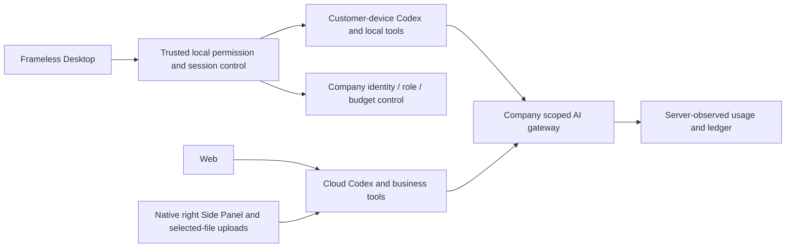

## Service structure and execution

| Module | Source | Implemented responsibility |
| --- | --- | --- |
| Identity and workspaces | Identity/member/session modules in `src/` | Email codes, Admin MFA, native PKCE, tenant/project/private-owner scope |
| Agent execution | `src/worker.ts`, Codex runtime, `catalog/`, `skills/` | Frozen Codex/skill/model versions, controlled tools, leases, fencing and events |
| Continuation | `src/paid-task-inputs.ts`, `src/task-tool-reuse.ts` | Measured completed-turn input waits, same-task/thread recovery and authorized result reuse |
| Billing and access | Billing/wallet/VIP/plan/approval modules | Integer HKD micros, holds, cumulative settlement, manual postings, gifts, refunds and separate VIP/credit |
| Creative and analytics | Design/video/marketing/SEO modules | Internal Images, editable layouts, FFmpeg template videos, CSV/XLSX, ad metrics, synchronized connections and website evidence |
| Content and Admin | Admin/source/erasure modules | Scoped metadata/body rights, quarantine, retention, audit, independent review and controlled erasure |
| Persistence | `migrations/`, PostgreSQL, pg-boss, storage | FORCE RLS, idempotent transactions, immutable facts, queue and asset versions |

Web sessions use HttpOnly cookies, Origin and CSRF checks. Native clients use browser authorization, PKCE and rotating refresh tokens. Administrator identities are separate from customer identities. Reads and tools recheck current tenant, project, private scope and source status.

A model describes missing inputs but cannot choose resource IDs. Completed fully measured turns retain the original budget hold. Human selection of an authorized current version allows a new execution attempt to resume the original Codex thread. Limits are eight rounds and thirty-two dependencies. Cancellation settles known usage; unknown effects remain in reconciliation.

## Initialize and run

```powershell
npm ci
npm run setup:local
npm run db:local
```

Keep the database terminal open. In another terminal:

```powershell
npm run db:migrate
npm run dev
```

Full integration tests require the documented sibling docs/contracts and complete workspace. A standalone backend checkout can run typechecking and compilation first.

API: `http://localhost:4310`. Native PostgreSQL: `127.0.0.1:55432`. `setup:local` generates local passwords and a durable MASTER_KEY only when configuration is absent. Preserve existing configuration/data. `db:migrate` prepares development and test databases. Owner migrations and application/control/queue identities remain separate.

Bootstrap an administrator with `npm run admin:create -- admin@your-company.example super_admin`. Import the local enrolment TOTP configuration into an authenticator and clear the sensitive file according to the runbook. There are no shared default Admin credentials.

## Internal AI gateway

Configure server-only `AI_BASE_URL`, `AI_ALLOWED_HOSTS`, `AI_API_KEY`, `AI_MODEL`, contracted HKD rates and qualification flags. Codex uses the company's OpenAI-compatible Responses interface; Image 2 uses internal Images generation/editing. Run `npm run codex:probe`, then qualify real tool turns, usage and failures. Synthetic responses do not qualify a live model or price.

`.env.example` is a secret-free reference. Production requires HTTPS, SMTP, durable encryption keys, restricted egress, storage and rehearsed backup/restore. The native local database launcher refuses production.

## Interfaces and data

`contracts/implemented-routes.json` inventories implemented routes. Runtime contracts/catalogs and the normative API retain distinct scopes. Canonical TaskDTO/task creation is incomplete; route counts are not contract acceptance. Applied SQL001–091 retain exact bytes; fixes require forward migrations.

Code tools read, hash-edit and package authorized code without running untrusted customer code or claiming unexecuted tests passed. Creative outputs include editable data, SVG/PNG and template MP4. AI video/speech and complete independent role qualification remain tracked.

## Canonical task API usage

1. Sign in, select a tenant/project and install an actual specialist to obtain agent_id. Web writes require the current Cookie and CSRF; native requests use PKCE credentials.
2. POST /v1/tasks with X-Tenant-ID and a distinct Idempotency-Key. Include project_id, agent_id, `type:"delegation"`, `input:{"prompt":"The actual request"}` and `budget:{"currency":"HKD","amount_micros":"1000000"}` for HKD 1.
3. The 202 acceptance contains task_id, status, version and Location. Read Location for a whitelisted Task or subscribe to persistent SSE. Retrieve deliverables through the existing asset APIs.
4. Controls require the latest expected_version and a distinct key. Use cancel or pause/resume at a currently supported checkpoint. A replay returns the current resource without reviving an obsolete state.
5. For needs_input, read pending_input_fields and explicitly select authorized dependency resources. POST inputs with answers such as `{"input-1":{"resource_ids":["actual version UUID"]}}`. The whole batch validates before mutation; task, thread and original budget remain bound.

Dedicated creative, analytics, SEO, workflow/device context and retry are not fully wired through these unified entry points and fail explicitly. Use their existing dedicated workflows. Historical tasks without retained specialist identity use their original project route. Arbitrary in-flight pause and reconciled unknown-operation recovery remain open.

## Checkout and prerequisites

Clone this branch into a fresh working directory; update an existing repository without reinitializing it.

```powershell
git clone --single-branch --branch backend git@github.com:copypasteltd/workmate.git copypaste-platform
cd copypaste-platform
```

Use Node.js ≥22.14, npm and Git with pinned lockfiles. The qualified local environment is Windows x64. Backend/full delivery also needs native PostgreSQL launcher resources, cloud-pinned Codex `0.163.0-alpha.10.2` and FFmpeg/FFprobe; Desktop independently pins `0.163.0-alpha.11` in its runtime manifest. No local Docker, WSL or virtualization. Run components in separate directories; see [workspace](https://github.com/copypasteltd/workmate/blob/docs/docs/governance/04-git-branches-and-publication.md).

## Checks and evidence scope

```powershell
npm run typecheck
npm run build
npm test
```

Historical-source **802/802** full Platform tests and **52/52** focused task tests pass, with **13 checks** across six repositories and **32** actual packaged Desktop/native Side Panel checks. All prior 782 named regression cases remain. Task checks exercise actual PostgreSQL, identity, ledger and Worker; separate real Codex child processes use a synthetic internal gateway. UI turns/business data are synthetic as authorized. The original 102 requirements remain: 81 partially verified, 21 without proven completion and zero fully accepted.

Canonical TaskDTO/task creation, arbitrary in-flight pause, unknown-effect recovery, independent complete role workflows, GEO, live suppliers and production/signing/store qualification remain tracked.

This revision adds canonical task APIs and atomic original-task inputs. Current UIs continue to use their existing project/conversation interfaces over the same execution domain. The refreshed actual recordings verify compatibility; they do not claim migration of every UI to canonical task APIs. See [the implementation and limits](https://github.com/copypasteltd/workmate/blob/docs/docs/technical/68-canonical-task-contracts-and-input-transactions.md) for exact money, idempotency, source revocation and unsupported business parameters.

## Actual screens and interactions

This service has no independent customer page. The following captures show the actual Web client connected to the service.

Actual recordings preserve capture timing. AI turns/business data are explicitly synthetic. Admin form demonstrations do not claim a financial commit.


[MP4](assets/screenshots/workmate-10-interaction.mp4) · [Capture/source evidence](https://github.com/copypasteltd/workmate/blob/docs/docs/quality/workmate-media-10.json)

## Detailed design and updates

- [Product](https://github.com/copypasteltd/workmate/blob/docs/docs/product/01-prd.md)
- [Architecture](https://github.com/copypasteltd/workmate/blob/docs/docs/technical/01-architecture-and-stack.md)
- [Identity and permissions](https://github.com/copypasteltd/workmate/blob/docs/docs/technical/07-security-and-permissions.md)
- [Task continuation](https://github.com/copypasteltd/workmate/blob/docs/docs/technical/66-paid-native-input-checkpoints.md)
- [Admin](https://github.com/copypasteltd/workmate/blob/docs/docs/product/08-admin-dashboard.md)
- [Native clients](https://github.com/copypasteltd/workmate/blob/docs/docs/technical/30-native-window-and-browser-sidepanel.md)
- [Canonical task update](https://github.com/copypasteltd/workmate/blob/docs/docs/changes/2026-10-22-canonical-task-repair.en.md)
- [Local Codex update](https://github.com/copypasteltd/workmate/blob/docs/docs/changes/2026-10-22-native-codex-supervisor.en.md)

Every later change updates both READMEs, affected actual captures/GIFs, release notes and its mapped branch. Verify remote SHAs through Delivery publishing; do not force-push collaborator history. Keep environment secrets, databases, sessions, dependencies and installers out of Git. Exact historical README bytes are retained in [archive](https://github.com/copypasteltd/workmate/blob/docs/docs/quality/history/stage66-before-workmate-readmes/manifest.json).

Stage 73 Desktop local execution: [design](https://github.com/copypasteltd/workmate/blob/docs/docs/technical/73-desktop-native-company-tools.md) · [source-bound proof](https://github.com/copypasteltd/workmate/blob/docs/docs/quality/desktop-company-tools-checkpoint.json). Prior recordings below retain their original source scopes.

## Desktop execution admission

Migration 092 separates immutable cloud/desktop execution ownership. Only the Desktop native login family may create/start/heartbeat/report a local execution; web/extension/Admin cannot grant OS permission. Task creation remains in the common reservation/role/Skill/frozen-pricing domain. Local tasks never enter the cloud queue. Native scoped Responses recheck auth, ownership, lease, capabilities and server budget on admission/dispatch; hosted or unknown native tools are denied. Finish fences admission before closing upstream and settles only company-observed usage. Unknown local/provider outcomes remain reconciling. See the linked design for strict routes, RLS, idempotency and recovery.

## Native company-tool contract

The Agent loop stays on the customer device. Main registers trusted `copypaste` dynamic tools for the pinned native runtime, binds each call to its task/call/thread/turn, and rechecks company permissions before effects and disclosure. Local read-only denies company mutations. Original business validation remains enforced after the native schema projection. Same-call retries reuse durable results; unknown accepted image operations stop further calls and retain reconciliation holds. Private artifact downloads use exact versions and a native save selection.

Stage 73 company-tool update: [release notes](https://github.com/copypasteltd/workmate/blob/docs/docs/changes/2026-10-23-desktop-company-tools.en.md) · [source-bound checkpoint](https://github.com/copypasteltd/workmate/blob/docs/docs/quality/desktop-company-tools-checkpoint.json). Earlier reports and media retain their historical source scopes.

Stage 74 native-input update: [release notes](https://github.com/copypasteltd/workmate/blob/docs/docs/changes/2026-10-23-desktop-native-input.en.md) · [current checkpoint](https://github.com/copypasteltd/workmate/blob/docs/docs/quality/desktop-native-input-checkpoint.json). Earlier reports/media retain their original source scopes.

Stage 75 private-video update: [release notes](https://github.com/copypasteltd/workmate/blob/docs/docs/changes/2026-10-23-desktop-private-video.en.md) · [current checkpoint](https://github.com/copypasteltd/workmate/blob/docs/docs/quality/desktop-video-checkpoint.json). Earlier reports retain their actual source scopes; platform/main-process qualification and later UI qualification are explicitly separated.

<!-- desktop-native-browser-stage77 -->

## Native browser and scrollbar-free Desktop

Start a new local session, select a folder and explicitly grant Full local access. Ask the local Codex to work in a browser. The trusted frameless address bar and remote page run in separate customer-device renderers. The tool namespace `copypaste_browser` v1 includes tabs/open/navigate/history/snapshot/screenshot/interact/evaluate/wait/dialog/downloads/close; interact supports real click, fill/type/select, keys, scroll/drag and exact local-file upload. Completed downloads remain in the selected workspace’s browser-downloads directory. Model screenshots capture the actual page; README browser media uses actual OS window capture, with no compositing.

Current local permission, company identity, project access, origin and budget are rechecked. Web content cannot grant OS access or acquire company inference credentials. Call IDs bind exact operations; unknown accepted actions never replay automatically. Stop, revoke, sign-out or exit close owned pages and pending downloads, preserving completed files and the customer’s original windows. Existing threads retain their original tool binding; create a new session for browser tools.

The previous progress-bar constraint is withdrawn. Truthful upload/task/workflow/video feedback remains. Hidden scrollbar rails do not disable native scrolling. Artifacts wrap into rows, code and tables reflow, scroll areas have keyboard focus, and the composer/receipt remain usable in actual 800×600, 1280×800 and 1440×980 windows. Real wheel/Home/End and last-download focus are verified, alongside compact billing/devices/account pages and English/Traditional Chinese light/dark controls. Physical touchpad hardware and every display-scaling configuration are not claimed by these automated checks.

Current complete inventory: 66 test files / 17 batches / 851 passing cases, retaining all 848 prior cases. SQL001–094 and all 428 HTTP routes remain unchanged. The isolated UI fixture alone allocates 32 user/platform/tenant slots and appends immutable provider-policy version 2 with 32 slots and 10,000 requests/minute, retaining intentional unknown cancellation holds. Bootstrap policy and production defaults/enforcement remain unchanged. Synthetic Responses, campaign content and native-dialog choices are explicit. Original 102 REQ/102 TC, NFR and G01–G10 remain at 81 partial / 21 unproven / 0 fully accepted. Extension product/verifier bytes are unchanged; no new Extension UI claim.

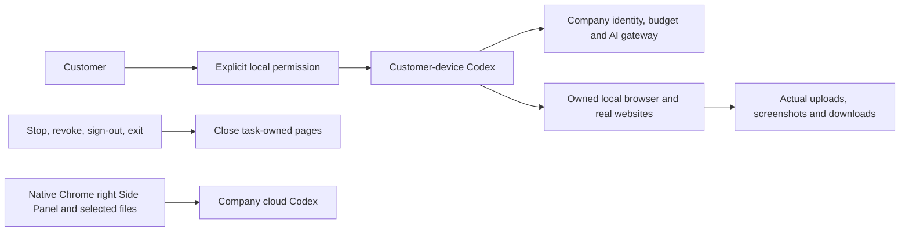


[Design](https://github.com/copypasteltd/workmate/blob/docs/docs/technical/77-desktop-native-browser.md) · [Requirements](https://github.com/copypasteltd/workmate/blob/docs/docs/requirements/04-desktop-layout-and-scroll.md) · [Evidence](https://github.com/copypasteltd/workmate/blob/docs/docs/quality/desktop-browser-checkpoint.json) · [Changes](https://github.com/copypasteltd/workmate/blob/docs/docs/changes/2026-10-23-desktop-native-browser.md)

<details>
<summary>Stage 76 historical implementation and captures (previous scrollbar layout)</summary>

<!-- desktop-native-workflow-stage76 -->

## Native workflows and verification

Choose Workflow consultant, select a folder and explicitly grant the desired local permission. Describe the work and agree its frozen steps. Review the separate per-child budgets and approve the exact version before a child can reserve money or run. Approve any concrete human step before the next specialist starts. Review real files, private SOP/workflow JSON/recovery downloads and company usage; this conversation and incomplete steps have separate charges. Stop or revoke to terminate local parent and child processes; unknown accepted actions retain reconciliation state and never replay automatically.

The first workflow subset permits up to eight sequential native Codex, human approval or analytics-summary steps. Every child uses its own approved role Skills, company tools and scoped credentials while retaining the current explicit local grant. Local full access does not grant another customer's data, project rights or unlimited budget. Company cloud Workers and schedules cannot take over native workflows. Each immutable version freezes actual external input provenance across new sessions and derived SOPs, without depending on the creator task lifetime. Source withdrawal also governs first reads, cached calls, child admission and private or explicitly published derivatives; administrators use existing permission/MFA/reason/audit controls. Closing the app fences requests still waiting for their local journal write.

Historical stage-76 inventory: 65 actual test files / 17 complete batches / 848 passing tests; all 830 stage-75 cases remain covered. SQL001–093 remain unchanged; SQL094 adds native workflow provenance and immutable versions. The actual 428-route inventory retains all prior 415 routes. Original 102 REQ/102 TC, NFR and G01–G10 remain open at 81 partial / 21 unproven / 0 fully accepted. Earlier evidence and media retain their original source scope.

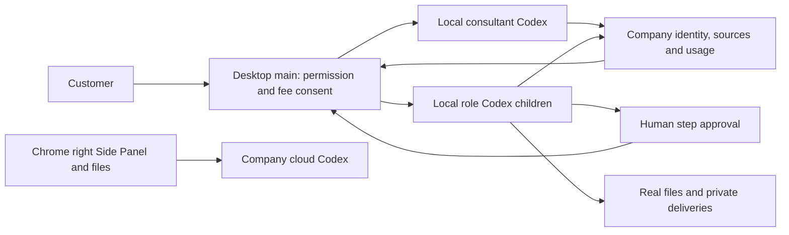


[Design and lifecycle](https://github.com/copypasteltd/workmate/blob/docs/docs/technical/76-desktop-native-workflows.md) · [Bound evidence](https://github.com/copypasteltd/workmate/blob/docs/docs/quality/desktop-workflow-checkpoint.json) · [Change notes](https://github.com/copypasteltd/workmate/blob/docs/docs/changes/2026-10-23-desktop-native-workflows.md)

</details>

</details>


</details>

</details>

</details>

</details>
