<!-- integrated-round-205 -->

## 205 · 0.5.14 · Exact per-call delivery and durable correction

[Evidence and limits / 证据与边界](https://github.com/copypasteltd/workmate/blob/docs/docs/quality/integrated-round-205/README.md) · [Downloads / 下载](https://agent.copypaste.hk/downloads)

1. Sign in, select company/project, then choose the default assistant or preset specialist. Explicitly pin reference versions and budget, submit the original request once, run cloud Codex, and review actual files and usage.

2. Conversation results and task details show each outstanding delivery with safe support references. Long responses, independent successful outputs, input waits and activity pruning preserve unresolved calls; only the actual exact correction resolves its item.

3. Keep bilingual dual-theme branding, readable narrow layouts and no horizontal overflow. Downloads exposes Desktop0.7.18 setup/portable and identical Extension0.5.7 archive bytes with actual sizes/SHA.

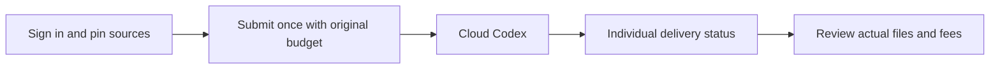

790 qualified related cases, including 675 executed in this round and unchanged Admin/Extension evidence. Four full public files passed exact size/SHA for the explicitly recorded QA path; default direct egress and DNS failover remain separate checks. The original102 requirements/32 groups, professional19-role/50-Skill sign-off, real external media/marketing/IdP services, device/concurrency/long-run/DR matrices and blind WorkBuddy comparison remain explicit. Server networking is read-only. Current exact-call rules supersede historical tool-name-only recovery descriptions below.


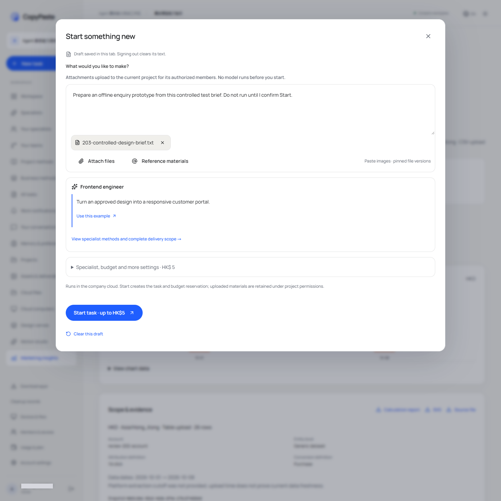


[Recorded interaction / 实际录影](assets/screenshots/workmate-205-v1-marketing-review-live.mp4)

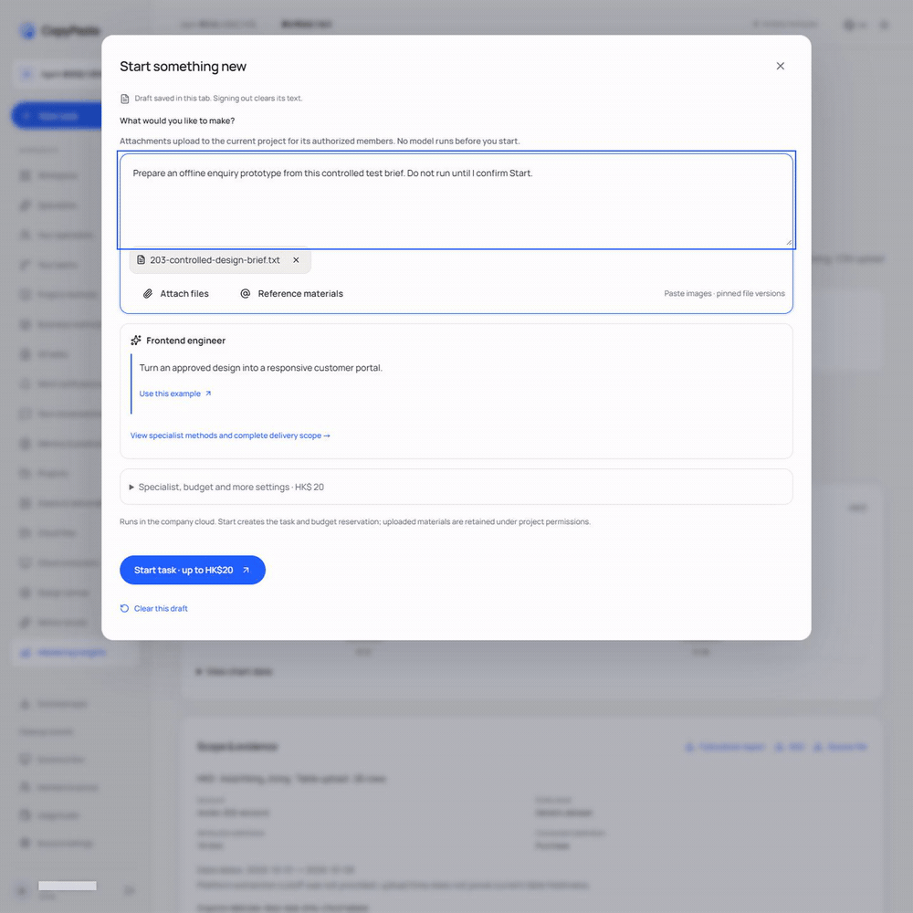

[Recorded interaction / 实际录影](assets/screenshots/workmate-205-v1-specialist-intake-live.mp4)

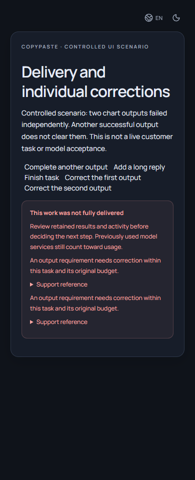

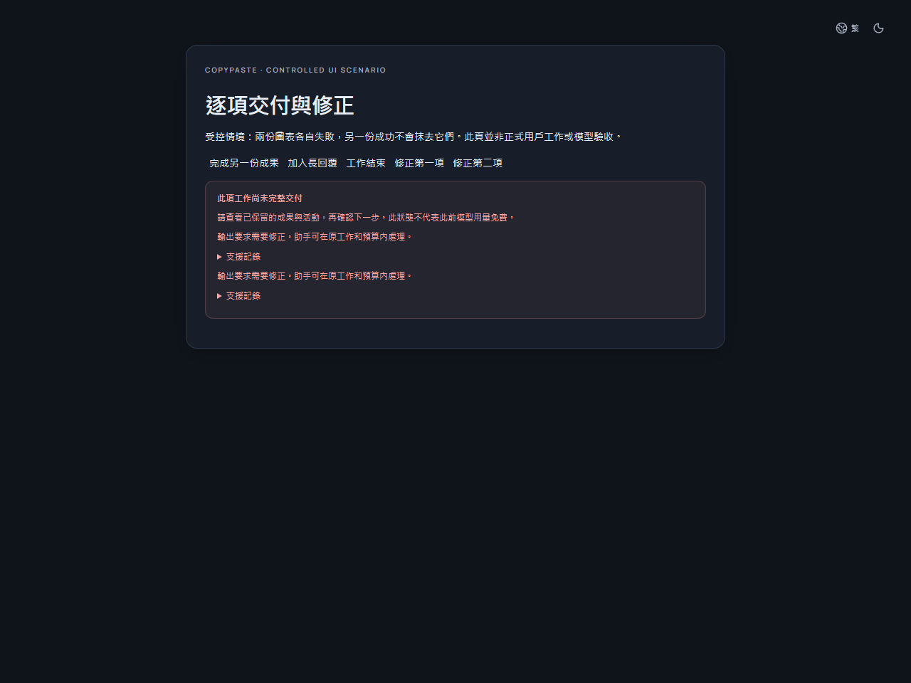

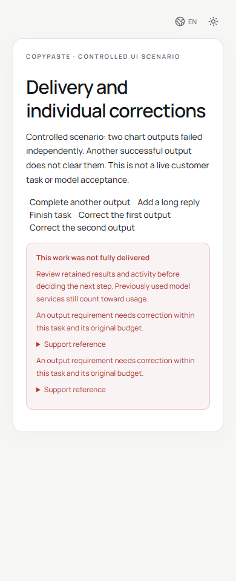

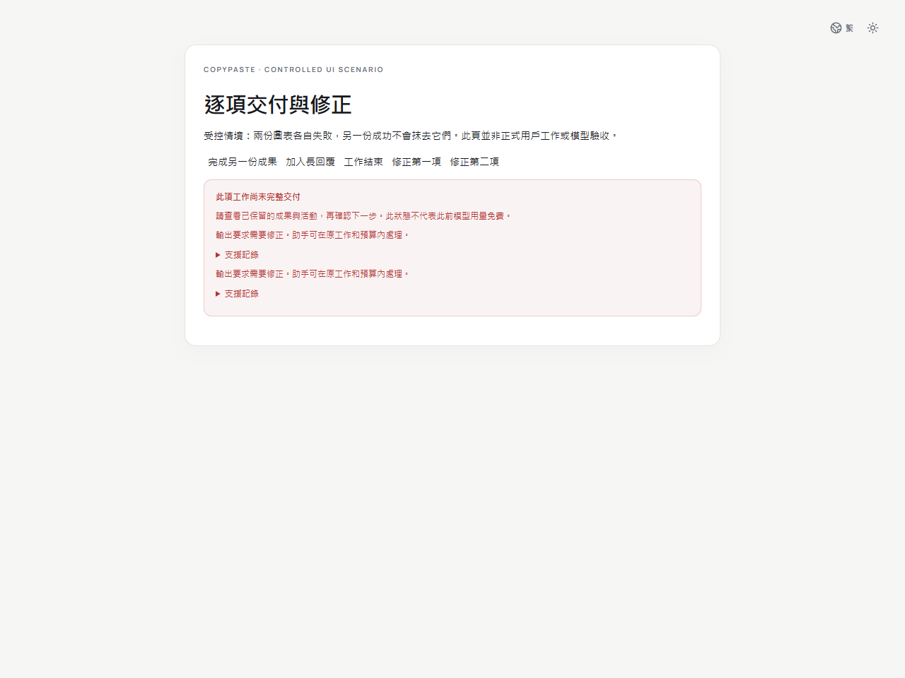

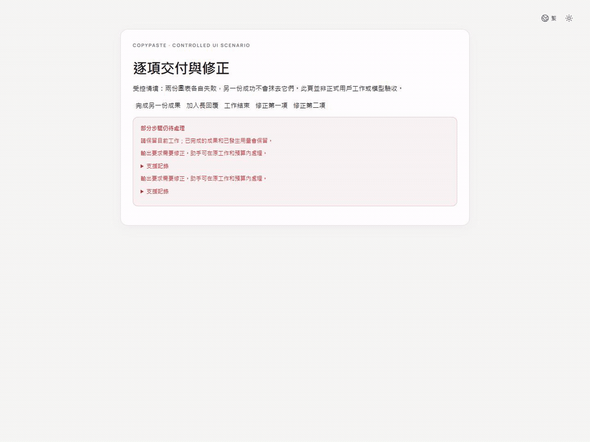

[Recorded interaction / 实际录影](assets/screenshots/workmate-205-v3-tool-feedback-controlled.mp4)

The complete setup/usage guide and explicitly historical release notes follow.

<!-- integrated-round-204 -->

## 204 · 0.5.13 · Safe tool feedback and durable cloud ownership

[Evidence and limits / 证据与边界](https://github.com/copypasteltd/workmate/blob/docs/docs/quality/integrated-round-204/README.md) · [Downloads / 下载](https://agent.copypaste.hk/downloads)

1. Sign in → select company/project → default assistant or specialist → explicitly pin attachments/budget → persist original request/key → cloud Codex → review actual deliverables and usage. The complete existing journey is preserved.

2. Task details and conversation results show outstanding steps, safe guidance and support references. Long responses retain current failures; a recorded successful correction clears feedback without inventing files or deleting usage.

3. Share one task-activity connection in task details and follow activity cursors. Preserve bilingual dual-theme branding, narrow layouts and no horizontal overflow. Publish Desktop0.7.17 and the identical Extension0.5.7 archive on Downloads.

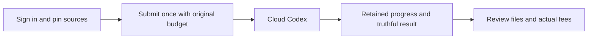

725 qualified related cases distinguish current tests from identical-source retention. One linked marketing sample delivered actual files. All four inner files passed full byte/SHA checks. Public installer transfers remain incomplete; the complete public-download gate has NOT passed. This release update and Git synchronization do not close that check. Original102 requirements/32 groups, professional19-role/50-Skill acceptance, external media/marketing/IdP setup, long-run/device/concurrency/DR qualification and blind WorkBuddy comparison remain explicit. Original generic failure/lease root causes, default public HTTP/2 and normal DNS-address failover remain unproven; QA alone selects another current public address without changing server networking; no full-product acceptance claim.


[Recorded interaction / 实际录影](assets/screenshots/workmate-204-v1-specialist-intake-live.mp4)

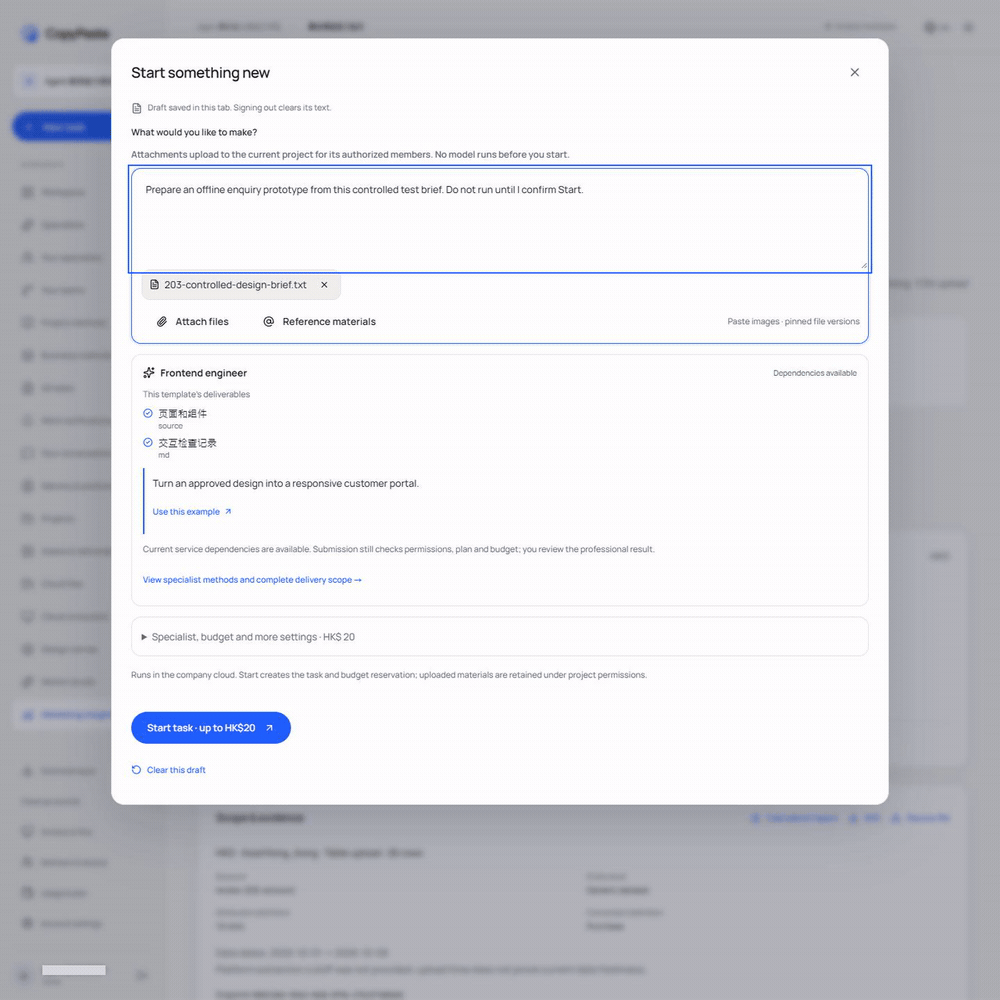

[Recorded interaction / 实际录影](assets/screenshots/workmate-204-v1-marketing-review-live.mp4)


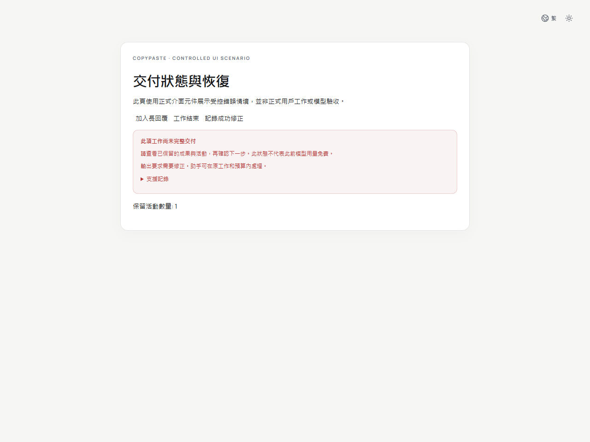

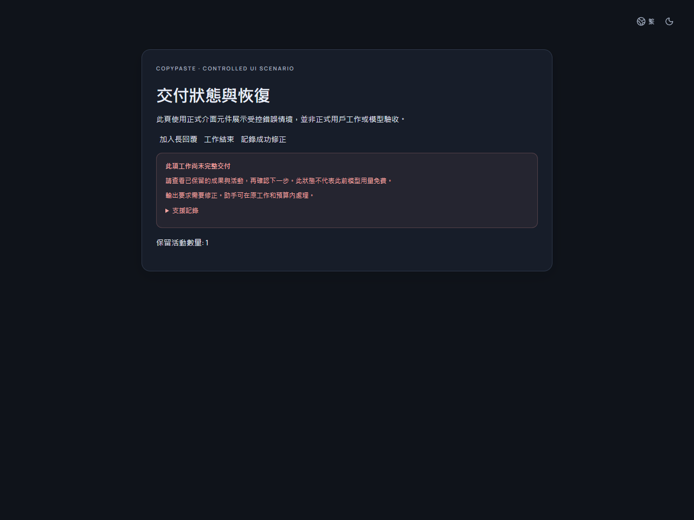

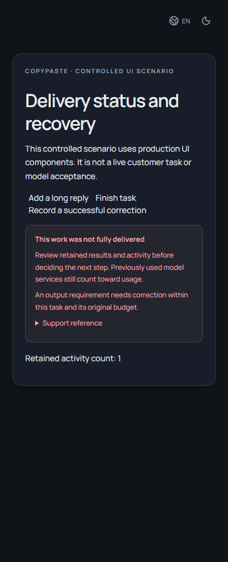

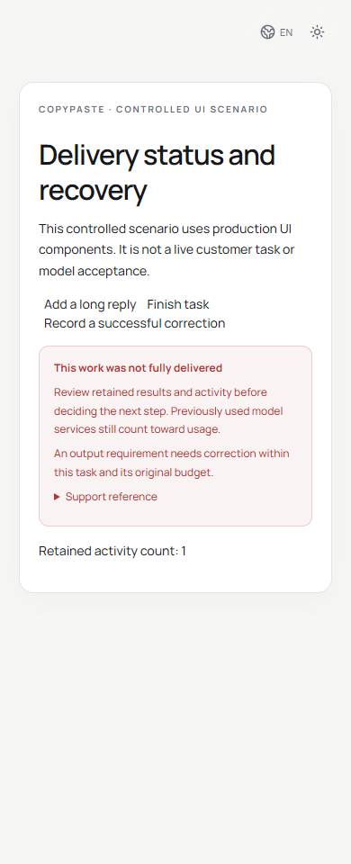

[Recorded interaction / 实际录影](assets/screenshots/workmate-204-v3-tool-feedback-controlled.mp4)

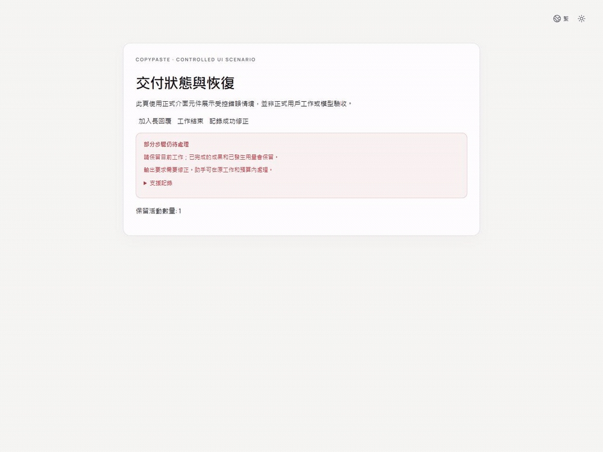

Historical release notes and the complete setup/usage guide follow.

<!-- integrated-round-203 -->

## 203 · 0.5.12 · Pinned specialist intake and reliable delivery

[Evidence and limits / 证据与边界](https://github.com/copypasteltd/workmate/blob/docs/docs/quality/integrated-round-203/README.md) · [Downloads / 下载](https://agent.copypaste.hk/downloads)

1. Sign in→choose workspace/project→New work→default assistant or specialist→state the actual goal→explicitly attach/drop/paste files/images or pin a current shared library version→review deliverables/maximum budget→Start. Pending upload blocks dispatch; no model task starts before confirmation.

2. Drafts belong to actor/tenant/project and remount on scope change. Persist and read back the exact body/idempotency key before paid dispatch; storage failure blocks it. Unknown outcomes lock prompt, attachments and budget; reload allows explicit continuation of the same original request, preventing a new key/charge. Sign-out clears this tab. Ordinary private conversations retain private attachment scope.

3. Marketing insights uses a wide responsive evidence dialog with complete Comparison labels. Review exact periods/scopes and export free HTML/CSV/JSON. Actual two-theme/two-language/multi-width views and identical native exports pass. Physical OS zoom and complete keyboard matrices stay open.

4. 203-v4 screenshots/interaction below use actual deployed Web with explicitly controlled QA attachments/CSV. Current Web68 pass among688 related qualified cases. QA uses original-domain TLS over HTTP/1.1; default HTTP/2 timeout evidence remains separate.

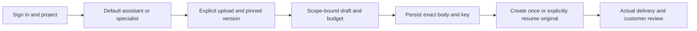

Open delivery: marketing-analyst returned no chart files; technical succeeded does not qualify it. The exact generic tool failure remains unverified. Default public HTTP/2 stalls and one worker-lease investigation also stay open. See the evidence report; no full-product acceptance is claimed.

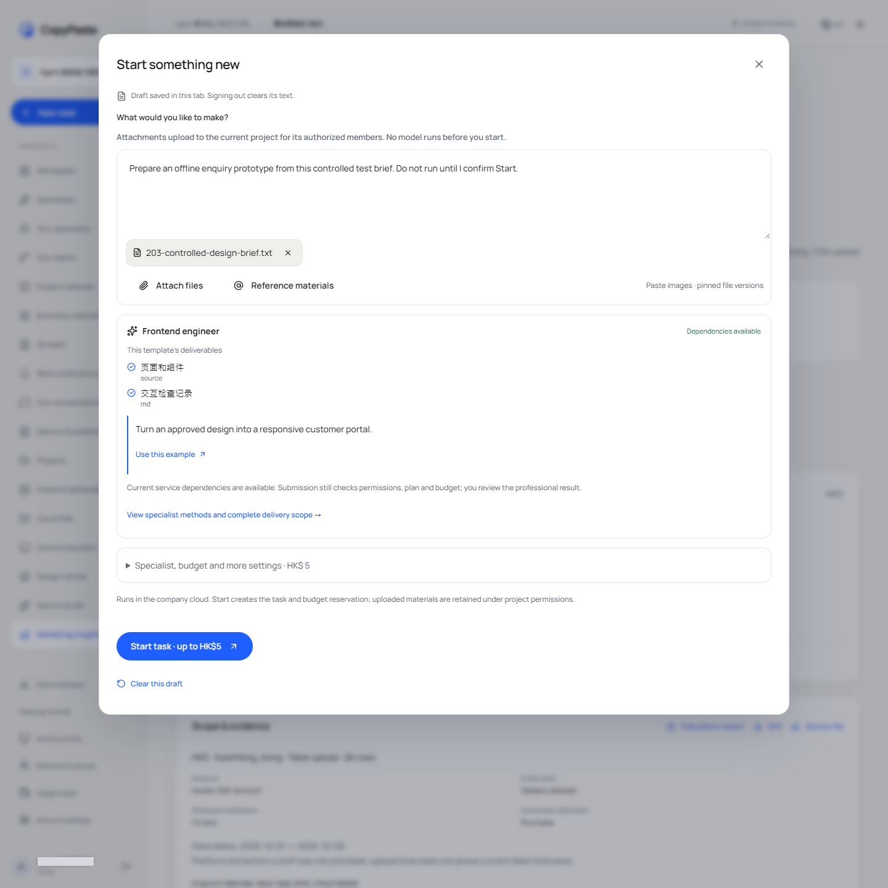

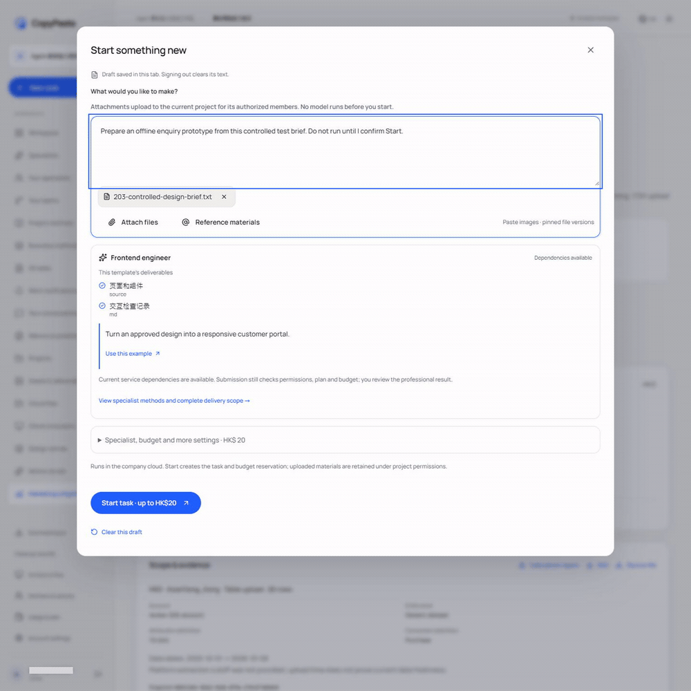

[Actual recording / 实际录影](assets/screenshots/workmate-203-v4-specialist-intake-live.mp4)


[Actual recording / 实际录影](assets/screenshots/workmate-203-v4-marketing-review-live.mp4)

The complete architecture, setup and usage guide follows.

<!-- integrated-round-202 -->

## 202 · 0.5.11 · Evidence review, delivery and safe request recovery

[Evidence and limits / 证据与边界](https://github.com/copypasteltd/workmate/blob/docs/docs/quality/integrated-round-202/README.md) · [Downloads / 下载](https://agent.copypaste.hk/downloads)

1. Sign in→select workspace/project→Marketing insights→search/page history→set the question/periods→Preview report scope. Review current/comparison values, every independent scope, metric filters and missing reasons; expand evidence for original eight-decimal precision and sources.

2. Download complete review HTML/CSV/JSON, including all scopes and fixed sources, without a model call. Explicitly confirm a maximum budget only when requesting a private AI narrative. Source/report histories both support search/pagination.

3. Persist the exact body/key before a paid request. Unknown outcomes lock editing; reload/reopen allows explicit continuation of that original request, without automatically creating another key/charge. Sign-out clears state. Isolated committed-but-lost-response injection proves one private task/reservation and is labelled separately from production.

4. Actual production13-scope review/evidence/three downloads pass. Isolated375/768/1024/1440 layouts and light/dark views have no horizontal overflow. PNG/GIF/MP4 below use real deployed services with explicitly controlled acceptance CSV, not actual ad-account performance.

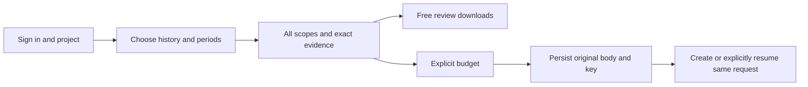

Actual deployed services with controlled acceptance CSV / 正式服务与明确验收CSV


[Actual recording / 实际录影](assets/screenshots/workmate-202-v7-marketing-review-live.mp4)


Earlier architecture, setup and complete use details remain below.

<!-- integrated-round-201 -->

## 201 · 0.5.10 · Motion production and actual delivery

[Evidence and limits / 證據與邊界](https://github.com/copypasteltd/workmate/blob/docs/docs/quality/integrated-round-201/README.md) · [Downloads / 下載](https://agent.copypaste.hk/downloads)

1. Sign in→choose workspace/project→Design canvas→New video project→Start with a video layout→choose one of six layouts and format→add actual copy and authorized sources. Saving shares with authorized project members; private attachments are never implicitly published.

2. Add/copy/reorder/remove scenes and change duration. Captions follow their original scene, split at cuts and are removed with deleted scenes; Undo restores them. Frame-rate changes retain timing/audio in points. Invalid/collapsed/out-of-budget changes are rejected atomically.

3. Choose a frame and explicitly request the actual server PNG. Captions stay fixed on screen. This visual-only preview does not validate audio/full video; save/render for that. Search/page fixed shared images/audio; narration text is not synthesized voice.

4. Undo/redo and scoped session drafts have8-hour/8-entry/2MB bounds and explicit recovery. Uncertain saves retain the original key and pause editing; retry does not duplicate the work. Explicit sign-out clears drafts. Actual390-frame MP4 play/download, cross-client versions and four exact widths without horizontal overflow are qualified.

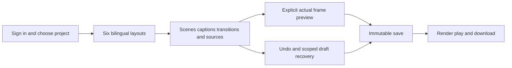

Actual deployed Web201 / 真實已上線Web201


[Actual recording / 實際錄影](assets/screenshots/workmate-201-v3-motion-production-live.mp4)

Earlier installation, architecture and use details remain below.

<!-- integrated-round-200 -->

## 200 · 0.5.9 · From editable layout to verifiable delivery

[Delivery and limits / 交付與邊界](https://github.com/copypasteltd/workmate/blob/docs/docs/quality/integrated-round-200/README.md) · [Downloads / 下載](https://agent.copypaste.hk/downloads)

1. Sign in→choose organization/project→Design canvas→expand “Start a new work from a layout”→choose one of six layouts and text language→confirm sharing. Published specialist sources and complete project imports remain available.

2. Search/select a fixed shared PNG under “Add or replace images & data charts”; review pixels/usage rights before adding or replacing. Explicitly publish an analysis source first, then select up to eight compatible original values. Private chat files never become implicitly shared.

3. Add blank pages and retain existing copy/reorder/delete, direct canvas editing and undo/redo. Whole-work256–1920px adaptation validates every page/font/stroke/minimum chart size atomically. Save a new version before generating PNG/SVG/PDF/PPTX and editable ZIP files. The preview shows the saved version; only a new edit marks it unsaved.

4. The actual isolated journey uses explicitly simulated campaign values with real images/four pages/resizing/undo/version2/16MBZIP and zero model requests/ledger writes. Actual deployed Web separately creates version2/downloads a ZIP and continues into final Desktop version3. Light/dark and375/768/1024/1440 have no page overflow.

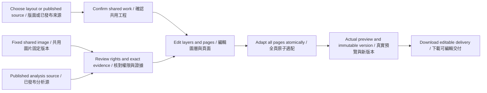

Actual deployed Web200 / 真實已上線Web200

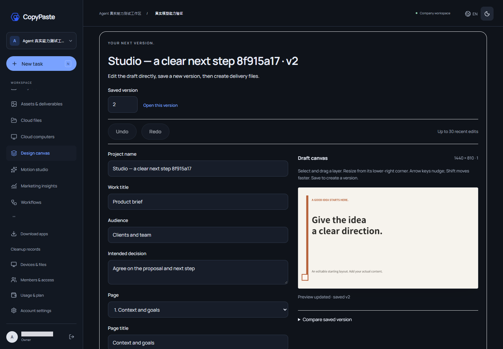

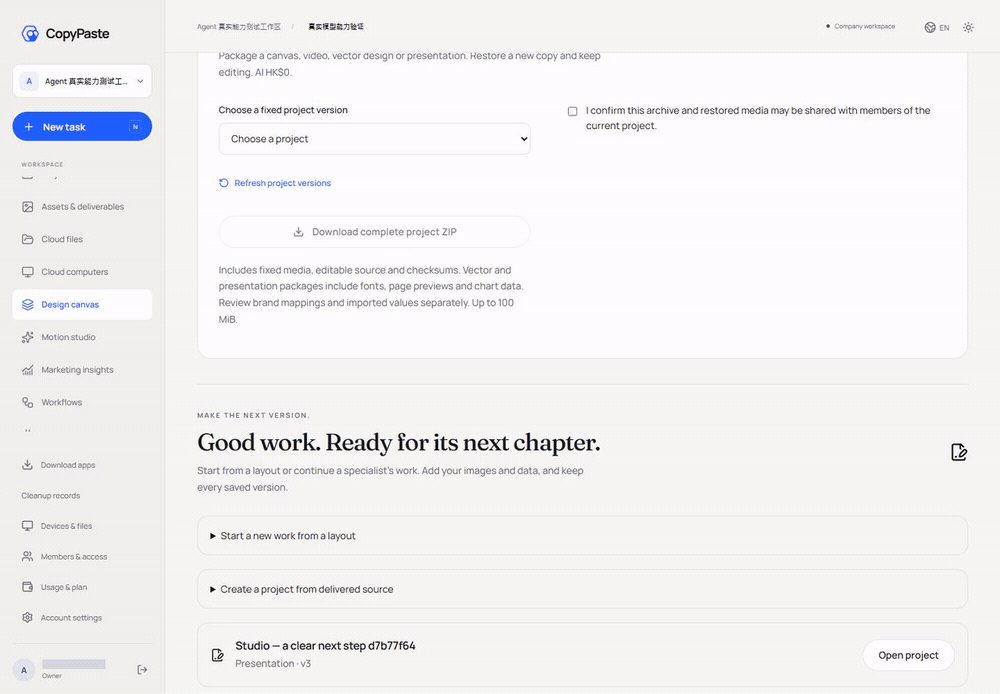

[Actual recording / 實際錄影](assets/screenshots/workmate-200-v3-live-production.mp4)

Earlier release/setup instructions remain below; full original acceptance stays open.

<!-- integrated-round-199 -->

## 199 · 0.5.7 · Direct editing and source-to-delivery continuity

[Delivery and limits / 交付與邊界](https://github.com/copypasteltd/workmate/blob/docs/docs/quality/integrated-round-199/README.md) · [Downloads / 下載](https://agent.copypaste.hk/downloads)

1. Sign in, select an organization/project/specialist and explicitly publish the private editable source produced by cloud Codex. Open Design canvas, choose that source and confirm sharing to create an editable project.

2. Select/drag/resize, nudge with arrow keys (Shift accelerates), align in six directions, duplicate layers and undo/redo. Text alignment/line height, image fitting, shape stroke/radius and geometry retain brand/source constraints. Unsaved previews use the real server renderer without model calls.

3. Drafts remain bounded in the current tab, scoped to account/organization/project/work:8 hours,2MB and8 snapshots, cleared on sign-out. Refresh recovery is explicit; changed server heads require review and renewed authorization. Save a new version before creating files/ZIP.

4. The isolated journey covers pointer edits, reload recovery, concurrent version3 conflict and version4 ZIP. The actual deployed Web saves/downloads version2 from a real cloud Codex source and continues in Desktop, with current375/768/1024/1440 and light/dark evidence. Re-selecting the current organization no longer clears project options.

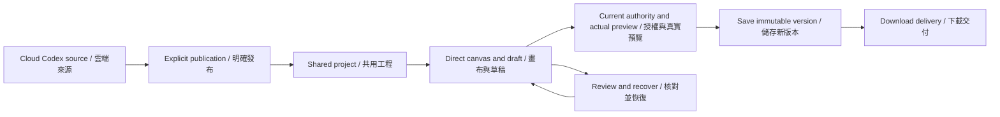

Current actual deployed Web / 本輪真實Web

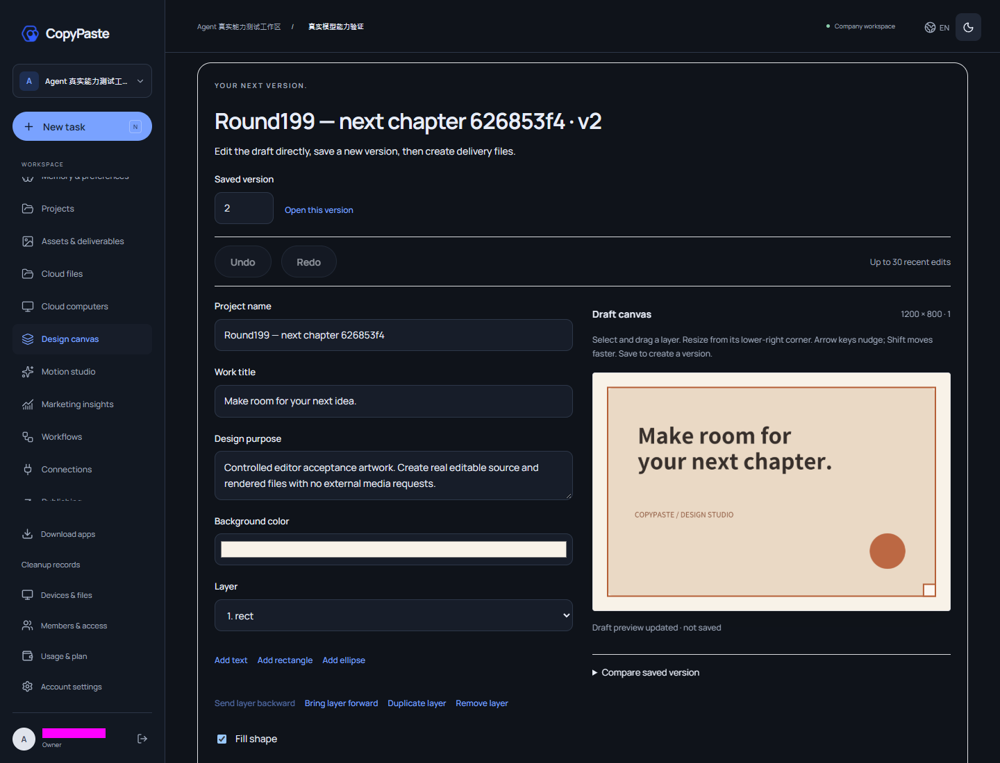

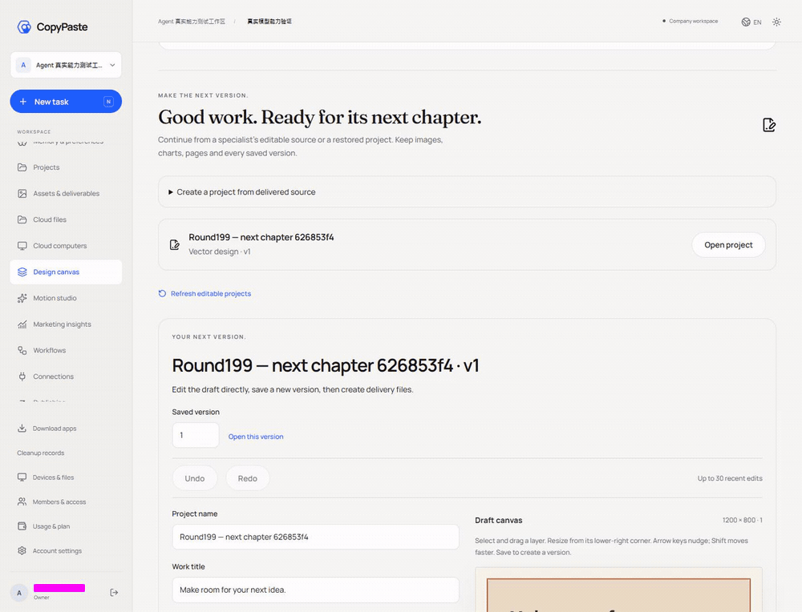

[Actual recording / 實際錄影](assets/screenshots/workmate-199-v3-live-design.mp4)

Earlier release/setup sections remain below. This batch does not close full original acceptance.

<!-- integrated-round-198 -->

## 198 · 0.5.6 · Find work and return precisely

[Delivery and limits / 交付與範圍](https://github.com/copypasteltd/workmate/blob/docs/docs/quality/integrated-round-198/README.md) · [Downloads / 下載](https://agent.copypaste.hk/downloads)

1. Sign in, select an organization/project, specialist and materials, then submit cloud Codex work. Open All tasks to find work by title/status/execution location/mode; subsequent pages use a cursor bound to current authority.
2. Review Results, Files, Changes, Execution, Browser, Activity and Usage. Returning retains the original account-scoped filters/page. Task tabs and still-available file versions restore without putting query text in the browser address bar or credentials/task bodies in navigation state.
3. An original conversation selects the exact requested task and preserves that task/tab through full review. Work links verify organization/project before mounting target pages. Manual scope changes leave old links; late requests from an old account cannot navigate current work.
4. Live checks explicitly assert 375/768/1024/1440 widths, light/dark themes, keyboard access, browser history and unavailable-project feedback. Downloads now provide Desktop 0.7.10 and Extension 0.5.7; all three packages pass complete public download and SHA-256 checks.

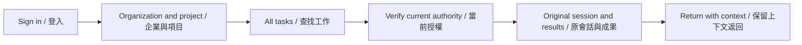

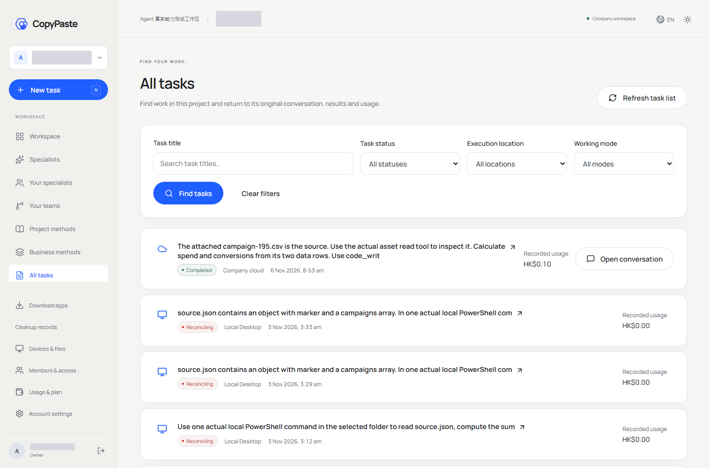

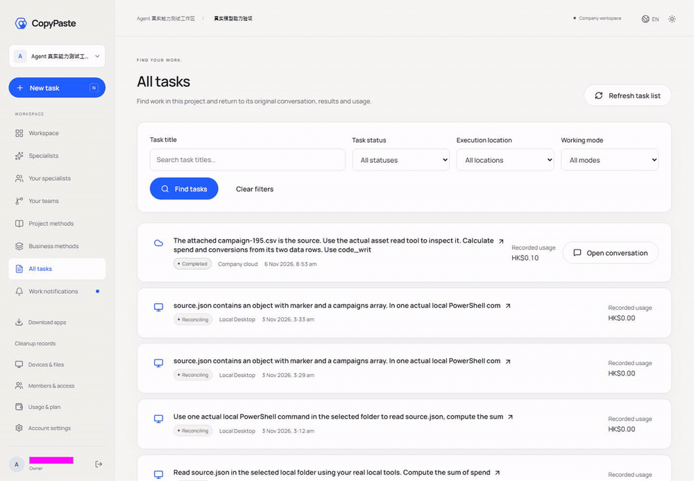

[Actual recording / 實際錄影](assets/screenshots/workmate-198-v6-work-directory.mp4)

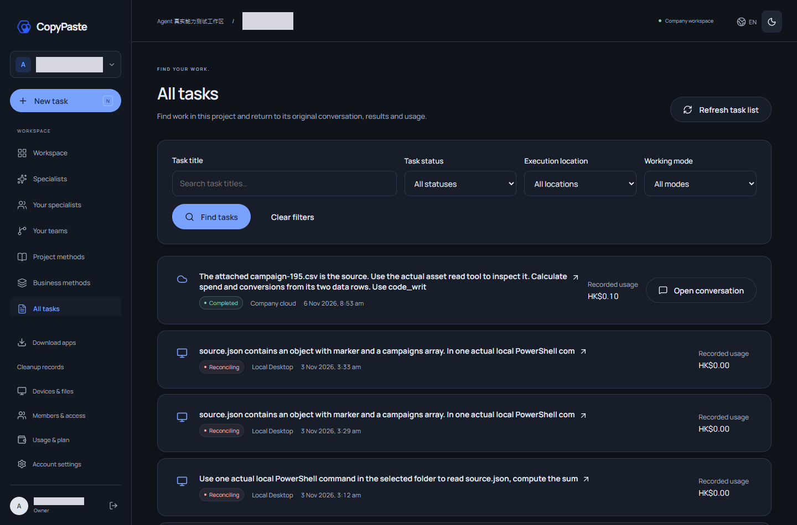

Earlier sections retain previous release/setup history. Current delivery does not close full original acceptance.

<!-- integrated-round-197 -->

## 197 · 0.5.4 · Consistent task review

[Delivery and limits / 交付與範圍](https://github.com/copypasteltd/workmate/blob/docs/docs/quality/integrated-round-197/README.md) · [Downloads / 下載](https://agent.copypaste.hk/downloads)

1. Sign in, choose an organization/project, specialist and materials, then submit cloud Codex work. The task workbench retains Results, Files, Changes, Execution, Browser, Activity and Usage.
2. Software checks appear once in Execution. Manual text editing still creates immutable versions with original-request recovery and historical comparison.
3. A failed body-free read retries at most once. Received HTTP responses are handled by the business flow. Uncertain writes require checking the original result and explicitly retrying that operation; work is never silently dispatched again.
4. Actual HTTPS checks cover keyboard navigation, 375/768/1024/1440 widths and dark review. Downloads contain this round’s three real client packages and checksums. Linux duration uses actual measurements or canonical timestamps; missing/invalid values never render as NaN.

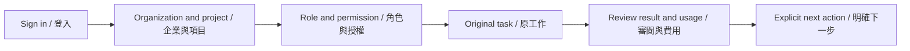

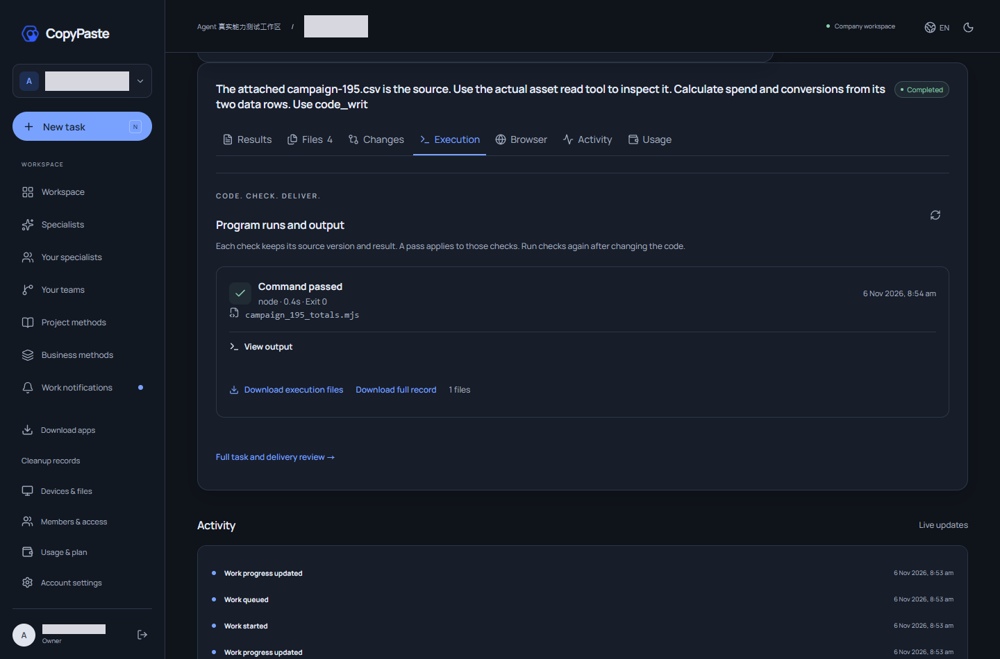

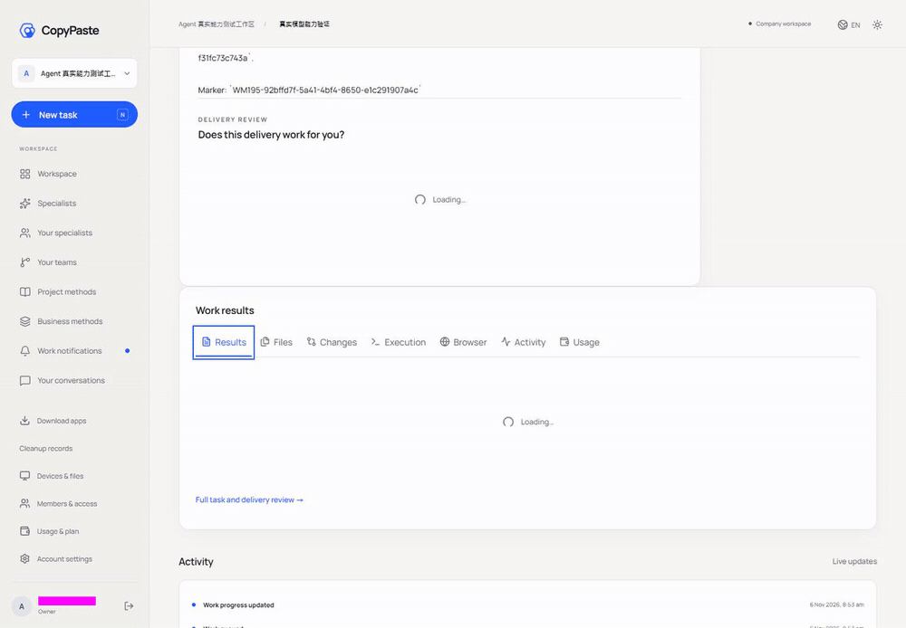

[Actual recording / 實際錄影](assets/screenshots/workmate-197-v5-task-review.mp4)

Earlier sections are retained release history. Full external/professional/production acceptance remains open.

<!-- integrated-round-196 -->

## 196 · 0.5.2 · Cloud deliverables and editing

[完整交付與限制 / Delivery and limits](https://github.com/copypasteltd/workmate/blob/docs/docs/quality/integrated-round-196/README.md) · [下載 / Downloads](https://agent.copypaste.hk/downloads)

1. Sign in with an email code and choose an organization/project. A new task can show the selected specialist template, deliverable formats and dependency state. Use example only fills the brief; confirm the budget and submit to start work.
2. A successful task has Results, Files, Changes, Execution, Browser, Activity and Usage tabs, with arrow/Home/End navigation. Files provide authorized previews/downloads and eligible text editing.
3. Open View and edit text. Saving creates a new immutable version and preserves the original. Review the new delivery again. Manual editing creates no AI task or model charge; supported text is bounded256KiBUTF-8.
4. If the save response is lost, the editor freezes that content and offers Check original save. This explicitly retries the same key/body. Signing out clears tab-local pending text; a version conflict requires reviewing the current file.
5. Changes compares the current deliverable with eligible authorized history, including text/format differences and SHA. Execution and Browser read real server records. Oversized comparisons return a summary/download; tenant, project and source permissions still apply.

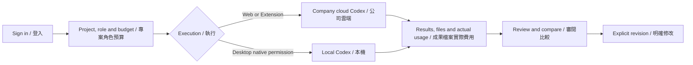

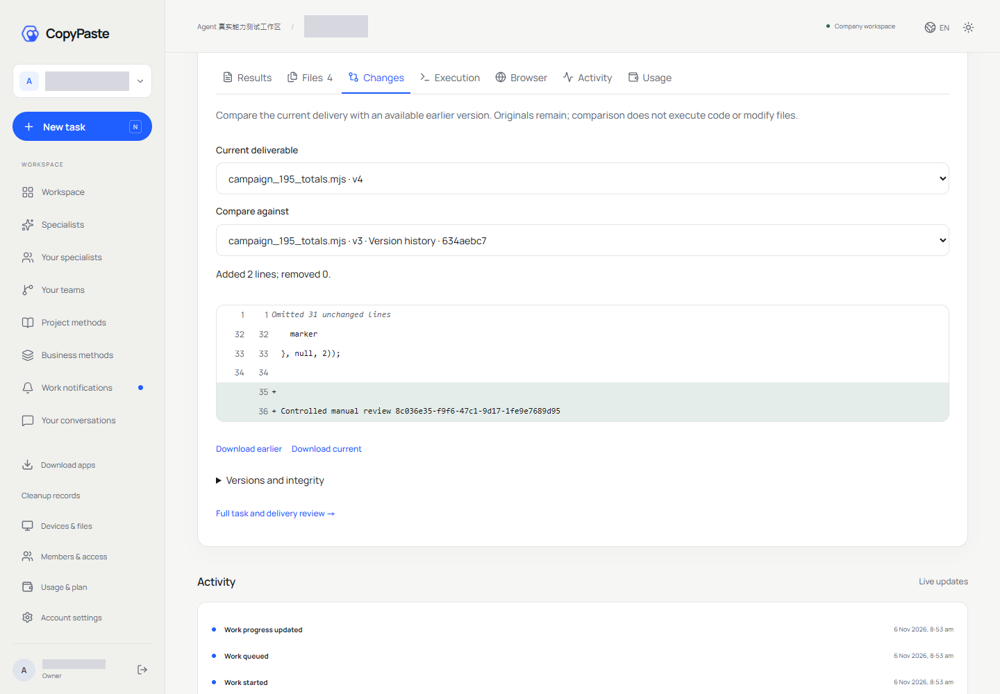

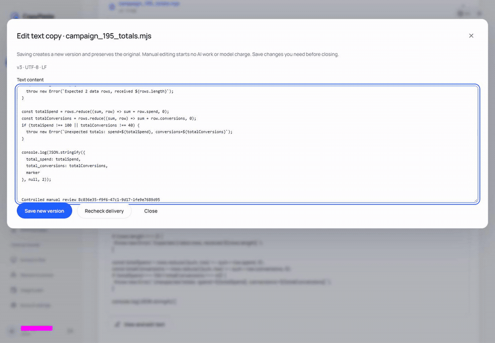

[Actual MP4 / 實際錄影](assets/screenshots/workmate-196-v3-workspace-review.mp4) · [Additional view / 其他頁面](assets/screenshots/196-pending-save.png) · [Additional view / 其他頁面](assets/screenshots/196-role-guidance.png) · [Additional view / 其他頁面](assets/screenshots/196-dark-workspace.png)

Scope: selected current journeys pass; original failures remain. Intermittent public HTTPS timeouts, professional outcomes, external integrations and full production/compatibility acceptance remain open. Earlier sections below describe historical releases.

<!-- integrated-round-195 -->

## 195 · 0.5.1 · 云端工作台 / Cloud workspace

Select/drop/paste/@ pinned files in conversations and review results, files, activity and usage together. Delegation and notes remain distinct.

[Round delivery / 本輪交付](https://github.com/copypasteltd/workmate/blob/docs/docs/quality/integrated-round-195/README.md) · [Download / 下載](https://agent.copypaste.hk/downloads)

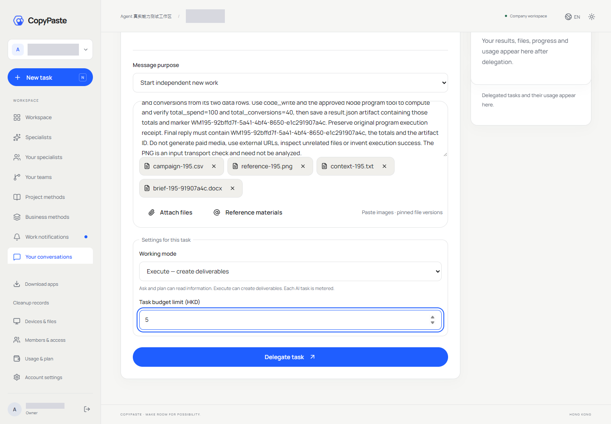

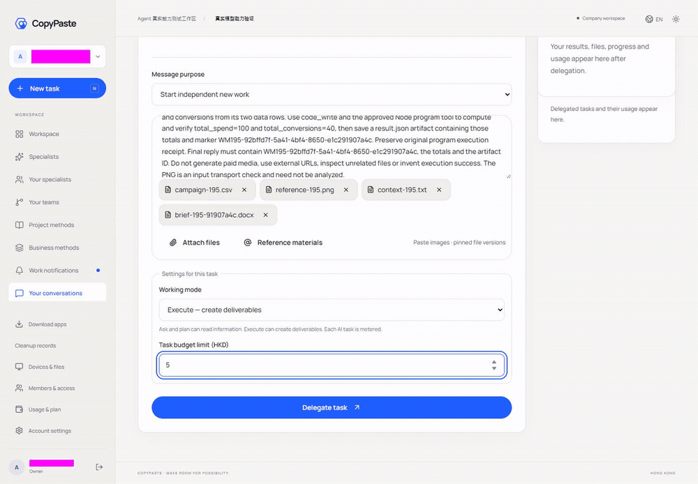

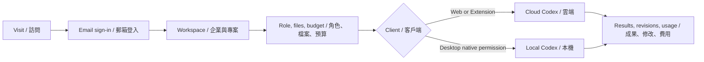

<!-- usage-195 -->

Using this release:

1. Sign in with an email code, choose an organization/project and describe the work in a conversation. Attachments initially belong to that private conversation.
2. Choose/drop files, paste images or use @ to select a pinned material version. Wait for uploads, set the role/execution mode/budget and delegate.
3. Delegation creates real work; saving a note does not invoke AI. An uncertain network outcome retains the original idempotent request.
4. Switch between Results, Files, Activity and Usage. Preview/download authorized files and continue revisions in the original execution location.

[Actual recording MP4 / 实际录像](assets/screenshots/workmate-195-v5-workspace.mp4) · [Additional view / 页面](assets/screenshots/195-v5-workspace-results.png) · [Additional view / 页面](assets/screenshots/195-v5-workspace-dark.png)

<!-- /usage-195 -->

本輪實際測試與旅程見報告；保留歷史失敗，不以代碼量替代全部專業/生產驗收。影片/語音/Google/Meta真實配置、至少12角色專業驗收及完整兼容/運營矩陣仍開放。測試郵箱及未簽名安裝按已確認範圍保留。

Selected regression and real journeys are in the report. Historical failures remain. Real video/audio/Google/Meta configuration, at least12 professional role evaluations and the full compatibility/operations matrix remain open. The requested test mailbox and unsigned manual installation remain.

<!-- product-downloads-193 -->

## Public product downloads · 193

[Open the download page](https://agent.copypaste.hk/downloads). Desktop 0.7.4 (Windows Setup/Portable), Chrome extension 0.5.4 ZIP and file checksums download directly from the company site without signing in.

The homepage, footer, sign-in page, workspace sidebar and Devices page link to /downloads. Direct navigation, refresh, Traditional Chinese/English, themes and mobile layouts are supported.

The Windows build is unsigned. The extension is installed manually and is not listed in the Chrome Web Store. macOS/Linux installers are not available.

[方案 / Implementation](https://github.com/copypasteltd/workmate/blob/docs/docs/development/193-product-downloads.md) · [驗證 / Verification](https://github.com/copypasteltd/workmate/blob/docs/docs/quality/193-product-downloads.md)

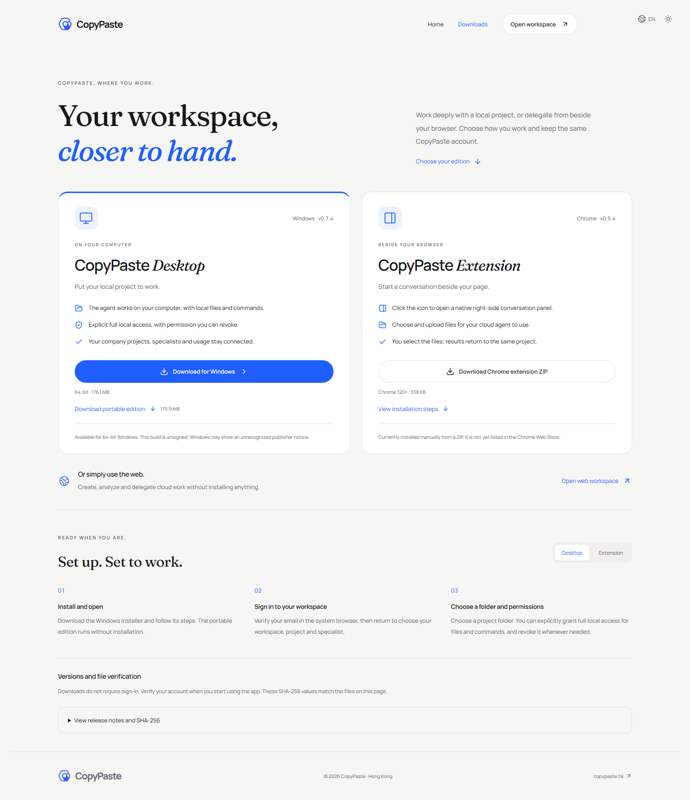

[實際手機下載頁 / Actual mobile download page](assets/screenshots/193-downloads-mobile-zh.png)


<!-- native-recheck-192 -->

## Recheck and native error visibility · 192

Reconciliation details show the billing reason and the reported local cause together. Real direct-browser checks cover the visible cause and horizontal overflow; actual cloud execution, browser checks and downloads retain independent receipts.

Final regressions: backend91, Web30, Admin22, Extension89, Desktop controller74; native Linux8 passed. Ordinary direct-browser GETs returned200 on all three domains; direct Python GETs returned403. This does not certify a zero-defect complete product. Item12 is excluded; unselected video/audio, Google/Meta, Linux Office and full-matrix scope remains open.

[方案 / Implementation](https://github.com/copypasteltd/workmate/blob/docs/docs/development/192-native-error-observability.md) · [复查 / Recheck](https://github.com/copypasteltd/workmate/blob/docs/docs/quality/192-native-recheck.md)

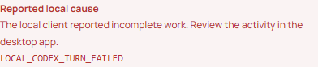

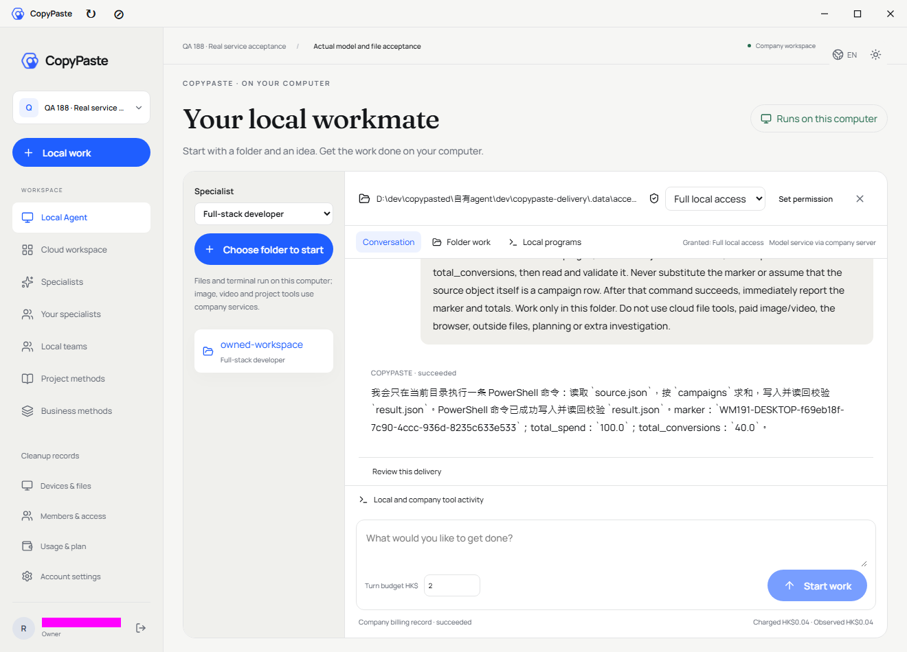

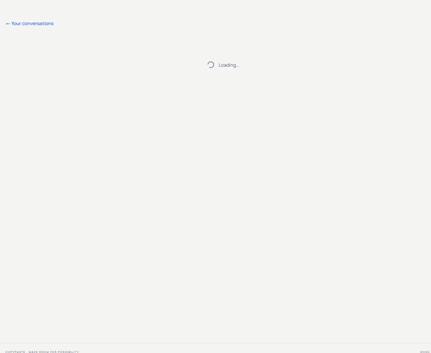

<!-- selected-repairs-191 -->

## Selected execution repairs and Desktop handoff · 191

An actual Web user ran native cloud programs/Chromium and downloaded verified deliverables. Web product sources are unchanged; its complete historical suite was not rerun. Selected issues02/03/04/05/07 have current evidence. The owner removed12; the new Windows build is unsigned and installed manually. Unknown supplier fees/reservations remain unresolved; execution-capacity release does not settle a bill.

The final Desktop uses the installer default company HTTPS origin through raw CONNECT forwarding, preserving end-to-end TLS verification, requests, model output and accounting. Browser PKCE uses the canonical HTTPS domain. This real workflow passed; a single acceptance does not establish long-term public-route reliability, so issue01 remains open. Fresh scopes: backend40/40, streaming gateway24/24, Windows cloud compatibility38/38, Desktop controller74/74, actual pinned-Codex disconnect1/1 and native Linux8/8; actual cloud task HK$0.126067 and final-build Desktop task HK$0.035144. These are separate checks, not a fresh whole-product acceptance. Public reliability and other unselected190 items retain their gaps. Older entries below are historical.

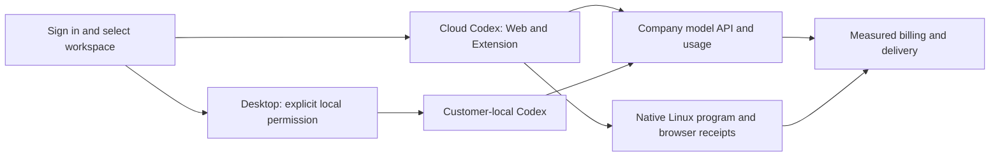

[方案 / Implementation](https://github.com/copypasteltd/workmate/blob/docs/docs/development/191-native-execution-and-capacity.md) · [证据 / Evidence](https://github.com/copypasteltd/workmate/blob/docs/docs/quality/191-selected-repairs.json) · [Desktop0.7.4手动下载 / Manual download](https://github.com/copypasteltd/workmate/releases/tag/desktop-v0.7.4)


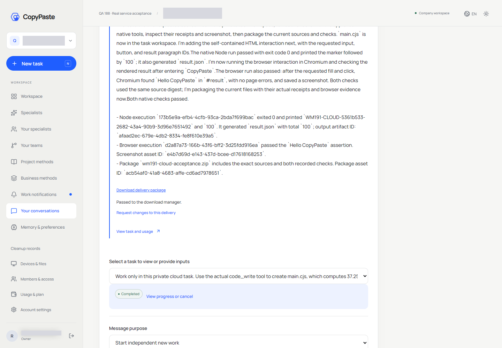

Actual Web download recording excerpt; identity labels redacted. 这是Web实际录像节选，不代表其他端的新交互录像。


<!-- live-acceptance-189 -->

## Real image deployment and acceptance · 189

`gpt-image-2` passed actual generation and editing and is published with the same upstream URL/key as text. An actual Web Designer task generated persisted files, downloaded verified hashes and settled measured usage. Larger1254-square PNGs are decoded and normalized to1024 while exact originals remain downloadable. Image tools now resolve their frozen per-model connection without a duplicate global key; unrecovered image-tool failures cannot become successful tasks.

Choose Designer, execution mode, a request and budget. Download the verified image and preserved original from Files; access, measured usage and audit remain bound to the task.

The full backend run recorded1950 tests:1949 passed and one failed; that browser deadline issue subsequently passed14/14 focused checks. Web28/28, Admin20/20, Extension89/89, Desktop269/269 and all builds passed. Separate image normalization48/48, per-model image/original persistence and discovery36/36, and actual native protocol image failure/recovery2/2 passed; overlapping runs are not summed into a new full-pass result.

Actual supplier-backed Desktop completion, public reliability, video/audio/Google/Meta credentials, SMTP and Linux native executor qualification remain open. The requested protected test mailbox remains. This is not full-product acceptance. See the [design, usage, original failures and rollback guide](https://github.com/copypasteltd/workmate/blob/docs/docs/development/189-real-image-and-acceptance.md).

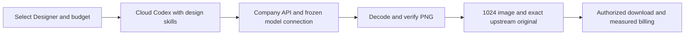

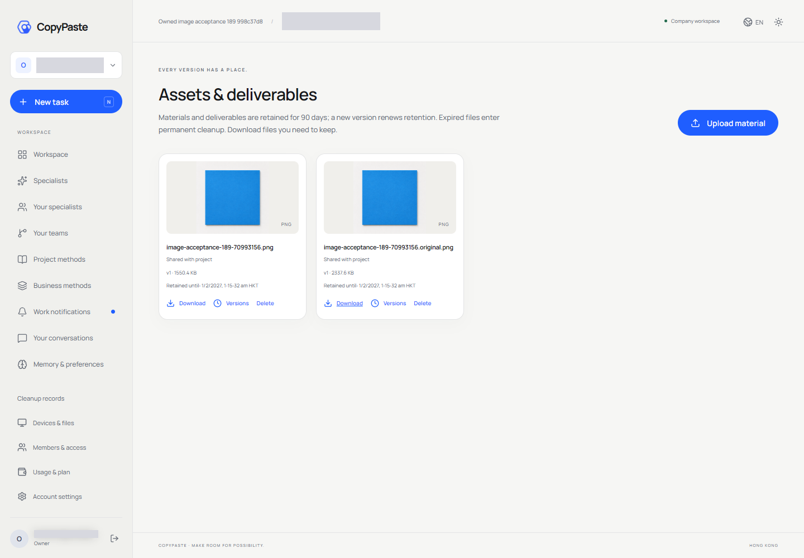

Actual Web download interaction excerpt. Reuse in other client repositories remains Web evidence.

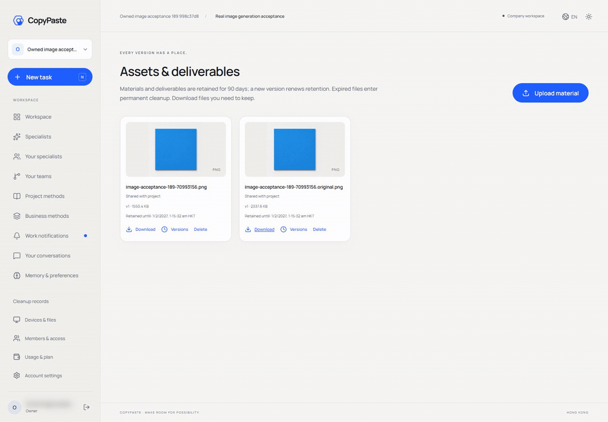

<!-- live-acceptance-188 -->

## Real-service acceptance and deployment · 188

Real text service is deployed. Web and the native Chrome right Side Panel completed email sign-in, authorized file upload, actual cloud Codex analysis, file delivery/download and measured billing. Actual admin checks cover user/workspace creation and deletion, atomic bulk changes, per-model API/key editing and deletion, VIP grants/revocation and audit records. See the [complete evidence and usage guide](https://github.com/copypasteltd/workmate/blob/docs/docs/development/188-live-acceptance.md).

Desktop runs pinned Codex on the customer's computer with explicit folder and full-access consent. Recognized GPT model exec compatibility is repaired; actual local command/file/company-tool operations passed a labelled protocol fixture. Final real-supplier Desktop acceptance remains blocked by intermittent public connectivity. The original full backend regression recorded 1,936 tests: 1,834 passed, 101 failed and one skipped. Subsequent targeted checks are separate evidence, not a replacement full-pass certificate.

To configure service, administrators enter each model's upstream URL, API key, alias and rates in Model capabilities, then qualify and publish its version. Users verify email, select a real workspace/project and submit bounded work. The protected test mailbox remains enabled. Actual image generation returned403; video/audio and Google/Meta credentials are absent and remain unqualified.

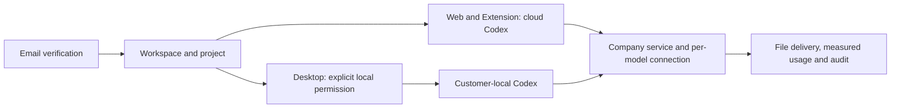

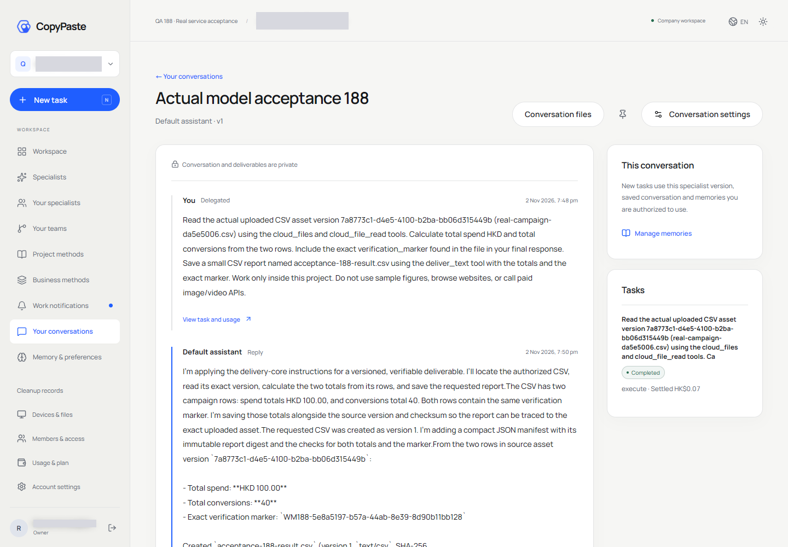

Actual read-only scrolling through the completed Web task, not new inference or a certificate for every client:


<!-- web-scroll-187 -->

## Web scroll refinement · 187

The [Web client](https://agent.copypaste.hk) hides visible page, sidebar, conversation and outer-modal rails while retaining native scrolling. Necessary inner tables, panels and inputs use consistent thin scrollbars derived from the existing light/dark theme. Narrow controls wrap; wide tables scroll only inside their own container.

Browse long content with the wheel, trackpad or touch. Navigation scrolls independently and long-dialog controls remain accessible. TypeScript/Vite and ten final actual deployed-LAN browser checks passed; owned browsers and QA sessions were closed. A complete public HTTPS journey was not qualified this round. See [usage, implementation, evidence and rollback](https://github.com/copypasteltd/workmate/blob/docs/docs/development/187-web-scroll-surfaces.md) for the exact scope.


# Workmate · web · v0.1.0

<!-- per-model-connections-178 -->
## Per-model API configuration · stage178

Open [Admin → Model capabilities](https://agent-dashboard.copypaste.hk/catalog?view=capabilities) → **Create configuration**. Enter `gpt-6-luna` (or the actual upstream alias), its **API Base URL** and **API Key** in the same form. Each model owns its address and key. Text models require the OpenAI Responses API.

Save draft → test connection → run full capability validation → independent approval/publication → assign the published capability to roles/templates. A connection test reads `/models`; it does not publish a model. Validation and real use consume actual upstream credit, including in the current trial-accounting environment.

The server encrypts keys and never returns them. Version changes preserve frozen task connections. Retain an existing key explicitly when copying a version; changing the URL or network scope requires a new key. Missing explicit connections fail closed. No real supplier key was configured for this deployment.

Customer requests continue through the company API. Supplier keys never reach the browser. The trial notice distinguishes simulated accounting/default fixtures from real calls made by explicitly configured models. Existing task authorization, credits and published role selection remain in force. Build: `npm run build`.


[使用细则 / Usage and operations](https://github.com/copypasteltd/workmate/blob/docs/docs/releases/model-connections-178.md) · [Source/runtime increment](https://agent.copypaste.hk/downloads/workmate-model-configuration-178.zip)


Earlier deployment/release records follow; their synthetic-service descriptions describe their original scope. 以下历史记录保留原部署范围。

---

<!-- public-domains-177 -->
## Public HTTPS deployment · stage177

[Web](https://agent.copypaste.hk) · [Admin](https://agent-dashboard.copypaste.hk) · [API readiness](https://ai-api.copypaste.hk/health/ready)

Same-origin /v1 proxy: email code → workspace/project → simulated credit → specialist task → delivery/download.

[Current deployment, login and operations / 当前部署、登录与运维](https://github.com/copypasteltd/workmate/blob/docs/docs/releases/domains-177.md)

Credentials are unchanged: server `/root/cfg/workmate/credentials.txt`, root `0600`. Admin: `admin@workmate.local` + email OTP + TOTP. Test mailbox: [protected operator inbox](https://agent-dashboard.copypaste.hk/ops/mailbox/). AI/media/ads/payment remain synthetic; records/files persist. 凭据保留，测试收件箱使用独立操作口令，外部服务仍为假数据。

[Desktop 0.7.2 Setup](https://agent.copypaste.hk/downloads/CopyPaste-0.7.2-x64-Setup.exe) · [Portable](https://agent.copypaste.hk/downloads/CopyPaste-0.7.2-x64-Portable.exe) · [Extension 0.5.3 ZIP](https://agent.copypaste.hk/downloads/CopyPaste-Extension-0.5.3.zip) · [Source increment / 源码增量](https://agent.copypaste.hk/downloads/workmate-domains-177.zip)

Windows installers are unsigned. Extract the Extension ZIP and load it unpacked in Chrome developer mode; the extension ID stays `fffkcnmfdhahlnifgdilabheppkgnlok`. Desktop AI access uses company services; supplier keys are not embedded. Windows 未签名，扩展采用已解压加载，固定 ID 不变。


[MP4 recording](assets/demos/177-public-domains.mp4)

---

Earlier releases and deployment history / 以下为历史版本及部署记录。

<!-- lan-deployment-176 -->
## LAN HTTP deployment · stage176

Web: http://192.168.31.20:63070 · Admin: http://192.168.31.20:63071 · API: http://192.168.31.20:63072

LAN HTTP supports login, workspace creation, secure digests, tasks and uploads; 19 role templates are available.

Server plaintext credentials: `/root/cfg/workmate/credentials.txt` (root `0600`). Email OTP is retrieved through the protected test mailbox; Admin additionally requires TOTP. Synthetic services remain explicitly labeled.

[部署、登录与运维 / Deployment and login guide](https://github.com/copypasteltd/workmate/blob/docs/docs/releases/lan-176.md)


[实际操作录像 / Actual recording](assets/demos/176-lan-http.mp4)


## v0.1.3 · 当前完整交付 / Current complete delivery

[Release / 下载](https://github.com/copypasteltd/workmate/releases/tag/v0.1.3) · [中英使用手册 / Bilingual guide](https://github.com/copypasteltd/workmate/blob/v0.1.3/docs/releases/v0.1.3.md)

本轮完整包包含六仓源码和全部端，纳入团队/单次运行费用报表、原成员/协调员账目、交叉筛选和同快照CSV。当前源码与假数据冻结交付按使用者要求收口；服务器资料和正式服务接入后续提供。AI/媒体/广告/支付使用假数据，Windows未签名；完整专业/生产台账保持。

All six source trees/clients are delivered, including team/run financial reports, original member/coordinator entries, intersecting filters and matching snapshot CSV. This current source/synthetic frozen delivery closes as requested; server/live configuration follows later. External services are synthetic and Windows is unsigned. Full professional/production qualification remains tracked.


## Current complete frozen delivery · v0.1.2

The complete bundle includes every client, six source trees and the current posting-period reports. Desktop runs Codex locally with explicitly granted full local permission; the native Extension Side Panel reads/uploads authorized files for cloud Codex. Schema156, authorized synthetic AI/media/ads/payments and unsigned Windows.

[完整下载 / Complete release](https://github.com/copypasteltd/workmate/releases/tag/v0.1.2) · [安装、登录和使用 / Setup and flows](https://github.com/copypasteltd/workmate/blob/v0.1.2/docs/releases/v0.1.2.md)

本轮重新构建Backend/Admin；其余运行产物及Windows分发核对后复用。继承源码一致的阶段172定向验证，阶段173不重跑功能测试。Backend/Admin rebuilt; unchanged runtimes/Windows distributions verified and reused. Exact-source stage172 focused checks inherited; no functional tests rerun at173. Older entries below retain their historical scope.

## Frozen delivery v0.1.1

The complete bundle includes local-Codex frameless Windows Desktop, Web, independent Admin, native Chrome Side Panel, backend, six buildable source trees and pinned runtime. Authorized synthetic services, unsigned Windows and schema156.

[完整发行包 / Complete release](https://github.com/copypasteltd/workmate/releases/tag/v0.1.1) · [安装及流程 / Setup and flows](https://github.com/copypasteltd/workmate/blob/v0.1.1/docs/releases/v0.1.1.md)


[中文](README.md) · [Complete release](https://github.com/copypasteltd/workmate/releases/tag/v0.1.0) · [Bilingual setup guide](https://github.com/copypasteltd/workmate/blob/v0.1.0/docs/releases/v0.1.0.md)

Workmate serves Hong Kong enterprises, beginning with existing marketing teams. This independent **web** component uses **React / TypeScript / Vite**. Business areas include design/media, advertising and website/SEO/GEO analytics, repeatable workflows and software development. CopyPaste's warm background, dark text, brand accents and editorial typography guide the interface.

## Current frozen release · v0.1.0

All clients, backend and six source trees are delivered together, including the latest creator-filtered Admin tasks/content. Six components are rebuilt. Rebuilt Desktop outputs match the qualified Windows app/Portable/Setup byte for byte, so those verified binaries are reused. Stage166's eight SQL/API cases and eight actual UI checks retain their source-bound original evidence; broad historical regression is not rerun.

Branch`web`, frozen tag`v0.1.0-web`. [Source and installers](https://github.com/copypasteltd/workmate/releases/tag/v0.1.0) · [Freeze record](https://github.com/copypasteltd/workmate/blob/v0.1.0/docs/quality/release-freeze-checkpoint-167.json) · [Open work](https://github.com/copypasteltd/workmate/blob/v0.1.0/docs/quality/remaining-work-stage167.md). AI/media/ads/payments use the authorized synthetic mode; Windows is unsigned. Existing screenshots/GIF/MP4 retain their actual capture scope and do not imply new full installation/professional qualification.

## Architecture and responsibilities

Entry points: `src/main.tsx, src/context.tsx, src/workspace-creation-form.tsx`. Codex is the only agent kernel. All AI calls use the company's OpenAI-compatible gateway; provider secrets remain server-side. Presets pin Skills, tools and configuration versions. The designer combines Codex, design Skills and company Image 2.

Web runs cloud agents. Chrome MV3 provides conversation and attachments in its native right Side Panel; customers explicitly select files and consent to upload for cloud execution. Desktop is frameless without Electron's default menu, runs Codex on the customer's computer and supports explicitly granted full local permission, stop/revocation and account/directory isolation.

Admin has independent email OTP plus TOTP and scoped permissions for users/organizations, usage, billing, VIP, roles/Skills and content. User detail passes the actual target ID; fee accounts are subject-filtered and VIP locks that target. Switching users unmounts previous dialogs/previews. Amounts use HKD micro-units. Budgets, balances, receipts, gifts, credit and VIP are distinct. Manual changes require preview, confirmation, current MFA/policy/approval, audited idempotency and current authority.


## Setup and commands

Place six independent repositories beside each other under `dev/`: platform, web, admin, desktop, extension and delivery, each with the `copypaste-` prefix. Use Windows x64, Node.js 22.14+, Git and native PostgreSQL. Media requires FFmpeg/FFprobe. Pinned Codex ships in the runtime archive. Docker, WSL and virtualization are prohibited.

Read the release guide. Before first configuration, choose an available database port. From Delivery run `demo:preflight`, `bootstrap:demo`, `demo:check`, then `demo`. Preserve existing configuration/data. Run Delivery `npm run stop` to close owned services.

Individual component development after supporting dependencies/backend are ready:

```powershell
npm ci
npm run dev
```

API uses localhost4310, Web4317 and Admin4318. Development OTP messages are in platform `.data/mailbox/`. Enroll an administrator with platform `npm run admin:create -- admin@example.com super_admin` and configure TOTP from its one-time material. Desktop uses browser PKCE, a chosen local directory and explicit permission. Load the extension unpacked in Chrome developer mode and click its icon to open the side panel.

## Customer and operator workflow

1. Sign in and accept an invitation or create a workspace/initial project. An uncertain creation keeps its original request. Check & continue after reload reconciles that operation; unavailable/removed receipts never silently create a replacement company.
2. Select a project/preset, provide the brief, approved files/brand/accounts, budget and permission. Supply missing inputs within the original task. Execution pins accepted configuration and Skill versions.
3. Review durable progress, approvals, delivery versions, costs and consumption. Download original files or request revisions. Unknown costs stay under reconciliation instead of being treated as free or blindly repeated.
4. From Admin user detail, verify the billing/VIP subject, inspect its preview and confirm under current policy. Directory filters survive refresh/return. User detail opens creator-filtered tasks/content with separate body authority and preserved navigation.

## Configuration and authority

Web/Admin use `VITE_API_BASE` or a same-origin proxy. Native deployment settings pin allowed origins and extension ID. Use HTTPS outside approved loopback development. SQL history is001–155; API/Worker check schema and environment identity. Sources exclude secrets, private `.env`, user databases, dependencies and Git metadata.

Expired sessions clear the previous workspace. Delayed responses cannot replace a newer sign-in. Files are private by default. Requests, worker claims, tools and downloads recheck authority. Saved responses confer no permanent access. Explicit sign-out removes private workspace-draft names while retaining an owner-scoped opaque recovery key.

## Preset and Skill bindings

Eighteen professional presets are defined; this count does not prove complete professional qualification of twelve roles.

| ID | Role | Required Skill bindings |
| --- | --- | --- |
| R01 | Full-stack engineer | `fullstack-engineering@1.0.0`, `frontend-implementation@1.0.0`, `backend-api@1.0.0`, `qa-testing@1.0.0`, `delivery-core@1.0.0` |
| R02 | Frontend engineer | `frontend-implementation@1.0.0`, `ui-system@1.0.0`, `qa-testing@1.0.0`, `delivery-core@1.0.0` |
| R03 | Backend/API engineer | `backend-api@1.0.0`, `qa-testing@1.0.0`, `delivery-core@1.0.0` |
| R04 | QA engineer | `qa-testing@1.0.0`, `frontend-implementation@1.0.0`, `delivery-core@1.0.0` |
| R05 | UI/UX designer | `ux-research@1.0.0`, `ui-system@1.0.0`, `frontend-implementation@1.0.0`, `delivery-core@1.0.0` |
| R06 | Designer | `creative-direction@1.0.0`, `image-art-direction@1.0.0`, `image2-production@1.0.0`, `typography-layout@1.0.0`, `delivery-core@1.0.0` |
| R07 | Brand designer | `brand-system@1.1.0`, `image-art-direction@1.0.0`, `image2-production@1.0.0`, `typography-layout@1.0.0`, `delivery-core@1.0.0` |
| R08 | Advertising creative designer | `ad-creative@1.0.0`, `image-art-direction@1.0.0`, `image2-production@1.0.0`, `typography-layout@1.0.0`, `delivery-core@1.0.0` |
| R09 | E-commerce designer | `ecommerce-visual@1.0.0`, `image-art-direction@1.0.0`, `image2-production@1.0.0`, `typography-layout@1.0.0`, `delivery-core@1.0.0` |
| R10 | Social content designer | `social-content@1.0.0`, `image2-production@1.0.0`, `typography-layout@1.0.0`, `delivery-core@1.0.0` |
| R11 | Illustration/IP designer | `illustration-ip@1.0.0`, `image-art-direction@1.0.0`, `image2-production@1.0.0`, `delivery-core@1.0.0` |
| R12 | Typography/layout designer | `typography-layout@1.0.0`, `image-art-direction@1.0.0`, `image2-production@1.0.0`, `delivery-core@1.0.0` |
| R13 | Presentation designer | `presentation-production@1.1.0`, `typography-layout@1.0.0`, `dataviz@1.1.0`, `delivery-core@1.0.0`, `deterministic-metrics@1.1.0` |
| R14 | Landing page designer | `landing-page@1.0.0`, `ui-system@1.0.0`, `frontend-implementation@1.0.0`, `image2-production@1.0.0`, `delivery-core@1.0.0` |
| R15 | Data visualization designer | `dataviz@1.1.0`, `deterministic-metrics@1.1.0`, `typography-layout@1.0.0`, `delivery-core@1.0.0` |
| R16 | Video/motion designer | `video-storyboard@1.0.0`, `template-video-composition@1.0.0`, `video-generation@1.1.0`, `speech-production@1.2.0`, `delivery-core@1.0.0` |
| R17 | Marketing analyst | `ads-analysis@1.1.0`, `deterministic-metrics@1.1.0`, `dataviz@1.1.0`, `delivery-core@1.0.0` |
| R18 | Workflow automation consultant | `workflow-design@1.1.0`, `workflow-execution@1.1.0`, `delivery-core@1.0.0` |


[Role contract](https://github.com/copypasteltd/workmate/blob/backend/catalog/role-preset-catalog.json) · [Skill contract](https://github.com/copypasteltd/workmate/blob/backend/catalog/skill-packages.json)

## Actual screenshots and interaction

The shared media shows this release's actual Web/SQL recovery and Admin MFA/target checks with synthetic business facts. It does not claim fresh installation acceptance of other native clients.


[Actual MP4](assets/screenshots/workmate-functional-closure-165-01-recover-original-workspace.mp4)

## Historical rc.5 qualification and publication

Historical rc.5 record: seven focused SQL cases, four draft-state cases and actual Web/Admin interactions accompanied six builds and Windows unpacked/Portable/Setup packaging. Current ASAR bytes and pinned Codex hashes are checked. Repeated broad regression is omitted as requested; the release checkpoint records actual results.

Branch `web`, frozen tag `v0.1.0-rc.5-web`. Later changes advance branches and notes while frozen bytes/tags remain. AI/media/ads/payments use the authorized synthetic mode. Windows is unsigned. All102 IDs and88 required whole-acceptance scopes remain;88 is not a count of missing modules. Production providers, signed updates, other OSes and full professional acceptance remain tracked.

[Checkpoint](https://github.com/copypasteltd/workmate/blob/v0.1.0-rc.5/docs/quality/release-freeze-checkpoint-165.json) · [Original acceptance ledger](https://github.com/copypasteltd/workmate/blob/v0.1.0-rc.5/docs/quality/remaining-work-stage165.md) · [Historical README](https://github.com/copypasteltd/workmate/blob/v0.1.0-rc.5/docs/history/readme-before-rc5/web-en.md)
