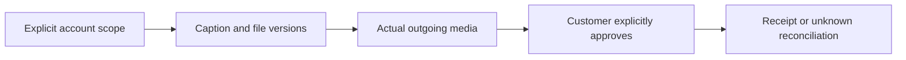
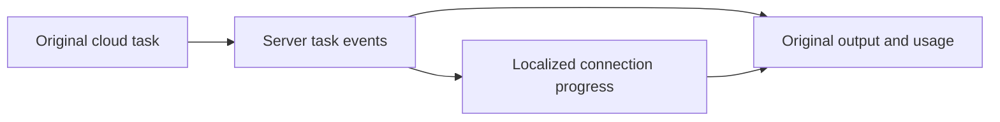
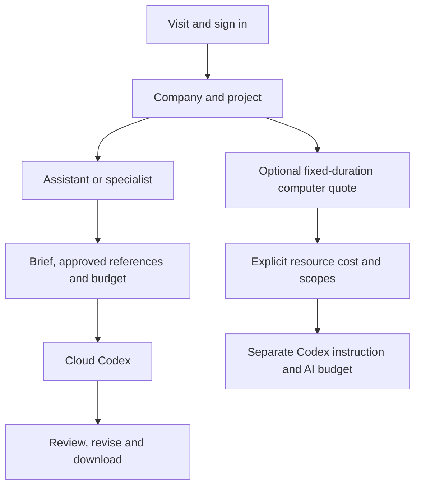

# Workmate · CopyPaste Enterprise Agent · web

[简体中文](README.md) · [English](README.en.md)

<!-- controlled-publications-stage125 -->


## Review actual media before publishing · Stage125

Connect and scope an account, set policy, select caption and exact source versions, review actual outgoing media, explicitly approve, then read the receipt. Accounts start disabled and the Agent can only prepare. Scope changes wait for fresh authority. Consent binds the current account, version and content digest.

Previews show actual image/video, versions and SHA-256; Instagram photos use the JPEG rendition. Expiry/revocation withdraws media. Unknown results allow read-only reconciliation or manual closure with a reason, without automatic resending or claiming failure. Lost responses use the original request.



Actual Web/Admin qualification passes 14/14 with recorded 375/768/1024/1440px layouts. Accounts are synthetic; native clients and complete professional quality require separate acceptance.


[Actual interaction MP4](assets/screenshots/workmate-publications-12-customer-preview-and-confirm.mp4)


<!-- runtime-startup-122 -->

## Codex startup and turn isolation · Stage 122

Work details now explain runtime.startup.retry as “Reconnecting your assistant”, with Traditional Chinese and English connection messages. Recovery retains the server task identity; the page does not resubmit paid work or create another budget.

All 20 existing client checks, type checking and the current build passed. The current Web OTP/PKCE pages also participated in the actual browser login to the packaged Desktop. Complete cross-client and production acceptance remains tracked in the requirements ledger.



[完整方案 / Behavior and verification](https://github.com/copypasteltd/workmate/blob/docs/docs/technical/122-codex-startup-and-turn-isolation.md)

## Product and boundaries

The first customers are existing marketing teams. Scope includes image/design/typography, video/effects, advertising and website analysis, SEO/GEO, repeated business processes and software development. The catalog has 18 candidates with exact Skill bindings; at least twelve individually qualified professional presets remain an acceptance requirement. The designer combines Codex, design Skills and company Image 2. Codex is the only Agent core. All AI uses the company's OpenAI-compatible backend; development currently uses authorized synthetic providers, not a claim of live professional quality.

React, TypeScript, Vite and React Router provide the cloud workspace. New users create a company or accept an invitation, select a project and available specialist, and provide explicit inputs. Missing dependencies request customer input and continuation keeps the original task. Project pages save, preview and publish guidance with exact brand/reference versions; histories retain versions, sources and costs without silently adopting later defaults.

## Repositories and execution

| Branch | Directory | Runtime |
| --- | --- | --- |
| [backend](https://github.com/copypasteltd/workmate/tree/backend) | `dev/copypaste-platform` | Fastify / PostgreSQL / cloud Codex |
| [web](https://github.com/copypasteltd/workmate/tree/web) | `dev/copypaste-web` | React / Vite / cloud workspace |
| [admin](https://github.com/copypasteltd/workmate/tree/admin) | `dev/copypaste-admin` | React / separate Admin identity |
| [desktop](https://github.com/copypasteltd/workmate/tree/desktop) | `dev/copypaste-desktop` | Electron / customer-local Codex |
| [extension](https://github.com/copypasteltd/workmate/tree/extension) | `dev/copypaste-extension` | Chrome MV3 / native Side Panel / cloud Codex |
| [delivery](https://github.com/copypasteltd/workmate/tree/delivery) | `dev/copypaste-delivery` | Native development, QA and publication tools |

The component is an independent Git repository. Keep the sibling layout and use the documented native tools; Docker, WSL and VMs are prohibited.

## User workflow

1. Visit the workspace, sign in/register, create a company or accept an invitation, then choose its project.
2. Choose the assistant or a specialist; supply the brief, approved files, brand, accounts and budget. Missing input continues the original session.
3. Confirm cloud Codex work; inspect durable status, questions, actual files and costs, then review/download or request a revision.
4. For an optional dedicated computer, review its plan, payer, duration, exact files and terminal/visual/Agent permissions.
5. Accept the expiring resource quote before reservation. Codex work has a separate instruction and AI-budget confirmation; entry alone buys nothing.



## Setup

### Local startup

Run these commands in the checked-out component. The complete workspace has the six independent repositories side by side under `dev/`; see the [branch and checkout layout](https://github.com/copypasteltd/workmate/blob/docs/docs/governance/04-git-branches-and-publication.md). Use Windows x64, Node.js >=22.14, npm/Git and the documented native PostgreSQL, FFmpeg/FFprobe and pinned Codex resources. Preserve existing local configuration/data. No Docker/WSL/VM is used.

```powershell
Set-Location 'D:/dev/copypasted/自有agent/dev/copypaste-web'
npm ci
npm run dev
```

Start the backend first, then open `http://localhost:4317`. Use `npm run build` for the static build. Sign in with email/OTP and select a workspace/project.

### Use the current workflow

1. Complete sign-in, company membership/invitation and project selection. Native clients use browser PKCE; Admin uses separate MFA identities. Expired/revoked credentials must not silently change identity or company.
2. Select a specialist and supply the brief and explicitly authorized references/accounts. Missing inputs request customer action. Project owners can save, preview and explicitly publish immutable shared guidance; publication starts no AI and grants no new permission.
3. New tasks pin their accepted role, Skill, brand, reference and guidance versions. Existing work, including an originally absent configuration, retains its original state. Source revocation hides unavailable bodies and blocks later use; history is not a permission bypass.
4. Confirm budget and any required operation/media approval. View genuine status, progress, exact deliverables and original receipts. Continue requested edits in the same task lineage. Unknown usage remains reserved for reconciliation; it is never silently free or blindly replayed.
5. Admin can independently manage authorized user/workspace status, inspect permitted consumption, preview/confirm manual fees or credits and activate scoped VIP/expiry. Balances, recorded payments, credits, budgets and VIP are separate records. Idempotent confirmation and audit prevent duplicate grants.

## Configuration and authority

The candidate requires the complete additive SQL001–132 history. API/worker schema admission rejects missing, changed or unsupported versions; recovery identity is fenced independently. Company model aliases, verified media capabilities, exact tariffs and provider secrets live on the backend. Unconfigured capabilities remain unavailable. Current development uses explicitly authorized synthetic data.

Web/Admin use `VITE_API_BASE` or their same-origin proxy; default development ports are 4317/4318. Desktop/Extension compile fixed `COPYPASTE_API_ORIGIN` and `COPYPASTE_WEB_ORIGIN` values; Desktop also pins `COPYPASTE_EXTENSION_ID`. HTTPS is required outside the allowed loopback-development case. No renderer or extension receives company provider secrets.

Files remain private unless the customer explicitly shares them. Authorization is checked on new requests, worker claims, tools and downloads. Source/body revocation is not bypassed by old history. Money uses exact HKD micros; budget, balance, credits, recorded payments and VIP are distinct. Stable request identities prevent duplicate grants, tasks and reservations. Unknown usage or physical cleanup retains its reconciliation hold.

## Preset roles and Skills

The catalog defines 18 professional presets plus the default assistant. Every run pins exact Skill versions and registered tools. These definitions are not a claim that twelve full professional qualifications have passed.

| ID | Role | Required Skill bindings |
| --- | --- | --- |
| R01 | Full-stack developer | `fullstack-engineering@1.0.0`, `frontend-implementation@1.0.0`, `backend-api@1.0.0`, `qa-testing@1.0.0`, `delivery-core@1.0.0` |
| R02 | Frontend developer | `frontend-implementation@1.0.0`, `ui-system@1.0.0`, `qa-testing@1.0.0`, `delivery-core@1.0.0` |
| R03 | Backend/API engineer | `backend-api@1.0.0`, `qa-testing@1.0.0`, `delivery-core@1.0.0` |
| R04 | Software QA engineer | `qa-testing@1.0.0`, `frontend-implementation@1.0.0`, `delivery-core@1.0.0` |
| R05 | UI/UX designer | `ux-research@1.0.0`, `ui-system@1.0.0`, `frontend-implementation@1.0.0`, `delivery-core@1.0.0` |
| R06 | Designer | `creative-direction@1.0.0`, `image-art-direction@1.0.0`, `image2-production@1.0.0`, `typography-layout@1.0.0`, `delivery-core@1.0.0` |
| R07 | Brand visual designer | `brand-system@1.1.0`, `image-art-direction@1.0.0`, `image2-production@1.0.0`, `typography-layout@1.0.0`, `delivery-core@1.0.0` |
| R08 | Ad creative designer | `ad-creative@1.0.0`, `image-art-direction@1.0.0`, `image2-production@1.0.0`, `typography-layout@1.0.0`, `delivery-core@1.0.0` |
| R09 | E-commerce designer | `ecommerce-visual@1.0.0`, `image-art-direction@1.0.0`, `image2-production@1.0.0`, `typography-layout@1.0.0`, `delivery-core@1.0.0` |
| R10 | Social content designer | `social-content@1.0.0`, `image2-production@1.0.0`, `typography-layout@1.0.0`, `delivery-core@1.0.0` |
| R11 | Illustration/IP designer | `illustration-ip@1.0.0`, `image-art-direction@1.0.0`, `image2-production@1.0.0`, `delivery-core@1.0.0` |
| R12 | Typography/layout designer | `typography-layout@1.0.0`, `image-art-direction@1.0.0`, `image2-production@1.0.0`, `delivery-core@1.0.0` |
| R13 | Presentation designer | `presentation-production@1.1.0`, `typography-layout@1.0.0`, `dataviz@1.1.0`, `delivery-core@1.0.0`, `deterministic-metrics@1.1.0` |
| R14 | Landing-page designer | `landing-page@1.0.0`, `ui-system@1.0.0`, `frontend-implementation@1.0.0`, `image2-production@1.0.0`, `delivery-core@1.0.0` |
| R15 | Information/data designer | `dataviz@1.1.0`, `deterministic-metrics@1.1.0`, `typography-layout@1.0.0`, `delivery-core@1.0.0` |
| R16 | Video/motion designer | `video-storyboard@1.0.0`, `template-video-composition@1.0.0`, `video-generation@1.1.0`, `speech-production@1.2.0`, `delivery-core@1.0.0` |
| R17 | Marketing analyst | `ads-analysis@1.1.0`, `deterministic-metrics@1.1.0`, `dataviz@1.1.0`, `delivery-core@1.0.0` |
| R18 | Workflow consultant | `workflow-design@1.1.0`, `workflow-execution@1.1.0`, `delivery-core@1.0.0` |

Designer combines Codex, design Skills and the company Image 2 capability. Optional R19 computer-operator work needs its own confirmed cloud lease and AI budget; native Desktop excludes it and retains customer-local execution.

[Role contract](https://github.com/copypasteltd/workmate/blob/backend/catalog/role-preset-catalog.json) · [Skill packages](https://github.com/copypasteltd/workmate/blob/backend/catalog/skill-packages.json)

## Optional dedicated cloud computer

Review an immutable plan/quote, payer, fixed duration, exact private files and separate terminal/visual/Agent scopes. Agent control defaults off. Explicit consent reserves resource cost; a later Codex instruction has a separate exact AI ceiling. No automatic renewal occurs. Stop/expiry/revocation fences subsequent actions; measured usage and verified cleanup settle, uncertainty reconciles.

The Linux physical-node source uses native Node22/systemd, cgroups, XFS project quotas and bounded desktop tools. No Linux host was started for the local Windows qualification. Build a fresh numbered source bundle with `node native/build-package.mjs NN` in Delivery; verify the externally pinned bundle digest before installation. The installer defaults to no service start and supports exact-UUID recovery.

## Actual interface and interaction

These are actual unretouched product screenshots and wall-clock recordings. Customer/model/media responses are explicit fixtures; native Codex, files, database and billing paths run where stated. Synthetic node pixels do not qualify an actual remote Linux desktop.


[Original MP4](assets/screenshots/workmate-12-dedicated-cloud-consent.mp4)

## Verification and delivery status

The integrated clients/tool inventory passed 338 checks: Web 20, Admin 9, Extension 63, Desktop 180, actual local Codex 22 and Delivery 44; corresponding types/builds passed. Native Desktop, Web/Admin and native Side Panel each have eight bounded actual UI checks, with 29 screenshots and five GIF/MP4 pairs. Complete backend success requires its final complete-inventory report; the checkpoint records actual outcomes and retains failed attempts.

Run this component’s `npm run typecheck`, `npm run build` and documented test scripts with installed native prerequisites. Delivery’s default `npm test` covers native-surface integrity; the complete Delivery unit inventory is `node --test --test-concurrency=1 tests/*.test.mjs`. `node scripts/qualify-delivered-clients-v1.mjs NN` uses a fresh two-digit attempt and the sibling layout for all integrated client inventories. Candidate-specific historical runners preserve their original directory requirements.

Full product acceptance remains open: twelve professional-role qualifications, complete permissions/business/compatibility matrices, live service quality, signed installers/updates, production load/restore and customer business acceptance. Use the numbered inventory rather than test counts as a completion claim. Owned browsers/processes are closed; user resources are preserved.

[Implementation / 方案](https://github.com/copypasteltd/workmate/blob/docs/docs/technical/121-dedicated-cloud-and-client-execution.md) · [Checkpoint / 证据](https://github.com/copypasteltd/workmate/blob/docs/docs/quality/dedicated-cloud-checkpoint.json) · [Open requirements / 未完成项](https://github.com/copypasteltd/workmate/blob/docs/docs/quality/remaining-work-2026-10-29.md) · [Branch layout / 检出布局](https://github.com/copypasteltd/workmate/blob/docs/docs/governance/04-git-branches-and-publication.md)
