# CopyPaste Desktop

[简体中文](README.md) · Windows enterprise Agent client · 0.5.0

An independent Electron repository bundling the Web workspace and a narrow local bridge. It supports system-browser login, Windows user-level encrypted credentials, explicit folder grants, platform-signed local file dispatch and Chrome Native Messaging. Codex execution remains on the company platform; the client never connects directly to model providers.


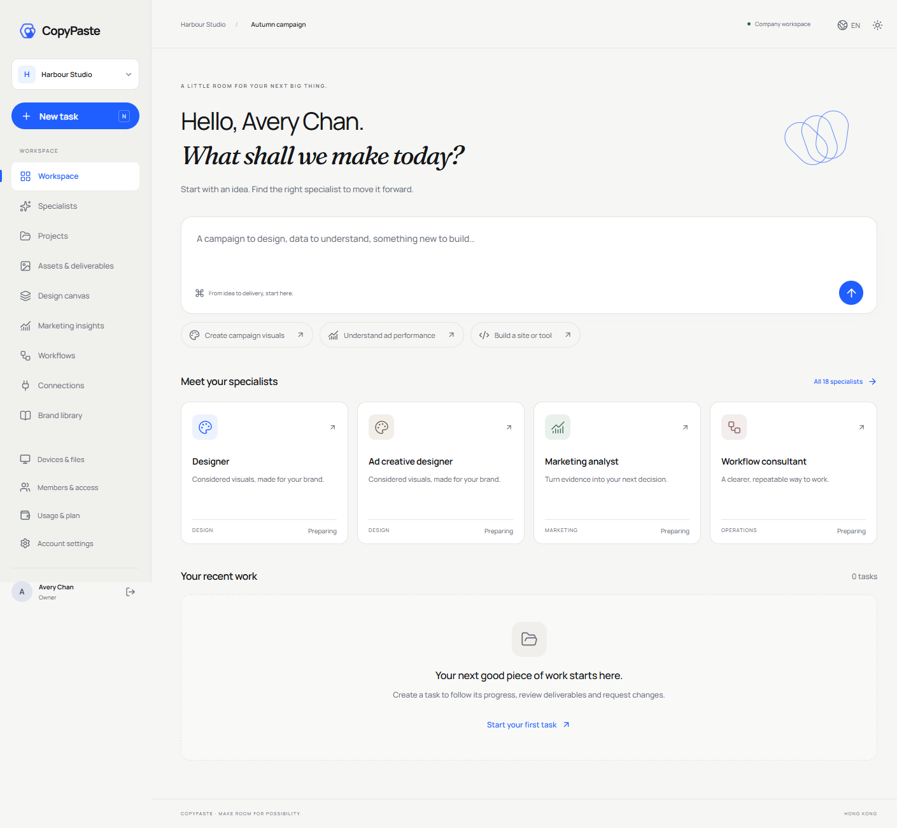
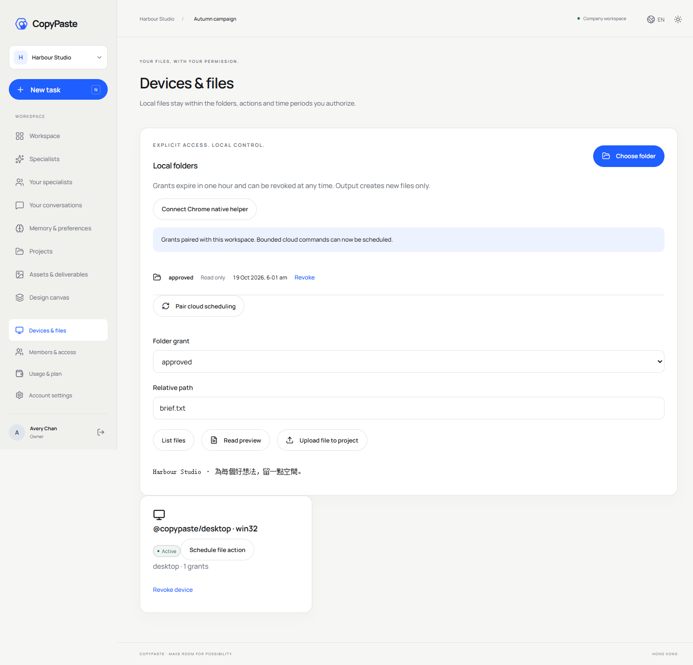

## Frameless window

The main window has no native frame/title bar or Electron default application menu, including after Alt. A 40px CopyPaste title bar provides a drag region and bilingual minimize, maximize/restore and close controls using the existing light/dark tokens. Content and modals start below it. Eight invisible edge/corner handles resize within a minimum of 800×600; the bottom-right handle also supports arrow keys (10px) and Shift+arrows (50px). System file and permission dialogs keep their native UI.

The isolated preload creates this shell outside the Web renderer snapshot, so explicit renderer synchronization preserves it. Main-process IPC checks both the owning webContents and main frame, permits only fixed window actions and bounded resize, and retains sandbox/context isolation with Node integration disabled.

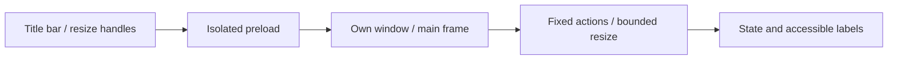


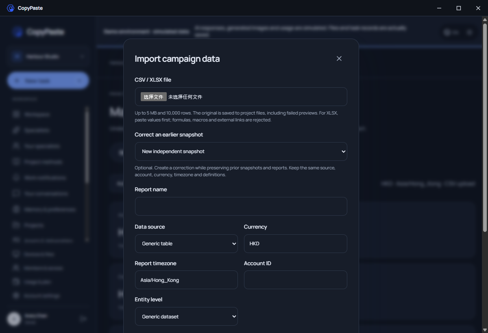

The current-source preview is under `release/frameless/`: `CopyPaste-0.5.0-x64-Setup.exe`, `CopyPaste-0.5.0-x64-Portable.exe` and `win-unpacked/CopyPaste.exe`. These unsigned previews use localhost origins. Earlier frameless artifacts remain byte-for-byte in `release/frameless-stage30/`, alongside the separately preserved original complete release. Rebuild with `npm run build` followed by `node node_modules/electron-builder/cli.js --win portable nsis --config.directories.output=release/frameless --publish never`.

The 2026-10-20 review fixed successful browser sign-in leaving Desktop on its login page: the local API policy now permits the read-only `/v1/session/context` operation and existing workspace-creation, member, analysis-evidence and report operations. Credential exchange remains in the main process; renderer access to credential/Admin endpoints and normalized path escapes is denied. All 25 Desktop tests and type checks pass. Delivery binds native QA to the actual client runtime, source, installer and extension bytes, preventing a historical green report from qualifying a changed package. Setup/Portable installation, uninstall and the full native authentication matrix remain separate acceptance work.

Run `npm run qa:native-surfaces` in the delivery repository for real window/menu/Alt controls, pointer/keyboard minimum-size enforcement, cross-window IPC denial, browser PKCE, modal clearance and themes/languages. Set `COPYPASTE_DESKTOP_EXECUTABLE` to the unpacked preview EXE for packaged verification; results are in `evidence/native-surfaces.json`. Signed updates, uninstall and the complete display/DPI matrix remain pending.

## Run and package

Windows x64, Node.js 22.14+ and npm are required. macOS/Linux packages have not been built or qualified. Start platform and Web first:

```powershell
npm ci
npm run typecheck
npm test
npm run build
npm start
```

Public `deployment.json` contains API/Web origins and the official extension ID. `COPYPASTE_API_ORIGIN` / `COPYPASTE_WEB_ORIGIN` can override at build or runtime. Only HTTPS or localhost is accepted. Delivered binaries target local demonstration at `localhost:4310/4317`; rebuild with company cloud origins for deployment.

```powershell
npm run package
```

Outputs include `release/CopyPaste-0.5.0-x64-Setup.exe`, `release/CopyPaste-0.5.0-x64-Portable.exe` and `release/win-unpacked/CopyPaste.exe`. `package:dir` produces only the unpacked app for QA. Packages are unsigned and are not store-published. Docker, WSL and virtualization are prohibited.

## Identity and local files

```mermaid
flowchart LR
  D[Launch Desktop] --> B[System browser and PKCE]
  B --> E[Email verification and consent]
  E --> L[Single-use loopback callback]
  L --> V[DPAPI-protected local session]
  V --> W[Workspace and cloud deliverables]
  W --> F[Native folder selection]
  F --> G[One-hour read-only grant]
  G --> P[Device pairing and pinned public key]
  P --> C[Verify signature, nonce and expiry]
  C --> R[Limited file execution and result]
```

State, PKCE, exact loopback callbacks and single-use codes protect sign-in. Short-lived access tokens use rotating refresh families. Logout revokes the platform session and local folder grants. Windows DPAPI CurrentUser wraps a local profile key; AES-256-GCM authenticates encrypted state. Credentials never persist as plaintext. The key does not depend on concurrent Chromium profiles, so Desktop and native-host processes share grants safely. A fixed native Windows PowerShell/.NET helper invokes DPAPI using stdin for secret bytes; it never executes customer commands.

Normal user state is `%APPDATA%/CopyPaste/`; QA uses isolated `COPYPASTE_USER_DATA`. Installed application user state is distinct from source/build artifacts, which remain in this repository.

Roots stay local. Grants default to list/read, require separate consent for create-only writes, expire after one hour and are limited to 20. Reads are limited to 5 MB, text creates to 2 MB and listings to 500 items. Traversal, links/junctions, ADS, Windows device names, trailing dots/spaces and overwrites are rejected. Revocation/expiry is checked before journal replay; journal size/count are bounded and cross-process writes are serialized.

Downloads use the company API and native save dialog with create-only semantics. Uploads require chosen files or authorized folders. Commands verify Ed25519 signatures, pinned keys, nonces and expiry. Results currently use native bearer tokens plus nonce, not client-signed result envelopes.

## Specialists and conversations

Version 0.2.0 bundles persistent specialists, private conversations, five memory scopes and ask/plan/execute modes. Notes persist through the limited native API bridge and survive renderer reloads. Desktop and Web share platform user/permission rules. Private task outputs become shared project copies through explicit publication.

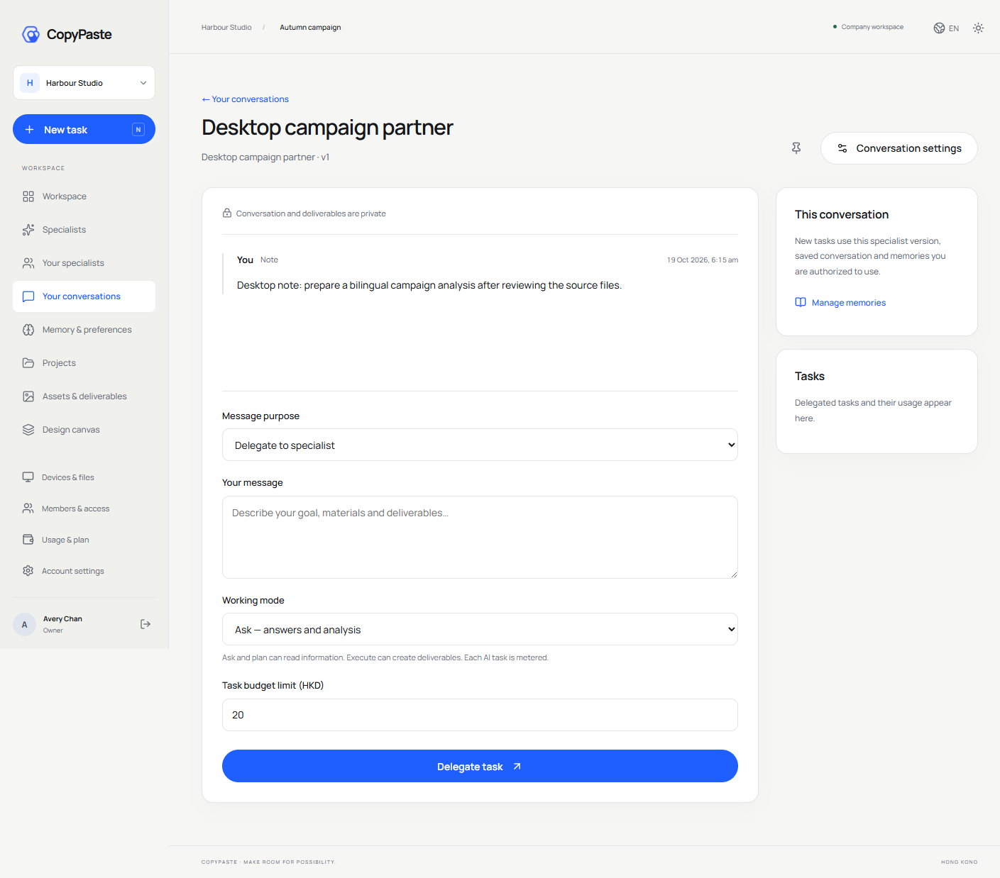

## Chrome helper

Install Setup to a stable path, then explicitly connect the Chrome helper from the device page. This writes the current user's `HKCU/Software/Google/Chrome/NativeMessagingHosts/hk.copypaste.agent` registration and only permits the configured official extension. The extension separately requests nativeMessaging and individual folder grants. Use Setup for persistent registration; portable paths may change.

Trusted deployment staff may also use:

```powershell
npm run native:register -- fffkcnmfdhahlnifgdilabheppkgnlok 'C:\YourStableInstall\CopyPaste.exe'
```

Point registration only at a stable trusted executable. QA does not overwrite existing user registry settings. The helper implements Chrome length-prefixed JSON with responses capped at 900 KB.

## Independent renderer

Committed `renderer/` is a self-contained Web source snapshot. Normal builds do not require a neighboring Web checkout. Explicit refresh:

```powershell
npm run renderer:sync -- 'D:\path\to\copypaste-web'
npm run build
```

`renderer-source.json` records provenance and hashes. Context isolation and sandboxing are enabled; Node integration and webviews are disabled. CSP prevents direct renderer networking; a limited IPC API handles requests. Extra permissions, arbitrary external origins and navigation are denied. Native-host mode creates no browser window.

## Validation and remaining scope

`npm test` covers path confinement, revocation, replay, create-only behavior, fixed API origin and actual Windows DPAPI cross-process decryption/tamper rejection. Delivery `qa:desktop` uses the packaged application for real OTP/PKCE, specialist creation/private-note persistence, encrypted credentials, folder access, signed cloud dispatch and native-host framing. Test dialogs select fixture paths; they do not authorize real user folders. `qa:packaged` separately checks packaging, version and launch.

The company AI gateway and external advertising platforms still require live qualification. Arbitrary desktop UI control, customer shell execution, full AI video/speech are not implemented. This release does not certify every long-term requirement. QA closes its browser/application processes in finally. See [third-party notices](THIRD_PARTY_NOTICES.md); master documents remain under the delivery root's `docs/`.

Chrome Host launches the bundled Node-mode script through `resources/native-host.cmd`; its source is `src/native-host.ts`. This keeps Chrome's binary stdin/stdout independent of the GUI process.

## Cloud workflow schedules

Version 0.4.0 includes the matching calendar interface: daily/weekly frequency, IANA zones, budget preview, explicit authorization, history and pause/resume/retire. Requests use the native bearer bridge with the same platform checks. Cloud execution continues after the app closes. These calendars do not grant unconfirmed local-folder access. Delivery `qa:desktop` creates, displays and retires a calendar in the actual packaged application.

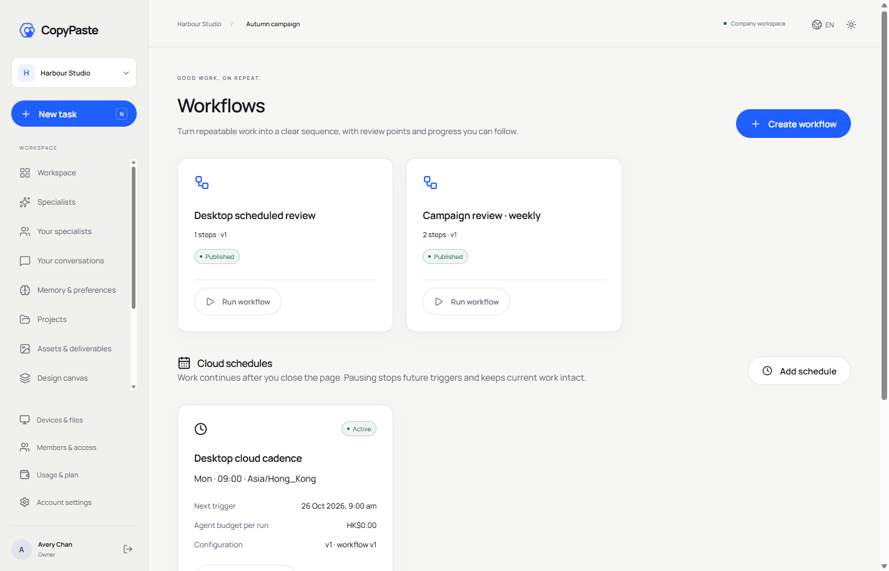

## 0.5.0 company identity and unified sign-in

OIDC uses code + PKCE S256, signature verification, state/nonce and a fixed callback. An existing registered account and active workspace membership are required. First binding requires a separate CopyPaste work-email code; domains never auto-enroll users. Configuration changes, disablement or unlinking revoke all linked users’ CopyPaste browser/native/refresh sessions and prior execution authorization. Administrator email and TOTP remain separate.

Choose company identity in the system browser and explicitly authorize return. The real loopback PKCE callback stores independent native credentials in DPAPI-protected local storage. Account settings show connected identities. Disabling the company connection invalidates existing native access/refresh credentials and outstanding codes; there is no separate local sign-in bypass.

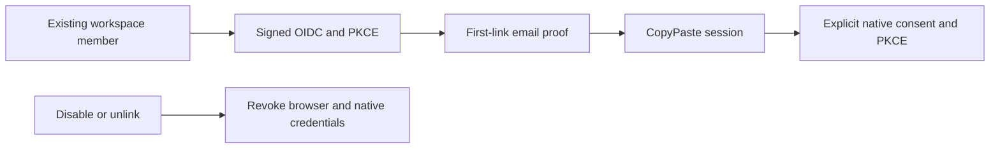


## Native file-channel repairs in progress

The renderer inherits resumable uploads, synthetic-mode labels, deletion progress and retention expiry. IPC forwards stable Idempotency-Key values. Downloads ask for a destination first, stream to a temporary file, validate size and SHA-256, refuse existing destinations and clean up after failure, with a 1 GiB limit. JSON event IPC drains pages using a cursor.

Native source validation is recorded below. Windows installers have not been rebuilt for these changes; packaged regression remains pending. Existing 0.5.0 installers retain their original behavior.

## Current source validation

Native source QA passes system-browser PKCE, stable upload idempotency, an actual 29 MiB part upload, streamed download with matching digest, existing-file protection and browsing the shared cloud tree over the native bridge. Owned browser and Electron instances close after the run.

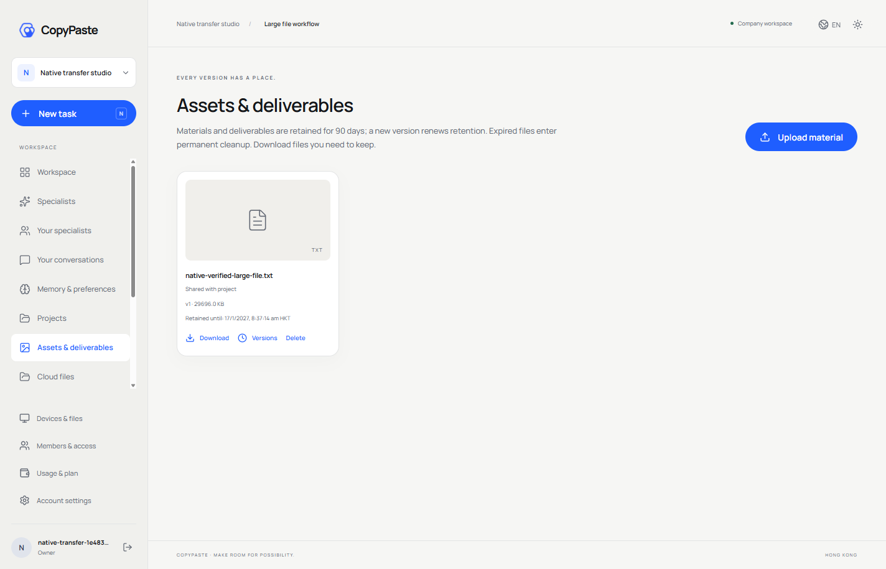
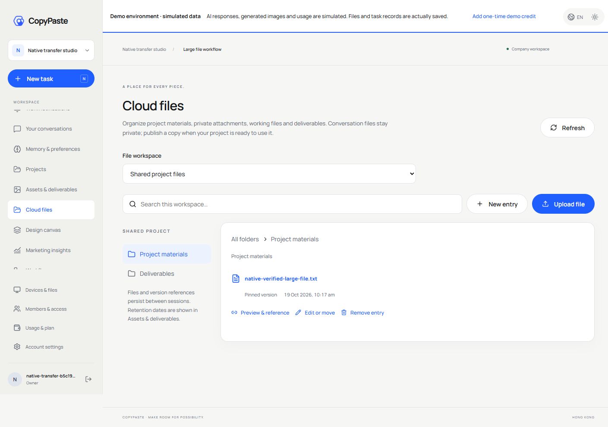

This evidence covers current source execution. Historical 0.5.0 installers have not been rebuilt and do not contain these changes.

## Project methods (current source snapshot)

Project methods now have exact installation and specialist/task bindings. Ordinary disable affects new work; uninstall and permanent security revocation block subsequent calls, including old tasks. Reinstallation creates a new identity and requires explicit adoption by a new specialist version. Current plan access is checked before tools and final output; measured usage settles against the original reservation.

Platform regression: **185/185**. `npm run qa:skills` in the delivery repository passed three browser groups; 31 captured HTTP request/response payloads passed the strict design schemas. Custom package review/publication and complete live-role qualification remain pending. Existing 0.5.0 installers are historical.

## Default assistant and inbox (current source)

The synchronized renderer supports direct text-assistant use, private conversations and notifications. Eight source Electron journey groups cover native PKCE, verified 29 MiB transfers/no overwrite, cloud files, a real Codex synthetic text deliverable and original-task navigation. Only the two public configuration/content reads work before login, allowing the demo notice to appear; private calls still fail while signed out and writes still require native credentials.

The simulated-data notice persists before and after sign-in. Four native tests pass. Owned browser/Electron instances are closed; historical installers do not include this increment.

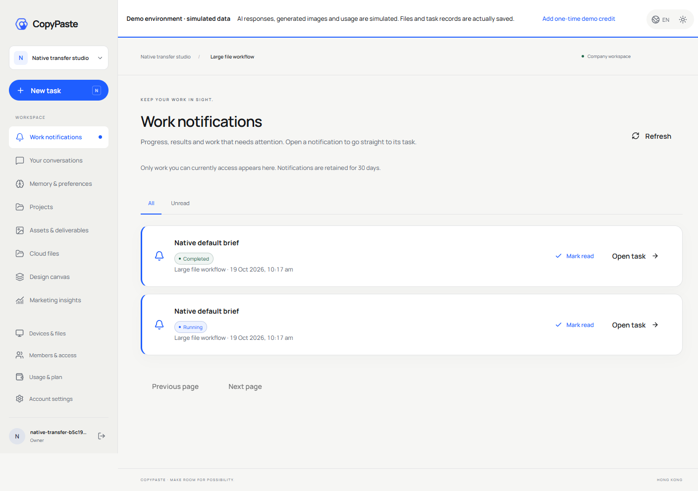

## Initial input checkpoint (current source)

The synchronized renderer keeps file/connection requests in the original conversation. Choose a current resource explicitly, or upload through the native bridge; resolving the request resumes the same task and budget hold. The eighth source Electron journey selects the actual 29 MiB upload, verifies no model execution while waiting and receives a result through real Codex with synthetic model data. Four native unit tests also pass. The renderer snapshot records all 41 source files.

This does not qualify paid-step continuation or replace historical installers.

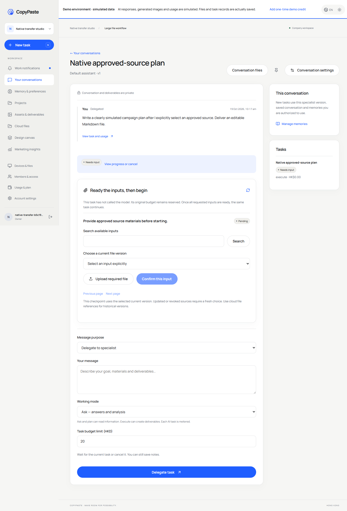
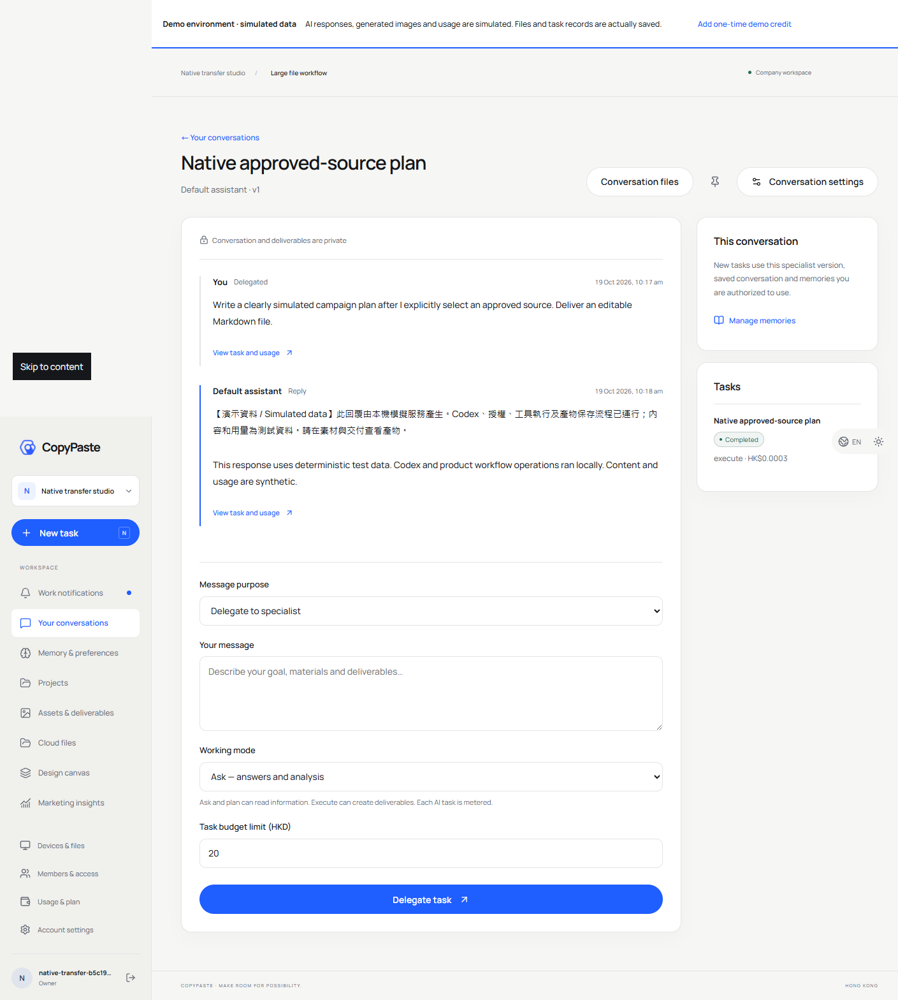

## Capacity waits (current source)

The renderer snapshot includes shared-slot notices and usage explanations. Server-side workspace, current-user and capability limits preserve the original queued task and hold, then resume automatically. Source builds and the existing eight native journeys are checked separately; historical installers do not include this increment.

## Native template selection and tenant isolation

The current renderer snapshot includes the persisted template directory, preflight and instance flow. The main process validates tenant UUIDs and forwards only to the fixed product API with protected credentials. Missing, foreign and malformed tenant identities are rejected. After real PKCE sign-in, a Desktop-created specialist is visible as the same persisted record on Web, with no implicit AI task or charge.

`qa:agent-templates` verifies current-source Electron with an isolated profile and closes its application and browser. All 18 professional presets still await live qualification. This screenshot does not mean historical 0.5.0 installers were rebuilt.

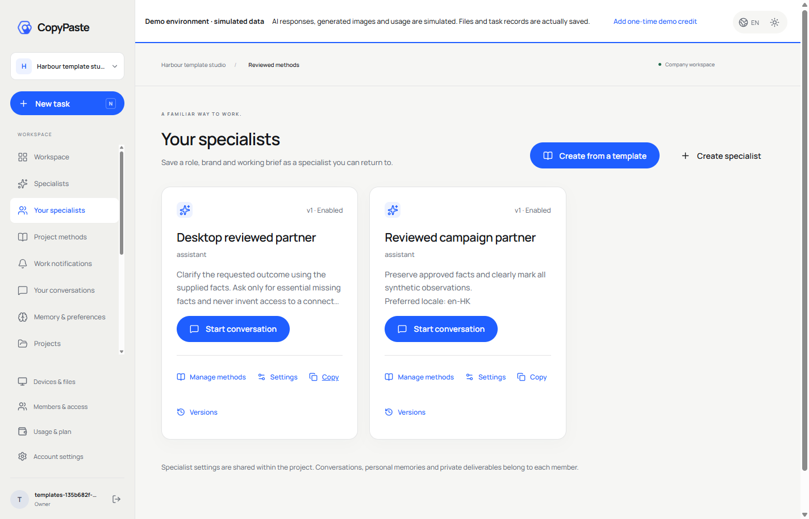

## Native PDF export and save (current source)

The synchronized canvas exports single-page raster review PDFs while retaining editable sources. Real PKCE sign-in precedes authenticated main-process requests and the existing streamed save to an explicitly selected destination. The new journey saves real PDF bytes and matches their hash to the immutable server version, then closes its owned application. Historical installers have not been rebuilt.


## Marketing CSV, exact metrics and provenance (current source)

Preview and confirm the account, currency, timezone, entity level, attribution and conversion definitions before import. Generic CSV and candidate Google/Meta-style headers support explicit column mapping. Actual UTF-8/BOM source bytes, SHA-256, definitions and computed results are retained. Duplicate requests, including a lost accepted response, return one project snapshot. Quarantine prevents reimport bypass. Unknown conversions stay unknown; exact decimal CTR/CPC/CPM/CVR/CPA/ROAS use aggregate totals and historical results are frozen.

Download the original CSV, normalized CSV, JSON calculation report with 11 evidence references and an actual SVG chart. Data dates are shown; upload time is not presented as the platform extraction cutoff. Official account sync, cross-platform conversion deduplication, FX and complete AI narrative acceptance remain pending. The marketing role is still unqualified. Authorized model dependencies are simulated; database and file behavior are real. Historical installers have not been rebuilt.

The independent renderer snapshot includes the same flow. `qa:marketing-analytics` uses real PKCE and protected IPC for a Meta-style import and native CSV save; local bytes match the source. Owned Electron/browser resources close in finally. Current source builds, renderer type checks and all four native unit tests pass.

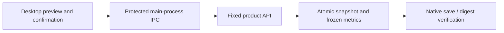

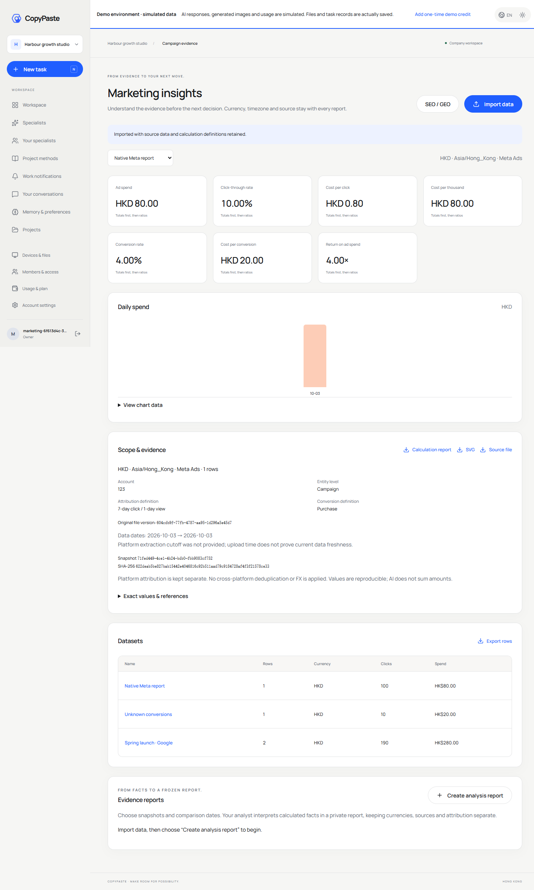

## Private AnalysisSpec reports (current source)

Select saved snapshots, a business question, current/comparison dates, metrics, dimensions and a maximum HKD budget in Marketing insights. Preview neither calls a model nor reserves credit. Explicit confirmation atomically creates a private Codex task, frozen calculations/evidence and one reservation. Sources, accounts, currencies, timezones and attribution stay independent; identical facts deduplicate, conflicts reject, and zero/missing comparison values retain reasons. Retrying a lost accepted response returns the same report.

Real Codex reads paginated frozen evidence. The server validates evidence placeholders and numeric literals before publishing an immutable HTML asset; JSON preserves full calculations. Natural-language meaning and professional quality still require acceptance. Model dependencies are explicitly simulated. Source quarantine/erasure and project revocation block reads and downloads. All 102 complete acceptance cases, official connectors, live-role qualification and production release remain pending. Historical installers have not been rebuilt.

The independent renderer snapshot now records **41** source digests and builds without a sibling Web checkout. Actual Electron QA covers browser PKCE, protected IPC, report reads, HashRouter navigation to the original task and native HTML saving. Saved bytes match the Web download SHA-256. Owned application/browser resources close in finally. Builds, renderer type checks and all four native unit tests pass.

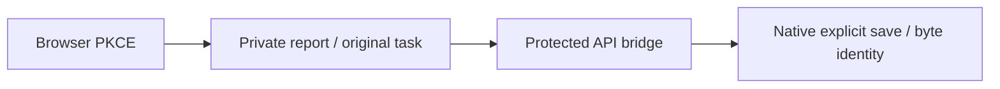

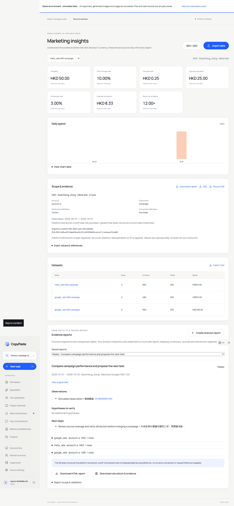

## File-backed CSV/XLSX and correction history (current source)

Marketing inputs are uploaded as immutable shared project-file versions before reviewing the sheet, header row, mapping and account definitions. Google/Meta use canonical `POST /v1/dataset-imports`; generic tables use the compatible nested endpoint. Preview calls no model and reserves no credit. Duplicate content and retries after a lost accepted reply reuse the snapshot. Original CSV/XLSX downloads verify actual bytes and SHA-256.

The bounded read-only XLSX parser accepts up to 5,000,000 bytes, 50 worksheets, 100 columns and 10,000 data rows. Multiple visible sheets require explicit selection; header rows range from 1 to 100. Shared/inline strings, XML Unicode references, exact decimals and 1900/1904 dates are supported. Money inputs allow six decimal places; frozen metric values retain eight. Formulas, including cached results, macros, external links, encrypted files and merged data cells are rejected. Errors identify actual worksheet cells. The UI explains that a failed preview still retains the explicitly uploaded original project file.

Corrections create new immutable snapshots and a complete ancestor chain; prior metrics and reports retain their original values. AnalysisSpec rejects selecting an ancestor with its correction before creating a task or budget hold. Source quarantine/erasure prevents dependent data, reports and downloads. Recovery closes only unclaimed unavailable tasks and releases unused holds; started or uncertain charges keep reconciliation rules. Private files require explicit publication as a shared copy first.

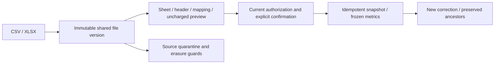

The full platform regression passes **185/185**; strict captured HTTP samples pass **31/31**. Four file-import and six existing CSV Web/source Electron groups pass, along with native type checks and four unit tests. Model/media dependencies are authorized synthetic data; database, Codex, files and authorization are real. All 102 complete acceptance cases, the complete official export matrix, live connectors, professional qualification and production release remain pending. Historical 0.5.0 installers have not been rebuilt. See master `docs/technical/29-file-imports-and-correction-lineage.md` for detailed limits.

The independent renderer snapshot records 41 source digests. The main process permits only the exact POST import route while retaining fixed-origin, tenant and credential checks. Actual Electron QA completes PKCE, upload parts, Meta XLSX import and a byte-identical native download.

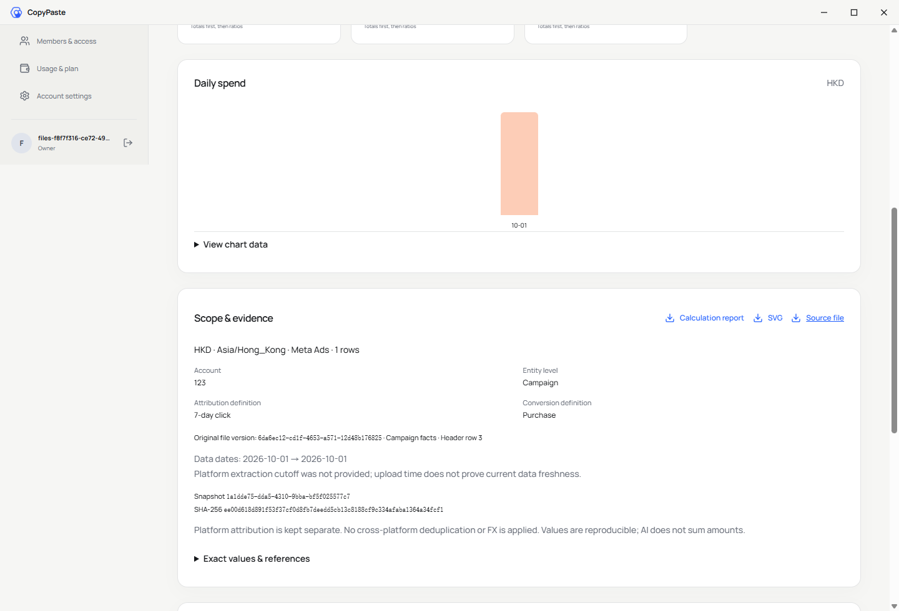

Task details inside the frameless window now offer initial queued pause/resume through the native API bridge, preserving the original task and reservation. Delivery `qa:task-controls` verifies browser PKCE, controls and cancellation releases. This is a source change; previous `release/frameless/` previews retain their recorded commits/hashes and do not yet include these controls. Paid-step continuation remains unfinished.

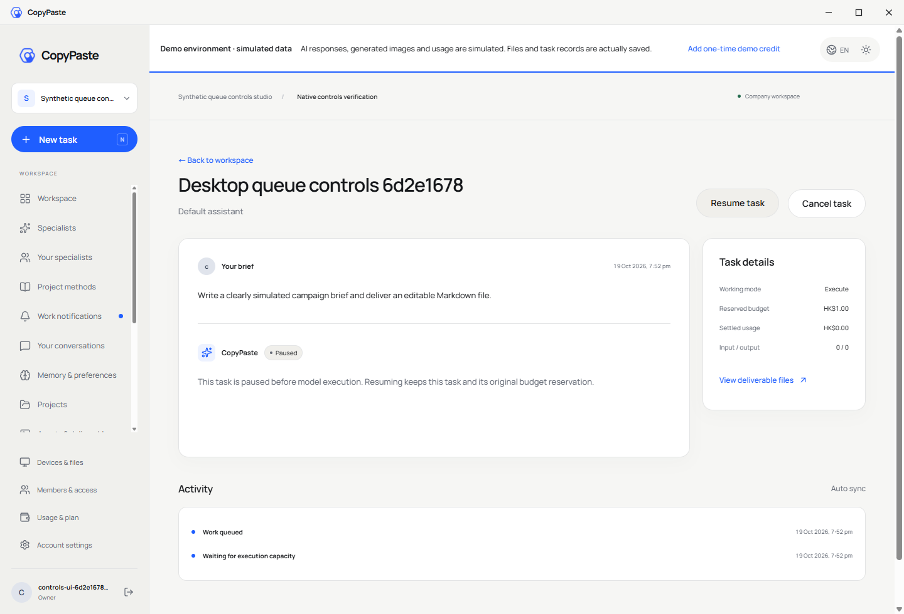

## Session races and local sign-out

The native session controller fences late login/refresh writes, coalesces concurrent refreshes and prevents an obsolete 401 from clearing a later account. Definitive rejection clears credentials; temporary failures preserve recoverable state. Sign-out clears encrypted credentials, revokes local folder grants/cached results and revokes the server family through refresh proof, including after access expiry. Offline feedback explicitly says remote revocation is unconfirmed and can be completed from another signed-in device. Account replacement also resets previous folder/device associations.

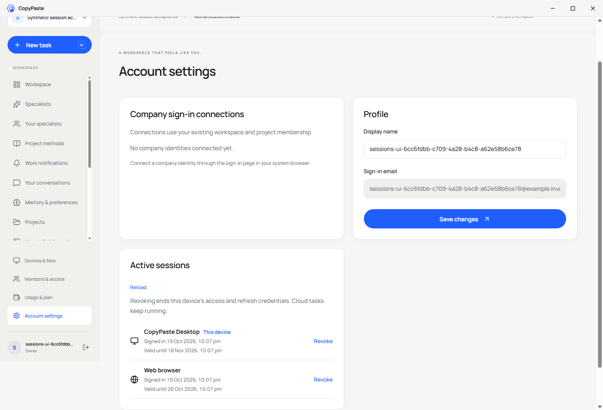
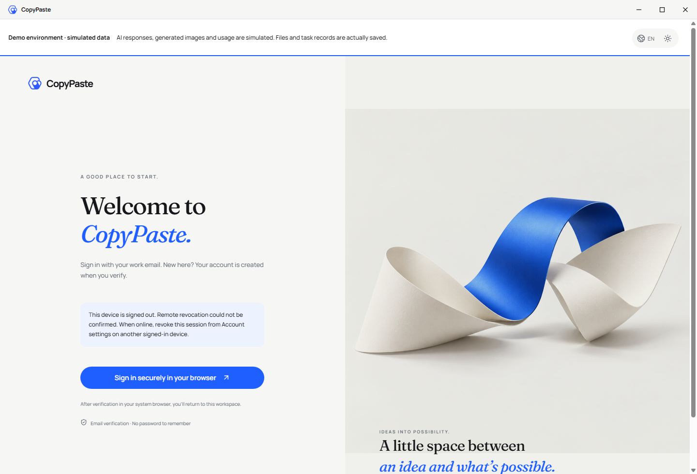

This increment delivers source/builds. Historical frameless preview installers retain their recorded commits/hashes and do not include this session repair. `npm test` covers ten session race/persistence groups and existing native capabilities; delivery `qa:sessions` exercises actual Electron/PKCE and remote revocation.

## Membership suspension renderer source

The renderer explicitly synchronizes the Web suspension notice and builds with recorded source hashes. Frameless native controls and the removed Electron application menu remain enforced. Installers/portable packages were not rebuilt for this increment, and the current complete native authentication/page matrix remains unproven.
