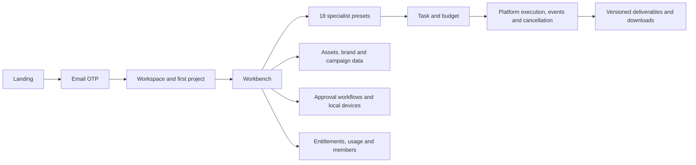

# CopyPaste Web

[简体中文](README.md) · Enterprise cloud workspace · 0.1.0

A Web client for Hong Kong enterprise marketing teams, using CopyPaste's warm white, ink and blue palette, serif display typography, Traditional Chinese/English and light/dark/system themes. Customer deliverables retain the customer's brand. This repository builds independently and obtains data from the platform API.


## Run and deploy

Requires Node.js 22.14+. Start the platform database/API first, then:

```powershell
npm ci
npm run dev
```

Visit `http://localhost:4317`. Vite proxies `/v1` and `/health` to `127.0.0.1:4310`. All tools run natively; Docker, WSL and virtualization are prohibited.

```powershell
npm run typecheck
npm run build
npm run preview
```

Deploy `dist/` as static assets over HTTPS, preferably reverse-proxying `/v1` on the Web origin to the API. SPA pages fall back to `index.html`; API paths must not. Optional build-time `VITE_API_BASE` is documented in `.env.example`. If using a separate API origin, configure exact `WEB_ORIGIN`, cookie and CORS rules. Never place AI keys in public `VITE_*` variables.

## Customer journey



New customers verify a work email, create their organization and first project, then enter the workbench. Returning customers select an existing workspace/project. Invitations bind email and project. Expired/invalid codes, throttling, expired sessions, inaccessible resources and unavailable models surface real API errors.

Development OTPs are available only in platform `.data/mailbox/`; production uses SMTP. No default user credentials exist. Native authorization reuses this identity through an independent PKCE flow rather than converting browser cookies to bearer tokens.

## Pages

| Area           | Working behavior                                                                                    |
| -------------- | --------------------------------------------------------------------------------------------------- |
| Workbench      | Project selection, specialists, recent tasks, published help/announcements and service availability |
| Specialists    | 18 presets with bound Skills, inputs, outputs and current availability                              |
| Projects/tasks | Project creation, budgeted tasks, status/events/output and cancellation                             |
| Creative       | Editable JSON text/shape/pinned-PNG layers, versioned edits, SVG/PNG/template MP4 export            |
| Assets         | Explicit uploads, thumbnails, immutable versions, downloads, rename and expiring/revocable shares   |
| Analytics      | CSV ingestion, exact aggregate metrics, dataset detail and submitted-HTML SEO checks                |
| Workflows      | Bounded analytics/Codex/approval steps, publish/run/approve                                         |
| Brand          | Colors, tone, fonts and approved copy                                                               |
| Members        | Invitations, organization roles, project scope, updates/removal and last-owner protection           |
| Connections    | Google Ads/GA4/Search Console/Meta OAuth and explicit-account report synchronization                |
| Devices        | Paired devices, expiring folder grants, explicit local command dispatch and results                 |
| Usage/settings | Separate wallet and effective plan limits, charges, language/theme/profile                          |


## Product and authorization rules

The API is authoritative for access, billing and entitlements. Hidden controls are not authorization. VIP and wallet balances are separate; personal/workspace entitlements use actual validity timestamps. Unconfigured company AI is explicitly unavailable. Installed presets are not proof of qualified live business work.

All AI requests run through the platform and company internal gateway. This client holds no model keys. Browsers do not gain silent disk access: files require a user picker, and persistent folder access requires the Desktop native bridge with individual grants.

`api.ts` uses credentialed requests/CSRF on Web and narrow IPC in the Desktop snapshot. Local storage contains theme/locale preferences, not authentication or model secrets. Published help/announcements render as text rather than injected HTML.

## Verification and maintenance

`npm test` performs type checking. The delivery repository's `npm run qa:web` exercises actual email login/onboarding, 13 workspace modules, 16 Admin pages, dark/light and mobile viewports. Screenshots use real UI/API/PostgreSQL with fictional fixture businesses and `.invalid` emails.

Routes/pages live in `src/main.tsx`; context handles identity/workspace/theme/locale; `api.ts` owns transport; `native-files.tsx` is the native-file panel; `ui.tsx` and `style.css` are self-contained UI foundations. Desktop imports an explicit renderer snapshot rather than requiring sibling source during builds.

Company gateway, SMTP, advertising OAuth and S3 still require deployment configuration and live qualification. SSO, cloud schedules, parallel specialist teams, collaborative editing and full AI video/speech are unfinished. Polling is not full planned SSE. Submitted-HTML SEO checks do not promise GEO rankings.

Self-hosted Manrope/Fraunces, Lucide icons and the generated blue-fold artwork are documented in [third-party notices](THIRD_PARTY_NOTICES.md). Master requirements remain in the delivery root's `docs/`.
