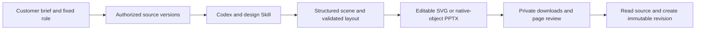
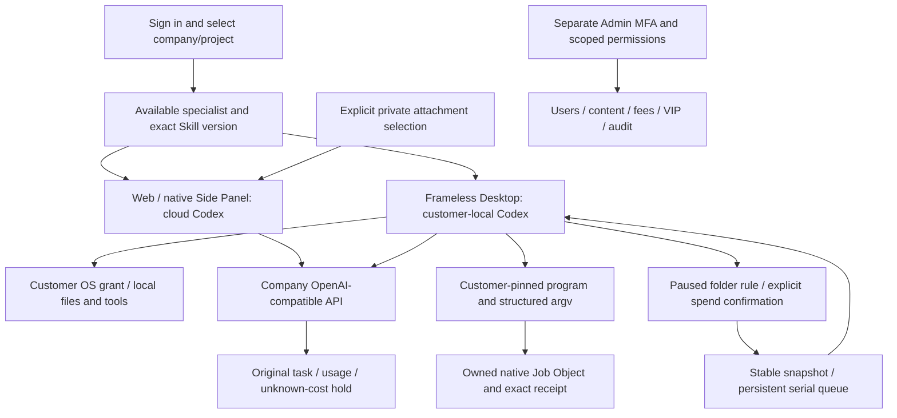
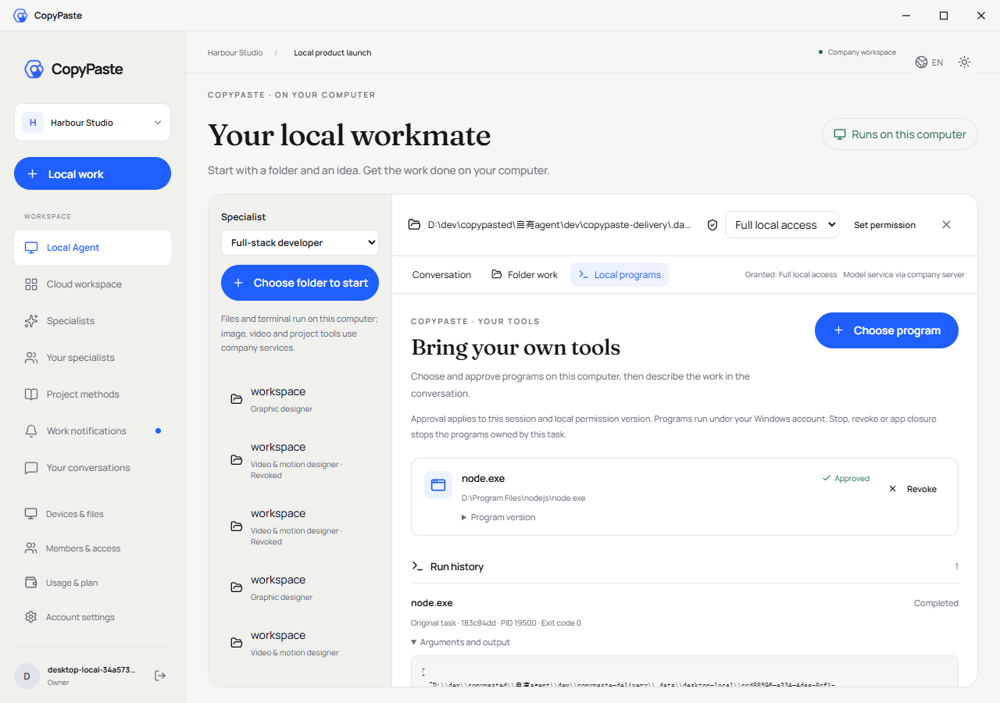
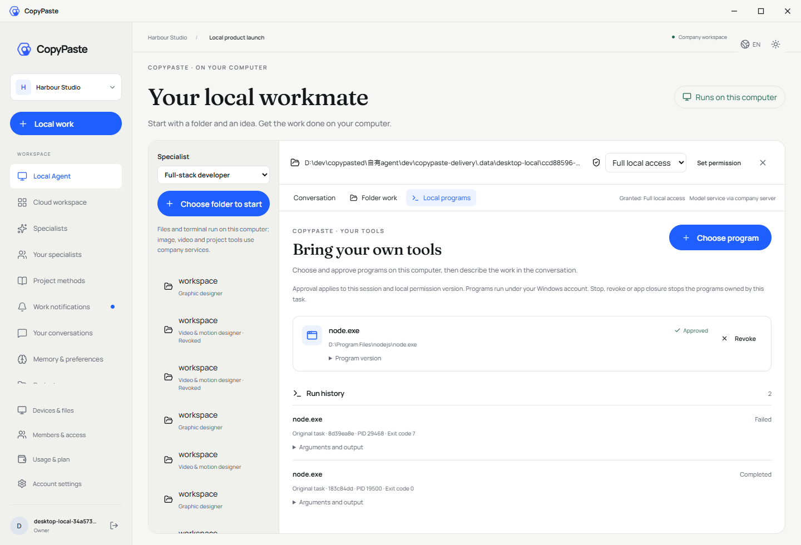
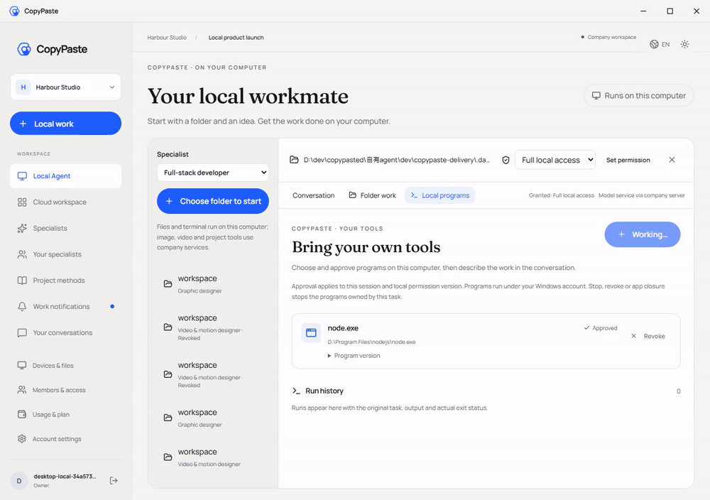

# Workmate · CopyPaste Enterprise Agent · desktop

<!-- editable-design-stage92 -->

## Editable brand and presentation delivery

Stage 92 connects actual brand-vector and presentation tools. Brand delivery includes editable and outlined SVG. Presentations include PPTX with native editable text, shapes, paths and evidence bars, plus per-page SVG/PNG, PDF/HTML reviews, exact evidence CSV, immutable source, manifest and a ZIP with the licensed font. Ninety-three relevant backend tests and eight actual browser checks pass. Codex, permissions, files and financial receipts are real; model/content are explicitly synthetic.

1. Create a brand/presentation specialist from the role directory, confirm the audience, exact copy, sources and brand, then explicitly select Execute and a budget. Ask/Plan cannot generate files.
2. Download actual editable files and the ZIP from Assets & deliverables. Presentations require slides_build followed by slides_render on the exact returned source version/hash; a prepared source is not delivered work.
3. Review all pages in the actual offline HTML or PDF. Request a correction against the saved source. New versions retain old files; retries reuse original tool receipts. Native rendering adds no AI charge.
4. Chart layers select actual deterministic evidence IDs, keeping currency/account/metric/attribution/date scopes separate. A brand-bound specialist must retain its exact brand version and authorized channel/locale; omission or replacement is rejected. Private source permissions and quarantine apply to every derivative.



Desktop keeps Codex on the customer computer. The 1.1.0 specialists expose these company file tools through the authenticated native bridge; source revision access additionally requires the same device, native sign-in family, local session and workspace. Another local session cannot read its private source. Backend checks exercise actual native authorization, schema admission, tool delivery and source revisions; the new recordings below show the Web workflow and downloaded source-based reviews, not a new Desktop UI recording.

Apply **SQL106** and **SQL107** after SQL001–105 and install the pinned dependencies. The second migration binds private design derivatives to exact sources without changing explicit publication authority. Brand/presentation roles and their production Skills are 1.1.0; the original 37 Skill packages remain byte-identical. The ZIP supplies checked CopyPaste Sans TC Regular/Bold static faces derived from Noto Sans TC under OFL, retaining the original variable font for provenance. Fonts are not embedded in PPTX. **PDF/PNG/HTML are fixed-source reviews, not PowerPoint renders**; inspect actual target-editor typography before publication. Charts are native editable bars/labels with exact CSV, not embedded Excel charts. Current brand-bound editable export requires Noto Sans TC; other licensed custom fonts use the existing brand layout renderer. Professional/customer role qualification remains unverified.

[Implementation and use](https://github.com/copypasteltd/workmate/blob/docs/docs/technical/92-editable-brand-and-presentation.md) · [Source-bound checks](https://github.com/copypasteltd/workmate/blob/docs/docs/quality/editable-design-checkpoint.json)


[Work GIF](assets/screenshots/workmate-editable-design-06-editable-design-work.gif) · [Work MP4](assets/screenshots/workmate-editable-design-06-editable-design-work.mp4) · [Review MP4](assets/screenshots/workmate-editable-design-06-editable-design-review.mp4)

<!-- local-programs-stage88 -->

Frameless Windows Desktop runs pinned Codex on the customer device, with explicitly granted and revocable full local permission.

## Product and boundaries

The first customers are existing marketing teams. Scope includes image/design/typography, video/effects, advertising and website analysis, SEO/GEO, repeated business processes and software development. The catalog has 18 candidates with exact Skill bindings; at least twelve individually qualified professional presets remain an acceptance requirement. The designer combines Codex, design Skills and company Image 2. Codex is the only Agent core. All AI uses the company's OpenAI-compatible backend; development currently uses authorized synthetic providers, not a claim of live professional quality.

The Electron main process owns OS grants, encrypted local sessions, pinned Codex children, files/terminal, browser tools and IPC; the React renderer has no generic Node/arbitrary-process API. Select a specialist/workspace and read-only, workspace-write or full local permission; native consent defaults to Cancel. Codex runs on the customer device while reasoning/image/video/audio requests use the company server. Questions start unselected, and explicit answers continue the same task/thread/turn. Stop/revoke clears prompts and ends owned children.

## Setup

### Local startup

Run these commands in the checked-out component. The complete workspace has the six independent repositories side by side under `dev/`; see the [branch and checkout layout](https://github.com/copypasteltd/workmate/blob/docs/docs/governance/04-git-branches-and-publication.md). Use Windows x64, Node.js >=22.14, npm/Git and the documented native PostgreSQL, FFmpeg/FFprobe and pinned Codex resources. Preserve existing local configuration/data. No Docker/WSL/VM is used.

```powershell
Set-Location 'D:/dev/copypasted/自有agent/dev/copypaste-desktop'
npm ci
$env:COPYPASTE_LOCAL_CODEX_BIN = 'D:/approved-runtime/codex.exe'
npm run runtime:prepare
npm run build
npm start
```

Start the backend first. The binary path is an example: supply the exact approved binary and adjacent helpers matching `contracts/local-codex-runtime.json`. Configure company origins in `deployment.json`. `npm run package:dir` builds an unpacked candidate; `npm run package` builds the installers. Current evidence covers an unsigned unpacked candidate; signing and human install/upgrade/uninstall remain open. The renderer builds independently; preserve its native overlays.

### Use the current workflow

1. Complete sign-in, company membership/invitation and project selection. Native clients use browser PKCE; Admin uses separate MFA identities. Expired/revoked credentials must not silently change identity or company.
2. Select a specialist and supply the brief and explicitly authorized references/accounts. Missing inputs request customer action. Project owners can save, preview and explicitly publish immutable shared guidance; publication starts no AI and grants no new permission.
3. New tasks pin their accepted role, Skill, brand, reference and guidance versions. Existing work, including an originally absent configuration, retains its original state. Source revocation hides unavailable bodies and blocks later use; history is not a permission bypass.
4. Confirm budget and any required operation/media approval. View genuine status, progress, exact deliverables and original receipts. Continue requested edits in the same task lineage. Unknown usage remains reserved for reconciliation; it is never silently free or blindly replayed.
5. Admin can independently manage authorized user/workspace status, inspect permitted consumption, preview/confirm manual fees or credits and activate scoped VIP/expiry. Balances, recorded payments, credits, budgets and VIP are separate records. Idempotent confirmation and audit prevent duplicate grants.

## Customer-local programs and browser resources

Sign in and select company/project → create a local session → explicitly grant full local permission → open **Local programs** → choose an actual executable and confirm the native dialog, which defaults to Cancel → request work in Conversation → inspect exact arguments, actual output, PID/exit code and the original task bill. Cancelling or declining grants nothing. Approvals pin file identity and SHA-256; the Agent supplies a program ID and argument array, not a replacement shell/environment.

Stopping the original task or revoking the program ends its owned native process tree. Program revocation leaves the separate customer full-access grant intact. Success, failure, cancellation and unknown outcomes remain distinct; an original call ID never replays. After restart, uncertain records remain unknown. Customer review only permits future calls, never rewrites the old record as success. Approved programs run with the customer's OS-user rights, not an additional workspace OS sandbox; Admin/cloud cannot approve on their behalf.

The Windows x64 native Job Object guardian does not pass company inference credentials to programs. Limits are two active programs per executor, 100 approval/200 run records, at most 64 arguments and 120 seconds per invocation, and 32 KiB retained per stdout/stderr with explicit truncation. New sessions pin the program tool version; legacy tool sets remain unchanged. Normal browser opens and popups share three pages per task/two active contexts per executor. A third context is denied without evicting another task; reuse clears cookies/localStorage.

## Customer-local folder work

In Desktop, choose a writable local session and open **Folder work**. Select an input folder inside the workspace and configure extensions, instructions, a quiet period, per-file/total limits and maximum runs. Existing files are excluded unless selected. Saving creates a **paused** rule; **Confirm and activate** opens a separate native automatic-spend confirmation that defaults to Cancel.

Stable native file events and bounded scans feed a persistent serial queue. Each job gets an exact snapshot, separate output directory, original task ID and company cost receipt. An unanswered native question is visible from Folder work; **Answer questions** returns to Conversation and requires the customer's explicit answer. Identical already-processed bytes and product outputs do not create another paid task. Unstarted old versions coalesce to the latest stable input.

Pause stops new dispatch and lets the current file finish. Revoke stops only that rule's owned work while keeping outputs/receipts. App closure stops watching; a real reopen retains the encrypted journal and allocated limits but requires fresh confirmation. Lost replies reuse original dispatch/create/start/finish keys; uncertain native actions block for review. Full OS permission remains the customer's grant, not an additional folder sandbox. Web/Extension keep cloud execution; folder work is a Desktop capability.

Limits: 20 rules; 1,000 history/200 queued items per rule; 1,000 dispatch receipts per session; 2,000 matching files/10,000 entries/12 levels per scan; 20 MiB per file and 64 MiB new reads per scan; at most 100 authorized runs, one scheduled job at a time. Limits do not reset on pause/restart. Outputs are under `.copypaste-local-jobs/<rule>/<job>/output/`. Symlinks/junctions, traversal, outside input, source replacement and conflicts block automatic work. See approved programs above; complete application-operation and crash/sleep/offline matrices remain open.

## Configuration, UI and verification

Apply SQL103 before client upgrades. This increment adds no HTTP route or migration; SQL001–103 and 532 recorded contracts remain byte-preserved. Set company gateways, exact model aliases, verified media capabilities and tariffs on the backend; consult its `.env.example` and the deployment runbook. Never embed company provider keys in a renderer/extension. Unconfigured capability is unavailable rather than silently redirected. Ordinary demo data does not activate every media fixture.

CopyPaste blue/cream, Manrope/Fraunces, English/Traditional Chinese and light/dark themes remain. Desktop has no Electron frame/menu or visible scrollbar rails. Real wheel/focus/last-action access and truthful progress remain. The narrow session guidance card separates its icon/version from the readable name. Focused page Home/End and Ctrl+Home/End act on that page; focused text fields keep caret navigation.

Stage 88 verifies approved pinned customer-local programs, structured argv, owned native process lifecycle/parent loss and original billing; one browser ledger enforces three pages per task/two active contexts with actual destruction and cleared storage on reuse. Fresh scopes: 68 packaged Desktop checks, 114 Desktop unit cases, 18 native Codex cases, 184 client cases, 91 related backend cases and six strict-declaration cases. Synthetic providers/dialog decisions remain explicit. Full product acceptance, twelve qualified professional roles and G01–G10 remain open. All prior 57 Desktop checks, 91 unit and 17 native cases remain. Folder work still checks a real new-PID restart, pinned original thread/versions and separately settled 90/60-micro-HKD tasks. All 14 runtime assets/licenses remain exact and repository recordings stay outside ASAR.

Retained historical stage-86 scopes: 1023 platform, 25 focused, 36 compatibility and 14 actual Web/Admin/native Side Panel checks. Complete platform/cross-client suites were not rerun. Web/Admin/Extension product sources are unchanged; changed backend tool declarations have fresh related checks. Native processes/files/ledgers/database are real; synthetic providers/dialog choices do not qualify live professional quality. Owned browsers/API/previews/test DB close; no Docker/WSL/virtualization.

The original 102 requirements remain **86 partial / 16 unproven / 0 fully accepted**. REQ-040/042 gain bounded evidence without closing their original conditions. At least twelve professional-role qualifications, complete Admin breadth, teams/solution packages, full marketing workflows, live quality, signed installation/update/uninstall, load/restore exercises and G01–G10 remain open. Test counts are not a product-completion percentage. See the complete numbered gap assessment.


[Plan and limits](https://github.com/copypasteltd/workmate/blob/docs/docs/technical/87-desktop-folder-work.md) · [Current-source checkpoint](https://github.com/copypasteltd/workmate/blob/docs/docs/quality/folder-work-checkpoint.json) · [Complete numbered gaps](https://github.com/copypasteltd/workmate/blob/docs/docs/quality/2026-10-25-goal-gap-assessment.md) · [Branch/checkout and publication](https://github.com/copypasteltd/workmate/blob/docs/docs/governance/04-git-branches-and-publication.md)

[Role catalog](https://github.com/copypasteltd/workmate/blob/backend/catalog/role-preset-catalog.json) · [Skill packages](https://github.com/copypasteltd/workmate/blob/backend/catalog/skill-packages.json)

## Architecture



Retained stage-87 native folder media; unchanged pixels and observed-time captures, with synthetic provider/dialog decisions.


[Original MP4](assets/screenshots/workmate-folders-69-native-folder-watch.mp4)


[Original MP4](assets/screenshots/workmate-folders-69-native-folder-restart.mp4)


[Local program plan](https://github.com/copypasteltd/workmate/blob/docs/docs/technical/88-approved-local-programs.md) · [Stage 88 checkpoint](https://github.com/copypasteltd/workmate/blob/docs/docs/quality/local-programs-checkpoint.json)

Actual packaged program interaction; model and native chooser/confirmation decisions are explicit fixtures.






[Original MP4](assets/screenshots/workmate-local-72-local-programs.mp4)


