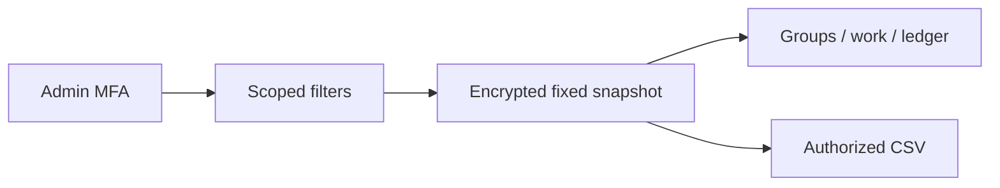
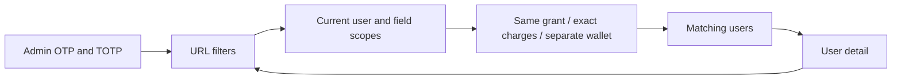
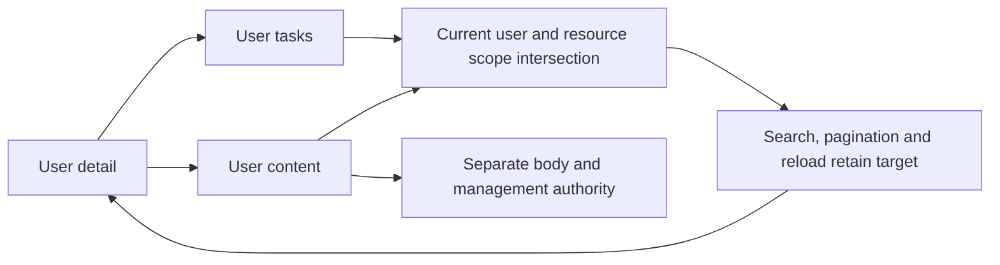
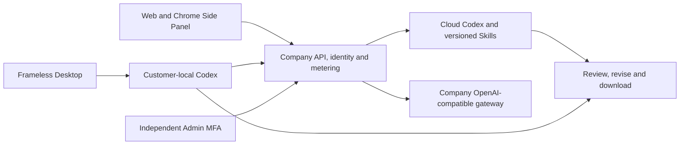

# Workmate · backend · v0.1.0
## Current source increment · stage169

Consumption reports add payer/project/creation-period filters, eight groupings, work accounting detail and same-snapshot CSV. Exact charges, refunds, holds, reconciliation and unknown supplier costs remain distinct. Current scopes, MFA and both export permissions are enforced. Schema156; existing v0.1.0 assets are unchanged. This increment is included in the next complete freeze.




[MP4](assets/screenshots/workmate-admin-usage-report-169-02-consumption-report-workflow.mp4) · [方案 / Behavior](https://github.com/copypasteltd/workmate/blob/docs/docs/development/169-admin-usage-reports.md)


[中文](README.md) · [Complete release](https://github.com/copypasteltd/workmate/releases/tag/v0.1.0) · [Bilingual setup guide](https://github.com/copypasteltd/workmate/blob/v0.1.0/docs/releases/v0.1.0.md)

Workmate serves Hong Kong enterprises, beginning with existing marketing teams. This independent **backend** component uses **Fastify / PostgreSQL / cloud Codex**. Business areas include design/media, advertising and website/SEO/GEO analytics, repeatable workflows and software development. CopyPaste's warm background, dark text, brand accents and editorial typography guide the interface.

## Current source increment · stage168

Combine registration/account-access dates and origin, VIP plan/state/expiry, confirmed charges, submitted/started role tasks, reconciliation and individual-account credit conditions. URLs survive reload/detail/return. Authenticated account access includes legitimate device polling; it is not human presence. Historical origin/activity stays unknown. Exact micro-HKD calculations count confirmed charges and never pool personal/workspace funds or classify unavailable/inconsistent accounts as zero.

Deploy complete schema001–156 with matching API/Worker: stop old services, back up, migrate and start the new services. Default directory DTOs remain compatible; view=operations opts into origin/access fields. Current independent usage/VIP/billing scopes and recent MFA are enforced. Directory reads do not mutate billing.

This source update follows v0.1.0 and is **not inside its frozen ZIP**. Frozen tags/assets remain unchanged. Backend/Admin builds, eight native SQL/API cases and six actual Admin browser checks passed; original fixture/locator failures remain preserved. Authorized synthetic dependencies and original whole-acceptance scopes remain explicit.




[MP4](assets/screenshots/workmate-admin-directory-filters-168-03-directory-filter-workflow.mp4) · [Logic / 逻辑](https://github.com/copypasteltd/workmate/blob/docs/docs/development/168-admin-directory-operational-filters.md) · [Evidence / 回执](https://github.com/copypasteltd/workmate/blob/docs/docs/quality/admin-directory-filters-168.json)

## Included user tasks/content · stage166

User detail opens creator-filtered tasks and content. Search, pagination and reload retain the user; return navigation restores directory conditions. Changing users discards previous bodies/operations. Current user scope intersects resource scope; body/download authority and recent MFA remain separate. Twenty content kinds use their actual creator; brands retain the original version-1 author. Unknown legacy authors remain unattributed in the full directory. Counts represent resource records; an asset and its cloud node have independent identities.

This functionality is included in v0.1.0 sources/distributions. Previous rc.5 tags/downloads stay unchanged. Current backend/Admin builds, eight native SQL/API cases and eight actual browser checks passed. The original locator failure and its media remain preserved. Authorized synthetic dependencies and all whole-acceptance scopes remain.




[MP4](assets/screenshots/workmate-admin-user-resources-166-02-user-task-content-scope.mp4) · [Logic / 逻辑](https://github.com/copypasteltd/workmate/blob/docs/docs/development/166-admin-user-resource-context.md) · [Evidence / 回执](https://github.com/copypasteltd/workmate/blob/docs/docs/quality/admin-user-resources-166.json)

## Current frozen release · v0.1.0

All clients, backend and six source trees are delivered together, including the latest creator-filtered Admin tasks/content. Six components are rebuilt. Rebuilt Desktop outputs match the qualified Windows app/Portable/Setup byte for byte, so those verified binaries are reused. Stage166's eight SQL/API cases and eight actual UI checks retain their source-bound original evidence; broad historical regression is not rerun.

Branch`backend`, frozen tag`v0.1.0-backend`. [Source and installers](https://github.com/copypasteltd/workmate/releases/tag/v0.1.0) · [Freeze record](https://github.com/copypasteltd/workmate/blob/v0.1.0/docs/quality/release-freeze-checkpoint-167.json) · [Open work](https://github.com/copypasteltd/workmate/blob/v0.1.0/docs/quality/remaining-work-stage167.md). AI/media/ads/payments use the authorized synthetic mode; Windows is unsigned. Existing screenshots/GIF/MP4 retain their actual capture scope and do not imply new full installation/professional qualification.

## Architecture and responsibilities

Entry points: `src/server.ts, src/workspaces.ts, catalog/, skills/, migrations/`. Codex is the only agent kernel. All AI calls use the company's OpenAI-compatible gateway; provider secrets remain server-side. Presets pin Skills, tools and configuration versions. The designer combines Codex, design Skills and company Image 2.

Web runs cloud agents. Chrome MV3 provides conversation and attachments in its native right Side Panel; customers explicitly select files and consent to upload for cloud execution. Desktop is frameless without Electron's default menu, runs Codex on the customer's computer and supports explicitly granted full local permission, stop/revocation and account/directory isolation.

Admin has independent email OTP plus TOTP and scoped permissions for users/organizations, usage, billing, VIP, roles/Skills and content. User detail passes the actual target ID; fee accounts are subject-filtered and VIP locks that target. Switching users unmounts previous dialogs/previews. Amounts use HKD micro-units. Budgets, balances, receipts, gifts, credit and VIP are distinct. Manual changes require preview, confirmation, current MFA/policy/approval, audited idempotency and current authority.



## Setup and commands

Place six independent repositories beside each other under `dev/`: platform, web, admin, desktop, extension and delivery, each with the `copypaste-` prefix. Use Windows x64, Node.js 22.14+, Git and native PostgreSQL. Media requires FFmpeg/FFprobe. Pinned Codex ships in the runtime archive. Docker, WSL and virtualization are prohibited.

Read the release guide. Before first configuration, choose an available database port. From Delivery run `demo:preflight`, `bootstrap:demo`, `demo:check`, then `demo`. Preserve existing configuration/data. Run Delivery `npm run stop` to close owned services.

Individual component development after supporting dependencies/backend are ready:

```powershell
npm ci
npm run build
npm start
```

API uses localhost4310, Web4317 and Admin4318. Development OTP messages are in platform `.data/mailbox/`. Enroll an administrator with platform `npm run admin:create -- admin@example.com super_admin` and configure TOTP from its one-time material. Desktop uses browser PKCE, a chosen local directory and explicit permission. Load the extension unpacked in Chrome developer mode and click its icon to open the side panel.

## Customer and operator workflow

1. Sign in and accept an invitation or create a workspace/initial project. An uncertain creation keeps its original request. Check & continue after reload reconciles that operation; unavailable/removed receipts never silently create a replacement company.
2. Select a project/preset, provide the brief, approved files/brand/accounts, budget and permission. Supply missing inputs within the original task. Execution pins accepted configuration and Skill versions.
3. Review durable progress, approvals, delivery versions, costs and consumption. Download original files or request revisions. Unknown costs stay under reconciliation instead of being treated as free or blindly repeated.
4. From Admin user detail, verify the billing/VIP subject, inspect its preview and confirm under current policy. Directory filters survive refresh/return. The current branch connects creator-filtered task/content pages and preserves the original directory conditions on return.

## Configuration and authority

Web/Admin use `VITE_API_BASE` or a same-origin proxy. Native deployment settings pin allowed origins and extension ID. Use HTTPS outside approved loopback development. Current SQL history is001–156 (frozen v0.1.0 uses155); API/Worker check schema and environment identity. Sources exclude secrets, private `.env`, user databases, dependencies and Git metadata.

Expired sessions clear the previous workspace. Delayed responses cannot replace a newer sign-in. Files are private by default. Requests, worker claims, tools and downloads recheck authority. Saved responses confer no permanent access. Explicit sign-out removes private workspace-draft names while retaining an owner-scoped opaque recovery key.

## Preset and Skill bindings

Eighteen professional presets are defined; this count does not prove complete professional qualification of twelve roles.

| ID | Role | Required Skill bindings |
| --- | --- | --- |
| R01 | Full-stack engineer | `fullstack-engineering@1.0.0`, `frontend-implementation@1.0.0`, `backend-api@1.0.0`, `qa-testing@1.0.0`, `delivery-core@1.0.0` |
| R02 | Frontend engineer | `frontend-implementation@1.0.0`, `ui-system@1.0.0`, `qa-testing@1.0.0`, `delivery-core@1.0.0` |
| R03 | Backend/API engineer | `backend-api@1.0.0`, `qa-testing@1.0.0`, `delivery-core@1.0.0` |
| R04 | QA engineer | `qa-testing@1.0.0`, `frontend-implementation@1.0.0`, `delivery-core@1.0.0` |
| R05 | UI/UX designer | `ux-research@1.0.0`, `ui-system@1.0.0`, `frontend-implementation@1.0.0`, `delivery-core@1.0.0` |
| R06 | Designer | `creative-direction@1.0.0`, `image-art-direction@1.0.0`, `image2-production@1.0.0`, `typography-layout@1.0.0`, `delivery-core@1.0.0` |
| R07 | Brand designer | `brand-system@1.1.0`, `image-art-direction@1.0.0`, `image2-production@1.0.0`, `typography-layout@1.0.0`, `delivery-core@1.0.0` |
| R08 | Advertising creative designer | `ad-creative@1.0.0`, `image-art-direction@1.0.0`, `image2-production@1.0.0`, `typography-layout@1.0.0`, `delivery-core@1.0.0` |
| R09 | E-commerce designer | `ecommerce-visual@1.0.0`, `image-art-direction@1.0.0`, `image2-production@1.0.0`, `typography-layout@1.0.0`, `delivery-core@1.0.0` |
| R10 | Social content designer | `social-content@1.0.0`, `image2-production@1.0.0`, `typography-layout@1.0.0`, `delivery-core@1.0.0` |
| R11 | Illustration/IP designer | `illustration-ip@1.0.0`, `image-art-direction@1.0.0`, `image2-production@1.0.0`, `delivery-core@1.0.0` |
| R12 | Typography/layout designer | `typography-layout@1.0.0`, `image-art-direction@1.0.0`, `image2-production@1.0.0`, `delivery-core@1.0.0` |
| R13 | Presentation designer | `presentation-production@1.1.0`, `typography-layout@1.0.0`, `dataviz@1.1.0`, `delivery-core@1.0.0`, `deterministic-metrics@1.1.0` |
| R14 | Landing page designer | `landing-page@1.0.0`, `ui-system@1.0.0`, `frontend-implementation@1.0.0`, `image2-production@1.0.0`, `delivery-core@1.0.0` |
| R15 | Data visualization designer | `dataviz@1.1.0`, `deterministic-metrics@1.1.0`, `typography-layout@1.0.0`, `delivery-core@1.0.0` |
| R16 | Video/motion designer | `video-storyboard@1.0.0`, `template-video-composition@1.0.0`, `video-generation@1.1.0`, `speech-production@1.2.0`, `delivery-core@1.0.0` |
| R17 | Marketing analyst | `ads-analysis@1.1.0`, `deterministic-metrics@1.1.0`, `dataviz@1.1.0`, `delivery-core@1.0.0` |
| R18 | Workflow automation consultant | `workflow-design@1.1.0`, `workflow-execution@1.1.0`, `delivery-core@1.0.0` |


[Role contract](https://github.com/copypasteltd/workmate/blob/backend/catalog/role-preset-catalog.json) · [Skill contract](https://github.com/copypasteltd/workmate/blob/backend/catalog/skill-packages.json)

## Actual screenshots and interaction

The shared media shows this release's actual Web/SQL recovery and Admin MFA/target checks with synthetic business facts. It does not claim fresh installation acceptance of other native clients.


[Actual MP4](assets/screenshots/workmate-functional-closure-165-01-recover-original-workspace.mp4)

## rc.5 frozen baseline qualification and publication

Historical rc.5 record: seven focused SQL cases, four draft-state cases and actual Web/Admin interactions accompanied six builds and Windows unpacked/Portable/Setup packaging. Current ASAR bytes and pinned Codex hashes are checked. Repeated broad regression is omitted as requested; the release checkpoint records actual results.

Branch `backend`, frozen tag `v0.1.0-rc.5-backend`. Later changes advance branches and notes while frozen bytes/tags remain. AI/media/ads/payments use the authorized synthetic mode. Windows is unsigned. All102 IDs and88 required whole-acceptance scopes remain;88 is not a count of missing modules. Production providers, signed updates, other OSes and full professional acceptance remain tracked.

[Checkpoint](https://github.com/copypasteltd/workmate/blob/v0.1.0-rc.5/docs/quality/release-freeze-checkpoint-165.json) · [Original acceptance ledger](https://github.com/copypasteltd/workmate/blob/v0.1.0-rc.5/docs/quality/remaining-work-stage165.md) · [Historical README](https://github.com/copypasteltd/workmate/blob/v0.1.0-rc.5/docs/history/readme-before-rc5/platform-en.md)
