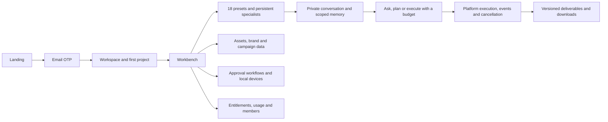
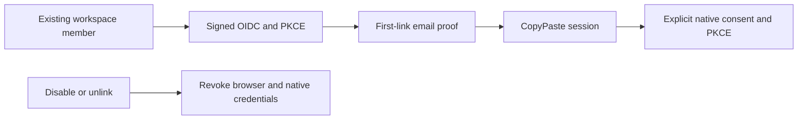
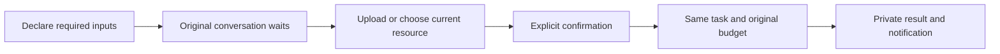

# CopyPaste Web

[简体中文](README.md) · Enterprise cloud workspace · 0.5.0

A Web client for Hong Kong enterprise marketing teams, using CopyPaste's warm white, ink and blue palette, serif display typography, Traditional Chinese/English and light/dark/system themes. Customer deliverables retain the customer's brand. This repository builds independently and obtains data from the platform API.


## Run and deploy

Requires Node.js 22.14+. Start the platform database/API first, then:

```powershell
npm ci
npm run dev
```

Visit `http://localhost:4317`. Vite proxies `/v1` and `/health` to `127.0.0.1:4310`. All tools run natively; Docker, WSL and virtualization are prohibited.

```powershell
npm run typecheck
npm run build
npm run preview
```

Deploy `dist/` as static assets over HTTPS, preferably reverse-proxying `/v1` on the Web origin to the API. SPA pages fall back to `index.html`; API paths must not. Optional build-time `VITE_API_BASE` is documented in `.env.example`. If using a separate API origin, configure exact `WEB_ORIGIN`, cookie and CORS rules. Never place AI keys in public `VITE_*` variables.

## Customer journey



New customers verify a work email, create their organization and first project, then enter the workbench. Returning customers select an existing workspace/project. Invitations bind email and project. Expired/invalid codes, throttling, expired sessions, inaccessible resources and unavailable models surface real API errors.

Development OTPs are available only in platform `.data/mailbox/`; production uses SMTP. No default user credentials exist. Native authorization reuses this identity through an independent PKCE flow rather than converting browser cookies to bearer tokens.

## Pages

| Area           | Working behavior                                                                                    |
| -------------- | --------------------------------------------------------------------------------------------------- |
| Workbench      | Project selection, specialists, recent tasks, published help/announcements and service availability |
| Specialists    | 18 presets with bound Skills, inputs, outputs and current availability                              |
| Projects/tasks | Project creation, budgeted tasks, status/events/output and cancellation                             |
| Creative       | Editable JSON text/shape/pinned-PNG layers, versioned edits, SVG/PNG/template MP4 export            |
| Assets         | Explicit uploads, thumbnails, immutable versions, downloads, rename and expiring/revocable shares   |
| Analytics      | CSV ingestion, exact aggregate metrics, dataset detail and submitted-HTML SEO checks                |
| Workflows      | Bounded analytics/Codex/approval steps, publish/run/approve                                         |
| Brand          | Colors, tone, fonts and approved copy                                                               |
| Members        | Invitations, organization roles, project scope, updates/removal and last-owner protection           |
| Connections    | Google Ads/GA4/Search Console/Meta OAuth and explicit-account report synchronization                |
| Devices        | Paired devices, expiring folder grants, explicit local command dispatch and results                 |
| Usage/settings | Separate wallet and effective plan limits, charges, language/theme/profile                          |


## Specialists and private work

Create a specialist from an installed role, set instructions, brand and tools, then start a private conversation. Specialist edits are versioned; conversations retain their selected version until you explicitly adopt an update. Notes save without AI. Ask and plan use reading tools, while execute can create deliverables. Execution of a plan requires approval against the current context and budget.

Conversations support search, pin, rename, archive/unarchive and version-checked deletion. Messages, tasks and outputs remain owner-private. Explicit publication creates a shared project copy. Workspace/brand/project/conversation/personal memories have content versions and optional expiry. Personal and conversation memory remain private. Deletion requires confirmation and completed or cancelled/settled work.

The 390px mobile layout and dark theme were exercised in a real browser. A closed mobile sidebar is removed from keyboard navigation. The platform rechecks authentication, access and billing on each request.


## Product and authorization rules

The API is authoritative for access, billing and entitlements. Hidden controls are not authorization. VIP and wallet balances are separate; personal/workspace entitlements use actual validity timestamps. Unconfigured company AI is explicitly unavailable. Installed presets are not proof of qualified live business work.

All AI requests run through the platform and company internal gateway. This client holds no model keys. Browsers do not gain silent disk access: files require a user picker, and persistent folder access requires the Desktop native bridge with individual grants.

`api.ts` uses credentialed requests/CSRF on Web and narrow IPC in the Desktop snapshot. Local storage contains theme/locale preferences, not authentication or model secrets. Published help/announcements render as text rather than injected HTML.

## Verification and maintenance

`npm test` performs type checking. The delivery repository's `npm run qa:web` and `npm run qa:persistent` exercise actual email login/onboarding, 13 workspace modules, 16 Admin pages, dark/light and mobile viewports. Screenshots use real UI/API/PostgreSQL with fictional fixture businesses and `.invalid` emails.

Routes/pages live in `src/main.tsx`; context handles identity/workspace/theme/locale; `api.ts` owns transport; `native-files.tsx` is the native-file panel; `ui.tsx` and `style.css` are self-contained UI foundations. Desktop imports an explicit renderer snapshot rather than requiring sibling source during builds.

Company gateway, SMTP, advertising OAuth and S3 still require deployment configuration and live qualification. SAML/SCIM, mandatory SSO policies, event triggers, parallel specialist teams, collaborative editing and full AI video/speech are unfinished. Polling is not full planned SSE. Submitted-HTML SEO checks do not promise GEO rankings.

Self-hosted Manrope/Fraunces, Lucide icons and the generated blue-fold artwork are documented in [third-party notices](THIRD_PARTY_NOTICES.md). Master requirements remain in the delivery root's `docs/`.

## Cloud schedules

Version 0.4.0 adds daily/weekly calendars to Workflows. Select a published workflow, IANA zone, weekdays and missed-run policy, preview local/UTC times and per-run budget, then explicitly authorize. The server continues after the page closes and retains version/occurrence history. One unfinished run prevents overlap, including approval gates and uncertain charges.

Users can edit, pause, reauthorize/resume or retire calendars. Pausing preserves current work; run history provides separate cancellation. Changes affect future work and paused intervals are skipped. End dates are exclusive; nonexistent DST times are skipped and repeated times run once at their first instant. Platform checks enforce these rules. See `src/schedules.tsx`; Delivery `qa:schedules` verifies actual-clock execution with the user page closed and mobile controls.


## 0.5.0 company identity and unified sign-in

OIDC uses code + PKCE S256, signature verification, state/nonce and a fixed callback. An existing registered account and active workspace membership are required. First binding requires a separate CopyPaste work-email code; domains never auto-enroll users. Configuration changes, disablement or unlinking revoke all linked users’ CopyPaste browser/native/refresh sessions and prior execution authorization. Administrator email and TOTP remain separate.

`/login` offers company identity; `/sso` accepts a company sign-in key and work email; `/sso/confirm` performs first-link email proof. Account settings list owned connections and explicitly confirm signing out everywhere on disconnect. Native `/authorize` callback and PKCE parameters survive SSO, followed by explicit user consent.




## File and execution repairs in progress

A persistent banner identifies synthetic data and lets a workspace Owner claim one demo gift. Uploads verify part and whole-file SHA-256, support pause/cancel and resume after a lost connection and reload. Limits are 100 MiB for ordinary files and 1 GiB for media. Assets show retention expiry; permanent deletion requires confirmation and has queryable cleanup progress. Task activity uses durable SSE with sequence-based reconnection and current authorization checks.

These are unpublished source changes. Full 1 GiB transfers, all clients and S3 remain to be qualified. The master alignment report records exact coverage and outstanding work.


## Cloud files (current source)

Shared project and private conversation workspaces support search, folders, exact asset-version references, rename/move, text and small bitmap previews, authorized downloads, confirmed publication of copies and entry removal. Conversation uploads remain private; coding roles can continue persistent working sources in later tasks.

Four browser QA groups cover these flows, two real Codex tasks driven by synthetic dependencies, four viewport widths, dark theme and Traditional Chinese. Captured responses receive separate strict schema checks. Live model quality and every file-preview format remain outside this evidence.


## Project methods (current source)

Project methods now have exact installation and specialist/task bindings. Ordinary disable affects new work; uninstall and permanent security revocation block subsequent calls, including old tasks. Reinstallation creates a new identity and requires explicit adoption by a new specialist version. Current plan access is checked before tools and final output; measured usage settles against the original reservation.

Platform regression: **129/129**. `npm run qa:skills` in the delivery repository passed three browser groups; fifteen captured HTTP payloads passed the strict design schemas. Custom package review/publication and complete live-role qualification remain pending. Existing 0.5.0 installers are historical.


## Default assistant and work notifications (current source)

New work selects the text assistant by default. Edit a sample, explicitly submit and continue in a private conversation. Selecting a sample or creating an empty conversation makes no AI call. Choose professional roles for image/code specialties. An open form retains its submission identity after an unknown response, so retry does not duplicate work. The default is protected from ordinary edits/deletion; copy it for customization or explicitly adopt current methods as a project manager.

The inbox supports all/unread filters, pagination, read changes and original-task navigation, switching projects first when needed. Authorization refresh failures remove stale items and the unread indicator. Assistant and inbox browser journeys each pass four groups across 375/768/1024/1440 widths, both themes and Traditional Chinese/English; this is bounded UI evidence.


## Initial file and connection requests (current source)

New work can explicitly require a file or connected account before execution. The original private conversation shows the request, current-version search, pagination and an unselected picker. Uploads from that conversation retain private ownership. Refresh and confirmation recheck access; an authorization error removes stale candidates. Resolving all inputs resumes the same task and its existing budget hold. Nothing is selected or submitted automatically.

Delivery `qa:task-dependencies` passes five real browser groups, including private upload, real Codex with labelled synthetic model data, a persisted result, four widths, both themes/languages and failure recovery. These checks cover initial prerequisites, not automatic discovery or continuation after a paid step.




