# CopyPaste Delivery and Integration

## Per-request budgets (stage 57)

Text generation counts its complete normalized context through the company `/v1/responses/input_tokens` endpoint, then atomically allocates frozen input prices and an explicit output bound against the task's original reservation. Images share that same budget. Counting needs an explicitly verified price and uses platform funds. Missing counts or prices block generation. Each proof is bound to one operation, digest, original identity and capability. Admin verification has independent run and daily platform budgets and never uses customer wallets.

Settlement aggregates durable exact cost numerators and rounds once for one ledger charge. Unknown outcomes retain commitments. Input mismatches and overruns persist actual spend before reconciliation and cannot enlarge the customer budget. Injected adapters reporting synthetic text counters cannot add unobserved text costs to real image operations.

Validation passed **129/129 focused checks within 559/559 full tests**, with 741 unchanged source files and all 546 stage 56 named tests retained. Type checking and the actual build passed. Both existing native databases upgraded from 066 to 067, preserving every row of 136 original public tables, SQL001–066 and their historical checksums. Eight new tables force RLS. Only definitely unexecuted tasks receive original budget bounds; no historical spend or verified prices were fabricated. SQL067 is now immutable.

Codex, PostgreSQL and accounting transactions are real; model/media responses are authorized simulations. No browser or native client was opened. Previous screenshots and packages retain their original source scope. Complete Admin policy publication, request directory, evidence-based cost/capacity reconciliation and all original product acceptance remain open.

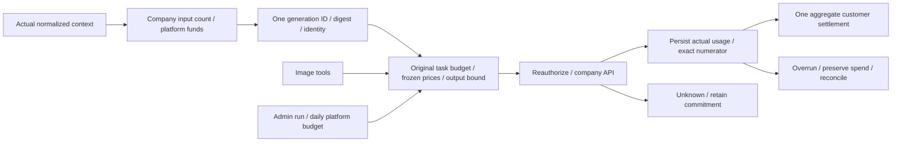

[Focused run](evidence/provider-budget-candidate-05.json) · [Full regression](evidence/provider-budget-regression-03.json) · [Build and types](evidence/provider-budget-static-04.json) · [Local upgrade](evidence/provider-budget-upgrade.json) · [Original-row preservation](evidence/provider-budget-migrations.json)

Use a fresh two-digit ID with `node scripts/run-provider-budget-checks.mjs NEXT_ID`; add `--full` for all tests or `--core` for core cases. Failures, source preimages and earlier passing reports are retained. Earlier success does not qualify current bytes. The one-time local upgrade guard cannot be rerun after migration.

## Durable provider requests (stage 56)

Focused run 03 passed **116/116**, included in **546/546 full tests**. All 738 source files remained unchanged, and all 531 earlier named tests remain present. Type checking and the actual build passed. Both native databases upgraded from 065 to 066, preserving every row of 132 original public tables, SQL001–065 bytes and historical checksums. Four new tables force RLS; no historical request or usage facts were fabricated.

[Focused run](evidence/provider-control-candidate-03.json) · [Full regression](evidence/provider-control-regression-01.json) · [Build and types](evidence/provider-control-static-01.json) · [Local upgrade](evidence/provider-control-upgrade.json) · [Original-row preservation](evidence/provider-control-migrations.json)

Real Node workers, Codex and PostgreSQL exercise shared limits, revoked authority, unknown capacity, orphan recovery, exact cost facts and durable terminal-frame handoff. Model/media responses are simulated. Initial SQL, handoff and compilation failures retain their raw diagnostics and exact source preimages. Actual fixture reclamation and owned database shutdown passed. No browser or native client was opened; earlier UI evidence retains its original scope.

```powershell
node scripts/run-provider-control-checks.mjs NEXT_ID --core
node scripts/run-provider-control-checks.mjs NEXT_ID
node scripts/run-provider-control-checks.mjs NEXT_ID --full
```

Use a fresh two-digit ID and never overwrite evidence. The one-time local upgrade guard now refuses another pre-upgrade capture; migration 066 is immutable. Raw TAP/database logs retain tool-emitted whitespace, while code, documentation and scripts still pass whitespace checks. Per-call budget allocation, complete Admin policy controls and original product acceptance remain open.

## Explicit adoption (stage 54)

Default assistant updates, specialist settings and conversation adoption now compare the exact models, effort, unit rates and Skill versions before explicit consent. Five-minute comparisons bind the real session and current configuration; stale comparisons are rejected. Retries use one persistent operation key. Previously accepted tasks keep their original versions and prices.

Current backend regression: **484/484**, including all 462 prior named tests; focused **93/93** overlaps that total. Actual built Web: **12/12**; new packaged frameless Desktop and real native Chrome Side Panel: **11/11**. AI/media use the authorized simulated dependencies; identity, PostgreSQL, permissions and version transactions execute normally. All 102 original requirements remain tracked. Earlier sections below retain their historical source and artifact scope.

[Focused regression](evidence/agent-adoption-candidate-06.json) · [Full regression](evidence/agent-adoption-regression-02.json) · [Built Web](evidence/agent-adoption-ui-06.json) · [Native Desktop / Side Panel](evidence/agent-adoption-native-05.json) · [Artifact hashes](evidence/agent-adoption-artifacts-02.json) · [Original-row preservation](evidence/agent-adoption-migrations.json)

Run a new numbered attempt; existing reports are never overwritten. Native QA uses an owned profile, real toolbar action and PKCE, then closes its own windows and processes. Setup/Portable provenance is checked without installation. No Docker or WSL is used.

```powershell
node scripts/run-agent-adoption-candidate.mjs NEXT_ID
node scripts/run-agent-adoption-regression.mjs NEXT_ID
node scripts/run-agent-adoption-ui.mjs NEXT_ID
node scripts/run-agent-adoption-native.mjs NEXT_ID
```

Replace `NEXT_ID` with a fresh two-digit number. Native extension QA uses the installed test Chromium under `.data/browsers/chromium-1248/chrome-win64/chrome.exe`; set `CHROME_BIN` to another Chromium build supporting unpacked extension testing when needed. The local database upgrade is already applied; its one-time before-state guard rejects repetition.

## Controlled capabilities and Admin publishing (stage 53)

Adds focused/full regression, built-Admin browser verification and a native 064 upgrade tool with before/after row digests. Current [full regression 04](evidence/capability-release-regression-04.json) passes **462/462** with 726 unchanged sources and no failures, cancellations or skips. Its [raw TAP](evidence/capability-release-regression-04.tap) retains all 435 original tests. [Candidate 11](evidence/capability-release-candidate-11.json) passes 71/71 and overlaps the full run; [actual Admin browser run 06](evidence/capability-release-ui-06.json) passes 11/11 with 14 unedited screenshots; [supplemental contract run 02](evidence/capability-release-contract-02.json) passes six cross-consumer checks.

The [native 063→064 upgrade](evidence/capability-release-upgrade.json) and [before/after comparison](evidence/capability-release-migrations.json) pass: both databases preserve complete row digests for all 125 original public tables, historical SQL and checksums. All six new control tables force RLS and deny direct application-account access, without fabricated validation or publication history; 064 is now immutable. [Full-run fixture reclamation](evidence/capability-release-regression-04-fixture-cleanup.json) confirms actual deletion of two deferred directories after workers exited. All browsers and services owned by these runs are stopped.

Image verification adds complete decoding and bounded inflation; local HTTP fixtures allocate Fetch-compatible ports. An [actual forbidden-port counterexample](evidence/fetch-port-counterexample-01.json) demonstrates that a kernel-listening server can receive no Fetch request. Full run 03 did not record its allocated port, so its exact value remains unknown. Full runs 01 at 456/458, 02 at 458/458 and 03 at 460/461, every candidate and browser runs 01–05 retain their original evidence and separate source scopes.

Verification workspace cleanup is a separate durable job and does not rewrite model receipts or costs. Parent-owned fixture reclamation requires actual filesystem checks; failure fails the entire run. Upgrade admission verifies focused/full TAP, actual cleanup receipts, SQL and the entire source set. The browser script starts owned native PostgreSQL, built Admin and an isolated API, executes real email/MFA, independent approval, rollback, read-only and revocation journeys, captures actual pages, then closes every owned browser and service. Model/media dependencies are authorized fixtures. Visible customer adoption, current three-client business checks, per-request gateway limits and complete acceptance remain open. Stage 52 results below retain their historical source scope.

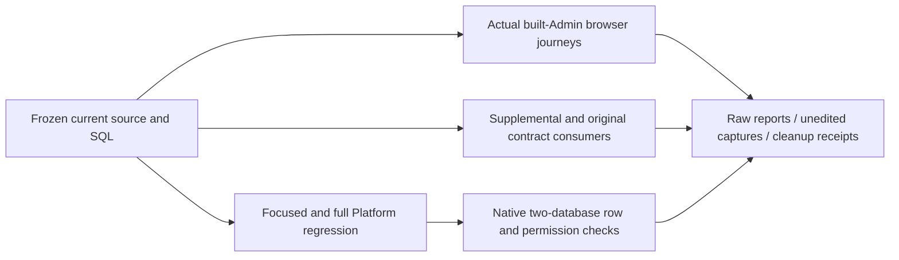

Use fresh attempt identifiers for another run; existing evidence cannot be overwritten. Both local databases are already upgraded, and the one-time upgrade command rejects repeated execution. Fresh runs can use `node scripts/run-capability-release-candidate.mjs 12`, `node scripts/run-capability-release-regression.mjs 05` and `node --import tsx scripts/check-capability-release-contract.ts 03`. For browser checks use `node scripts/run-capability-release-ui.mjs 07`; if the default Playwright browser is absent, explicitly set `CHROME_BIN` to the actual Chrome executable. The runner uses an isolated profile and closes its owned instances.

## Frozen task capability and pricing verification (stage 52)

The current foundation freezes each task's Codex, model, reasoning effort and original rates, including actual image generation/editing, administrator retries, post-revocation settlement, unknown costs, private isolation and bounded database locks. Current focused suites and existing template/private workflows pass [35/35](evidence/capability-candidate-05.json). [Candidate 04 at 28/28](evidence/capability-candidate-04.json) retains its original source scope. Three failed candidates and the [first full run at 434/435](evidence/capability-regression-01.json) retain their original TAP, SQL and source manifests. Its sole failure required cancelling old tasks after a default configuration change; the corrected assertion retains new-delegation and active-revocation guards. A second full run executes separately.

[Both native 062→063 upgrades](evidence/capability-migrations.json) preserve all 124 original public tables, prior SQL bytes and historical checksums. At stage 52, administrative publication/rollback and visible customer version confirmation remained open; the later Admin subflow is described in stage 53 above.

The [second full regression passes 435/435](evidence/capability-regression-02.json), with 714 unchanged sources, no failures, cancellations or skips, and independently retained [raw TAP](evidence/capability-regression-02.tap) and SQL bytes. All 424 original tests remain, with one explicitly mapped semantic rename. The 35 focused cases overlap the full run and are not added to its total. Owned PostgreSQL is stopped; native frameless/Side Panel preview bytes retain separate evidence.

```powershell
npm run qa:capabilities -- 06
npm run qa:capability-regression -- 03
```

The commands reserve new attempt identifiers and never overwrite existing evidence. Both local upgrades are complete; `upgrade:capabilities-local` rejects repeated execution or missing pre-upgrade conditions. The executed `npm run upgrade:capabilities-local -- 04` remains part of the historical record and should not be repeated. Stage 51 and older figures below describe historical baselines, not all stage 52 current-source workflows.

## Controlled support update / 受控客服协助

Delivery verification adds controlled-support suites, complete old-row comparison for the native 061→062 upgrade, actual Web/Admin grant/revocation/expiry journeys and unedited screenshots. Full regression and native frameless/Side Panel verification stay separate. All original requirements, complete acceptance conditions and production gates remain tracked.


Stage 51 current regression: 424/424 with 711 source files; controlled-support browser workflows: 8/8 with 816 source files and 9 unedited captures. The 14 support tests, original contract checks, migration preservation and separate native checks are bounded evidence, not completion of all 102 acceptance cases. Current binaries are rebuilt; stage 50 binaries remain unchanged in their archive.

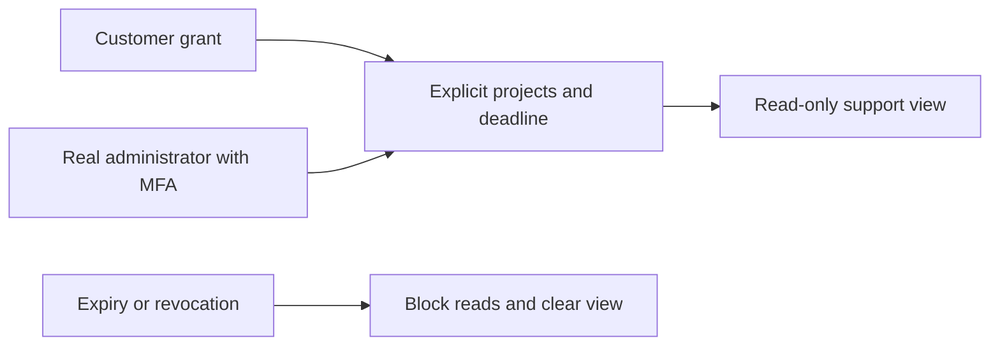

```powershell
npm run qa:support-ui
npm run qa:platform
```


[简体中文](README.md) · Native lifecycle controller and qualification · 0.5.0

This repository is independently versioned alongside five product repositories. The working root is `D:\dev\copypasted\自有agent\`; source/dependencies/artifacts live under `dev/`, and master requirements/design/quality documents remain under `docs/`. Each repository includes bilingual READMEs, diagrams, screenshots and notices.


## Durable financial notifications and three-client accounts (stage 50)

New scripts cover candidate tests, a stopped-stack upgrade and actual three-client finance workflows. Candidate four passes 38/38; the full platform regression passes 410/410 with 707 unchanged source files. Web, packaged frameless Desktop and the native SIDE_PANEL pass 8/8 financial checks, with 808 unchanged source/runtime files, four separate strict supplemental responses and eight unedited captures. All ten existing Admin/member/native/session context runs pass. Failed attempts and original stage 49 evidence are archived byte-for-byte; old binaries and current rebuilt previews remain separate.

Stage 50 historical platform regression: 410/410; actual three-client financial workflows: 8/8. AI/media and payment evidence are authorized local simulations; authentication, database, authorization, ledger and notification paths execute for real. This does not complete the original 102 acceptance cases, production banking or the full installation/system matrix.

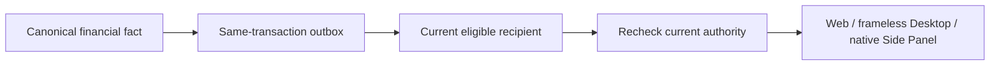


## Atomic VIP and explicit credit (stage 49)

The existing VIP form can include a deliberate HKD gift with its own exact amount, expiry and reason. One frozen preview and one confirmation create a parent operation. The server commits canonical VIP and financial child operations in one database transaction, or rolls both back. If either risk policy requires review, the whole request waits for another administrator with both domains' permissions; pending requests create no entitlement or credit.

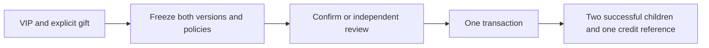


The current full platform run passes 394/394 with 703 unchanged source files; the 19 focused groups are included. Nine actual Admin/user browser groups and 12 unedited captures are bounded evidence. The 125 original-schema responses and one strict supplemental request are checked separately. Additive migration 060 preserves complete old-row digests for all 119 original public tables in each native database, applied 001–059 bytes and historical null checksums. Initial fixture errors and two verifier mistakes remain archived. All original REQ/TC/NFR/G01–G10, professional role quality, real external services and production/installation acceptance remain in scope. Master details are in `docs/technical/49-atomic-vip-and-explicit-credit.md` and current Delivery receipts.

All five independent-clone checks pass. The missing-capture commit and subsequent Windows long-path failures remain archived; new archives use short flat paths. After rerunning native appearance QA without changing client bytes, use `node scripts/refresh-native-surface-validation.mjs`. It verifies the complete runtime, three packages and 31 embedded ASAR files before preserving the old manifest and refreshing only its receipt binding, retaining original build time and commits. All README images ship inside this repository.

## Current immutable plan increment

The Admin definition form, frozen comparison and independent publication review use real APIs. Legacy grants retain fixed execution definitions. Both native databases advance to 056 with old-row and migration-digest comparisons. `npm run qa:admin-plans` passes six groups covering real email/TOTP sessions, structured forms, exact money, retained validation/focus, durable receipts, independent review, immutable versions and Traditional Chinese dark mobile views. Owned Chromium processes close, sessions are revoked and test administrators disabled. No model or payment call is made. Screenshots ship in the independent Admin repository.

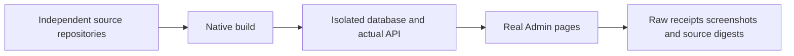

Set `CHROME_BIN` to an installed native Chrome/Chromium executable. `evidence/plan-ui-browser-path-failure/` and `plan-ui-layout-before-fix/` retain initial failures and original captures. The focused suite passes 24/24; the current `alignment-platform.json` and raw TAP record the complete platform run. Complete VIP/quota, production services and native system acceptance remain unfinished. Existing native preview bytes are unchanged.

## Frameless Desktop and native side-panel previews

Desktop uses a branded title bar without the native frame or Electron default menus. The extension action opens Chrome's global Side Panel, normally on the right. The 2026-10-20 current-source and rebuilt packaged runs each pass **10/10** checks: real controls, Alt, pointer/keyboard resizing with an 800×600 minimum, cross-window IPC denial, PKCE, modal clearance and theme/language behavior. Their records are preserved separately. Browser entry uses `Extensions.triggerAction` and a real `SIDE_PANEL` context. Chrome controls the left/right preference. The previous **8/8** extension result remains historical business evidence; the full native authentication/system matrix has separate acceptance work.

Current previews are in sibling Desktop `release/frameless/` (Setup, Portable, win-unpacked) and extension `release/sidepanel/CopyPaste-0.5.0-sidepanel.zip`. They use localhost origins and unsigned Desktop binaries. Earlier preview bytes remain in `frameless-stage30/` and `sidepanel-stage30/`; their original receipt, report, screenshots and digest mapping remain in `evidence/stage30-native-surfaces/`. `evidence/native-surfaces-artifacts.json` records current hashes, source commits, binding to actually tested files and matching ASAR build bytes. QA executes win-unpacked; Setup/Portable installation and uninstall are separate acceptance work.

The 2026-10-20 rerun exposed and fixed a missing Desktop session-context API permission. Three failed login-landing records, diagnostic images and the subsequent source run's ten passing checks are retained in `evidence/native-preview-refresh-initial/`. The new admission check compares complete runtime, installer, extension-dist and runtime-source hashes before/after QA and before admitting packages. Historical reports, modified or added/removed files and incomplete cleanup fail admission. All 12 `npm run test:surfaces` checks pass.

```powershell
# Native development stack running; Desktop and extension built separately
$env:CHROME_BIN='Your native Chromium executable'
$env:COPYPASTE_DESKTOP_EXECUTABLE='Absolute path to sibling Desktop/release/frameless/win-unpacked/CopyPaste.exe'
npm run qa:native-surfaces
npm run test:surfaces
# After committing clean source checkouts, verify binaries and create extension ZIP/manifest
npm run package:surfaces
```

Results are in `evidence/native-surfaces.json`; owned windows close in finally. QA uses software rendering without changing product launch defaults. Screenshots are Desktop 18–20 and extension 09; workspace captures wait for the role cards and fonts. The earlier panel-layout failure, current bridge failures and historical complete release are preserved separately. Signed updates, installation/uninstall, the full system/DPI matrix and all 102 full acceptance cases remain pending.

## Repositories

| Sibling directory     | Responsibility                                                                                         | Default entry    |
| --------------------- | ------------------------------------------------------------------------------------------------------ | ---------------- |
| `copypaste-platform`  | Identity, authorization, API/Worker, Codex, billing/VIP, assets/analytics/workflows and admin services | `localhost:4310` |
| `copypaste-web`       | Customer visit, sign-in, onboarding and workspace                                                      | `localhost:4317` |
| `copypaste-admin`     | Independent MFA console with 16 operations pages                                                       | `localhost:4318` |
| `copypaste-extension` | Chrome MV3, PKCE, explicit files/pages and native bridge                                               | Load `dist/`     |
| `copypaste-desktop`   | Windows client, folder grants, signed dispatch and Chrome Host                                         | Setup/Portable   |
| `copypaste-delivery`  | This controller, integrated QA, evidence and release manifests                                         | CLI              |

Each has its own package/lock files and main branch. Client builds do not need sibling source. Integration startup/build supports this sibling layout or `COPYPASTE_DEV_ROOT`; browser QA currently expects the documented sibling layout and local ports.

## View the existing installation

```powershell
npm start
```

Visit `http://localhost:4317` or `http://localhost:4318`. Leave the terminal open. From another terminal in this repository:

```powershell
npm run stop
```

The controller starts real native PostgreSQL, API, Web and Admin after checking ports and actual readiness. A local authenticated control port at 4319 closes only owned processes, API first and database last. Existing listeners cause startup to fail without killing them. Shutdown uses native pg_ctl to checkpoint. Clean restarts preserve specialist/conversation/memory records and preexisting listener PIDs on 5173/5174. Private controller tokens/logs live only in ignored `.data/`.

## Reproduce from clean source

Use native Windows x64, Node.js 22.14+, npm, Git, FFmpeg/FFprobe and approved Codex `0.163.0-alpha.10.2`. Docker, WSL and virtualization are prohibited. First dependency installation may download platform PostgreSQL/Electron binaries. Place all six checkouts as siblings and stop previous development services:

```powershell
npm ci
npm run bootstrap
npm start
```

Once ready, use another terminal in the platform repository:

```powershell
npm run db:migrate
npm run admin:create -- admin@your-company.example super_admin
```

Import the generated TOTP URI, then remove its enrollment file. Customers self-register through email; no shared default credentials exist. Development OTPs are in platform `.data/mailbox/`, while production requires SMTP.

Bootstrap does not install personal global tools or overwrite `.env`. Preserve the durable MASTER_KEY with database and object backups. QA uses fictional fixtures and must not stand in for real customer records.

## Runtime architecture

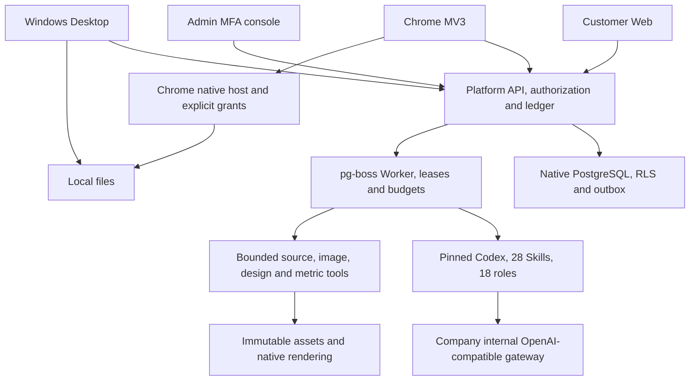

AI credentials remain server-only. Without the company base URL, exact aliases, key and contracted pricing, non-AI workflows run but AI tasks explicitly remain unavailable.

## Verification and evidence

```powershell
npm run verify
npm run qa:web
npm run qa:persistent
npm run qa:admin-identities
npm run qa:schedules
npm run qa:extension
# Build Desktop package:dir or package first
npm run qa:desktop
npm run qa:packaged
python -X utf8 scripts/review-repositories.py
```

Browser QA requires native Chromium. Set `CHROME_BIN` to an existing executable or install Playwright Chromium using `npx playwright install chromium`. Tests close their own tabs/contexts/processes in finally and preserve user-owned browsers.

| Evidence                 | Meaning                                                                                                                  |
| ------------------------ | ------------------------------------------------------------------------------------------------------------------------ |
| `verification.json`      | Six type checks/builds, 84 platform tests, three Desktop tests and route inventory                                       |
| `web-admin.json`         | Actual email onboarding, PNG/layer/media/data/workflows, 16 Admin pages and funding/VIP                                  |
| `persistent-work.json`   | Eight browser checks for specialists/private conversations/memory, mobile/dark themes and admin governance               |
| `admin-identities.json`  | Six browser groups for admin invitations, email/real MFA, replacement, least privilege, suspension/resumption and resend |
| `schedules.json`         | Five actual-clock/closed-page report, pause/resume, time-zone edit, Admin and mobile groups                              |
| `federation.json`        | Six signed OIDC, first-mailbox-proof, packaged Desktop and cross-client revocation groups                                |
| `extension.json`         | Real MV3/identity PKCE, upload, token privacy and logout                                                                 |
| `desktop.json`           | Actual packaged client, PKCE/encryption, real folder, signed dispatch and host framing                                   |
| `packaged-windows.json`  | Packaged launch/version/isPackaged and screenshot                                                                        |
| `native-controller.json` | Controller startup/shutdown and preservation of preexisting services                                                     |
| `repository-review.json` | Repository boundaries, bilingual READMEs/diagrams/screenshots, secret exclusion and provenance                           |
| `release-manifest.json`  | Final repository commits and binary SHA-256 hashes                                                                       |

Files are under `evidence/`. Results describe only executed checks. A controlled Responses fixture drives real Codex through a tool round but does not qualify the company's live model. The master baseline's 102 long-term cases are not blanket-marked passed. Documentation validation is separate: run `python -X utf8 docs/tools/validate_docs.py` at the project root.

## Database lifecycle check

Stop an existing CopyPaste controller before `npm run qa:lifecycle`. It starts, stops and restarts its own native stack, checks PostgreSQL checkpointing, readiness at the current version, persistent specialist/conversation/memory metadata and unchanged preexisting listener PIDs, then stops its stack. Run `npm start` afterwards to reopen the product. It starts no browser or virtualization.

Historical 0.1.0, 0.2.0, 0.3.0 and 0.4.0 evidence remains under `evidence/versions/`; current reports describe 0.5.0. Unfinished requirements remain tracked in repository and master documents.

## Binaries and demonstration

After validation and clean commits in all six repositories, run `npm run release`. It checks the evidence and creates `release/` with six independently cloneable Git bundles, Web/Admin/Chrome ZIP builds, Windows Setup/Portable and an exact-commit/SHA-256 manifest. Restore a repository with `git clone <file.bundle> <directory>`. Release artifacts and `evidence/release-manifest.json` are ignored to avoid a commit self-reference; their generator and validation reports remain in source control.

Run `python -X utf8 scripts/verify-release.py` to check artifact hashes and ZIP CRC/entries, then actually restore all six bundles offline and compare commits, branches, trees, source indexes and clean checkouts. It creates and removes only its own temporary directories under `.data/release-restore/`; its report is ignored at `evidence/release-restore.json`.

Desktop packaging produces unsigned Windows x64 Setup, Portable and unpacked applications configured for localhost. Load extension `dist/` manually. Production needs company origins, matching extension registration and explicit native-helper consent. No app installation, store publication, live acquiring or production deployment was performed automatically.

Suggested demonstration: email signup → workspace/project → specialist/private conversation/memory → brand/assets → editable SVG/PNG/MP4 → CSV analytics → workflow approval → Admin detail/funding/VIP → extension login/upload → Desktop login/folder/signed file command. Live Agent generation requires internal gateway qualification.

## Remaining release work

Company AI/SMTP/advertising OAuth/S3 require actual credentials and live validation. Windows signing, native production service identities/ACL/egress, restore drills and SLOs require deployment qualification. SAML/SCIM, mandatory SSO policies, event triggers, parallel specialist teams, collaborative editing, full AI video/speech, online acquiring and strong untrusted-code isolation are unfinished. The 18 installed role/28 Skill presets still need live business acceptance and must not be advertised as qualified merely because they are installed.

The long-term requirements remain intact. This delivery records working implementation and evidence rather than treating page presence as full acceptance. See each repository's bilingual instructions and [third-party notices](THIRD_PARTY_NOTICES.md).

## Cloud calendar qualification

`npm run qa:schedules` uses actual email sign-in, a new workspace, CSV and a published workflow. It previews/confirms a calendar through the UI, closes the user page, waits for the real clock and verifies the native Worker's persisted HKD/ROAS report. It then checks user pause/resume, weekly/Hong Kong edits, separate Admin MFA and a 390px layout: five groups in `evidence/schedules.json`. It makes no AI call and closes its browser, retires the calendar and cancels the fixture run in finally.

Packaged Desktop separately checks native bearer creation, rendering and retirement. `qa:lifecycle` checks database-side calendar/history digests and persistence across native restarts. Current version 0.5.0 includes 84 platform tests and three Desktop unit tests; browser and packaged journeys are reported separately.

## 0.5.0 company identity and unified sign-in

OIDC uses code + PKCE S256, signature verification, state/nonce and a fixed callback. An existing registered account and active workspace membership are required. First binding requires a separate CopyPaste work-email code; domains never auto-enroll users. Configuration changes, disablement or unlinking revoke all linked users’ CopyPaste browser/native/refresh sessions and prior execution authorization. Administrator email and TOTP remain separate.

`npm run qa:federation` runs a native signed OIDC IdP and checks email onboarding, admin save/check/enable, first-link email proof, real packaged Desktop browser SSO + loopback PKCE, 390px layout and cross-client revocation. Fixture, browser and Electron close in finally; the report is `evidence/federation.json`. This does not qualify a real company IdP or internal AI gateway.

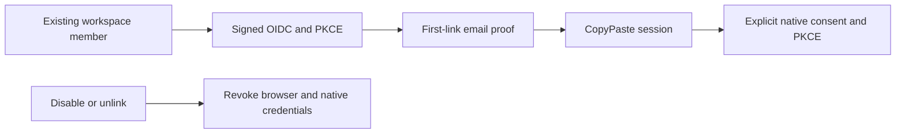

Deployment: use exact HTTPS `SSO_ALLOWED_ORIGINS`. Default callback is `WEB_ORIGIN/v1/auth/sso/callback` through the Web API proxy; `SSO_CALLBACK_ORIGIN=API_ORIGIN` is supported when Web uses that cross-origin `VITE_API_BASE`. Production rejects `SSO_ALLOW_LOCALHOST=true`. For the native fixture only, start the development controller with this environment flag, run `qa:federation`, then stop and restart without it.

## Labelled synthetic development mode

`npm run demo` starts the native database, real Codex worker, loopback mock AI gateway, Web and Admin without modifying the platform .env. Production and exposed-host configurations reject synthetic mode. Pages and stored business records identify the mode; a workspace Owner can claim one demo gift. `npm run stop` closes only controller-owned processes; wait for the native database checkpoint and exit before restarting.

`npm run qa:alignment` covers email onboarding, erasure, a 9 MiB upload interrupted and resumed after reload, an actual Codex run with synthetic dependencies, SSE, four viewport widths/dark theme and independent Admin MFA. Results are stored in evidence/alignment.json. All owned browser contexts and instances close in finally. Existing release/ archives remain the historical 0.5.0 delivery until rebuilt.

## Additional source validation

- `npm run qa:cloud-files`: four Web cloud-file groups, two real Codex tasks with synthetic dependencies, persistent sources and actual ZIPs. Saves cloud-files.json and captured HTTP payloads.
- `npm run qa:desktop-transfer`: eight source Electron groups for login, idempotent upload, actual 29 MiB transfers, overwrite protection and native cloud-tree browsing. Saves alignment-desktop.json.
- The current platform regression passes 185/185; the complete TAP and summary are under evidence/alignment-platform.\*.

At the master root, run `python -X utf8 docs/tools/validate_runtime_contract_samples.py` to check captured response schemas. These runs use explicitly synthetic dependencies and real Codex; they do not qualify live model quality or all 102 integrated acceptance cases.

## Skill lifecycle verification

Project methods now have exact installation and specialist/task bindings. Ordinary disable affects new work; uninstall and permanent security revocation block subsequent calls, including old tasks. Reinstallation creates a new identity and requires explicit adoption by a new specialist version. Current plan access is checked before tools and final output; measured usage settles against the original reservation.

Platform regression: **185/185**. `npm run qa:skills` in the delivery repository passed three browser groups; 31 captured HTTP request/response payloads passed the strict design schemas. Custom package review/publication and complete live-role qualification remain pending. Existing 0.5.0 installers are historical.

## Default assistant, inbox and source integrity

qa:default-assistant and qa:notifications each validate four Web journey groups; qa:extension validates eight real MV3 groups. qa:desktop-transfer now has eight groups, including default text work, inbox navigation and the persistent simulated-data notice before/after login. Dependencies are synthetic as authorized, while Codex and persisted workflows run; owned browser/application instances close in finally.

qa:byte-integrity creates independent native Git clones of platform/Desktop/delivery and checks raw SQL digests against both existing migration ledgers, all 28 Skills, renderer provenance and raw TAP. Commit source and TAP first. Owned, verified temporary directories are removed afterward. This is checkout integrity, not disaster recovery.

Current source passes 185/185 platform tests and four Desktop unit tests, with 31 captured HTTP request/response payloads. Master documents retain all 102 full acceptance cases and remaining production work.

## Initial-input verification

`npm run qa:task-dependencies` passes five Web groups covering the original waiting conversation, one reservation, private upload, current-version selection, authorization-error recovery and real Codex with synthetic model data. `npm run qa:admin-task-inputs` passes three groups covering scoped body inspection and cancellation without a model charge. Desktop transfer QA and MV3 QA each pass eight groups, including the same initial-input flow. Every owned browser/context/application closes in `finally`.

`python scripts/capture-platform-regression.py` captures exact raw TAP bytes and records their SHA-256 and test counts. Commit source and evidence before `qa:byte-integrity`. `npm run stop` waits for the controller and native database checkpoint to finish; it does not report completion merely when shutdown is acknowledged. Full requirements and paid-step continuation remain in the master audit.

## Execution-capacity verification (current source)

`npm run qa:execution-capacity` uses explicitly synthetic private occupancy in its fresh workspace to check waiting with no model call, one original hold, an MFA-authenticated Admin reason, themes/languages/widths and automatic real-Codex/synthetic-model delivery with one settlement. Owned occupancy and browser instances are released in `finally`. This is not an NFR benchmark. Seven platform groups independently test concurrent claims and actual pg-boss in a random native database, then remove that database and its dedicated data directory.

## Admin record and isolation verification

`npm run qa:admin-records` uses fresh enterprises, 58 visible and six excluded synthetic journal rows. It verifies real email/MFA, scoped totals, default 50-record pages, combined filters/URL state, read-only retry denial, four widths, two themes/languages, delayed-denial cleanup and actual grant expiry. It runs only in local synthetic mode and creates no real objects or physical deletion effects. Finally it suspends the fixture administrator, revokes its sessions and closes owned browsers. Reports and actual payloads are `evidence/admin-records*.json`.

Platform integration suites now use separate native databases/data directories while keeping production execution limits. `evidence/admin-records-first-regression-failure.*` preserves the original failed run; `capture-platform-regression.py` captures current regression bytes. Migration 030 participates in checkout integrity. Historical installers are not repackaged by these source changes.

## Template and native-client verification

`npm run qa:agent-templates` verifies eight real Web/current-source Electron journeys: isolated sign-in/workspace, filtering, unavailable tools, cost-free preflights, edit invalidation, idempotent recovery after a lost accepted response, fresh receipts after restoring a method, widths/themes/languages, authorization-denial hiding and native PKCE/tenant validation. Model/media dependencies remain simulated; persistence is real. Owned browsers and applications close in finally.

The template increment's six platform groups brought that regression to 145/145; the subsequent PDF increment brought the total at that time to 147/147. Four captured template responses bring strict HTTP schema samples to 21. Byte verification must include migration 031 and the new renderer snapshot. Historical installers/bundles retain their original version, and all 102 requirements and the minimum of 12 qualified roles remain in scope.

## PDF delivery verification

`npm run qa:design-pdf` verifies seven journeys: real sign-in/canvas, a lost accepted reply, idempotent retry, source-version conflicts, widths/themes/languages, a designer template and native Electron saving. Independent pypdf inspection and native Poppler rendering compare the PDF to its source PNG. `evidence/design-pdf.json` records geometry, hashes and owned-resource cleanup.

Set `CHROME_BIN`, `PDF_QA_PYTHON` (pypdf/Pillow) and `PDFTOPPM_BIN` for native QA tools; these are not product runtime dependencies. The full platform regression passed **185/185**. Historical installers remain unchanged and all 102 requirements retain their full acceptance conditions.


## Marketing CSV, exact metrics and provenance (current source)

Preview and confirm the account, currency, timezone, entity level, attribution and conversion definitions before import. Generic CSV and candidate Google/Meta-style headers support explicit column mapping. Actual UTF-8/BOM source bytes, SHA-256, definitions and computed results are retained. Duplicate requests, including a lost accepted response, return one project snapshot. Quarantine prevents reimport bypass. Unknown conversions stay unknown; exact decimal CTR/CPC/CPM/CVR/CPA/ROAS use aggregate totals and historical results are frozen.

Download the original CSV, normalized CSV, JSON calculation report with 11 evidence references and an actual SVG chart. Data dates are shown; upload time is not presented as the platform extraction cutoff. Official account sync, cross-platform conversion deduplication, FX and complete AI narrative acceptance remain pending. The marketing role is still unqualified. Authorized model dependencies are simulated; database and file behavior are real. Historical installers have not been rebuilt.

`npm run qa:marketing-analytics` exercises six Web/native Electron groups: real sign-in, mapping preview, retry after a lost accepted reply, actual CSV/JSON/SVG downloads, invalid/unknown data, both themes/languages at four widths, clearing denied selected snapshots and native saves. Set `CHROME_BIN` to native Chromium. Evidence is under evidence/marketing-analytics.json; all owned browser/context/Electron resources close in finally. The current full platform regression passes **185/185** and preserves raw TAP bytes and their hash.

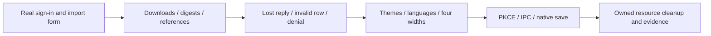


## Private AnalysisSpec reports (current source)

Select saved snapshots, a business question, current/comparison dates, metrics, dimensions and a maximum HKD budget in Marketing insights. Preview neither calls a model nor reserves credit. Explicit confirmation atomically creates a private Codex task, frozen calculations/evidence and one reservation. Sources, accounts, currencies, timezones and attribution stay independent; identical facts deduplicate, conflicts reject, and zero/missing comparison values retain reasons. Retrying a lost accepted response returns the same report.

Real Codex reads paginated frozen evidence. The server validates evidence placeholders and numeric literals before publishing an immutable HTML asset; JSON preserves full calculations. Natural-language meaning and professional quality still require acceptance. Model dependencies are explicitly simulated. Source quarantine/erasure and project revocation block reads and downloads. All 102 complete acceptance cases, official connectors, live-role qualification and production release remain pending. Historical installers have not been rebuilt.

Run `npm run demo`, set `CHROME_BIN` to native Chromium, then run `npm run qa:analysis-reports`. Six actual Web/current-source Electron groups cover sign-in, uncharged preview, lost-response retry, canonical reads/real downloads, 16 width/theme/language combinations, denied-read clearing and byte-identical native saves. Results: `evidence/analysis-reports.json`. Two first-failure reports retain the tool-context and mobile-layout issues; the final report records repaired behavior separately.

Current platform regression: **185/185**; strict captured HTTP payloads: **31/31**. `capture-platform-regression.py` preserves exact TAP bytes and hashes; never format TAP files. `evidence/analysis-index-backfill.json` compares the evidence index with saved metrics without recomputing history. All owned browsers, pages, contexts and Electron applications close in finally.

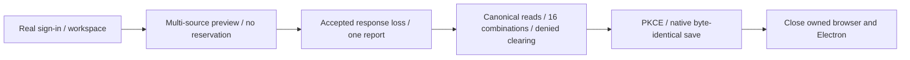


## File-backed CSV/XLSX and correction history (current source)

Marketing inputs are uploaded as immutable shared project-file versions before reviewing the sheet, header row, mapping and account definitions. Google/Meta use canonical `POST /v1/dataset-imports`; generic tables use the compatible nested endpoint. Preview calls no model and reserves no credit. Duplicate content and retries after a lost accepted reply reuse the snapshot. Original CSV/XLSX downloads verify actual bytes and SHA-256.

The bounded read-only XLSX parser accepts up to 5,000,000 bytes, 50 worksheets, 100 columns and 10,000 data rows. Multiple visible sheets require explicit selection; header rows range from 1 to 100. Shared/inline strings, XML Unicode references, exact decimals and 1900/1904 dates are supported. Money inputs allow six decimal places; frozen metric values retain eight. Formulas, including cached results, macros, external links, encrypted files and merged data cells are rejected. Errors identify actual worksheet cells. The UI explains that a failed preview still retains the explicitly uploaded original project file.

Corrections create new immutable snapshots and a complete ancestor chain; prior metrics and reports retain their original values. AnalysisSpec rejects selecting an ancestor with its correction before creating a task or budget hold. Source quarantine/erasure prevents dependent data, reports and downloads. Recovery closes only unclaimed unavailable tasks and releases unused holds; started or uncertain charges keep reconciliation rules. Private files require explicit publication as a shared copy first.

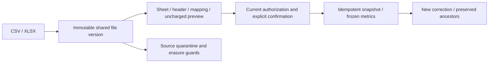

The full platform regression passes **185/185**; strict captured HTTP samples pass **31/31**. Four file-import and six existing CSV Web/source Electron groups pass, along with native type checks and four unit tests. Model/media dependencies are authorized synthetic data; database, Codex, files and authorization are real. All 102 complete acceptance cases, the complete official export matrix, live connectors, professional qualification and production release remain pending. Historical 0.5.0 installers have not been rebuilt. See master `docs/technical/29-file-imports-and-correction-lineage.md` for detailed limits.

With the native development stack running, set `CHROME_BIN` and run `npm run qa:file-imports`. Four groups cover a lost accepted reply, one source asset, correction history, formula errors, 16 UI combinations and real PKCE/native saves. Results and five request/response samples are under `evidence/file-imports*.json`. Initial native-bridge failure evidence is preserved separately; all four groups passed after the fix. Owned browsers and Electron close in finally.


Independent compatibility: set `WORKBOOK_QA_PYTHON` to native Python with openpyxl, then run `npm run qa:workbook-interop`. Four groups use openpyxl 3.1.5 workbooks covering both date systems, styles, sparse/hidden rows, Unicode, formula rejection and seven-decimal input rejection. Evidence is `evidence/workbook-interop.json`. The first Unicode-reference defect and the initial overprecision fixture record are retained separately; owned temporary workbooks close and are removed in finally. Python/openpyxl are QA tools, not product runtime dependencies.

With the native stack running, set `CHROME_BIN` and run `npm run qa:task-controls`. Five groups verify Web, source frameless Desktop and real MV3/PKCE queued pause/resume/cancel, then release only owned synthetic occupancy so real Codex/synthetic model output produces a file and settles once. Task/reservation identity is preserved; owned browsers, Electron and MV3 close in finally. Evidence: `evidence/task-controls.json`; full platform regression: 185/185. This validates current source; prior native previews/offline bundles retain their manifests. Running/paid-step continuation and all 102 complete acceptance cases remain unfinished.

## Cross-client session acceptance

`npm run qa:sessions` uses owned isolated browsers, source frameless Electron and real MV3, a fresh synthetic account and actual email/PKCE. It covers inventory, Web remote revocation, expired native access sign-out, offline feedback, cross-tab logout and late responses, with zero model calls. Only this run's credentials have expiry altered; offline revoke and the background GET gate are explicit fault fixtures. Finally closes all owned pages/contexts/applications and writes `evidence/sessions.json`. This suite does not rebuild historical installers or close full identity, all 102 requirements or production gates.

The session acceptance run passes all seven groups. The full platform suite passes 191/191, native Desktop tests 15/15 and Extension tests 10/10. Four earlier Windows GPU-path timeouts and the controlled comparison are retained. This acceptance run launches its owned Chromium/Electron instances with `--disable-gpu`; product launch flags remain unchanged. Timer/frame and normal-click evidence is in `evidence/sessions-gpu-diagnostic.json`, and the final mode is recorded in `evidence/sessions.json`. This does not qualify hardware rendering compatibility or complete the full requirement matrix.

## Admin membership real HTTP verification

Run npm run qa:admin-membership-wire for real synthetic user logins and temporary administrators scoped only to the owned test workspace. It checks grants, suspension/restoration, canonical operation recovery, independent approval and revocation, with zero model calls. It logs out its own sessions and disables its own temporary principals. Original receipts and captured response samples stay in evidence; these checks do not establish page acceptance.

Final stable-source platform regression: **233/233**, including **13/13** Admin membership groups. Current real Admin membership HTTP checks: **5/5**; captured original-contract samples: **43/43**. Delivery `evidence/` retains original receipts. Current UI, production and complete native gates remain separate.


## Account-control verification increment

`npm run qa:admin-account-wire` runs six current local HTTP groups with owned synthetic email/TOTP identities: canonical profile, session revocation, user freeze, workspace isolation, independent closure and MFA checks on replay, capturing eight strict operation samples. `npm run qa:admin-account-ui` separately checks the new form using owned software-rendered Chromium, closing it in finally without touching user browsers. The actual evidence JSON checks/errors/closed determine the outcome; attempts and old screenshots are not passes.

This increment's full platform regression is 245/245 with untouched raw TAP. The previous 233-test JSON/TAP and clone receipt are archived in `evidence/stage36-platform/`. Model dependencies remain authorized simulations; full native acceptance, remaining Admin contracts and updated historical packages are outstanding.


The new account UI passes **5/5**, the full platform **245/245**, and current strict captures **51/51**. Browser checks led to a real approval-navigation fix; screenshots accompany the Admin bilingual guides. Native and older membership open issues remain. When the default Playwright executable is absent, set `CHROME_BIN` to an installed Chromium; this run used local `chromium-1243/chrome-win64/chrome.exe`. QA does not download browsers, and missing-path/navigation failures are archived separately.


## Canonical directory verification increment

`npm run qa:admin-directory-ui` runs seven groups against the local API/Vite Admin and owned Chromium: real email/TOTP, 23 synthetic users across 20/3 cursor pages, strict details and existing account/VIP target entry points, VIP/workspace/state filters, stable workspace billing account IDs, responsive bilingual styling, and MFA/anonymous rejection. `CHROME_BIN` selects an installed browser; this run used cached chromium-1243 without downloading. Only owned synthetic records are captured in `evidence/admin-directory-contract-samples.json`; checks and closure are recorded in `evidence/admin-directory-ui.json`.

Ten server groups are preserved in `evidence/admin-directory-final.tap`. Previous 245-test platform and byte receipts are archived under `evidence/stage37-platform/`; invalid fixtures, denied-project zero projection and premature initial screenshots remain in `evidence/stage38-initial/`. Current full regression/clone receipts provide actual counts and hashes, retaining untouched TAP bytes.

UI verification uses source Vite services; production builds are checked separately. It does not accept packaged or complete native journeys. Owned browsers/contexts close and owned test administrators/sessions/users are disabled without touching user browsers. Model calls are zero. Complete financial/VIP write contracts, consumption drilldown, older membership pages and native/release acceptance remain outstanding.

Historical directory-stage platform regression: **256/256**; directory UI/HTTP: **7/7**; strict response captures: **63/63**. The full TAP includes eleven new directory/export groups; the targeted legacy-consumer rerun passes **7/7**. Untouched TAP SHA-256: `e0741c2315252c644229cfd51198c911c8272c66b365924f4a3e92fa396f5079`. The initial 252/255 legacy-consumer failure is preserved under stage38-initial; original contracts and security assertions were retained.

## Canonical financial forms and approval increment

The final full platform regression passes **291/291**, with 664 participating source files and the verifier unchanged before/after execution. Raw TAP SHA-256: `3384f423b23b9d764af55daeffbe7bcf14669791defbddfc9ba0358cd7bcb6c7`. This fee increment does not change the tested frameless Desktop or native Chrome Side Panel bytes.

`npm run qa:admin-fees` verifies the three fee forms, pure previews, idempotent receipt recovery, distinct independent approval requests, actual ledger and bilingual light/dark/mobile pages using real email/TOTP sessions. Four groups and ten actual strict HTTP captures pass. Runtime/verifier sources match before and after, the owned browser closes, and user tabs are untouched. Five screenshots ship in the independent Admin repository. External payment/model calls are zero.

The focused fee/migration TAP passes 16/16. Initial failures and the earlier pre-request 14/14 raw output remain preserved. Two initial browser-script locator/initialization failures and diagnostics are archived separately. Previous 277-test evidence is under `pre-admin-fees/`; an intermediate 289-test run explicitly cannot prove final source because implementation continued during its execution. The coherent 291-test result before the route inventory update is separately preserved under `admin-fees-pre-route-inventory/`. Current JSON/TAP and clone receipts govern the final result.

Full payment evidence/records, cash refunds/reconciliation, original-bucket consumption refunds, immutable plans/VIP, financial outbox, complete normative approval directories and remaining native/NFR/release gates are still required. Historical stage counts are not complete current acceptance.

## Stage 42 snapshot: membership UI and native authentication recovery (2026-10-20)

| Command | Current receipt | Result | Source/runtime files |
| --- | --- | --- | --- |
| `npm run qa:membership` | `evidence/membership-ui-recovery.json` | Web 6/6, four strict captures | 155, unchanged |
| `npm run qa:admin-membership-ui` | `evidence/admin-membership-ui.json` | Admin 6/6, four strict captures | 179, unchanged |
| `npm run qa:sessions` | `evidence/auth-recovery-current.json` | Web/source Electron/MV3 12/12 | 758 including actual dist/renderer-dist, unchanged |

Actual authentication/authorization/database behavior is used with owned test identities; model calls are zero. Owned BrowserServer, Electron and MV3 instances close, credentials are revoked and temporary admins are confirmed suspended in the database. User tabs are untouched. Fourteen actual screenshots ship in independent client repositories and bilingual READMEs, mirrored centrally. Three original issue receipts retain their SHA-256 and link to the new bounded passing evidence in the central snapshot.

The first Web recovery remained failed because logout lacked an idempotency header; the initial Admin UI run remained failed for schema-container registration and a cleanup enum. Their raw receipts, samples, screenshots and subsequent actual credential cleanup are preserved in `membership-ui-first-recovery/` and `admin-membership-ui-initial/`. New results do not overwrite failures or establish one cause for the older startup timeouts.

Eight new captures bring original-schema checks to 89/89. The full 291/291 platform regression, its 664 participating source files and raw TAP remain unchanged. Twelve source authentication flows are separate from ten native-preview window/side-panel groups. Full packaged authentication, system/DPI, SSO, native membership, production mail and all TC/NFR/G01–G10 acceptance remain outstanding. Central scope: `docs/technical/42-current-membership-ui-and-native-auth-recovery.md`.

## Shared Admin approval verification (2026-10-20)

Existing pending Platform/Admin commands now share distinct persisted requests, the original cursor directory and four-field decisions. `npm run qa:admin-membership-ui` exercises real email/TOTP logins for two administrators, suspension/restoration, actual request navigation, UI self-review prevention and server refusal, independent approval with the frozen revision/hash, and normative list/operation captures. `npm run qa:admin-fees` rechecks three financial forms and independent approval; `npm run qa:admin-account-ui` checks account forms and self-review prevention. Native authentication and Web membership are rerun separately.

Prior passing source snapshots/screenshots are retained in `evidence/stage42-before-unified-approvals/`; every initial failing TAP remains intact. Complete payments, refunds, VIP, financial notifications and full acceptance remain outstanding. The bound Desktop/extension preview bytes were not rebuilt for this backend change.

Stage 43 passed platform 303/303 (669 unchanged source files), approval/upgrade focus 53/53, Web membership 6/6, Admin membership 6/6, fees 4/4, accounts 5/5 and Web/source Electron/MV3 authentication 12/12. Original-schema captures pass 91/91. Overlapping checks are not added twice to platform totals. Full acceptance of all 102 requirements remains tracked in docs.

## Payment evidence and exact posting repair (2026-10-20)

`qa:admin-fees` covers four normative fee commands plus payment registration and independent evidence verification: five browser groups, fifteen original-schema responses and thirty-nine unchanged runtime/verifier source files. Owned browsers close after execution. Twenty-one isolated financial groups cover exact large amounts, independent verification, historical receipt deduplication, concurrent single posting, actual debt repayment, current authority/revocation and atomic audit rollback. The full regression result remains in `evidence/alignment-platform.json/.tap`.

Stage 43 original bytes are archived under `evidence/stage43-before-payment-records/`. New `payment-records-*` files retain actual failures, successes, native migration logs and copy manifests. Original 050/049 trigger failures and initial verifier mistakes are not counted as passes; appended 051/052 repair them. Simulated receipts do not establish payment-provider, complete refund/VIP or full product acceptance. Existing native appearance previews retain their original artifact manifests.

This stage finishes with platform **310/310** and 676 unchanged participating files. Raw TAP SHA-256: `5b499c16a50ec57427ed7ff7cf4681ba2e0cef0330e97159dde7e9d25e291119`. Separate scoped checks pass Web membership 6/6 (164 files), Admin membership 6/6 (190), fees 5/5 (39), accounts 5/5 and source cross-client authentication 12/12 (769). Original-schema samples pass **96/96**. Manifests preserve 180 original-byte archive copies, including the first 306/310 failure. These bounded checks do not close all 102 requirements or release gates.

## Original-source refunds and cash evidence (2026-10-20, later increment)

Consumption compensation restores original promotional/paid funding or the actual credit repayment source, preserves gift expiry and cancels only the original unpaid obligation. Cash refunds reserve unspent verified original payments. A different administrator records each actual payout, remaining non-payment or unknown/mismatched result; a partial payout never becomes a false full success. Missing legacy repayment provenance requires reconciliation.

Current Platform regression passes 324/324 with 683 unchanged source files. Actual financial/refund UI passes 8/8 with 47 unchanged sources; 100/100 original response schemas and 14/14 supplemental refund checks pass separately. The 50 focused cases overlap the full run. SQL 053–055 are applied to both native databases; 001–052 remain unchanged. Synthetic model/media/payment fixtures do not qualify live providers. Legacy credit reconciliation, full payment/VIP/outbox, system and complete acceptance remain outstanding. Earlier counts describe their historical stages.

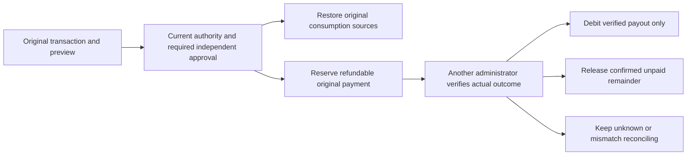

After the refund increment, current-source Web membership passes 6/6 (169 sources), Admin membership 6/6 (196), and Web/source Electron/MV3 authentication 12/12 (775), with unchanged source hashes and owned credential/process cleanup. The initial Electron debugging connection timeout is retained; the same source passed the rerun. Frameless Desktop and native Side Panel preview bytes are unchanged. Full packaged authentication and system acceptance remain separate.

Current-source verification after the immutable-plan increment (2026-10-20): Web membership 6/6 (172 source files), Admin membership 6/6 (200), and Web/source Electron/MV3 authentication 12/12 (779). Source digests match before and after each run; owned browsers, Electron and extension instances are closed and test credentials cleared. Immutable definitions and frozen legacy bindings do not change the native preview packages. Complete VIP/quota behavior, packaged authentication and system acceptance remain tracked in the main documentation.

Independent Git checkout verification also compares every tracked canonical schema fixture byte-for-byte, preventing line-ending conversion from invalidating source receipts. The final full platform regression passes 340/340 with 688 unchanged source files; current evidence retains the raw TAP and its digest.

## Canonical VIP and current native preview delivery

The original stage 47 platform run passed **354/354** with 694 unchanged source files and preserved raw `alignment-platform.tap` bytes. Admin VIP has six groups/nine original-schema responses; native VIP has six groups/five responses; native surfaces have ten groups; source-runtime cross-client authentication has twelve. Overlapping subflows are not added up as full-product acceptance. All 122 captured runtime responses pass strict original OpenAPI schemas. All 102 requirements, full acceptance cases, NFR and G01–G10 remain in scope.

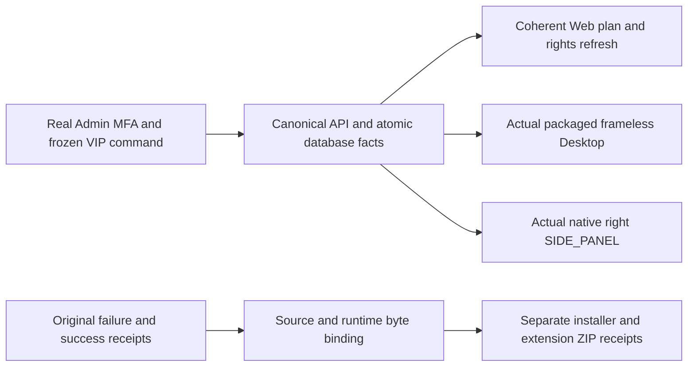

New runnable entries: `npm run qa:admin-vip` and `npm run qa:native-vip`. For `qa:native-surfaces`, set `COPYPASTE_DESKTOP_EXECUTABLE` to the actual `release/frameless/win-unpacked/CopyPaste.exe`; MV3 verification requires extension-capable Chromium. Scripts close only their owned windows, browsers, sessions and fixture administrators, preserving existing user tabs. Docker and WSL are not used.

`evidence/vip-migrations.json` retains the real limitation of 057: the test database has a complete 056→057 old-row comparison, while initial primary startup migrated before the snapshot, leaving only a later baseline. The primary pre-upgrade row proof is missing. Fifteen legacy null checksums remain null. Applied 001–057 bytes are immutable. The already-executed controlled `upgrade:vip-local` tool refuses to repeat or invent an earlier snapshot.

Archive manifests preserve original SQL/TAP candidates, result-modal and narrow-layout failures, the stale plan heading, the incorrect free-feature assumption, and native document/resize timing failures. Only actual new passes qualify as current evidence. Seat/storage enforcement, atomic VIP-plus-gift operations, full installer/system/SSO acceptance and live model role qualification remain open.


## Enterprise seat and storage enforcement (stage 48)

`npm run qa:resources` exercises eight actual browser subflows: real email/TOTP sessions, independently approved workspace plans, an actual upload, usage/member/admin views, over-limit downgrade and permission revocation. Upgrades 058 and 059 each retain before/after comparisons of 23 original tables in both native databases. Their upgrade commands refuse to overwrite original snapshots.

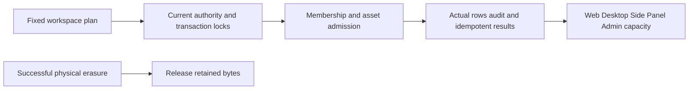

The initial 374-test run with one deletion conflict, the ambiguous UI locator failure and their original receipts remain archived. Current native previews were rebuilt and bound to source/runtime/installer bytes. No Docker or WSL is used. Current results are recorded in `evidence/alignment-platform.json`, `resource-ui.json` and `native-surfaces-artifacts.json`. All 102 complete acceptance cases remain separate.
