# Workmate · CopyPaste Enterprise Agent · delivery

<!-- native-teams-stage139 -->

Exact-byte delivery: the original runtime checkpoint and failed attempts are retained. Git preserves the executed sources and verifiers without newline conversion; the release checkpoint separately binds this version-control metadata change.


## Native specialist teams · Stage139

Run `npm run qa:native-teams-backend -- <new two-digit attempt>` for actual native PostgreSQL, metering and permission regressions. Run `npm run qa:native-teams -- <new two-digit attempt>` to build and operate the actual Windows package. Native Node/PostgreSQL runtimes, Chrome, FFmpeg and pinned Codex are required; Docker/WSL are not used. Original successful and failed attempts remain separate.

Up to 16 steps, seven members plus one assistant coordinator and three concurrent members share one explicitly approved folder. Keep concurrent edits in separate files. Review is free; exact budgets are immutable, holds and actual charges remain separate, and unknown accepted operations are never rerun. Revocation stops native tools first and leaves unsynchronized receipts visible. Only submitted outputs enter the team ZIP; local-only files remain local.

60 backend, 36 extension and 81 native controller/download checks, plus six actual Windows journey checks passed. Four screenshots, one GIF/MP4 pair, three layouts and an independently extracted complete team archive bind 1756 exact source files.

Business/model responses and native folder/consent/save decisions are controlled fixtures. Actual OTP/PKCE, native Codex processes, Windows file operations, company metering, revocation and ZIP extraction execute for real. The package is unsigned. Full professional-role quality, signed installation coverage, real company models/ad accounts and portable project recovery remain separately open.

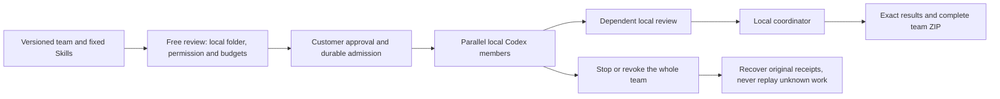

[Requirements](https://github.com/copypasteltd/workmate/blob/main/docs/requirements/16-desktop-native-teams.md) · [API, permissions, recovery and delivery](https://github.com/copypasteltd/workmate/blob/main/docs/technical/139-desktop-native-teams.md) · [Source and evidence](https://github.com/copypasteltd/workmate/blob/main/docs/quality/native-teams-release-checkpoint-139.json) · [All original identities](https://github.com/copypasteltd/workmate/blob/main/docs/quality/remaining-work-stage139.md)

Actual Desktop workflow, synthetic business content:


- [workmate-native-teams-139-05-review-before-local-run-en.png](https://github.com/copypasteltd/workmate/blob/desktop/assets/screenshots/workmate-native-teams-139-05-review-before-local-run-en.png)
- [workmate-native-teams-139-05-completed-local-team-zh.png](https://github.com/copypasteltd/workmate/blob/desktop/assets/screenshots/workmate-native-teams-139-05-completed-local-team-zh.png)
- [workmate-native-teams-139-05-whole-team-access-revoked-zh.png](https://github.com/copypasteltd/workmate/blob/desktop/assets/screenshots/workmate-native-teams-139-05-whole-team-access-revoked-zh.png)
- [workmate-native-teams-139-05-local-team.mp4](https://github.com/copypasteltd/workmate/blob/desktop/assets/screenshots/workmate-native-teams-139-05-local-team.mp4)

<!-- delivery-revision-stage138 -->
## Source-bound revisions and new delivery · Stage138

Run `npm run qa:delivery-revision-backend -- <new two-digit attempt>` for the native-database regressions, or `npm run qa:delivery-revision -- <new two-digit attempt>` for complete builds and actual client journeys. Native Node/PostgreSQL runtimes, Chrome, FFmpeg and the pinned local Codex are required. Every attempt is retained separately, including failures. Docker and WSL are not used.

Choose a complete delivery, answer, file, Unicode text quote, image region or verified video interval. Previewing does not call AI or reserve money. Confirming a revision creates a separate budgeted task with the fixed original role and source; original files and charges remain. Changed or withdrawn sources fence later reads and completion. Shared project editors may revise authorized shared work; private conversations retain their original owner. Unknown-outcome retries retain their original immutable request.

Text previews are limited to 1 MiB and inline image/MP4 previews to 4 MiB. Larger or unsupported previews can still be downloaded and revised as complete files. Complete-delivery references allow at most 20 files; video intervals require retained valid duration. Image/video anchors identify requested locations and do not approve an editing operation or prove professional output quality. Specialist workflows retain their own approvals.

34 current backend checks including 13 new revision cases, 36 extension checks, 73 native controller/download checks and nine actual client journey checks passed. Eleven actual screenshots, three GIF/MP4 pairs, seven layouts and three independently extracted revised archives bind 1732 exact source files.

Business/model responses and native dialog selections are explicitly controlled fixtures. Login, database permissions, exact files, actual packaged local Codex, native Windows surfaces, Chrome SIDE_PANEL and revised ZIP downloads run for real. The Windows package is unsigned. Real company models/accounts, full professional-role output quality, installation matrices and complete project recovery remain separately open.

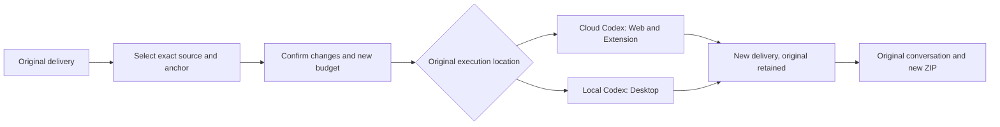

[Requirements](https://github.com/copypasteltd/workmate/blob/main/docs/requirements/15-delivery-revisions.md) · [Architecture and usage](https://github.com/copypasteltd/workmate/blob/main/docs/technical/138-source-bound-delivery-revisions.md) · [Exact source and evidence](https://github.com/copypasteltd/workmate/blob/main/docs/quality/delivery-revision-checkpoint-138.json) · [All original identities](https://github.com/copypasteltd/workmate/blob/main/docs/quality/remaining-work-stage138.md)

Actual product interaction, with synthetic business content:


Additional actual screenshots and MP4 recording:

- [workmate-delivery-revision-138-06-lost-response-retained.png](https://github.com/copypasteltd/workmate/blob/web/assets/screenshots/workmate-delivery-revision-138-06-lost-response-retained.png)
- [workmate-delivery-revision-138-06-image-anchor-en.png](https://github.com/copypasteltd/workmate/blob/web/assets/screenshots/workmate-delivery-revision-138-06-image-anchor-en.png)
- [workmate-delivery-revision-138-06-video-anchor-en.png](https://github.com/copypasteltd/workmate/blob/web/assets/screenshots/workmate-delivery-revision-138-06-video-anchor-en.png)
- [workmate-delivery-revision-138-06-revised-delivery-zh.png](https://github.com/copypasteltd/workmate/blob/web/assets/screenshots/workmate-delivery-revision-138-06-revised-delivery-zh.png)
- [workmate-delivery-revision-138-06-delivery-revision.mp4](https://github.com/copypasteltd/workmate/blob/web/assets/screenshots/workmate-delivery-revision-138-06-delivery-revision.mp4)

<!-- delivery-package-stage137 -->
## Complete delivery and original-chat download · Stage137

The main journey is goal → missing inputs → execution → review → download → revision in the original conversation. Web and the genuine native Chrome right SIDE_PANEL now download a complete current task delivery directly from chat. Delivery review also exposes it. Desktop uses the company API and its native save dialog; cancellation sends no export request and shows no success. Panel receipts survive live refresh and language changes.

The ZIP contains actual output files, task text when present, exact task/artifact versions, SHA-256 checksums and bilingual editing instructions. Identical filenames remain separate; stopped/failed task outputs remain explicitly partial. Instructions distinguish source ZIPs, SVG/PPTX, project JSON and flattened outputs. They never invent a missing editable project. Local files not submitted remain local, and Desktop continues running its own local Codex with customer-granted permissions.

The requested task version and delivery digest must match. The backend verifies real file size and digest while streaming sequentially into a disk-backed ZIP, then repeats current authority, source, retention and version checks before sending any download headers. Corruption, revocation or a changed delivery fails the whole package. Project readers may download authorized shared results; approval remains separate. Admin identity alone does not grant private conversation access. Exporting creates no AI call, new task or AI charge. Capacity is 16 GiB / 10,000 output/text entries; excess is rejected without silent omissions.

No new SQL migration is needed beyond existing SQL135. Rebuild Backend and all three clients. Extension adds Chrome `downloads` permission and uses the browser download location with conflict renaming; authorization stays in company request headers. Backend `contracts/delivery-package-v1.json` specifies the endpoint. From Delivery run `npm run qa:delivery-package-backend -- <new two-digit attempt>` or `npm run qa:delivery-package -- <new two-digit attempt>`; the latter performs full builds, creates an unsigned Windows package and drives actual native client downloads.

21 current backend checks including eleven new export cases, 37 extension checks, 1 native download regression, twelve boundary checks and ten actual client journey checks passed. Nine actual screenshots, three GIF/MP4 pairs, seven layouts and three independently extracted archives bind 1,713 exact source files. Business content and the Codex adapter are controlled; OTP/PKCE, stored files, authorization, native windows and Chrome downloads run for real. Desktop save-dialog selection is directed to an owned fixture destination. This increment does not requalify every local Codex tool, real company model, professional output quality or full project restoration across environments. A separate stage-local 52-case backend/source regression retains its exact original scope rather than being presented as a full current-platform rerun.

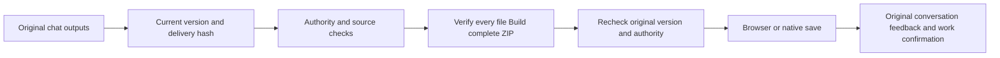

[Requirements](https://github.com/copypasteltd/workmate/blob/main/docs/requirements/14-complete-delivery-package.md) · [Architecture and usage](https://github.com/copypasteltd/workmate/blob/main/docs/technical/137-complete-delivery-package.md) · [Exact source and evidence](https://github.com/copypasteltd/workmate/blob/main/docs/quality/delivery-package-checkpoint-137.json) · [All original identities](https://github.com/copypasteltd/workmate/blob/main/docs/quality/remaining-work-stage137.md)

Actual customer workflow captures (synthetic content):


<!-- business-inputs-stage136 -->
## Business questions and original-task continuation · Stage136

When an essential canvas size, audience or business definition is missing, the Agent can ask in the original conversation. Customers may choose and edit a suggestion or write a different answer, then explicitly confirm it. Nothing is preselected or automatically submitted. Partial answers remain saved; completing all inputs continues the same task, conversation and original budget hold. Measured usage is settled cumulatively. Each confirmed question becomes one original-conversation note; identical retry adds no duplicate.

Web and the actual native Chrome right Side Panel show these questions inside the existing chat; Desktop supports answers in its existing cloud-task detail view. English/Traditional Chinese switching preserves drafts and a failed submission retains its text. Extension clears drafts on identity/conversation changes and removes protected questions when sources become unreadable. An answer grants no files, advertising accounts, tools, local access or additional spending permission.

The server strictly distinguishes `question`, `file` and `connection`: up to eight suggestions and 4,000 answer characters, with version, current authority, source and complete-batch validation before any update. Confirmed answers are immutable. Paid questions wait at a completed, measured Codex boundary and resume the original thread; cancellation settles known usage only. Private-conversation erasure removes questions, answers, checkpoints and text while retaining necessary accounting facts.

Apply SQL135 before API/Worker startup with Backend `npm run db:migrate`. Original SQL001–134, twenty baseline task definitions and the primary OpenAPI remain byte-identical. `contracts/business-inputs-v1.schema.json` adds strict versioned definitions to the existing create/input endpoints. File/connection requests retain their shape; questions use `answer` rather than `resource_ids`.

122 backend integration checks (including eleven new question cases), 61 extension state checks, twelve delivery binding tests and fourteen actual three-client checks passed. Nine actual screenshots, three GIF/MP4 pairs and seven layout checks bind to exact sources. Native integration uses the actual pinned Codex executable with synthetic Responses; UI journeys use scripted tools and synthetic business replies. Initial full client builds passed. Corrected journeys explicitly reuse byte-identical product source and the same unsigned Windows package; original failures remain. From Delivery, run `npm run qa:business-inputs-backend -- <new two-digit attempt>` or `npm run qa:business-inputs -- <new two-digit attempt>`; the latter performs full builds and creates an isolated native test database.

Desktop retains its separate local Codex and explicitly granted full-local-permission flow; this increment extends its cloud-task view. Actual native windows remain frameless with no Electron menu, visible vertical rails or horizontal overflow. Extension retains the genuine native right SIDE_PANEL. Data are synthetic and the Windows package is unsigned. Production models and complete specialist delivery remain open. Full acceptance retains 88 required records, twelve unconfirmed suggestions and one optional record; original REQ-095 remains accepted.

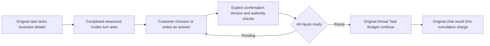

[Requirements](https://github.com/copypasteltd/workmate/blob/main/docs/requirements/13-business-brief-inputs.md) · [Implementation and usage](https://github.com/copypasteltd/workmate/blob/main/docs/technical/136-business-brief-clarification.md) · [All 102 identities](https://github.com/copypasteltd/workmate/blob/main/docs/quality/remaining-work-stage136.md) · [Exact source and evidence](https://github.com/copypasteltd/workmate/blob/main/docs/quality/business-inputs-checkpoint-136.json)


<!-- client-errors-stage135 -->
## Connection and session recovery across four clients · Stage135

Web, Admin, Desktop and Extension show connection guidance in the current language while retaining valid sign-in. A write with a lost or unreadable reply is explicitly unconfirmed: check its result before retrying. The application does not retry the write automatically. Browser transport retransmissions retain the same message identity and are deduplicated by the server. Support grants retain their fixed request key and deadline; extension delegations retain their original message identity, so explicit retry creates no second task. Background polling preserves an unconfirmed-write notice. Switching English/Traditional Chinese updates the same notice without exposing Electron internals, URLs or response bodies.

A current protected HTTP401 clears the current identity even when the body is HTML or empty. An obsolete request cannot sign out a newer identity or replace its CSRF token. Admin immediately removes its independent shell. Support-list connection errors are separate from form and revoked-access notices; successful list recovery clears only its own connection notice.

15 transport/identity tests (including actual HTTP faults), 12 delivery-file binding tests, one native bridge test and 30 actual four-client journey checks passed. Twenty screenshots and seven actual GIF/MP4 pairs bind to exact sources, including a real right-docked Chrome SIDE_PANEL, customer OTP/PKCE, independent administrator TOTP and an actual committed extension write with a lost reply and identical-message retry. Attempt09 rebuilds current Extension and Delivery. Backend/Web/Admin/Desktop source and Windows package bytes exactly match full build02, whose ten corresponding build steps and unchanged-source unit results are explicitly reused. Original failed attempts remain. Delivery `npm test` includes strict compilation, binding and transport checks; `npm run qa:client-errors -- <new two-digit attempt>` performs a full build by default.

Desktop continues to run Codex locally with separate explicit local permission, a frameless window, no Electron menus or visible rails. Extension keeps the native Chrome toolbar/Side Panel, approved-file uploads and cloud execution. Business fixtures are synthetic, no models ran and the Windows package is unsigned. Full acceptance still has 88 required records, 12 unconfirmed suggestions and one optional record open; original REQ-095 remains accepted.

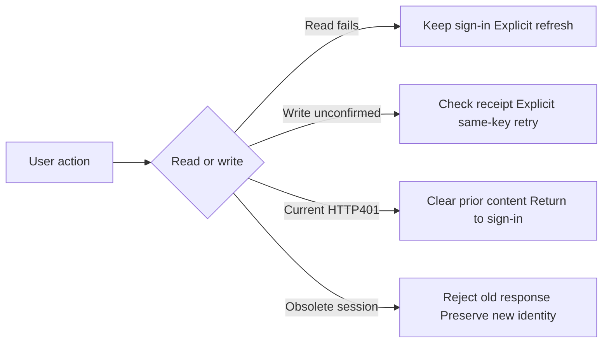

[Behavior and implementation](https://github.com/copypasteltd/workmate/blob/main/docs/technical/135-client-connection-and-session-recovery.md) · [All 102 requirement identities](https://github.com/copypasteltd/workmate/blob/main/docs/quality/remaining-work-stage135.md) · [Source-bound verification](https://github.com/copypasteltd/workmate/blob/main/docs/quality/client-errors-checkpoint-135.json)


<!-- support-recovery-stage134 -->
## Safe support-grant recovery and accepted support scope · Stage134

In **Web or Desktop → Account settings → Time-limited support**, choose explicit projects, the reason and duration. An empty project selection means metadata only. The first submission now fixes its request key and deadline. If its response is lost, use **Check previous request** or retry the same details; refreshing retrieves the existing result without automatically submitting again. Different details cannot replace an unresolved request. A recovered grant shows its current active, revoked or expired state and never gains extra time. You can revoke it from the list at any time.

Recovery stores only an opaque key, an intent digest and the fixed deadline in the current browser session. It does not persist the reason, project IDs, content or credentials. With storage disabled, recovery is limited to the running renderer; committed grants remain visible in the server list. Switching accounts or workspaces prevents late results from filling the new form. The native Desktop bridge permits only the customer receipt GET, alongside existing customer grant operations; it exposes no administrator impersonation route.

**Original REQ-095 / TC-095 is now accepted** against twelve individually mapped conditions and current source-bound evidence: real administrator identity and a read-only banner, explicit scope, independent body permission, write/payment/VIP/credential refusal, no hidden customer login, real-clock expiry, revocation and audit failure rollback. This closes one original requirement. REQ-055 whole-platform accessibility and REQ-094 whole-platform permission/concurrency matrices remain separate open work.

65 related backend checks, one native bridge boundary check and 18 actual Admin/Web/packaged Desktop journey checks passed. Ten build commands passed. The evidence includes real HTTP response loss before/after commit, reload, an actual workspace switch, identical retries, current-receipt recovery, real expiry and native customer revocation; user/native sessions, refresh-token and native-code row counts remain unchanged during support activity. Nine screenshots and five actual GIF/MP4 pairs are bound to the exact sources. Support controls work with keyboard input and enlarged text; Web/Admin use CSS zoom=2 and Desktop uses actual native webContents zoom=2. This does not constitute full browser/screen-reader accessibility acceptance.

Desktop continues to run Codex on the customer's computer, with separate explicit full local permission and a frameless window without Electron menus or visible scroll rails. Extension retains the native Chrome Side Panel for approved file uploads and cloud execution. Models did not run; business fixtures and retained output are synthetic. The Windows package is unsigned. All owned test browsers, native clients and databases closed.

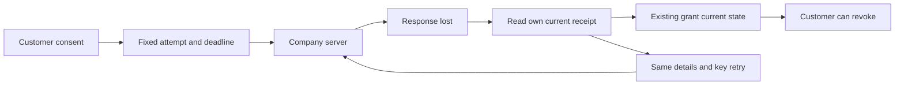

[方案 / Behavior](https://github.com/copypasteltd/workmate/blob/main/docs/technical/134-support-grant-recovery-and-acceptance.md) · [TC-095 acceptance](https://github.com/copypasteltd/workmate/blob/main/docs/quality/tc095-acceptance-134.json) · [Checkpoint](https://github.com/copypasteltd/workmate/blob/main/docs/quality/support-recovery-checkpoint-134.json) · [完整编号清单 / Remaining work](https://github.com/copypasteltd/workmate/blob/main/docs/quality/remaining-work-stage134.md)


[Recovery recording](https://github.com/copypasteltd/workmate/blob/web/assets/screenshots/workmate-support-recovery-134-04-grant-result-recovery.mp4) · [Retry recording](https://github.com/copypasteltd/workmate/blob/web/assets/screenshots/workmate-support-recovery-134-04-fixed-intent-retry.mp4) · [Native grant](https://github.com/copypasteltd/workmate/blob/desktop/assets/screenshots/workmate-support-recovery-134-04-customer-grant.mp4) · [Native revocation](https://github.com/copypasteltd/workmate/blob/desktop/assets/screenshots/workmate-support-recovery-134-04-customer-revocation.gif) · [200% Admin](https://github.com/copypasteltd/workmate/blob/admin/assets/screenshots/workmate-support-recovery-134-04-support-en-200.png) · [Chinese dark Admin](https://github.com/copypasteltd/workmate/blob/admin/assets/screenshots/workmate-support-recovery-134-04-support-zh-dark.png)

One requirement is accepted; 88 required records, 12 unconfirmed suggestions and one optional record remain open. These are acceptance records, not 101 uncoded modules. Complete source-delivery reproduction, signed installation, production integration and the remaining business acceptance continue in the numbered ledger. Earlier sections retain their original historical scope.

---

<!-- support-access-stage133 -->
## Controlled support and native customer authorization · Stage133

In **Web or Desktop → Account settings → Time-limited support**, choose the actual projects, a reason and a 15/30/60-minute deadline. An empty selection grants workspace/customer metadata only. Share the grant ID with support and revoke it from the same customer form at any time.

In **Admin → Support**, the administrator signs in with their own email and TOTP, chooses the customer, workspace, explicit projects, deadline and optional customer grant. The read-only banner keeps the real identities and deadline visible. Shared task bodies also require independent current body permission; private conversations stay private. The view provides no editing, billing, VIP or customer-login authority.

Support now checks original task sources before returning retained text. A quarantined/expired source or erased version blocks the body and masks its diagnostic title. Selected bodies use a current revision condition; changes during the audit are rejected. The page cancels old requests, rejects late task/session replies and clears bodies on changed revisions, source withdrawal, hidden views, failure, revocation or expiry. The server decides access on every read; visible Admin polling is approximately two seconds.

59 related backend tests and 13 actual Admin/Web/packaged native Desktop journey checks passed. The current source bytes bind 6 screenshots and 3 real-time GIF/MP4 pairs. Actual OTP/PKCE, email/TOTP, customer grants/revocation, delayed authorized responses, source withdrawal, real expiry, Chinese dark theme, four Admin widths and three frameless native widths were exercised. All owned browsers, the native client and test databases closed. Models did not run; business data, retained results and fixture file reads are explicitly synthetic. The Windows package remains unsigned.

Desktop continues to run Codex locally with the customer's separate explicit local-permission flow. Its support form uses customer-only routes; the administrator view stays in Admin. Extension continues to use the native Chrome Side Panel for approved file uploads and cloud execution. This increment changes no Extension execution code.

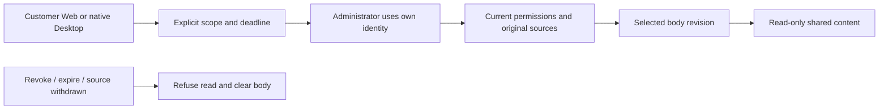

[Behavior](https://github.com/copypasteltd/workmate/blob/main/docs/technical/133-controlled-support-source-and-native-access.md) · [Checkpoint](https://github.com/copypasteltd/workmate/blob/main/docs/quality/support-access-checkpoint-133.json) · [Numbered remaining work](https://github.com/copypasteltd/workmate/blob/main/docs/quality/remaining-work-stage133.md)


[Native grant recording](https://github.com/copypasteltd/workmate/blob/desktop/assets/screenshots/workmate-support-access-133-02-customer-grant.mp4) · [Selection recording](https://github.com/copypasteltd/workmate/blob/admin/assets/screenshots/workmate-support-access-133-02-task-selection.mp4) · [Revocation recording](https://github.com/copypasteltd/workmate/blob/desktop/assets/screenshots/workmate-support-access-133-02-customer-revocation.mp4) · [Web metadata-only grant](https://github.com/copypasteltd/workmate/blob/web/assets/screenshots/workmate-support-access-133-02-metadata-grant-en.png) · [Chinese dark Admin](https://github.com/copypasteltd/workmate/blob/admin/assets/screenshots/workmate-support-access-133-02-support-zh-dark.png) · [Source withdrawn](https://github.com/copypasteltd/workmate/blob/admin/assets/screenshots/workmate-support-access-133-02-source-withdrawn-en.png)

89 required full-acceptance records, 12 unconfirmed suggestions and 1 optional record remain open. They are not 102 uncoded modules. Full permission/concurrency matrices, all-page accessibility, signed installation and production integration remain in the numbered ledger. Earlier sections retain their original historical scope.

---

<!-- content-history-stage132 -->
## Complete administrator content history · Stage132

Open **User content → Read content** on a conversation, specialist or memory. Read up to 50 original records per page, move in either direction or jump to the first/last page. Specialist and memory versions start with the newest and distinguish **Customer version** from **Administrator revision**. Expand a version to inspect its complete record.

The server rechecks the current MFA session, both content-reading permissions, tenant/project scope and explicit denials on every request. Signed cursors reject stale content. The visible reader rechecks every 15 seconds and on focus; failed authorization or changed readable sources clears its private state. Closing or changing resources aborts old requests and rejects late bodies. Bodies and cursors are not saved to browser storage. Unavailable assistant sources are masked.

The new GET `/v1/admin/content/:kind/:id/history` accepts `edge=first|last` or a returned `cursor`, with a fixed page size of 50. SQL134 maintains the message-history revision. Legacy body responses retain their limit and add `truncated` plus `history_url`. Ordinary customer conversations still have their existing 80-input limit.

54 related backend tests and 9 actual browser journey checks passed. Real API fixtures contain 205 specialist versions, 205 memory versions and 66 customer messages. Native PostgreSQL, email/MFA, actual administrator revision, source withdrawal, permission denial, late responses and 375/768/1440 layouts were exercised. Business data and retained assistant output are explicitly synthetic; no model ran. Original failed attempts and their exact sources remain available. Current captures contain 5 screenshots and 2 real-time GIF/MP4 pairs. All owned test resources closed.

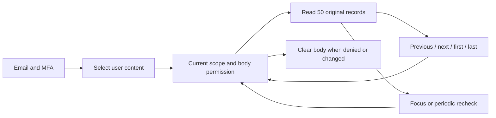

[Behavior](https://github.com/copypasteltd/workmate/blob/main/docs/technical/132-admin-content-history.md) · [Checkpoint](https://github.com/copypasteltd/workmate/blob/main/docs/quality/content-history-checkpoint-132.json) · [Numbered open work](https://github.com/copypasteltd/workmate/blob/main/docs/quality/remaining-work-stage132.md) · [API supplement](https://github.com/copypasteltd/workmate/blob/backend/contracts/admin-content-history-route-additions.json)


[Oldest memory version](https://github.com/copypasteltd/workmate/blob/admin/assets/screenshots/workmate-content-history-132-02-oldest-memory-en.png) · [Administrator provenance](https://github.com/copypasteltd/workmate/blob/admin/assets/screenshots/workmate-content-history-132-02-administrator-provenance-en.png) · [中文页面](https://github.com/copypasteltd/workmate/blob/admin/assets/screenshots/workmate-content-history-132-02-memory-history-zh.png) · [Permission denied](https://github.com/copypasteltd/workmate/blob/admin/assets/screenshots/workmate-content-history-132-02-permission-withdrawn-en.png) · [Navigation MP4](https://github.com/copypasteltd/workmate/blob/admin/assets/screenshots/workmate-content-history-132-02-complete-version-navigation.mp4) · [Withdrawal MP4](https://github.com/copypasteltd/workmate/blob/admin/assets/screenshots/workmate-content-history-132-02-permission-withdrawal.mp4)

89 required, 12 unconfirmed suggested and 1 optional full-acceptance records remain open. This is bounded history-reader qualification; full operations, all roles, production models/connectors and signed desktop installation remain in the numbered ledger. Historical sections below keep their original scope.

---

<!-- durable-receipt-stage131 -->
## Durable native result and billing receipt synchronization · Stage131

A completed local child keeps its original result when the company finish request is not delivered or its acknowledgement is lost after settlement. The parent cannot clear the operation until the child receipt is acknowledged. Choose **Sync saved receipts** after reconnecting. This also works after withdrawing local access and fully quitting and reopening the app, without replaying commands, starting QA or making another model request.

The known child settles once using company-observed usage. An unknown parent retains its original budget hold for reconciliation. Receipt synchronization does not establish overall workflow success or clear uncertain local side effects. Account and server authorization remain enforced; another login family or tenant permission cannot be bypassed.

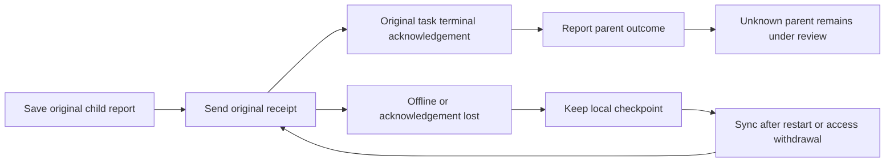

Bounded validation passed: 124 controller checks including 15 new receipt boundaries, 43 actual pinned-Codex checks, three actual native/SQL receipt-loss journeys, two compiler checks and eight actual unsigned packaged-Desktop checks. An old/current comparison reproduces the lost child finish request on the old code and verifies child-before-parent delivery on the new code. Processes, commands, files, SQL, dropped HTTP responses and a full application restart are actual; model responses and native dialog choices are synthetic. All owned test resources were closed. Original failures, executed QA and source snapshots remain preserved.

[Implementation](https://github.com/copypasteltd/workmate/blob/main/docs/technical/131-desktop-durable-receipt-sync.md) · [Current checkpoint](https://github.com/copypasteltd/workmate/blob/main/docs/quality/receipt-sync-checkpoint-131.json) · [Complete numbered open work](https://github.com/copypasteltd/workmate/blob/main/docs/quality/remaining-work-stage131.md)


[Fee confirmation](https://github.com/copypasteltd/workmate/blob/desktop/assets/screenshots/workmate-receipt-sync-131-01-child-fee-confirmation-en.png) · [撤权后中文提示](https://github.com/copypasteltd/workmate/blob/desktop/assets/screenshots/workmate-receipt-sync-131-01-revoked-receipts-pending-zh.png) · [Original receipts synchronized](https://github.com/copypasteltd/workmate/blob/desktop/assets/screenshots/workmate-receipt-sync-131-01-original-receipts-synchronized-en.png) · [Loss/withdrawal MP4](https://github.com/copypasteltd/workmate/blob/desktop/assets/screenshots/workmate-receipt-sync-131-01-receipt-loss-and-permission-withdrawal.mp4) · [Restart/sync MP4](https://github.com/copypasteltd/workmate/blob/desktop/assets/screenshots/workmate-receipt-sync-131-01-receipt-sync-after-application-restart.mp4)

The full-acceptance ledger retains 89 required, 12 unconfirmed suggestion and one optional records; these are not 102 uncoded modules. Arbitrary crash/process reclamation, login-family changes, complete parent accounting reconciliation, professional roles, live model/media services and signed installation remain open. This increment uses the independent Stage131 manifest/publisher; Stage128 and130 evidence retains its original historical scope.

```powershell
node scripts/qualify-receipt-journeys-v2.mjs 11
$env:COPYPASTE_NPM_CLI = 'C:\path\to\npm-cli.js'
node scripts/run-desktop-receipt-131-v2.mjs 11
```

Prepare the actual environment, pinned runtime, native database and qualified prerequisite reports. Versioned QA binds this increment's explicit passing prerequisites. Other source versions need new qualification scripts and attempt numbers; do not edit executed QA to relabel results.

---

<!-- workflow-recovery-stage130 -->
## Customer-local workflow recovery and cancellation · Stage130

Task shutdown and normal completion now retire each parent/child background authority watcher independently. An uncooperative heartbeat transport cannot keep cleanup waiting or resume execution through a late response. Retiring a watcher does not cancel a normally completing parent; fresh current-authority checks still precede native turn admission.

Customer flow: browser sign-in and company workspace → choose a local folder and explicitly grant access → confirm separate child limits → local developer work → human review of actual files → local QA → private SOP, frozen JSON and recovery-note downloads. Actual developer initialization and QA thread-start faults each recover once, only after durable company proof of zero admissions. Original tasks, holds, deadlines and worker attempts remain.

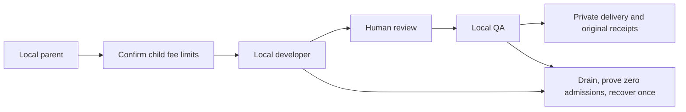

Bounded checks passed: 109 controller checks, 43 actual pinned-Codex checks, three complete native parent/child journeys, two current compiler checks and eight actual unsigned packaged-UI checks. Electron, native PostgreSQL, shell work and files are real. Model output, dialog choices and injected transport faults are fixtures. Three native widths retain no default frame/menu, visible scroll rails or horizontal overflow. Owned resources close; original failed probes and source snapshots remain immutable.

[Implementation](https://github.com/copypasteltd/workmate/blob/docs/docs/technical/130-desktop-workflow-recovery.md) · [Current checkpoint](https://github.com/copypasteltd/workmate/blob/docs/docs/quality/workflow-recovery-checkpoint-130.json) · [Numbered remaining work](https://github.com/copypasteltd/workmate/blob/docs/docs/quality/remaining-work-stage130.md)


[Fee confirmation](https://github.com/copypasteltd/workmate/blob/desktop/assets/screenshots/workmate-workflow-recovery-130-01-child-fee-confirmation-en.png) · [Completed English UI](https://github.com/copypasteltd/workmate/blob/desktop/assets/screenshots/workmate-workflow-recovery-130-01-two-recovered-children-completed-en.png) · [Completed Chinese UI](https://github.com/copypasteltd/workmate/blob/desktop/assets/screenshots/workmate-workflow-recovery-130-01-two-recovered-children-completed-zh.png) · [Actual wall-clock MP4](https://github.com/copypasteltd/workmate/blob/desktop/assets/screenshots/workmate-workflow-recovery-130-01-parent-child-startup-recovery.mp4)

89 required, 12 unconfirmed suggested and one optional full-acceptance records remain open; these are not 102 uncoded modules. Arbitrary crash/multi-node behavior, all local tools, complete roles, durable resubmission of lost child finish receipts, live providers and signed installation remain. Stage130 uses its own manifest and publisher. The old V11 entry and Stage128 manifest retain their historical source scope and do not publish this increment.

运行复核 / Reproduce:

```powershell
node scripts/qualify-workflow-journeys-v1.mjs NN
$env:COPYPASTE_NPM_CLI="<absolute npm-cli.js path>"
node scripts/run-desktop-workflow-130-v1.mjs NN
Set-Location ../..
python -X utf8 docs/tools/publish_workflow_recovery_130_v1.py --push
```

每次使用新的两位编号；已执行的脚本、日志、报告和快照不得覆盖。原生联调需要两个既有publication-125检出、固定Codex和公司测试配置；打包复核还需要原生Windows工具、已准备的Chromium/FFmpeg。发布器从工作区根目录执行；先提交所有匹配源码、材料与独立清单。 / Use a fresh two-digit attempt; never overwrite executed verifiers, logs, reports or snapshots. Native qualification requires both publication-125 checkouts, pinned Codex and private test configuration. Packaged QA also requires native Windows tooling and prepared Chromium/FFmpeg. Run publication from the workspace root after committing reviewed matching sources, media and the independent manifest.

[简体中文](README.md) · [English](README.en.md)

<!-- startup-recovery-stage128 -->
## Safe customer-local startup recovery · Stage128

Desktop runs pinned Codex on the customer's computer. After explicit folder selection and consent, a classified initialization/thread transport failure first drains the old process, lock and owned tools. Company services permit one recovery only when no turn, provider, input-count or company-tool request has been admitted and the original identity, permissions and deadline remain valid. At most two launches retain one task, hold and worker attempt; the absolute deadline never extends.

The UI shows Reconnecting. Retry connection retrieves an unconfirmed original result; possibly executed work requires local-file and billing review. Withdrawal, rejection, incomplete cleanup, admitted turns and unknown outcomes cannot replay automatically. Scoped inference credentials go only to the trusted local runtime and are excluded from the recovery journal and renderer.

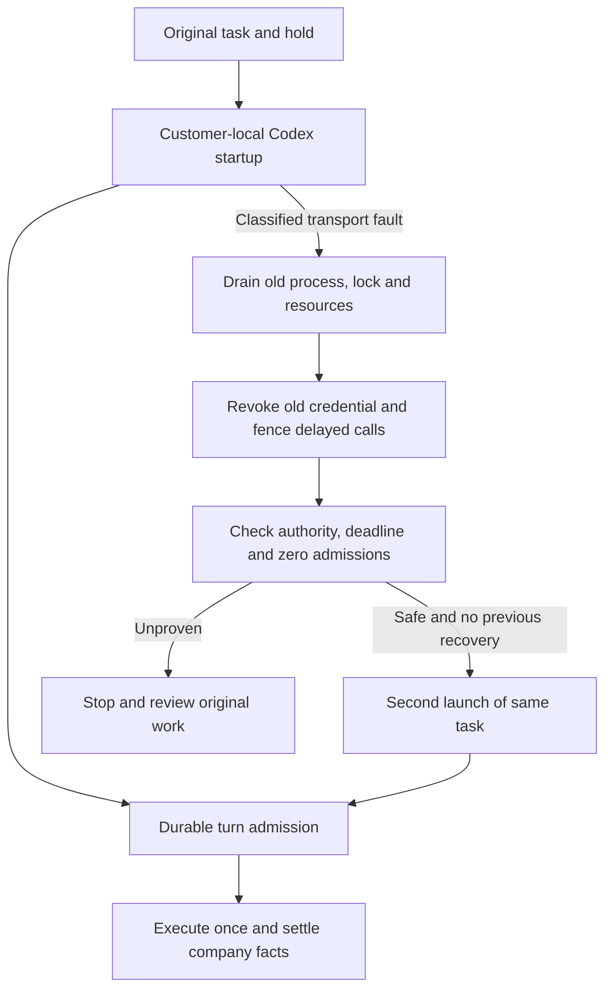

Upgrade the server through SQL133 with the database owner before starting the matching API. New clients opt into `desktop-startup-recovery-v1`. `/startup-recovery` binds the original session, contract digest and durable recovery key; `/turn-admission` precedes native `turn/start`. Legacy clients retain their existing flow without recovery authority.

The checkpoint records bounded controller, actual pinned Codex, native SQL and actual unsigned packaged Desktop qualification. Model responses and dialog decisions are synthetic as requested. This does not qualify a live provider, signed installation, every crash combination or complete professional roles. Earlier packages and captures retain their original source scope.

Bounded checks passed: 91 related controller, 43 actual pinned-Codex, 30 native database/API, three current compilation and six actual unsigned packaged-UI checks. The journey verifies sign-in, consent, one startup recovery, one original-task charge, one displayed answer, pending-startup withdrawal and native widths of 1000/1240/1440. Current PNG/GIF/MP4 captures come from successful attempt04; failed attempts01–03 and their raw records remain intact. V11 publishes the branches; the final receipt and remote SHA readback determine publication status.

After committing reviewed source, media, bilingual guides and the central publication manifest, run in this repository:

```powershell
node scripts/publish-workmate-v11.mjs --push
```

`--check` verifies without pushing. V11 checks actual committed content, every historical proof, media/links and ancestry for all eight mapped branches, then performs an ordinary atomic push and reads back each SHA. Unrelated untracked user files in the central documentation checkout are preserved and listed in the receipt; tracked files and component checkouts must be clean. Failures retain their receipts; no force push.

[Design and APIs](https://github.com/copypasteltd/workmate/blob/docs/docs/technical/128-desktop-startup-recovery.md) · [Sources and qualification](https://github.com/copypasteltd/workmate/blob/docs/docs/quality/startup-recovery-checkpoint-128.json) · [Numbered open work](https://github.com/copypasteltd/workmate/blob/docs/docs/quality/remaining-work-stage128.md)


[Original receipt](https://github.com/copypasteltd/workmate/blob/desktop/assets/screenshots/workmate-startup-recovery-128-04-original-local-receipt.png) · [Withdrawal screenshot](https://github.com/copypasteltd/workmate/blob/desktop/assets/screenshots/workmate-startup-recovery-128-04-permission-revoked-before-turn.png) · [Withdrawal GIF](https://github.com/copypasteltd/workmate/blob/desktop/assets/screenshots/workmate-startup-recovery-128-04-revoke-pending-startup.gif) · [Recovery MP4](https://github.com/copypasteltd/workmate/blob/desktop/assets/screenshots/workmate-startup-recovery-128-04-startup-and-original-receipt.mp4) · [Withdrawal MP4](https://github.com/copypasteltd/workmate/blob/desktop/assets/screenshots/workmate-startup-recovery-128-04-revoke-pending-startup.mp4)

<!-- local-startup-stage127 -->
## Source-bound local startup and delivery · Stage127

Desktop adds main/child authority renewal during startup, a preparation-close barrier, interruptible native startup requests and readable bilingual feedback. Codex remains customer-local and billing retains the original task. Bounded qualification covers 73 related controller, 38 actual pinned-native and five packaged-window checks, bound to exact source/package bytes in the checkpoint. SQL, processes and windows are real; model responses and native-dialog decisions are synthetic.

The journey signs in through browser OTP/PKCE, creates a workspace, chooses a folder and explicitly grants access, waits for startup, checks original completion/billing, then withdraws during another startup without admitting a model request. Actual 1000/1240/1440 windows remain frameless, menu-free and free of visible scroll rails/horizontal overflow. Desktop delivers the actual PNG/GIF/MP4 captures.

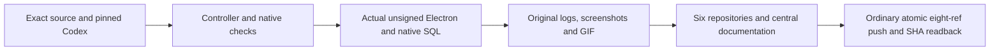

The historical Stage127 entry is `node scripts/publish-workmate-v10.mjs --push`; `--check` verifies only. V10 checks source, actual committed Git content, bilingual guides, real media, original failures and all historical proofs before an ordinary atomic eight-ref update and SHA readback. Stage128 uses V11; earlier results retain their original source scope.

All executed `run-desktop-startup-v1/v2/v3/v4.mjs` and QA scripts remain unchanged. Attempt01 chose the native default decline and stopped at authorization. Attempt02 reused that package and passed, but its capture revealed an internal error code. After correcting bilingual feedback, attempt03 repeats controller/native checks and builds a fresh package. Its first three checks passed, but the window-width wait timed out. Attempt04 reuses unchanged package03, binds the page-owned native window, restores normal bounds/100% zoom and checks OS/renderer sizes together. The old window state and underlying timeout cause remain unproven. Failed/cancelled records, cleanup receipts and older captures remain preserved. Stage verifiers depend on the recorded adjacent candidate paths, pinned resources and isolated database; use the normal setup instructions for another checkout. Reclaim owned windows, processes and native PostgreSQL. No Docker/WSL.

Automatic Desktop startup recovery, signed installation, complete professional roles and all 89 required full-acceptance records remain open. Recovery must revoke/drain old authority and atomically prove zero admission; zero charge is insufficient.

[Behavior](https://github.com/copypasteltd/workmate/blob/docs/docs/technical/127-desktop-startup-lifecycle.md) · [Checkpoint](https://github.com/copypasteltd/workmate/blob/docs/docs/quality/local-startup-checkpoint-127.json) · [Changes and open work](https://github.com/copypasteltd/workmate/blob/docs/docs/changes/127-desktop-startup-lifecycle.md) · [Actual captures](https://github.com/copypasteltd/workmate/blob/desktop/README.en.md)

<!-- native-publishing-stage126 -->
## Native Codex publication tools and delivery · Stage126

Backend fixes tool admission and immutable media-version lineage. Real pinned cloud Codex calls accounts → preview → prepare → status; the original customer must still explicitly confirm in Publishing. Current native09 passes5/5, startup fault03 passes9/9 and complete sixteen-file related10 passes155/155 with unchanged source and reclaimed owned native database/fixtures. Bounded startup recovery requires no admitted turn, zero model requests after gateway shutdown and full original-process exit; the two-process limit and original billing identity remain enforced.

Interrupted06 lacks terminal/cleanup receipts; run08 (132 passed, one failed), red01, green02 and other failures retain their original outcomes. The QA helper's actual process-creation-time check was corrected and separately verified. Underlying intermittent native/Windows latency causality and Desktop-local recovery/four-tool qualification remain open.

The Stage126 entry is `node scripts/publish-workmate-v9.mjs --push`; `--check` verifies without pushing. V9 checks this increment's source, original logs and portable archive while retaining historical proofs, actual screenshots/GIFs and failed attempts. Six independent repositories and an ordinary atomic eight-ref update with SHA readback remain in use. Read-only checks finish concurrently across seven independent checkouts; the shared main/docs directory is checked once at final preflight. Object imports and remote writes remain sequential. Only the final executor receipt establishes publication.

No new UI/media is claimed. Stage125 captures below retain their original source scope. Intermittent native timeout causality, video playback/seek, signed installation, complete role combinations and full acceptance remain open. Model/accounts are authorized simulated data. No Docker/WSL; reclaim owned processes.

[Behavior and limits](https://github.com/copypasteltd/workmate/blob/docs/docs/technical/126-native-publication-tools.md) · [Changes and open work](https://github.com/copypasteltd/workmate/blob/docs/docs/changes/126-native-publication-tools.md)

<!-- controlled-publications-stage125 -->
## Controlled publication qualification and delivery · Stage125

Adds synthetic OAuth, complete related backend checks, actual Web/Admin pages, packaged Electron and Chrome native Side Panel checks. Every attempt preserves original verifier/source/logs and actual screenshot/GIF/MP4; failures are never overwritten. Owned browsers, previews, native PostgreSQL and fixtures must be reclaimed. Docker/WSL are prohibited.

Historical Stage125 passing scopes: backend09 117/117, CLI07 5/5, analysis08 12/12, Desktop media03 21/21, Extension02 70/70 and Web/Admin12 14/14. Actual packaged Desktop/native Chrome Side Panel run02 passes 10/10, with matching source/package bytes and owned browsers, Electron, API, database and fixtures closed. Actual Web/Admin observations cover four widths; previous invalid width claims and all failures remain preserved.

The Stage125 publication entry is `node scripts/publish-workmate-v8.mjs --push`; `--check` verifies without pushing. The executor requires six committed independent product repositories and committed central documentation. It reads the normal development directories, verifies current sources, original receipts, historical proofs, bilingual guides, actual media and remote ancestry, then ordinarily updates eight mapped refs atomically and reads back their final SHAs. The final receipt establishes publication; it never force-pushes.

Stage-specific qualification scripts preserve adjacent `copypaste-*-publication-125` candidate paths and a pinned unsigned package; they are not generic launchers for another checkout. Follow the normal installation/startup instructions below. Independent-checkout reproduction, signed installation, new publication video playback, actual Codex invocation of the four publication tools and professional qualification of at least twelve roles remain open.

[Behavior and limits](https://github.com/copypasteltd/workmate/blob/docs/docs/technical/125-controlled-publishing-and-native-media.md) · [Source/evidence checkpoint](https://github.com/copypasteltd/workmate/blob/docs/docs/quality/publications-checkpoint-125.json)


<!-- admin-profile-revisions-124 -->
## Stage124 publication and qualification

Backend/Admin add scoped specialist, brand and memory revisions. All 68 related backend checks, 11 Admin unit checks, eight actual UI flows and 14 layout observations passed. Eight screenshots, three GIF/MP4 pairs and failed originals are retained. Desktop remains customer-local Codex; Extension remains a native Side Panel with cloud Codex.

The Stage124 entry is `node scripts/publish-workmate-v7.mjs --push`. After all six components and central documentation are committed, V7 checks exact sources, historical proofs, media, bilingual guides, credentials and remote ancestry. It performs an ordinary atomic update of eight mapped refs, then reads their actual SHAs. No force push; the final executor receipt establishes publication. Native tools only; no Docker/WSL.

[Design and qualification](https://github.com/copypasteltd/workmate/blob/docs/docs/technical/124-admin-profile-revisions.md) · [Actual Admin screens](https://github.com/copypasteltd/workmate/blob/admin/README.en.md)

<!-- admin-content-revisions-123 -->
## Administrator revisions and publication · Stage 123

The Stage123 publication command is `node scripts/publish-workmate-v6.mjs --push`; `--check` verifies without pushing. V6 checks committed independent repositories, exact sources, original evidence, bilingual guides, media, historical objects, configured credentials and remote ancestry, then ordinarily updates the eight mapped refs atomically and reads back their SHAs. Historical proof identities and failures remain intact; publication never force-pushes.

The increment passed **75 checks across five complete related backend files**, **seven actual Admin UI flows** and seven dialog/field-bound observations at four widths. Backend checks cover the three revision types, scoped authority/MFA, concurrency, idempotency, audit rollback, separate administrator provenance, database roles and immutability. Actual UI uses email/MFA login, structured editing, a committed response deliberately lost and recovered, and live permission withdrawal. Editing makes no model requests and creates no tasks or charges.

The `qualify-admin-content-v1`–`v4` and UI V1/V2 tools preserve each executed version and source snapshot. They bind their original worktrees, native database and owned ports; do not reuse those resource identities in another checkout. Normal startup follows the workspace instructions below. Review the central [checkpoint](https://github.com/copypasteltd/workmate/blob/docs/docs/quality/admin-content-checkpoint-123.json) and [archive index](https://github.com/copypasteltd/workmate/blob/docs/docs/quality/admin-content-evidence-123/index.json).

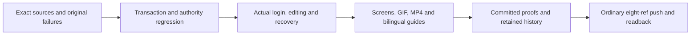

[Actual screens and recordings](https://github.com/copypasteltd/workmate/blob/admin/README.en.md) · [Behavior](https://github.com/copypasteltd/workmate/blob/docs/docs/technical/123-admin-content-revisions.md). This increment does not requalify every backend file, live provider quality or full product acceptance.

<!-- runtime-startup-122 -->

The historical Stage 122 publication command was `node scripts/publish-workmate-v5.mjs --push`; `--check` performed preflight only. That executor required the corresponding committed repositories, central proof manifest and bounded evidence, then ordinarily updated eight refs atomically and read back their SHAs. The current manifest uses V6 above.

Billing evidence retains the initial 78/79 run with one cancellation, an isolated failure and a later isolated pass. Earlier failure causes remain unproven; the [current checkpoint](https://github.com/copypasteltd/workmate/blob/docs/docs/quality/runtime-startup-checkpoint-122.json) records the final complete related-file scope. Real fixture preparation is timed separately while recovery and ledger assertions retain their 120-second bound. Product RPC and task deadlines stay unchanged.

The final five complete related files passed all 79 checks with zero failures, cancellations or skips. Sources stayed unchanged, and fixture reclamation, native database shutdown and port closure passed. This bounded result does not replace a new complete backend or production reliability qualification.

## Codex startup and turn isolation · Stage 122

This stage binds actual source bytes, the native executable and raw output; retains failed attempts; and separately checks startup recovery, turn isolation, billing transactions and packaged UI. Runners control only owned native processes, folders, databases and browsers, without Docker, WSL or virtual machines.

Recorded bounded passes cover 12 cloud native checks, 180 Desktop unit / 25 native checks, 20 Web checks and 8 packaged UI checks. Historical runners preserve their authored workspace and source; normal product usage follows the startup instructions below. Production signing, live provider quality and complete acceptance of all 102 requirements are tracked separately.

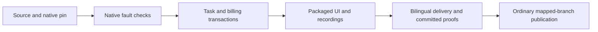

[完整方案 / Behavior and verification](https://github.com/copypasteltd/workmate/blob/docs/docs/technical/122-codex-startup-and-turn-isolation.md)

## Product and boundaries

The first customers are existing marketing teams. Scope includes image/design/typography, video/effects, advertising and website analysis, SEO/GEO, repeated business processes and software development. The catalog has 18 candidates with exact Skill bindings; at least twelve individually qualified professional presets remain an acceptance requirement. The designer combines Codex, design Skills and company Image 2. Codex is the only Agent core. All AI uses the company's OpenAI-compatible backend; development currently uses authorized synthetic providers, not a claim of live professional quality.

Tools retain original TAP, failed receipts, verifier sources, selected source digests and actual screenshots/GIF/MP4, distinguishing synthetic model replies from native Codex and real files/database/ledgers. Native tests own only their ports, processes, folders and database fixtures; unused owned browsers close while user pages/services remain. Publication audits seven repositories, bilingual READMEs, media, credentials, historical object sizes and committed manifests, then uses ordinary explicit-ref pushes and verifies eight remote SHAs without force.

## Repositories and execution

| Branch | Directory | Runtime |
| --- | --- | --- |
| [backend](https://github.com/copypasteltd/workmate/tree/backend) | `dev/copypaste-platform` | Fastify / PostgreSQL / cloud Codex |
| [web](https://github.com/copypasteltd/workmate/tree/web) | `dev/copypaste-web` | React / Vite / cloud workspace |
| [admin](https://github.com/copypasteltd/workmate/tree/admin) | `dev/copypaste-admin` | React / separate Admin identity |
| [desktop](https://github.com/copypasteltd/workmate/tree/desktop) | `dev/copypaste-desktop` | Electron / customer-local Codex |
| [extension](https://github.com/copypasteltd/workmate/tree/extension) | `dev/copypaste-extension` | Chrome MV3 / native Side Panel / cloud Codex |
| [delivery](https://github.com/copypasteltd/workmate/tree/delivery) | `dev/copypaste-delivery` | Native development, QA and publication tools |

The component is an independent Git repository. Keep the sibling layout and use the documented native tools; Docker, WSL and VMs are prohibited.

## User workflow

1. Check out six branches as independent sibling repositories under dev, install locked dependencies and preserve existing configuration/data.
2. Bootstrap validates/builds the layout. Demo starts its owned native database, API, worker, synthetic provider and Web/Admin.
3. Run the complete backend inventory, client types/builds/units, actual local Codex and UI checks; retain source bytes, raw logs and failures.
4. Verify owned ports/processes/directories/browsers are cleaned. Record actual wall-clock interaction and distinguish fixture data from native execution.
5. Bind six actual Git commits, bilingual READMEs, media and historical proofs, then atomically push normal explicit refs and verify all eight heads.

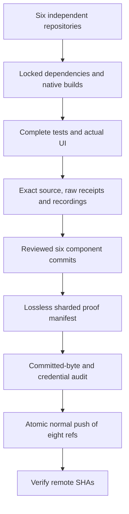

## Setup

### Local startup

Run these commands in the checked-out component. The complete workspace has the six independent repositories side by side under `dev/`; see the [branch and checkout layout](https://github.com/copypasteltd/workmate/blob/docs/docs/governance/04-git-branches-and-publication.md). Use Windows x64, Node.js >=22.14, npm/Git and the documented native PostgreSQL, FFmpeg/FFprobe and pinned Codex resources. Preserve existing local configuration/data. No Docker/WSL/VM is used.

```powershell
Set-Location 'D:/dev/copypasted/自有agent/dev/copypaste-delivery'
npm ci
npm run bootstrap
npm run demo
```

Open Web `http://localhost:4317` and Admin `http://localhost:4318`; API is `4310`, controller `4319`, native PostgreSQL `55432`. Stop with `npm run stop`, which closes only controller-owned processes and checkpoints its database. The built-in demo simulates text/images and supports editing/template video; generated video requires the configured company contract. Current generation acceptance uses an explicit media fixture. Local Desktop additionally requires its independently pinned native runtime.

### Use the current workflow

1. Complete sign-in, company membership/invitation and project selection. Native clients use browser PKCE; Admin uses separate MFA identities. Expired/revoked credentials must not silently change identity or company.
2. Select a specialist and supply the brief and explicitly authorized references/accounts. Missing inputs request customer action. Project owners can save, preview and explicitly publish immutable shared guidance; publication starts no AI and grants no new permission.
3. New tasks pin their accepted role, Skill, brand, reference and guidance versions. Existing work, including an originally absent configuration, retains its original state. Source revocation hides unavailable bodies and blocks later use; history is not a permission bypass.
4. Confirm budget and any required operation/media approval. View genuine status, progress, exact deliverables and original receipts. Continue requested edits in the same task lineage. Unknown usage remains reserved for reconciliation; it is never silently free or blindly replayed.
5. Admin can independently manage authorized user/workspace status, inspect permitted consumption, preview/confirm manual fees or credits and activate scoped VIP/expiry. Balances, recorded payments, credits, budgets and VIP are separate records. Idempotent confirmation and audit prevent duplicate grants.

## Configuration and authority

The candidate requires the complete additive SQL001–133 history. API/worker schema admission rejects missing, changed or unsupported versions; recovery identity is fenced independently. Company model aliases, verified media capabilities, exact tariffs and provider secrets live on the backend. Unconfigured capabilities remain unavailable. Current development uses explicitly authorized synthetic data.

Web/Admin use `VITE_API_BASE` or their same-origin proxy; default development ports are 4317/4318. Desktop/Extension compile fixed `COPYPASTE_API_ORIGIN` and `COPYPASTE_WEB_ORIGIN` values; Desktop also pins `COPYPASTE_EXTENSION_ID`. HTTPS is required outside the allowed loopback-development case. No renderer or extension receives company provider secrets.

Files remain private unless the customer explicitly shares them. Authorization is checked on new requests, worker claims, tools and downloads. Source/body revocation is not bypassed by old history. Money uses exact HKD micros; budget, balance, credits, recorded payments and VIP are distinct. Stable request identities prevent duplicate grants, tasks and reservations. Unknown usage or physical cleanup retains its reconciliation hold.

## Preset roles and Skills

The catalog defines 18 professional presets plus the default assistant. Every run pins exact Skill versions and registered tools. These definitions are not a claim that twelve full professional qualifications have passed.

| ID | Role | Required Skill bindings |
| --- | --- | --- |
| R01 | Full-stack developer | `fullstack-engineering@1.0.0`, `frontend-implementation@1.0.0`, `backend-api@1.0.0`, `qa-testing@1.0.0`, `delivery-core@1.0.0` |
| R02 | Frontend developer | `frontend-implementation@1.0.0`, `ui-system@1.0.0`, `qa-testing@1.0.0`, `delivery-core@1.0.0` |
| R03 | Backend/API engineer | `backend-api@1.0.0`, `qa-testing@1.0.0`, `delivery-core@1.0.0` |
| R04 | Software QA engineer | `qa-testing@1.0.0`, `frontend-implementation@1.0.0`, `delivery-core@1.0.0` |
| R05 | UI/UX designer | `ux-research@1.0.0`, `ui-system@1.0.0`, `frontend-implementation@1.0.0`, `delivery-core@1.0.0` |
| R06 | Designer | `creative-direction@1.0.0`, `image-art-direction@1.0.0`, `image2-production@1.0.0`, `typography-layout@1.0.0`, `delivery-core@1.0.0` |
| R07 | Brand visual designer | `brand-system@1.1.0`, `image-art-direction@1.0.0`, `image2-production@1.0.0`, `typography-layout@1.0.0`, `delivery-core@1.0.0` |
| R08 | Ad creative designer | `ad-creative@1.0.0`, `image-art-direction@1.0.0`, `image2-production@1.0.0`, `typography-layout@1.0.0`, `delivery-core@1.0.0` |
| R09 | E-commerce designer | `ecommerce-visual@1.0.0`, `image-art-direction@1.0.0`, `image2-production@1.0.0`, `typography-layout@1.0.0`, `delivery-core@1.0.0` |
| R10 | Social content designer | `social-content@1.0.0`, `image2-production@1.0.0`, `typography-layout@1.0.0`, `delivery-core@1.0.0` |
| R11 | Illustration/IP designer | `illustration-ip@1.0.0`, `image-art-direction@1.0.0`, `image2-production@1.0.0`, `delivery-core@1.0.0` |
| R12 | Typography/layout designer | `typography-layout@1.0.0`, `image-art-direction@1.0.0`, `image2-production@1.0.0`, `delivery-core@1.0.0` |
| R13 | Presentation designer | `presentation-production@1.1.0`, `typography-layout@1.0.0`, `dataviz@1.1.0`, `delivery-core@1.0.0`, `deterministic-metrics@1.1.0` |
| R14 | Landing-page designer | `landing-page@1.0.0`, `ui-system@1.0.0`, `frontend-implementation@1.0.0`, `image2-production@1.0.0`, `delivery-core@1.0.0` |
| R15 | Information/data designer | `dataviz@1.1.0`, `deterministic-metrics@1.1.0`, `typography-layout@1.0.0`, `delivery-core@1.0.0` |
| R16 | Video/motion designer | `video-storyboard@1.0.0`, `template-video-composition@1.0.0`, `video-generation@1.1.0`, `speech-production@1.2.0`, `delivery-core@1.0.0` |
| R17 | Marketing analyst | `ads-analysis@1.1.0`, `deterministic-metrics@1.1.0`, `dataviz@1.1.0`, `delivery-core@1.0.0` |
| R18 | Workflow consultant | `workflow-design@1.1.0`, `workflow-execution@1.1.0`, `delivery-core@1.0.0` |

Designer combines Codex, design Skills and the company Image 2 capability. Optional R19 computer-operator work needs its own confirmed cloud lease and AI budget; native Desktop excludes it and retains customer-local execution.

[Role contract](https://github.com/copypasteltd/workmate/blob/backend/catalog/role-preset-catalog.json) · [Skill packages](https://github.com/copypasteltd/workmate/blob/backend/catalog/skill-packages.json)

## Optional dedicated cloud computer

Review an immutable plan/quote, payer, fixed duration, exact private files and separate terminal/visual/Agent scopes. Agent control defaults off. Explicit consent reserves resource cost; a later Codex instruction has a separate exact AI ceiling. No automatic renewal occurs. Stop/expiry/revocation fences subsequent actions; measured usage and verified cleanup settle, uncertainty reconciles.

The Linux physical-node source uses native Node22/systemd, cgroups, XFS project quotas and bounded desktop tools. No Linux host was started for the local Windows qualification. Build a fresh numbered source bundle with `node native/build-package.mjs NN` in Delivery; verify the externally pinned bundle digest before installation. The installer defaults to no service start and supports exact-UUID recovery.

## Actual interface and interaction

These are actual unretouched product screenshots and wall-clock recordings. Customer/model/media responses are explicit fixtures; native Codex, files, database and billing paths run where stated. Synthetic node pixels do not qualify an actual remote Linux desktop.

Linked extension product UI demonstrates this headless component’s integration; it is not a separate delivery screen.


[Original MP4](https://github.com/copypasteltd/workmate/blob/extension/assets/screenshots/workmate-dedicated-extension-03-folder-response.mp4)

## Verification and delivery status

The integrated clients/tool inventory passed 338 checks: Web 20, Admin 9, Extension 63, Desktop 180, actual local Codex 22 and Delivery 44; corresponding types/builds passed. Native Desktop, Web/Admin and native Side Panel each have eight bounded actual UI checks, with 29 screenshots and five GIF/MP4 pairs. Complete backend success requires its final complete-inventory report; the checkpoint records actual outcomes and retains failed attempts.

Run this component’s `npm run typecheck`, `npm run build` and documented test scripts with installed native prerequisites. Delivery’s default `npm test` covers native-surface integrity; the complete Delivery unit inventory is `node --test --test-concurrency=1 tests/*.test.mjs`. `node scripts/qualify-delivered-clients-v1.mjs NN` uses a fresh two-digit attempt and the sibling layout for all integrated client inventories. Candidate-specific historical runners preserve their original directory requirements.

Full product acceptance remains open: twelve professional-role qualifications, complete permissions/business/compatibility matrices, live service quality, signed installers/updates, production load/restore and customer business acceptance. Use the numbered inventory rather than test counts as a completion claim. Owned browsers/processes are closed; user resources are preserved.

[Implementation / 方案](https://github.com/copypasteltd/workmate/blob/docs/docs/technical/121-dedicated-cloud-and-client-execution.md) · [Checkpoint / 证据](https://github.com/copypasteltd/workmate/blob/docs/docs/quality/dedicated-cloud-checkpoint.json) · [Open requirements / 未完成项](https://github.com/copypasteltd/workmate/blob/docs/docs/quality/remaining-work-2026-10-29.md) · [Branch layout / 检出布局](https://github.com/copypasteltd/workmate/blob/docs/docs/governance/04-git-branches-and-publication.md)
