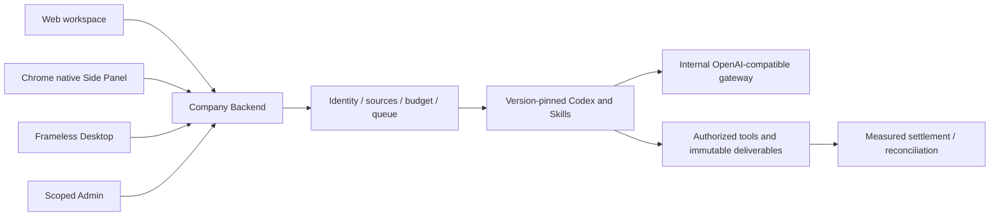
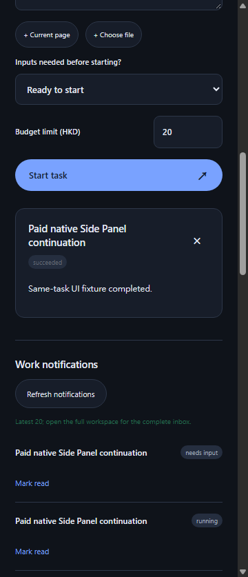

# Workmate · CopyPaste Chrome Extension

[中文](README.md) · [Documentation](https://github.com/copypasteltd/workmate/blob/docs/docs/README.en.md)

[Backend](https://github.com/copypasteltd/workmate/tree/backend) · [Web](https://github.com/copypasteltd/workmate/tree/web) · [Admin Dashboard](https://github.com/copypasteltd/workmate/tree/admin) · [Desktop](https://github.com/copypasteltd/workmate/tree/desktop) · [Chrome Extension](https://github.com/copypasteltd/workmate/tree/extension) · [Delivery](https://github.com/copypasteltd/workmate/tree/delivery)

A cloud Agent product for Hong Kong enterprises. This repository owns **Chrome Extension** and publishes to `extension`.

## Architecture and constraints

Codex is the only Agent kernel. All AI calls use the company's internal OpenAI-compatible server. Web, Desktop, extension and Admin share server identity, permissions, sources and billing controls. UI follows CopyPaste brand assets, colors, typography and bilingual patterns.



## Native Side Panel

Chrome Manifest V3 uses `side_panel.default_path` and `chrome.sidePanel.setPanelBehavior({openPanelOnActionClick:true})`. The toolbar opens the real browser Side Panel and can close it again, without an action popup or simulated sidebar tab. It is right by default and respects Chrome's selected side.

`src/background.ts` handles lifecycle, company authorization and panel behavior. `src/panel.ts` owns workspace/project, tasks, inputs and results. `public/sidepanel.html` and `public/panel.css` provide the local UI. `scripts/build.mjs` generates fixed origins, CSP and the stable extension ID.

## Usage flow

1. Build/load the extension and pin its toolbar icon.
2. Click the icon to open the native workspace. Complete email verification and PKCE authorization at the fixed company webpage.
3. Select workspace, project and assistant, then submit work or open a retained task. Fixed links open complete creative, connection and website workspaces.
4. Select an authorized file version or connection when inputs are missing. Polling retains the choice; confirmation continues the original task and exposes results/cumulative settlement.
5. Workspace changes or denied task reads clear prior content. Browser-page navigation preserves the panel; close unused owned tabs after work.

An extension cannot arbitrarily read every local path. Uploads require explicit selection; persistent folder/device work requires grants and a Native Messaging companion. `nativeMessaging` is optional. Models cannot grant local permissions.

## Build and load

```powershell
npm ci
npm run build
```

Open `chrome://extensions`, enable developer mode, choose Load unpacked and select this repository's `dist/`. Pin and click the icon. Chrome 120+ is required; retained native evidence identifies the actual Chromium used.

Set `COPYPASTE_API_ORIGIN` and `COPYPASTE_WEB_ORIGIN` at build time. Defaults are localhost 4310/4317; production requires company HTTPS origins. Preserve `manifest-key.txt` to retain the ID; it contains a public key, not a signing private key. `extension-id.txt` is used for Backend/companion registration.

The branch contains reproducible source. The local preview ZIP is ignored under `release/paid-input-66-03/`. Store submission, signing, other browser/system matrices and live supplier integration require separate qualification.

## Checkout and prerequisites

Clone this branch into a fresh working directory; update an existing repository without reinitializing it.

```powershell
git clone --single-branch --branch extension git@github.com:copypasteltd/workmate.git copypaste-extension
cd copypaste-extension
```

Use Node.js ≥22.14, npm and Git with pinned lockfiles. The qualified local environment is Windows x64. Backend/full delivery also needs native PostgreSQL launcher resources, pinned Codex `0.163.0-alpha.10.2` and FFmpeg/FFprobe. No local Docker, WSL or virtualization. Run components in separate directories; see [workspace](https://github.com/copypasteltd/workmate/blob/docs/docs/governance/04-git-branches-and-publication.md).

## Checks and evidence scope

```powershell
npm run typecheck
npm test
npm run build
```

**782/782** Platform and **34/34** focused tests, plus **13 checks** across six repositories for types/build/existing client suites. The actual packaged Desktop and native Side Panel journey passes **32** checks, retaining every prior named test among 765. Actual Codex child-process tool/thread/usage behavior is tested through a synthetic internal API. UI turns/business data in these demonstrations are synthetic as authorized. All 102 original requirements remain: 81 partially verified, 21 without proven completion and zero fully accepted. Screenshots and test counts do not establish whole-product acceptance.

Canonical TaskDTO/task creation, arbitrary in-flight pause, unknown-effect recovery, independent complete role workflows, GEO, live suppliers and production/signing/store qualification remain tracked.

## Actual screens and interactions

Actual recordings preserve capture timing. AI turns/business data are explicitly synthetic. Admin form demonstrations do not claim a financial commit.





[MP4](assets/screenshots/workmate-06-interaction.mp4) · [Capture/source evidence](https://github.com/copypasteltd/workmate/blob/docs/docs/quality/workmate-media-06.json)

## Detailed design and updates

- [Product](https://github.com/copypasteltd/workmate/blob/docs/docs/product/01-prd.md)
- [Architecture](https://github.com/copypasteltd/workmate/blob/docs/docs/technical/01-architecture-and-stack.md)
- [Identity and permissions](https://github.com/copypasteltd/workmate/blob/docs/docs/technical/07-security-and-permissions.md)
- [Task continuation](https://github.com/copypasteltd/workmate/blob/docs/docs/technical/66-paid-native-input-checkpoints.md)
- [Admin](https://github.com/copypasteltd/workmate/blob/docs/docs/product/08-admin-dashboard.md)
- [Native clients](https://github.com/copypasteltd/workmate/blob/docs/docs/technical/30-native-window-and-browser-sidepanel.md)
- [Release notes](https://github.com/copypasteltd/workmate/blob/docs/docs/changes/2026-10-22-workmate-publication.en.md)

Every later change updates both READMEs, affected actual captures/GIFs, release notes and its mapped branch. Verify remote SHAs through Delivery publishing; do not force-push collaborator history. Keep environment secrets, databases, sessions, dependencies and installers out of Git. Exact historical README bytes are retained in [archive](https://github.com/copypasteltd/workmate/blob/docs/docs/quality/history/stage66-before-workmate-readmes/manifest.json).
