# Workmate · CopyPaste Enterprise Agent · admin

[简体中文](README.md) · [English](README.en.md)

<!-- controlled-publications-stage125 -->

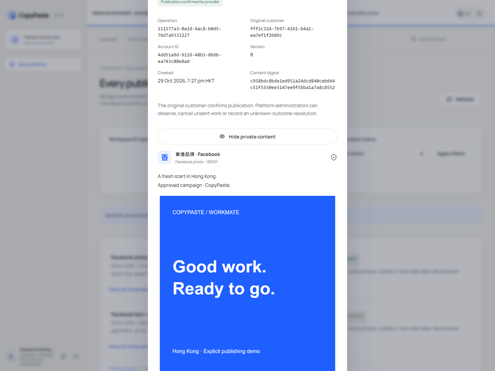
## Publishing administration and independent authority · Stage125

The directory fetches metadata by default. Explicit private-body/media review requires independent body-read permission, current source access and recent MFA. Administrators may change scoped policy, cancel unsent operations, observe unknown results and record manual closure; they cannot confirm for the customer.

| Action | Permission, within current scope |
| --- | --- |
| Metadata | `admin.publication.read` |
| Private body/media | Above plus `admin.content.body.read` |
| Policy | `admin.publication.policy.write` |
| Cancellation/unknown resolution | `admin.publication.resolve` |

Mutations bind expected versions and original request keys. Lost responses are checked against the original administrator, object and request, without issuing a replacement mutation. Explicit new authorization atomically revokes old sessions; repetition/concurrency does not duplicate grants. Current denies, source expiry and revocation withdraw content.

Actual Web/Admin checks pass 14/14: independent email/TOTP, private-content opt-in, four widths, keyboard dismissal, policy, lost-response recovery and revocation. The complete Admin permission matrix remains open.

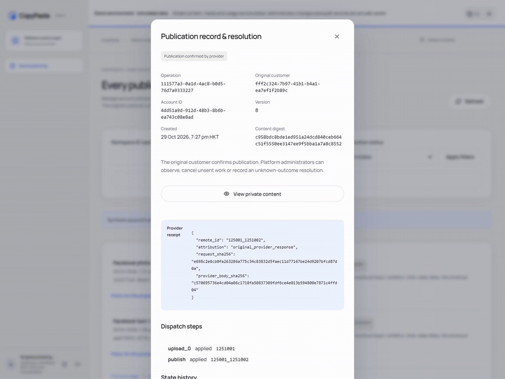

[Actual interaction MP4](assets/screenshots/workmate-publications-12-private-review-and-request-recovery.mp4)


<!-- admin-profile-revisions-124 -->
## Structured specialist, brand and private memory editing · Stage 124

Sign in with the separate Admin identity and MFA, then choose **Revise** for a customer specialist, brand or memory in Content. Specialist fields cover name, instructions and a tool subset from the pinned role. Brand fields cover font sources/permitted use, shared Logos, products, precise prices and offers. Memory edits retain the owner and scope while changing content and expiry. Legacy brand guidance requires explicit font/use declarations; rights are never invented.

Provide a reason, preview exact differences and pinned sources, check consent and save a new version. Currency precision is respected and comparisons display `HK$128.90`; review dates explicitly use Hong Kong time (`HKT`) while input pickers use the device's local timezone. Pinned models/Skills/brands and existing conversation inputs are retained; editing never starts customer work.

All three content permissions must intersect at the current object scope; explicit restrictions take precedence. Live withdrawal clears private content, preview and history. A lost response recovers the original outcome after reload without storing body/reason or mutating twice. Existing team, project-brief and method editors retain their respective publication workflows.

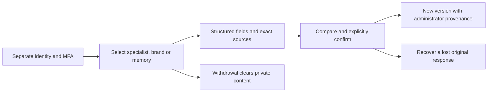

All **68 related backend checks**, **11 Admin unit checks**, **eight actual UI flows** and **14 boundary observations** at four widths passed. Initial recording/viewport-race failures remain unchanged; attempt 03 is a historical pass for its source, and the following use attempt 04 with readable money/time. All owned browsers/services/native databases were closed. Full product, live professional quality and production deployment retain separate acceptance.

| Actual screen | Capture |
| --- | --- |
| Specialist instructions and tool selection | [Specialist form](assets/screenshots/workmate-admin-profiles-04-specialist-form-en.png) |
| New specialist version and provenance | [Specialist receipt](assets/screenshots/workmate-admin-profiles-04-specialist-receipt-en.png) |
| Exact price and shared source selection | [Brand fields](assets/screenshots/workmate-admin-profiles-04-brand-price-and-sources-en.png) |
| Brand comparison with readable money | [Brand review](assets/screenshots/workmate-admin-profiles-04-brand-review-en.png) |
| Committed new brand version | [Brand receipt](assets/screenshots/workmate-admin-profiles-04-brand-receipt-en.png) |
| Chinese at 375px private memory and Hong Kong time | [Narrow review](assets/screenshots/workmate-admin-profiles-04-memory-review-zh-375.png) |
| Genuinely dropped committed response | [Original-request recovery](assets/screenshots/workmate-admin-profiles-04-memory-lost-response.png) |
| Actual scope withdrawal clears content | [Withdrawn scope](assets/screenshots/workmate-admin-profiles-04-memory-authority-withdrawn.png) |

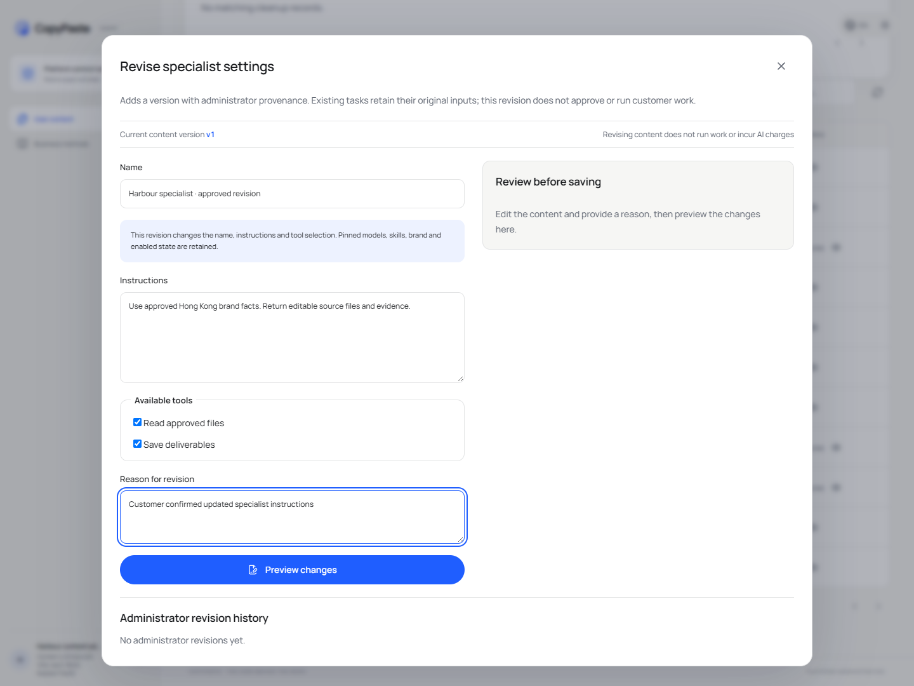

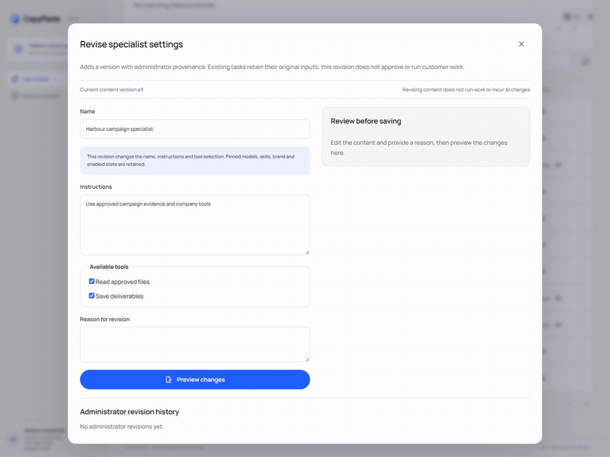

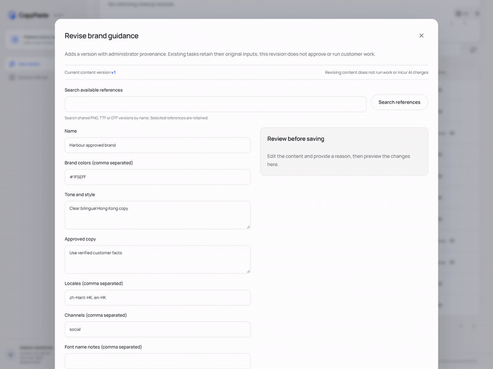

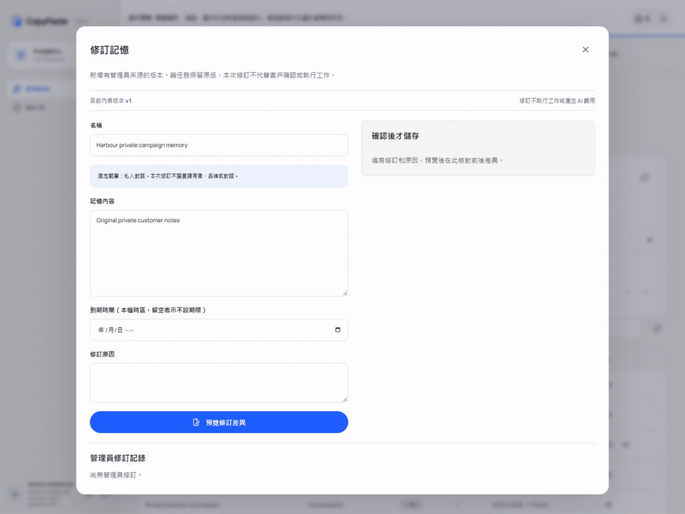

[SpecialistMP4](assets/screenshots/workmate-admin-profiles-04-specialist-revision.mp4) · [BrandMP4](assets/screenshots/workmate-admin-profiles-04-brand-revision.mp4) · [MemoryMP4](assets/screenshots/workmate-admin-profiles-04-private-memory-revision.mp4) · [Design and evidence](https://github.com/copypasteltd/workmate/blob/docs/docs/technical/124-admin-profile-revisions.md)

<!-- admin-content-revisions-123 -->
## Structured content editing and recovery · Stage 123

Sign in with an independent Admin identity and MFA. Choose **Revise** for a team or shared project brief, or **Create revision draft** for a method. Edit names, instructions, member responsibilities, exact references or required materials. Search authorized references by name while retaining existing selections.

Provide a reason, inspect the before/after comparison and pinned dependency versions, then check the explicit confirmation. A shared brief publishes a new version and replaces its draft. A method revision creates a draft subject to the customer's existing trial and publication process. HKD budgets use exact decimal conversion.

Unknown responses retain the original request key and signed digests for recovery after reload; browser storage contains no content body or reason. Authority withdrawal clears the open body, preview and history, and late responses cannot restore cleared content. The editor retains CopyPaste typography, blue palette and neutral workspace; narrow layouts present editing, review and history in order.

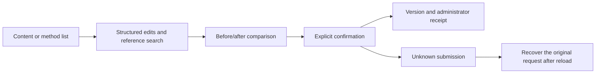

See the [structured editor](src/content-revisions.tsx) and [responsive styles](src/content-revisions.css). All **75 checks across five complete related backend files** and **seven actual UI flows** passed. Dialog and field bounds fit 375/768/1024/1440px. After an unknown response, the recovered receipt remains open until dismissed and the original request does not mutate content twice. Initial failures and older captures remain historical; the following use attempt 03. Owned browsers, services and the test database were closed. Full product acceptance is tracked separately.

| Actual screen | Capture |
| --- | --- |
| English team diff and unchecked confirmation | [Team preview](assets/screenshots/workmate-admin-content-03-team-preview-en.png) |
| Committed version receipt | [Saved result](assets/screenshots/workmate-admin-content-03-team-saved-en.png) |
| Traditional Chinese, exact HKD and 375px layout | [Narrow confirmation](assets/screenshots/workmate-admin-content-03-brief-preview-zh-375.png) |
| Method materials and draft preview | [Method revision](assets/screenshots/workmate-admin-content-03-method-preview-zh.png) |
| Committed request with a deliberately lost response | [Original request recovery](assets/screenshots/workmate-admin-content-03-unknown-response-recovery.png) |
| Current authority withdrawal clears the private body | [Withdrawal result](assets/screenshots/workmate-admin-content-03-authority-withdrawn.png) |

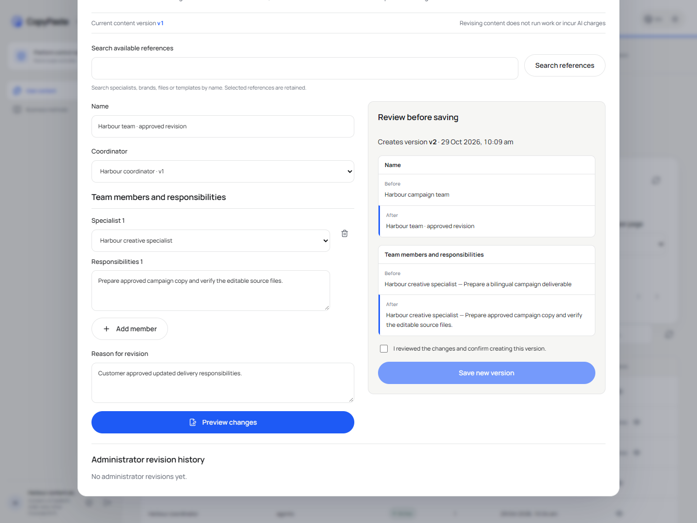

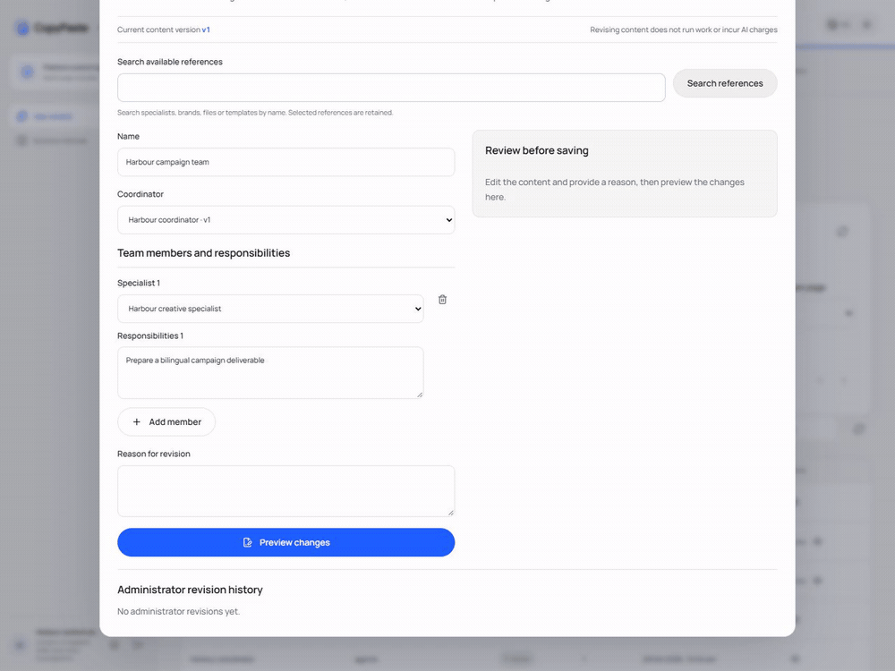

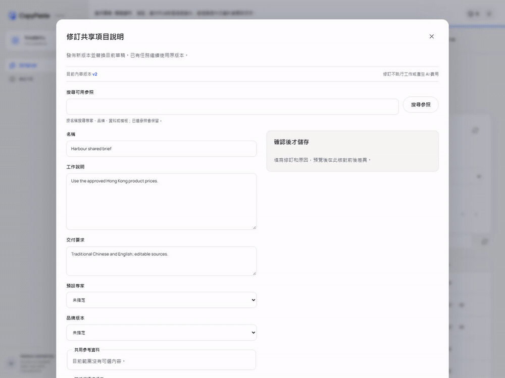

[Team MP4](assets/screenshots/workmate-admin-content-03-team-revision.mp4) · [Brief and method MP4](assets/screenshots/workmate-admin-content-03-brief-method-revisions.mp4) · [Behavior and evidence](https://github.com/copypasteltd/workmate/blob/docs/docs/technical/123-admin-content-revisions.md)

## Product and boundaries

The first customers are existing marketing teams. Scope includes image/design/typography, video/effects, advertising and website analysis, SEO/GEO, repeated business processes and software development. The catalog has 18 candidates with exact Skill bindings; at least twelve individually qualified professional presets remain an acceptance requirement. The designer combines Codex, design Skills and company Image 2. Codex is the only Agent core. All AI uses the company's OpenAI-compatible backend; development currently uses authorized synthetic providers, not a claim of live professional quality.

Uses separately enrolled Admin identities and MFA; customer login grants no administration. Metadata, sensitive bodies, usage/cost, credits/reversals, credit limits, refunds, payment records, VIP, quarantine/restore and irreversible erasure have separate permissions. Preview exact users/workspaces, amounts or entitlements, expiry and reason before confirming the same idempotent operation. Preview changes no balance and replay grants no duplicate credit. Support access does not imply body access; sensitive operations retain independent review, current MFA and audit. Admin cannot grant customer-local full permission or sign a customer's media declaration.

## Repositories and execution

| Branch | Directory | Runtime |
| --- | --- | --- |
| [backend](https://github.com/copypasteltd/workmate/tree/backend) | `dev/copypaste-platform` | Fastify / PostgreSQL / cloud Codex |
| [web](https://github.com/copypasteltd/workmate/tree/web) | `dev/copypaste-web` | React / Vite / cloud workspace |
| [admin](https://github.com/copypasteltd/workmate/tree/admin) | `dev/copypaste-admin` | React / separate Admin identity |
| [desktop](https://github.com/copypasteltd/workmate/tree/desktop) | `dev/copypaste-desktop` | Electron / customer-local Codex |
| [extension](https://github.com/copypasteltd/workmate/tree/extension) | `dev/copypaste-extension` | Chrome MV3 / native Side Panel / cloud Codex |
| [delivery](https://github.com/copypasteltd/workmate/tree/delivery) | `dev/copypaste-delivery` | Native development, QA and publication tools |

The component is an independent Git repository. Keep the sibling layout and use the documented native tools; Docker, WSL and VMs are prohibited.

## User workflow

1. Sign in with a separate administrator identity and MFA; a customer session grants no Admin access.
2. Search scoped users/workspaces and inspect permitted projects, tasks, content and consumption; sensitive bodies require separate access.
3. Preview exact subject, amount, funding source and reason before confirming the same idempotency key. Balance, cash, credit and VIP remain separate.
4. Grant, extend, suspend or revoke subject-specific VIP with explicit expiry/entitlements; a VIP change does not silently grant money.
5. Perform permitted content/task/batch/capability/node actions with current MFA, reason, version checks and independent approval where required.

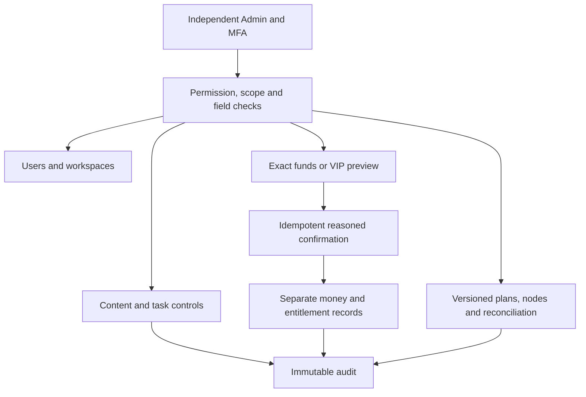

## Setup

### Local startup

Run these commands in the checked-out component. The complete workspace has the six independent repositories side by side under `dev/`; see the [branch and checkout layout](https://github.com/copypasteltd/workmate/blob/docs/docs/governance/04-git-branches-and-publication.md). Use Windows x64, Node.js >=22.14, npm/Git and the documented native PostgreSQL, FFmpeg/FFprobe and pinned Codex resources. Preserve existing local configuration/data. No Docker/WSL/VM is used.

```powershell
Set-Location 'D:/dev/copypasted/自有agent/dev/copypaste-admin'
npm ci
npm run dev
```

Start the backend first, then open `http://localhost:4318`. Use `npm run build` for the static build. Use a separately enrolled Admin account with MFA and assigned permissions.

### Use the current workflow

1. Complete sign-in, company membership/invitation and project selection. Native clients use browser PKCE; Admin uses separate MFA identities. Expired/revoked credentials must not silently change identity or company.
2. Select a specialist and supply the brief and explicitly authorized references/accounts. Missing inputs request customer action. Project owners can save, preview and explicitly publish immutable shared guidance; publication starts no AI and grants no new permission.
3. New tasks pin their accepted role, Skill, brand, reference and guidance versions. Existing work, including an originally absent configuration, retains its original state. Source revocation hides unavailable bodies and blocks later use; history is not a permission bypass.
4. Confirm budget and any required operation/media approval. View genuine status, progress, exact deliverables and original receipts. Continue requested edits in the same task lineage. Unknown usage remains reserved for reconciliation; it is never silently free or blindly replayed.
5. Admin can independently manage authorized user/workspace status, inspect permitted consumption, preview/confirm manual fees or credits and activate scoped VIP/expiry. Balances, recorded payments, credits, budgets and VIP are separate records. Idempotent confirmation and audit prevent duplicate grants.

## Configuration and authority

The candidate requires the complete additive SQL001–133 history. API/worker schema admission rejects missing, changed or unsupported versions; recovery identity is fenced independently. Company model aliases, verified media capabilities, exact tariffs and provider secrets live on the backend. Unconfigured capabilities remain unavailable. Current development uses explicitly authorized synthetic data.

Web/Admin use `VITE_API_BASE` or their same-origin proxy; default development ports are 4317/4318. Desktop/Extension compile fixed `COPYPASTE_API_ORIGIN` and `COPYPASTE_WEB_ORIGIN` values; Desktop also pins `COPYPASTE_EXTENSION_ID`. HTTPS is required outside the allowed loopback-development case. No renderer or extension receives company provider secrets.

Files remain private unless the customer explicitly shares them. Authorization is checked on new requests, worker claims, tools and downloads. Source/body revocation is not bypassed by old history. Money uses exact HKD micros; budget, balance, credits, recorded payments and VIP are distinct. Stable request identities prevent duplicate grants, tasks and reservations. Unknown usage or physical cleanup retains its reconciliation hold.

### Admin control matrix

| Scope | Controls |
| --- | --- | --- |
| Identity | Separate session, MFA, revocation, CSRF, scoped roles and explicit deny |
| Users / workspaces | Search, membership, freeze/restore and permitted task/content links |
| Funds / consumption | Exact usage, grants, credits, recorded payments, compensation, refund and reconciliation |
| VIP / entitlements | Subject, plan version, start/expiry, extension, suspension and revocation |
| Content / tasks | Separate metadata/body access, revisions, quarantine, erasure, pause/cancel and batch outcomes |
| Platform | Versioned models/skills/content releases; distinct infrastructure/read/stop/reconcile permissions |
| Sensitive changes | Reason, current MFA, compare-and-swap, idempotency, audit and independent approval when required |

Node credentials are shown once and cleared on close/unmount. Resource metadata access grants no customer pixels or private body access.

## Preset roles and Skills

The catalog defines 18 professional presets plus the default assistant. Every run pins exact Skill versions and registered tools. These definitions are not a claim that twelve full professional qualifications have passed.

| ID | Role | Required Skill bindings |
| --- | --- | --- |
| R01 | Full-stack developer | `fullstack-engineering@1.0.0`, `frontend-implementation@1.0.0`, `backend-api@1.0.0`, `qa-testing@1.0.0`, `delivery-core@1.0.0` |
| R02 | Frontend developer | `frontend-implementation@1.0.0`, `ui-system@1.0.0`, `qa-testing@1.0.0`, `delivery-core@1.0.0` |
| R03 | Backend/API engineer | `backend-api@1.0.0`, `qa-testing@1.0.0`, `delivery-core@1.0.0` |
| R04 | Software QA engineer | `qa-testing@1.0.0`, `frontend-implementation@1.0.0`, `delivery-core@1.0.0` |
| R05 | UI/UX designer | `ux-research@1.0.0`, `ui-system@1.0.0`, `frontend-implementation@1.0.0`, `delivery-core@1.0.0` |
| R06 | Designer | `creative-direction@1.0.0`, `image-art-direction@1.0.0`, `image2-production@1.0.0`, `typography-layout@1.0.0`, `delivery-core@1.0.0` |
| R07 | Brand visual designer | `brand-system@1.1.0`, `image-art-direction@1.0.0`, `image2-production@1.0.0`, `typography-layout@1.0.0`, `delivery-core@1.0.0` |
| R08 | Ad creative designer | `ad-creative@1.0.0`, `image-art-direction@1.0.0`, `image2-production@1.0.0`, `typography-layout@1.0.0`, `delivery-core@1.0.0` |
| R09 | E-commerce designer | `ecommerce-visual@1.0.0`, `image-art-direction@1.0.0`, `image2-production@1.0.0`, `typography-layout@1.0.0`, `delivery-core@1.0.0` |
| R10 | Social content designer | `social-content@1.0.0`, `image2-production@1.0.0`, `typography-layout@1.0.0`, `delivery-core@1.0.0` |
| R11 | Illustration/IP designer | `illustration-ip@1.0.0`, `image-art-direction@1.0.0`, `image2-production@1.0.0`, `delivery-core@1.0.0` |
| R12 | Typography/layout designer | `typography-layout@1.0.0`, `image-art-direction@1.0.0`, `image2-production@1.0.0`, `delivery-core@1.0.0` |
| R13 | Presentation designer | `presentation-production@1.1.0`, `typography-layout@1.0.0`, `dataviz@1.1.0`, `delivery-core@1.0.0`, `deterministic-metrics@1.1.0` |
| R14 | Landing-page designer | `landing-page@1.0.0`, `ui-system@1.0.0`, `frontend-implementation@1.0.0`, `image2-production@1.0.0`, `delivery-core@1.0.0` |
| R15 | Information/data designer | `dataviz@1.1.0`, `deterministic-metrics@1.1.0`, `typography-layout@1.0.0`, `delivery-core@1.0.0` |
| R16 | Video/motion designer | `video-storyboard@1.0.0`, `template-video-composition@1.0.0`, `video-generation@1.1.0`, `speech-production@1.2.0`, `delivery-core@1.0.0` |
| R17 | Marketing analyst | `ads-analysis@1.1.0`, `deterministic-metrics@1.1.0`, `dataviz@1.1.0`, `delivery-core@1.0.0` |
| R18 | Workflow consultant | `workflow-design@1.1.0`, `workflow-execution@1.1.0`, `delivery-core@1.0.0` |

Designer combines Codex, design Skills and the company Image 2 capability. Optional R19 computer-operator work needs its own confirmed cloud lease and AI budget; native Desktop excludes it and retains customer-local execution.

[Role contract](https://github.com/copypasteltd/workmate/blob/backend/catalog/role-preset-catalog.json) · [Skill packages](https://github.com/copypasteltd/workmate/blob/backend/catalog/skill-packages.json)

## Optional dedicated cloud computer

Review an immutable plan/quote, payer, fixed duration, exact private files and separate terminal/visual/Agent scopes. Agent control defaults off. Explicit consent reserves resource cost; a later Codex instruction has a separate exact AI ceiling. No automatic renewal occurs. Stop/expiry/revocation fences subsequent actions; measured usage and verified cleanup settle, uncertainty reconciles.

The Linux physical-node source uses native Node22/systemd, cgroups, XFS project quotas and bounded desktop tools. No Linux host was started for the local Windows qualification. Build a fresh numbered source bundle with `node native/build-package.mjs NN` in Delivery; verify the externally pinned bundle digest before installation. The installer defaults to no service start and supports exact-UUID recovery.

## Actual interface and interaction

These are actual unretouched product screenshots and wall-clock recordings. Customer/model/media responses are explicit fixtures; native Codex, files, database and billing paths run where stated. Synthetic node pixels do not qualify an actual remote Linux desktop.

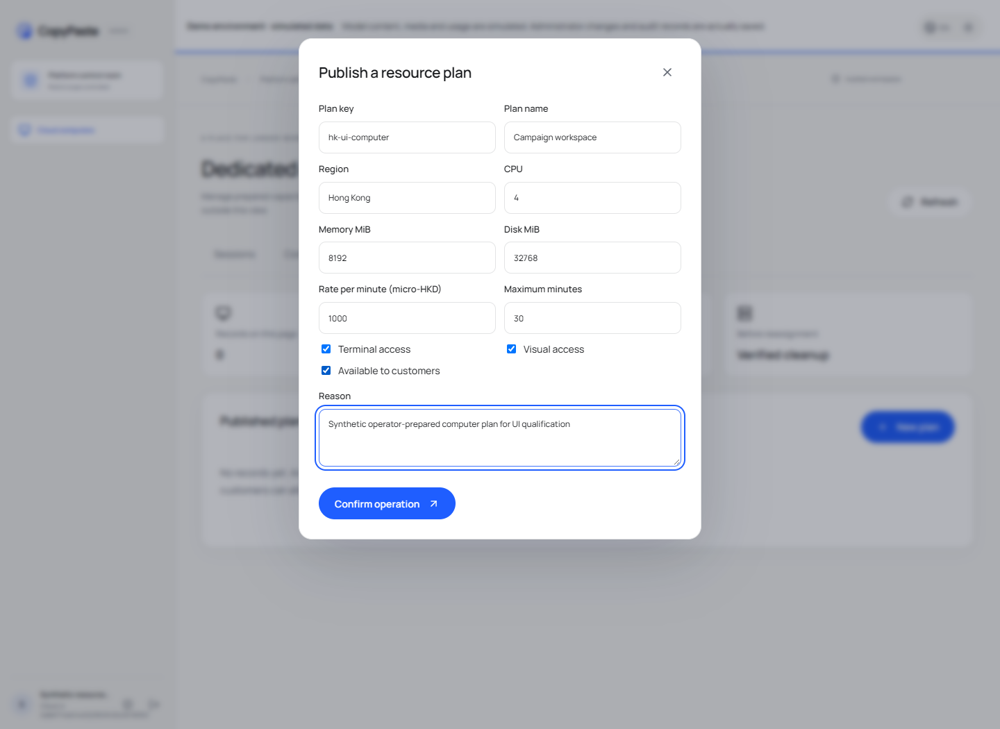

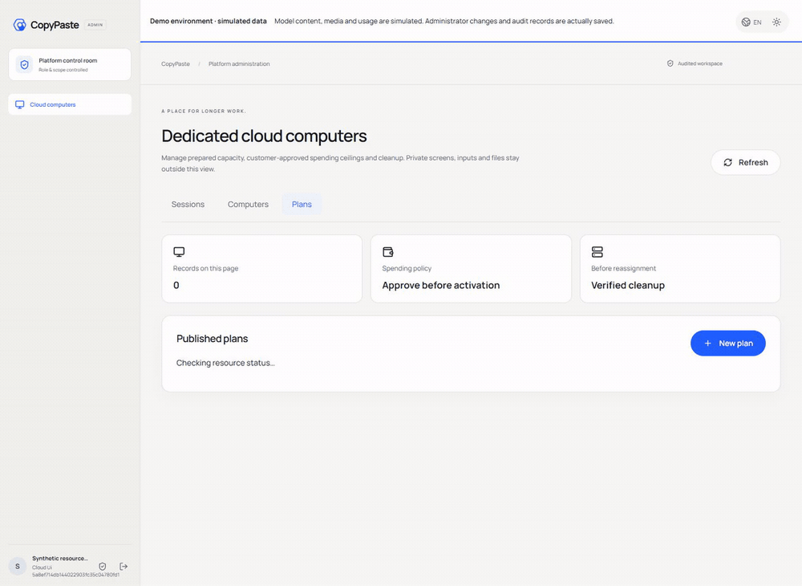

[Original MP4](assets/screenshots/workmate-12-dedicated-cloud-plan.mp4)

## Verification and delivery status

The integrated clients/tool inventory passed 338 checks: Web 20, Admin 9, Extension 63, Desktop 180, actual local Codex 22 and Delivery 44; corresponding types/builds passed. Native Desktop, Web/Admin and native Side Panel each have eight bounded actual UI checks, with 29 screenshots and five GIF/MP4 pairs. Complete backend success requires its final complete-inventory report; the checkpoint records actual outcomes and retains failed attempts.

Run this component’s `npm run typecheck`, `npm run build` and documented test scripts with installed native prerequisites. Delivery’s default `npm test` covers native-surface integrity; the complete Delivery unit inventory is `node --test --test-concurrency=1 tests/*.test.mjs`. `node scripts/qualify-delivered-clients-v1.mjs NN` uses a fresh two-digit attempt and the sibling layout for all integrated client inventories. Candidate-specific historical runners preserve their original directory requirements.

Full product acceptance remains open: twelve professional-role qualifications, complete permissions/business/compatibility matrices, live service quality, signed installers/updates, production load/restore and customer business acceptance. Use the numbered inventory rather than test counts as a completion claim. Owned browsers/processes are closed; user resources are preserved.

[Implementation / 方案](https://github.com/copypasteltd/workmate/blob/docs/docs/technical/121-dedicated-cloud-and-client-execution.md) · [Checkpoint / 证据](https://github.com/copypasteltd/workmate/blob/docs/docs/quality/dedicated-cloud-checkpoint.json) · [Open requirements / 未完成项](https://github.com/copypasteltd/workmate/blob/docs/docs/quality/remaining-work-2026-10-29.md) · [Branch layout / 检出布局](https://github.com/copypasteltd/workmate/blob/docs/docs/governance/04-git-branches-and-publication.md)
