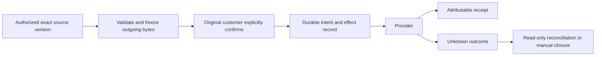
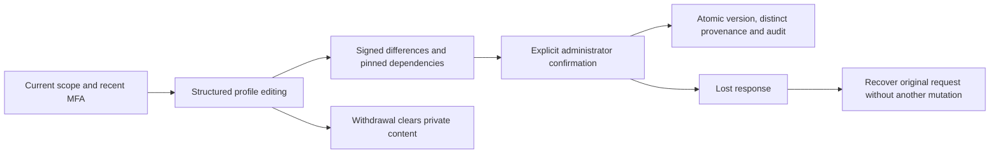
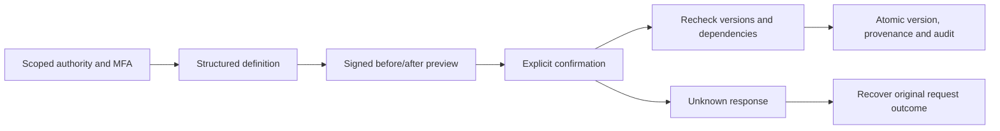
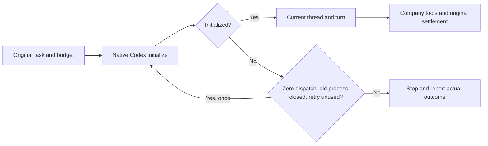
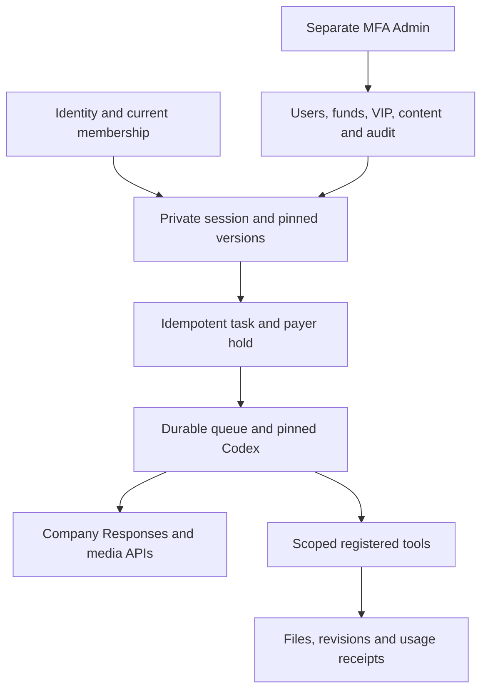

# Workmate · CopyPaste Enterprise Agent · platform

[简体中文](README.md) · [English](README.en.md)

<!-- controlled-publications-stage125 -->
## Controlled social publishing · Stage125

Adds account authorization, exact source-version freezing, actual media previews, per-operation customer consent, durable execution and unknown-outcome reconciliation. Formats cover Facebook text/photo/gallery/video and Instagram photo/Reel/carousel/Story, each with independent media/account checks. Instagram photos receive the required JPEG rendition; valid Facebook PNGs may remain PNG.



Project APIs live under `/v1/tenants/:tenant/projects/:project/publications`. Preview/preparation does not publish. Consent binds the actual content digest, account and current version. Only unsent operations can be cancelled; unknown outcomes never automatically resend and manual closure does not prove failure. Independent receipts, restore replay fences, source/account revocation, budget and quota checks apply on the server.

Codex exposes `publication_accounts`, `publication_preview`, `publication_prepare` and `publication_status`; preparation stops at customer consent. Desktop invokes company tools from its local Codex runtime.

Admin permissions are `admin.publication.read`, `admin.publication.policy.write` and `admin.publication.resolve`; private body/media also require independent `admin.content.body.read`. Existing administrators do not silently upgrade. An enrolled active permanent global super administrator may be explicitly upgraded by a local operator:

```powershell
npm run admin:enable-publications -- admin@example.com --acknowledge-global-publication-authority
```

A new grant atomically revokes old sessions and records an audit; sign in again. Repeated/concurrent calls neither duplicate grants nor revoke fresh sessions. Body-read is not granted; conflicting roles and relevant explicit denies are refused.

Current scopes pass 117/117 related backend checks, 5/5 CLI checks, 12/12 analysis checks and 14/14 actual Web/Admin checks. The actual packaged Desktop/native Chrome Side Panel publishing journey passes 10/10. These are not complete product or twelve-role professional acceptance; actual Codex invocation of the four new tools remains open; synthetic data and previous failures remain explicit.

<!-- admin-profile-revisions-124 -->
## Specialist, brand and memory revisions · Stage 124

Scoped administrators can now revise saved customer specialists, brand guidance and all five memory scopes through the same three intersecting content permissions, recent MFA, signed previews, explicit confirmation, original-request recovery and audit. The six operations retain `/v1/admin/content-revisions/{kind}/{id}`; allowed kinds now include `agents`, `brand_profiles`, `memories`, `agent_groups`, `project_configurations` and `solutions`.

| Content | Editable fields | Version and authority boundaries |
| --- | --- | --- |
| Customer specialist | Name, instructions and tools allowed by its pinned role | Retains Codex, models, Skills, template and brand versions; default assistant remains fixed and existing conversations retain their original version |
| Brand guidance | Colors, voice, approved copy, font sources/use declarations, shared PNG Logos, product prices and offers | Validates actual bytes, exact asset revisions and permitted use; existing work retains its brand version and money uses exact decimal conversion |
| Memory | Name, content and expiry | Retains scope, customer owner, project, brand and private conversation; enterprise-wide revisions require broad authority and honor explicit project restrictions |

Forward [migration 131](migrations/131-admin-profile-revisions.sql) leaves SQL001–130 unchanged. Administrator versions have distinct provenance rather than a fabricated customer author; application/queue roles cannot forge administrator facts. The immutable fact, actual version and audit commit atomically or roll back together. Permanent memory erasure clears content and definition snapshots while retaining governance/accounting metadata. Subsequent ordinary customer edits retain the real customer creator.



**Validation:** all **68 checks across five complete related backend files**, including 25 new revision checks, **11 Admin unit checks**, **eight actual Admin journeys** and **14 layout observations** at four widths passed. Eight PNG captures and three actual GIF/MP4 pairs are retained. Email/MFA, Hong Kong local time, exact HK$128.90 presentation, a genuinely dropped committed response and live scope withdrawal use the actual implementation. Editing adds no tasks, reservations or AI calls. Historical failures and media remain; owned browsers/services/native databases were closed. This bounded evidence does not replace full backend, live provider or complete product acceptance.

See [domain logic](src/admin-profile-content.ts), [revision service](src/admin-content-revisions.ts), [related tests](tests/admin-profile-revisions.test.ts), [design and evidence](https://github.com/copypasteltd/workmate/blob/docs/docs/technical/124-admin-profile-revisions.md) and [actual screens/recordings](https://github.com/copypasteltd/workmate/blob/admin/README.en.md).

<!-- admin-content-revisions-123 -->
## Administrator content revisions · Stage 123

Structured revisions append a team version, publish a shared project brief while replacing its draft, or create a new method-family draft. Existing tasks retain their pinned input versions; method trials and customer publication remain required.

Every operation intersects the current object scopes of `admin.content.read`, `admin.content.body.read` and `admin.content.version.create`, with explicit restrictions taking precedence. The current Admin session and recent MFA are rechecked. Five-minute signed previews bind the source version, resolved dependencies, before/after digests, reason, administrator and session. Confirmation atomically appends the exact version, distinct administrator provenance and audit. Revisions create no tasks, model calls or AI charges. Customer creation retains its existing read privilege rather than gaining database template-update authority.

Six routes share `/v1/admin/content-revisions/{kind}/{id}`: read the editor, `GET /options?q=`, `GET /history`, `POST /previews`, `POST /apply` and `POST /requests/{key}`. Kinds are restricted to `agent_groups`, `project_configurations` and `solutions`. Unknown responses recover through the original idempotency key and return metadata only.



See the [revision service](src/admin-content-revisions.ts), [forward migration 130](migrations/130-admin-content-revisions.sql) and [focused integration tests](tests/admin-content-revisions.test.ts). All **75 checks across five complete related files** passed, including 16 new revision checks. **Seven actual Admin UI flows** passed login, all three editors, original-request recovery, live authority withdrawal and unchanged task/charge counts. Dialog and field bounds were observed at 375/768/1024/1440px. Owned browsers, services and the native test database were closed. Synthetic inference remains authorized; full product and production acceptance are tracked separately.

[Behavior and evidence](https://github.com/copypasteltd/workmate/blob/docs/docs/technical/123-admin-content-revisions.md) · [Actual screenshots and GIF/MP4](https://github.com/copypasteltd/workmate/blob/admin/README.en.md)

<!-- runtime-startup-122 -->

The [billing integration scenario](tests/runtime-startup-billing.test.ts) prepares real private source evidence and its original funding reservation, then checks recovery and settlement within the retained 120-second bound. Two initial failures and the later isolated pass stay separate; the checkpoint records the final complete related-file count. Earlier failure causes remain unproven.

The final five complete related files passed all 79 checks, with zero failures, cancellations or skips. Source bytes stayed unchanged; private fixtures, the native database and its port were reclaimed and checked. This covers billing, gateway, request control, SEO and recovery integration; the complete backend suite was not rerun. Final recovery/ledger assertions took about 79.7 seconds under the retained 120-second bound.

## Codex startup and turn isolation · Stage 122

A timed-out or disconnected cloud Codex initialization may restart once only after zero model dispatches and actual closure of the old process and gateway. RPCs retain the 60-second deadline; both starts share the original task deadline, authority and budget. Failures after thread or model admission are not replayed. Tools, output and completion must belong to the current thread and turn.

12 real native runtime checks passed, including the actual 60-second timeout, restart limit, cancellation, explicit rejection, cleanup failure and foreign-turn denial. Model responses are synthetic; the historical intermittent timeout root cause remains unproven. Native checks require the locked executable and adjacent Desktop contract.



[完整方案 / Behavior and verification](https://github.com/copypasteltd/workmate/blob/docs/docs/technical/122-codex-startup-and-turn-isolation.md)

## Product and boundaries

The first customers are existing marketing teams. Scope includes image/design/typography, video/effects, advertising and website analysis, SEO/GEO, repeated business processes and software development. The catalog has 18 candidates with exact Skill bindings; at least twelve individually qualified professional presets remain an acceptance requirement. The designer combines Codex, design Skills and company Image 2. Codex is the only Agent core. All AI uses the company's OpenAI-compatible backend; development currently uses authorized synthetic providers, not a claim of live professional quality.

Uses TypeScript, Fastify and native PostgreSQL. Application roles have no owner/BYPASSRLS privilege; HTTP, workers, downloads and source reuse recheck current authority. Task ledgers distinguish reservations, actual usage and unknown cost; stopping never fabricates zero usage. Company model aliases, media capabilities, exact tariffs and allowed origins are backend configuration, not arbitrary client-supplied provider secrets or URLs.

## Repositories and execution

| Branch | Directory | Runtime |
| --- | --- | --- |
| [backend](https://github.com/copypasteltd/workmate/tree/backend) | `dev/copypaste-platform` | Fastify / PostgreSQL / cloud Codex |
| [web](https://github.com/copypasteltd/workmate/tree/web) | `dev/copypaste-web` | React / Vite / cloud workspace |
| [admin](https://github.com/copypasteltd/workmate/tree/admin) | `dev/copypaste-admin` | React / separate Admin identity |
| [desktop](https://github.com/copypasteltd/workmate/tree/desktop) | `dev/copypaste-desktop` | Electron / customer-local Codex |
| [extension](https://github.com/copypasteltd/workmate/tree/extension) | `dev/copypaste-extension` | Chrome MV3 / native Side Panel / cloud Codex |
| [delivery](https://github.com/copypasteltd/workmate/tree/delivery) | `dev/copypaste-delivery` | Native development, QA and publication tools |

The component is an independent Git repository. Keep the sibling layout and use the documented native tools; Docker, WSL and VMs are prohibited.

## User workflow

1. Verify identity, current membership and project scope; create a private session and pin role, Skill, brand and input versions.
2. Create the durable task and original-payer hold under a stable request identity; recheck authority at inference, tools and downloads.
3. Run pinned Codex through the company Responses API with registered file, analysis, media, approval and delivery tools.
4. Persist actual files, events, provenance, usage and unknown-cost holds. Revisions keep task lineage; uncertain external writes reconcile.
5. Use a separate Admin identity for users, content, manual funds and VIP; it cannot grant customer OS authority.



## Setup

### Local startup

Run these commands in the checked-out component. The complete workspace has the six independent repositories side by side under `dev/`; see the [branch and checkout layout](https://github.com/copypasteltd/workmate/blob/docs/docs/governance/04-git-branches-and-publication.md). Use Windows x64, Node.js >=22.14, npm/Git and the documented native PostgreSQL, FFmpeg/FFprobe and pinned Codex resources. Preserve existing local configuration/data. No Docker/WSL/VM is used.

```powershell
Set-Location 'D:/dev/copypasted/自有agent/dev/copypaste-platform'
npm ci
npm run setup:local
npm run db:local
```

Keep that database terminal open. In a second terminal in the same repository, run `npm run db:migrate` and then `npm run dev`. API: `http://localhost:4310`. SQL103 must be applied before upgrading clients. Create/enrol an administrator with the existing `admin:create` runbook and current MFA; no shared default Admin credentials are supplied.

### Use the current workflow

1. Complete sign-in, company membership/invitation and project selection. Native clients use browser PKCE; Admin uses separate MFA identities. Expired/revoked credentials must not silently change identity or company.
2. Select a specialist and supply the brief and explicitly authorized references/accounts. Missing inputs request customer action. Project owners can save, preview and explicitly publish immutable shared guidance; publication starts no AI and grants no new permission.
3. New tasks pin their accepted role, Skill, brand, reference and guidance versions. Existing work, including an originally absent configuration, retains its original state. Source revocation hides unavailable bodies and blocks later use; history is not a permission bypass.
4. Confirm budget and any required operation/media approval. View genuine status, progress, exact deliverables and original receipts. Continue requested edits in the same task lineage. Unknown usage remains reserved for reconciliation; it is never silently free or blindly replayed.
5. Admin can independently manage authorized user/workspace status, inspect permitted consumption, preview/confirm manual fees or credits and activate scoped VIP/expiry. Balances, recorded payments, credits, budgets and VIP are separate records. Idempotent confirmation and audit prevent duplicate grants.

## Configuration and authority

The candidate requires the complete additive SQL001–129 history. API/worker schema admission rejects missing, changed or unsupported versions; recovery identity is fenced independently. Company model aliases, verified media capabilities, exact tariffs and provider secrets live on the backend. Unconfigured capabilities remain unavailable. Current development uses explicitly authorized synthetic data.

Web/Admin use `VITE_API_BASE` or their same-origin proxy; default development ports are 4317/4318. Desktop/Extension compile fixed `COPYPASTE_API_ORIGIN` and `COPYPASTE_WEB_ORIGIN` values; Desktop also pins `COPYPASTE_EXTENSION_ID`. HTTPS is required outside the allowed loopback-development case. No renderer or extension receives company provider secrets.

Files remain private unless the customer explicitly shares them. Authorization is checked on new requests, worker claims, tools and downloads. Source/body revocation is not bypassed by old history. Money uses exact HKD micros; budget, balance, credits, recorded payments and VIP are distinct. Stable request identities prevent duplicate grants, tasks and reservations. Unknown usage or physical cleanup retains its reconciliation hold.

Create an administrator only through `npm run admin:create -- <email> [role]` after migrations. The one-time MFA enrollment is stored under the owned `.data/enrolment/` path; there is no shared default administrator. See `.env.example`, `contracts/` and `migrations/` for current configuration and contracts.

## Preset roles and Skills

The catalog defines 18 professional presets plus the default assistant. Every run pins exact Skill versions and registered tools. These definitions are not a claim that twelve full professional qualifications have passed.

| ID | Role | Required Skill bindings |
| --- | --- | --- |
| R01 | Full-stack developer | `fullstack-engineering@1.0.0`, `frontend-implementation@1.0.0`, `backend-api@1.0.0`, `qa-testing@1.0.0`, `delivery-core@1.0.0` |
| R02 | Frontend developer | `frontend-implementation@1.0.0`, `ui-system@1.0.0`, `qa-testing@1.0.0`, `delivery-core@1.0.0` |
| R03 | Backend/API engineer | `backend-api@1.0.0`, `qa-testing@1.0.0`, `delivery-core@1.0.0` |
| R04 | Software QA engineer | `qa-testing@1.0.0`, `frontend-implementation@1.0.0`, `delivery-core@1.0.0` |
| R05 | UI/UX designer | `ux-research@1.0.0`, `ui-system@1.0.0`, `frontend-implementation@1.0.0`, `delivery-core@1.0.0` |
| R06 | Designer | `creative-direction@1.0.0`, `image-art-direction@1.0.0`, `image2-production@1.0.0`, `typography-layout@1.0.0`, `delivery-core@1.0.0` |
| R07 | Brand visual designer | `brand-system@1.1.0`, `image-art-direction@1.0.0`, `image2-production@1.0.0`, `typography-layout@1.0.0`, `delivery-core@1.0.0` |
| R08 | Ad creative designer | `ad-creative@1.0.0`, `image-art-direction@1.0.0`, `image2-production@1.0.0`, `typography-layout@1.0.0`, `delivery-core@1.0.0` |
| R09 | E-commerce designer | `ecommerce-visual@1.0.0`, `image-art-direction@1.0.0`, `image2-production@1.0.0`, `typography-layout@1.0.0`, `delivery-core@1.0.0` |
| R10 | Social content designer | `social-content@1.0.0`, `image2-production@1.0.0`, `typography-layout@1.0.0`, `delivery-core@1.0.0` |
| R11 | Illustration/IP designer | `illustration-ip@1.0.0`, `image-art-direction@1.0.0`, `image2-production@1.0.0`, `delivery-core@1.0.0` |
| R12 | Typography/layout designer | `typography-layout@1.0.0`, `image-art-direction@1.0.0`, `image2-production@1.0.0`, `delivery-core@1.0.0` |
| R13 | Presentation designer | `presentation-production@1.1.0`, `typography-layout@1.0.0`, `dataviz@1.1.0`, `delivery-core@1.0.0`, `deterministic-metrics@1.1.0` |
| R14 | Landing-page designer | `landing-page@1.0.0`, `ui-system@1.0.0`, `frontend-implementation@1.0.0`, `image2-production@1.0.0`, `delivery-core@1.0.0` |
| R15 | Information/data designer | `dataviz@1.1.0`, `deterministic-metrics@1.1.0`, `typography-layout@1.0.0`, `delivery-core@1.0.0` |
| R16 | Video/motion designer | `video-storyboard@1.0.0`, `template-video-composition@1.0.0`, `video-generation@1.1.0`, `speech-production@1.2.0`, `delivery-core@1.0.0` |
| R17 | Marketing analyst | `ads-analysis@1.1.0`, `deterministic-metrics@1.1.0`, `dataviz@1.1.0`, `delivery-core@1.0.0` |
| R18 | Workflow consultant | `workflow-design@1.1.0`, `workflow-execution@1.1.0`, `delivery-core@1.0.0` |

Designer combines Codex, design Skills and the company Image 2 capability. Optional R19 computer-operator work needs its own confirmed cloud lease and AI budget; native Desktop excludes it and retains customer-local execution.

[Role contract](https://github.com/copypasteltd/workmate/blob/backend/catalog/role-preset-catalog.json) · [Skill packages](https://github.com/copypasteltd/workmate/blob/backend/catalog/skill-packages.json)

## Optional dedicated cloud computer

Review an immutable plan/quote, payer, fixed duration, exact private files and separate terminal/visual/Agent scopes. Agent control defaults off. Explicit consent reserves resource cost; a later Codex instruction has a separate exact AI ceiling. No automatic renewal occurs. Stop/expiry/revocation fences subsequent actions; measured usage and verified cleanup settle, uncertainty reconciles.

The Linux physical-node source uses native Node22/systemd, cgroups, XFS project quotas and bounded desktop tools. No Linux host was started for the local Windows qualification. Build a fresh numbered source bundle with `node native/build-package.mjs NN` in Delivery; verify the externally pinned bundle digest before installation. The installer defaults to no service start and supports exact-UUID recovery.

## Actual interface and interaction

These are actual unretouched product screenshots and wall-clock recordings. Customer/model/media responses are explicit fixtures; native Codex, files, database and billing paths run where stated. Synthetic node pixels do not qualify an actual remote Linux desktop.

Linked admin product UI demonstrates this headless component’s integration; it is not a separate platform screen.


[Original MP4](https://github.com/copypasteltd/workmate/blob/admin/assets/screenshots/workmate-12-dedicated-cloud-plan.mp4)

## Verification and delivery status

The integrated clients/tool inventory passed 338 checks: Web 20, Admin 9, Extension 63, Desktop 180, actual local Codex 22 and Delivery 44; corresponding types/builds passed. Native Desktop, Web/Admin and native Side Panel each have eight bounded actual UI checks, with 29 screenshots and five GIF/MP4 pairs. Complete backend success requires its final complete-inventory report; the checkpoint records actual outcomes and retains failed attempts.

Run this component’s `npm run typecheck`, `npm run build` and documented test scripts with installed native prerequisites. Delivery’s default `npm test` covers native-surface integrity; the complete Delivery unit inventory is `node --test --test-concurrency=1 tests/*.test.mjs`. `node scripts/qualify-delivered-clients-v1.mjs NN` uses a fresh two-digit attempt and the sibling layout for all integrated client inventories. Candidate-specific historical runners preserve their original directory requirements.

Full product acceptance remains open: twelve professional-role qualifications, complete permissions/business/compatibility matrices, live service quality, signed installers/updates, production load/restore and customer business acceptance. Use the numbered inventory rather than test counts as a completion claim. Owned browsers/processes are closed; user resources are preserved.

[Implementation / 方案](https://github.com/copypasteltd/workmate/blob/docs/docs/technical/121-dedicated-cloud-and-client-execution.md) · [Checkpoint / 证据](https://github.com/copypasteltd/workmate/blob/docs/docs/quality/dedicated-cloud-checkpoint.json) · [Open requirements / 未完成项](https://github.com/copypasteltd/workmate/blob/docs/docs/quality/remaining-work-2026-10-29.md) · [Branch layout / 检出布局](https://github.com/copypasteltd/workmate/blob/docs/docs/governance/04-git-branches-and-publication.md)
