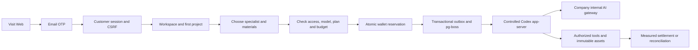
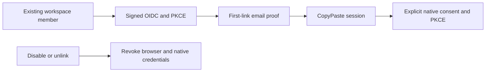

# CopyPaste Platform

[简体中文](README.md) · Native enterprise Agent services · 0.5.0

This independent repository implements persistent PostgreSQL services, customer/admin identity, workspace/project authorization, Codex execution, marketing assets, analytics, workflows, device commands and the admin control plane. No sibling source checkout is required. The delivery root's `docs/` contains the master requirements and design baseline.

## Prerequisites and local start

Validated on Windows x64 with Node.js 22.14+, npm, Git, native Codex `0.163.0-alpha.10.2`, FFmpeg and FFprobe. Dependencies are pinned. Use native processes; Docker, WSL and virtualization are prohibited. Other operating systems have not been qualified.

```powershell
npm ci
npm run setup:local
npm run db:local
```

Keep the database terminal open. In another terminal:

```powershell
npm run db:migrate
npm run dev
```

API: `http://localhost:4310`; PostgreSQL: `127.0.0.1:55432`. The launcher applies development migrations; `db:migrate` also prepares `copypaste_test`. Migrations use the owner identity, while application connections use restricted, non-owner roles with RLS.

`setup:local` creates unique passwords and a durable MASTER_KEY only when `.env` is absent. `.env.example` is a secret-free reference, not a replacement for an existing installation. An ephemeral ASCII junction works around PostgreSQL bootstrap limitations on Unicode Windows paths; actual data and binaries stay in this repository. Shutdown uses native pg_ctl to checkpoint the cluster before removing the alias; it does not force-kill PostgreSQL.

## Customer lifecycle



First email verification can create an account. OTPs expire after 10 minutes, permit five failed attempts and have one atomic consumer. Development mail is written to `.data/mailbox/<challenge-id>.json`; inspect it locally. Production requires SMTP. Web and Admin use separate HttpOnly cookie sessions with Origin/CSRF checks. Native clients use PKCE, short-lived access tokens and rotating refresh families. Logout, suspension and session revocation invalidate access.

## Administrator enrollment

```powershell
npm run admin:create -- admin@your-company.example super_admin
```

Import the generated TOTP URI from `.data/enrolment/<id>.json` into an authenticator, then delete that file. Admin login requires both email OTP and TOTP. There are no shared default credentials. Enrollment is a trusted deployment CLI operation.

Eight built-in roles and 68 permission keys support global, tenant and project scope, explicit denies, amount/duration/batch limits and bounded delegation. Sensitive actions require MFA within the last 10 minutes. Administrators cannot grant themselves access or remove the last permanent recovery administrator.

Version 0.3.0 completes subsequent admin invitations, recipient email proof and real TOTP enrollment, profile editing, status CAS, suspend/resume, resend, other-admin MFA reset, self authenticator replacement and session revocation. Capabilities are hashed; setup keys and unmailed invitation material are encrypted and cleared on completion/revocation. Public admin projections never expose keys, tokens or invitation links. See migration `008-admin-identity-lifecycle.sql`, `src/admin-identities.ts` and 14 actual PostgreSQL/API test groups. Trusted CLI bootstrap remains; production SMTP and SSO need separate qualification.

## Implemented scope

| Area              | Implementation                                                                                                                                                                |
| ----------------- | ----------------------------------------------------------------------------------------------------------------------------------------------------------------------------- |
| Identity          | Email OTP, separate Admin MFA, native PKCE, invitations, member/project rights, last-owner protection and PostgreSQL RLS                                                      |
| Agent             | Codex-only version-pinned runtime, 28 hash-checked Skill packages, 18 role presets, tasks/events/cancellation/leases/fencing                                                  |
| Billing           | Integer HKD micros, funding lots, reserve/settle once, manual confirmed payments/gifts/source-bound refunds, personal/workspace VIP and frozen plan versions                  |
| Admin             | Paginated users/workspaces, scoped consumption, preview/commit, independent approvals, content quarantine/share revocation, jobs/exports, configuration publication and audit |
| Creative          | Local/S3 adapters, immutable versions, authorized downloads/thumbnails, brand records, image/text layout projects, SVG/PNG and actual FFmpeg template MP4                     |
| Analytics         | CSV imports, aggregate CTR/CPC/CPA/ROAS, null undefined ratios, submitted-HTML SEO checks, Google/GA4/GSC/Meta OAuth/report adapters                                          |
| Workflows/devices | Bounded eight-step persistent workflows, analysis/Agent/approval steps, registered devices, Ed25519-signed commands, expiring folder grants and single-use results            |

The 18 roles cover full-stack, frontend, backend/API, software QA, UI/UX, general design, brand, advertising, ecommerce, social content, illustration/IP, typography/layout, presentations, landing pages, information design, video/motion, marketing analytics and workflow consulting. Definitions and actual packages are in `catalog/` and `skills/`.

Installed packages are not evidence of qualified live business tasks. All roles currently report `pending_live_validation`. Unconfigured AI fails explicitly instead of returning synthetic success.

### Actual runtime tools

Registered tools include `project_assets`, `asset_text_read`, `deliver_text`, `marketing_metrics`, and role-gated `code_read`, `code_write`, `code_package`, `font_catalog`, `design_render`, `image2_generate`, `image2_edit`. Code tools support hash-based edits and real ZIP manifests without executing untrusted customer code or claiming tests ran. Design tools produce editable JSON, SVG, PNG and bounded template MP4. Image generation/editing uses the internal Images endpoints only.

Other planned tool identifiers in the design catalog are not all registered. AI video and speech are not implemented; roles requiring those capabilities remain unavailable. Manual signed local-file dispatch works; autonomous Codex local-file dispatch is not connected yet.

## Persistent specialists, private conversations and memory

Version 0.2.0 adds project specialists based on installed roles, with instructions, brand binding and a restricted tool subset. Edits create immutable versions. Conversations pin a version and can explicitly adopt an update. Kernel, provider, model and executable Skills remain server-controlled Codex configuration.

Conversation ownership applies to tasks, events, versions and generated files, enforced by API checks and PostgreSQL RLS. Ordinary workspace administrators cannot read another user's conversation. Shared project tasks cannot consume unrelated private artifacts. Publication explicitly creates a shared copy without private context.

Messages can be notes or delegated ask/plan/execute tasks. Ask and plan permit reading tools; execute can create artifacts. Message UUIDs, conversation versions and one active task per conversation prevent duplicate submissions. Plan approval rechecks the input digest, specialist/memory/conversation versions and budget, and creates one execution child.

Memory has workspace, brand, project, conversation and personal scopes, content versions and expiry. Tasks freeze exact references and recheck authorization before subsequent tools. Deletion clears readable content and cached replay responses while retaining idempotency tombstones. Physical object/runtime-cache garbage collection remains unfinished. Conversations with active or unresolved billing work cannot be deleted.


## Internal gateway qualification

Configure server-only `AI_BASE_URL`, `AI_ALLOWED_HOSTS`, `AI_API_KEY`, the exact `AI_MODEL` alias and contracted HKD token rates. The base commonly includes `/v1`. URL-embedded credentials, production HTTP and fallback to external model providers are rejected.

```powershell
npm run codex:probe
```

This probes the actual version, initialize and thread/start without sending a model turn. Before setting `AI_VERIFIED=true`, qualify real `/responses` tool rounds, token usage and failure behavior against the company gateway. Image 2 separately requires its alias, per-image price and `AI_IMAGE_VERIFIED=true`; verify actual PNG generation and multipart edits.

The runtime integration test launches real Codex against a controlled local Responses fixture and observes a tool call and measured usage. It does not qualify the company's live model. No company gateway credentials were supplied for live integration.

## Financial and operational semantics

1 HKD equals 1,000,000 integer micros. Gifts, confirmed payments, reservations, charges and refunds have separate immutable entries. Confirmed payment references are globally unique. VIP does not credit a wallet, and a wallet balance does not grant VIP.

Pilot Starter/Pro/Business defaults allow 1/3/8 concurrent tasks and HK$100/500/5,000 task budgets. These are operational defaults; monthly pricing remains an unpriced zero placeholder, not a commercial free-plan promise. Admin can publish versioned policies.

Financial/VIP writes require a five-minute preview, payload hash, target version and idempotent commit. The default independent-approval threshold is HK$10,000. Uncertain upstream outcomes retain reservations in reconciliation rather than blindly repeating charges. Payments are manual confirmed records; no online payment acquiring is integrated.

Exports are limited to 500 rows, expire after 15 minutes, belong to the creating admin and recheck source authorization. SQL collection queries enforce scope and explicit denies; roles separately gate contact, usage and billing fields.

## Build and validation

```powershell
npm run typecheck
npm run build
npm test
npm run contracts:export
```

`contracts/implemented-routes.json` exports 167 actual Fastify method/path pairs; ten ordered database migrations are included. This is the implementation inventory, not the full planned OpenAPI. The 84 native tests cover authentication, isolation, concurrent/idempotent billing, permissions/VIP, content revocation, image versions, actual PNG/MP4, a real Codex controlled protocol turn and initialization cancellation, and source packaging. Separate delivery tools record browser, extension and Desktop journeys.

| Directory             | Purpose                                                     |
| --------------------- | ----------------------------------------------------------- |
| `src/`                | API domains, Worker, authorization and Codex                |
| `migrations/`         | Ordered migrations and database constraints                 |
| `catalog/`, `skills/` | Roles, permissions and hashed Skill packages                |
| `contracts/`          | Generated Codex protocol and actual route inventory         |
| `scripts/`            | Native startup, migration, admin enrollment and probes      |
| `tests/`              | Real PostgreSQL, media and runtime tests                    |
| `.data/`              | Ignored local state, mail, enrollment secrets and artifacts |


The screenshot comes from the independent Admin client; this service repository does not contain that UI.

## Deployment and remaining work

Production requires HTTPS, SMTP, separate database identities, a durable MASTER_KEY, restricted egress and storage. The local database launcher refuses production. Back up the database, object data and encryption key, and rehearse native restoration before deployment.

Google/Meta need server OAuth credentials, explicit API versions, Ads developer token and callback registration; live platform authorization/report qualification is pending. S3 has not been qualified against a live bucket. SAML/SCIM, mandatory SSO policies, event triggers, parallel specialist teams, collaborative editing, full AI video/speech, production SLOs, Windows signing and strong customer-code isolation remain unfinished. Codex shell, web search and other agents are disabled; production service-account, ACL and network containment still require deployment work.

No additional open-source license is granted for this application. See [third-party notices](THIRD_PARTY_NOTICES.md).

## Daily / weekly cloud workflows

Version 0.4.0 persists server calendars for published workflows; closing the user page does not stop execution. Migration `009-workflow-schedules.sql`, `src/schedule-time.ts`, `src/schedules.ts` and the native Worker retain immutable versions, occurrences and run references. Explicit confirmation pins the workflow version/hash, execution identity and per-run budget. IANA time zones skip nonexistent DST wall times and select the first repeated instant once.


One unfinished run per schedule prevents overlap, including approval gates and uncertain child charges. Missed opportunities catch up only the latest or skip late triggers; older ranges are coalesced. Paused intervals never backfill. User resumption confirms current authorization; Admin resumption retains the original identity and requires scope, recent MFA, CAS and a reason, rejecting revoked authorization. End times are exclusive; projects allow 50 non-retired schedules. This is not a hard real-time SLA. Fourteen additional database/API/calendar test groups cover concurrency and thousand-day downtime; Delivery `qa:schedules` separately waits on the real clock.

## 0.5.0 company identity and unified sign-in

OIDC uses code + PKCE S256, signature verification, state/nonce and a fixed callback. An existing registered account and active workspace membership are required. First binding requires a separate CopyPaste work-email code; domains never auto-enroll users. Configuration changes, disablement or unlinking revoke all linked users’ CopyPaste browser/native/refresh sessions and prior execution authorization. Administrator email and TOTP remain separate.

Global `admin.tenants.sso.write` is one of 68 actions, built into super/security roles only. Writes require recent MFA, reason, CAS and idempotency. Save disables the connection and clears prior verification; discovery/JWKS/PKCE checks do not qualify the client secret or a real company account. Pinned MIT `openid-client` 6.8.8 enables asymmetric ID-token signature checks.



Deployment: use exact HTTPS `SSO_ALLOWED_ORIGINS`. Default callback is `WEB_ORIGIN/v1/auth/sso/callback` through the Web API proxy; `SSO_CALLBACK_ORIGIN=API_ORIGIN` is supported when Web uses that cross-origin `VITE_API_BASE`. Production rejects `SSO_ALLOW_LOCALHOST=true`. For the native fixture only, start the development controller with this environment flag, run `qa:federation`, then stop and restart without it.

Migration 010 invalidates legacy native codes without a source session. Exchanges recheck source expiry/revocation and user revision; refresh inherits federation identity/revision. Revoking a previously listed device session also revokes its rotated credential family. Tests use actual PostgreSQL and signed code/token/JWKS exchanges. SAML/SCIM, mandatory SSO policy and real company-IdP qualification remain outside this increment.


