<!-- integrated-round-198 -->

## 198 · 0.5.5 · Integrated delivery and traceable validation

[Delivery and limits / 交付與範圍](https://github.com/copypasteltd/workmate/blob/docs/docs/quality/integrated-round-198/README.md) · [Downloads / 下載](https://agent.copypaste.hk/downloads)

1. Complete all independently implementable round code before integrated builds/tests/journeys. Six builds, Desktop main/renderer types and 555 relevant tests pass, followed by 343 Web/Desktop checks after the wording correction. The 69 backend cases are selected risk regressions, not the complete historical matrix.
2. Live Web/Admin, actual packaged native Codex and the real extension Side Panel provide current PNG/GIF/MP 4 evidence. Failed drivers, timeouts and weak evidence remain. Bounded safe-page GET recovery neither replaces responses nor replays business writes.
3. Three immutable client packages and the checksum text pass full public downloads under/releases/19802/. Candidate readiness/active-work checks precede integrated-198-v 2 deployment. Schema 163/credentials and database/proxy processes stay unchanged;198-v 1 remains a rollback path.
4. Seven repositories publish eight ordinary atomic refs with remote readback under existing authorization, preserving user files/unrelated branches. All 32 groups/102 original requirements remain, with external/professional/full production acceptance open.

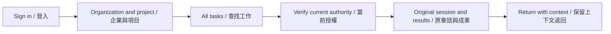

Earlier sections retain previous release/setup history. Current delivery does not close full original acceptance.

<!-- integrated-round-197 -->

## 197 · 0.5.3 · Integrated validation and publication

[Delivery and limits / 交付與範圍](https://github.com/copypasteltd/workmate/blob/docs/docs/quality/integrated-round-197/README.md) · [Downloads / 下載](https://agent.copypaste.hk/downloads)

1. Complete the implementation batch before six-component builds, type checks, regression and actual client journeys. 528 relevant tests pass; selected backend checks are not mislabeled as the complete historical matrix.
2. Immutable Windows Setup/Portable and Extension ZIP downloads are linked publicly and checked by complete byte count and SHA-256. Deployment checks active work, existing configuration and candidate readiness, retaining the prior rollback path.
3. Actual screenshots, interaction GIFs and MP4s come from this round’s real interfaces. Original failures/scripts remain. Server credentials stay in the user-requested private /root/cfg/ directory and are excluded from Git.
4. Publish seven independent repositories to their component branches and docs/main using ordinary pushes with remote readback, preserving user files/unrelated refs. Professional, external and full production acceptance retain all 32 groups/102 requirements.

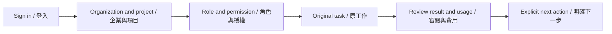

Earlier sections are retained release history. Full external/professional/production acceptance remains open.

<!-- integrated-round-196 -->

## 196 · 0.5.2 · Integrated implementation and release

[完整交付與限制 / Delivery and limits](https://github.com/copypasteltd/workmate/blob/docs/docs/quality/integrated-round-196/README.md) · [下載 / Downloads](https://agent.copypaste.hk/downloads)

1. Inventory requirements and all code work before a complete implementation batch. Only then build six repositories, type-check and run selected tests. Aggregate repairs before revalidation and preserve failed attempts.
2. All476 final relevant tests pass;63 unchanged earlier backend successes remain separately recorded. This does not claim rerunning every historical backend suite.
3. Record real Web save/recovery, packaged local Codex/billing, native Side Panel, Admin compatibility and complete public download digests independently. Preserve actual response timing and exclude sessions/keys from public evidence.
4. Finish and hash packages/metadata before upload. Validate a non-root candidate and active-task preconditions before switching. Retain compatible195 rollback, prior downloads and private/root/cfg/workmate/configuration.
5. Deliver Desktop0.7.6Setup/Portable and byte-identical Extension0.5.5ZIP. Update bilingual READMEs, actual screenshots/GIF/MP4 and all32 groups/102 requirements before ordinary branch publication.

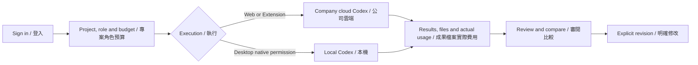

Scope: selected current journeys pass; original failures remain. Intermittent public HTTPS timeouts, professional outcomes, external integrations and full production/compatibility acceptance remain open. Earlier sections below describe historical releases.

<!-- integrated-round-195 -->

## 195 · 0.5.1 · 交付与实机证据 / Delivery and real-device evidence

Implementation-first integrated builds/testing/debugging, immutable candidates, actual journeys/recordings, download hashes, backups and automatic rollback.

[Round delivery / 本輪交付](https://github.com/copypasteltd/workmate/blob/docs/docs/quality/integrated-round-195/README.md) · [Download / 下載](https://agent.copypaste.hk/downloads)

<!-- usage-195 -->

Using this release:

1. Complete the entire code batch before six-repository builds and selected tests. All517 final tests passed; historical failures remain.
2. Record paid cloud, packaged local Codex, native Side Panel and Admin journeys independently, preserving actual response time.
3. Create immutable candidate archives/hashes. Validate a non-root candidate and the no-active-task condition before switching; restore a compatible prior version on failure.
4. Publish Setup, Portable, extension ZIP and checksums; verify complete downloads. Update bilingual documentation and requirement coverage before ordinary branch pushes.

<!-- /usage-195 -->

本輪實際測試與旅程見報告；保留歷史失敗，不以代碼量替代全部專業/生產驗收。影片/語音/Google/Meta真實配置、至少12角色專業驗收及完整兼容/運營矩陣仍開放。測試郵箱及未簽名安裝按已確認範圍保留。

Selected regression and real journeys are in the report. Historical failures remain. Real video/audio/Google/Meta configuration, at least12 professional role evaluations and the full compatibility/operations matrix remain open. The requested test mailbox and unsigned manual installation remain.

<!-- system-assessment-194 -->

## Completeness and UX assessment · 194

Read-only source/configuration, canonical cost/capacity and public browser probes confirm three public origins return 200. Text/image models are configured; real video/audio and Google/Meta authorization remain unavailable. Three original unknown-cost requests hold no execution capacity. Inapplicable runtime probes and an old-workspace 404 remain recorded with their limits.

The assessment contains 32 grouped work areas, 10 UX observations, 9 WorkBuddy comparison dimensions and 102 requirement traces. No paid task, product change, service restart or full-suite rerun was performed. All owned browsers were closed. Excluded signing and the intentional test mailbox remain unchanged.

[Full assessment](https://github.com/copypasteltd/workmate/blob/docs/docs/quality/system-assessment-194/README.md) · [Requirement trace](https://github.com/copypasteltd/workmate/blob/docs/docs/quality/system-assessment-194/requirements-102.md)

<!-- product-downloads-193 -->

## Public product downloads · 193

[Open the download page](https://agent.copypaste.hk/downloads). Desktop 0.7.4 (Windows Setup/Portable), Chrome extension 0.5.4 ZIP and file checksums download directly from the company site without signing in.

Publish only two verified Desktop files, the extension ZIP and SHA256SUMS.txt. Separate page and versioned-file routing supports HEAD and Range/resume, returns 404 for missing files and disables directory listings. Deployment gracefully reloads only the site proxy.

The Windows build is unsigned. The extension is installed manually and is not listed in the Chrome Web Store. macOS/Linux installers are not available.

[方案 / Implementation](https://github.com/copypasteltd/workmate/blob/docs/docs/development/193-product-downloads.md) · [驗證 / Verification](https://github.com/copypasteltd/workmate/blob/docs/docs/quality/193-product-downloads.md)


[實際手機下載頁 / Actual mobile download page](assets/screenshots/193-downloads-mobile-zh.png)


<!-- native-recheck-192 -->

## Recheck and native error visibility · 192

Adds actual model/native/cloud qualification, direct-browser probes, hash-checked downloads, read-only BOM result verification, and backend/static deployment tools. Historical failures remain diagnostic records and are not a deployment replay guide.

Final regressions: backend91, Web30, Admin22, Extension89, Desktop controller74; native Linux8 passed. Ordinary direct-browser GETs returned200 on all three domains; direct Python GETs returned403. This does not certify a zero-defect complete product. Item12 is excluded; unselected video/audio, Google/Meta, Linux Office and full-matrix scope remains open.

[方案 / Implementation](https://github.com/copypasteltd/workmate/blob/docs/docs/development/192-native-error-observability.md) · [复查 / Recheck](https://github.com/copypasteltd/workmate/blob/docs/docs/quality/192-native-recheck.md)


<!-- selected-repairs-191 -->

## Selected execution repairs and Desktop handoff · 191

Add native/runtime and real Desktop/Web checks, candidate deployment, audited capacity repair and manual Desktop publication. Scripts require protected local configuration and target the documented maintenance environment; failed historical operations are not replay instructions. Selected issues02/03/04/05/07 have current evidence. The owner removed12; the new Windows build is unsigned and installed manually. Unknown supplier fees/reservations remain unresolved; execution-capacity release does not settle a bill.

The final Desktop uses the installer default company HTTPS origin through raw CONNECT forwarding, preserving end-to-end TLS verification, requests, model output and accounting. Browser PKCE uses the canonical HTTPS domain. This real workflow passed; a single acceptance does not establish long-term public-route reliability, so issue01 remains open. Fresh scopes: backend40/40, streaming gateway24/24, Windows cloud compatibility38/38, Desktop controller74/74, actual pinned-Codex disconnect1/1 and native Linux8/8; actual cloud task HK$0.126067 and final-build Desktop task HK$0.035144. These are separate checks, not a fresh whole-product acceptance. Public reliability and other unselected190 items retain their gaps. Older entries below are historical.

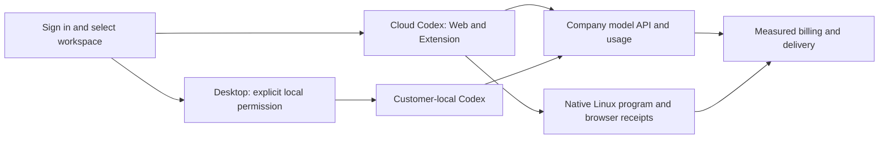

[方案 / Implementation](https://github.com/copypasteltd/workmate/blob/docs/docs/development/191-native-execution-and-capacity.md) · [证据 / Evidence](https://github.com/copypasteltd/workmate/blob/docs/docs/quality/191-selected-repairs.json) · [Desktop0.7.4手动下载 / Manual download](https://github.com/copypasteltd/workmate/releases/tag/desktop-v0.7.4)


Actual Web download recording excerpt; identity labels redacted. 这是Web实际录像节选，不代表其他端的新交互录像。


<!-- system-recheck-190 -->

## Current system recheck · 190

New read-only probes distinguish intermittent public paths from healthy origins, unavailable Linux executors, Desktop error/reconciliation gaps and missing integrations. Eighteen of19 fresh browser checks passed; the admin readiness timeout remains recorded. Fresh mailbox OTP and administrator TOTP logins worked. Private sessions/receipts stay controlled; public evidence contains no credentials. Owned browsers and CONNECT were closed. No new paid task or product deployment occurred. See the [14 numbered groups and actual scope](https://github.com/copypasteltd/workmate/blob/docs/docs/quality/190-system-recheck.md).

These maintenance-only tools need existing private server/QA configuration and the pinned browser: start`scripts/public-qa-transport-189-v1.py`, run`scripts/recheck-network-system-190-v1.py`and`scripts/recheck-public-ui-190-v1.mjs`, then send`{"action":"close"}`to the owned CONNECT process. Never commit private inputs or treat this diagnostic transport as ordinary public-path acceptance.

<!-- live-acceptance-189 -->

## Real image deployment and acceptance · 189

`gpt-image-2` passed actual generation and editing and is published with the same upstream URL/key as text. An actual Web Designer task generated persisted files, downloaded verified hashes and settled measured usage. Larger1254-square PNGs are decoded and normalized to1024 while exact originals remain downloadable. Image tools now resolve their frozen per-model connection without a duplicate global key; unrecovered image-tool failures cannot become successful tasks.

Backend189-v5 and the independent admin update are deployed. Failed receipts, frozen releases and original costs remain. One-shot installation checks candidate63079 and idle tasks before switching; database, credentials and unrelated services are preserved.

The full backend run recorded1950 tests:1949 passed and one failed; that browser deadline issue subsequently passed14/14 focused checks. Web28/28, Admin20/20, Extension89/89, Desktop269/269 and all builds passed. Separate image normalization48/48, per-model image/original persistence and discovery36/36, and actual native protocol image failure/recovery2/2 passed; overlapping runs are not summed into a new full-pass result.

Actual supplier-backed Desktop completion, public reliability, video/audio/Google/Meta credentials, SMTP and Linux native executor qualification remain open. The requested protected test mailbox remains. This is not full-product acceptance. See the [design, usage, original failures and rollback guide](https://github.com/copypasteltd/workmate/blob/docs/docs/development/189-real-image-and-acceptance.md).

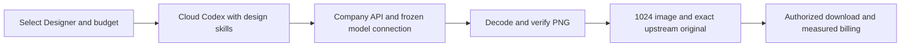


Actual Web download interaction excerpt. Reuse in other client repositories remains Web evidence.


<!-- live-acceptance-188 -->

## Real-service acceptance and deployment · 188

Real text service is deployed. Web and the native Chrome right Side Panel completed email sign-in, authorized file upload, actual cloud Codex analysis, file delivery/download and measured billing. Actual admin checks cover user/workspace creation and deletion, atomic bulk changes, per-model API/key editing and deletion, VIP grants/revocation and audit records. See the [complete evidence and usage guide](https://github.com/copypasteltd/workmate/blob/docs/docs/development/188-live-acceptance.md).

Desktop runs pinned Codex on the customer's computer with explicit folder and full-access consent. Recognized GPT model exec compatibility is repaired; actual local command/file/company-tool operations passed a labelled protocol fixture. Final real-supplier Desktop acceptance remains blocked by intermittent public connectivity. The original full backend regression recorded 1,936 tests: 1,834 passed, 101 failed and one skipped. Subsequent targeted checks are separate evidence, not a replacement full-pass certificate.

To configure service, administrators enter each model's upstream URL, API key, alias and rates in Model capabilities, then qualify and publish its version. Users verify email, select a real workspace/project and submit bounded work. The protected test mailbox remains enabled. Actual image generation returned403; video/audio and Google/Meta credentials are absent and remain unqualified.

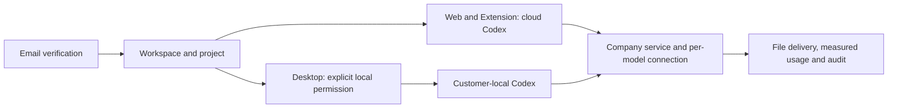


Actual read-only scrolling through the completed Web task, not new inference or a certificate for every client:


<!-- web-scroll-187 -->

## Web scroll refinement · 187

The [Web client](https://agent.copypaste.hk) hides visible page, sidebar, conversation and outer-modal rails while retaining native scrolling. Necessary inner tables, panels and inputs use consistent thin scrollbars derived from the existing light/dark theme. Narrow controls wrap; wide tables scroll only inside their own container.

Browse long content with the wheel, trackpad or touch. Navigation scrolls independently and long-dialog controls remain accessible. TypeScript/Vite and ten final actual deployed-LAN browser checks passed; owned browsers and QA sessions were closed. A complete public HTTPS journey was not qualified this round. See [usage, implementation, evidence and rollback](https://github.com/copypasteltd/workmate/blob/docs/docs/development/187-web-scroll-surfaces.md) for the exact scope.

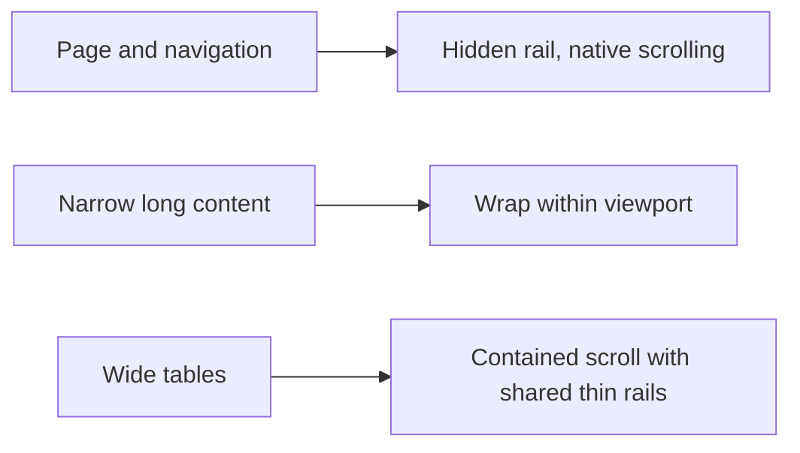


<!-- test-mailbox-185 -->

## Test inbox OTP repair · stage185

New codes were hidden by lexical weekday ordering followed by a30-message cap. Open the [test inbox](https://agent-dashboard.copypaste.hk/ops/mailbox/) with its existing independent operator credentials. Mail now sorts newest first and checks automatically every5 seconds; manual refresh remains available. Request a fresh code if the old one expired. Administrator sign-in still requires the existing TOTP.

Seven focused regression checks and six final public checks passed. A fresh real OTP appeared automatically in about3 seconds and completed actual administrator sign-in. This static-page update retains test delivery, existing credentials and service configuration.

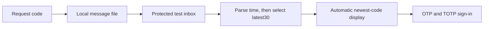

[Usage, implementation, rollback and evidence](https://github.com/copypasteltd/workmate/blob/docs/docs/development/185-test-mailbox.md)


<!-- admin-directory-lifecycle-184 -->

## User/workspace creation, deletion and bulk management · stage184

User and Company management now provide Create, permanent row deletion, current-page selection, bulk status changes and bulk deletion. Reasons, explicit targets, versions, five-minute previews and idempotency are mandatory. Highest administrators execute directly; other roles follow the published approval policy. Ordinary user creation still requires OTP at first sign-in; workspace creation includes its owner, billing account and first project.

Select only the records you intend to change, choose an action, enter a reason, preview and confirm. For deletion, type DELETE followed by the exact count and acknowledge retention. A changed or ineligible record rejects the entire selection. User deletion revokes sign-in and removes contact/profile data while preserving shared workspace content and billing/audit references. Workspace deletion immediately fences new work and queues permanent cleanup; track the actual cleanup status in Content management. API maximum100; the UI never silently selects other pages.

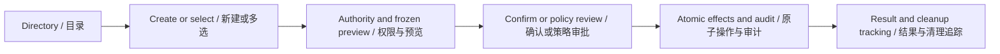

[Detailed design, API, permissions, retention and deployment](https://github.com/copypasteltd/workmate/blob/docs/docs/development/184-admin-directory-lifecycle.md)

13 focused native checks and10 final actual-browser checks passed. Two owned UI runs created and cleaned4 users and4 workspaces; all18 operations have matching direct-execution audit facts. The four root cleanup jobs finished with empty operational exception arrays and documented retained facts. Server configuration, model API/key settings and unknown financial holds are preserved.

<!-- highest-admin-direct-182 -->

## Highest-administrator direct execution · stage182

Active global built-in super_admin executes protected administrative changes directly. Other roles keep policy-based approval and cannot approve their own protected requests. Sensitive operations retain MFA, business permissions, scope, limits and original evidence checks. Actual actors, reasons, command hashes and outcomes are audited atomically.

Production gpt-6-luna was published directly through the real Admin UI. Operation `7d32d69d-5680-4199-bd04-1ebe2b1b4813`, audit `7174`; no pending review was created.18 focused checks and6 real browser checks passed. Existing model settings, encrypted keys, unknown holds and historical violations are preserved. Additive schema160 requires the matching API.

[设计、使用和逻辑图 / Design, usage and diagram](https://github.com/copypasteltd/workmate/blob/docs/docs/development/182-highest-admin-direct.md)


# Workmate · delivery

<!-- model-tool-contract-181 -->
## Complete Codex model validation · stage181

The current saved **gpt-6-luna** passed real production Admin validation: pinned Codex, requested model/effort, a registered tool/result round trip, completed text and known usage. Per-model API URLs/keys are retained. Both flat function tools and native code-mode additional_tools are supported, with business permissions enforced.

Receipt `b8c8c28a-1df1-4ef7-af55-91d9d51b4bcc`; input/output tokens `20230/139`. Earlier uncertain requests remain intact. The unpublished bootstrap policy moves actor/verification ceilings from2 to4 to retain two old holds and restore two available slots; all budget amounts and other limits stay intact. Native code-mode context is pre-funded from complete serialized bytes, then settled using measured tokens; exceeding input, output or monetary bounds still fails.

Package V3/install V4 with the181 scripts; qualify using `qualify-model-tool-contract-181-v4.mjs` with `PLAYWRIGHT_BROWSERS_PATH=.data/browsers`. The bounded bootstrap recovery refuses to replace a published Admin policy. Forward migration159 pre-funds native context from complete request bytes; historical exact-count allocations and frozen installers remain intact.

[Implementation, workflow and evidence / 方案、逻辑图与回执](https://github.com/copypasteltd/workmate/blob/docs/docs/development/181-model-tool-contract.md)


Earlier records follow. 以下为历史记录。

---

<!-- model-http-180 -->
## HTTP and HTTPS model upstreams · stage180

Model API base URLs accept **HTTP and HTTPS**. Public HTTP does not need the private-network checkbox. Saving, connection tests, Codex capability verification and inference use the same transport. Existing addresses and encrypted keys are retained.

The deployed gpt-6-luna connection was tested through the real Admin UI: authentication succeeded and the model list contains gpt-6-luna. This is a connection check, not full Codex capability qualification or automatic publication.

Native related checks: `node scripts/test-model-http-180-v1.mjs` (24 cases). Runtime: `package-model-http-180-v1.py` and `install-model-http-180-v1.sh`. Overlay `/opt/workmate/overlays/model-http-180/`; schema158 unchanged. Backend and Admin builds passed. No new native installers or changes to unrelated services.

[Usage and implementation / 使用与开发](https://github.com/copypasteltd/workmate/blob/docs/docs/development/180-model-http.md)


Earlier records follow. 以下为历史记录。

---

<!-- model-management-179 -->
## Edit and delete existing models · stage179

Open [Model capabilities](https://agent-dashboard.copypaste.hk/catalog?view=capabilities). Each current model has **Edit model** and **Delete model** actions in both the list and detail view. Edit preloads the existing model/API/rates; its masked API Key field accepts a replacement directly. Keep the saved key with the same URL/network scope, or enter a new key after changing that scope.

**Save changes** updates the current model entry. Validate and publish the updated configuration before using it for new customer work. **Delete model → Confirm deletion** removes the model family from new selection, including pinned new-agent/task paths; a deleted default cannot reactivate a bootstrap fallback. Existing tasks and billing keep exact historical versions and encrypted connections. Current/history/deleted views expose the retained records.

Focused native checks: `node scripts/test-model-management-179-v5.mjs` (21 cases: 10 model-management cases plus 11 existing model-connection cases). Runtime: `package-model-management-179-v1.py` and `install-model-management-179-v1.sh`. Overlay `/opt/workmate/overlays/model-management-179/`, schema158. Existing credentials and unrelated services remain unchanged; any frontend rollback must retain a schema158-compatible API. Native PostgreSQL only; no local Docker/WSL. Browser scripts close their own contexts and browser in finally blocks.

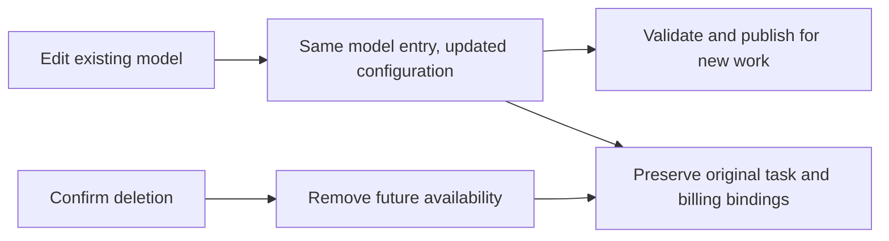

[Usage and implementation / 使用细则](https://github.com/copypasteltd/workmate/blob/docs/docs/development/179-model-management.md)


Earlier implementation and deployment records follow. 以下为原有版本记录。

---

<!-- per-model-connections-178 -->
## Per-model API configuration · stage178

Open [Admin → Model capabilities](https://agent-dashboard.copypaste.hk/catalog?view=capabilities) → **Create configuration**. Enter `gpt-6-luna` (or the actual upstream alias), its **API Base URL** and **API Key** in the same form. Each model owns its address and key. Text models require the OpenAI Responses API.

Save draft → test connection → run full capability validation → independent approval/publication → assign the published capability to roles/templates. A connection test reads `/models`; it does not publish a model. Validation and real use consume actual upstream credit, including in the current trial-accounting environment.

The server encrypts keys and never returns them. Version changes preserve frozen task connections. Retain an existing key explicitly when copying a version; changing the URL or network scope requires a new key. Missing explicit connections fail closed. No real supplier key was configured for this deployment.

Run `node scripts/test-model-connections-178-v4.mjs` for the isolated native PostgreSQL model-connection checks. `package-model-connections-178-v1.py` creates the immutable runtime overlay; `install-model-connections-178-v1.sh` migrates schema157 and switches only owned services. Existing server credentials are preserved. Forward-compatible API is required when rolling back frontends after migration. Never invoke local Docker/WSL. Browser verifiers close their own contexts and browser in finally blocks.

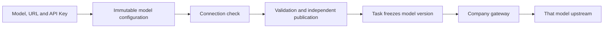

[使用细则 / Usage and operations](https://github.com/copypasteltd/workmate/blob/docs/docs/releases/model-connections-178.md) · [Source/runtime increment](https://agent.copypaste.hk/downloads/workmate-model-configuration-178.zip)


Earlier deployment/release records follow; their synthetic-service descriptions describe their original scope. 以下历史记录保留原部署范围。

---

<!-- public-domains-177 -->
## Public HTTPS deployment · stage177

[Web](https://agent.copypaste.hk) · [Admin](https://agent-dashboard.copypaste.hk) · [API readiness](https://ai-api.copypaste.hk/health/ready)

Additive deployment, client downloads, bilingual guides and actual recordings preserve frozen releases, credentials and unrelated services.

[Current deployment, login and operations / 当前部署、登录与运维](https://github.com/copypasteltd/workmate/blob/docs/docs/releases/domains-177.md)

Credentials are unchanged: server `/root/cfg/workmate/credentials.txt`, root `0600`. Admin: `admin@workmate.local` + email OTP + TOTP. Test mailbox: [protected operator inbox](https://agent-dashboard.copypaste.hk/ops/mailbox/). AI/media/ads/payment remain synthetic; records/files persist. 凭据保留，测试收件箱使用独立操作口令，外部服务仍为假数据。

[Desktop 0.7.2 Setup](https://agent.copypaste.hk/downloads/CopyPaste-0.7.2-x64-Setup.exe) · [Portable](https://agent.copypaste.hk/downloads/CopyPaste-0.7.2-x64-Portable.exe) · [Extension 0.5.3 ZIP](https://agent.copypaste.hk/downloads/CopyPaste-Extension-0.5.3.zip) · [Source increment / 源码增量](https://agent.copypaste.hk/downloads/workmate-domains-177.zip)

Windows installers are unsigned. Extract the Extension ZIP and load it unpacked in Chrome developer mode; the extension ID stays `fffkcnmfdhahlnifgdilabheppkgnlok`. Desktop AI access uses company services; supplier keys are not embedded. Windows 未签名，扩展采用已解压加载，固定 ID 不变。

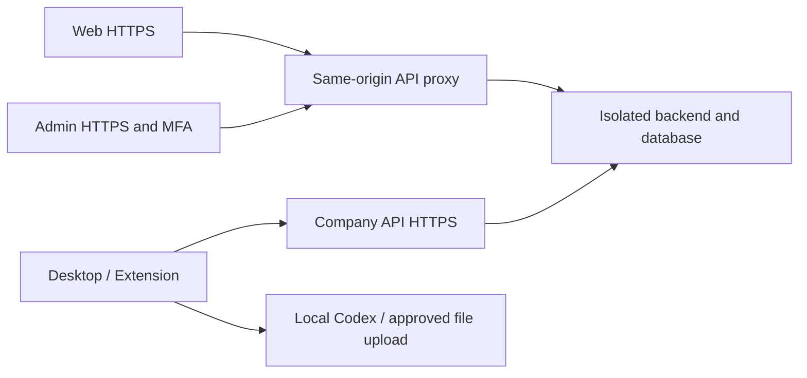

[Actual public Web task](https://github.com/copypasteltd/workmate/blob/web/assets/screenshots/177b-domain-task-result.png) · [Actual interaction GIF](https://github.com/copypasteltd/workmate/blob/web/assets/demos/177-public-domains.gif)

---

Earlier releases and deployment history / 以下为历史版本及部署记录。

<!-- lan-deployment-176 -->
## LAN HTTP deployment · stage176

Web: http://192.168.31.20:63070 · Admin: http://192.168.31.20:63071 · API: http://192.168.31.20:63072

Preserves frozen artifacts and original failures, with independent deploy/audit scripts, actual browser checks and post-login recordings.

Server plaintext credentials: `/root/cfg/workmate/credentials.txt` (root `0600`). Email OTP is retrieved through the protected test mailbox; Admin additionally requires TOTP. Synthetic services remain explicitly labeled.

[部署、登录与运维 / Deployment and login guide](https://github.com/copypasteltd/workmate/blob/docs/docs/releases/lan-176.md)

[实际 Web 交互 / Actual Web recording](https://github.com/copypasteltd/workmate/blob/web/assets/demos/176-lan-http.gif) · [后台截图 / Admin capture](https://github.com/copypasteltd/workmate/blob/admin/assets/screenshots/176e-lan-users.png)


## v0.1.3 · 当前完整交付 / Current complete delivery

[Release / 下载](https://github.com/copypasteltd/workmate/releases/tag/v0.1.3) · [中英使用手册 / Bilingual guide](https://github.com/copypasteltd/workmate/blob/v0.1.3/docs/releases/v0.1.3.md)

本轮完整包包含六仓源码和全部端，纳入团队/单次运行费用报表、原成员/协调员账目、交叉筛选和同快照CSV。当前源码与假数据冻结交付按使用者要求收口；服务器资料和正式服务接入后续提供。AI/媒体/广告/支付使用假数据，Windows未签名；完整专业/生产台账保持。

All six source trees/clients are delivered, including team/run financial reports, original member/coordinator entries, intersecting filters and matching snapshot CSV. This current source/synthetic frozen delivery closes as requested; server/live configuration follows later. External services are synthetic and Windows is unsigned. Full professional/production qualification remains tracked.


## 團隊費用 / Team consumption · stage174

團隊及執行ID交叉篩選，成員與協調員實際帳目只加總一次；固定快照明細／CSV保留原身份，舊來源不推斷。Team/run filters and groups sum original work entries once, with immutable detail/CSV and explicit unknown legacy attribution. 21 native report cases and seven current actual Admin journeys; original failed capture retained. Final freeze rebuilds Admin for current CSS.

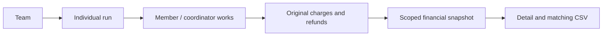


[MP4](assets/screenshots/workmate-admin-team-usage-174-03-team-consumption-workflow.mp4)


## Current complete frozen delivery · v0.1.2

The complete bundle includes every client, six source trees and the current posting-period reports. Desktop runs Codex locally with explicitly granted full local permission; the native Extension Side Panel reads/uploads authorized files for cloud Codex. Schema156, authorized synthetic AI/media/ads/payments and unsigned Windows.

[完整下载 / Complete release](https://github.com/copypasteltd/workmate/releases/tag/v0.1.2) · [安装、登录和使用 / Setup and flows](https://github.com/copypasteltd/workmate/blob/v0.1.2/docs/releases/v0.1.2.md)

本轮重新构建Backend/Admin；其余运行产物及Windows分发核对后复用。继承源码一致的阶段172定向验证，阶段173不重跑功能测试。Backend/Admin rebuilt; unchanged runtimes/Windows distributions verified and reused. Exact-source stage172 focused checks inherited; no functional tests rerun at173. Older entries below retain their historical scope.


## Current source increment · stage172

Admin supports creation and posting periods. Reports include old-work charges, Hong Kong posting days, refunds with an out-of-period original charge and negative net. Summary, projected detail and CSV share one immutable snapshot. Holds and lifetime operation units stay separate. Use matching backend/Admin sources with schema156. This increment is outside the frozen v0.1.1 ZIP; archives/tags remain unchanged.

Eight fresh native SQL/API cases and one exact projection case passed; six actual successful legacy cases are inherited only from identical sources. Seven actual Admin journeys passed. The first historical fixture was rejected for missing funding-source entries; a new version records balanced sources and funding movements without disabling guards. Original failures and all whole-acceptance scopes remain.

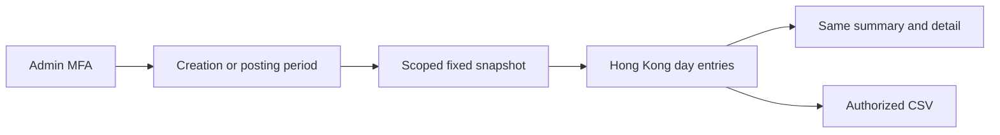


[MP4](assets/screenshots/workmate-admin-posting-period-172-01-posting-period-workflow.mp4) · [方案 / Behavior](https://github.com/copypasteltd/workmate/blob/docs/docs/development/172-admin-posting-period.md)

## v0.1.1 打包补充 / Packaging follow-up

START-HERE links the committed stage169 ledger. The source manifest records package-frozen-release-170-v3.py as packaging-only overlays. The first failed packaging attempt remains; five completed archives were reused only after exact entry checks. The publishing helper now validates schema156. Application sources, builds and frozen tags are unchanged. This follow-up records that exact helper and these notes; it does not replace release assets.

## Frozen delivery v0.1.1

The complete bundle includes local-Codex frameless Windows Desktop, Web, independent Admin, native Chrome Side Panel, backend, six buildable source trees and pinned runtime. Authorized synthetic services, unsigned Windows and schema156.

[完整发行包 / Complete release](https://github.com/copypasteltd/workmate/releases/tag/v0.1.1) · [安装及流程 / Setup and flows](https://github.com/copypasteltd/workmate/blob/v0.1.1/docs/releases/v0.1.1.md)

## Current source increment · stage169

Consumption reports add payer/project/creation-period filters, eight groupings, work accounting detail and same-snapshot CSV. Exact charges, refunds, holds, reconciliation and unknown supplier costs remain distinct. Current scopes, MFA and both export permissions are enforced. Schema156; existing v0.1.0 assets are unchanged. This increment is included in the next complete freeze.

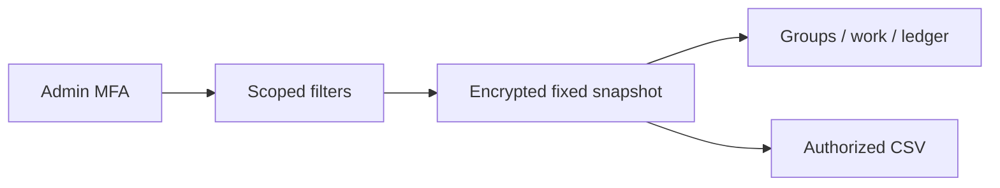


[MP4](assets/screenshots/workmate-admin-usage-report-169-02-consumption-report-workflow.mp4) · [方案 / Behavior](https://github.com/copypasteltd/workmate/blob/docs/docs/development/169-admin-usage-reports.md)


[中文](README.md) · [Complete release](https://github.com/copypasteltd/workmate/releases/tag/v0.1.0) · [Bilingual setup guide](https://github.com/copypasteltd/workmate/blob/v0.1.0/docs/releases/v0.1.0.md)

Workmate serves Hong Kong enterprises, beginning with existing marketing teams. This independent **delivery** component uses **Native startup / qualification / publication**. Business areas include design/media, advertising and website/SEO/GEO analytics, repeatable workflows and software development. CopyPaste's warm background, dark text, brand accents and editorial typography guide the interface.

## Current source increment · stage168

Combine registration/account-access dates and origin, VIP plan/state/expiry, confirmed charges, submitted/started role tasks, reconciliation and individual-account credit conditions. URLs survive reload/detail/return. Authenticated account access includes legitimate device polling; it is not human presence. Historical origin/activity stays unknown. Exact micro-HKD calculations count confirmed charges and never pool personal/workspace funds or classify unavailable/inconsistent accounts as zero.

Deploy complete schema001–156 with matching API/Worker: stop old services, back up, migrate and start the new services. Default directory DTOs remain compatible; view=operations opts into origin/access fields. Current independent usage/VIP/billing scopes and recent MFA are enforced. Directory reads do not mutate billing.

This source update follows v0.1.0 and is **not inside its frozen ZIP**. Frozen tags/assets remain unchanged. Backend/Admin builds, eight native SQL/API cases and six actual Admin browser checks passed; original fixture/locator failures remain preserved. Authorized synthetic dependencies and original whole-acceptance scopes remain explicit.

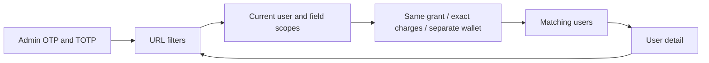


[MP4](assets/screenshots/workmate-admin-directory-filters-168-03-directory-filter-workflow.mp4) · [Logic / 逻辑](https://github.com/copypasteltd/workmate/blob/docs/docs/development/168-admin-directory-operational-filters.md) · [Evidence / 回执](https://github.com/copypasteltd/workmate/blob/docs/docs/quality/admin-directory-filters-168.json)

## Included user tasks/content · stage166

User detail opens creator-filtered tasks and content. Search, pagination and reload retain the user; return navigation restores directory conditions. Changing users discards previous bodies/operations. Current user scope intersects resource scope; body/download authority and recent MFA remain separate. Twenty content kinds use their actual creator; brands retain the original version-1 author. Unknown legacy authors remain unattributed in the full directory. Counts represent resource records; an asset and its cloud node have independent identities.

This functionality is included in v0.1.0 sources/distributions. Previous rc.5 tags/downloads stay unchanged. Current backend/Admin builds, eight native SQL/API cases and eight actual browser checks passed. The original locator failure and its media remain preserved. Authorized synthetic dependencies and all whole-acceptance scopes remain.

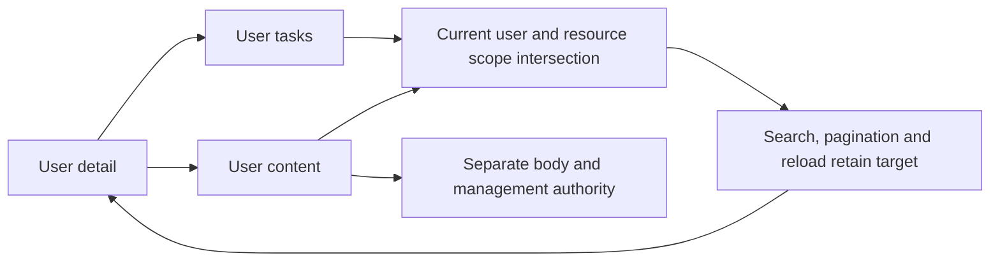


[MP4](assets/screenshots/workmate-admin-user-resources-166-02-user-task-content-scope.mp4) · [Logic / 逻辑](https://github.com/copypasteltd/workmate/blob/docs/docs/development/166-admin-user-resource-context.md) · [Evidence / 回执](https://github.com/copypasteltd/workmate/blob/docs/docs/quality/admin-user-resources-166.json)

## Current frozen release · v0.1.0

All clients, backend and six source trees are delivered together, including the latest creator-filtered Admin tasks/content. Six components are rebuilt. Rebuilt Desktop outputs match the qualified Windows app/Portable/Setup byte for byte, so those verified binaries are reused. Stage166's eight SQL/API cases and eight actual UI checks retain their source-bound original evidence; broad historical regression is not rerun.

Branch`delivery`, frozen tag`v0.1.0-delivery`. [Source and installers](https://github.com/copypasteltd/workmate/releases/tag/v0.1.0) · [Freeze record](https://github.com/copypasteltd/workmate/blob/v0.1.0/docs/quality/release-freeze-checkpoint-167.json) · [Open work](https://github.com/copypasteltd/workmate/blob/v0.1.0/docs/quality/remaining-work-stage167.md). AI/media/ads/payments use the authorized synthetic mode; Windows is unsigned. Existing screenshots/GIF/MP4 retain their actual capture scope and do not imply new full installation/professional qualification.

## Architecture and responsibilities

Entry points: `scripts/, native/, evidence/functional-closure-165/`. Codex is the only agent kernel. All AI calls use the company's OpenAI-compatible gateway; provider secrets remain server-side. Presets pin Skills, tools and configuration versions. The designer combines Codex, design Skills and company Image 2.

Web runs cloud agents. Chrome MV3 provides conversation and attachments in its native right Side Panel; customers explicitly select files and consent to upload for cloud execution. Desktop is frameless without Electron's default menu, runs Codex on the customer's computer and supports explicitly granted full local permission, stop/revocation and account/directory isolation.

Admin has independent email OTP plus TOTP and scoped permissions for users/organizations, usage, billing, VIP, roles/Skills and content. User detail passes the actual target ID; fee accounts are subject-filtered and VIP locks that target. Switching users unmounts previous dialogs/previews. Amounts use HKD micro-units. Budgets, balances, receipts, gifts, credit and VIP are distinct. Manual changes require preview, confirmation, current MFA/policy/approval, audited idempotency and current authority.

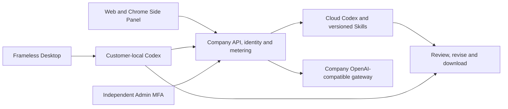

## Setup and commands

Place six independent repositories beside each other under `dev/`: platform, web, admin, desktop, extension and delivery, each with the `copypaste-` prefix. Use Windows x64, Node.js 22.14+, Git and native PostgreSQL. Media requires FFmpeg/FFprobe. Pinned Codex ships in the runtime archive. Docker, WSL and virtualization are prohibited.

Read the release guide. Before first configuration, choose an available database port. From Delivery run `demo:preflight`, `bootstrap:demo`, `demo:check`, then `demo`. Preserve existing configuration/data. Run Delivery `npm run stop` to close owned services.

Individual component development after supporting dependencies/backend are ready:

```powershell
npm ci
npm run demo:preflight
npm run bootstrap:demo
npm run demo:check
npm run demo
```

API uses localhost4310, Web4317 and Admin4318. Development OTP messages are in platform `.data/mailbox/`. Enroll an administrator with platform `npm run admin:create -- admin@example.com super_admin` and configure TOTP from its one-time material. Desktop uses browser PKCE, a chosen local directory and explicit permission. Load the extension unpacked in Chrome developer mode and click its icon to open the side panel.

## Customer and operator workflow

1. Sign in and accept an invitation or create a workspace/initial project. An uncertain creation keeps its original request. Check & continue after reload reconciles that operation; unavailable/removed receipts never silently create a replacement company.
2. Select a project/preset, provide the brief, approved files/brand/accounts, budget and permission. Supply missing inputs within the original task. Execution pins accepted configuration and Skill versions.
3. Review durable progress, approvals, delivery versions, costs and consumption. Download original files or request revisions. Unknown costs stay under reconciliation instead of being treated as free or blindly repeated.
4. From Admin user detail, verify the billing/VIP subject, inspect its preview and confirm under current policy. Directory filters survive refresh/return. The current branch connects creator-filtered task/content pages and preserves the original directory conditions on return.

## Configuration and authority

Web/Admin use `VITE_API_BASE` or a same-origin proxy. Native deployment settings pin allowed origins and extension ID. Use HTTPS outside approved loopback development. SQL history is001–155; API/Worker check schema and environment identity. Sources exclude secrets, private `.env`, user databases, dependencies and Git metadata.

Expired sessions clear the previous workspace. Delayed responses cannot replace a newer sign-in. Files are private by default. Requests, worker claims, tools and downloads recheck authority. Saved responses confer no permanent access. Explicit sign-out removes private workspace-draft names while retaining an owner-scoped opaque recovery key.

## Preset and Skill bindings

Eighteen professional presets are defined; this count does not prove complete professional qualification of twelve roles.

| ID | Role | Required Skill bindings |
| --- | --- | --- |
| R01 | Full-stack engineer | `fullstack-engineering@1.0.0`, `frontend-implementation@1.0.0`, `backend-api@1.0.0`, `qa-testing@1.0.0`, `delivery-core@1.0.0` |
| R02 | Frontend engineer | `frontend-implementation@1.0.0`, `ui-system@1.0.0`, `qa-testing@1.0.0`, `delivery-core@1.0.0` |
| R03 | Backend/API engineer | `backend-api@1.0.0`, `qa-testing@1.0.0`, `delivery-core@1.0.0` |
| R04 | QA engineer | `qa-testing@1.0.0`, `frontend-implementation@1.0.0`, `delivery-core@1.0.0` |
| R05 | UI/UX designer | `ux-research@1.0.0`, `ui-system@1.0.0`, `frontend-implementation@1.0.0`, `delivery-core@1.0.0` |
| R06 | Designer | `creative-direction@1.0.0`, `image-art-direction@1.0.0`, `image2-production@1.0.0`, `typography-layout@1.0.0`, `delivery-core@1.0.0` |
| R07 | Brand designer | `brand-system@1.1.0`, `image-art-direction@1.0.0`, `image2-production@1.0.0`, `typography-layout@1.0.0`, `delivery-core@1.0.0` |
| R08 | Advertising creative designer | `ad-creative@1.0.0`, `image-art-direction@1.0.0`, `image2-production@1.0.0`, `typography-layout@1.0.0`, `delivery-core@1.0.0` |
| R09 | E-commerce designer | `ecommerce-visual@1.0.0`, `image-art-direction@1.0.0`, `image2-production@1.0.0`, `typography-layout@1.0.0`, `delivery-core@1.0.0` |
| R10 | Social content designer | `social-content@1.0.0`, `image2-production@1.0.0`, `typography-layout@1.0.0`, `delivery-core@1.0.0` |
| R11 | Illustration/IP designer | `illustration-ip@1.0.0`, `image-art-direction@1.0.0`, `image2-production@1.0.0`, `delivery-core@1.0.0` |
| R12 | Typography/layout designer | `typography-layout@1.0.0`, `image-art-direction@1.0.0`, `image2-production@1.0.0`, `delivery-core@1.0.0` |
| R13 | Presentation designer | `presentation-production@1.1.0`, `typography-layout@1.0.0`, `dataviz@1.1.0`, `delivery-core@1.0.0`, `deterministic-metrics@1.1.0` |
| R14 | Landing page designer | `landing-page@1.0.0`, `ui-system@1.0.0`, `frontend-implementation@1.0.0`, `image2-production@1.0.0`, `delivery-core@1.0.0` |
| R15 | Data visualization designer | `dataviz@1.1.0`, `deterministic-metrics@1.1.0`, `typography-layout@1.0.0`, `delivery-core@1.0.0` |
| R16 | Video/motion designer | `video-storyboard@1.0.0`, `template-video-composition@1.0.0`, `video-generation@1.1.0`, `speech-production@1.2.0`, `delivery-core@1.0.0` |
| R17 | Marketing analyst | `ads-analysis@1.1.0`, `deterministic-metrics@1.1.0`, `dataviz@1.1.0`, `delivery-core@1.0.0` |
| R18 | Workflow automation consultant | `workflow-design@1.1.0`, `workflow-execution@1.1.0`, `delivery-core@1.0.0` |


[Role contract](https://github.com/copypasteltd/workmate/blob/backend/catalog/role-preset-catalog.json) · [Skill contract](https://github.com/copypasteltd/workmate/blob/backend/catalog/skill-packages.json)

## Actual screenshots and interaction

The shared media shows this release's actual Web/SQL recovery and Admin MFA/target checks with synthetic business facts. It does not claim fresh installation acceptance of other native clients.


[Actual MP4](assets/screenshots/workmate-functional-closure-165-01-recover-original-workspace.mp4)

## rc.5 frozen baseline qualification and publication

Historical rc.5 record: seven focused SQL cases, four draft-state cases and actual Web/Admin interactions accompanied six builds and Windows unpacked/Portable/Setup packaging. Current ASAR bytes and pinned Codex hashes are checked. Repeated broad regression is omitted as requested; the release checkpoint records actual results.

Branch `delivery`, frozen tag `v0.1.0-rc.5-delivery`. Later changes advance branches and notes while frozen bytes/tags remain. AI/media/ads/payments use the authorized synthetic mode. Windows is unsigned. All102 IDs and88 required whole-acceptance scopes remain;88 is not a count of missing modules. Production providers, signed updates, other OSes and full professional acceptance remain tracked.

[Checkpoint](https://github.com/copypasteltd/workmate/blob/v0.1.0-rc.5/docs/quality/release-freeze-checkpoint-165.json) · [Original acceptance ledger](https://github.com/copypasteltd/workmate/blob/v0.1.0-rc.5/docs/quality/remaining-work-stage165.md) · [Historical README](https://github.com/copypasteltd/workmate/blob/v0.1.0-rc.5/docs/history/readme-before-rc5/delivery-en.md)
