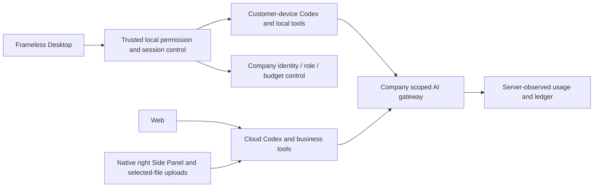
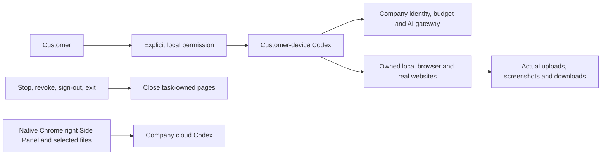
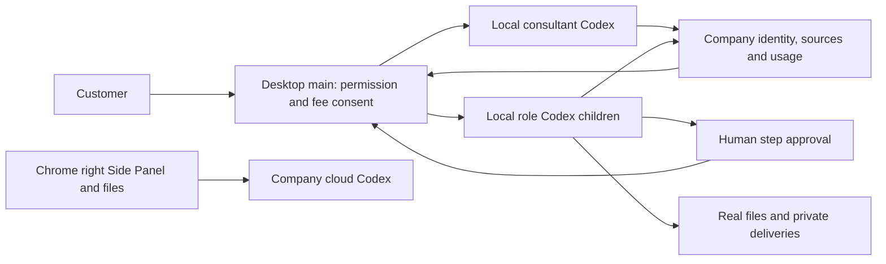

# Workmate · CopyPaste Web

[中文](README.md) · [Documentation](https://github.com/copypasteltd/workmate/blob/docs/docs/README.en.md)

[Backend](https://github.com/copypasteltd/workmate/tree/backend) · [Web](https://github.com/copypasteltd/workmate/tree/web) · [Admin Dashboard](https://github.com/copypasteltd/workmate/tree/admin) · [Desktop](https://github.com/copypasteltd/workmate/tree/desktop) · [Chrome Extension](https://github.com/copypasteltd/workmate/tree/extension) · [Delivery](https://github.com/copypasteltd/workmate/tree/delivery)

A cloud Agent product for Hong Kong enterprises. This repository owns **Web** and publishes to `web`.

<!-- client01-direction -->
## Current client direction and qualified scope

CLIENT01 (2026-10-22) requires **Desktop to run Codex on the customer's computer**, with a real user-opt-in **full local access** mode and Codex Desktop as the operation benchmark. The **Extension uses a ChatGPT-style conversation and attachment layout in Chrome's native right Side Panel**, reads user-selected files and uploads them for cloud Codex execution. All product AI calls still use the company gateway.

**Current implementation:** Desktop runs Codex on the customer device with explicit full access, local files/terminal, persistent threads, native questions, company design/video tools and native workflow children. Twelve local browser tools now perform actual navigation, interaction, upload, screenshots and downloads; Stop/revoke reclaim owned pages. Desktop hides scrollbar rails and reflows artifacts, code and tables while preserving vertical scrolling and keyboard access. The previous progress-bar constraint is withdrawn; truthful progress feedback remains. Separate qualification covers 851 platform, 68 client, 17 native-supervisor, 10 standalone Electron-browser and 25 packaged-journey checks; counts are not additive. Full professional delivery across 18 roles/29 Skills, complete OS-application/Codex Desktop parity, live models and production remain pending. Extension retains independent ChatGPT-style native right Side Panel cloud chat and authorized-file upload; its UI was not rerun. See [design](https://github.com/copypasteltd/workmate/blob/docs/docs/technical/77-desktop-native-browser.md), [layout requirements](https://github.com/copypasteltd/workmate/blob/docs/docs/requirements/04-desktop-layout-and-scroll.md) and [source/media checkpoint](https://github.com/copypasteltd/workmate/blob/docs/docs/quality/desktop-browser-checkpoint.json).

Desktop runs the native Agent locally; the Web and Extension run cloud Codex. The linked stage 73 proof states the tested scope.

Native supervisor scope, actual permission checks and remaining integration: [implementation details](https://github.com/copypasteltd/workmate/blob/docs/docs/technical/70-desktop-native-codex-supervisor.md).

<!-- /client01-direction -->

## Architecture and constraints

Codex is the only Agent kernel. All AI calls use the company's internal OpenAI-compatible server. Web, Desktop, extension and Admin share server identity, permissions, sources and billing controls. UI follows CopyPaste brand assets, colors, typography and bilingual patterns.



## Product and usage flow

1. Visit the workspace and sign in with an email code. First verification can create a customer account. Production uses SMTP; local demonstrations use the development mailbox.
2. Create/select a workspace and project. The server checks membership, project rights, funding subject and private conversation ownership.
3. Select the default assistant, an installed preset among eighteen roles, or a personal specialist. Tasks freeze role, skills, brand, model and price versions.
4. Select files, brand materials and marketing connections. Access/plan/budget checks precede an atomic budget hold and execution.
5. Inspect state, messages, outputs, actual sources and usage. Explicitly select authorized versions for missing inputs and continue the original task. Refreshes retain unsubmitted choices.
6. Download or explicitly publish an independent deliverable copy. Revocation, invalid sources and denied current reads fence unavailable content. Notifications, plans, conversations and memory retain their own scopes.

## Pages and business modules

Workspace, specialist catalog, personal specialists, project methods/Skills, notifications, private conversations, memory, projects, files/devices, members, usage/plans and account settings share workspace/project context. Creative flows cover design, brand, advertising, ecommerce, social, typography, presentations, information design and template video. Marketing includes file analytics, ad connections and scoped website audit/change-draft/recheck flows.

`src/main.tsx` contains entry/routing. Domain components implement conversations, tasks, inputs, creative work, connections and analytics. `src/api.ts` and session code centralize Backend access. React/TypeScript/Vite, with repository-provided fonts and brand assets.

## Run

```powershell
npm ci
npm run dev
```

Open `http://localhost:4317` after starting backend at `http://localhost:4310`. See `.env.example` and `vite.config.ts`. The frontend contains company service origins and no model API secrets. Production static hosting requires the documented HTTPS, cookie/Origin/CSP and Backend configuration.

## Interaction rules

Refreshes of the same task retain selected inputs; workspace/project/task changes and failed reads clear prior content. State, recorded usage and settled charges are separate. Initial pre-model waits and waits after a measured paid turn use different copy. Published copies and downloads remain governed by current sources, retention and authorization.

## Checkout and prerequisites

Clone this branch into a fresh working directory; update an existing repository without reinitializing it.

```powershell
git clone --single-branch --branch web git@github.com:copypasteltd/workmate.git copypaste-web
cd copypaste-web
```

Use Node.js ≥22.14, npm and Git with pinned lockfiles. The qualified local environment is Windows x64. Backend/full delivery also needs native PostgreSQL launcher resources, cloud-pinned Codex `0.163.0-alpha.10.2` and FFmpeg/FFprobe; Desktop independently pins `0.163.0-alpha.11` in its runtime manifest. No local Docker, WSL or virtualization. Run components in separate directories; see [workspace](https://github.com/copypasteltd/workmate/blob/docs/docs/governance/04-git-branches-and-publication.md).

## Checks and evidence scope

```powershell
npm run typecheck
npm test
npm run build
```

Historical-source **802/802** full Platform tests and **52/52** focused task tests pass, with **13 checks** across six repositories and **32** actual packaged Desktop/native Side Panel checks. All prior 782 named regression cases remain. Task checks exercise actual PostgreSQL, identity, ledger and Worker; separate real Codex child processes use a synthetic internal gateway. UI turns/business data are synthetic as authorized. The original 102 requirements remain: 81 partially verified, 21 without proven completion and zero fully accepted.

Canonical TaskDTO/task creation, arbitrary in-flight pause, unknown-effect recovery, independent complete role workflows, GEO, live suppliers and production/signing/store qualification remain tracked.

This revision adds canonical task APIs and atomic original-task inputs. Current UIs continue to use their existing project/conversation interfaces over the same execution domain. The refreshed actual recordings verify compatibility; they do not claim migration of every UI to canonical task APIs. See [the implementation and limits](https://github.com/copypasteltd/workmate/blob/docs/docs/technical/68-canonical-task-contracts-and-input-transactions.md) for exact money, idempotency, source revocation and unsupported business parameters.

## Actual screens and interactions

Actual recordings preserve capture timing. AI turns/business data are explicitly synthetic. Admin form demonstrations do not claim a financial commit.


[MP4](assets/screenshots/workmate-10-interaction.mp4) · [Capture/source evidence](https://github.com/copypasteltd/workmate/blob/docs/docs/quality/workmate-media-10.json)

## Detailed design and updates

- [Product](https://github.com/copypasteltd/workmate/blob/docs/docs/product/01-prd.md)
- [Architecture](https://github.com/copypasteltd/workmate/blob/docs/docs/technical/01-architecture-and-stack.md)
- [Identity and permissions](https://github.com/copypasteltd/workmate/blob/docs/docs/technical/07-security-and-permissions.md)
- [Task continuation](https://github.com/copypasteltd/workmate/blob/docs/docs/technical/66-paid-native-input-checkpoints.md)
- [Admin](https://github.com/copypasteltd/workmate/blob/docs/docs/product/08-admin-dashboard.md)
- [Native clients](https://github.com/copypasteltd/workmate/blob/docs/docs/technical/30-native-window-and-browser-sidepanel.md)
- [Canonical task update](https://github.com/copypasteltd/workmate/blob/docs/docs/changes/2026-10-22-canonical-task-repair.en.md)
- [Local Codex update](https://github.com/copypasteltd/workmate/blob/docs/docs/changes/2026-10-22-native-codex-supervisor.en.md)

Every later change updates both READMEs, affected actual captures/GIFs, release notes and its mapped branch. Verify remote SHAs through Delivery publishing; do not force-push collaborator history. Keep environment secrets, databases, sessions, dependencies and installers out of Git. Exact historical README bytes are retained in [archive](https://github.com/copypasteltd/workmate/blob/docs/docs/quality/history/stage66-before-workmate-readmes/manifest.json).

Stage 73 Desktop local execution: [design](https://github.com/copypasteltd/workmate/blob/docs/docs/technical/73-desktop-native-company-tools.md) · [source-bound proof](https://github.com/copypasteltd/workmate/blob/docs/docs/quality/desktop-company-tools-checkpoint.json). Prior recordings below retain their original source scopes.

Stage 73 company-tool update: [release notes](https://github.com/copypasteltd/workmate/blob/docs/docs/changes/2026-10-23-desktop-company-tools.en.md) · [source-bound checkpoint](https://github.com/copypasteltd/workmate/blob/docs/docs/quality/desktop-company-tools-checkpoint.json). Earlier reports and media retain their historical source scopes.

Stage 74 native-input update: [release notes](https://github.com/copypasteltd/workmate/blob/docs/docs/changes/2026-10-23-desktop-native-input.en.md) · [current checkpoint](https://github.com/copypasteltd/workmate/blob/docs/docs/quality/desktop-native-input-checkpoint.json). Earlier reports/media retain their original source scopes.

Stage 75 private-video update: [release notes](https://github.com/copypasteltd/workmate/blob/docs/docs/changes/2026-10-23-desktop-private-video.en.md) · [current checkpoint](https://github.com/copypasteltd/workmate/blob/docs/docs/quality/desktop-video-checkpoint.json). Earlier reports retain their actual source scopes; platform/main-process qualification and later UI qualification are explicitly separated.

<!-- desktop-native-browser-stage77 -->

## Native browser and scrollbar-free Desktop

Start a new local session, select a folder and explicitly grant Full local access. Ask the local Codex to work in a browser. The trusted frameless address bar and remote page run in separate customer-device renderers. The tool namespace `copypaste_browser` v1 includes tabs/open/navigate/history/snapshot/screenshot/interact/evaluate/wait/dialog/downloads/close; interact supports real click, fill/type/select, keys, scroll/drag and exact local-file upload. Completed downloads remain in the selected workspace’s browser-downloads directory. Model screenshots capture the actual page; README browser media uses actual OS window capture, with no compositing.

Current local permission, company identity, project access, origin and budget are rechecked. Web content cannot grant OS access or acquire company inference credentials. Call IDs bind exact operations; unknown accepted actions never replay automatically. Stop, revoke, sign-out or exit close owned pages and pending downloads, preserving completed files and the customer’s original windows. Existing threads retain their original tool binding; create a new session for browser tools.

The previous progress-bar constraint is withdrawn. Truthful upload/task/workflow/video feedback remains. Hidden scrollbar rails do not disable native scrolling. Artifacts wrap into rows, code and tables reflow, scroll areas have keyboard focus, and the composer/receipt remain usable in actual 800×600, 1280×800 and 1440×980 windows. Real wheel/Home/End and last-download focus are verified, alongside compact billing/devices/account pages and English/Traditional Chinese light/dark controls. Physical touchpad hardware and every display-scaling configuration are not claimed by these automated checks.

Current complete inventory: 66 test files / 17 batches / 851 passing cases, retaining all 848 prior cases. SQL001–094 and all 428 HTTP routes remain unchanged. The isolated UI fixture alone allocates 32 user/platform/tenant slots and appends immutable provider-policy version 2 with 32 slots and 10,000 requests/minute, retaining intentional unknown cancellation holds. Bootstrap policy and production defaults/enforcement remain unchanged. Synthetic Responses, campaign content and native-dialog choices are explicit. Original 102 REQ/102 TC, NFR and G01–G10 remain at 81 partial / 21 unproven / 0 fully accepted. Extension product/verifier bytes are unchanged; no new Extension UI claim.




[Design](https://github.com/copypasteltd/workmate/blob/docs/docs/technical/77-desktop-native-browser.md) · [Requirements](https://github.com/copypasteltd/workmate/blob/docs/docs/requirements/04-desktop-layout-and-scroll.md) · [Evidence](https://github.com/copypasteltd/workmate/blob/docs/docs/quality/desktop-browser-checkpoint.json) · [Changes](https://github.com/copypasteltd/workmate/blob/docs/docs/changes/2026-10-23-desktop-native-browser.md)

<details>
<summary>Stage 76 historical implementation and captures (previous scrollbar layout)</summary>

<!-- desktop-native-workflow-stage76 -->

## Native workflows and verification

Choose Workflow consultant, select a folder and explicitly grant the desired local permission. Describe the work and agree its frozen steps. Review the separate per-child budgets and approve the exact version before a child can reserve money or run. Approve any concrete human step before the next specialist starts. Review real files, private SOP/workflow JSON/recovery downloads and company usage; this conversation and incomplete steps have separate charges. Stop or revoke to terminate local parent and child processes; unknown accepted actions retain reconciliation state and never replay automatically.

The first workflow subset permits up to eight sequential native Codex, human approval or analytics-summary steps. Every child uses its own approved role Skills, company tools and scoped credentials while retaining the current explicit local grant. Local full access does not grant another customer's data, project rights or unlimited budget. Company cloud Workers and schedules cannot take over native workflows. Each immutable version freezes actual external input provenance across new sessions and derived SOPs, without depending on the creator task lifetime. Source withdrawal also governs first reads, cached calls, child admission and private or explicitly published derivatives; administrators use existing permission/MFA/reason/audit controls. Closing the app fences requests still waiting for their local journal write.

Historical stage-76 inventory: 65 actual test files / 17 complete batches / 848 passing tests; all 830 stage-75 cases remain covered. SQL001–093 remain unchanged; SQL094 adds native workflow provenance and immutable versions. The actual 428-route inventory retains all prior 415 routes. Original 102 REQ/102 TC, NFR and G01–G10 remain open at 81 partial / 21 unproven / 0 fully accepted. Earlier evidence and media retain their original source scope.




[Design and lifecycle](https://github.com/copypasteltd/workmate/blob/docs/docs/technical/76-desktop-native-workflows.md) · [Bound evidence](https://github.com/copypasteltd/workmate/blob/docs/docs/quality/desktop-workflow-checkpoint.json) · [Change notes](https://github.com/copypasteltd/workmate/blob/docs/docs/changes/2026-10-23-desktop-native-workflows.md)

</details>
