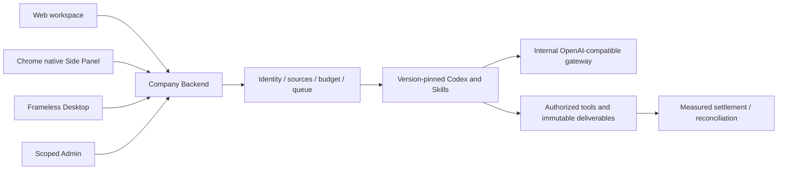

# Workmate · CopyPaste Backend

[中文](README.md) · [Documentation](https://github.com/copypasteltd/workmate/blob/docs/docs/README.en.md)

[Backend](https://github.com/copypasteltd/workmate/tree/backend) · [Web](https://github.com/copypasteltd/workmate/tree/web) · [Admin Dashboard](https://github.com/copypasteltd/workmate/tree/admin) · [Desktop](https://github.com/copypasteltd/workmate/tree/desktop) · [Chrome Extension](https://github.com/copypasteltd/workmate/tree/extension) · [Delivery](https://github.com/copypasteltd/workmate/tree/delivery)

A cloud Agent product for Hong Kong enterprises. This repository owns **Backend** and publishes to `backend`.

<!-- client01-direction -->
## Current client direction — implementation gap

CLIENT01 (2026-10-22) requires **Desktop to run Codex on the customer's computer**, with a real user-opt-in **full local access** mode and Codex Desktop as the operation benchmark. The **Extension uses a ChatGPT-style conversation and attachment layout in Chrome's native right Side Panel**, reads user-selected files and uploads them for cloud Codex execution. All product AI calls still use the company gateway.

**Current implementation:** The Desktop product entry point still uses cloud Codex and a restricted file bridge. An independent native Codex supervisor passes nine real-native integration tests; Electron consent and billing integration remain pending. The Extension has the native Side Panel and basic uploads, while its task-form-first UI needs restructuring. Existing screenshots and recordings show that implementation and do not prove the amended capabilities. [Requirements](https://github.com/copypasteltd/workmate/blob/docs/docs/requirements/03-client-execution-amendment.md) · [Direction audit and development plan](https://github.com/copypasteltd/workmate/blob/docs/docs/technical/69-desktop-local-codex-and-extension-direction.md).

The architecture diagram below describes the implemented cloud/file-bridge baseline; it is not the target Desktop local-agent architecture.

Native supervisor scope, actual permission checks and remaining integration: [implementation details](https://github.com/copypasteltd/workmate/blob/docs/docs/technical/70-desktop-native-codex-supervisor.md).

<!-- /client01-direction -->

## Architecture and constraints

Codex is the only Agent kernel. All AI calls use the company's internal OpenAI-compatible server. Web, Desktop, extension and Admin share server identity, permissions, sources and billing controls. UI follows CopyPaste brand assets, colors, typography and bilingual patterns.



## Service structure and execution

| Module | Source | Implemented responsibility |
| --- | --- | --- |
| Identity and workspaces | Identity/member/session modules in `src/` | Email codes, Admin MFA, native PKCE, tenant/project/private-owner scope |
| Agent execution | `src/worker.ts`, Codex runtime, `catalog/`, `skills/` | Frozen Codex/skill/model versions, controlled tools, leases, fencing and events |
| Continuation | `src/paid-task-inputs.ts`, `src/task-tool-reuse.ts` | Measured completed-turn input waits, same-task/thread recovery and authorized result reuse |
| Billing and access | Billing/wallet/VIP/plan/approval modules | Integer HKD micros, holds, cumulative settlement, manual postings, gifts, refunds and separate VIP/credit |
| Creative and analytics | Design/video/marketing/SEO modules | Internal Images, editable layouts, FFmpeg template videos, CSV/XLSX, ad metrics, synchronized connections and website evidence |
| Content and Admin | Admin/source/erasure modules | Scoped metadata/body rights, quarantine, retention, audit, independent review and controlled erasure |
| Persistence | `migrations/`, PostgreSQL, pg-boss, storage | FORCE RLS, idempotent transactions, immutable facts, queue and asset versions |

Web sessions use HttpOnly cookies, Origin and CSRF checks. Native clients use browser authorization, PKCE and rotating refresh tokens. Administrator identities are separate from customer identities. Reads and tools recheck current tenant, project, private scope and source status.

A model describes missing inputs but cannot choose resource IDs. Completed fully measured turns retain the original budget hold. Human selection of an authorized current version allows a new execution attempt to resume the original Codex thread. Limits are eight rounds and thirty-two dependencies. Cancellation settles known usage; unknown effects remain in reconciliation.

## Initialize and run

```powershell
npm ci
npm run setup:local
npm run db:local
```

Keep the database terminal open. In another terminal:

```powershell
npm run db:migrate
npm run dev
```

Full integration tests require the documented sibling docs/contracts and complete workspace. A standalone backend checkout can run typechecking and compilation first.

API: `http://localhost:4310`. Native PostgreSQL: `127.0.0.1:55432`. `setup:local` generates local passwords and a durable MASTER_KEY only when configuration is absent. Preserve existing configuration/data. `db:migrate` prepares development and test databases. Owner migrations and application/control/queue identities remain separate.

Bootstrap an administrator with `npm run admin:create -- admin@your-company.example super_admin`. Import the local enrolment TOTP configuration into an authenticator and clear the sensitive file according to the runbook. There are no shared default Admin credentials.

## Internal AI gateway

Configure server-only `AI_BASE_URL`, `AI_ALLOWED_HOSTS`, `AI_API_KEY`, `AI_MODEL`, contracted HKD rates and qualification flags. Codex uses the company's OpenAI-compatible Responses interface; Image 2 uses internal Images generation/editing. Run `npm run codex:probe`, then qualify real tool turns, usage and failures. Synthetic responses do not qualify a live model or price.

`.env.example` is a secret-free reference. Production requires HTTPS, SMTP, durable encryption keys, restricted egress, storage and rehearsed backup/restore. The native local database launcher refuses production.

## Interfaces and data

`contracts/implemented-routes.json` inventories implemented routes. Runtime contracts/catalogs and the normative API retain distinct scopes. Canonical TaskDTO/task creation is incomplete; route counts are not contract acceptance. Applied SQL001–091 retain exact bytes; fixes require forward migrations.

Code tools read, hash-edit and package authorized code without running untrusted customer code or claiming unexecuted tests passed. Creative outputs include editable data, SVG/PNG and template MP4. AI video/speech and complete independent role qualification remain tracked.

## Canonical task API usage

1. Sign in, select a tenant/project and install an actual specialist to obtain agent_id. Web writes require the current Cookie and CSRF; native requests use PKCE credentials.
2. POST /v1/tasks with X-Tenant-ID and a distinct Idempotency-Key. Include project_id, agent_id, `type:"delegation"`, `input:{"prompt":"The actual request"}` and `budget:{"currency":"HKD","amount_micros":"1000000"}` for HKD 1.
3. The 202 acceptance contains task_id, status, version and Location. Read Location for a whitelisted Task or subscribe to persistent SSE. Retrieve deliverables through the existing asset APIs.
4. Controls require the latest expected_version and a distinct key. Use cancel or pause/resume at a currently supported checkpoint. A replay returns the current resource without reviving an obsolete state.
5. For needs_input, read pending_input_fields and explicitly select authorized dependency resources. POST inputs with answers such as `{"input-1":{"resource_ids":["actual version UUID"]}}`. The whole batch validates before mutation; task, thread and original budget remain bound.

Dedicated creative, analytics, SEO, workflow/device context and retry are not fully wired through these unified entry points and fail explicitly. Use their existing dedicated workflows. Historical tasks without retained specialist identity use their original project route. Arbitrary in-flight pause and reconciled unknown-operation recovery remain open.

## Checkout and prerequisites

Clone this branch into a fresh working directory; update an existing repository without reinitializing it.

```powershell
git clone --single-branch --branch backend git@github.com:copypasteltd/workmate.git copypaste-platform
cd copypaste-platform
```

Use Node.js ≥22.14, npm and Git with pinned lockfiles. The qualified local environment is Windows x64. Backend/full delivery also needs native PostgreSQL launcher resources, pinned Codex `0.163.0-alpha.10.2` and FFmpeg/FFprobe. No local Docker, WSL or virtualization. Run components in separate directories; see [workspace](https://github.com/copypasteltd/workmate/blob/docs/docs/governance/04-git-branches-and-publication.md).

## Checks and evidence scope

```powershell
npm run typecheck
npm run build
npm test
```

**802/802** full Platform tests and **52/52** focused task tests pass, with **13 checks** across six repositories and **32** actual packaged Desktop/native Side Panel checks. All prior 782 named regression cases remain. Task checks exercise actual PostgreSQL, identity, ledger and Worker; separate real Codex child processes use a synthetic internal gateway. UI turns/business data are synthetic as authorized. The original 102 requirements remain: 81 partially verified, 21 without proven completion and zero fully accepted.

Canonical TaskDTO/task creation, arbitrary in-flight pause, unknown-effect recovery, independent complete role workflows, GEO, live suppliers and production/signing/store qualification remain tracked.

This revision adds canonical task APIs and atomic original-task inputs. Current UIs continue to use their existing project/conversation interfaces over the same execution domain. The refreshed actual recordings verify compatibility; they do not claim migration of every UI to canonical task APIs. See [the implementation and limits](https://github.com/copypasteltd/workmate/blob/docs/docs/technical/68-canonical-task-contracts-and-input-transactions.md) for exact money, idempotency, source revocation and unsupported business parameters.

## Actual screens and interactions

This service has no independent customer page. The following captures show the actual Web client connected to the service.

Actual recordings preserve capture timing. AI turns/business data are explicitly synthetic. Admin form demonstrations do not claim a financial commit.


[MP4](assets/screenshots/workmate-10-interaction.mp4) · [Capture/source evidence](https://github.com/copypasteltd/workmate/blob/docs/docs/quality/workmate-media-10.json)

## Detailed design and updates

- [Product](https://github.com/copypasteltd/workmate/blob/docs/docs/product/01-prd.md)
- [Architecture](https://github.com/copypasteltd/workmate/blob/docs/docs/technical/01-architecture-and-stack.md)
- [Identity and permissions](https://github.com/copypasteltd/workmate/blob/docs/docs/technical/07-security-and-permissions.md)
- [Task continuation](https://github.com/copypasteltd/workmate/blob/docs/docs/technical/66-paid-native-input-checkpoints.md)
- [Admin](https://github.com/copypasteltd/workmate/blob/docs/docs/product/08-admin-dashboard.md)
- [Native clients](https://github.com/copypasteltd/workmate/blob/docs/docs/technical/30-native-window-and-browser-sidepanel.md)
- [Canonical task update](https://github.com/copypasteltd/workmate/blob/docs/docs/changes/2026-10-22-canonical-task-repair.en.md)
- [Local Codex update](https://github.com/copypasteltd/workmate/blob/docs/docs/changes/2026-10-22-native-codex-supervisor.en.md)

Every later change updates both READMEs, affected actual captures/GIFs, release notes and its mapped branch. Verify remote SHAs through Delivery publishing; do not force-push collaborator history. Keep environment secrets, databases, sessions, dependencies and installers out of Git. Exact historical README bytes are retained in [archive](https://github.com/copypasteltd/workmate/blob/docs/docs/quality/history/stage66-before-workmate-readmes/manifest.json).
