# Workmate · CopyPaste Enterprise Agent · web

<!-- business-inputs-stage136 -->
## Business questions and original-task continuation · Stage136

When an essential canvas size, audience or business definition is missing, the Agent can ask in the original conversation. Customers may choose and edit a suggestion or write a different answer, then explicitly confirm it. Nothing is preselected or automatically submitted. Partial answers remain saved; completing all inputs continues the same task, conversation and original budget hold. Measured usage is settled cumulatively. Each confirmed question becomes one original-conversation note; identical retry adds no duplicate.

Web and the actual native Chrome right Side Panel show these questions inside the existing chat; Desktop supports answers in its existing cloud-task detail view. English/Traditional Chinese switching preserves drafts and a failed submission retains its text. Extension clears drafts on identity/conversation changes and removes protected questions when sources become unreadable. An answer grants no files, advertising accounts, tools, local access or additional spending permission.

The server strictly distinguishes `question`, `file` and `connection`: up to eight suggestions and 4,000 answer characters, with version, current authority, source and complete-batch validation before any update. Confirmed answers are immutable. Paid questions wait at a completed, measured Codex boundary and resume the original thread; cancellation settles known usage only. Private-conversation erasure removes questions, answers, checkpoints and text while retaining necessary accounting facts.

Apply SQL135 before API/Worker startup with Backend `npm run db:migrate`. Original SQL001–134, twenty baseline task definitions and the primary OpenAPI remain byte-identical. `contracts/business-inputs-v1.schema.json` adds strict versioned definitions to the existing create/input endpoints. File/connection requests retain their shape; questions use `answer` rather than `resource_ids`.

122 backend integration checks (including eleven new question cases), 61 extension state checks, twelve delivery binding tests and fourteen actual three-client checks passed. Nine actual screenshots, three GIF/MP4 pairs and seven layout checks bind to exact sources. Native integration uses the actual pinned Codex executable with synthetic Responses; UI journeys use scripted tools and synthetic business replies. Initial full client builds passed. Corrected journeys explicitly reuse byte-identical product source and the same unsigned Windows package; original failures remain. From Delivery, run `npm run qa:business-inputs-backend -- <new two-digit attempt>` or `npm run qa:business-inputs -- <new two-digit attempt>`; the latter performs full builds and creates an isolated native test database.

Desktop retains its separate local Codex and explicitly granted full-local-permission flow; this increment extends its cloud-task view. Actual native windows remain frameless with no Electron menu, visible vertical rails or horizontal overflow. Extension retains the genuine native right SIDE_PANEL. Data are synthetic and the Windows package is unsigned. Production models and complete specialist delivery remain open. Full acceptance retains 88 required records, twelve unconfirmed suggestions and one optional record; original REQ-095 remains accepted.

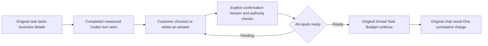

[Requirements](https://github.com/copypasteltd/workmate/blob/main/docs/requirements/13-business-brief-inputs.md) · [Implementation and usage](https://github.com/copypasteltd/workmate/blob/main/docs/technical/136-business-brief-clarification.md) · [All 102 identities](https://github.com/copypasteltd/workmate/blob/main/docs/quality/remaining-work-stage136.md) · [Exact source and evidence](https://github.com/copypasteltd/workmate/blob/main/docs/quality/business-inputs-checkpoint-136.json)


<!-- client-errors-stage135 -->
## Connection and session recovery across four clients · Stage135

Web, Admin, Desktop and Extension show connection guidance in the current language while retaining valid sign-in. A write with a lost or unreadable reply is explicitly unconfirmed: check its result before retrying. The application does not retry the write automatically. Browser transport retransmissions retain the same message identity and are deduplicated by the server. Support grants retain their fixed request key and deadline; extension delegations retain their original message identity, so explicit retry creates no second task. Background polling preserves an unconfirmed-write notice. Switching English/Traditional Chinese updates the same notice without exposing Electron internals, URLs or response bodies.

A current protected HTTP401 clears the current identity even when the body is HTML or empty. An obsolete request cannot sign out a newer identity or replace its CSRF token. Admin immediately removes its independent shell. Support-list connection errors are separate from form and revoked-access notices; successful list recovery clears only its own connection notice.

15 transport/identity tests (including actual HTTP faults), 12 delivery-file binding tests, one native bridge test and 30 actual four-client journey checks passed. Twenty screenshots and seven actual GIF/MP4 pairs bind to exact sources, including a real right-docked Chrome SIDE_PANEL, customer OTP/PKCE, independent administrator TOTP and an actual committed extension write with a lost reply and identical-message retry. Attempt09 rebuilds current Extension and Delivery. Backend/Web/Admin/Desktop source and Windows package bytes exactly match full build02, whose ten corresponding build steps and unchanged-source unit results are explicitly reused. Original failed attempts remain. Delivery `npm test` includes strict compilation, binding and transport checks; `npm run qa:client-errors -- <new two-digit attempt>` performs a full build by default.

Desktop continues to run Codex locally with separate explicit local permission, a frameless window, no Electron menus or visible rails. Extension keeps the native Chrome toolbar/Side Panel, approved-file uploads and cloud execution. Business fixtures are synthetic, no models ran and the Windows package is unsigned. Full acceptance still has 88 required records, 12 unconfirmed suggestions and one optional record open; original REQ-095 remains accepted.

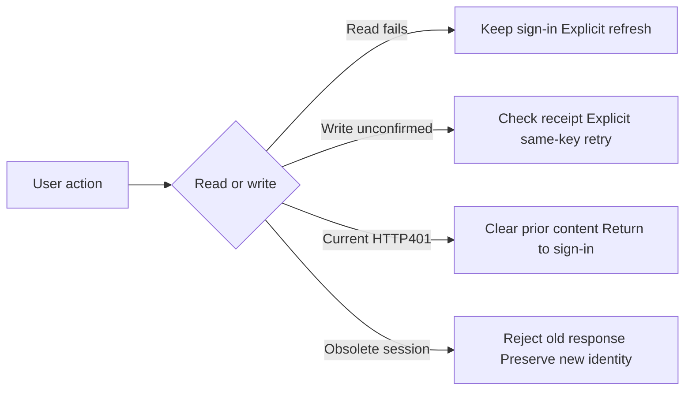

[Behavior and implementation](https://github.com/copypasteltd/workmate/blob/main/docs/technical/135-client-connection-and-session-recovery.md) · [All 102 requirement identities](https://github.com/copypasteltd/workmate/blob/main/docs/quality/remaining-work-stage135.md) · [Source-bound verification](https://github.com/copypasteltd/workmate/blob/main/docs/quality/client-errors-checkpoint-135.json)


<!-- support-recovery-stage134 -->
## Safe support-grant recovery and accepted support scope · Stage134

In **Web or Desktop → Account settings → Time-limited support**, choose explicit projects, the reason and duration. An empty project selection means metadata only. The first submission now fixes its request key and deadline. If its response is lost, use **Check previous request** or retry the same details; refreshing retrieves the existing result without automatically submitting again. Different details cannot replace an unresolved request. A recovered grant shows its current active, revoked or expired state and never gains extra time. You can revoke it from the list at any time.

Recovery stores only an opaque key, an intent digest and the fixed deadline in the current browser session. It does not persist the reason, project IDs, content or credentials. With storage disabled, recovery is limited to the running renderer; committed grants remain visible in the server list. Switching accounts or workspaces prevents late results from filling the new form. The native Desktop bridge permits only the customer receipt GET, alongside existing customer grant operations; it exposes no administrator impersonation route.

**Original REQ-095 / TC-095 is now accepted** against twelve individually mapped conditions and current source-bound evidence: real administrator identity and a read-only banner, explicit scope, independent body permission, write/payment/VIP/credential refusal, no hidden customer login, real-clock expiry, revocation and audit failure rollback. This closes one original requirement. REQ-055 whole-platform accessibility and REQ-094 whole-platform permission/concurrency matrices remain separate open work.

65 related backend checks, one native bridge boundary check and 18 actual Admin/Web/packaged Desktop journey checks passed. Ten build commands passed. The evidence includes real HTTP response loss before/after commit, reload, an actual workspace switch, identical retries, current-receipt recovery, real expiry and native customer revocation; user/native sessions, refresh-token and native-code row counts remain unchanged during support activity. Nine screenshots and five actual GIF/MP4 pairs are bound to the exact sources. Support controls work with keyboard input and enlarged text; Web/Admin use CSS zoom=2 and Desktop uses actual native webContents zoom=2. This does not constitute full browser/screen-reader accessibility acceptance.

Desktop continues to run Codex on the customer's computer, with separate explicit full local permission and a frameless window without Electron menus or visible scroll rails. Extension retains the native Chrome Side Panel for approved file uploads and cloud execution. Models did not run; business fixtures and retained output are synthetic. The Windows package is unsigned. All owned test browsers, native clients and databases closed.

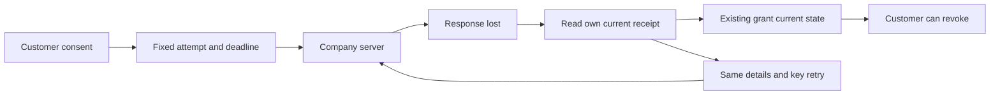

[方案 / Behavior](https://github.com/copypasteltd/workmate/blob/main/docs/technical/134-support-grant-recovery-and-acceptance.md) · [TC-095 acceptance](https://github.com/copypasteltd/workmate/blob/main/docs/quality/tc095-acceptance-134.json) · [Checkpoint](https://github.com/copypasteltd/workmate/blob/main/docs/quality/support-recovery-checkpoint-134.json) · [完整编号清单 / Remaining work](https://github.com/copypasteltd/workmate/blob/main/docs/quality/remaining-work-stage134.md)


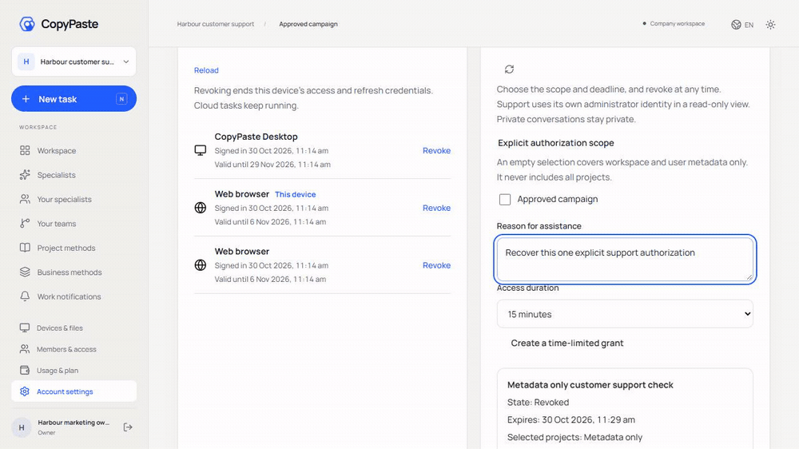

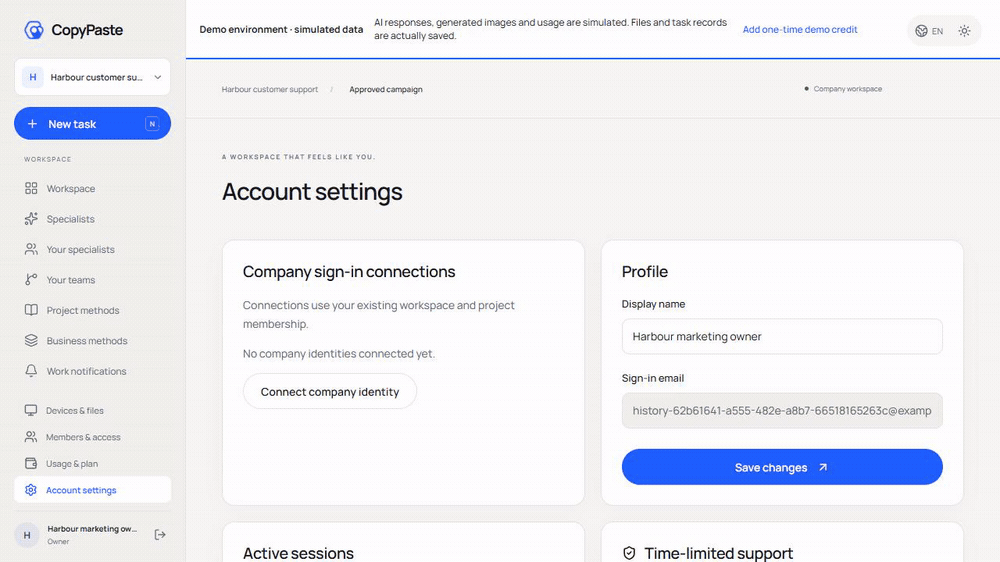

[Recovery recording](assets/screenshots/workmate-support-recovery-134-04-grant-result-recovery.mp4) · [Retry recording](assets/screenshots/workmate-support-recovery-134-04-fixed-intent-retry.mp4) · [Native grant](https://github.com/copypasteltd/workmate/blob/desktop/assets/screenshots/workmate-support-recovery-134-04-customer-grant.mp4) · [Native revocation](https://github.com/copypasteltd/workmate/blob/desktop/assets/screenshots/workmate-support-recovery-134-04-customer-revocation.gif) · [200% Admin](https://github.com/copypasteltd/workmate/blob/admin/assets/screenshots/workmate-support-recovery-134-04-support-en-200.png) · [Chinese dark Admin](https://github.com/copypasteltd/workmate/blob/admin/assets/screenshots/workmate-support-recovery-134-04-support-zh-dark.png)

One requirement is accepted; 88 required records, 12 unconfirmed suggestions and one optional record remain open. These are acceptance records, not 101 uncoded modules. Complete source-delivery reproduction, signed installation, production integration and the remaining business acceptance continue in the numbered ledger. Earlier sections retain their original historical scope.

---

<!-- support-access-stage133 -->
## Controlled support and native customer authorization · Stage133

In **Web or Desktop → Account settings → Time-limited support**, choose the actual projects, a reason and a 15/30/60-minute deadline. An empty selection grants workspace/customer metadata only. Share the grant ID with support and revoke it from the same customer form at any time.

In **Admin → Support**, the administrator signs in with their own email and TOTP, chooses the customer, workspace, explicit projects, deadline and optional customer grant. The read-only banner keeps the real identities and deadline visible. Shared task bodies also require independent current body permission; private conversations stay private. The view provides no editing, billing, VIP or customer-login authority.

Support now checks original task sources before returning retained text. A quarantined/expired source or erased version blocks the body and masks its diagnostic title. Selected bodies use a current revision condition; changes during the audit are rejected. The page cancels old requests, rejects late task/session replies and clears bodies on changed revisions, source withdrawal, hidden views, failure, revocation or expiry. The server decides access on every read; visible Admin polling is approximately two seconds.

59 related backend tests and 13 actual Admin/Web/packaged native Desktop journey checks passed. The current source bytes bind 6 screenshots and 3 real-time GIF/MP4 pairs. Actual OTP/PKCE, email/TOTP, customer grants/revocation, delayed authorized responses, source withdrawal, real expiry, Chinese dark theme, four Admin widths and three frameless native widths were exercised. All owned browsers, the native client and test databases closed. Models did not run; business data, retained results and fixture file reads are explicitly synthetic. The Windows package remains unsigned.

Desktop continues to run Codex locally with the customer's separate explicit local-permission flow. Its support form uses customer-only routes; the administrator view stays in Admin. Extension continues to use the native Chrome Side Panel for approved file uploads and cloud execution. This increment changes no Extension execution code.

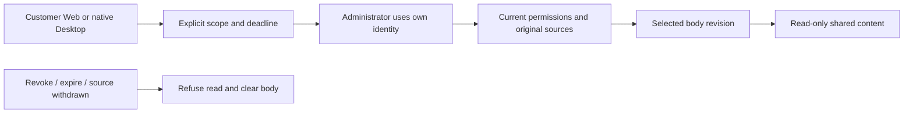

[Behavior](https://github.com/copypasteltd/workmate/blob/main/docs/technical/133-controlled-support-source-and-native-access.md) · [Checkpoint](https://github.com/copypasteltd/workmate/blob/main/docs/quality/support-access-checkpoint-133.json) · [Numbered remaining work](https://github.com/copypasteltd/workmate/blob/main/docs/quality/remaining-work-stage133.md)


[Native grant recording](https://github.com/copypasteltd/workmate/blob/desktop/assets/screenshots/workmate-support-access-133-02-customer-grant.mp4) · [Selection recording](https://github.com/copypasteltd/workmate/blob/admin/assets/screenshots/workmate-support-access-133-02-task-selection.mp4) · [Revocation recording](https://github.com/copypasteltd/workmate/blob/desktop/assets/screenshots/workmate-support-access-133-02-customer-revocation.mp4) · [Web metadata-only grant](assets/screenshots/workmate-support-access-133-02-metadata-grant-en.png) · [Chinese dark Admin](https://github.com/copypasteltd/workmate/blob/admin/assets/screenshots/workmate-support-access-133-02-support-zh-dark.png) · [Source withdrawn](https://github.com/copypasteltd/workmate/blob/admin/assets/screenshots/workmate-support-access-133-02-source-withdrawn-en.png)

89 required full-acceptance records, 12 unconfirmed suggestions and 1 optional record remain open. They are not 102 uncoded modules. Full permission/concurrency matrices, all-page accessibility, signed installation and production integration remain in the numbered ledger. Earlier sections retain their original historical scope.

---

[简体中文](README.md) · [English](README.en.md)

<!-- controlled-publications-stage125 -->

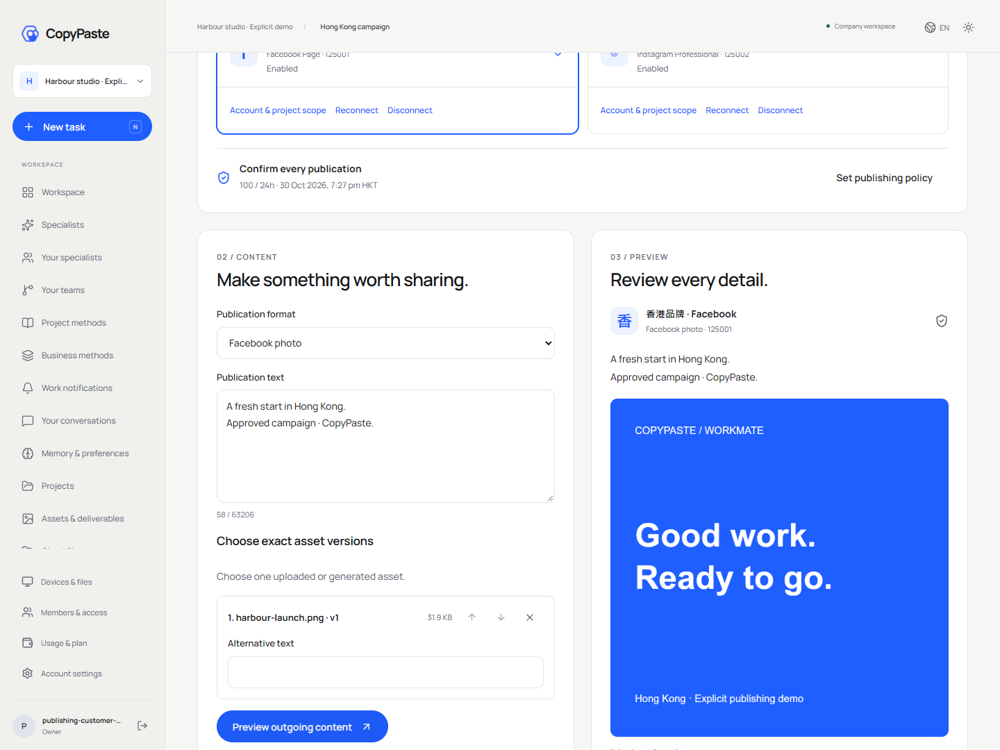
## Review actual media before publishing · Stage125

Connect and scope an account, set policy, select caption and exact source versions, review actual outgoing media, explicitly approve, then read the receipt. Accounts start disabled and the Agent can only prepare. Scope changes wait for fresh authority. Consent binds the current account, version and content digest.

Previews show actual image/video, versions and SHA-256; Instagram photos use the JPEG rendition. Expiry/revocation withdraws media. Unknown results allow read-only reconciliation or manual closure with a reason, without automatic resending or claiming failure. Lost responses use the original request.

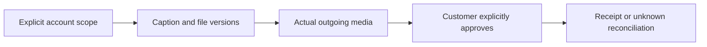

Actual Web/Admin qualification passes 14/14 with recorded 375/768/1024/1440px layouts. Accounts are synthetic; native clients and complete professional quality require separate acceptance.

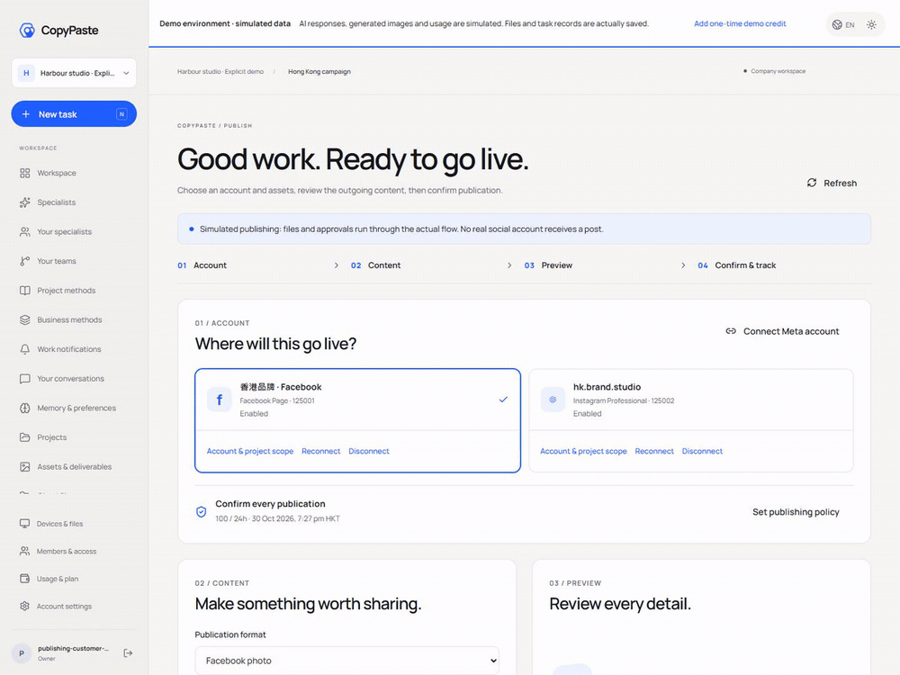

[Actual interaction MP4](assets/screenshots/workmate-publications-12-customer-preview-and-confirm.mp4)


<!-- runtime-startup-122 -->

## Codex startup and turn isolation · Stage 122

Work details now explain runtime.startup.retry as “Reconnecting your assistant”, with Traditional Chinese and English connection messages. Recovery retains the server task identity; the page does not resubmit paid work or create another budget.

All 20 existing client checks, type checking and the current build passed. The current Web OTP/PKCE pages also participated in the actual browser login to the packaged Desktop. Complete cross-client and production acceptance remains tracked in the requirements ledger.

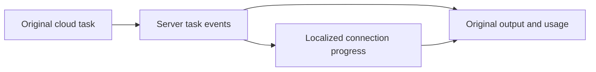

[完整方案 / Behavior and verification](https://github.com/copypasteltd/workmate/blob/docs/docs/technical/122-codex-startup-and-turn-isolation.md)

## Product and boundaries

The first customers are existing marketing teams. Scope includes image/design/typography, video/effects, advertising and website analysis, SEO/GEO, repeated business processes and software development. The catalog has 18 candidates with exact Skill bindings; at least twelve individually qualified professional presets remain an acceptance requirement. The designer combines Codex, design Skills and company Image 2. Codex is the only Agent core. All AI uses the company's OpenAI-compatible backend; development currently uses authorized synthetic providers, not a claim of live professional quality.

React, TypeScript, Vite and React Router provide the cloud workspace. New users create a company or accept an invitation, select a project and available specialist, and provide explicit inputs. Missing dependencies request customer input and continuation keeps the original task. Project pages save, preview and publish guidance with exact brand/reference versions; histories retain versions, sources and costs without silently adopting later defaults.

## Repositories and execution

| Branch | Directory | Runtime |
| --- | --- | --- |
| [backend](https://github.com/copypasteltd/workmate/tree/backend) | `dev/copypaste-platform` | Fastify / PostgreSQL / cloud Codex |
| [web](https://github.com/copypasteltd/workmate/tree/web) | `dev/copypaste-web` | React / Vite / cloud workspace |
| [admin](https://github.com/copypasteltd/workmate/tree/admin) | `dev/copypaste-admin` | React / separate Admin identity |
| [desktop](https://github.com/copypasteltd/workmate/tree/desktop) | `dev/copypaste-desktop` | Electron / customer-local Codex |
| [extension](https://github.com/copypasteltd/workmate/tree/extension) | `dev/copypaste-extension` | Chrome MV3 / native Side Panel / cloud Codex |
| [delivery](https://github.com/copypasteltd/workmate/tree/delivery) | `dev/copypaste-delivery` | Native development, QA and publication tools |

The component is an independent Git repository. Keep the sibling layout and use the documented native tools; Docker, WSL and VMs are prohibited.

## User workflow

1. Visit the workspace, sign in/register, create a company or accept an invitation, then choose its project.
2. Choose the assistant or a specialist; supply the brief, approved files, brand, accounts and budget. Missing input continues the original session.
3. Confirm cloud Codex work; inspect durable status, questions, actual files and costs, then review/download or request a revision.
4. For an optional dedicated computer, review its plan, payer, duration, exact files and terminal/visual/Agent permissions.
5. Accept the expiring resource quote before reservation. Codex work has a separate instruction and AI-budget confirmation; entry alone buys nothing.

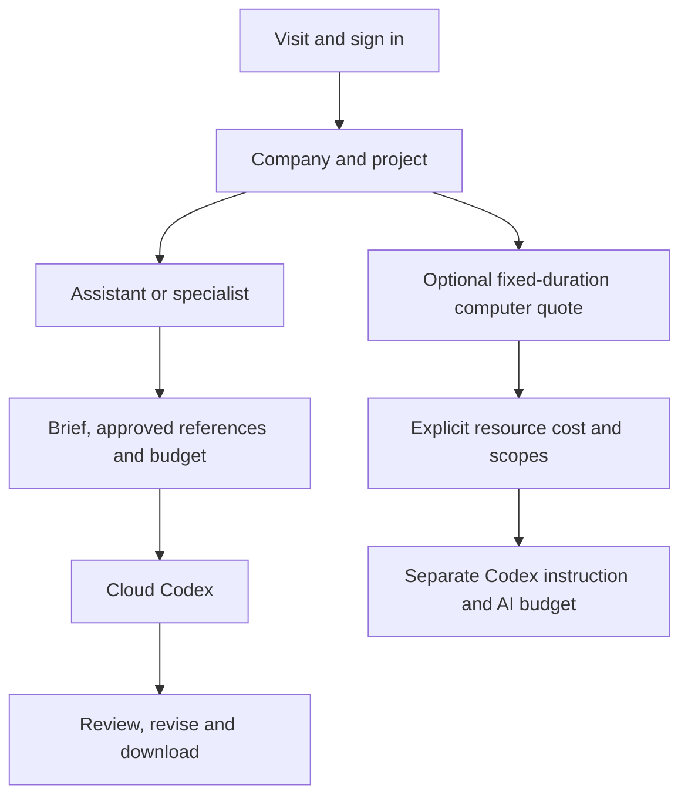

## Setup

### Local startup

Run these commands in the checked-out component. The complete workspace has the six independent repositories side by side under `dev/`; see the [branch and checkout layout](https://github.com/copypasteltd/workmate/blob/docs/docs/governance/04-git-branches-and-publication.md). Use Windows x64, Node.js >=22.14, npm/Git and the documented native PostgreSQL, FFmpeg/FFprobe and pinned Codex resources. Preserve existing local configuration/data. No Docker/WSL/VM is used.

```powershell
Set-Location 'D:/dev/copypasted/自有agent/dev/copypaste-web'
npm ci
npm run dev
```

Start the backend first, then open `http://localhost:4317`. Use `npm run build` for the static build. Sign in with email/OTP and select a workspace/project.

### Use the current workflow

1. Complete sign-in, company membership/invitation and project selection. Native clients use browser PKCE; Admin uses separate MFA identities. Expired/revoked credentials must not silently change identity or company.
2. Select a specialist and supply the brief and explicitly authorized references/accounts. Missing inputs request customer action. Project owners can save, preview and explicitly publish immutable shared guidance; publication starts no AI and grants no new permission.
3. New tasks pin their accepted role, Skill, brand, reference and guidance versions. Existing work, including an originally absent configuration, retains its original state. Source revocation hides unavailable bodies and blocks later use; history is not a permission bypass.
4. Confirm budget and any required operation/media approval. View genuine status, progress, exact deliverables and original receipts. Continue requested edits in the same task lineage. Unknown usage remains reserved for reconciliation; it is never silently free or blindly replayed.
5. Admin can independently manage authorized user/workspace status, inspect permitted consumption, preview/confirm manual fees or credits and activate scoped VIP/expiry. Balances, recorded payments, credits, budgets and VIP are separate records. Idempotent confirmation and audit prevent duplicate grants.

## Configuration and authority

The candidate requires the complete additive SQL001–133 history. API/worker schema admission rejects missing, changed or unsupported versions; recovery identity is fenced independently. Company model aliases, verified media capabilities, exact tariffs and provider secrets live on the backend. Unconfigured capabilities remain unavailable. Current development uses explicitly authorized synthetic data.

Web/Admin use `VITE_API_BASE` or their same-origin proxy; default development ports are 4317/4318. Desktop/Extension compile fixed `COPYPASTE_API_ORIGIN` and `COPYPASTE_WEB_ORIGIN` values; Desktop also pins `COPYPASTE_EXTENSION_ID`. HTTPS is required outside the allowed loopback-development case. No renderer or extension receives company provider secrets.

Files remain private unless the customer explicitly shares them. Authorization is checked on new requests, worker claims, tools and downloads. Source/body revocation is not bypassed by old history. Money uses exact HKD micros; budget, balance, credits, recorded payments and VIP are distinct. Stable request identities prevent duplicate grants, tasks and reservations. Unknown usage or physical cleanup retains its reconciliation hold.

## Preset roles and Skills

The catalog defines 18 professional presets plus the default assistant. Every run pins exact Skill versions and registered tools. These definitions are not a claim that twelve full professional qualifications have passed.

| ID | Role | Required Skill bindings |
| --- | --- | --- |
| R01 | Full-stack developer | `fullstack-engineering@1.0.0`, `frontend-implementation@1.0.0`, `backend-api@1.0.0`, `qa-testing@1.0.0`, `delivery-core@1.0.0` |
| R02 | Frontend developer | `frontend-implementation@1.0.0`, `ui-system@1.0.0`, `qa-testing@1.0.0`, `delivery-core@1.0.0` |
| R03 | Backend/API engineer | `backend-api@1.0.0`, `qa-testing@1.0.0`, `delivery-core@1.0.0` |
| R04 | Software QA engineer | `qa-testing@1.0.0`, `frontend-implementation@1.0.0`, `delivery-core@1.0.0` |
| R05 | UI/UX designer | `ux-research@1.0.0`, `ui-system@1.0.0`, `frontend-implementation@1.0.0`, `delivery-core@1.0.0` |
| R06 | Designer | `creative-direction@1.0.0`, `image-art-direction@1.0.0`, `image2-production@1.0.0`, `typography-layout@1.0.0`, `delivery-core@1.0.0` |
| R07 | Brand visual designer | `brand-system@1.1.0`, `image-art-direction@1.0.0`, `image2-production@1.0.0`, `typography-layout@1.0.0`, `delivery-core@1.0.0` |
| R08 | Ad creative designer | `ad-creative@1.0.0`, `image-art-direction@1.0.0`, `image2-production@1.0.0`, `typography-layout@1.0.0`, `delivery-core@1.0.0` |
| R09 | E-commerce designer | `ecommerce-visual@1.0.0`, `image-art-direction@1.0.0`, `image2-production@1.0.0`, `typography-layout@1.0.0`, `delivery-core@1.0.0` |
| R10 | Social content designer | `social-content@1.0.0`, `image2-production@1.0.0`, `typography-layout@1.0.0`, `delivery-core@1.0.0` |
| R11 | Illustration/IP designer | `illustration-ip@1.0.0`, `image-art-direction@1.0.0`, `image2-production@1.0.0`, `delivery-core@1.0.0` |
| R12 | Typography/layout designer | `typography-layout@1.0.0`, `image-art-direction@1.0.0`, `image2-production@1.0.0`, `delivery-core@1.0.0` |
| R13 | Presentation designer | `presentation-production@1.1.0`, `typography-layout@1.0.0`, `dataviz@1.1.0`, `delivery-core@1.0.0`, `deterministic-metrics@1.1.0` |
| R14 | Landing-page designer | `landing-page@1.0.0`, `ui-system@1.0.0`, `frontend-implementation@1.0.0`, `image2-production@1.0.0`, `delivery-core@1.0.0` |
| R15 | Information/data designer | `dataviz@1.1.0`, `deterministic-metrics@1.1.0`, `typography-layout@1.0.0`, `delivery-core@1.0.0` |
| R16 | Video/motion designer | `video-storyboard@1.0.0`, `template-video-composition@1.0.0`, `video-generation@1.1.0`, `speech-production@1.2.0`, `delivery-core@1.0.0` |
| R17 | Marketing analyst | `ads-analysis@1.1.0`, `deterministic-metrics@1.1.0`, `dataviz@1.1.0`, `delivery-core@1.0.0` |
| R18 | Workflow consultant | `workflow-design@1.1.0`, `workflow-execution@1.1.0`, `delivery-core@1.0.0` |

Designer combines Codex, design Skills and the company Image 2 capability. Optional R19 computer-operator work needs its own confirmed cloud lease and AI budget; native Desktop excludes it and retains customer-local execution.

[Role contract](https://github.com/copypasteltd/workmate/blob/backend/catalog/role-preset-catalog.json) · [Skill packages](https://github.com/copypasteltd/workmate/blob/backend/catalog/skill-packages.json)

## Optional dedicated cloud computer

Review an immutable plan/quote, payer, fixed duration, exact private files and separate terminal/visual/Agent scopes. Agent control defaults off. Explicit consent reserves resource cost; a later Codex instruction has a separate exact AI ceiling. No automatic renewal occurs. Stop/expiry/revocation fences subsequent actions; measured usage and verified cleanup settle, uncertainty reconciles.

The Linux physical-node source uses native Node22/systemd, cgroups, XFS project quotas and bounded desktop tools. No Linux host was started for the local Windows qualification. Build a fresh numbered source bundle with `node native/build-package.mjs NN` in Delivery; verify the externally pinned bundle digest before installation. The installer defaults to no service start and supports exact-UUID recovery.

## Actual interface and interaction

These are actual unretouched product screenshots and wall-clock recordings. Customer/model/media responses are explicit fixtures; native Codex, files, database and billing paths run where stated. Synthetic node pixels do not qualify an actual remote Linux desktop.

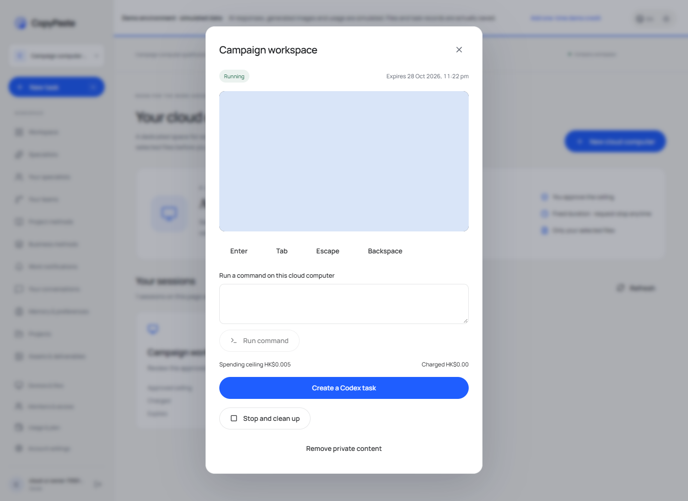

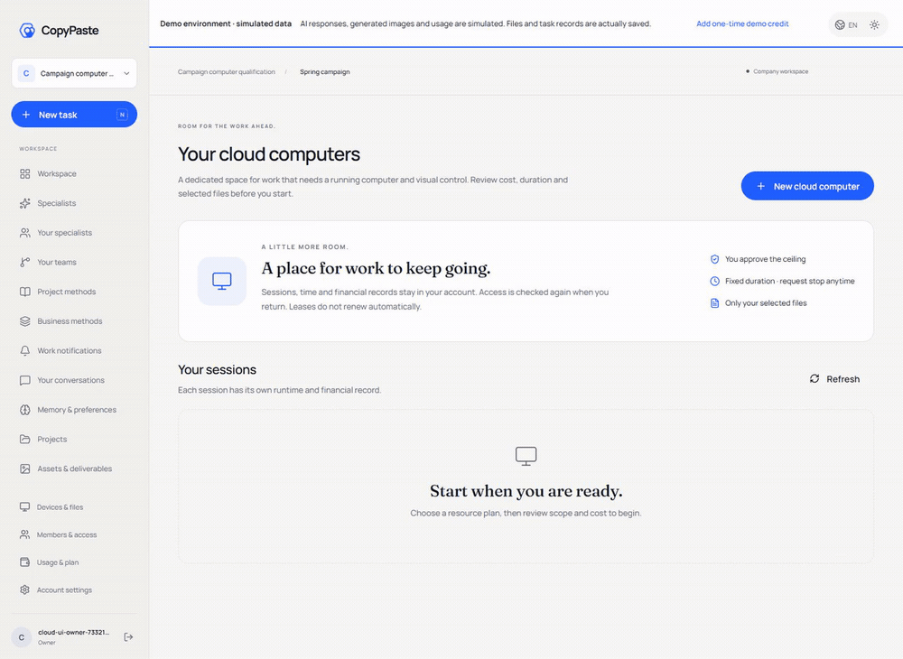

[Original MP4](assets/screenshots/workmate-12-dedicated-cloud-consent.mp4)

## Verification and delivery status

The integrated clients/tool inventory passed 338 checks: Web 20, Admin 9, Extension 63, Desktop 180, actual local Codex 22 and Delivery 44; corresponding types/builds passed. Native Desktop, Web/Admin and native Side Panel each have eight bounded actual UI checks, with 29 screenshots and five GIF/MP4 pairs. Complete backend success requires its final complete-inventory report; the checkpoint records actual outcomes and retains failed attempts.

Run this component’s `npm run typecheck`, `npm run build` and documented test scripts with installed native prerequisites. Delivery’s default `npm test` covers native-surface integrity; the complete Delivery unit inventory is `node --test --test-concurrency=1 tests/*.test.mjs`. `node scripts/qualify-delivered-clients-v1.mjs NN` uses a fresh two-digit attempt and the sibling layout for all integrated client inventories. Candidate-specific historical runners preserve their original directory requirements.

Full product acceptance remains open: twelve professional-role qualifications, complete permissions/business/compatibility matrices, live service quality, signed installers/updates, production load/restore and customer business acceptance. Use the numbered inventory rather than test counts as a completion claim. Owned browsers/processes are closed; user resources are preserved.

[Implementation / 方案](https://github.com/copypasteltd/workmate/blob/docs/docs/technical/121-dedicated-cloud-and-client-execution.md) · [Checkpoint / 证据](https://github.com/copypasteltd/workmate/blob/docs/docs/quality/dedicated-cloud-checkpoint.json) · [Open requirements / 未完成项](https://github.com/copypasteltd/workmate/blob/docs/docs/quality/remaining-work-2026-10-29.md) · [Branch layout / 检出布局](https://github.com/copypasteltd/workmate/blob/docs/docs/governance/04-git-branches-and-publication.md)
