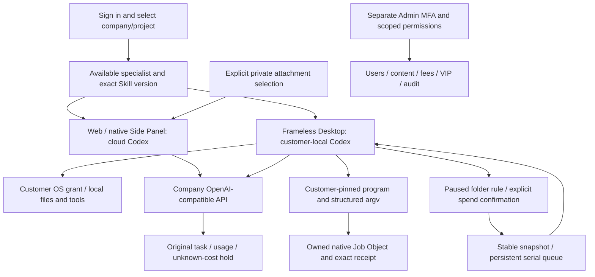

# Workmate · CopyPaste Enterprise Agent · admin

<!-- agent-groups-stage93 -->

## Persistent professional teams

Stage 93 implements persistent Web teams with a coordinator, distinct specialists, frozen versions, customer-reviewed briefs/dependencies/budgets, bounded actual Codex execution and unified delivery. All 115 relevant backend cases and seven actual browser checks pass. Model/account capacity is explicitly synthetic; authentication, native Codex processes, company tools, private files, budgets and accounting actually run.

1. Sign in and select a project. Create specialists in Your specialists, then save a coordinator and distinct members in Your teams. Team settings are project-shared; runs and files remain private to their customer.
2. Add the brief, step instructions, dependencies, individual caps and parallelism. Review the exact fixed member versions and full plan for free. Only the current customer can explicitly approve the budget and start.
3. Follow actual task links, member states, approved maximum, reserved funds and actual charges. The coordinator waits for all actual members to succeed, then reads their authorized outputs. Stop prevents new dispatch and preserves uncertain-cost reconciliation.
4. Team edits create immutable versions. A repeated request reuses its original run; a new execution needs a new review. Withdrawing a source blocks private derivatives. Admin body access, quarantine, restore and erasure retain independent scoped permissions and audit.


Apply **SQL108** after SQL001–107. A team has one coordinator and up to seven distinct members, with 1–16 acyclic steps and 1–3 concurrent member slots bounded by actual plan capacity. At least two active task slots are required. Reviews expire after 15 minutes; runs have a two-hour deadline. Only each actual task allocation is reserved; the displayed total is a maximum, not another charge. Existing single-task conversation admission remains enforced.

Desktop keeps local Codex and customer-controlled full permission, frameless windows and no native Electron menus. This new team interface is cloud Web work; it is hidden in native Desktop. Extension remains a ChatGPT-style native right Side Panel for authorized uploads and cloud conversations. These recordings do not establish new native team interfaces, professional role quality, live providers or full product acceptance.

Use Content to locate agent_groups / agent_group_runs. Listing does not grant body access. Quarantine cancels admitted work and releases known unused holds; restoring settings cannot restart a cancelled run or silently restore its private body. Permanent deletion removes online content while preserving financial/audit records.

[Implementation and API](https://github.com/copypasteltd/workmate/blob/docs/docs/technical/93-persistent-agent-groups.md) · [Exact-source evidence](https://github.com/copypasteltd/workmate/blob/docs/docs/quality/agent-groups-checkpoint.json)


[375px](assets/screenshots/workmate-agent-groups-04-responsive-375.png) · [Delivery GIF](assets/screenshots/workmate-agent-groups-04-team-delivery.gif) · [Authoring MP4](assets/screenshots/workmate-agent-groups-04-team-authoring.mp4) · [Delivery MP4](assets/screenshots/workmate-agent-groups-04-team-delivery.mp4)

<!-- local-programs-stage88 -->

A separate MFA-protected Admin scopes users, content, consumption, fees and VIP by role, company, project, field and operation.

## Product and boundaries

The first customers are existing marketing teams. Scope includes image/design/typography, video/effects, advertising and website analysis, SEO/GEO, repeated business processes and software development. The catalog has 18 candidates with exact Skill bindings; at least twelve individually qualified professional presets remain an acceptance requirement. The designer combines Codex, design Skills and company Image 2. Codex is the only Agent core. All AI uses the company's OpenAI-compatible backend; development currently uses authorized synthetic providers, not a claim of live professional quality.

Uses separately enrolled Admin identities and MFA; customer login grants no administration. Metadata, sensitive bodies, usage/cost, credits/reversals, credit limits, refunds, payment records, VIP, quarantine/restore and irreversible erasure have separate permissions. Preview exact users/workspaces, amounts or entitlements, expiry and reason before confirming the same idempotent operation. Preview changes no balance and replay grants no duplicate credit. Support access does not imply body access; sensitive operations retain independent review, current MFA and audit. Admin cannot grant customer-local full permission or sign a customer's media declaration.

## Setup

### Local startup

Run these commands in the checked-out component. The complete workspace has the six independent repositories side by side under `dev/`; see the [branch and checkout layout](https://github.com/copypasteltd/workmate/blob/docs/docs/governance/04-git-branches-and-publication.md). Use Windows x64, Node.js >=22.14, npm/Git and the documented native PostgreSQL, FFmpeg/FFprobe and pinned Codex resources. Preserve existing local configuration/data. No Docker/WSL/VM is used.

```powershell
Set-Location 'D:/dev/copypasted/自有agent/dev/copypaste-admin'
npm ci
npm run dev
```

Start the backend first, then open `http://localhost:4318`. Use `npm run build` for the static build. Use a separately enrolled Admin account with MFA and assigned permissions.

### Use the current workflow

1. Complete sign-in, company membership/invitation and project selection. Native clients use browser PKCE; Admin uses separate MFA identities. Expired/revoked credentials must not silently change identity or company.
2. Select a specialist and supply the brief and explicitly authorized references/accounts. Missing inputs request customer action. Project owners can save, preview and explicitly publish immutable shared guidance; publication starts no AI and grants no new permission.
3. New tasks pin their accepted role, Skill, brand, reference and guidance versions. Existing work, including an originally absent configuration, retains its original state. Source revocation hides unavailable bodies and blocks later use; history is not a permission bypass.
4. Confirm budget and any required operation/media approval. View genuine status, progress, exact deliverables and original receipts. Continue requested edits in the same task lineage. Unknown usage remains reserved for reconciliation; it is never silently free or blindly replayed.
5. Admin can independently manage authorized user/workspace status, inspect permitted consumption, preview/confirm manual fees or credits and activate scoped VIP/expiry. Balances, recorded payments, credits, budgets and VIP are separate records. Idempotent confirmation and audit prevent duplicate grants.

## Customer-local programs and browser resources

Sign in and select company/project → create a local session → explicitly grant full local permission → open **Local programs** → choose an actual executable and confirm the native dialog, which defaults to Cancel → request work in Conversation → inspect exact arguments, actual output, PID/exit code and the original task bill. Cancelling or declining grants nothing. Approvals pin file identity and SHA-256; the Agent supplies a program ID and argument array, not a replacement shell/environment.

Stopping the original task or revoking the program ends its owned native process tree. Program revocation leaves the separate customer full-access grant intact. Success, failure, cancellation and unknown outcomes remain distinct; an original call ID never replays. After restart, uncertain records remain unknown. Customer review only permits future calls, never rewrites the old record as success. Approved programs run with the customer's OS-user rights, not an additional workspace OS sandbox; Admin/cloud cannot approve on their behalf.

The Windows x64 native Job Object guardian does not pass company inference credentials to programs. Limits are two active programs per executor, 100 approval/200 run records, at most 64 arguments and 120 seconds per invocation, and 32 KiB retained per stdout/stderr with explicit truncation. New sessions pin the program tool version; legacy tool sets remain unchanged. Normal browser opens and popups share three pages per task/two active contexts per executor. A third context is denied without evicting another task; reuse clears cookies/localStorage.

## Customer-local folder work

In Desktop, choose a writable local session and open **Folder work**. Select an input folder inside the workspace and configure extensions, instructions, a quiet period, per-file/total limits and maximum runs. Existing files are excluded unless selected. Saving creates a **paused** rule; **Confirm and activate** opens a separate native automatic-spend confirmation that defaults to Cancel.

Stable native file events and bounded scans feed a persistent serial queue. Each job gets an exact snapshot, separate output directory, original task ID and company cost receipt. An unanswered native question is visible from Folder work; **Answer questions** returns to Conversation and requires the customer's explicit answer. Identical already-processed bytes and product outputs do not create another paid task. Unstarted old versions coalesce to the latest stable input.

Pause stops new dispatch and lets the current file finish. Revoke stops only that rule's owned work while keeping outputs/receipts. App closure stops watching; a real reopen retains the encrypted journal and allocated limits but requires fresh confirmation. Lost replies reuse original dispatch/create/start/finish keys; uncertain native actions block for review. Full OS permission remains the customer's grant, not an additional folder sandbox. Web/Extension keep cloud execution; folder work is a Desktop capability.

Limits: 20 rules; 1,000 history/200 queued items per rule; 1,000 dispatch receipts per session; 2,000 matching files/10,000 entries/12 levels per scan; 20 MiB per file and 64 MiB new reads per scan; at most 100 authorized runs, one scheduled job at a time. Limits do not reset on pause/restart. Outputs are under `.copypaste-local-jobs/<rule>/<job>/output/`. Symlinks/junctions, traversal, outside input, source replacement and conflicts block automatic work. See approved programs above; complete application-operation and crash/sleep/offline matrices remain open.

## Configuration, UI and verification

Apply SQL103 before client upgrades. This increment adds no HTTP route or migration; SQL001–103 and 532 recorded contracts remain byte-preserved. Set company gateways, exact model aliases, verified media capabilities and tariffs on the backend; consult its `.env.example` and the deployment runbook. Never embed company provider keys in a renderer/extension. Unconfigured capability is unavailable rather than silently redirected. Ordinary demo data does not activate every media fixture.

CopyPaste blue/cream, Manrope/Fraunces, English/Traditional Chinese and light/dark themes remain. Desktop has no Electron frame/menu or visible scrollbar rails. Real wheel/focus/last-action access and truthful progress remain. The narrow session guidance card separates its icon/version from the readable name. Focused page Home/End and Ctrl+Home/End act on that page; focused text fields keep caret navigation.

Stage 88 verifies approved pinned customer-local programs, structured argv, owned native process lifecycle/parent loss and original billing; one browser ledger enforces three pages per task/two active contexts with actual destruction and cleared storage on reuse. Fresh scopes: 68 packaged Desktop checks, 114 Desktop unit cases, 18 native Codex cases, 184 client cases, 91 related backend cases and six strict-declaration cases. Synthetic providers/dialog decisions remain explicit. Full product acceptance, twelve qualified professional roles and G01–G10 remain open. All prior 57 Desktop checks, 91 unit and 17 native cases remain. Folder work still checks a real new-PID restart, pinned original thread/versions and separately settled 90/60-micro-HKD tasks. All 14 runtime assets/licenses remain exact and repository recordings stay outside ASAR.

Retained historical stage-86 scopes: 1023 platform, 25 focused, 36 compatibility and 14 actual Web/Admin/native Side Panel checks. Complete platform/cross-client suites were not rerun. Web/Admin/Extension product sources are unchanged; changed backend tool declarations have fresh related checks. Native processes/files/ledgers/database are real; synthetic providers/dialog choices do not qualify live professional quality. Owned browsers/API/previews/test DB close; no Docker/WSL/virtualization.

The original 102 requirements remain **86 partial / 16 unproven / 0 fully accepted**. REQ-040/042 gain bounded evidence without closing their original conditions. At least twelve professional-role qualifications, complete Admin breadth, teams/solution packages, full marketing workflows, live quality, signed installation/update/uninstall, load/restore exercises and G01–G10 remain open. Test counts are not a product-completion percentage. See the complete numbered gap assessment.


[Plan and limits](https://github.com/copypasteltd/workmate/blob/docs/docs/technical/87-desktop-folder-work.md) · [Current-source checkpoint](https://github.com/copypasteltd/workmate/blob/docs/docs/quality/folder-work-checkpoint.json) · [Complete numbered gaps](https://github.com/copypasteltd/workmate/blob/docs/docs/quality/2026-10-25-goal-gap-assessment.md) · [Branch/checkout and publication](https://github.com/copypasteltd/workmate/blob/docs/docs/governance/04-git-branches-and-publication.md)

[Role catalog](https://github.com/copypasteltd/workmate/blob/backend/catalog/role-preset-catalog.json) · [Skill packages](https://github.com/copypasteltd/workmate/blob/backend/catalog/skill-packages.json)

## Architecture



Retained stage-86 media for unchanged product sources; this stage adds no fresh Web/Admin/Side Panel UI qualification.


[Original MP4](assets/screenshots/workmate-guidance-14-project-guidance-governance.mp4)


[Local program plan](https://github.com/copypasteltd/workmate/blob/docs/docs/technical/88-approved-local-programs.md) · [Stage 88 checkpoint](https://github.com/copypasteltd/workmate/blob/docs/docs/quality/local-programs-checkpoint.json)
