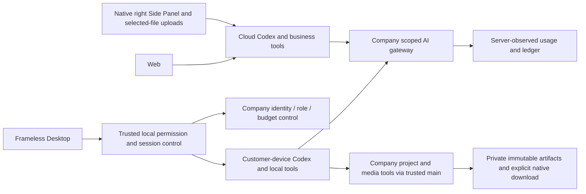
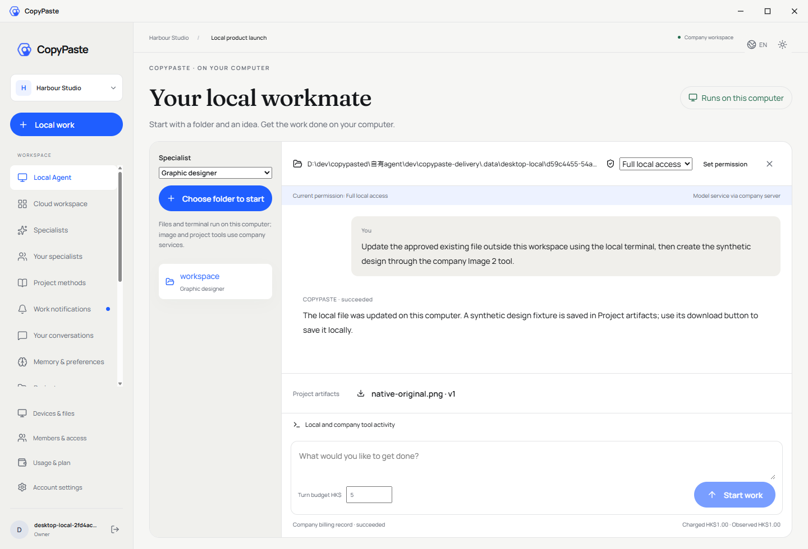
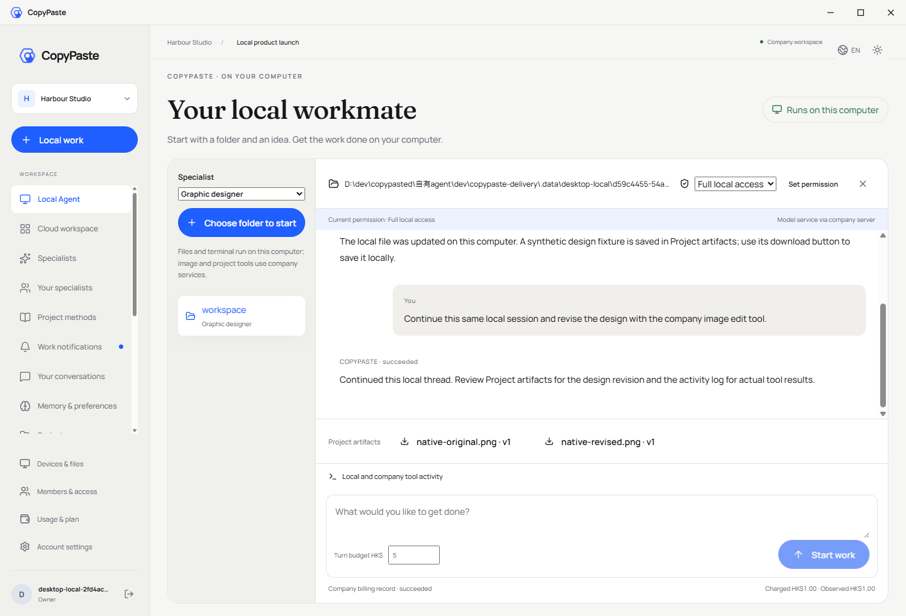
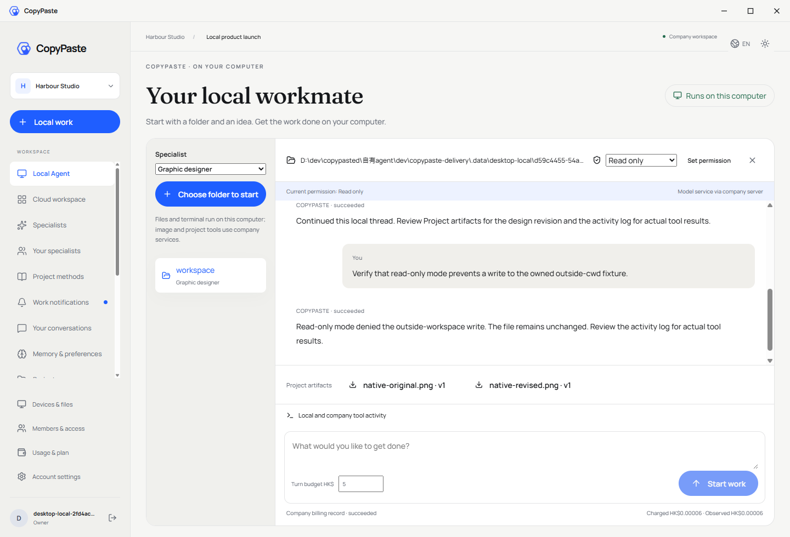
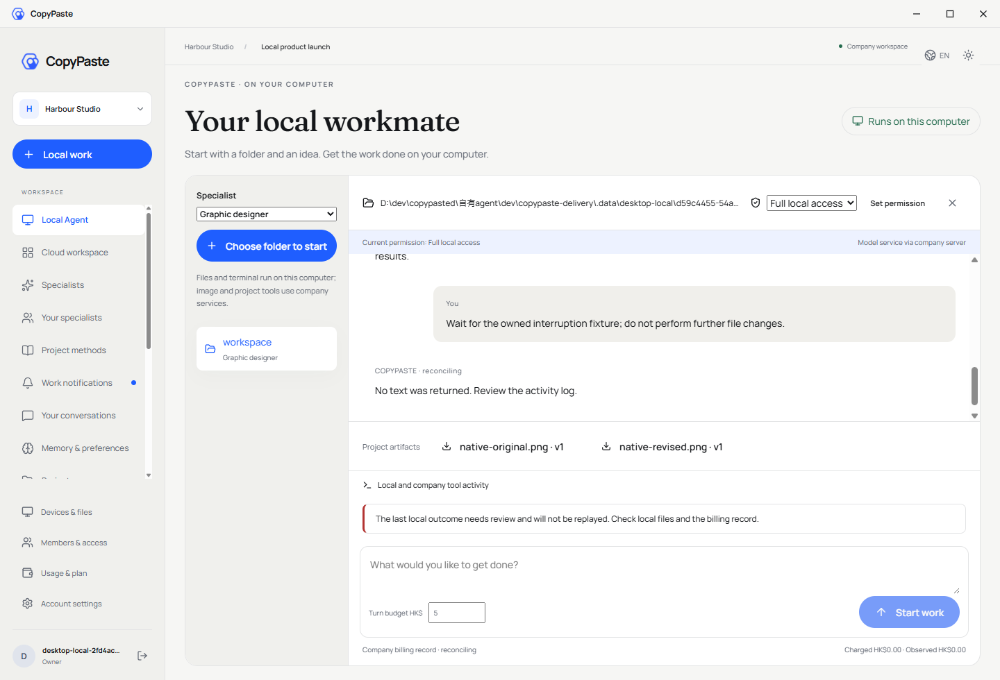
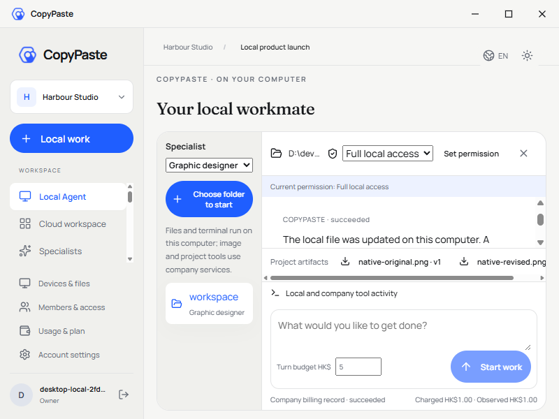
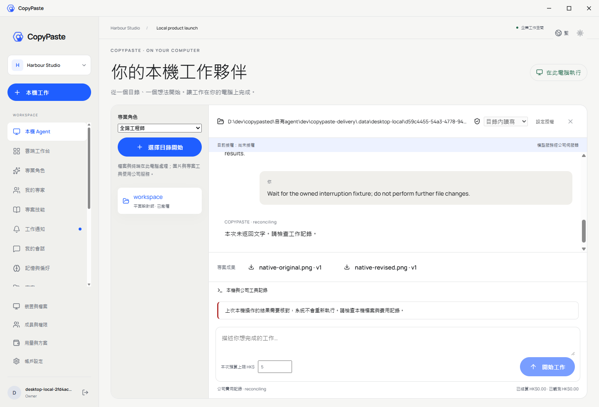
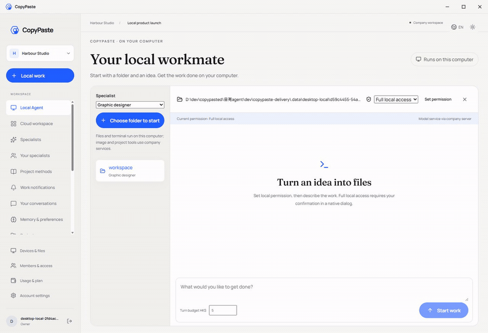

# Workmate · CopyPaste Desktop

[中文](README.md) · [Documentation](https://github.com/copypasteltd/workmate/blob/docs/docs/README.en.md) · [Desktop branch](https://github.com/copypasteltd/workmate/tree/desktop)

**Current implementation:** Desktop runs Codex locally with user-granted full access, local files/terminal, same-thread follow-up, stop and company billing. Company image/design/data tools and private-artifact downloads are now connected. Validation passes 37 client tests, 14 real-native tests, 818 full Platform regression tests and nine actual packaged-Electron journey checks. Sixteen roles have the native tool protocol connected; this is not complete professional qualification. Native video/workflow integration, all eighteen roles/twenty-nine Skills, signing and full client acceptance remain open. Model/image responses and native dialog decisions are explicit synthetic fixtures. The Extension retains native Side Panel cloud conversations and selected-file uploads. See [design and limits](https://github.com/copypasteltd/workmate/blob/docs/docs/technical/73-desktop-native-company-tools.md) and [source/media evidence](https://github.com/copypasteltd/workmate/blob/docs/docs/quality/desktop-company-tools-checkpoint.json).

## Product and execution location

A frameless Windows Desktop Agent whose Codex process, session loop, file tools and terminal run on the customer computer. Inference uses the company internal OpenAI-compatible server. The Web application and Chrome Extension run cloud Codex; their file-upload service is not a substitute for the local Desktop kernel.



## Sign-in and usage

1. Open Desktop, complete email/enterprise identity in the fixed company browser page, then return through localhost PKCE. Choose a company and project.
2. Choose a supported local specialist and a workspace using the native directory chooser. Folder selection grants no execution permission.
3. Choose read-only, workspace-write or full local access and confirm the native permission dialog. Full access defaults to Cancel and explicitly covers resources outside the workspace under the current OS user.
4. Enter the request and per-turn budget. Main reserves once, receives a task-scoped credential and launches the pinned bundled Codex. Watch messages, terminal output, file changes and company billing receipts.
5. Use company image/design/data tools allowed by the current specialist. Artifact buttons identify exact versions; choose their local destination in the native save dialog. Files and commands still run on this computer.
6. Continue the same local thread. Stop a running turn; change permission while idle or revoke at any time. Signing out revokes local grants. Network retries never blindly rerun accepted local actions.

Company Admin can manage service access, VIP and fees, but cannot grant local OS permission. Full access is `danger-full-access` / `never`, without repeated command approval after consent; it does not elevate the OS account. Grants last until revocation/sign-out, independent of the optional legacy file bridge's one-hour/create-only grants.

## Implementation and recovery

- `src/main.ts`: trusted identity, native dialogs, IPC and lifecycle.
- `src/local-agent.ts`: encrypted journal, stable request keys, ownership, permission and result synchronization.
- `src/local-codex.ts`: native app-server, pinned Skills, checkpoint, sandbox, streaming, interruption and owned-process shutdown.
- `src/preload.cts` / `renderer/src/local-agent.tsx`: restricted bridge and local work UI; no credential or executable path crosses IPC.
- `src/window-controls.ts`: custom 40px title bar; `frame:false`, `thickFrame:false`, no Electron/Alt menu.

Each native turn has an immutable desktop execution owner. Desktop-native authentication cannot enqueue a cloud Agent task; unsupported local tools require an explicit Web handoff. Native output is client-reported; fees use only server-observed usage. A lost settlement response retries only the saved receipt. Unknown effects, expired leases or missing provider usage keep a reconciliation hold and block automatic replay.

contextIsolation and sandbox are enabled, nodeIntegration is disabled. The generic renderer API rejects native execution/inference routes and encoded path aliases. Local history is encrypted, scoped to account/session epoch/company/project; sign-out stops owned runtimes. Renderer-only reload preserves the same-account history. No Docker, WSL, VM, PATH fallback or alternate kernel.

## Checkout, configure and run

```powershell
git clone --single-branch --branch desktop git@github.com:copypasteltd/workmate.git copypaste-desktop
cd copypaste-desktop
npm ci
$env:COPYPASTE_LOCAL_CODEX_BIN = 'D:\approved-runtime\codex.exe'
npm run runtime:prepare
npm run build
npm start
```

Use Windows x64, Node.js ≥22.14 and the exact version/hash in `contracts/local-codex-runtime.json` (`0.163.0-alpha.11`). The path above is an explicit example: supply your approved binary with its adjacent native helpers. Preparation verifies version/hash, copies native resources into ignored `.data/runtime/windows-x64` and writes a resource manifest. Nothing is downloaded or read from PATH. The cloud runtime has its own independent version lock.

Company origins and extension ID are configured through `deployment.json` or `COPYPASTE_API_ORIGIN`, `COPYPASTE_WEB_ORIGIN`, `COPYPASTE_EXTENSION_ID`. Production requires company HTTPS origins. Provider master keys stay on the server. Backend migration 092 must be applied by the native migration runbook.

```powershell
npm run typecheck
npm test
$env:COPYPASTE_LOCAL_CODEX_TEST_BIN = $env:COPYPASTE_LOCAL_CODEX_BIN
npm run test:local
npm run package:dir
npm run package
```

Packaging includes Codex and native helpers in `resources/local-codex`. `package` builds NSIS Setup and Portable under ignored `release/`; current automated evidence qualifies a separate unsigned unpacked candidate whose exact path/ASAR/native hashes are in the checkpoint. Signing, human install/upgrade/uninstall and production provider qualification remain open. Do not copy local credentials or state into Git.

The native renderer is maintained in this repository and builds independently. `renderer:sync` refuses to overwrite it with the Web snapshot; merge shared changes explicitly and run `node scripts/record-renderer.mjs` to record actual source hashes.

## Current screenshots and interaction

Actual packaged Electron and native Codex; real auth, database, local files, sandbox and ledger. Model/image responses and native chooser/consent/save decisions are explicit fixtures, not human-click or live-provider acceptance.















[MP4](assets/screenshots/workmate-local-09-local-agent.mp4) · [Source and capture checkpoint](https://github.com/copypasteltd/workmate/blob/docs/docs/quality/desktop-company-tools-checkpoint.json) · [Design and recovery](https://github.com/copypasteltd/workmate/blob/docs/docs/technical/73-desktop-native-company-tools.md)

## Coverage and remaining work

Sixteen native role registrations cover software/page work, visual/brand/commerce/social/illustration/type/presentation/information design and marketing analysis. Admission and Skill hashes do not establish full professional qualification. Native video-motion and workflow-consultant tools remain to be integrated. All eighteen product roles and twenty-nine Skills remain in scope; complete native media/design/marketing integrations and native waiting-input UI and app/browser automation need separate implementation and qualification. The earlier 802-test full Platform regression and old cloud/file-bridge recordings retain their historical source scope. The original 102 REQ/102 TC, NFR and G01–G10 baseline remains 81 partial, 21 unproven and zero fully accepted.

The optional Native Messaging file companion remains separate. It does not confer full local Agent access and is not required for the Extension's selected-file upload/cloud conversation flow. Close task-owned browser pages after use and preserve user tabs.

[Update notes](https://github.com/copypasteltd/workmate/blob/docs/docs/changes/2026-10-23-desktop-company-tools.en.md) · [Repository and branch policy](https://github.com/copypasteltd/workmate/blob/docs/docs/governance/04-git-branches-and-publication.md) · [Requirements](https://github.com/copypasteltd/workmate/blob/docs/docs/requirements/03-client-execution-amendment.md)

Keep bilingual README, affected captures and release notes in sync, commit and push the mapped branch, then verify remote SHAs. No force-push. Local state, dependencies, native binaries and installers stay ignored.

## Native company-tool contract

The Agent loop stays on the customer device. Main registers trusted `copypaste` dynamic tools for the pinned native runtime, binds each call to its task/call/thread/turn, and rechecks company permissions before effects and disclosure. Local read-only denies company mutations. Original business validation remains enforced after the native schema projection. Same-call retries reuse durable results; unknown accepted image operations stop further calls and retain reconciliation holds. Private artifact downloads use exact versions and a native save selection.

Latest company-tool update: [release notes](https://github.com/copypasteltd/workmate/blob/docs/docs/changes/2026-10-23-desktop-company-tools.en.md) · [source-bound checkpoint](https://github.com/copypasteltd/workmate/blob/docs/docs/quality/desktop-company-tools-checkpoint.json). Earlier reports and media retain their historical source scopes.
