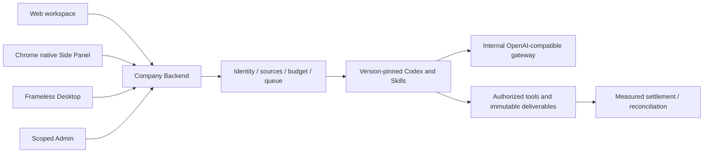

# Workmate · CopyPaste Web

[中文](README.md) · [Documentation](https://github.com/copypasteltd/workmate/blob/docs/docs/README.en.md)

[Backend](https://github.com/copypasteltd/workmate/tree/backend) · [Web](https://github.com/copypasteltd/workmate/tree/web) · [Admin Dashboard](https://github.com/copypasteltd/workmate/tree/admin) · [Desktop](https://github.com/copypasteltd/workmate/tree/desktop) · [Chrome Extension](https://github.com/copypasteltd/workmate/tree/extension) · [Delivery](https://github.com/copypasteltd/workmate/tree/delivery)

A cloud Agent product for Hong Kong enterprises. This repository owns **Web** and publishes to `web`.

## Architecture and constraints

Codex is the only Agent kernel. All AI calls use the company's internal OpenAI-compatible server. Web, Desktop, extension and Admin share server identity, permissions, sources and billing controls. UI follows CopyPaste brand assets, colors, typography and bilingual patterns.



## Product and usage flow

1. Visit the workspace and sign in with an email code. First verification can create a customer account. Production uses SMTP; local demonstrations use the development mailbox.
2. Create/select a workspace and project. The server checks membership, project rights, funding subject and private conversation ownership.
3. Select the default assistant, an installed preset among eighteen roles, or a personal specialist. Tasks freeze role, skills, brand, model and price versions.
4. Select files, brand materials and marketing connections. Access/plan/budget checks precede an atomic budget hold and execution.
5. Inspect state, messages, outputs, actual sources and usage. Explicitly select authorized versions for missing inputs and continue the original task. Refreshes retain unsubmitted choices.
6. Download or explicitly publish an independent deliverable copy. Revocation, invalid sources and denied current reads fence unavailable content. Notifications, plans, conversations and memory retain their own scopes.

## Pages and business modules

Workspace, specialist catalog, personal specialists, project methods/Skills, notifications, private conversations, memory, projects, files/devices, members, usage/plans and account settings share workspace/project context. Creative flows cover design, brand, advertising, ecommerce, social, typography, presentations, information design and template video. Marketing includes file analytics, ad connections and scoped website audit/change-draft/recheck flows.

`src/main.tsx` contains entry/routing. Domain components implement conversations, tasks, inputs, creative work, connections and analytics. `src/api.ts` and session code centralize Backend access. React/TypeScript/Vite, with repository-provided fonts and brand assets.

## Run

```powershell
npm ci
npm run dev
```

Open `http://localhost:4317` after starting backend at `http://localhost:4310`. See `.env.example` and `vite.config.ts`. The frontend contains company service origins and no model API secrets. Production static hosting requires the documented HTTPS, cookie/Origin/CSP and Backend configuration.

## Interaction rules

Refreshes of the same task retain selected inputs; workspace/project/task changes and failed reads clear prior content. State, recorded usage and settled charges are separate. Initial pre-model waits and waits after a measured paid turn use different copy. Published copies and downloads remain governed by current sources, retention and authorization.

## Checkout and prerequisites

Clone this branch into a fresh working directory; update an existing repository without reinitializing it.

```powershell
git clone --single-branch --branch web git@github.com:copypasteltd/workmate.git copypaste-web
cd copypaste-web
```

Use Node.js ≥22.14, npm and Git with pinned lockfiles. The qualified local environment is Windows x64. Backend/full delivery also needs native PostgreSQL launcher resources, pinned Codex `0.163.0-alpha.10.2` and FFmpeg/FFprobe. No local Docker, WSL or virtualization. Run components in separate directories; see [workspace](https://github.com/copypasteltd/workmate/blob/docs/docs/governance/04-git-branches-and-publication.md).

## Checks and evidence scope

```powershell
npm run typecheck
npm test
npm run build
```

**782/782** Platform and **34/34** focused tests, plus **13 checks** across six repositories for types/build/existing client suites. The actual packaged Desktop and native Side Panel journey passes **32** checks, retaining every prior named test among 765. Actual Codex child-process tool/thread/usage behavior is tested through a synthetic internal API. UI turns/business data in these demonstrations are synthetic as authorized. All 102 original requirements remain: 81 partially verified, 21 without proven completion and zero fully accepted. Screenshots and test counts do not establish whole-product acceptance.

Canonical TaskDTO/task creation, arbitrary in-flight pause, unknown-effect recovery, independent complete role workflows, GEO, live suppliers and production/signing/store qualification remain tracked.

## Actual screens and interactions

Actual recordings preserve capture timing. AI turns/business data are explicitly synthetic. Admin form demonstrations do not claim a financial commit.


[MP4](assets/screenshots/workmate-06-interaction.mp4) · [Capture/source evidence](https://github.com/copypasteltd/workmate/blob/docs/docs/quality/workmate-media-06.json)

## Detailed design and updates

- [Product](https://github.com/copypasteltd/workmate/blob/docs/docs/product/01-prd.md)
- [Architecture](https://github.com/copypasteltd/workmate/blob/docs/docs/technical/01-architecture-and-stack.md)
- [Identity and permissions](https://github.com/copypasteltd/workmate/blob/docs/docs/technical/07-security-and-permissions.md)
- [Task continuation](https://github.com/copypasteltd/workmate/blob/docs/docs/technical/66-paid-native-input-checkpoints.md)
- [Admin](https://github.com/copypasteltd/workmate/blob/docs/docs/product/08-admin-dashboard.md)
- [Native clients](https://github.com/copypasteltd/workmate/blob/docs/docs/technical/30-native-window-and-browser-sidepanel.md)
- [Release notes](https://github.com/copypasteltd/workmate/blob/docs/docs/changes/2026-10-22-workmate-publication.en.md)

Every later change updates both READMEs, affected actual captures/GIFs, release notes and its mapped branch. Verify remote SHAs through Delivery publishing; do not force-push collaborator history. Keep environment secrets, databases, sessions, dependencies and installers out of Git. Exact historical README bytes are retained in [archive](https://github.com/copypasteltd/workmate/blob/docs/docs/quality/history/stage66-before-workmate-readmes/manifest.json).
