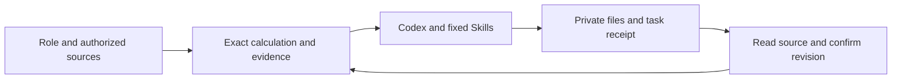
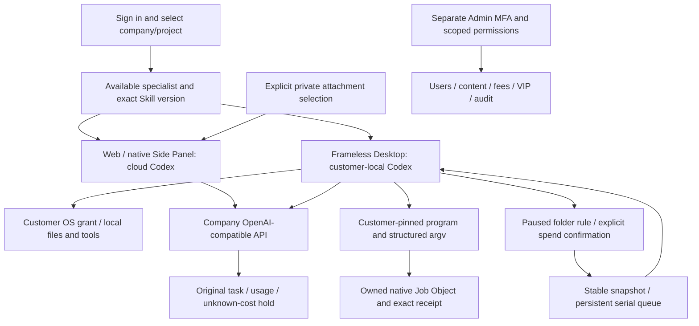
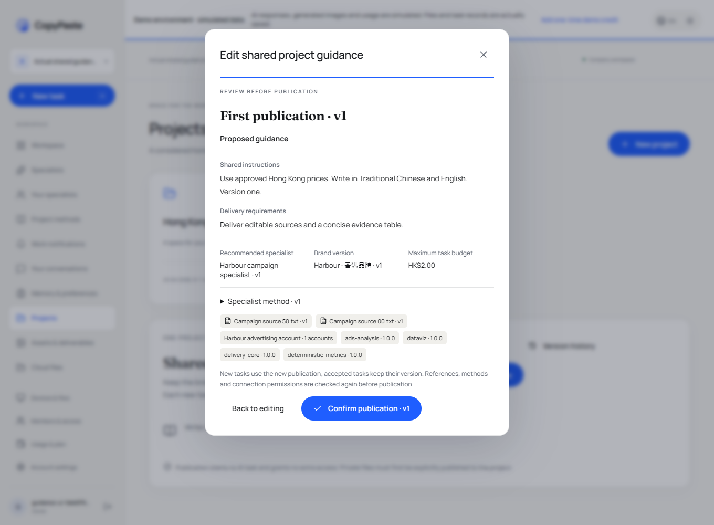
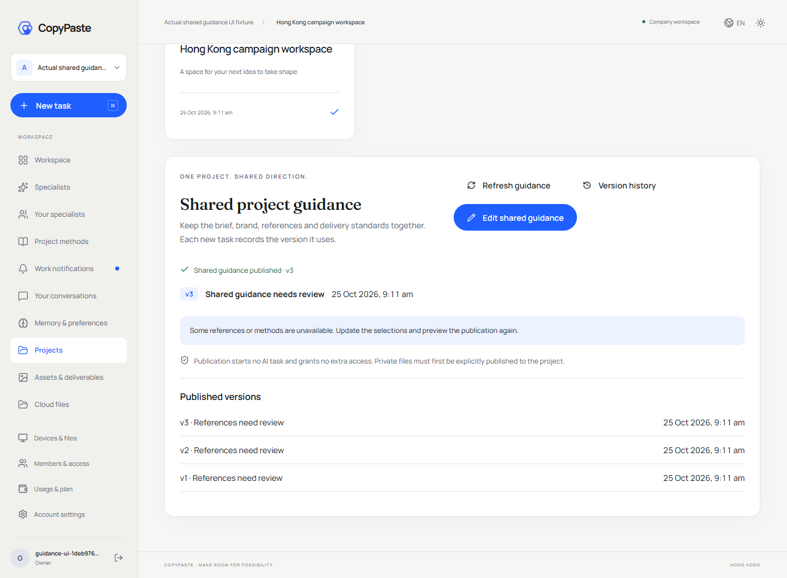
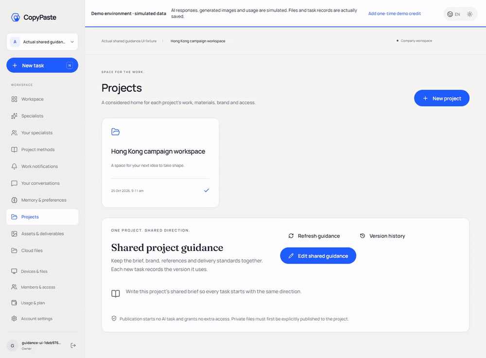

# Workmate · CopyPaste Enterprise Agent · platform

<!-- cloud-workflows-stage91 -->

## Private cloud workflow delivery

Stage 91 connects the workflow consultant to private cloud execution. Actual pinned Codex prepares an immutable procedure; the customer reviews its fixed steps and child budget before confirming execution, which pauses again at human approval steps. Fifty-five relevant backend cases and eight actual browser checks pass, including private downloads, single child reservations/settlements, versioned corrections, cancellation, source withdrawal and exact retries. Model replies/account data are synthetic; Codex, tools, database, files and UI interactions are real.

1. Select the workflow consultant and use Execute to prepare an authorized private procedure. Preparation has its own actual task bill.
2. Open Workflows, review the exact version, all steps and the separate total child budget, then explicitly check consent and confirm. No child task/reservation exists beforehand.
3. Download the calculated private summary, approve the next human review, and follow the actual child task, delivered file and cost receipt. Unknown usage blocks replacement execution.
4. Ask the same consultant for a correction. A new version/request keeps original versions and runs intact. Cancellation stops only this run; withdrawn sources block history/downloads.


Apply **SQL105** after SQL001–104. The consultant and its two fixed workflow Skills are 1.1.0. At most eight sequential authorized cloud-role, data-summary or human-review steps are supported; nested workflows, arbitrary cloud shell, external account writes and video child tasks are not enabled here. Desktop keeps its separate local Codex runtime.

[Implementation](https://github.com/copypasteltd/workmate/blob/docs/docs/technical/91-private-cloud-workflows.md) · [Source-bound evidence](https://github.com/copypasteltd/workmate/blob/docs/docs/quality/cloud-workflows-checkpoint.json)


[Preparation GIF](assets/screenshots/workmate-cloud-workflow-04-cloud-workflow-prepare.gif) · [Preparation MP4](assets/screenshots/workmate-cloud-workflow-04-cloud-workflow-prepare.mp4) · [Review MP4](assets/screenshots/workmate-cloud-workflow-04-cloud-workflow-review.mp4)

<!-- analysis-roles-stage90 -->

## Earlier analysis and infographic verification (stage 90)

Stage 90 connects versioned marketing-analyst and information-design presets to deterministic calculation and nine real deliverable files. Sixty-eight relevant backend checks and eleven actual browser checks pass. Both roles use the real pinned Codex process and authorized company tools. Model replies and account data are explicitly synthetic; the program, database, PNG/ZIP bytes, downloads, private isolation, source fences and ledger operations are real. This does not replace the requirement for twelve professionally qualified roles or complete product acceptance.

1. Create the marketing analyst or information designer from the specialist directory. Existing specialists keep their old role/Skill versions.
2. Confirm the dates, currency, account, attribution and conversion definition. Choose actual imported data or upload CSV/XLSX to this private conversation; inspect the real worksheet and headers.
3. Select **Execute**, confirm the budget and delegate the work. Ask/Plan cannot write files. Download SVG, PNG, interactive HTML, metrics/source CSV, creative brief, editable JSON, manifest and ZIP.
4. Request a correction using the original source version. Recalculation creates new immutable files; prior versions remain available while their sources are authorized. Identical render retries reuse the original files. Rendering makes no extra AI request; text inference follows the task ledger.



Apply **SQL104** before starting the updated backend; SQL001–103 and all old Skill bytes remain intact.

[Design and implementation](https://github.com/copypasteltd/workmate/blob/docs/docs/technical/90-analysis-role-delivery.md) · [Exact evidence](https://github.com/copypasteltd/workmate/blob/docs/docs/quality/analysis-roles-checkpoint.json)


[Creation and download GIF](assets/screenshots/workmate-analysis-04-analysis-role-work.gif) · [MP4](assets/screenshots/workmate-analysis-04-analysis-role-work.mp4) · [Report MP4](assets/screenshots/workmate-analysis-04-analysis-report-review.mp4)

<!-- local-programs-stage88 -->

Backend for identity, workspaces/projects, cloud Codex, business tools, the company AI gateway, metering and audits.

## Product and boundaries

The first customers are existing marketing teams. Scope includes image/design/typography, video/effects, advertising and website analysis, SEO/GEO, repeated business processes and software development. The catalog has 18 candidates with exact Skill bindings; at least twelve individually qualified professional presets remain an acceptance requirement. The designer combines Codex, design Skills and company Image 2. Codex is the only Agent core. All AI uses the company's OpenAI-compatible backend; development currently uses authorized synthetic providers, not a claim of live professional quality.

Uses TypeScript, Fastify and native PostgreSQL. Application roles have no owner/BYPASSRLS privilege; HTTP, workers, downloads and source reuse recheck current authority. Task ledgers distinguish reservations, actual usage and unknown cost; stopping never fabricates zero usage. Company model aliases, media capabilities, exact tariffs and allowed origins are backend configuration, not arbitrary client-supplied provider secrets or URLs.

## Setup

### Local startup

Run these commands in the checked-out component. The complete workspace has the six independent repositories side by side under `dev/`; see the [branch and checkout layout](https://github.com/copypasteltd/workmate/blob/docs/docs/governance/04-git-branches-and-publication.md). Use Windows x64, Node.js >=22.14, npm/Git and the documented native PostgreSQL, FFmpeg/FFprobe and pinned Codex resources. Preserve existing local configuration/data. No Docker/WSL/VM is used.

```powershell
Set-Location 'D:/dev/copypasted/自有agent/dev/copypaste-platform'
npm ci
npm run setup:local
npm run db:local
```

Keep that database terminal open. In a second terminal in the same repository, run `npm run db:migrate` and then `npm run dev`. API: `http://localhost:4310`. SQL103 must be applied before upgrading clients. Create/enrol an administrator with the existing `admin:create` runbook and current MFA; no shared default Admin credentials are supplied.

### Use the current workflow

1. Complete sign-in, company membership/invitation and project selection. Native clients use browser PKCE; Admin uses separate MFA identities. Expired/revoked credentials must not silently change identity or company.
2. Select a specialist and supply the brief and explicitly authorized references/accounts. Missing inputs request customer action. Project owners can save, preview and explicitly publish immutable shared guidance; publication starts no AI and grants no new permission.
3. New tasks pin their accepted role, Skill, brand, reference and guidance versions. Existing work, including an originally absent configuration, retains its original state. Source revocation hides unavailable bodies and blocks later use; history is not a permission bypass.
4. Confirm budget and any required operation/media approval. View genuine status, progress, exact deliverables and original receipts. Continue requested edits in the same task lineage. Unknown usage remains reserved for reconciliation; it is never silently free or blindly replayed.
5. Admin can independently manage authorized user/workspace status, inspect permitted consumption, preview/confirm manual fees or credits and activate scoped VIP/expiry. Balances, recorded payments, credits, budgets and VIP are separate records. Idempotent confirmation and audit prevent duplicate grants.

## Customer-local programs and browser resources

Sign in and select company/project → create a local session → explicitly grant full local permission → open **Local programs** → choose an actual executable and confirm the native dialog, which defaults to Cancel → request work in Conversation → inspect exact arguments, actual output, PID/exit code and the original task bill. Cancelling or declining grants nothing. Approvals pin file identity and SHA-256; the Agent supplies a program ID and argument array, not a replacement shell/environment.

Stopping the original task or revoking the program ends its owned native process tree. Program revocation leaves the separate customer full-access grant intact. Success, failure, cancellation and unknown outcomes remain distinct; an original call ID never replays. After restart, uncertain records remain unknown. Customer review only permits future calls, never rewrites the old record as success. Approved programs run with the customer's OS-user rights, not an additional workspace OS sandbox; Admin/cloud cannot approve on their behalf.

The Windows x64 native Job Object guardian does not pass company inference credentials to programs. Limits are two active programs per executor, 100 approval/200 run records, at most 64 arguments and 120 seconds per invocation, and 32 KiB retained per stdout/stderr with explicit truncation. New sessions pin the program tool version; legacy tool sets remain unchanged. Normal browser opens and popups share three pages per task/two active contexts per executor. A third context is denied without evicting another task; reuse clears cookies/localStorage.

## Customer-local folder work

In Desktop, choose a writable local session and open **Folder work**. Select an input folder inside the workspace and configure extensions, instructions, a quiet period, per-file/total limits and maximum runs. Existing files are excluded unless selected. Saving creates a **paused** rule; **Confirm and activate** opens a separate native automatic-spend confirmation that defaults to Cancel.

Stable native file events and bounded scans feed a persistent serial queue. Each job gets an exact snapshot, separate output directory, original task ID and company cost receipt. An unanswered native question is visible from Folder work; **Answer questions** returns to Conversation and requires the customer's explicit answer. Identical already-processed bytes and product outputs do not create another paid task. Unstarted old versions coalesce to the latest stable input.

Pause stops new dispatch and lets the current file finish. Revoke stops only that rule's owned work while keeping outputs/receipts. App closure stops watching; a real reopen retains the encrypted journal and allocated limits but requires fresh confirmation. Lost replies reuse original dispatch/create/start/finish keys; uncertain native actions block for review. Full OS permission remains the customer's grant, not an additional folder sandbox. Web/Extension keep cloud execution; folder work is a Desktop capability.

Limits: 20 rules; 1,000 history/200 queued items per rule; 1,000 dispatch receipts per session; 2,000 matching files/10,000 entries/12 levels per scan; 20 MiB per file and 64 MiB new reads per scan; at most 100 authorized runs, one scheduled job at a time. Limits do not reset on pause/restart. Outputs are under `.copypaste-local-jobs/<rule>/<job>/output/`. Symlinks/junctions, traversal, outside input, source replacement and conflicts block automatic work. See approved programs above; complete application-operation and crash/sleep/offline matrices remain open.

## Configuration, UI and verification

Apply SQL105 before starting the updated backend. Private workflow listing and customer decisions are additive routes; SQL001–104 and 532 historical contracts remain byte-preserved. Set company gateways, exact model aliases, verified media capabilities and tariffs on the backend; consult its `.env.example` and the deployment runbook. Never embed company provider keys in a renderer/extension. Unconfigured capability is unavailable rather than silently redirected. Ordinary demo data does not activate every media fixture.

CopyPaste blue/cream, Manrope/Fraunces, English/Traditional Chinese and light/dark themes remain. Desktop has no Electron frame/menu or visible scrollbar rails. Real wheel/focus/last-action access and truthful progress remain. The narrow session guidance card separates its icon/version from the readable name. Focused page Home/End and Ctrl+Home/End act on that page; focused text fields keep caret navigation.

Stage 88 verifies approved pinned customer-local programs, structured argv, owned native process lifecycle/parent loss and original billing; one browser ledger enforces three pages per task/two active contexts with actual destruction and cleared storage on reuse. Fresh scopes: 68 packaged Desktop checks, 114 Desktop unit cases, 18 native Codex cases, 184 client cases, 91 related backend cases and six strict-declaration cases. Synthetic providers/dialog decisions remain explicit. Full product acceptance, twelve qualified professional roles and G01–G10 remain open. All prior 57 Desktop checks, 91 unit and 17 native cases remain. Folder work still checks a real new-PID restart, pinned original thread/versions and separately settled 90/60-micro-HKD tasks. All 14 runtime assets/licenses remain exact and repository recordings stay outside ASAR.

Retained historical stage-86 scopes: 1023 platform, 25 focused, 36 compatibility and 14 actual Web/Admin/native Side Panel checks. Complete platform/cross-client suites were not rerun. Web/Admin/Extension product sources are unchanged; changed backend tool declarations have fresh related checks. Native processes/files/ledgers/database are real; synthetic providers/dialog choices do not qualify live professional quality. Owned browsers/API/previews/test DB close; no Docker/WSL/virtualization.

The original 102 requirements remain **86 partial / 16 unproven / 0 fully accepted**. REQ-040/042 gain bounded evidence without closing their original conditions. At least twelve professional-role qualifications, complete Admin breadth, teams/solution packages, full marketing workflows, live quality, signed installation/update/uninstall, load/restore exercises and G01–G10 remain open. Test counts are not a product-completion percentage. See the complete numbered gap assessment.


[Plan and limits](https://github.com/copypasteltd/workmate/blob/docs/docs/technical/87-desktop-folder-work.md) · [Current-source checkpoint](https://github.com/copypasteltd/workmate/blob/docs/docs/quality/folder-work-checkpoint.json) · [Complete numbered gaps](https://github.com/copypasteltd/workmate/blob/docs/docs/quality/2026-10-25-goal-gap-assessment.md) · [Branch/checkout and publication](https://github.com/copypasteltd/workmate/blob/docs/docs/governance/04-git-branches-and-publication.md)

[Role catalog](https://github.com/copypasteltd/workmate/blob/backend/catalog/role-preset-catalog.json) · [Skill packages](https://github.com/copypasteltd/workmate/blob/backend/catalog/skill-packages.json)

## Architecture



Retained stage-86 media for unchanged product sources; this stage adds no fresh Web/Admin/Side Panel UI qualification.





[Original MP4](assets/workmate-current/copypaste-web__workmate-guidance-14-project-guidance.mp4)



[Local program plan](https://github.com/copypasteltd/workmate/blob/docs/docs/technical/88-approved-local-programs.md) · [Stage 88 checkpoint](https://github.com/copypasteltd/workmate/blob/docs/docs/quality/local-programs-checkpoint.json)
