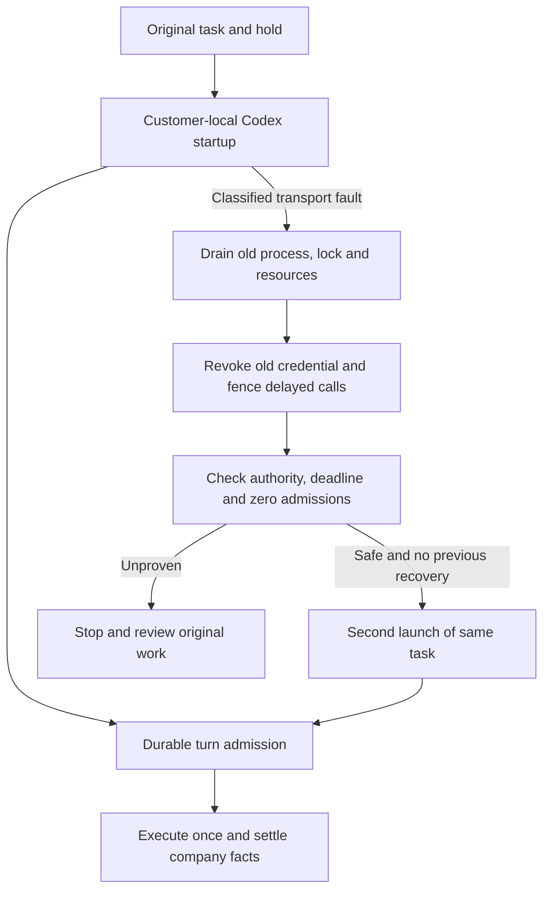
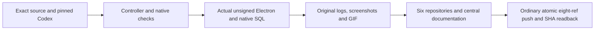
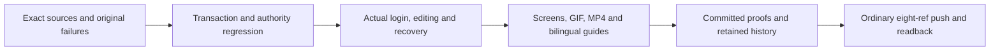
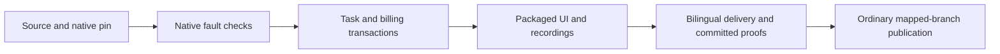
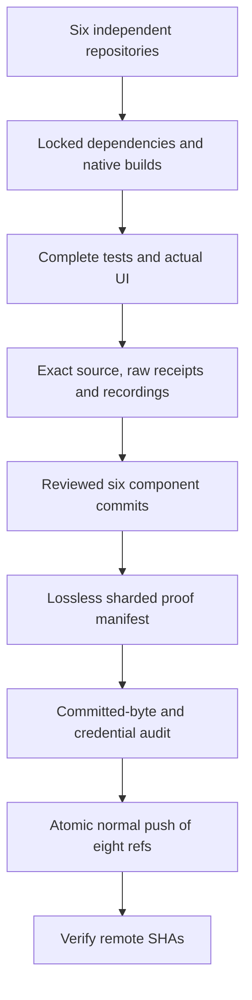

# Workmate · CopyPaste Enterprise Agent · delivery

[简体中文](README.md) · [English](README.en.md)

<!-- startup-recovery-stage128 -->
## Safe customer-local startup recovery · Stage128

Desktop runs pinned Codex on the customer's computer. After explicit folder selection and consent, a classified initialization/thread transport failure first drains the old process, lock and owned tools. Company services permit one recovery only when no turn, provider, input-count or company-tool request has been admitted and the original identity, permissions and deadline remain valid. At most two launches retain one task, hold and worker attempt; the absolute deadline never extends.

The UI shows Reconnecting. Retry connection retrieves an unconfirmed original result; possibly executed work requires local-file and billing review. Withdrawal, rejection, incomplete cleanup, admitted turns and unknown outcomes cannot replay automatically. Scoped inference credentials go only to the trusted local runtime and are excluded from the recovery journal and renderer.



Upgrade the server through SQL133 with the database owner before starting the matching API. New clients opt into `desktop-startup-recovery-v1`. `/startup-recovery` binds the original session, contract digest and durable recovery key; `/turn-admission` precedes native `turn/start`. Legacy clients retain their existing flow without recovery authority.

The checkpoint records bounded controller, actual pinned Codex, native SQL and actual unsigned packaged Desktop qualification. Model responses and dialog decisions are synthetic as requested. This does not qualify a live provider, signed installation, every crash combination or complete professional roles. Earlier packages and captures retain their original source scope.

Bounded checks passed: 91 related controller, 43 actual pinned-Codex, 30 native database/API, three current compilation and six actual unsigned packaged-UI checks. The journey verifies sign-in, consent, one startup recovery, one original-task charge, one displayed answer, pending-startup withdrawal and native widths of 1000/1240/1440. Current PNG/GIF/MP4 captures come from successful attempt04; failed attempts01–03 and their raw records remain intact. V11 publishes the branches; the final receipt and remote SHA readback determine publication status.

After committing reviewed source, media, bilingual guides and the central publication manifest, run in this repository:

```powershell
node scripts/publish-workmate-v11.mjs --push
```

`--check` verifies without pushing. V11 checks actual committed content, every historical proof, media/links and ancestry for all eight mapped branches, then performs an ordinary atomic push and reads back each SHA. Unrelated untracked user files in the central documentation checkout are preserved and listed in the receipt; tracked files and component checkouts must be clean. Failures retain their receipts; no force push.

[Design and APIs](https://github.com/copypasteltd/workmate/blob/docs/docs/technical/128-desktop-startup-recovery.md) · [Sources and qualification](https://github.com/copypasteltd/workmate/blob/docs/docs/quality/startup-recovery-checkpoint-128.json) · [Numbered open work](https://github.com/copypasteltd/workmate/blob/docs/docs/quality/remaining-work-stage128.md)


[Original receipt](https://github.com/copypasteltd/workmate/blob/desktop/assets/screenshots/workmate-startup-recovery-128-04-original-local-receipt.png) · [Withdrawal screenshot](https://github.com/copypasteltd/workmate/blob/desktop/assets/screenshots/workmate-startup-recovery-128-04-permission-revoked-before-turn.png) · [Withdrawal GIF](https://github.com/copypasteltd/workmate/blob/desktop/assets/screenshots/workmate-startup-recovery-128-04-revoke-pending-startup.gif) · [Recovery MP4](https://github.com/copypasteltd/workmate/blob/desktop/assets/screenshots/workmate-startup-recovery-128-04-startup-and-original-receipt.mp4) · [Withdrawal MP4](https://github.com/copypasteltd/workmate/blob/desktop/assets/screenshots/workmate-startup-recovery-128-04-revoke-pending-startup.mp4)

<!-- local-startup-stage127 -->
## Source-bound local startup and delivery · Stage127

Desktop adds main/child authority renewal during startup, a preparation-close barrier, interruptible native startup requests and readable bilingual feedback. Codex remains customer-local and billing retains the original task. Bounded qualification covers 73 related controller, 38 actual pinned-native and five packaged-window checks, bound to exact source/package bytes in the checkpoint. SQL, processes and windows are real; model responses and native-dialog decisions are synthetic.

The journey signs in through browser OTP/PKCE, creates a workspace, chooses a folder and explicitly grants access, waits for startup, checks original completion/billing, then withdraws during another startup without admitting a model request. Actual 1000/1240/1440 windows remain frameless, menu-free and free of visible scroll rails/horizontal overflow. Desktop delivers the actual PNG/GIF/MP4 captures.



The historical Stage127 entry is `node scripts/publish-workmate-v10.mjs --push`; `--check` verifies only. V10 checks source, actual committed Git content, bilingual guides, real media, original failures and all historical proofs before an ordinary atomic eight-ref update and SHA readback. Stage128 uses V11; earlier results retain their original source scope.

All executed `run-desktop-startup-v1/v2/v3/v4.mjs` and QA scripts remain unchanged. Attempt01 chose the native default decline and stopped at authorization. Attempt02 reused that package and passed, but its capture revealed an internal error code. After correcting bilingual feedback, attempt03 repeats controller/native checks and builds a fresh package. Its first three checks passed, but the window-width wait timed out. Attempt04 reuses unchanged package03, binds the page-owned native window, restores normal bounds/100% zoom and checks OS/renderer sizes together. The old window state and underlying timeout cause remain unproven. Failed/cancelled records, cleanup receipts and older captures remain preserved. Stage verifiers depend on the recorded adjacent candidate paths, pinned resources and isolated database; use the normal setup instructions for another checkout. Reclaim owned windows, processes and native PostgreSQL. No Docker/WSL.

Automatic Desktop startup recovery, signed installation, complete professional roles and all 89 required full-acceptance records remain open. Recovery must revoke/drain old authority and atomically prove zero admission; zero charge is insufficient.

[Behavior](https://github.com/copypasteltd/workmate/blob/docs/docs/technical/127-desktop-startup-lifecycle.md) · [Checkpoint](https://github.com/copypasteltd/workmate/blob/docs/docs/quality/local-startup-checkpoint-127.json) · [Changes and open work](https://github.com/copypasteltd/workmate/blob/docs/docs/changes/127-desktop-startup-lifecycle.md) · [Actual captures](https://github.com/copypasteltd/workmate/blob/desktop/README.en.md)

<!-- native-publishing-stage126 -->
## Native Codex publication tools and delivery · Stage126

Backend fixes tool admission and immutable media-version lineage. Real pinned cloud Codex calls accounts → preview → prepare → status; the original customer must still explicitly confirm in Publishing. Current native09 passes5/5, startup fault03 passes9/9 and complete sixteen-file related10 passes155/155 with unchanged source and reclaimed owned native database/fixtures. Bounded startup recovery requires no admitted turn, zero model requests after gateway shutdown and full original-process exit; the two-process limit and original billing identity remain enforced.

Interrupted06 lacks terminal/cleanup receipts; run08 (132 passed, one failed), red01, green02 and other failures retain their original outcomes. The QA helper's actual process-creation-time check was corrected and separately verified. Underlying intermittent native/Windows latency causality and Desktop-local recovery/four-tool qualification remain open.

The Stage126 entry is `node scripts/publish-workmate-v9.mjs --push`; `--check` verifies without pushing. V9 checks this increment's source, original logs and portable archive while retaining historical proofs, actual screenshots/GIFs and failed attempts. Six independent repositories and an ordinary atomic eight-ref update with SHA readback remain in use. Read-only checks finish concurrently across seven independent checkouts; the shared main/docs directory is checked once at final preflight. Object imports and remote writes remain sequential. Only the final executor receipt establishes publication.

No new UI/media is claimed. Stage125 captures below retain their original source scope. Intermittent native timeout causality, video playback/seek, signed installation, complete role combinations and full acceptance remain open. Model/accounts are authorized simulated data. No Docker/WSL; reclaim owned processes.

[Behavior and limits](https://github.com/copypasteltd/workmate/blob/docs/docs/technical/126-native-publication-tools.md) · [Changes and open work](https://github.com/copypasteltd/workmate/blob/docs/docs/changes/126-native-publication-tools.md)

<!-- controlled-publications-stage125 -->
## Controlled publication qualification and delivery · Stage125

Adds synthetic OAuth, complete related backend checks, actual Web/Admin pages, packaged Electron and Chrome native Side Panel checks. Every attempt preserves original verifier/source/logs and actual screenshot/GIF/MP4; failures are never overwritten. Owned browsers, previews, native PostgreSQL and fixtures must be reclaimed. Docker/WSL are prohibited.

Historical Stage125 passing scopes: backend09 117/117, CLI07 5/5, analysis08 12/12, Desktop media03 21/21, Extension02 70/70 and Web/Admin12 14/14. Actual packaged Desktop/native Chrome Side Panel run02 passes 10/10, with matching source/package bytes and owned browsers, Electron, API, database and fixtures closed. Actual Web/Admin observations cover four widths; previous invalid width claims and all failures remain preserved.

The Stage125 publication entry is `node scripts/publish-workmate-v8.mjs --push`; `--check` verifies without pushing. The executor requires six committed independent product repositories and committed central documentation. It reads the normal development directories, verifies current sources, original receipts, historical proofs, bilingual guides, actual media and remote ancestry, then ordinarily updates eight mapped refs atomically and reads back their final SHAs. The final receipt establishes publication; it never force-pushes.

Stage-specific qualification scripts preserve adjacent `copypaste-*-publication-125` candidate paths and a pinned unsigned package; they are not generic launchers for another checkout. Follow the normal installation/startup instructions below. Independent-checkout reproduction, signed installation, new publication video playback, actual Codex invocation of the four publication tools and professional qualification of at least twelve roles remain open.

[Behavior and limits](https://github.com/copypasteltd/workmate/blob/docs/docs/technical/125-controlled-publishing-and-native-media.md) · [Source/evidence checkpoint](https://github.com/copypasteltd/workmate/blob/docs/docs/quality/publications-checkpoint-125.json)


<!-- admin-profile-revisions-124 -->
## Stage124 publication and qualification

Backend/Admin add scoped specialist, brand and memory revisions. All 68 related backend checks, 11 Admin unit checks, eight actual UI flows and 14 layout observations passed. Eight screenshots, three GIF/MP4 pairs and failed originals are retained. Desktop remains customer-local Codex; Extension remains a native Side Panel with cloud Codex.

The Stage124 entry is `node scripts/publish-workmate-v7.mjs --push`. After all six components and central documentation are committed, V7 checks exact sources, historical proofs, media, bilingual guides, credentials and remote ancestry. It performs an ordinary atomic update of eight mapped refs, then reads their actual SHAs. No force push; the final executor receipt establishes publication. Native tools only; no Docker/WSL.

[Design and qualification](https://github.com/copypasteltd/workmate/blob/docs/docs/technical/124-admin-profile-revisions.md) · [Actual Admin screens](https://github.com/copypasteltd/workmate/blob/admin/README.en.md)

<!-- admin-content-revisions-123 -->
## Administrator revisions and publication · Stage 123

The Stage123 publication command is `node scripts/publish-workmate-v6.mjs --push`; `--check` verifies without pushing. V6 checks committed independent repositories, exact sources, original evidence, bilingual guides, media, historical objects, configured credentials and remote ancestry, then ordinarily updates the eight mapped refs atomically and reads back their SHAs. Historical proof identities and failures remain intact; publication never force-pushes.

The increment passed **75 checks across five complete related backend files**, **seven actual Admin UI flows** and seven dialog/field-bound observations at four widths. Backend checks cover the three revision types, scoped authority/MFA, concurrency, idempotency, audit rollback, separate administrator provenance, database roles and immutability. Actual UI uses email/MFA login, structured editing, a committed response deliberately lost and recovered, and live permission withdrawal. Editing makes no model requests and creates no tasks or charges.

The `qualify-admin-content-v1`–`v4` and UI V1/V2 tools preserve each executed version and source snapshot. They bind their original worktrees, native database and owned ports; do not reuse those resource identities in another checkout. Normal startup follows the workspace instructions below. Review the central [checkpoint](https://github.com/copypasteltd/workmate/blob/docs/docs/quality/admin-content-checkpoint-123.json) and [archive index](https://github.com/copypasteltd/workmate/blob/docs/docs/quality/admin-content-evidence-123/index.json).



[Actual screens and recordings](https://github.com/copypasteltd/workmate/blob/admin/README.en.md) · [Behavior](https://github.com/copypasteltd/workmate/blob/docs/docs/technical/123-admin-content-revisions.md). This increment does not requalify every backend file, live provider quality or full product acceptance.

<!-- runtime-startup-122 -->

The historical Stage 122 publication command was `node scripts/publish-workmate-v5.mjs --push`; `--check` performed preflight only. That executor required the corresponding committed repositories, central proof manifest and bounded evidence, then ordinarily updated eight refs atomically and read back their SHAs. The current manifest uses V6 above.

Billing evidence retains the initial 78/79 run with one cancellation, an isolated failure and a later isolated pass. Earlier failure causes remain unproven; the [current checkpoint](https://github.com/copypasteltd/workmate/blob/docs/docs/quality/runtime-startup-checkpoint-122.json) records the final complete related-file scope. Real fixture preparation is timed separately while recovery and ledger assertions retain their 120-second bound. Product RPC and task deadlines stay unchanged.

The final five complete related files passed all 79 checks with zero failures, cancellations or skips. Sources stayed unchanged, and fixture reclamation, native database shutdown and port closure passed. This bounded result does not replace a new complete backend or production reliability qualification.

## Codex startup and turn isolation · Stage 122

This stage binds actual source bytes, the native executable and raw output; retains failed attempts; and separately checks startup recovery, turn isolation, billing transactions and packaged UI. Runners control only owned native processes, folders, databases and browsers, without Docker, WSL or virtual machines.

Recorded bounded passes cover 12 cloud native checks, 180 Desktop unit / 25 native checks, 20 Web checks and 8 packaged UI checks. Historical runners preserve their authored workspace and source; normal product usage follows the startup instructions below. Production signing, live provider quality and complete acceptance of all 102 requirements are tracked separately.



[完整方案 / Behavior and verification](https://github.com/copypasteltd/workmate/blob/docs/docs/technical/122-codex-startup-and-turn-isolation.md)

## Product and boundaries

The first customers are existing marketing teams. Scope includes image/design/typography, video/effects, advertising and website analysis, SEO/GEO, repeated business processes and software development. The catalog has 18 candidates with exact Skill bindings; at least twelve individually qualified professional presets remain an acceptance requirement. The designer combines Codex, design Skills and company Image 2. Codex is the only Agent core. All AI uses the company's OpenAI-compatible backend; development currently uses authorized synthetic providers, not a claim of live professional quality.

Tools retain original TAP, failed receipts, verifier sources, selected source digests and actual screenshots/GIF/MP4, distinguishing synthetic model replies from native Codex and real files/database/ledgers. Native tests own only their ports, processes, folders and database fixtures; unused owned browsers close while user pages/services remain. Publication audits seven repositories, bilingual READMEs, media, credentials, historical object sizes and committed manifests, then uses ordinary explicit-ref pushes and verifies eight remote SHAs without force.

## Repositories and execution

| Branch | Directory | Runtime |
| --- | --- | --- |
| [backend](https://github.com/copypasteltd/workmate/tree/backend) | `dev/copypaste-platform` | Fastify / PostgreSQL / cloud Codex |
| [web](https://github.com/copypasteltd/workmate/tree/web) | `dev/copypaste-web` | React / Vite / cloud workspace |
| [admin](https://github.com/copypasteltd/workmate/tree/admin) | `dev/copypaste-admin` | React / separate Admin identity |
| [desktop](https://github.com/copypasteltd/workmate/tree/desktop) | `dev/copypaste-desktop` | Electron / customer-local Codex |
| [extension](https://github.com/copypasteltd/workmate/tree/extension) | `dev/copypaste-extension` | Chrome MV3 / native Side Panel / cloud Codex |
| [delivery](https://github.com/copypasteltd/workmate/tree/delivery) | `dev/copypaste-delivery` | Native development, QA and publication tools |

The component is an independent Git repository. Keep the sibling layout and use the documented native tools; Docker, WSL and VMs are prohibited.

## User workflow

1. Check out six branches as independent sibling repositories under dev, install locked dependencies and preserve existing configuration/data.
2. Bootstrap validates/builds the layout. Demo starts its owned native database, API, worker, synthetic provider and Web/Admin.
3. Run the complete backend inventory, client types/builds/units, actual local Codex and UI checks; retain source bytes, raw logs and failures.
4. Verify owned ports/processes/directories/browsers are cleaned. Record actual wall-clock interaction and distinguish fixture data from native execution.
5. Bind six actual Git commits, bilingual READMEs, media and historical proofs, then atomically push normal explicit refs and verify all eight heads.



## Setup

### Local startup

Run these commands in the checked-out component. The complete workspace has the six independent repositories side by side under `dev/`; see the [branch and checkout layout](https://github.com/copypasteltd/workmate/blob/docs/docs/governance/04-git-branches-and-publication.md). Use Windows x64, Node.js >=22.14, npm/Git and the documented native PostgreSQL, FFmpeg/FFprobe and pinned Codex resources. Preserve existing local configuration/data. No Docker/WSL/VM is used.

```powershell
Set-Location 'D:/dev/copypasted/自有agent/dev/copypaste-delivery'
npm ci
npm run bootstrap
npm run demo
```

Open Web `http://localhost:4317` and Admin `http://localhost:4318`; API is `4310`, controller `4319`, native PostgreSQL `55432`. Stop with `npm run stop`, which closes only controller-owned processes and checkpoints its database. The built-in demo simulates text/images and supports editing/template video; generated video requires the configured company contract. Current generation acceptance uses an explicit media fixture. Local Desktop additionally requires its independently pinned native runtime.

### Use the current workflow

1. Complete sign-in, company membership/invitation and project selection. Native clients use browser PKCE; Admin uses separate MFA identities. Expired/revoked credentials must not silently change identity or company.
2. Select a specialist and supply the brief and explicitly authorized references/accounts. Missing inputs request customer action. Project owners can save, preview and explicitly publish immutable shared guidance; publication starts no AI and grants no new permission.
3. New tasks pin their accepted role, Skill, brand, reference and guidance versions. Existing work, including an originally absent configuration, retains its original state. Source revocation hides unavailable bodies and blocks later use; history is not a permission bypass.
4. Confirm budget and any required operation/media approval. View genuine status, progress, exact deliverables and original receipts. Continue requested edits in the same task lineage. Unknown usage remains reserved for reconciliation; it is never silently free or blindly replayed.
5. Admin can independently manage authorized user/workspace status, inspect permitted consumption, preview/confirm manual fees or credits and activate scoped VIP/expiry. Balances, recorded payments, credits, budgets and VIP are separate records. Idempotent confirmation and audit prevent duplicate grants.

## Configuration and authority

The candidate requires the complete additive SQL001–133 history. API/worker schema admission rejects missing, changed or unsupported versions; recovery identity is fenced independently. Company model aliases, verified media capabilities, exact tariffs and provider secrets live on the backend. Unconfigured capabilities remain unavailable. Current development uses explicitly authorized synthetic data.

Web/Admin use `VITE_API_BASE` or their same-origin proxy; default development ports are 4317/4318. Desktop/Extension compile fixed `COPYPASTE_API_ORIGIN` and `COPYPASTE_WEB_ORIGIN` values; Desktop also pins `COPYPASTE_EXTENSION_ID`. HTTPS is required outside the allowed loopback-development case. No renderer or extension receives company provider secrets.

Files remain private unless the customer explicitly shares them. Authorization is checked on new requests, worker claims, tools and downloads. Source/body revocation is not bypassed by old history. Money uses exact HKD micros; budget, balance, credits, recorded payments and VIP are distinct. Stable request identities prevent duplicate grants, tasks and reservations. Unknown usage or physical cleanup retains its reconciliation hold.

## Preset roles and Skills

The catalog defines 18 professional presets plus the default assistant. Every run pins exact Skill versions and registered tools. These definitions are not a claim that twelve full professional qualifications have passed.

| ID | Role | Required Skill bindings |
| --- | --- | --- |
| R01 | Full-stack developer | `fullstack-engineering@1.0.0`, `frontend-implementation@1.0.0`, `backend-api@1.0.0`, `qa-testing@1.0.0`, `delivery-core@1.0.0` |
| R02 | Frontend developer | `frontend-implementation@1.0.0`, `ui-system@1.0.0`, `qa-testing@1.0.0`, `delivery-core@1.0.0` |
| R03 | Backend/API engineer | `backend-api@1.0.0`, `qa-testing@1.0.0`, `delivery-core@1.0.0` |
| R04 | Software QA engineer | `qa-testing@1.0.0`, `frontend-implementation@1.0.0`, `delivery-core@1.0.0` |
| R05 | UI/UX designer | `ux-research@1.0.0`, `ui-system@1.0.0`, `frontend-implementation@1.0.0`, `delivery-core@1.0.0` |
| R06 | Designer | `creative-direction@1.0.0`, `image-art-direction@1.0.0`, `image2-production@1.0.0`, `typography-layout@1.0.0`, `delivery-core@1.0.0` |
| R07 | Brand visual designer | `brand-system@1.1.0`, `image-art-direction@1.0.0`, `image2-production@1.0.0`, `typography-layout@1.0.0`, `delivery-core@1.0.0` |
| R08 | Ad creative designer | `ad-creative@1.0.0`, `image-art-direction@1.0.0`, `image2-production@1.0.0`, `typography-layout@1.0.0`, `delivery-core@1.0.0` |
| R09 | E-commerce designer | `ecommerce-visual@1.0.0`, `image-art-direction@1.0.0`, `image2-production@1.0.0`, `typography-layout@1.0.0`, `delivery-core@1.0.0` |
| R10 | Social content designer | `social-content@1.0.0`, `image2-production@1.0.0`, `typography-layout@1.0.0`, `delivery-core@1.0.0` |
| R11 | Illustration/IP designer | `illustration-ip@1.0.0`, `image-art-direction@1.0.0`, `image2-production@1.0.0`, `delivery-core@1.0.0` |
| R12 | Typography/layout designer | `typography-layout@1.0.0`, `image-art-direction@1.0.0`, `image2-production@1.0.0`, `delivery-core@1.0.0` |
| R13 | Presentation designer | `presentation-production@1.1.0`, `typography-layout@1.0.0`, `dataviz@1.1.0`, `delivery-core@1.0.0`, `deterministic-metrics@1.1.0` |
| R14 | Landing-page designer | `landing-page@1.0.0`, `ui-system@1.0.0`, `frontend-implementation@1.0.0`, `image2-production@1.0.0`, `delivery-core@1.0.0` |
| R15 | Information/data designer | `dataviz@1.1.0`, `deterministic-metrics@1.1.0`, `typography-layout@1.0.0`, `delivery-core@1.0.0` |
| R16 | Video/motion designer | `video-storyboard@1.0.0`, `template-video-composition@1.0.0`, `video-generation@1.1.0`, `speech-production@1.2.0`, `delivery-core@1.0.0` |
| R17 | Marketing analyst | `ads-analysis@1.1.0`, `deterministic-metrics@1.1.0`, `dataviz@1.1.0`, `delivery-core@1.0.0` |
| R18 | Workflow consultant | `workflow-design@1.1.0`, `workflow-execution@1.1.0`, `delivery-core@1.0.0` |

Designer combines Codex, design Skills and the company Image 2 capability. Optional R19 computer-operator work needs its own confirmed cloud lease and AI budget; native Desktop excludes it and retains customer-local execution.

[Role contract](https://github.com/copypasteltd/workmate/blob/backend/catalog/role-preset-catalog.json) · [Skill packages](https://github.com/copypasteltd/workmate/blob/backend/catalog/skill-packages.json)

## Optional dedicated cloud computer

Review an immutable plan/quote, payer, fixed duration, exact private files and separate terminal/visual/Agent scopes. Agent control defaults off. Explicit consent reserves resource cost; a later Codex instruction has a separate exact AI ceiling. No automatic renewal occurs. Stop/expiry/revocation fences subsequent actions; measured usage and verified cleanup settle, uncertainty reconciles.

The Linux physical-node source uses native Node22/systemd, cgroups, XFS project quotas and bounded desktop tools. No Linux host was started for the local Windows qualification. Build a fresh numbered source bundle with `node native/build-package.mjs NN` in Delivery; verify the externally pinned bundle digest before installation. The installer defaults to no service start and supports exact-UUID recovery.

## Actual interface and interaction

These are actual unretouched product screenshots and wall-clock recordings. Customer/model/media responses are explicit fixtures; native Codex, files, database and billing paths run where stated. Synthetic node pixels do not qualify an actual remote Linux desktop.

Linked extension product UI demonstrates this headless component’s integration; it is not a separate delivery screen.


[Original MP4](https://github.com/copypasteltd/workmate/blob/extension/assets/screenshots/workmate-dedicated-extension-03-folder-response.mp4)

## Verification and delivery status

The integrated clients/tool inventory passed 338 checks: Web 20, Admin 9, Extension 63, Desktop 180, actual local Codex 22 and Delivery 44; corresponding types/builds passed. Native Desktop, Web/Admin and native Side Panel each have eight bounded actual UI checks, with 29 screenshots and five GIF/MP4 pairs. Complete backend success requires its final complete-inventory report; the checkpoint records actual outcomes and retains failed attempts.

Run this component’s `npm run typecheck`, `npm run build` and documented test scripts with installed native prerequisites. Delivery’s default `npm test` covers native-surface integrity; the complete Delivery unit inventory is `node --test --test-concurrency=1 tests/*.test.mjs`. `node scripts/qualify-delivered-clients-v1.mjs NN` uses a fresh two-digit attempt and the sibling layout for all integrated client inventories. Candidate-specific historical runners preserve their original directory requirements.

Full product acceptance remains open: twelve professional-role qualifications, complete permissions/business/compatibility matrices, live service quality, signed installers/updates, production load/restore and customer business acceptance. Use the numbered inventory rather than test counts as a completion claim. Owned browsers/processes are closed; user resources are preserved.

[Implementation / 方案](https://github.com/copypasteltd/workmate/blob/docs/docs/technical/121-dedicated-cloud-and-client-execution.md) · [Checkpoint / 证据](https://github.com/copypasteltd/workmate/blob/docs/docs/quality/dedicated-cloud-checkpoint.json) · [Open requirements / 未完成项](https://github.com/copypasteltd/workmate/blob/docs/docs/quality/remaining-work-2026-10-29.md) · [Branch layout / 检出布局](https://github.com/copypasteltd/workmate/blob/docs/docs/governance/04-git-branches-and-publication.md)
