<!-- ownership-transfer-151 -->

**Unreleased increment151 — explicit workspace ownership handover**

An owner selects an active existing non-owner member in Members & access, confirms the exact workspace name and requests a24-hour handover. Only the named recipient accepts; their workspace notice leads to the inbox. Acceptance atomically makes the recipient an owner and the source an admin. Decline/cancel/expiry or changed authorization cannot grant roles. Existing private authorship, task actors, billing identity and OS permission stay separate. Admin inspects/cancels through its existing membership manager with current tenant permission and recent MFA; independent privilege approvals remain required.

9 targeted backend cases,6 actual Web/Desktop/Admin groups,8 build steps and12 native-surface boundaries passed;6 real screenshots and3 GIF/MP4 pairs are retained. Broad production/history/OS regression was deliberately omitted; no AI model was called. Full exports, real providers/advertising accounts, signing and whole-product acceptance remain open. Frozen v0.1.0-rc.1 tags and five archives remain intact.

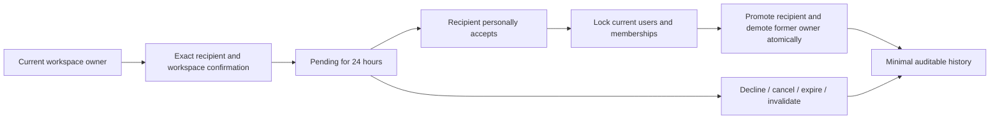

Actual component journey.

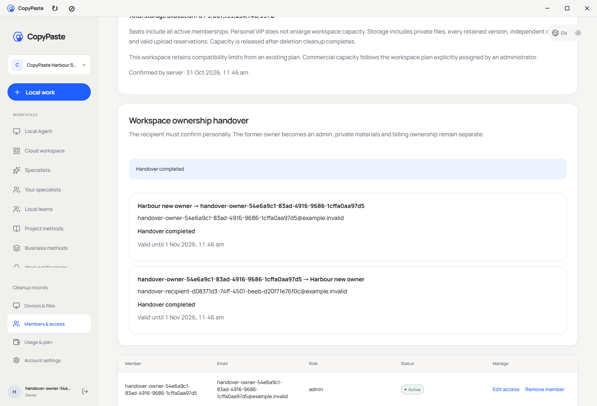


[Actual MP4](assets/screenshots/workmate-ownership-transfer-151-01-ownership-handover.mp4)

---

<!-- scope-erasure-150 -->

**Unreleased increment150 — permanent project/workspace cleanup**

Owners/admins open Projects, preview permanent deletion, type the exact name and acknowledge irreversibility and retention. Only owners delete a whole workspace. Admin Content management requires scoped deletion permission and recent MFA. Cleanup history remains accessible at /cleanup after the last workspace is removed. New work/source access is blocked immediately. In-flight executions close using real company usage; unknown charges remain held. Native Desktop runs Codex locally; Extension keeps its cloud agent and right Side Panel.

11 focused backend cases,6 actual client groups and3 targeted rebuild steps after8 all-client build steps passed. One unchanged expensive backup scenario was deliberately not repeated; its earlier individual pass and all original failures are retained. No broad regressions or paid models. Required billing/audit facts, shared identities, live references and customer-local copies follow explicit retention boundaries. Full export, all derivative/production recovery acceptance, real provider/advertising accounts and signing remain open. The first frozen v0.1.0-rc.1 tags and five archives are unchanged.

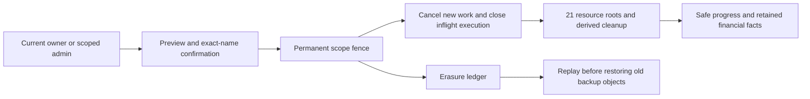

Actual component journey.


[Actual MP4](assets/screenshots/workmate-scope-erasure-150-04-scope-cleanup.mp4)

---

<!-- project-lifecycle-149 -->

**Current development increment149 — project management after frozen `v0.1.0-rc.1`**

Workspace owners/admins open Projects, filter Active/Archived/All, search and page, edit details, or explicitly confirm archive/restore. Archiving the last active project keeps the management page reachable. Restore reuses its identity, materials and existing grants; revoked access remains revoked. Ordinary members see only authorized active projects. Archive controls availability while archived; cancel work separately when termination is intended.

The management API checks current authority after lock waits, rejects stale expected state and makes lost-response retries return current state without reapplying obsolete changes. Web/Desktop reject stale list results and validate restored selections against the latest active list. Desktop continues running Codex locally with customer-controlled full permission; Extension remains a cloud agent client using Chrome's native right Side Panel for consented file upload.

Ten current backend cases, five actual client journey groups and six build steps passed. Four actual screenshots and two wall-clock GIF/MP4 pairs were recorded; owned resources closed. No AI request or broad historical regression was run. The original failed verification attempt is retained. Aggregate erasure, production integrations and full acceptance remain open. The original seven frozen tags and five release archives are unchanged;149 is an unreleased branch increment.

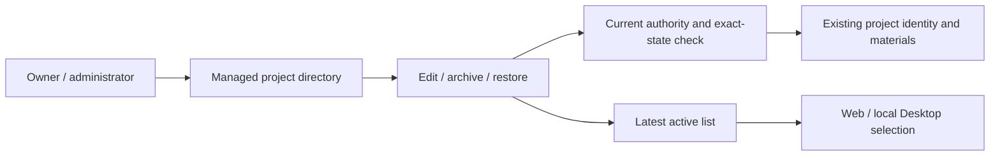

Actual current component journey.


[Actual MP4](assets/screenshots/workmate-project-lifecycle-149-01-project-archive-restore.mp4)

Current unsigned candidate: `release/project-lifecycle-149-01/win-unpacked/CopyPaste.exe`. The first frozen portable archive remains separate.

---

<!-- frozen-release-148 -->

**固定运行时准备 / Pinned runtime preparation**：`runtime:prepare` 不下载或查找 PATH。先解压本版 Windows 便携 ZIP，在 PowerShell 设置 `$env:COPYPASTE_LOCAL_CODEX_BIN` 为解压目录中的 `resources/local-codex/codex.exe` 绝对路径（保留旁边全部 helper 文件），再在 desktop 执行 `npm run runtime:prepare`。源码单独交付时，需自行提供与 `contracts/local-codex-runtime.json` 相符的同一组原生文件。首次启动会自动执行原生 PostgreSQL 迁移到145，无需容器。

`runtime:prepare` neither downloads nor searches PATH. Extract this release's Windows directory ZIP, set PowerShell `$env:COPYPASTE_LOCAL_CODEX_BIN` to its absolute `resources/local-codex/codex.exe` path, keep all sibling helpers, and run desktop `npm run runtime:prepare`. A source-only install must supply the exact locked native files. Native database startup applies schema145 automatically.

运行后访问 Web `http://localhost:4317`、Admin `http://localhost:4318`。本机开发验证码保存在 platform `.data/mailbox/`，不是公共邮件服务。另开终端在 platform 执行 `npm run admin:create -- admin@example.com super_admin`，按 `.data/enrolment/` 的一次性资料绑定认证器后删除该私密资料；不提供共享默认密码。Windows 包连接同一后端后使用浏览器登录。

Open Web at localhost4317 and Admin at localhost4318. Development OTP messages are in platform `.data/mailbox/`. In another terminal run platform `npm run admin:create -- admin@example.com super_admin`, enroll its one-time authenticator material, then delete that private enrollment file. No shared administrator password is provided.

**首个冻结候选版本 / First frozen candidate: `v0.1.0-rc.1`**

本版用于 Windows x64 本地试用，AI 提供方使用已获准的模拟数据。产品版本与各组件 package.json 版本独立。Web / Extension 在云端运行 Codex；Desktop 在客户本机运行固定版本 Codex，可由客户主动授予完整本机权限。Extension 保留 Chrome 原生右侧 Side Panel，负责获准文件读取与上传。管理后台保留独立管理员登录、用户/企业控制、费用/VIP/用量及内容权限。

This release candidate provides a Windows x64 local trial with explicitly synthetic AI providers. Product and component versions are independent. Web and Extension use cloud Codex; Desktop runs pinned Codex locally with customer-controlled full OS permission. Extension uses Chrome's native right Side Panel for conversation and consented file upload. Admin provides separate administrator authentication, account controls, billing/VIP/usage and content permissions.

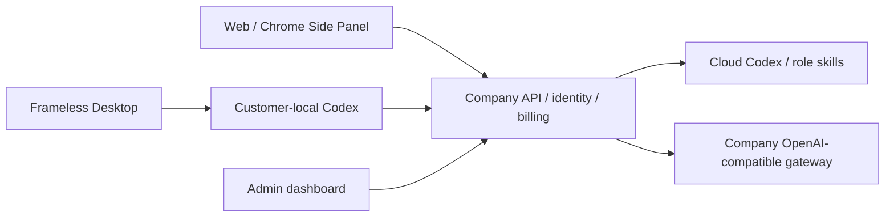

**首次启动 / First source startup**：六组件按 `copypaste-platform`、`copypaste-web`、`copypaste-admin`、`copypaste-desktop`、`copypaste-extension`、`copypaste-delivery` 放在同一父目录。要求 Windows x64、Node.js ≥22.14、Git、原生 .NET 构建工具；禁止 Docker/WSL。进入 delivery 执行 `npm run bootstrap`，在 desktop 执行 `npm run runtime:prepare`，回到 delivery 执行 `node scripts/start-frozen-demo-148.mjs`。该入口校验 Codex 版本及 SHA-256，避免使用系统 PATH 中的其他版本；停止用 `npm run stop`。管理员首次开户按 platform 已有 enrollment 命令创建独立管理员，勿使用客户登录代替。

Place all six named repositories under one parent. Run delivery `npm run bootstrap`, desktop `npm run runtime:prepare`, then delivery `node scripts/start-frozen-demo-148.mjs`. This entry verifies the pinned Codex binary instead of selecting an arbitrary PATH version. Stop with delivery `npm run stop`. Enroll an independent administrator using the platform's documented enrollment command.

**使用流程 / Journey**：浏览器打开 Web → 邮箱验证码 → 进入企业/项目 → 选择预设角色 → 提交任务并审核所需权限 → 查看结果、费用、下载。Desktop 配置同一后端，使用浏览器授权登录，再选择本机目录和权限。Chrome 在开发者模式加载 extension 的 `dist/`，点击扩展打开右侧面板、登录并主动选择上传文件。营销分析支持原始 CSV/XLSX 上传、明确数字/日期口径、字段映射、精确预览、确认和持久化分析快照；改变格式会撤销旧确认。

Open Web, verify email, select workspace/project and a role preset, review permissions, run a task and inspect results/usage/downloads. Desktop signs in through browser authorization and then selects local scope. Load Extension `dist/` unpacked in Chrome, click its action to open the native side panel, sign in and explicitly attach files. Marketing imports retain original bytes, require explicit conventions and mapping, preview exact facts and create a durable analysis snapshot; changing conventions clears confirmation.

**冻结依据 / Qualification**：当前后端 17 项必要检查通过；Web、Admin、Extension、Desktop 构建完成，Windows 未签名目录包已在真实窗口验证。当前 UI 冒烟覆盖 Web OTP、Desktop 原生 PKCE 和两端原文件→精确预览→分析快照，共 4 组旅程；保留 4 张实际截图、2 组实际 GIF/MP4。阶段147的真实本地/云端 Codex 与 Chrome 原生侧栏为历史证据，本轮未重复完整回归，也没有把模拟 AI 回复称作真实模型验收。

Seventeen focused backend checks passed. All client builds completed; the unsigned Windows directory package was exercised in a real window. Four current smoke groups cover Web OTP, native Desktop PKCE and actual original-file imports through durable snapshots, with four screenshots and two GIF/MP4 pairs. Stage147 local/cloud Codex and native Chrome Side Panel evidence stays historical. Broad regression was deliberately omitted at the user's request; synthetic model replies are not production model acceptance.

**边界 / Boundaries**：这是首个候选冻结版。生产内部 API/真实媒体和 Google/Meta 等账户联调、签名安装及更新、完整权限/故障/并发矩阵和全量验收仍待完成。项目/企业聚合整删尚未实现；归档项目的恢复权限路径需要修复，不能视为已支持。UTF-16 CSV 上传需 BOM；其他编码转换为 UTF-8。原有102项需求逐条记录保留，88项必需完整验收范围仍开放，并非88个模块完全未实现。

Production provider/account integration, signed installers/updates and comprehensive permission/failure/concurrency acceptance remain open. Aggregate project/tenant erasure is unimplemented; archived-project restoration still needs its access-path fix. UTF-16 CSV uploads require a BOM. All102 original requirement records remain, including88 open required full-acceptance scopes; this does not mean88 entirely missing modules.

冻结标签 / Frozen tags: `v0.1.0-rc.1` (docs), `v0.1.0-rc.1-backend`, `-web`, `-admin`, `-desktop`, `-extension`, `-delivery` (full tag prefix for each component). Each tag identifies a complete independent Git history; compact release source archives omit historical evidence/media, which remain available in Git.

实际 Desktop 窗口 / Actual Desktop window


[Actual MP4](assets/screenshots/workmate-marketing-release-148-04-reviewed-marketing-import.mp4) · [Saved analysis](assets/screenshots/workmate-marketing-release-148-04-durable-analysis-snapshot-en.png)

---

<!-- business-history-stage144 -->

<!-- workflow-handoff-stage145 -->
## Stage145: complete handoffs and failure review

The trusted local sequencer validates input/failure review while retaining local Codex and the existing OS grant.

A consultant prepares a frozen version. The customer reviews its inputs, budget and failure policy before execution, then downloads original files. A known settled failure can await explicit skip approval, preserving charges and the overall failure without an automatic retry.

39 backend cases, 12 trusted native-runner cases and seven actual Web journeys passed with explicitly synthetic model responses. Production integration and complete native Codex/OS acceptance remain open. Default Desktop tests retain historical files and select the current revision.

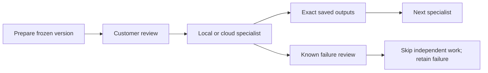

[Full design and usage](https://github.com/copypasteltd/workmate/blob/docs/docs/development/145-workflow-handoffs-and-failure-review.md) · [Original 102-item ledger](https://github.com/copypasteltd/workmate/blob/docs/docs/quality/remaining-work-stage145.md)

The following is an actual Web customer workflow shared as a release illustration, not a client-specific screen.


[MP4](assets/screenshots/workmate-workflow-handoff-145-03-exact-workflow-handoff.mp4)

## Administrator business histories

Stage144 adds administrator saved-version reading for brands, teams, briefs, schedules and every creative project kind. Ordinary canvas saves now retain immutable versions; new customer brand saves preserve their actor. Current checks: 52 related backend cases and 9 real Admin browser journeys. The capture below is the actual administrator interface shared by this release.

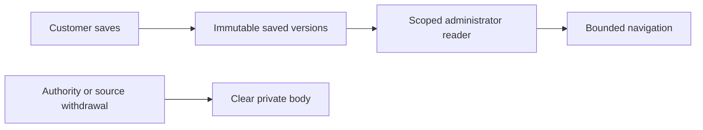


[MP4](assets/screenshots/workmate-business-history-144-01-business-version-navigation.mp4) · [详细方案 / Usage and implementation](https://github.com/copypasteltd/workmate/blob/docs/docs/development/144-admin-business-content-history.md)

Use Client content → Read content → Newest/Oldest/Next/Previous. Expand a saved record for its exact definition. Reads require both content permissions and current project scope; revoked dependencies redact the body. Earlier unsaved versions are not invented. Desktop keeps customer-local Codex execution and Extension keeps its actual browser Side Panel. Original whole-product acceptance remains open.

<!-- editable-projects-stage143 -->

Vector and presentation workspaces now support exact-source creation, text/page/notes editing, saved history, actual SVG/PNG/PDF/PPTX delivery and portable ZIP restoration. Imported chart values require their own acknowledgement; destination brand review remains explicit. Preview/save operations queue safely, and administrative deletion clears workspace history and physical derived files.

42 related checks and real Web, frameless Windows and native Chrome right Side Panel journeys passed. Synthetic model/business fixtures; actual native auth/render/storage. Windows package unsigned; complete professional-format, Office and cross-machine acceptance stays open. [方案与使用 / Design and usage](https://github.com/copypasteltd/workmate/blob/docs/docs/development/143-editable-project-workspaces.md).

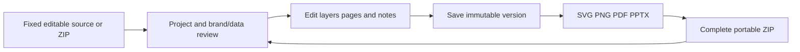

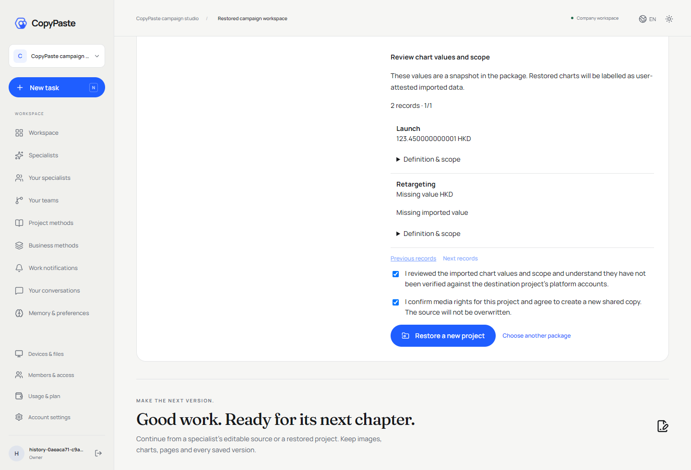

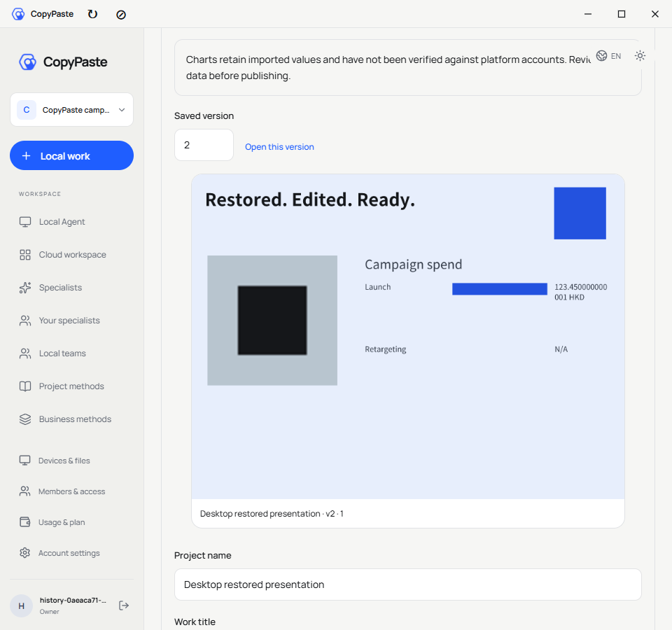

[Actual interaction recording](assets/screenshots/workmate-editable-projects-143-04-project-restore.mp4)

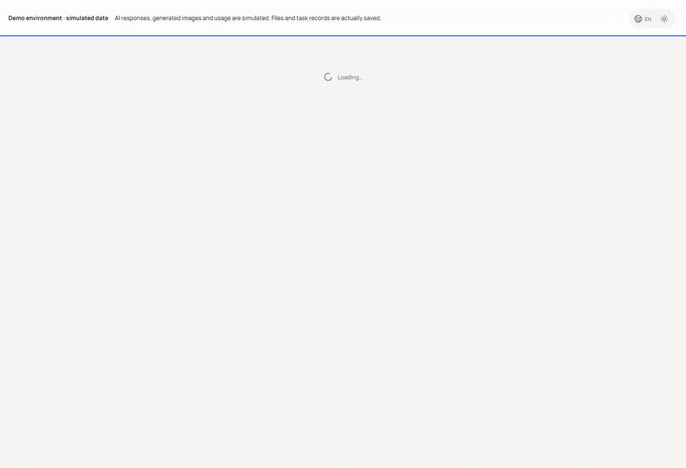

<!-- brand-reuse-stage142 -->

Reuse a brand canvas in another project by selecting a fixed destination brand, mapping fonts, price/promotion facts, Logos and optional colors, reviewing actual changes and explicitly approving a new copy. Web/Desktop continue editing, render PNG/PDF/SVG and export again; Extension uploads, reviews and restores inside its native right Side Panel. Font outlining now preserves source images and shape order in brand/vector/presentation output.

62 related checks and actual three-client journeys passed with5 screenshots and3 recording pairs bound to the sources. Synthetic data; no model requests; unsigned Windows package. All-format restoration, cross-machine and configured-provider acceptance remain open. [方案 / Guide](https://github.com/copypasteltd/workmate/blob/docs/docs/development/142-brand-project-reuse.md).

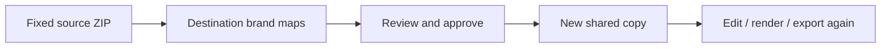

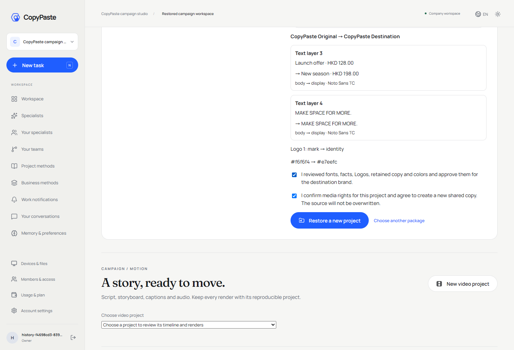

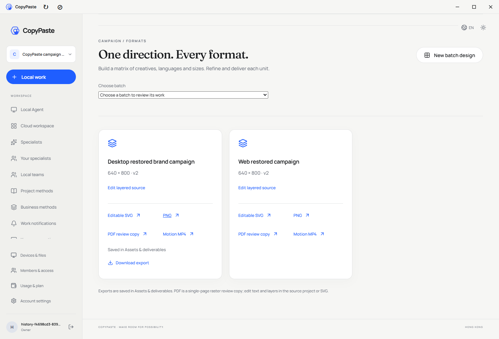

[Actual interaction MP4](assets/screenshots/workmate-creative-brand-142-02-project-restore.mp4)

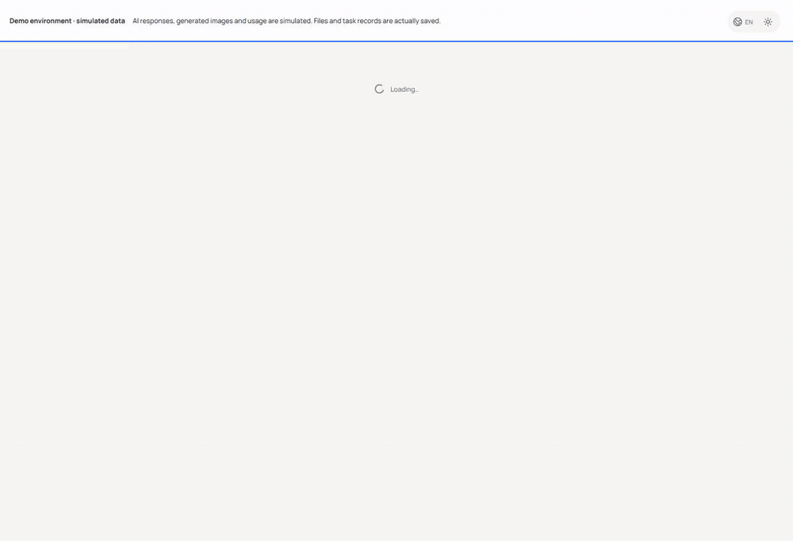

# Workmate · CopyPaste Enterprise Agent · desktop

<!-- creative-packages-stage140 -->
## Project packages & restore · Stage140

The frameless Desktop restores video sources and the pinned font, edits the script, re-renders MP4 and saves a complete project ZIP through a native dialog. Codex execution and customer OS permissions retain the existing local workflow.

Export and restore make no AI request. Confirm project sharing before upload and media rights before restoring. Sources remain intact; an interrupted restore retains its original receipt. The supported slice covers ordinary layered canvases and campaign-cuts videos. Canvas system-font differences, brand rebinding, all-format and cross-machine restoration remain open.

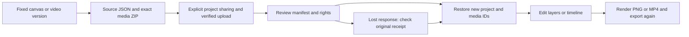

- [Format, APIs & usage / 格式、接口及使用](https://github.com/copypasteltd/workmate/blob/docs/docs/development/140-creative-project-packages.md)
- [Actual qualification / 实际验证](https://github.com/copypasteltd/workmate/blob/docs/docs/quality/creative-packages-checkpoint-140.json)
- [Open acceptance scopes / 未完成验收](https://github.com/copypasteltd/workmate/blob/docs/docs/quality/remaining-work-stage140.md)


- [Actual web interaction .MP4](https://github.com/copypasteltd/workmate/blob/web/assets/screenshots/workmate-creative-packages-140-07-project-restore.mp4)
- [Actual web interaction .GIF](https://github.com/copypasteltd/workmate/blob/web/assets/screenshots/workmate-creative-packages-140-07-project-restore.gif)
- [Actual desktop interaction .MP4](https://github.com/copypasteltd/workmate/blob/desktop/assets/screenshots/workmate-creative-packages-140-07-project-restore.mp4)


- [Actual desktop interaction .GIF](https://github.com/copypasteltd/workmate/blob/desktop/assets/screenshots/workmate-creative-packages-140-07-project-restore.gif)
- [Actual extension interaction .MP4](https://github.com/copypasteltd/workmate/blob/extension/assets/screenshots/workmate-creative-packages-140-07-project-restore.mp4)
- [Actual extension interaction .GIF](https://github.com/copypasteltd/workmate/blob/extension/assets/screenshots/workmate-creative-packages-140-07-project-restore.gif)

<!-- native-teams-stage139 -->
## Native specialist teams · Stage139

Open Local teams, choose a coordinator and members, then enter the brief, step dependencies and budgets. Review selects a native folder and permission. After approval, separate Codex members execute on the customer computer; the coordinator starts only after actual member deliveries finish. Open member sessions to answer questions. New assignments require a new review. Stop or revoke the whole team, then download the completed team delivery.

Up to 16 steps, seven members plus one assistant coordinator and three concurrent members share one explicitly approved folder. Keep concurrent edits in separate files. Review is free; exact budgets are immutable, holds and actual charges remain separate, and unknown accepted operations are never rerun. Revocation stops native tools first and leaves unsynchronized receipts visible. Only submitted outputs enter the team ZIP; local-only files remain local.

60 backend, 36 extension and 81 native controller/download checks, plus six actual Windows journey checks passed. Four screenshots, one GIF/MP4 pair, three layouts and an independently extracted complete team archive bind 1756 exact source files.

Business/model responses and native folder/consent/save decisions are controlled fixtures. Actual OTP/PKCE, native Codex processes, Windows file operations, company metering, revocation and ZIP extraction execute for real. The package is unsigned. Full professional-role quality, signed installation coverage, real company models/ad accounts and portable project recovery remain separately open.

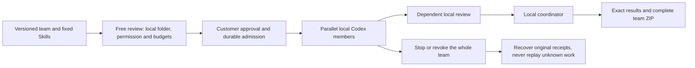

[Requirements](https://github.com/copypasteltd/workmate/blob/main/docs/requirements/16-desktop-native-teams.md) · [API, permissions, recovery and delivery](https://github.com/copypasteltd/workmate/blob/main/docs/technical/139-desktop-native-teams.md) · [Source and evidence](https://github.com/copypasteltd/workmate/blob/main/docs/quality/native-teams-checkpoint-139.json) · [All original identities](https://github.com/copypasteltd/workmate/blob/main/docs/quality/remaining-work-stage139.md)

Actual Desktop workflow, synthetic business content:


- [workmate-native-teams-139-05-review-before-local-run-en.png](https://github.com/copypasteltd/workmate/blob/desktop/assets/screenshots/workmate-native-teams-139-05-review-before-local-run-en.png)
- [workmate-native-teams-139-05-completed-local-team-zh.png](https://github.com/copypasteltd/workmate/blob/desktop/assets/screenshots/workmate-native-teams-139-05-completed-local-team-zh.png)
- [workmate-native-teams-139-05-whole-team-access-revoked-zh.png](https://github.com/copypasteltd/workmate/blob/desktop/assets/screenshots/workmate-native-teams-139-05-whole-team-access-revoked-zh.png)
- [workmate-native-teams-139-05-local-team.mp4](https://github.com/copypasteltd/workmate/blob/desktop/assets/screenshots/workmate-native-teams-139-05-local-team.mp4)

<!-- delivery-revision-stage138 -->
## Source-bound revisions and new delivery · Stage138

After local work completes, open its delivery review and request changes. The new work uses the current local grant, original folder and exact Codex thread, and executes Codex on the customer computer. Grants are revocable and revision dispatch records survive restart. Frameless presentation, no Electron menu and no visible scrolling rails are retained. A cloud Agent never substitutes for local execution.

Choose a complete delivery, answer, file, Unicode text quote, image region or verified video interval. Previewing does not call AI or reserve money. Confirming a revision creates a separate budgeted task with the fixed original role and source; original files and charges remain. Changed or withdrawn sources fence later reads and completion. Shared project editors may revise authorized shared work; private conversations retain their original owner. Unknown-outcome retries retain their original immutable request.

Text previews are limited to 1 MiB and inline image/MP4 previews to 4 MiB. Larger or unsupported previews can still be downloaded and revised as complete files. Complete-delivery references allow at most 20 files; video intervals require retained valid duration. Image/video anchors identify requested locations and do not approve an editing operation or prove professional output quality. Specialist workflows retain their own approvals.

34 current backend checks including 13 new revision cases, 36 extension checks, 73 native controller/download checks and nine actual client journey checks passed. Eleven actual screenshots, three GIF/MP4 pairs, seven layouts and three independently extracted revised archives bind 1732 exact source files.

Business/model responses and native dialog selections are explicitly controlled fixtures. Login, database permissions, exact files, actual packaged local Codex, native Windows surfaces, Chrome SIDE_PANEL and revised ZIP downloads run for real. The Windows package is unsigned. Real company models/accounts, full professional-role output quality, installation matrices and complete project recovery remain separately open.

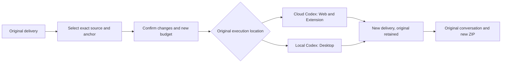

[Requirements](https://github.com/copypasteltd/workmate/blob/main/docs/requirements/15-delivery-revisions.md) · [Architecture and usage](https://github.com/copypasteltd/workmate/blob/main/docs/technical/138-source-bound-delivery-revisions.md) · [Exact source and evidence](https://github.com/copypasteltd/workmate/blob/main/docs/quality/delivery-revision-checkpoint-138.json) · [All original identities](https://github.com/copypasteltd/workmate/blob/main/docs/quality/remaining-work-stage138.md)

Actual product interaction, with synthetic business content:


Additional actual screenshots and MP4 recording:

- [workmate-delivery-revision-138-06-local-revision-zh.png](https://github.com/copypasteltd/workmate/blob/desktop/assets/screenshots/workmate-delivery-revision-138-06-local-revision-zh.png)
- [workmate-delivery-revision-138-06-local-revised-delivery.png](https://github.com/copypasteltd/workmate/blob/desktop/assets/screenshots/workmate-delivery-revision-138-06-local-revised-delivery.png)
- [workmate-delivery-revision-138-06-delivery-revision.mp4](https://github.com/copypasteltd/workmate/blob/desktop/assets/screenshots/workmate-delivery-revision-138-06-delivery-revision.mp4)

<!-- delivery-package-stage137 -->
## Complete delivery and original-chat download · Stage137

The main journey is goal → missing inputs → execution → review → download → revision in the original conversation. Web and the genuine native Chrome right SIDE_PANEL now download a complete current task delivery directly from chat. Delivery review also exposes it. Desktop uses the company API and its native save dialog; cancellation sends no export request and shows no success. Panel receipts survive live refresh and language changes.

The ZIP contains actual output files, task text when present, exact task/artifact versions, SHA-256 checksums and bilingual editing instructions. Identical filenames remain separate; stopped/failed task outputs remain explicitly partial. Instructions distinguish source ZIPs, SVG/PPTX, project JSON and flattened outputs. They never invent a missing editable project. Local files not submitted remain local, and Desktop continues running its own local Codex with customer-granted permissions.

The requested task version and delivery digest must match. The backend verifies real file size and digest while streaming sequentially into a disk-backed ZIP, then repeats current authority, source, retention and version checks before sending any download headers. Corruption, revocation or a changed delivery fails the whole package. Project readers may download authorized shared results; approval remains separate. Admin identity alone does not grant private conversation access. Exporting creates no AI call, new task or AI charge. Capacity is 16 GiB / 10,000 output/text entries; excess is rejected without silent omissions.

No new SQL migration is needed beyond existing SQL135. Rebuild Backend and all three clients. Extension adds Chrome `downloads` permission and uses the browser download location with conflict renaming; authorization stays in company request headers. Backend `contracts/delivery-package-v1.json` specifies the endpoint. From Delivery run `npm run qa:delivery-package-backend -- <new two-digit attempt>` or `npm run qa:delivery-package -- <new two-digit attempt>`; the latter performs full builds, creates an unsigned Windows package and drives actual native client downloads.

21 current backend checks including eleven new export cases, 37 extension checks, 1 native download regression, twelve boundary checks and ten actual client journey checks passed. Nine actual screenshots, three GIF/MP4 pairs, seven layouts and three independently extracted archives bind 1,713 exact source files. Business content and the Codex adapter are controlled; OTP/PKCE, stored files, authorization, native windows and Chrome downloads run for real. Desktop save-dialog selection is directed to an owned fixture destination. This increment does not requalify every local Codex tool, real company model, professional output quality or full project restoration across environments. A separate stage-local 52-case backend/source regression retains its exact original scope rather than being presented as a full current-platform rerun.

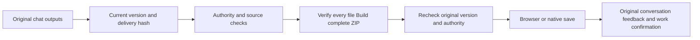

[Requirements](https://github.com/copypasteltd/workmate/blob/main/docs/requirements/14-complete-delivery-package.md) · [Architecture and usage](https://github.com/copypasteltd/workmate/blob/main/docs/technical/137-complete-delivery-package.md) · [Exact source and evidence](https://github.com/copypasteltd/workmate/blob/main/docs/quality/delivery-package-checkpoint-137.json) · [All original identities](https://github.com/copypasteltd/workmate/blob/main/docs/quality/remaining-work-stage137.md)

Actual customer workflow captures (synthetic content):


<!-- business-inputs-stage136 -->
## Business questions and original-task continuation · Stage136

When an essential canvas size, audience or business definition is missing, the Agent can ask in the original conversation. Customers may choose and edit a suggestion or write a different answer, then explicitly confirm it. Nothing is preselected or automatically submitted. Partial answers remain saved; completing all inputs continues the same task, conversation and original budget hold. Measured usage is settled cumulatively. Each confirmed question becomes one original-conversation note; identical retry adds no duplicate.

Web and the actual native Chrome right Side Panel show these questions inside the existing chat; Desktop supports answers in its existing cloud-task detail view. English/Traditional Chinese switching preserves drafts and a failed submission retains its text. Extension clears drafts on identity/conversation changes and removes protected questions when sources become unreadable. An answer grants no files, advertising accounts, tools, local access or additional spending permission.

The server strictly distinguishes `question`, `file` and `connection`: up to eight suggestions and 4,000 answer characters, with version, current authority, source and complete-batch validation before any update. Confirmed answers are immutable. Paid questions wait at a completed, measured Codex boundary and resume the original thread; cancellation settles known usage only. Private-conversation erasure removes questions, answers, checkpoints and text while retaining necessary accounting facts.

Apply SQL135 before API/Worker startup with Backend `npm run db:migrate`. Original SQL001–134, twenty baseline task definitions and the primary OpenAPI remain byte-identical. `contracts/business-inputs-v1.schema.json` adds strict versioned definitions to the existing create/input endpoints. File/connection requests retain their shape; questions use `answer` rather than `resource_ids`.

122 backend integration checks (including eleven new question cases), 61 extension state checks, twelve delivery binding tests and fourteen actual three-client checks passed. Nine actual screenshots, three GIF/MP4 pairs and seven layout checks bind to exact sources. Native integration uses the actual pinned Codex executable with synthetic Responses; UI journeys use scripted tools and synthetic business replies. Initial full client builds passed. Corrected journeys explicitly reuse byte-identical product source and the same unsigned Windows package; original failures remain. From Delivery, run `npm run qa:business-inputs-backend -- <new two-digit attempt>` or `npm run qa:business-inputs -- <new two-digit attempt>`; the latter performs full builds and creates an isolated native test database.

Desktop retains its separate local Codex and explicitly granted full-local-permission flow; this increment extends its cloud-task view. Actual native windows remain frameless with no Electron menu, visible vertical rails or horizontal overflow. Extension retains the genuine native right SIDE_PANEL. Data are synthetic and the Windows package is unsigned. Production models and complete specialist delivery remain open. Full acceptance retains 88 required records, twelve unconfirmed suggestions and one optional record; original REQ-095 remains accepted.

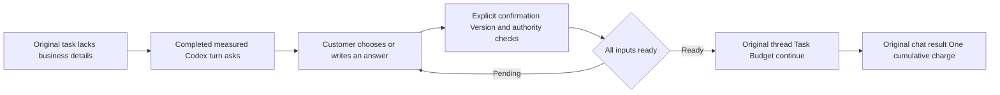

[Requirements](https://github.com/copypasteltd/workmate/blob/main/docs/requirements/13-business-brief-inputs.md) · [Implementation and usage](https://github.com/copypasteltd/workmate/blob/main/docs/technical/136-business-brief-clarification.md) · [All 102 identities](https://github.com/copypasteltd/workmate/blob/main/docs/quality/remaining-work-stage136.md) · [Exact source and evidence](https://github.com/copypasteltd/workmate/blob/main/docs/quality/business-inputs-checkpoint-136.json)


<!-- client-errors-stage135 -->
## Connection and session recovery across four clients · Stage135

Web, Admin, Desktop and Extension show connection guidance in the current language while retaining valid sign-in. A write with a lost or unreadable reply is explicitly unconfirmed: check its result before retrying. The application does not retry the write automatically. Browser transport retransmissions retain the same message identity and are deduplicated by the server. Support grants retain their fixed request key and deadline; extension delegations retain their original message identity, so explicit retry creates no second task. Background polling preserves an unconfirmed-write notice. Switching English/Traditional Chinese updates the same notice without exposing Electron internals, URLs or response bodies.

A current protected HTTP401 clears the current identity even when the body is HTML or empty. An obsolete request cannot sign out a newer identity or replace its CSRF token. Admin immediately removes its independent shell. Support-list connection errors are separate from form and revoked-access notices; successful list recovery clears only its own connection notice.

15 transport/identity tests (including actual HTTP faults), 12 delivery-file binding tests, one native bridge test and 30 actual four-client journey checks passed. Twenty screenshots and seven actual GIF/MP4 pairs bind to exact sources, including a real right-docked Chrome SIDE_PANEL, customer OTP/PKCE, independent administrator TOTP and an actual committed extension write with a lost reply and identical-message retry. Attempt09 rebuilds current Extension and Delivery. Backend/Web/Admin/Desktop source and Windows package bytes exactly match full build02, whose ten corresponding build steps and unchanged-source unit results are explicitly reused. Original failed attempts remain. Delivery `npm test` includes strict compilation, binding and transport checks; `npm run qa:client-errors -- <new two-digit attempt>` performs a full build by default.

Desktop continues to run Codex locally with separate explicit local permission, a frameless window, no Electron menus or visible rails. Extension keeps the native Chrome toolbar/Side Panel, approved-file uploads and cloud execution. Business fixtures are synthetic, no models ran and the Windows package is unsigned. Full acceptance still has 88 required records, 12 unconfirmed suggestions and one optional record open; original REQ-095 remains accepted.

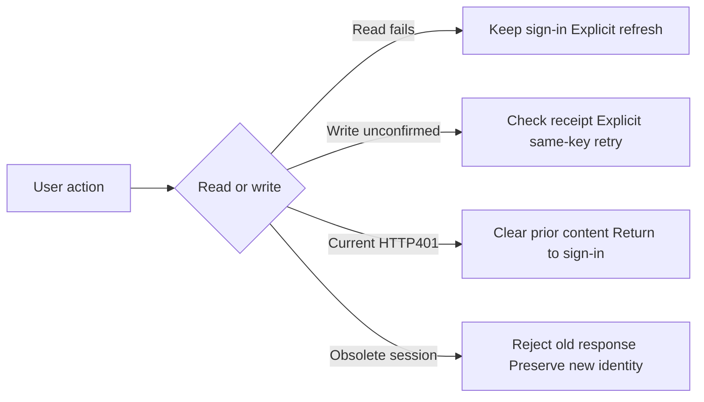

[Behavior and implementation](https://github.com/copypasteltd/workmate/blob/main/docs/technical/135-client-connection-and-session-recovery.md) · [All 102 requirement identities](https://github.com/copypasteltd/workmate/blob/main/docs/quality/remaining-work-stage135.md) · [Source-bound verification](https://github.com/copypasteltd/workmate/blob/main/docs/quality/client-errors-checkpoint-135.json)


<!-- support-recovery-stage134 -->
## Safe support-grant recovery and accepted support scope · Stage134

In **Web or Desktop → Account settings → Time-limited support**, choose explicit projects, the reason and duration. An empty project selection means metadata only. The first submission now fixes its request key and deadline. If its response is lost, use **Check previous request** or retry the same details; refreshing retrieves the existing result without automatically submitting again. Different details cannot replace an unresolved request. A recovered grant shows its current active, revoked or expired state and never gains extra time. You can revoke it from the list at any time.

Recovery stores only an opaque key, an intent digest and the fixed deadline in the current browser session. It does not persist the reason, project IDs, content or credentials. With storage disabled, recovery is limited to the running renderer; committed grants remain visible in the server list. Switching accounts or workspaces prevents late results from filling the new form. The native Desktop bridge permits only the customer receipt GET, alongside existing customer grant operations; it exposes no administrator impersonation route.

**Original REQ-095 / TC-095 is now accepted** against twelve individually mapped conditions and current source-bound evidence: real administrator identity and a read-only banner, explicit scope, independent body permission, write/payment/VIP/credential refusal, no hidden customer login, real-clock expiry, revocation and audit failure rollback. This closes one original requirement. REQ-055 whole-platform accessibility and REQ-094 whole-platform permission/concurrency matrices remain separate open work.

65 related backend checks, one native bridge boundary check and 18 actual Admin/Web/packaged Desktop journey checks passed. Ten build commands passed. The evidence includes real HTTP response loss before/after commit, reload, an actual workspace switch, identical retries, current-receipt recovery, real expiry and native customer revocation; user/native sessions, refresh-token and native-code row counts remain unchanged during support activity. Nine screenshots and five actual GIF/MP4 pairs are bound to the exact sources. Support controls work with keyboard input and enlarged text; Web/Admin use CSS zoom=2 and Desktop uses actual native webContents zoom=2. This does not constitute full browser/screen-reader accessibility acceptance.

Desktop continues to run Codex on the customer's computer, with separate explicit full local permission and a frameless window without Electron menus or visible scroll rails. Extension retains the native Chrome Side Panel for approved file uploads and cloud execution. Models did not run; business fixtures and retained output are synthetic. The Windows package is unsigned. All owned test browsers, native clients and databases closed.

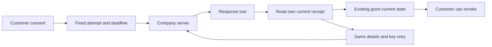

[方案 / Behavior](https://github.com/copypasteltd/workmate/blob/main/docs/technical/134-support-grant-recovery-and-acceptance.md) · [TC-095 acceptance](https://github.com/copypasteltd/workmate/blob/main/docs/quality/tc095-acceptance-134.json) · [Checkpoint](https://github.com/copypasteltd/workmate/blob/main/docs/quality/support-recovery-checkpoint-134.json) · [完整编号清单 / Remaining work](https://github.com/copypasteltd/workmate/blob/main/docs/quality/remaining-work-stage134.md)

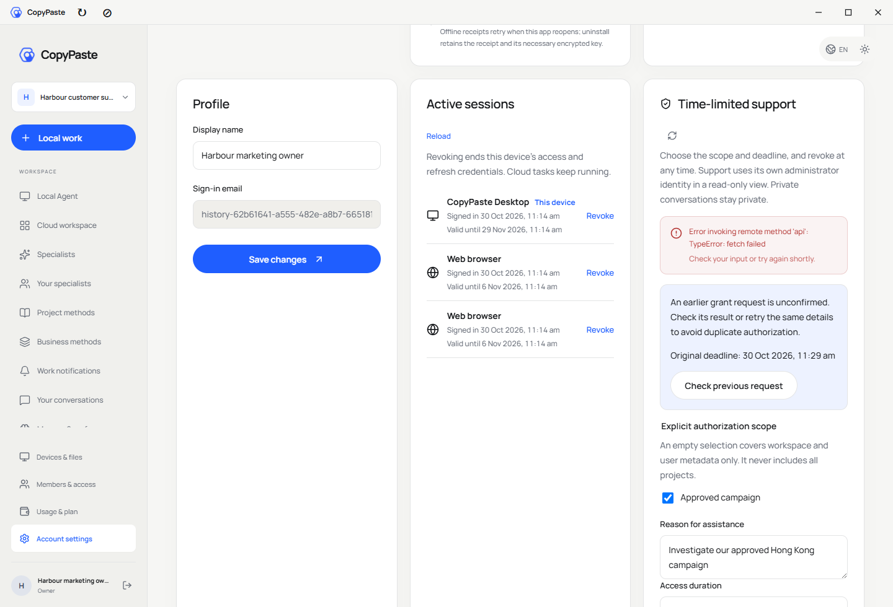


[Recovery recording](https://github.com/copypasteltd/workmate/blob/web/assets/screenshots/workmate-support-recovery-134-04-grant-result-recovery.mp4) · [Retry recording](https://github.com/copypasteltd/workmate/blob/web/assets/screenshots/workmate-support-recovery-134-04-fixed-intent-retry.mp4) · [Native grant](assets/screenshots/workmate-support-recovery-134-04-customer-grant.mp4) · [Native revocation](assets/screenshots/workmate-support-recovery-134-04-customer-revocation.gif) · [200% Admin](https://github.com/copypasteltd/workmate/blob/admin/assets/screenshots/workmate-support-recovery-134-04-support-en-200.png) · [Chinese dark Admin](https://github.com/copypasteltd/workmate/blob/admin/assets/screenshots/workmate-support-recovery-134-04-support-zh-dark.png)

One requirement is accepted; 88 required records, 12 unconfirmed suggestions and one optional record remain open. These are acceptance records, not 101 uncoded modules. Complete source-delivery reproduction, signed installation, production integration and the remaining business acceptance continue in the numbered ledger. Earlier sections retain their original historical scope.

---

<!-- support-access-stage133 -->
## Controlled support and native customer authorization · Stage133

In **Web or Desktop → Account settings → Time-limited support**, choose the actual projects, a reason and a 15/30/60-minute deadline. An empty selection grants workspace/customer metadata only. Share the grant ID with support and revoke it from the same customer form at any time.

In **Admin → Support**, the administrator signs in with their own email and TOTP, chooses the customer, workspace, explicit projects, deadline and optional customer grant. The read-only banner keeps the real identities and deadline visible. Shared task bodies also require independent current body permission; private conversations stay private. The view provides no editing, billing, VIP or customer-login authority.

Support now checks original task sources before returning retained text. A quarantined/expired source or erased version blocks the body and masks its diagnostic title. Selected bodies use a current revision condition; changes during the audit are rejected. The page cancels old requests, rejects late task/session replies and clears bodies on changed revisions, source withdrawal, hidden views, failure, revocation or expiry. The server decides access on every read; visible Admin polling is approximately two seconds.

59 related backend tests and 13 actual Admin/Web/packaged native Desktop journey checks passed. The current source bytes bind 6 screenshots and 3 real-time GIF/MP4 pairs. Actual OTP/PKCE, email/TOTP, customer grants/revocation, delayed authorized responses, source withdrawal, real expiry, Chinese dark theme, four Admin widths and three frameless native widths were exercised. All owned browsers, the native client and test databases closed. Models did not run; business data, retained results and fixture file reads are explicitly synthetic. The Windows package remains unsigned.

Desktop continues to run Codex locally with the customer's separate explicit local-permission flow. Its support form uses customer-only routes; the administrator view stays in Admin. Extension continues to use the native Chrome Side Panel for approved file uploads and cloud execution. This increment changes no Extension execution code.

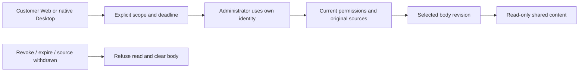

[Behavior](https://github.com/copypasteltd/workmate/blob/main/docs/technical/133-controlled-support-source-and-native-access.md) · [Checkpoint](https://github.com/copypasteltd/workmate/blob/main/docs/quality/support-access-checkpoint-133.json) · [Numbered remaining work](https://github.com/copypasteltd/workmate/blob/main/docs/quality/remaining-work-stage133.md)

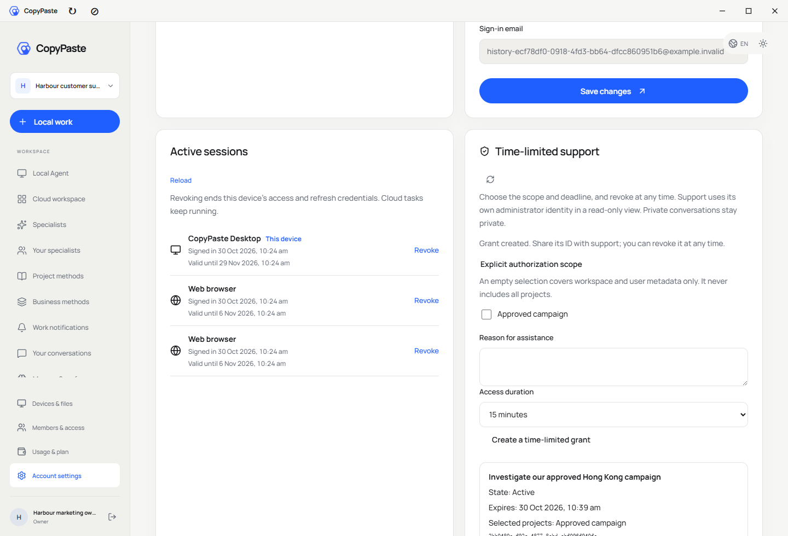


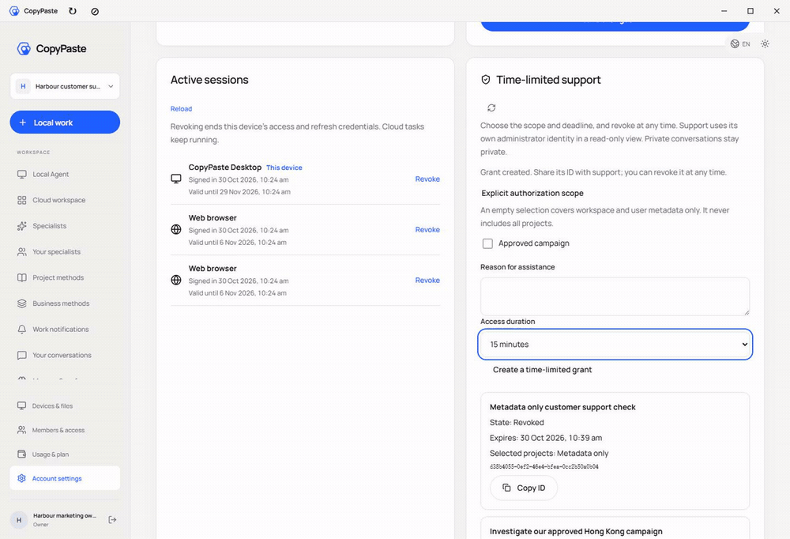

[Native grant recording](assets/screenshots/workmate-support-access-133-02-customer-grant.mp4) · [Selection recording](https://github.com/copypasteltd/workmate/blob/admin/assets/screenshots/workmate-support-access-133-02-task-selection.mp4) · [Revocation recording](assets/screenshots/workmate-support-access-133-02-customer-revocation.mp4) · [Web metadata-only grant](https://github.com/copypasteltd/workmate/blob/web/assets/screenshots/workmate-support-access-133-02-metadata-grant-en.png) · [Chinese dark Admin](https://github.com/copypasteltd/workmate/blob/admin/assets/screenshots/workmate-support-access-133-02-support-zh-dark.png) · [Source withdrawn](https://github.com/copypasteltd/workmate/blob/admin/assets/screenshots/workmate-support-access-133-02-source-withdrawn-en.png)

89 required full-acceptance records, 12 unconfirmed suggestions and 1 optional record remain open. They are not 102 uncoded modules. Full permission/concurrency matrices, all-page accessibility, signed installation and production integration remain in the numbered ledger. Earlier sections retain their original historical scope.

---

<!-- durable-receipt-stage131 -->
## Durable native result and billing receipt synchronization · Stage131

A completed local child keeps its original result when the company finish request is not delivered or its acknowledgement is lost after settlement. The parent cannot clear the operation until the child receipt is acknowledged. Choose **Sync saved receipts** after reconnecting. This also works after withdrawing local access and fully quitting and reopening the app, without replaying commands, starting QA or making another model request.

The known child settles once using company-observed usage. An unknown parent retains its original budget hold for reconciliation. Receipt synchronization does not establish overall workflow success or clear uncertain local side effects. Account and server authorization remain enforced; another login family or tenant permission cannot be bypassed.

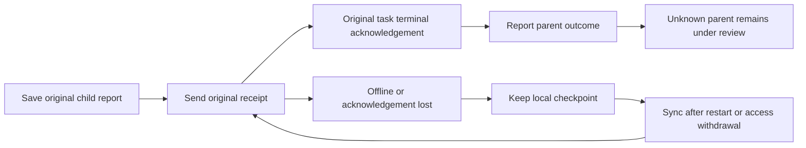

Bounded validation passed: 124 controller checks including 15 new receipt boundaries, 43 actual pinned-Codex checks, three actual native/SQL receipt-loss journeys, two compiler checks and eight actual unsigned packaged-Desktop checks. An old/current comparison reproduces the lost child finish request on the old code and verifies child-before-parent delivery on the new code. Processes, commands, files, SQL, dropped HTTP responses and a full application restart are actual; model responses and native dialog choices are synthetic. All owned test resources were closed. Original failures, executed QA and source snapshots remain preserved.

[Implementation](https://github.com/copypasteltd/workmate/blob/main/docs/technical/131-desktop-durable-receipt-sync.md) · [Current checkpoint](https://github.com/copypasteltd/workmate/blob/main/docs/quality/receipt-sync-checkpoint-131.json) · [Complete numbered open work](https://github.com/copypasteltd/workmate/blob/main/docs/quality/remaining-work-stage131.md)

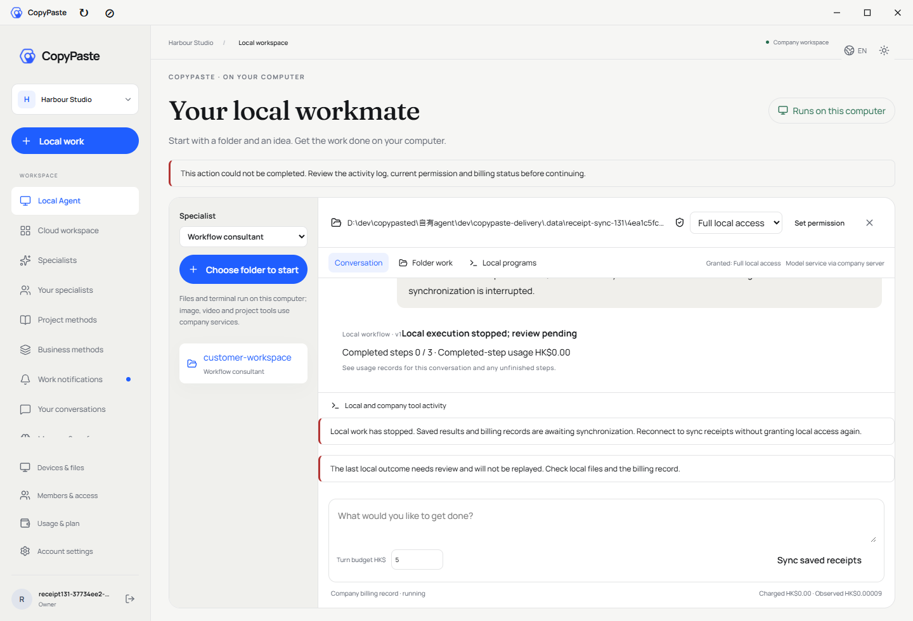


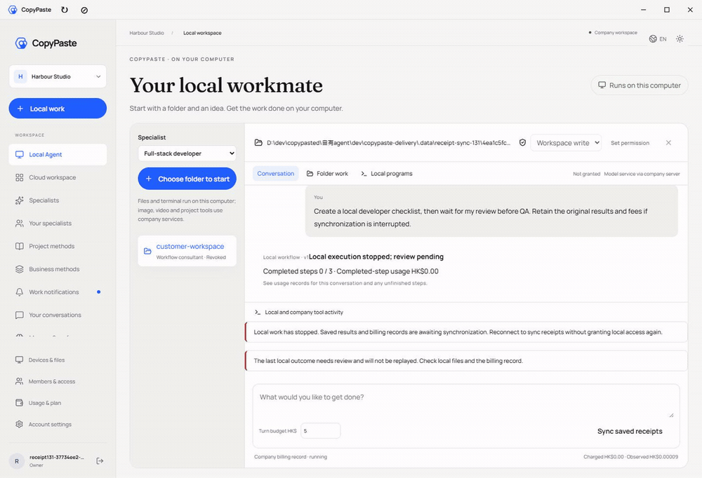

[Fee confirmation](assets/screenshots/workmate-receipt-sync-131-01-child-fee-confirmation-en.png) · [撤权后中文提示](assets/screenshots/workmate-receipt-sync-131-01-revoked-receipts-pending-zh.png) · [Original receipts synchronized](assets/screenshots/workmate-receipt-sync-131-01-original-receipts-synchronized-en.png) · [Loss/withdrawal MP4](assets/screenshots/workmate-receipt-sync-131-01-receipt-loss-and-permission-withdrawal.mp4) · [Restart/sync MP4](assets/screenshots/workmate-receipt-sync-131-01-receipt-sync-after-application-restart.mp4)

The full-acceptance ledger retains 89 required, 12 unconfirmed suggestion and one optional records; these are not 102 uncoded modules. Arbitrary crash/process reclamation, login-family changes, complete parent accounting reconciliation, professional roles, live model/media services and signed installation remain open. This increment uses the independent Stage131 manifest/publisher; Stage128 and130 evidence retains its original historical scope.

```powershell
node scripts/qualify-receipt-sync-v1.mjs unit 11
node scripts/qualify-receipt-sync-v1.mjs native 12
node scripts/qualify-receipt-sync-v1.mjs types 13
```

Prepare the pinned Codex runtime first. Use fresh two-digit attempt numbers; never overwrite original evidence.

---

<!-- workflow-recovery-stage130 -->
## Customer-local workflow recovery and cancellation · Stage130

Task shutdown and normal completion now retire each parent/child background authority watcher independently. An uncooperative heartbeat transport cannot keep cleanup waiting or resume execution through a late response. Retiring a watcher does not cancel a normally completing parent; fresh current-authority checks still precede native turn admission.

Customer flow: browser sign-in and company workspace → choose a local folder and explicitly grant access → confirm separate child limits → local developer work → human review of actual files → local QA → private SOP, frozen JSON and recovery-note downloads. Actual developer initialization and QA thread-start faults each recover once, only after durable company proof of zero admissions. Original tasks, holds, deadlines and worker attempts remain.

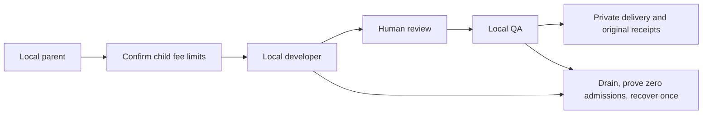

Bounded checks passed: 109 controller checks, 43 actual pinned-Codex checks, three complete native parent/child journeys, two current compiler checks and eight actual unsigned packaged-UI checks. Electron, native PostgreSQL, shell work and files are real. Model output, dialog choices and injected transport faults are fixtures. Three native widths retain no default frame/menu, visible scroll rails or horizontal overflow. Owned resources close; original failed probes and source snapshots remain immutable.

[Implementation](https://github.com/copypasteltd/workmate/blob/docs/docs/technical/130-desktop-workflow-recovery.md) · [Current checkpoint](https://github.com/copypasteltd/workmate/blob/docs/docs/quality/workflow-recovery-checkpoint-130.json) · [Numbered remaining work](https://github.com/copypasteltd/workmate/blob/docs/docs/quality/remaining-work-stage130.md)

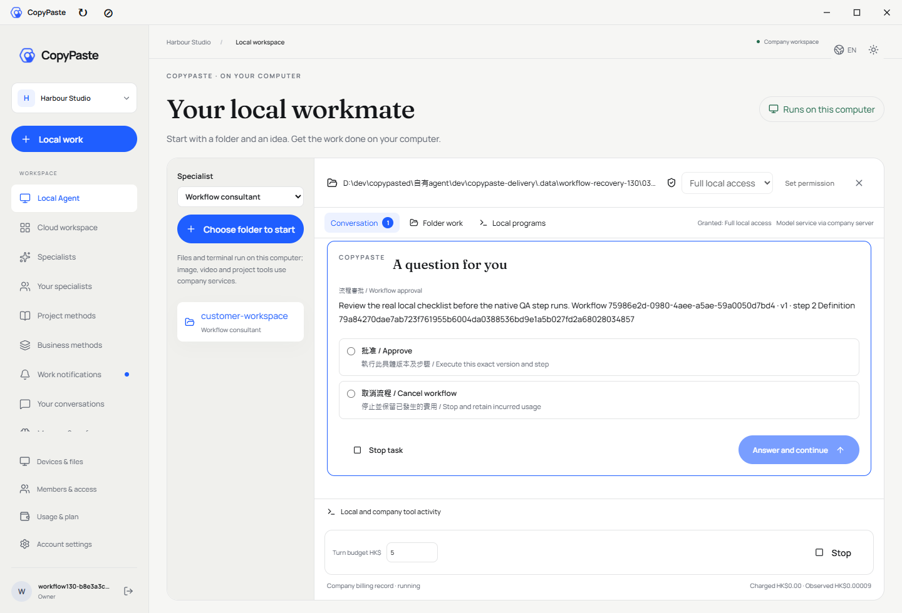


[Fee confirmation](assets/screenshots/workmate-workflow-recovery-130-01-child-fee-confirmation-en.png) · [Completed English UI](assets/screenshots/workmate-workflow-recovery-130-01-two-recovered-children-completed-en.png) · [Completed Chinese UI](assets/screenshots/workmate-workflow-recovery-130-01-two-recovered-children-completed-zh.png) · [Actual wall-clock MP4](assets/screenshots/workmate-workflow-recovery-130-01-parent-child-startup-recovery.mp4)

89 required, 12 unconfirmed suggested and one optional full-acceptance records remain open; these are not 102 uncoded modules. Arbitrary crash/multi-node behavior, all local tools, complete roles, durable resubmission of lost child finish receipts, live providers and signed installation remain. Stage130 uses its own manifest and publisher. The old V11 entry and Stage128 manifest retain their historical source scope and do not publish this increment.

[简体中文](README.md) · [English](README.en.md)

<!-- startup-recovery-stage128 -->
## Safe customer-local startup recovery · Stage128

Desktop runs pinned Codex on the customer's computer. After explicit folder selection and consent, a classified initialization/thread transport failure first drains the old process, lock and owned tools. Company services permit one recovery only when no turn, provider, input-count or company-tool request has been admitted and the original identity, permissions and deadline remain valid. At most two launches retain one task, hold and worker attempt; the absolute deadline never extends.

The UI shows Reconnecting. Retry connection retrieves an unconfirmed original result; possibly executed work requires local-file and billing review. Withdrawal, rejection, incomplete cleanup, admitted turns and unknown outcomes cannot replay automatically. Scoped inference credentials go only to the trusted local runtime and are excluded from the recovery journal and renderer.

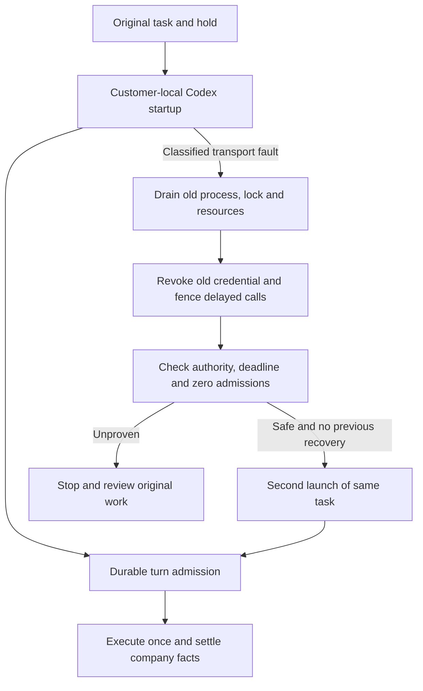

Upgrade the server through SQL133 with the database owner before starting the matching API. New clients opt into `desktop-startup-recovery-v1`. `/startup-recovery` binds the original session, contract digest and durable recovery key; `/turn-admission` precedes native `turn/start`. Legacy clients retain their existing flow without recovery authority.

The checkpoint records bounded controller, actual pinned Codex, native SQL and actual unsigned packaged Desktop qualification. Model responses and dialog decisions are synthetic as requested. This does not qualify a live provider, signed installation, every crash combination or complete professional roles. Earlier packages and captures retain their original source scope.

Bounded checks passed: 91 related controller, 43 actual pinned-Codex, 30 native database/API, three current compilation and six actual unsigned packaged-UI checks. The journey verifies sign-in, consent, one startup recovery, one original-task charge, one displayed answer, pending-startup withdrawal and native widths of 1000/1240/1440. Current PNG/GIF/MP4 captures come from successful attempt04; failed attempts01–03 and their raw records remain intact. V11 publishes the branches; the final receipt and remote SHA readback determine publication status.

[Design and APIs](https://github.com/copypasteltd/workmate/blob/docs/docs/technical/128-desktop-startup-recovery.md) · [Sources and qualification](https://github.com/copypasteltd/workmate/blob/docs/docs/quality/startup-recovery-checkpoint-128.json) · [Numbered open work](https://github.com/copypasteltd/workmate/blob/docs/docs/quality/remaining-work-stage128.md)

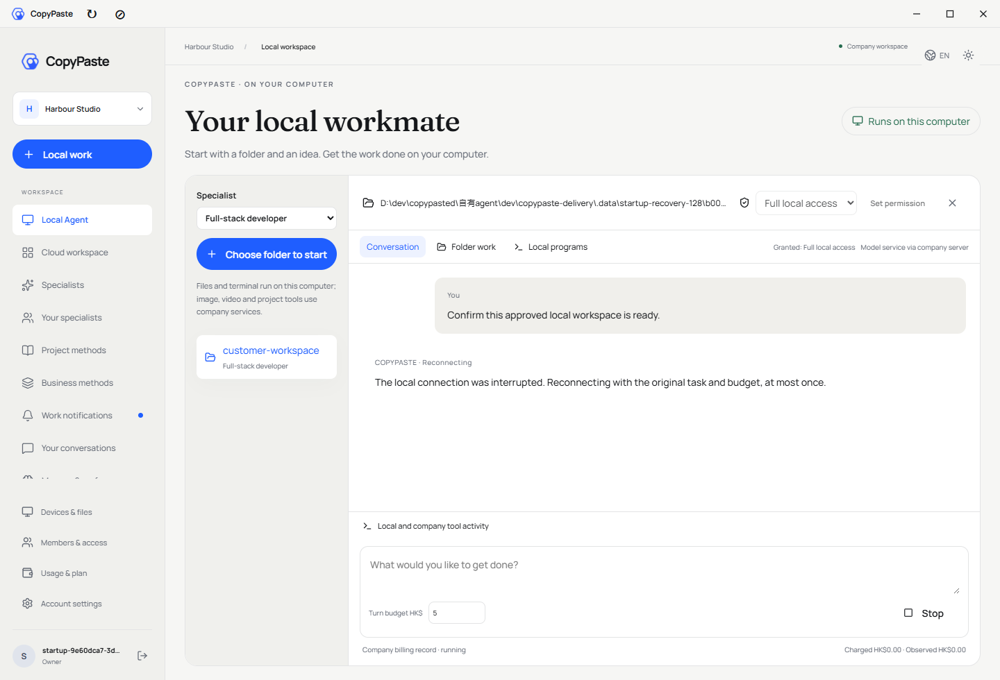

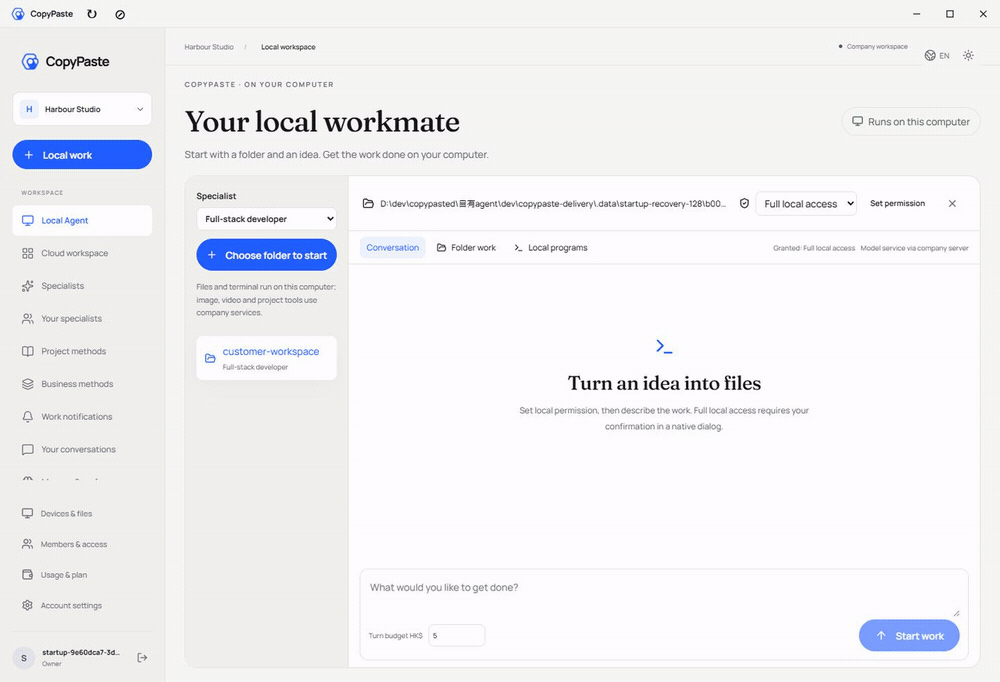

[Original receipt](assets/screenshots/workmate-startup-recovery-128-04-original-local-receipt.png) · [Withdrawal screenshot](assets/screenshots/workmate-startup-recovery-128-04-permission-revoked-before-turn.png) · [Withdrawal GIF](assets/screenshots/workmate-startup-recovery-128-04-revoke-pending-startup.gif) · [Recovery MP4](assets/screenshots/workmate-startup-recovery-128-04-startup-and-original-receipt.mp4) · [Withdrawal MP4](assets/screenshots/workmate-startup-recovery-128-04-revoke-pending-startup.mp4)

<!-- local-startup-stage127 -->
## Customer-local startup, renewal and withdrawal · Stage127

After the customer chooses a folder and explicitly grants access, Codex runs on their computer. Company services enforce identity, the model gateway and original-task billing. Main and workflow-child tasks now renew authority during preparation/startup and reauthorize before a turn. Closure or withdrawal interrupts pending initialization/thread requests, drains preparation and reclaims the owned process and lock, preventing a late spawn after cleanup.

Startup beyond the initial 45-second lease retains the original task and budget hold. Completion stops and drains heartbeat before closing resources and settling the original receipt. Readable withdrawal feedback asks customers to review authority and billing. Accepted or unknown work is never automatically repeated. Automatic Desktop startup recovery remains unimplemented; zero charge alone cannot authorize replay.

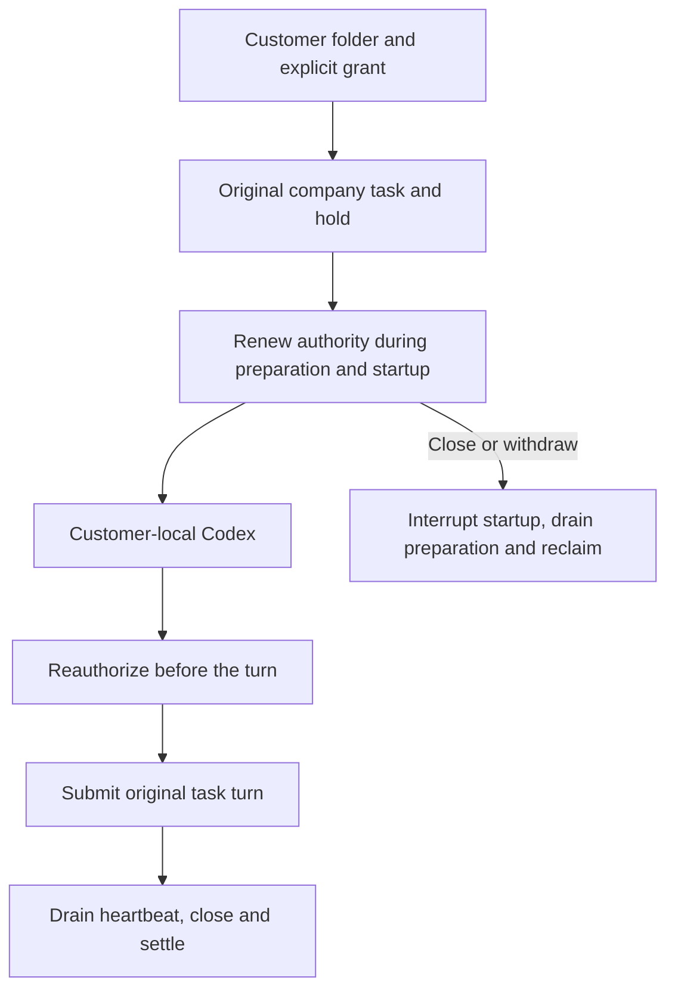

Bounded qualification covers 73 complete related controller checks, 38 real pinned-native checks and five actual unsigned packaged-window checks; the checkpoint below records final results. The actual window journey covers browser OTP/PKCE/onboarding, default decline, startup beyond 45 seconds, original company SQL billing, pending-startup withdrawal and frameless/menu-free/rail-free layouts at 1000/1240/1440 native widths. Model responses and native-dialog choices are synthetic. This does not qualify a live provider, signed installation or all professional roles. Earlier packages/captures retain their original source scope.

Current unsigned directory package: `release/local-startup-127-03/win-unpacked/`. Follow the normal setup instructions below. `scripts/qualify-local-startup-v2.mjs` and Delivery's `run-desktop-startup-v4.mjs` bind their recorded candidate directories, pinned binary and isolated database; they are not generic launchers for other checkouts.

[Behavior and ordering](https://github.com/copypasteltd/workmate/blob/docs/docs/technical/127-desktop-startup-lifecycle.md) · [Exact source and final results](https://github.com/copypasteltd/workmate/blob/docs/docs/quality/local-startup-checkpoint-127.json) · [Numbered open work](https://github.com/copypasteltd/workmate/blob/docs/docs/quality/remaining-work-stage127.md)


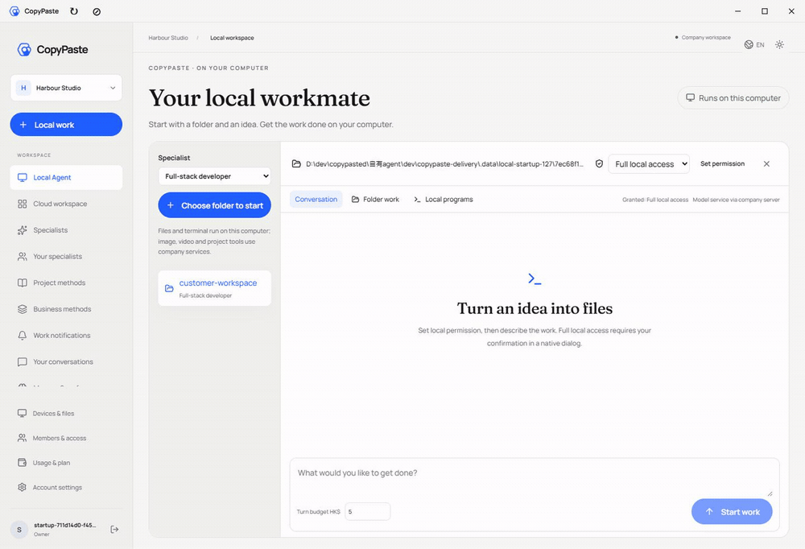

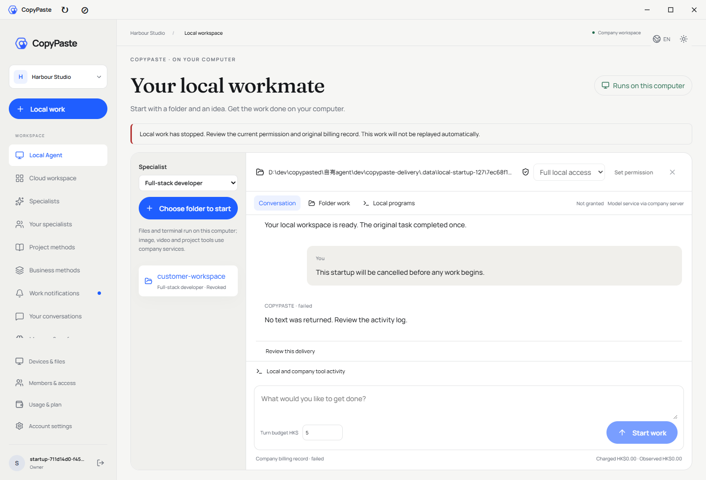

[Original receipt](assets/screenshots/workmate-local-startup-127-04-original-local-receipt.png) · [Withdrawal GIF](assets/screenshots/workmate-local-startup-127-04-revoke-pending-startup.gif) · [Completion MP4](assets/screenshots/workmate-local-startup-127-04-startup-and-original-receipt.mp4) · [Withdrawal MP4](assets/screenshots/workmate-local-startup-127-04-revoke-pending-startup.mp4)

<!-- controlled-publications-stage125 -->
## Native publication previews and authority · Stage125

Desktop retains customer-local Codex, revocable full local authority and a frameless window. The main process calls company services; Bearer credentials never enter the renderer. `workmate-media` binds window, session and scope, with bounded streaming, HEAD/Range, integrity checks, concurrency and expiry. Sign-out, session changes and window destruction revoke capabilities.

Sign in through the secure browser, create a workspace, connect and explicitly scope an account in Web, then return to Desktop to select caption/source versions, inspect actual media, explicitly approve and read the receipt. Unknown outcomes permit reconciliation/manual closure, never automatic resending. Source expiry and revocation withdraw content.

```mermaid
flowchart LR
  UI[Frameless local interface] --> Main[Main-process session and media]
  UI --> Codex[Customer-local Codex]
  Codex --> Gateway[Company AI gateway]
  Main --> Company[Company publication service]
```

Typechecks and 21/21 media/session checks pass. The latest unsigned directory package is `release/publications-125-02/win-unpacked/`. The actual packaged Electron/native Chrome Side Panel journey passes 10/10, including native media, three OS window widths, no frame/menu/visible scroll rails, explicit consent and revocation. Signed installation, complete local tools and professional roles remain separate.

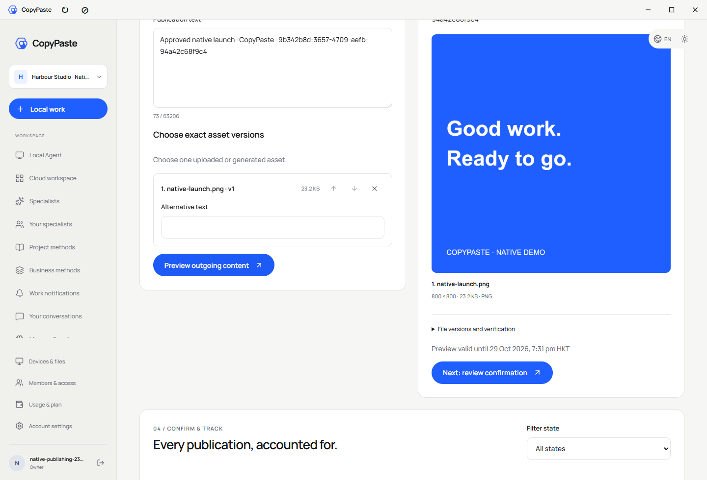

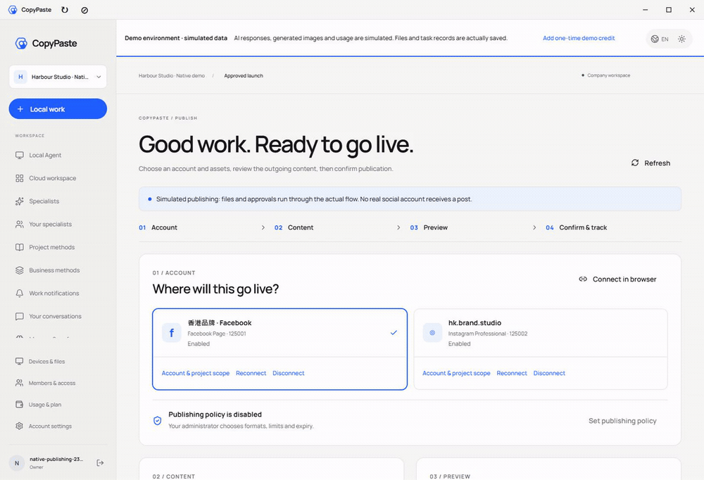

[Actual interaction MP4](assets/screenshots/workmate-native-publications-02-native-preview-and-confirm.mp4)


<!-- runtime-startup-122 -->

## Codex startup and turn isolation · Stage 122

Local Codex tools, input requests, approvals, messages, usage and completion are scoped to the current thread and turn. Queued old frames cannot enter a later task. A real completion can recover a lost turn/start reply without replay. Native error diagnostics retain only bounded fields. Customer-local full permission, revocation, frameless presentation and custom window controls remain enforced.

180 unit and 25 real native Codex checks passed. npm test now builds the Native Host for fresh checkouts. Eight actual packaged UI checks also passed: OTP/PKCE, explicit local consent, real local files and company-tool billing, revocation, and 1440/1280/800 layouts without visible scrollbar rails or horizontal overflow. Provider responses and native dialog selections are explicit fixtures.

```mermaid
flowchart LR
  A[Customer permission] --> B[Customer-local Codex]
  B --> C{Current thread and turn?}
  C -->|Yes| D[Authorized local or company tool]
  C -->|No| E[Reject foreign request]
  D --> F[Native completion and original billing]
```

[完整方案 / Behavior and verification](https://github.com/copypasteltd/workmate/blob/docs/docs/technical/122-codex-startup-and-turn-isolation.md)

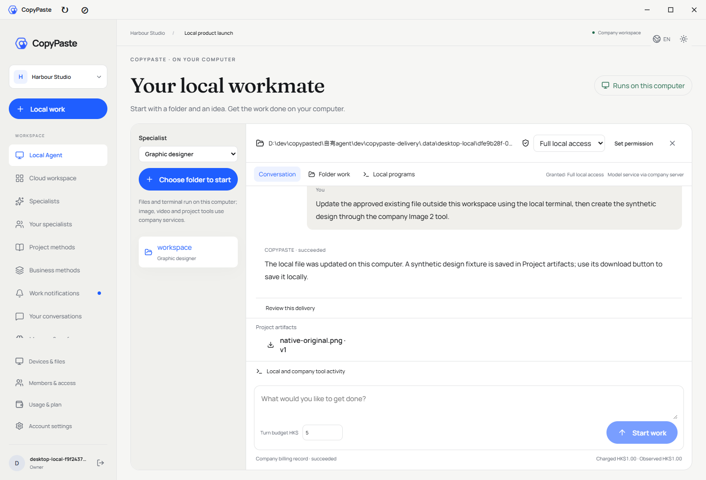

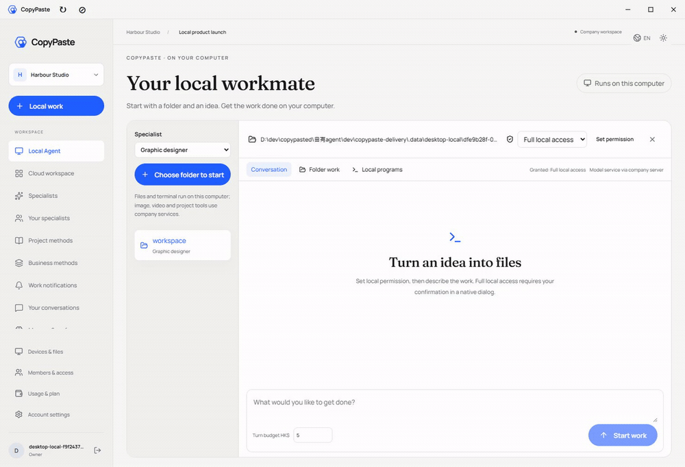

[800px](assets/screenshots/workmate-runtime-startup-desktop-02-layout-800-en.png) · [繁體中文](assets/screenshots/workmate-runtime-startup-desktop-02-workspace-zh.png) · [MP4](assets/screenshots/workmate-runtime-startup-desktop-02-local-cloud-boundary.mp4)

## Product and boundaries

The first customers are existing marketing teams. Scope includes image/design/typography, video/effects, advertising and website analysis, SEO/GEO, repeated business processes and software development. The catalog has 18 candidates with exact Skill bindings; at least twelve individually qualified professional presets remain an acceptance requirement. The designer combines Codex, design Skills and company Image 2. Codex is the only Agent core. All AI uses the company's OpenAI-compatible backend; development currently uses authorized synthetic providers, not a claim of live professional quality.

The Electron main process owns OS grants, encrypted local sessions, pinned Codex children, files/terminal, browser tools and IPC; the React renderer has no generic Node/arbitrary-process API. Select a specialist/workspace and read-only, workspace-write or full local permission; native consent defaults to Cancel. Codex runs on the customer device while reasoning/image/video/audio requests use the company server. Questions start unselected, and explicit answers continue the same task/thread/turn. Stop/revoke clears prompts and ends owned children.

## Repositories and execution

| Branch | Directory | Runtime |
| --- | --- | --- |
| [backend](https://github.com/copypasteltd/workmate/tree/backend) | `dev/copypaste-platform` | Fastify / PostgreSQL / cloud Codex |
| [web](https://github.com/copypasteltd/workmate/tree/web) | `dev/copypaste-web` | React / Vite / cloud workspace |
| [admin](https://github.com/copypasteltd/workmate/tree/admin) | `dev/copypaste-admin` | React / separate Admin identity |
| [desktop](https://github.com/copypasteltd/workmate/tree/desktop) | `dev/copypaste-desktop` | Electron / customer-local Codex |
| [extension](https://github.com/copypasteltd/workmate/tree/extension) | `dev/copypaste-extension` | Chrome MV3 / native Side Panel / cloud Codex |
| [delivery](https://github.com/copypasteltd/workmate/tree/delivery) | `dev/copypaste-delivery` | Native development, QA and publication tools |

The component is an independent Git repository. Keep the sibling layout and use the documented native tools; Docker, WSL and VMs are prohibited.

## User workflow

1. Launch/install the frameless client, complete browser PKCE and select company, project and local workspace.
2. Choose read-only, workspace-write or full local authority. The customer explicitly confirms full permission; Cancel is the default and revocation stays available.
3. Local Codex operates local files, terminal and browser. An external program must be selected and confirmed by the customer.
4. Inspect original-thread questions, actual output, files, artifacts and billing. Stop/revocation ends owned work; uncertain outcomes stay uncertain.
5. Folder rules save paused and need a separate automatic-spend confirmation. Reopening retains queue/limits and requires confirmation to resume.

```mermaid
flowchart TD
  Login[Browser PKCE and local session] --> Grant[Customer local permission]
  Grant --> Codex[Codex process on customer computer]
  Codex --> Local[Local files, terminal and browser]
  Codex --> Company[Company inference and media APIs]
  Local --> Receipt[Actual files, process receipts and cost]
  Grant --> Revoke[Customer stop or revoke]
  Revoke --> Cleanup[End owned work and retain truthful outcome]
```

## Setup

### Local startup

Run these commands in the checked-out component. The complete workspace has the six independent repositories side by side under `dev/`; see the [branch and checkout layout](https://github.com/copypasteltd/workmate/blob/docs/docs/governance/04-git-branches-and-publication.md). Use Windows x64, Node.js >=22.14, npm/Git and the documented native PostgreSQL, FFmpeg/FFprobe and pinned Codex resources. Preserve existing local configuration/data. No Docker/WSL/VM is used.

```powershell
Set-Location 'D:/dev/copypasted/自有agent/dev/copypaste-desktop'
npm ci
$env:COPYPASTE_LOCAL_CODEX_BIN = 'D:/approved-runtime/codex.exe'
npm run runtime:prepare
npm run build
npm start
```

Start the backend first. The binary path is an example: supply the exact approved binary and adjacent helpers matching `contracts/local-codex-runtime.json`. Configure company origins in `deployment.json`. `npm run package:dir` builds an unpacked candidate; `npm run package` builds the installers. Current evidence covers an unsigned unpacked candidate; signing and human install/upgrade/uninstall remain open. The renderer builds independently; preserve its native overlays.

### Use the current workflow

1. Complete sign-in, company membership/invitation and project selection. Native clients use browser PKCE; Admin uses separate MFA identities. Expired/revoked credentials must not silently change identity or company.
2. Select a specialist and supply the brief and explicitly authorized references/accounts. Missing inputs request customer action. Project owners can save, preview and explicitly publish immutable shared guidance; publication starts no AI and grants no new permission.
3. New tasks pin their accepted role, Skill, brand, reference and guidance versions. Existing work, including an originally absent configuration, retains its original state. Source revocation hides unavailable bodies and blocks later use; history is not a permission bypass.
4. Confirm budget and any required operation/media approval. View genuine status, progress, exact deliverables and original receipts. Continue requested edits in the same task lineage. Unknown usage remains reserved for reconciliation; it is never silently free or blindly replayed.
5. Admin can independently manage authorized user/workspace status, inspect permitted consumption, preview/confirm manual fees or credits and activate scoped VIP/expiry. Balances, recorded payments, credits, budgets and VIP are separate records. Idempotent confirmation and audit prevent duplicate grants.

## Customer-local programs and browser resources

Sign in and select company/project → create a local session → explicitly grant full local permission → open **Local programs** → choose an actual executable and confirm the native dialog, which defaults to Cancel → request work in Conversation → inspect exact arguments, actual output, PID/exit code and the original task bill. Cancelling or declining grants nothing. Approvals pin file identity and SHA-256; the Agent supplies a program ID and argument array, not a replacement shell/environment.

Stopping the original task or revoking the program ends its owned native process tree. Program revocation leaves the separate customer full-access grant intact. Success, failure, cancellation and unknown outcomes remain distinct; an original call ID never replays. After restart, uncertain records remain unknown. Customer review only permits future calls, never rewrites the old record as success. Approved programs run with the customer's OS-user rights, not an additional workspace OS sandbox; Admin/cloud cannot approve on their behalf.

The Windows x64 native Job Object guardian does not pass company inference credentials to programs. Limits are two active programs per executor, 100 approval/200 run records, at most 64 arguments and 120 seconds per invocation, and 32 KiB retained per stdout/stderr with explicit truncation. New sessions pin the program tool version; legacy tool sets remain unchanged. Normal browser opens and popups share three pages per task/two active contexts per executor. A third context is denied without evicting another task; reuse clears cookies/localStorage.

## Customer-local folder work

In Desktop, choose a writable local session and open **Folder work**. Select an input folder inside the workspace and configure extensions, instructions, a quiet period, per-file/total limits and maximum runs. Existing files are excluded unless selected. Saving creates a **paused** rule; **Confirm and activate** opens a separate native automatic-spend confirmation that defaults to Cancel.

Stable native file events and bounded scans feed a persistent serial queue. Each job gets an exact snapshot, separate output directory, original task ID and company cost receipt. An unanswered native question is visible from Folder work; **Answer questions** returns to Conversation and requires the customer's explicit answer. Identical already-processed bytes and product outputs do not create another paid task. Unstarted old versions coalesce to the latest stable input.

Pause stops new dispatch and lets the current file finish. Revoke stops only that rule's owned work while keeping outputs/receipts. App closure stops watching; a real reopen retains the encrypted journal and allocated limits but requires fresh confirmation. Lost replies reuse original dispatch/create/start/finish keys; uncertain native actions block for review. Full OS permission remains the customer's grant, not an additional folder sandbox. Web/Extension keep cloud execution; folder work is a Desktop capability.

Limits: 20 rules; 1,000 history/200 queued items per rule; 1,000 dispatch receipts per session; 2,000 matching files/10,000 entries/12 levels per scan; 20 MiB per file and 64 MiB new reads per scan; at most 100 authorized runs, one scheduled job at a time. Limits do not reset on pause/restart. Outputs are under `.copypaste-local-jobs/<rule>/<job>/output/`. Symlinks/junctions, traversal, outside input, source replacement and conflicts block automatic work. See approved programs above; complete application-operation and crash/sleep/offline matrices remain open.

## Configuration and authority

The candidate requires the complete additive SQL001–133 history. API/worker schema admission rejects missing, changed or unsupported versions; recovery identity is fenced independently. Company model aliases, verified media capabilities, exact tariffs and provider secrets live on the backend. Unconfigured capabilities remain unavailable. Current development uses explicitly authorized synthetic data.

Web/Admin use `VITE_API_BASE` or their same-origin proxy; default development ports are 4317/4318. Desktop/Extension compile fixed `COPYPASTE_API_ORIGIN` and `COPYPASTE_WEB_ORIGIN` values; Desktop also pins `COPYPASTE_EXTENSION_ID`. HTTPS is required outside the allowed loopback-development case. No renderer or extension receives company provider secrets.

Files remain private unless the customer explicitly shares them. Authorization is checked on new requests, worker claims, tools and downloads. Source/body revocation is not bypassed by old history. Money uses exact HKD micros; budget, balance, credits, recorded payments and VIP are distinct. Stable request identities prevent duplicate grants, tasks and reservations. Unknown usage or physical cleanup retains its reconciliation hold.

## Preset roles and Skills

The catalog defines 18 professional presets plus the default assistant. Every run pins exact Skill versions and registered tools. These definitions are not a claim that twelve full professional qualifications have passed.

| ID | Role | Required Skill bindings |
| --- | --- | --- |
| R01 | Full-stack developer | `fullstack-engineering@1.0.0`, `frontend-implementation@1.0.0`, `backend-api@1.0.0`, `qa-testing@1.0.0`, `delivery-core@1.0.0` |
| R02 | Frontend developer | `frontend-implementation@1.0.0`, `ui-system@1.0.0`, `qa-testing@1.0.0`, `delivery-core@1.0.0` |
| R03 | Backend/API engineer | `backend-api@1.0.0`, `qa-testing@1.0.0`, `delivery-core@1.0.0` |
| R04 | Software QA engineer | `qa-testing@1.0.0`, `frontend-implementation@1.0.0`, `delivery-core@1.0.0` |
| R05 | UI/UX designer | `ux-research@1.0.0`, `ui-system@1.0.0`, `frontend-implementation@1.0.0`, `delivery-core@1.0.0` |
| R06 | Designer | `creative-direction@1.0.0`, `image-art-direction@1.0.0`, `image2-production@1.0.0`, `typography-layout@1.0.0`, `delivery-core@1.0.0` |
| R07 | Brand visual designer | `brand-system@1.1.0`, `image-art-direction@1.0.0`, `image2-production@1.0.0`, `typography-layout@1.0.0`, `delivery-core@1.0.0` |
| R08 | Ad creative designer | `ad-creative@1.0.0`, `image-art-direction@1.0.0`, `image2-production@1.0.0`, `typography-layout@1.0.0`, `delivery-core@1.0.0` |
| R09 | E-commerce designer | `ecommerce-visual@1.0.0`, `image-art-direction@1.0.0`, `image2-production@1.0.0`, `typography-layout@1.0.0`, `delivery-core@1.0.0` |
| R10 | Social content designer | `social-content@1.0.0`, `image2-production@1.0.0`, `typography-layout@1.0.0`, `delivery-core@1.0.0` |
| R11 | Illustration/IP designer | `illustration-ip@1.0.0`, `image-art-direction@1.0.0`, `image2-production@1.0.0`, `delivery-core@1.0.0` |
| R12 | Typography/layout designer | `typography-layout@1.0.0`, `image-art-direction@1.0.0`, `image2-production@1.0.0`, `delivery-core@1.0.0` |
| R13 | Presentation designer | `presentation-production@1.1.0`, `typography-layout@1.0.0`, `dataviz@1.1.0`, `delivery-core@1.0.0`, `deterministic-metrics@1.1.0` |
| R14 | Landing-page designer | `landing-page@1.0.0`, `ui-system@1.0.0`, `frontend-implementation@1.0.0`, `image2-production@1.0.0`, `delivery-core@1.0.0` |
| R15 | Information/data designer | `dataviz@1.1.0`, `deterministic-metrics@1.1.0`, `typography-layout@1.0.0`, `delivery-core@1.0.0` |
| R16 | Video/motion designer | `video-storyboard@1.0.0`, `template-video-composition@1.0.0`, `video-generation@1.1.0`, `speech-production@1.2.0`, `delivery-core@1.0.0` |
| R17 | Marketing analyst | `ads-analysis@1.1.0`, `deterministic-metrics@1.1.0`, `dataviz@1.1.0`, `delivery-core@1.0.0` |
| R18 | Workflow consultant | `workflow-design@1.1.0`, `workflow-execution@1.1.0`, `delivery-core@1.0.0` |

Designer combines Codex, design Skills and the company Image 2 capability. Optional R19 computer-operator work needs its own confirmed cloud lease and AI budget; native Desktop excludes it and retains customer-local execution.

[Role contract](https://github.com/copypasteltd/workmate/blob/backend/catalog/role-preset-catalog.json) · [Skill packages](https://github.com/copypasteltd/workmate/blob/backend/catalog/skill-packages.json)

## Actual interface and interaction

These are actual unretouched product screenshots and wall-clock recordings. Customer/model/media responses are explicit fixtures; native Codex, files, database and billing paths run where stated. Synthetic node pixels do not qualify an actual remote Linux desktop.

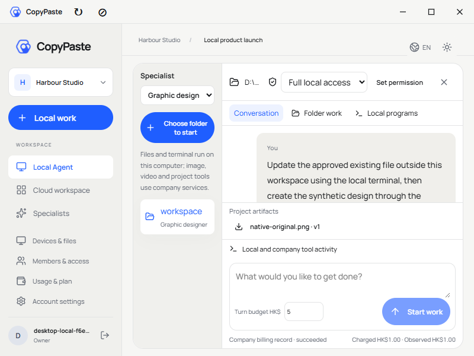

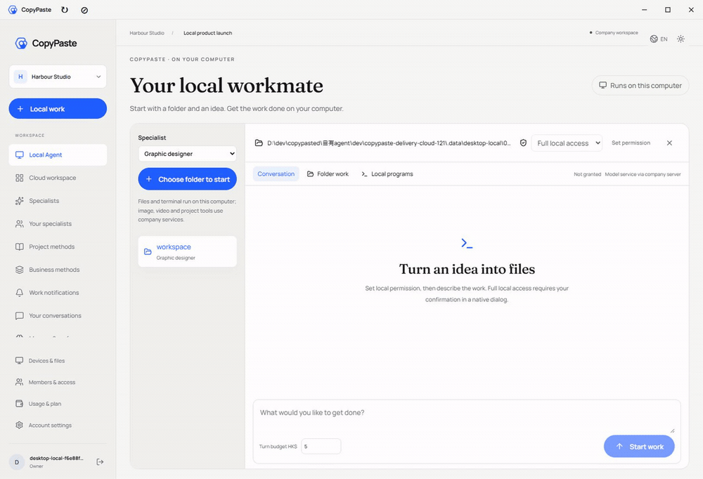

[Original MP4](assets/screenshots/workmate-dedicated-desktop-06-local-cloud-boundary.mp4)

## Verification and delivery status

The integrated clients/tool inventory passed 338 checks: Web 20, Admin 9, Extension 63, Desktop 180, actual local Codex 22 and Delivery 44; corresponding types/builds passed. Native Desktop, Web/Admin and native Side Panel each have eight bounded actual UI checks, with 29 screenshots and five GIF/MP4 pairs. Complete backend success requires its final complete-inventory report; the checkpoint records actual outcomes and retains failed attempts.

Run this component’s `npm run typecheck`, `npm run build` and documented test scripts with installed native prerequisites. Delivery’s default `npm test` covers native-surface integrity; the complete Delivery unit inventory is `node --test --test-concurrency=1 tests/*.test.mjs`. `node scripts/qualify-delivered-clients-v1.mjs NN` uses a fresh two-digit attempt and the sibling layout for all integrated client inventories. Candidate-specific historical runners preserve their original directory requirements.

Full product acceptance remains open: twelve professional-role qualifications, complete permissions/business/compatibility matrices, live service quality, signed installers/updates, production load/restore and customer business acceptance. Use the numbered inventory rather than test counts as a completion claim. Owned browsers/processes are closed; user resources are preserved.

[Implementation / 方案](https://github.com/copypasteltd/workmate/blob/docs/docs/technical/121-dedicated-cloud-and-client-execution.md) · [Checkpoint / 证据](https://github.com/copypasteltd/workmate/blob/docs/docs/quality/dedicated-cloud-checkpoint.json) · [Open requirements / 未完成项](https://github.com/copypasteltd/workmate/blob/docs/docs/quality/remaining-work-2026-10-29.md) · [Branch layout / 检出布局](https://github.com/copypasteltd/workmate/blob/docs/docs/governance/04-git-branches-and-publication.md)


<!-- document-preview-stage146 -->
## Stage146: actual document pages and complete source selection

The frameless Windows client gains cloud document pages while retaining customer-local Codex and its explicit OS grant.

Open Cloud files, search authorized sources and explicitly select a fixed version before previewing, turning pages, downloading or passing a reference to a specialist. In Extension, preview an uploaded attachment inside the right Side Panel. Previewing does not send it or create an AI task. 19 backend checks and four actual client journeys passed, with nine screenshots and three real-time GIF/MP4 pairs. Office runtime setup and conversion are qualified on Windows x64; other server platforms, production services and complete native Codex/OS acceptance remain open.

```mermaid
flowchart LR
  A[Select authorized source] --> B[Choose immutable version]
  B --> C[Check current authority]
  C --> D[Render actual document page]
  D --> E[Recheck authority]
  E --> F[Preview or pass exact reference]
```

[Design / 使用方案](https://github.com/copypasteltd/workmate/blob/docs/docs/development/146-document-pages-and-source-selection.md) · [Original numbered ledger / 原编号清单](https://github.com/copypasteltd/workmate/blob/docs/docs/quality/remaining-work-stage146.md)

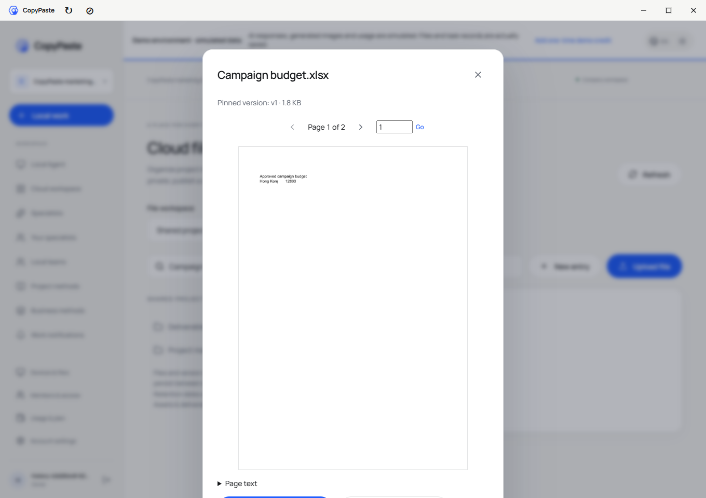


[Actual MP4 recording](assets/screenshots/workmate-document-preview-146-04-document-pages.mp4)


<!-- functional-closure-stage147 -->
## Stage147: named workflows and local preparation for the original task

The frameless local workspace selects a real folder, obtains explicit full OS permission and executes actual local Codex after fee confirmation, then waits for the customer to return files.

Sign in and select the project → original cloud task requests local files → Desktop folder/OS grant → separate local fee review → actual local Codex → explicit upload and confirmation of exact versions → the original cloud task resumes its same thread. Workflow execution freezes actual inputs and exposes complete named deliverables; recurring rules and budgets require separate review.

95 backend cases, five actual client journeys, 11 screenshots and five real-time GIF/MP4 pairs passed. Internal model replies remain explicitly synthetic and the Windows package is unsigned. Complete professional, production and OS acceptance remains open.

Backend coverage combines 92 existing checks on identical product bytes with three targeted concurrency reruns. Original test-context failures remain retained; this is not a new full 95-case rerun.

```mermaid
flowchart LR
  A[Original cloud task] --> B[Request local material]
  B --> C[Folder and OS grant]
  C --> D[Review separate fees]
  D --> E[Actual local Codex]
  E --> F[Customer uploads exact files]
  F --> G[Same original cloud thread]
  G --> H[Complete delivery and settlement]
```

[Usage / 使用流程](https://github.com/copypasteltd/workmate/blob/docs/docs/development/147-functional-closure.md) · [Detailed contracts / 详细契约](https://github.com/copypasteltd/workmate/blob/docs/docs/technical/147-workflow-contract-and-local-handoff.md) · [Numbered ledger / 全部编号](https://github.com/copypasteltd/workmate/blob/docs/docs/quality/remaining-work-stage147.md)

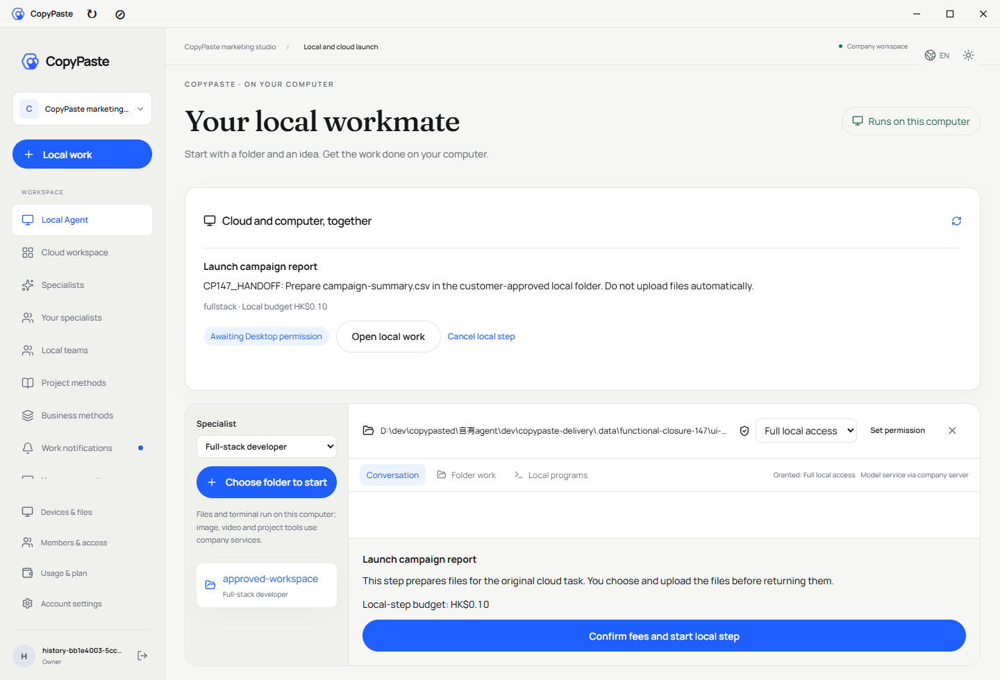

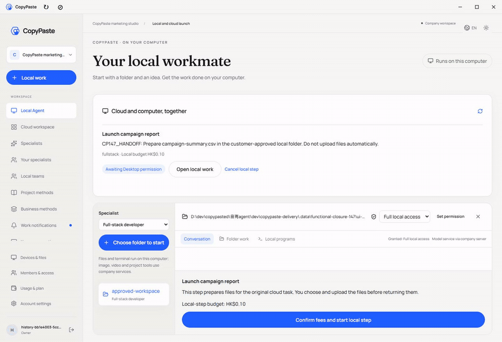

[Actual MP4](assets/screenshots/workmate-functional-closure-147-08-native-preparation.mp4)
