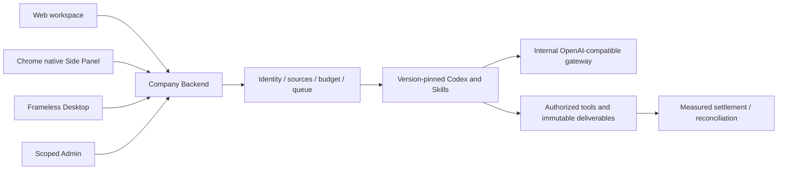

# Workmate · CopyPaste Delivery

[中文](README.md) · [Documentation](https://github.com/copypasteltd/workmate/blob/docs/docs/README.en.md)

[Backend](https://github.com/copypasteltd/workmate/tree/backend) · [Web](https://github.com/copypasteltd/workmate/tree/web) · [Admin Dashboard](https://github.com/copypasteltd/workmate/tree/admin) · [Desktop](https://github.com/copypasteltd/workmate/tree/desktop) · [Chrome Extension](https://github.com/copypasteltd/workmate/tree/extension) · [Delivery](https://github.com/copypasteltd/workmate/tree/delivery)

A cloud Agent product for Hong Kong enterprises. This repository owns **Delivery** and publishes to `delivery`.

## Architecture and constraints

Codex is the only Agent kernel. All AI calls use the company's internal OpenAI-compatible server. Web, Desktop, extension and Admin share server identity, permissions, sources and billing controls. UI follows CopyPaste brand assets, colors, typography and bilingual patterns.



## Responsibility and layout

This repository starts native development services, verifies cross-client behavior, preserves raw results, checks package bytes, captures actual interactions and synchronizes mapped branches. It coordinates sibling repositories rather than containing another business kernel.

| Directory | Responsibility |
| --- | --- |
| `scripts/` | Bootstrap, native process control, migration checks, client/API/permission/media verification, recording and publishing |
| `tests/` | Integrity checks for native-package and Side Panel verifiers |
| `evidence/` | Per-execution raw TAP/logs, source bindings, cleanup and actual screenshot digests |
| `assets/screenshots/` | Actual README screenshots, MP4 and GIF |
| `.data/` | Ignored owned process state, browser profiles, raw recordings and temporary data |

## Workspace layout

Check out docs at the project root. Place component branches under `dev/copypaste-platform`, `copypaste-web`, `copypaste-admin`, `copypaste-desktop`, `copypaste-extension` and this `copypaste-delivery` repository. Use separate working directories when running components together.

## Install, start and stop

```powershell
npm ci
npm run bootstrap
npm run demo
```

Ports: Web `4317`, Admin `4318`, API `4310`, controller `4319` and native PostgreSQL `55432`. `npm run stop` only stops controller-owned processes and requests a normal database checkpoint. Occupied ports fail startup while preserving existing processes.

`demo` explicitly enables local synthetic mode, which production and non-loopback hosts reject. Authorized synthetic data does not qualify live model quality, prices or production services. Original errors/failures remain intact.

## Actual interaction recording

```powershell
node scripts/run-paid-input-native.mjs NN --media
```

Use a fresh two-digit ID for a new recording. The command starts owned native PostgreSQL, isolated fixtures, Web/Admin previews, actual unpacked Desktop and a native Chrome Side Panel. All owned browsers/previews close and isolated fixtures are reclaimed afterward. First reproduce the local Desktop/Extension previews named by the script using the packaging runbook; source branches do not include installers or dist.

Replace `NN` with a fresh two-digit ID. `qa-workmate-media.ts` hooks actual UI operations. `record-workmate-media.ts` encodes captured wall-clock intervals into MP4/GIF. Captures come directly from the confirmed native SIDE_PANEL document viewport and exclude the browser toolbar. The same journey independently asserts right-side layout, reduced main-page width and no popup/extra tab. Evidence binds synthetic-turn scope, source/media hashes and exit receipts.

## Branch publication

After committing the six components, update component SHAs, the media attempt and release notes in the docs branch's `docs/quality/workmate-publication.json`, then commit the documentation. With all repositories clean:

```powershell
node scripts/publish-workmate.mjs --check
node scripts/publish-workmate.mjs --push
```

The publisher updates only the eight mapped branches atomically, checks remote ancestry and verifies post-push SHAs. It never force-pushes or deletes other branches. Preflight calls the documentation audit for historical objects, credentials, README links and media. Ignored runtime receipts live in `.data/publication/`; failures remain available and stop publication.

## Verification boundaries

`npm run typecheck` and `npm test` check this repository. Backend runs full platform tests; cross-client/native scripts enforce their own prerequisites. Applied migration bytes are immutable. Pre-upgrade snapshots, first failures and later read-only corrections remain separate. Docker/WSL/virtualization are prohibited for all tests and captures.

## Checkout and prerequisites

Clone this branch into a fresh working directory; update an existing repository without reinitializing it.

```powershell
git clone --single-branch --branch delivery git@github.com:copypasteltd/workmate.git copypaste-delivery
cd copypaste-delivery
```

Use Node.js ≥22.14, npm and Git with pinned lockfiles. The qualified local environment is Windows x64. Backend/full delivery also needs native PostgreSQL launcher resources, pinned Codex `0.163.0-alpha.10.2` and FFmpeg/FFprobe. No local Docker, WSL or virtualization. Run components in separate directories; see [workspace](https://github.com/copypasteltd/workmate/blob/docs/docs/governance/04-git-branches-and-publication.md).

## Checks and evidence scope

```powershell
npm run typecheck
npm test
```

**782/782** Platform and **34/34** focused tests, plus **13 checks** across six repositories for types/build/existing client suites. The actual packaged Desktop and native Side Panel journey passes **32** checks, retaining every prior named test among 765. Actual Codex child-process tool/thread/usage behavior is tested through a synthetic internal API. UI turns/business data in these demonstrations are synthetic as authorized. All 102 original requirements remain: 81 partially verified, 21 without proven completion and zero fully accepted. Screenshots and test counts do not establish whole-product acceptance.

Canonical TaskDTO/task creation, arbitrary in-flight pause, unknown-effect recovery, independent complete role workflows, GEO, live suppliers and production/signing/store qualification remain tracked.

## Actual screens and interactions

This service has no independent customer page. The following captures show the actual Desktop client connected to the service.

Actual recordings preserve capture timing. AI turns/business data are explicitly synthetic. Admin form demonstrations do not claim a financial commit.


[MP4](assets/screenshots/workmate-06-interaction.mp4) · [Capture/source evidence](https://github.com/copypasteltd/workmate/blob/docs/docs/quality/workmate-media-06.json)

## Detailed design and updates

- [Product](https://github.com/copypasteltd/workmate/blob/docs/docs/product/01-prd.md)
- [Architecture](https://github.com/copypasteltd/workmate/blob/docs/docs/technical/01-architecture-and-stack.md)
- [Identity and permissions](https://github.com/copypasteltd/workmate/blob/docs/docs/technical/07-security-and-permissions.md)
- [Task continuation](https://github.com/copypasteltd/workmate/blob/docs/docs/technical/66-paid-native-input-checkpoints.md)
- [Admin](https://github.com/copypasteltd/workmate/blob/docs/docs/product/08-admin-dashboard.md)
- [Native clients](https://github.com/copypasteltd/workmate/blob/docs/docs/technical/30-native-window-and-browser-sidepanel.md)
- [Release notes](https://github.com/copypasteltd/workmate/blob/docs/docs/changes/2026-10-22-workmate-publication.en.md)

Every later change updates both READMEs, affected actual captures/GIFs, release notes and its mapped branch. Verify remote SHAs through Delivery publishing; do not force-push collaborator history. Keep environment secrets, databases, sessions, dependencies and installers out of Git. Exact historical README bytes are retained in [archive](https://github.com/copypasteltd/workmate/blob/docs/docs/quality/history/stage66-before-workmate-readmes/manifest.json).
