# CopyPaste Platform

<!-- stage66-current-paid-inputs:start -->
The Backend stores paid-turn checkpoints, cumulative usage and completed-tool receipts using existing identity, permission, source and financial guards.

## Continue the original paid task after providing inputs (stage 66)

A completed, fully measured Codex turn can now request authorized files or existing marketing connections. The model describes the gap and the user selects the resources. The same task retains its conversation, native thread, original budget hold and cumulative usage, then rechecks current permissions, sources and capacity before continuing. Input requests are bounded to eight rounds and thirty-two dependencies. Unknown external results remain subject to reconciliation.

Completed transactional tools retain immutable receipts. A later turn reuses matching results only after current authorization, output and source checks. Source packages also compare the actual file manifest and hashes, so changed sources produce a new package. Cancellation during an input wait settles measured spend; unknown usage is never treated as free. Web, Desktop and Side Panel distinguish recorded usage from settled charges and initial input waits from waits after a paid turn.

All three clients retain explicit input selections during refreshes of the same task. Native checks observe at least two actual task responses before confirmation. Workspace changes or denied current reads clear prior task content and input controls. The first failed form-remount journey and its packages remain intact; corrected packages use a separate directory.

Validation: **782/782 Platform tests**, preserving all **765 prior named tests**; **34/34 focused tests** and **13 checks across six repositories**. Actual Codex child processes restore the original thread, tools and history and verify completed-file reuse and one cumulative settlement, using authorized synthetic API responses. **32 native journey checks** cover Web, packaged Desktop and the actual native Side Panel. Their input-selection journeys use explicitly identified synthetic model-turn fixtures.

Desktop is frameless, with custom dragging and minimize/maximize/close buttons and no Electron default or Alt menu. Clicking the extension toolbar opens Chrome's native Side Panel, right by default while respecting browser preferences; there is no action popup. New Setup/Portable files and the Side Panel ZIP are unsigned localhost previews. Installation, signing, store publication and production model services remain unqualified.

Native SQL087→091 preserves complete original-field row digests for all 169 prior public tables, migration bytes, ownership and RLS. Only the declared capacity claim changes; checkpoint/tool-receipt guards are added. New columns start at zero/null and both execution-fact tables start empty, without invented history. Code and scripts live in the D-drive dev directory; main documentation lives in docs. No local Docker, WSL or virtualization is used.

Codex is the only kernel. All AI calls use the company internal OpenAI-compatible gateway. All 102 original requirements and TC/NFR/G01–G10 remain: 81 partially verified, 21 without proven completion, zero fully accepted. Canonical TaskDTO/task creation, arbitrary in-flight pause, unknown-effect recovery, complete independent role workflows and production acceptance remain open.

[Implementation](../../docs/technical/66-paid-native-input-checkpoints.md) · [Evidence binding](../../docs/quality/paid-input-checkpoint.json) · [Current client artifacts](../../docs/quality/paid-input-artifacts.json)

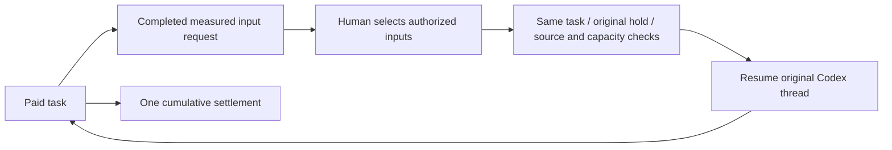
<!-- stage66-current-paid-inputs:end -->

<!-- stage65-current-history-source-lineage:start -->
This repository adds actual-read provenance, content traversal, publication input snapshots and scoped source locks, preserving SQL001–081.

## Sources of conversations and actual reads (stage 65)

Actual model reads now retain immutable file-version, cloud-reference and marketing-dataset provenance. Historical assistant results, pinned memories and approved plans remain subject to current source checks before further model input, cached tools, events and artifact persistence. A new paid delegation rejects unavailable history before creating a task or reserving funds. Conversations show an unavailable placeholder; task lists and details retain state and cost metadata while fencing unavailable acceptance bodies. Existing PLAN_STALE / PLAN_INPUT_CHANGED and initial input-selection semantics remain intact. Controlled deletion explicitly scrubs provenance; a missing erasure flag never authorizes an ordinary provenance rewrite.

Explicit publication creates an independent copy with a frozen set of known inputs. Removing the original private conversation preserves that published copy. Revocation of an input file, dataset or pinned memory still fences derived copies and public shares. Restoration preserves current project, user and private-scope authorization.

Validation: **765/765 Platform tests**, retaining all **746** prior named tests; **51/51 focused tests** and **13 checks across six repositories**. Actual HTTP SSE, Worker tools, downloads, plans, holds and public shares run with authorized synthetic AI/business data. Native SQL081→087 preserves row digests for all 168 original public tables, prior migrations and original function definitions. The added provenance table starts empty; historical reads are never invented.

Desktop remains frameless with custom window controls and no Electron default or Alt menu. The extension uses a real Chrome native Side Panel, right by default while respecting browser preferences. Existing packages receive a read-only byte check; screenshots and native journeys retain their historical Backend source scope. Current Backend UI qualification, signed installation, store release and production acceptance remain pending.

Codex is the only kernel. All AI requests use the company internal OpenAI-compatible gateway. All 102 original requirements and TC/NFR/G01–G10 remain: 81 partially verified, 21 without proven completion, zero fully accepted.

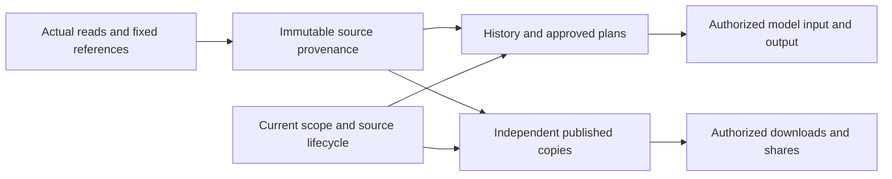
<!-- stage65-current-history-source-lineage:end -->

<!-- stage64-current-report-task-source-fences:start -->
This repository adds SQL081 and shared report/task read fences. SQL001–080 retain their original bytes.

## Current source fences for reports and task history (stage 64)

Marketing analysis and original SEO audit task details, project lists, historical JSON messages and both SSE routes now share current source checks with their dedicated reports. When a source is quarantined or expires, an open stream stops emitting message bodies and closes at its next batch. Restoration still requires current workspace, project, private-owner and session authorization; retained reports and events remain immutable.

Analysis dataset, original CSV, output artifact and terminal analysis-task retention applies before cleanup. Expired analysis inputs are rejected before task creation or budget reservation. Reads that wait for ordinary task updates recheck the actor's current authorization version before responding.

Validation: **746/746 Platform tests**, retaining all **734** prior named tests; **12/12 focused tests** and **13 checks across six repositories**. Actual HTTP streams and Worker-persisted model messages run, including locked Codex through the internal synthetic gateway. AI and business data remain synthetic as authorized. Native SQL080→081 preserves every row digest in **168** prior public tables, old migrations and table ownership/RLS in both databases; only two report-access functions change.

**Desktop remains frameless with no Electron application or Alt menu.** The extension toolbar toggles **Chrome's native Side Panel**, right by default and subject to browser preferences. Existing sources, ASAR, extension ZIP and stage 63 preview packages were rechecked read-only. The actual screenshots and native executions below retain their original Backend scope; this stage adds no browser/native journey qualification of the changed Backend. Installation, signing, store publication and production remain open.

Codex remains the only kernel; every AI request uses the company's internal OpenAI-compatible server. All original 102 requirements and TC/NFR/G01–G10 remain: 81 partially verified, 21 not proven complete, zero fully accepted.

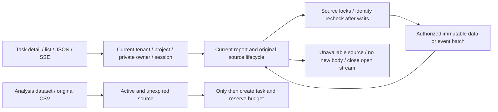
<!-- stage64-current-report-task-source-fences:end -->

<!-- stage63-source-governed-website-changes:start -->
This repository implements scoped website audits, private change tasks, Codex execution, billing and source lifecycle APIs. SQL080 is additive; SQL001–079 retain their original bytes.

## Source-governed website change tasks (stage 63)

Open Marketing insights → Website audits & rechecks. Select 1–20 findings, confirm the frozen original evidence, change objective and separate AI budget, then save a private task. Pause/resume unclaimed work, cancel, inspect original evidence and download JSON/HTML drafts. Explicitly request a same-scope recheck after separately implementing and authorizing website changes. Drafts require human review; unchanged fixture pages correctly retain persistent findings.

**Codex is the only kernel**, with every AI request sent through the company's internal OpenAI-compatible gateway. Business and AI data remain **synthetic as authorized**. Authentication, authorization, native HTTP fixtures, Codex processes, metering receipts and saved files actually run. Drafts must cover every selected, actually read finding; fabricated, unread, missing or duplicated references cannot publish artifacts. Original sources, cache ancestors, quarantine, retention, revocation and erasure govern private drafts and explicitly published copies. Admin metadata, private-body access and content actions retain separate permissions.

**Desktop remains frameless**, with custom dragging and window controls, no Electron application or Alt menu. Downloads use the current tenant's restricted authenticated bridge and native save dialog. The extension toolbar toggles **Chrome's native Side Panel**, right by default and subject to browser preferences; its fixed company link opens the website workspace.

Validation: **734/734 Platform tests**, retaining all **716** prior named tests; **18 actual Web/Admin and 23 newly packaged native checks**, plus 13 checks across six repositories. Native SQL079→080 preserves every row digest in **167** prior public tables and SQL001–079 in both databases. The new table is empty with FORCE RLS. Desktop previews: `release/seo-changes-63-02/`; extension: `release/seo-changes-63-02/CopyPaste-0.5.0-sidepanel.zip`.

The current unpacked Desktop and real Chrome Side Panel were exercised. Setup/Portable remain unsigned; installation, store publication, live websites/models and full product acceptance remain open. All original 102 requirements and TC/NFR/G01–G10 remain: 81 partially verified, 21 not proven complete and zero fully accepted. Earlier sections, screenshots and receipts retain their historical source/package scope.

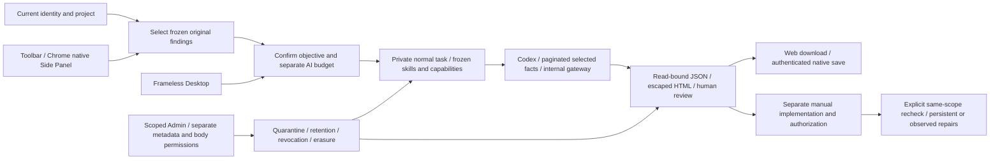


<!-- stage63-source-governed-website-changes:end -->

This repository provides cloud APIs, durable tasks, budgets and source governance. Customers confirm scope in Web or Desktop. Collection and Codex interpretation execute separately under existing enterprise identity and billing rules.

## Scoped website audits and rechecks (stage 62)

Open Marketing insights → Website audits & rechecks. Confirm seed URLs, exact hosts, path prefixes, page-request and AI budgets, then explicitly authorize collection. Inspect progress, uncovered URLs, access limits and URL findings with original quotes, capture times, HTTP/charset facts and hashes. Download actual JSON/HTML attachments. An explicitly requested same-scope recheck creates immutable new history and confirms changes only for pages actually inspected.

Business and AI data remain **synthetic as authorized**. The non-production fixture performs actual native HTTP; a real locked Codex process interprets retained facts through the company's internal OpenAI-compatible synthetic gateway. Public deployment and live model quality remain unqualified. Every DNS answer and redirect is scoped. Collection submits no credentials/forms and executes no scripts. Robots, login pages, errors, unvisited scope and sequential collection limits stay explicit. Storage exhaustion stops collection and releases the unused inference reservation.

Private sources, cache ancestors, recheck history, reports and deliberately published copies retain current authorization, retention, quarantine and erasure controls. Identity is checked again after storage I/O. Admin tenant/project scope, metadata, body access and content operations remain separate. Quarantining a source fences derived customer evidence. Saved website change tasks, Search Console connection metrics, GEO observations, canonical TaskDTO and complete original acceptance remain tracked.

**Desktop stays frameless**, with custom dragging and minimize/maximize/close controls, no Electron native frame, application menu or Alt menu. Email-code sessions use local test mailbox delivery, with actual PKCE identity and tenant-bound authenticated native saves. The extension toolbar toggles **Chrome's native Side Panel**, right by default and subject to Chrome preferences. Its Website audits & rechecks action opens only the fixed company workspace. Owned temporary test tabs are closed.

Validation: **45/45 focused checks, 716/716 Platform tests**, retaining all **674** previous named tests; **13 actual Web/Admin and 20 newly packaged native checks**. Both native databases upgrade SQL077→079 while retaining all rows in **164** prior public tables and SQL001–077. Three added tables are empty with FORCE RLS. Original product tracking remains 81 partially verified, 21 not proven complete and zero fully accepted requirements.

Current localhost previews: Desktop `release/scoped-seo-62-02/`; Extension `release/scoped-seo-62-02/CopyPaste-0.5.0-sidepanel.zip`. The unpacked Desktop and actual native Side Panel were run. Setup/Portable remain unsigned and were not installed, published or production-qualified. Earlier sections retain historical source/package scope.

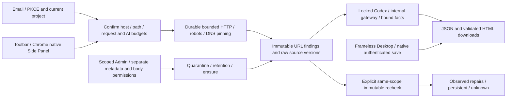


## Marketing accounts and native clients (stage 61)

Connections supports Google Ads, Meta Ads, Google Analytics 4 and Search Console. Select a provider, complete the clearly labelled synthetic consent, wait for account/property/site discovery, then confirm discovered accounts and the projects allowed to use snapshots. Select dates and explicitly create a snapshot. The workbench shows durable pages, errors, rate-limit retry time and immutable history. Queued/running jobs can be cancelled; an explicit retry creates a new linked job.

As requested, business data remains synthetic. The supplier fixture runs only in non-production loopback development mode, using actual HTTP, one-use OAuth state, Google S256 PKCE and pagination. UI, facts and snapshots identify this mode; no real marketing account was accessed. Live application approval, actual account permissions, versions and reporting definitions require separate verification. AI requests continue through the company's OpenAI-compatible server, with Codex as the only agent kernel.

Only discovered authorized accounts can be bound. Google manager paths, GA4 reporting identity/timezone, GSC site permissions and Meta ad-read scope are retained. Snapshots distinguish capture time, source dates/grains, currencies, query digests and coverage limits. Missing cutoff times and metrics remain unknown. Overlapping Meta purchase types are not summed, GA4 traffic/event grains remain separate, and GSC pagination does not claim exhaustive detail. Inspect facts or download actual JSON/CSV. Normalized Google/Meta datasets retain immutable source-asset lineage.

Connection and history directories use bounded pagination; scope changes check their expected version. Revocation clears credentials, cancels unfinished work and fences late publication. Existing snapshots retain original project permissions, retention and content governance. Admin metadata is scoped by tenant/project. Body reading and fresh-MFA revocation are separate permissions; revocation returns a durable audited operation without revealing tokens. Source quarantine, expiry and physical deletion constrain derived analysis, downloads and shares while retaining content-free historical receipts.

Desktop is **frameless**, with a custom drag region and minimize/maximize/close controls, no native frame, Electron application menu or Alt menu. Provider authorization opens only a fixed company page in the browser and returns to the native workspace. Protected JSON passes through the current authenticated bridge into the native save dialog. The extension toolbar toggles **Chrome's native Side Panel**, right by default and subject to the user's Chrome preference. Its Marketing accounts & sync entry opens only the fixed company workspace.

Validation: **39/39 focused checks within 674/674 Platform tests**, retaining all 638 prior named tests; **17 actual Web/Admin checks and 16 newly packaged native checks** passed. Independent suites: web 8, admin 3, desktop 27, extension 21, delivery 12. Both native databases upgraded SQL071→077 while retaining every row digest in 157 prior public tables and SQL001–071. Seven new tables force RLS; legacy connections receive directory-only profiles without invented account/project grants or business history.

Current localhost previews: Desktop `release/connectors-61/`, Extension `release/connectors-61/CopyPaste-0.5.0-sidepanel.zip`. The unpacked executable was run. Setup/Portable remain unsigned and were not installed by these checks. All original 102 requirements and complete TC/NFR/G01–G10, professional-role and production acceptance remain tracked. Earlier receipts and screenshots below retain their original execution scope.

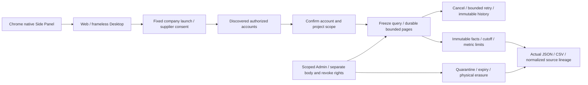


## Template video and current clients (stage 60)

Open Design canvas → Video production. Save independent scripts, scene/storyboard tracks, branding, captions and fixed shared project PNG versions. Optionally select a fixed WAV/MP3, its in point/gain and an ownership or license statement. Save the project, explicitly render, then play or download six files: MP4, project JSON, script, storyboard, WebVTT and media probe. Edits append versions; failed receipts remain visible and retries are explicit. Queued and running renders can be cancelled.

`campaign-cuts-1` supports 3–60 seconds, 24/25/30/30000÷1001 fps and even dimensions from 256 to 1920 px within a total pixel/frame budget. Integer-frame timelines are encoded by native FFmpeg as H.264/yuv420p and optional AAC/48 kHz. Actual frames, duration, complete decoding and post-encode audio volume are verified. The bundled Noto Sans TC font includes its OFL, pinned source commit and full SHA. Missing glyphs, overflowing text, missing/quarantined/expired sources and short audio fail explicitly. Encoder fingerprints hash version output. Exported projects reference fixed source media: rebuilding requires those original versions and the recorded environment; byte-identical cross-environment output is not claimed.

The durable queue has immutable input versions, leases, bounded concurrency, cancellation and final authority/source checks. Admin scope, body reading and content actions remain independent permissions. Shared and authenticated downloads recheck derived source availability. Deletion physically erases objects and content copies. Composition makes no AI call; AI HK$0 excludes upstream source creation costs.

New R16 video preset v1.1.0 exposes the implemented `video.render` composition tool. Controlled Codex execute-mode calls can idempotently create and queue a project. Ask/plan and private conversations do not expose this shared writer. The 29th preset skill, `template-video-composition`, preserves the earlier 28 packages and complete acceptance conditions of all 18 roles; earlier installed versions remain unchanged. Generated video, effects, TTS/ASR and complete professional-role qualification retain separate requirements.

Validation: **34/34 focused checks within 638/638 full Platform tests**, retaining all 607 previous named tests; **10 actual Web checks and 17 newly packaged native checks** passed. Independent suites: Web 8, Desktop 25, Extension 21 and Delivery 12. Both native databases upgraded 069→071 while preserving all row digests in 154 prior public tables and SQL001–069; three new tables force RLS.

Desktop remains frameless, with custom controls and no Electron or Alt menu. Protected video bytes pass through the existing authenticated bridge into the local player. The extension toolbar still toggles Chrome's native Side Panel, right by default and subject to the user's Chrome setting, with a new video workspace entry. Current previews: Desktop `release/video-60/`, Extension `release/video-60/CopyPaste-0.5.0-sidepanel.zip`. The unpacked runtime was executed. Setup/Portable remain unsigned localhost previews without installer execution acceptance. All original 102 requirements and TC/NFR/G01–G10 retain their complete acceptance conditions.

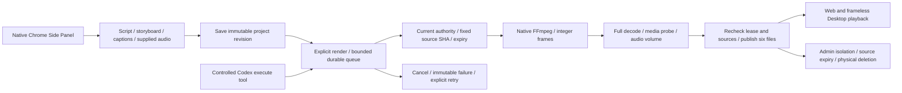


## Batch designs and current clients (stage 59)

Design canvas now creates a creative × language × size matrix, capped at 60 independent delivery units. Supply Traditional Chinese/English copy, a fixed shared project PNG and preset or custom dimensions. Each size receives its own layout and actual PNG, SVG and editable JSON files. Edits, retries, failures and output history belong to individual units. Layout makes no AI calls: its recorded AI cost is HK$0 from local composition, excluding upstream source creation costs.

Claims and publication recheck current authority, input revision and source access. Cancellation, revocation and expired leases fence late output. Existing scoped Admin body permissions apply. Source quarantine blocks derived downloads; deletion physically erases embedded copies. SVG references server fonts; custom font distribution and commercial font qualification remain separate work.

Validation: **22/22 focused checks within 607/607 complete Platform tests**, retaining all original 588 named tests; **10 actual Web journeys and 13 new packaged/native journeys** passed. Independent unit suites passed Web 8, Desktop 25, Extension 21 and Delivery 12. Both native databases upgraded 068→069 while preserving every row digest in 151 prior public tables and SQL001–068; three new tables force RLS.

Desktop remains frameless with custom controls and no default Electron menu. The extension toolbar opens the native Side Panel and toggles it closed; its batch-design entry opens the full company workspace. Current previews are Desktop `release/matrices-59-02/` and Extension `release/matrices-59-02/CopyPaste-0.5.0-sidepanel.zip`. Earlier packages remain intact. These unsigned localhost previews have not passed installer execution or store distribution acceptance. Other professional workflows, live services, all original 102 requirements and TC/NFR/G01–G10 remain independently tracked.

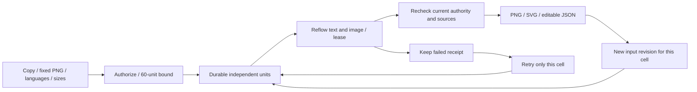


## Provider Admin controls (stage 58)

The Admin Provider controls page supports immutable policy drafts and independent publication, scoped request filters and extra cost-field authority, downloadable immutable human evidence, separate cost and capacity confirmation, and original task settlement. Original unknown observations remain intact. Settlement derives frozen prices instead of accepting a client amount, excludes platform-funded input counting and creates one customer debit. Legacy arbitrary reconciliation cannot bypass durable provider records.

Validation passed **158/158 focused checks within 588/588 full tests**, retaining all 559 stage 57 named tests. The same 753 Platform sources passed type checking and the actual build. The built Admin passed **10 real browser journeys and 29 strict response samples**, including email/TOTP sign-in, a second reviewer, separate cost/capacity facts, one settlement, scoped redaction, bilingual dark and narrow layouts. AI observations are explicitly simulated. All owned browsers and services were closed.

Both existing native databases upgraded from 067 to 068 while preserving every row digest in 144 original public tables, SQL001–067 and historical checksums. Seven new tables force RLS without automatically granting existing administrators new rights or fabricating publications, evidence or charges. All original 102 requirements, TC/NFR/G01–G10, live-role qualification and distribution acceptance remain open; older sections retain their historical scope.

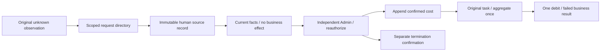

### Explicit activation for an existing administrator

From the Platform repository, a trusted operator previews one active, MFA-enrolled permanent global super administrator:

```powershell
node --env-file=.env --import tsx scripts/admin-enable-provider-control.ts --principal PRINCIPAL_UUID --reason "Assign provider control owner"
node --env-file=.env --import tsx scripts/admin-enable-provider-control.ts --principal PRINCIPAL_UUID --reason "Assign provider control owner" --apply --expected-hash PREVIEW_SHA256
```

Use the exact preview hash and unchanged reason. Preview again if the database or target authority changes. Activation revokes old sessions and requires fresh email/TOTP sign-in. Explicitly activate two separate administrators for independent review. The command never selects a principal or expands existing roles automatically. Keep `.env` and private identity configuration outside Git.

## Per-request budgets (stage 57)

Text generation counts its complete normalized context through the company `/v1/responses/input_tokens` endpoint, then atomically allocates frozen input prices and an explicit output bound against the task's original reservation. Images share that same budget. Counting needs an explicitly verified price and uses platform funds. Missing counts or prices block generation. Each proof is bound to one operation, digest, original identity and capability. Admin verification has independent run and daily platform budgets and never uses customer wallets.

Settlement aggregates durable exact cost numerators and rounds once for one ledger charge. Unknown outcomes retain commitments. Input mismatches and overruns persist actual spend before reconciliation and cannot enlarge the customer budget. Injected adapters reporting synthetic text counters cannot add unobserved text costs to real image operations.

Validation passed **129/129 focused checks within 559/559 full tests**, with 741 unchanged source files and all 546 stage 56 named tests retained. Type checking and the actual build passed. Both existing native databases upgraded from 066 to 067, preserving every row of 136 original public tables, SQL001–066 and their historical checksums. Eight new tables force RLS. Only definitely unexecuted tasks receive original budget bounds; no historical spend or verified prices were fabricated. SQL067 is now immutable.

Codex, PostgreSQL and accounting transactions are real; model/media responses are authorized simulations. No browser or native client was opened. Previous screenshots and packages retain their original source scope. Complete Admin policy publication, request directory, evidence-based cost/capacity reconciliation and all original product acceptance remain open.

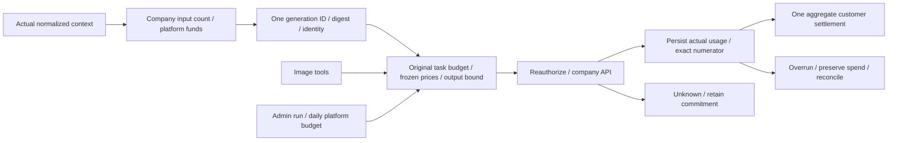

## Durable provider requests (stage 56)

Worker text, image tools and Admin verification share PostgreSQL admission, concurrency and rolling-minute limits. Immutable request identity, policy versions and events preserve the original task, capability and rates. Current authority is checked again before dispatch. Unknown outcomes and lost originators retain capacity and are never automatically replayed. Bounded terminal frames reach Codex only after validated usage commits, so its next response cannot race the preceding persistence step. Exact cost numerators support aggregate rounding; request facts do not charge the ledger again.

Validation passed **116/116 focused checks within 546/546 full tests**, with 738 unchanged source files and all 531 stage 55 named tests retained. Type checking and the actual build passed. Both existing native databases upgraded from 065 to 066, preserving all rows of 132 original public tables, SQL001–065 bytes and historical checksums. No historical provider requests were fabricated. Migration 066 is now immutable.

Codex and PostgreSQL are real; model/media responses are authorized simulations. No browser or native client was opened in this stage. Earlier screenshots and packages retain their original source scope. Per-call budget allocation, complete Admin policy/reconciliation controls and original whole-product acceptance remain open.

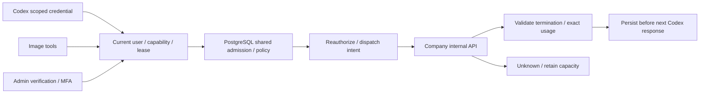

## Explicit adoption (stage 54)

Default assistant updates, specialist settings and conversation adoption now compare the exact models, effort, unit rates and Skill versions before explicit consent. Five-minute comparisons bind the real session and current configuration; stale comparisons are rejected. Retries use one persistent operation key. Previously accepted tasks keep their original versions and prices.

Current backend regression: **484/484**, including all 462 prior named tests; focused **93/93** overlaps that total. Actual built Web: **12/12**; new packaged frameless Desktop and real native Chrome Side Panel: **11/11**. AI/media use the authorized simulated dependencies; identity, PostgreSQL, permissions and version transactions execute normally. All 102 original requirements remain tracked. Earlier sections below retain their historical source and artifact scope.

Migration `065-explicit-agent-adoption.sql` is forward-only: tenant/actor RLS, column-limited consumption and bounded Skill locks. Both existing databases retain all 131 pre-existing public tables and SQL001–064 byte checksums. No historical adoption facts are fabricated. Main implementation: `src/agent-adoption.ts`; semantic integration coverage: `tests/agent-adoption.test.ts`.

## Controlled capabilities and Admin publishing (stage 53)

Adds typed capability documents, pinned Codex/internal-gateway verification, independently approved publication/rollback, database-backed current versions and preservation of old task bindings. See `src/capability-releases.ts`, `src/capability-verification.ts` and [forward migration 064](migrations/064-controlled-capability-releases.sql). Current full regression 04 passes **462/462** with 726 unchanged sources and no failures, cancellations or skips, including all 435 original stage 52 tests. Candidate 11's 71/71 overlaps the full run and is not added to its total. Actual built-Admin browser run 06 passes 11/11 with 14 unedited screenshots; supplemental contract run 02 passes six checks.

064 is applied to both existing local databases, each preserving complete row digests for all 125 original public tables, SQL 001–063 bytes and historical migration checksums. All six new control tables force RLS and deny direct application-account access; historical publications are not fabricated. Migration 064 is now immutable. The full run's two deferred fixtures were actually reclaimed after workers exited; all browsers, services and databases owned by these runs are stopped.

Image verification fully decodes PNG, checking CRCs, scanlines and bounded inflation. Accepted corrupt responses retain reconciliation and known costs without replaying model calls. Local HTTP fixtures allocate Fetch-compatible ports and retain an actual forbidden-port zero-request counterexample. Verification and durable workspace reclamation remain separate facts: only actual removal completes cleanup, and retries never call the model or rewrite costs.

`npm test` uses `scripts/run-tests-owned.mjs`: bounded Windows locks can defer reclamation until test workers exit, but failed actual removal still fails the overall run. Two real-child-process tests check live-worker and replaced-path refusal. Full runs 01 at 456/458, 02 at 458/458 and 03 at 460/461, and every candidate's original evidence, retain their historical source scope. SQL 001–063 and historical retained fixtures remain unchanged. The additive machine contract at `docs/contracts/capability-releases.openapi.json` is tracked separately from the original OpenAPI. Visible customer model/price comparison and adoption, per-request gateway limits and complete acceptance remain open. The 435/435 figures below describe the original stage 52 source baseline.

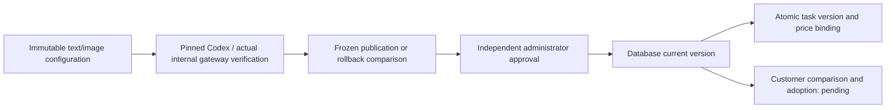

## Frozen task models and prices (stage 52 historical baseline)

New tasks bind their Codex profile, internal model, reasoning effort and pricing version in the same transaction as enqueueing and budget reservation. Worker execution, image generation/editing and settlement use the original binding; customer and administrator retries inherit it. Revocation blocks further execution while retaining original costs, and unknown image results remain in reconciliation. Historical selections are never fabricated from today's configuration.

[Migration 063](migrations/063-frozen-task-capabilities.sql) adds immutable bindings protected by RLS. The application still cannot update global capabilities or Codex profiles; a bounded database function only locks specified versions. At that stage, focused suites, existing templates, private workflows and real Codex checks passed 35/35. Both native 062→063 upgrades preserve all 124 original public tables and historical SQL bytes. Original permission, fixture and outdated full-suite assertion failures remain retained. Stage 52 left administrative validation/publication/rollback and customer version confirmation open; the later Admin subflow is described in stage 53 above. Customer confirmation and complete REQ-045/099 acceptance remain open. Stage 51 and older figures below retain their historical scope.

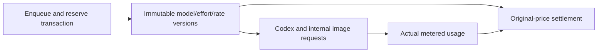

See the [capability and frozen pricing suite](tests/capability-bindings.test.ts). Model/media dependencies are controlled fixtures; identity, permissions, PostgreSQL, pinned Codex and ledger operations execute for real.

The stage 52 full Platform regression passed 435/435 with 714 unchanged source files and no failures, cancellations or skips; TypeScript checks and build passed. The original 434/435 report and old test source remain retained. Only the assertion cancelling an existing task on default changes was corrected to preserve its frozen binding; new-delegation and active-revocation checks were retained.

## Controlled support update / 受控客服协助

Added time-limited customer grants and canonical administrator support sessions. Scope binds the real administrator session, target identity/membership versions, explicit projects and deadline. Body, billing and VIP authority stay independent; private bodies remain unavailable. Migration 062 is additive and does not turn legacy records into customer views.


Stage 51 current regression: 424/424 with 711 source files; controlled-support browser workflows: 8/8 with 816 source files and 9 unedited captures. The 14 support tests, original contract checks, migration preservation and separate native checks are bounded evidence, not completion of all 102 acceptance cases. Current binaries are rebuilt; stage 50 binaries remain unchanged in their archive.

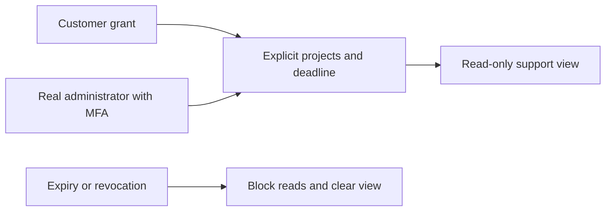


[简体中文](README.md) · Native enterprise Agent services · 0.5.0

This independent repository implements persistent PostgreSQL services, customer/admin identity, workspace/project authorization, Codex execution, marketing assets, analytics, workflows, device commands and the admin control plane. No sibling source checkout is required. The delivery root's `docs/` contains the master requirements and design baseline.

## Durable financial notifications and three-client accounts (stage 50)

Migration 061 captures canonical journal, payment evidence/confirmation and refund INSERTs into an outbox in the same transaction. Independent maintenance delivers to currently eligible recipients with locking and uniqueness; retrying delivery never repeats funding. Financial GET/PATCH operations recheck the current session, workspace, role and account. Unknown refunds retain a null amount and a separate requested amount, with no internal reason, bank reference or evidence in the user DTO. Both native databases retain identical row digests across all 120 original public tables; 001–060 remain unchanged and historical notifications are not backfilled.

Stage 50 historical platform regression: 410/410; actual three-client financial workflows: 8/8. AI/media and payment evidence are authorized local simulations; authentication, database, authorization, ledger and notification paths execute for real. This does not complete the original 102 acceptance cases, production banking or the full installation/system matrix.

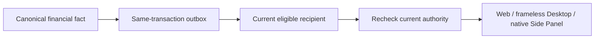


## Atomic VIP and explicit credit (stage 49)

The existing VIP form can include a deliberate HKD gift with its own exact amount, expiry and reason. One frozen preview and one confirmation create a parent operation. The server commits canonical VIP and financial child operations in one database transaction, or rolls both back. If either risk policy requires review, the whole request waits for another administrator with both domains' permissions; pending requests create no entitlement or credit.

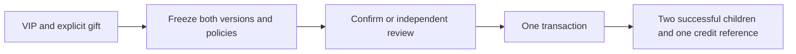


The current full platform run passes 394/394 with 703 unchanged source files; the 19 focused groups are included. Nine actual Admin/user browser groups and 12 unedited captures are bounded evidence. The 125 original-schema responses and one strict supplemental request are checked separately. Additive migration 060 preserves complete old-row digests for all 119 original public tables in each native database, applied 001–059 bytes and historical null checksums. Initial fixture errors and two verifier mistakes remain archived. All original REQ/TC/NFR/G01–G10, professional role quality, real external services and production/installation acceptance remain in scope. Master details are in `docs/technical/49-atomic-vip-and-explicit-credit.md` and current Delivery receipts.


## Immutable plan definitions and legacy grant bindings

Commercial families have immutable drafts/versions, frozen publication comparisons and independent review. Original AdminPlanDraft / AdminVersionReason commands return strict 202 AdminOperation receipts. The server checks global permission, overlapping denies, recent MFA, the original live session, policy/head versions, concurrency, idempotency and atomic audit rollback. Legacy catalog writes cannot bypass the registry. Issued grant bodies remain fixed; missing old bodies are explicitly labelled as evaluated at binding time, without inventing original grant facts.

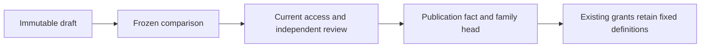

Forward migration 056 retains all original 001–055 bytes. The focused plan/migration/Skill suite passes 24 tests; see the current delivery receipt for the complete platform regression. Publishing does not credit money, charge a payment or activate VIP. Complete canonical grants, customer plan endpoints, seat/storage quota enforcement and entitlement events remain unfinished. The master design is `docs/technical/46-immutable-plans-and-legacy-grant-bindings.md` in the delivery root.

## Prerequisites and local start

Validated on Windows x64 with Node.js 22.14+, npm, Git, native Codex `0.163.0-alpha.10.2`, FFmpeg and FFprobe. Dependencies are pinned. Use native processes; Docker, WSL and virtualization are prohibited. Other operating systems have not been qualified.

```powershell
npm ci
npm run setup:local
npm run db:local
```

Keep the database terminal open. In another terminal:

```powershell
npm run db:migrate
npm run dev
```

API: `http://localhost:4310`; PostgreSQL: `127.0.0.1:55432`. The launcher applies development migrations; `db:migrate` also prepares `copypaste_test`. Migrations use the owner identity, while application connections use restricted, non-owner roles with RLS.

`setup:local` creates unique passwords and a durable MASTER_KEY only when `.env` is absent. `.env.example` is a secret-free reference, not a replacement for an existing installation. An ephemeral ASCII junction works around PostgreSQL bootstrap limitations on Unicode Windows paths; actual data and binaries stay in this repository. Shutdown uses native pg_ctl to checkpoint the cluster before removing the alias; it does not force-kill PostgreSQL.

## Customer lifecycle

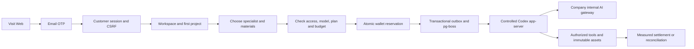

First email verification can create an account. OTPs expire after 10 minutes, permit five failed attempts and have one atomic consumer. Development mail is written to `.data/mailbox/<challenge-id>.json`; inspect it locally. Production requires SMTP. Web and Admin use separate HttpOnly cookie sessions with Origin/CSRF checks. Native clients use PKCE, short-lived access tokens and rotating refresh families. Logout, suspension and session revocation invalidate access.

## Administrator enrollment

```powershell
npm run admin:create -- admin@your-company.example super_admin
```

Import the generated TOTP URI from `.data/enrolment/<id>.json` into an authenticator, then delete that file. Admin login requires both email OTP and TOTP. There are no shared default credentials. Enrollment is a trusted deployment CLI operation.

Eight built-in roles and 68 permission keys support global, tenant and project scope, explicit denies, amount/duration/batch limits and bounded delegation. Sensitive actions require MFA within the last 10 minutes. Administrators cannot grant themselves access or remove the last permanent recovery administrator.

Version 0.3.0 completes subsequent admin invitations, recipient email proof and real TOTP enrollment, profile editing, status CAS, suspend/resume, resend, other-admin MFA reset, self authenticator replacement and session revocation. Capabilities are hashed; setup keys and unmailed invitation material are encrypted and cleared on completion/revocation. Public admin projections never expose keys, tokens or invitation links. See migration `008-admin-identity-lifecycle.sql`, `src/admin-identities.ts` and 14 actual PostgreSQL/API test groups. Trusted CLI bootstrap remains; production SMTP and SSO need separate qualification.

## Implemented scope

| Area              | Implementation                                                                                                                                                                |
| ----------------- | ----------------------------------------------------------------------------------------------------------------------------------------------------------------------------- |
| Identity          | Email OTP, separate Admin MFA, native PKCE, invitations, member/project rights, last-owner protection and PostgreSQL RLS                                                      |
| Agent             | Codex-only version-pinned runtime, 28 hash-checked Skill packages, 18 role presets, tasks/events/cancellation/leases/fencing                                                  |
| Billing           | Integer HKD micros, funding lots, reserve/settle once, manual confirmed payments/gifts/source-bound refunds, personal/workspace VIP and frozen plan versions                  |
| Admin             | Paginated users/workspaces, scoped consumption, preview/commit, independent approvals, content quarantine/share revocation, jobs/exports, configuration publication and audit |
| Creative          | Local/S3 adapters, immutable versions, authorized downloads/thumbnails, brand records, image/text layout projects, SVG/PNG and actual FFmpeg template MP4                     |
| Analytics         | CSV imports, aggregate CTR/CPC/CPA/ROAS, null undefined ratios, submitted-HTML SEO checks, Google/GA4/GSC/Meta OAuth/report adapters                                          |
| Workflows/devices | Bounded eight-step persistent workflows, analysis/Agent/approval steps, registered devices, Ed25519-signed commands, expiring folder grants and single-use results            |

The 18 roles cover full-stack, frontend, backend/API, software QA, UI/UX, general design, brand, advertising, ecommerce, social content, illustration/IP, typography/layout, presentations, landing pages, information design, video/motion, marketing analytics and workflow consulting. Definitions and actual packages are in `catalog/` and `skills/`.

Installed packages are not evidence of qualified live business tasks. All roles currently report `pending_live_validation`. Unconfigured AI fails explicitly instead of returning synthetic success.

### Actual runtime tools

Registered tools include `project_assets`, `asset_text_read`, `deliver_text`, `marketing_metrics`, and role-gated `code_read`, `code_write`, `code_package`, `font_catalog`, `design_render`, `image2_generate`, `image2_edit`. Code tools support hash-based edits and real ZIP manifests without executing untrusted customer code or claiming tests ran. Design tools produce editable JSON, SVG, PNG and bounded template MP4. Image generation/editing uses the internal Images endpoints only.

Other planned tool identifiers in the design catalog are not all registered. AI video and speech are not implemented; roles requiring those capabilities remain unavailable. Manual signed local-file dispatch works; autonomous Codex local-file dispatch is not connected yet.

## Persistent specialists, private conversations and memory

Version 0.2.0 adds project specialists based on installed roles, with instructions, brand binding and a restricted tool subset. Edits create immutable versions. Conversations pin a version and can explicitly adopt an update. Kernel, provider, model and executable Skills remain server-controlled Codex configuration.

Conversation ownership applies to tasks, events, versions and generated files, enforced by API checks and PostgreSQL RLS. Ordinary workspace administrators cannot read another user's conversation. Shared project tasks cannot consume unrelated private artifacts. Publication explicitly creates a shared copy without private context.

Messages can be notes or delegated ask/plan/execute tasks. Ask and plan permit reading tools; execute can create artifacts. Message UUIDs, conversation versions and one active task per conversation prevent duplicate submissions. Plan approval rechecks the input digest, specialist/memory/conversation versions and budget, and creates one execution child.

Memory has workspace, brand, project, conversation and personal scopes, content versions and expiry. Tasks freeze exact references and recheck authorization before subsequent tools. Deletion clears readable content and cached replay responses while retaining idempotency tombstones. Physical object/runtime-cache garbage collection remains unfinished. Conversations with active or unresolved billing work cannot be deleted.


## Internal gateway qualification

Configure server-only `AI_BASE_URL`, `AI_ALLOWED_HOSTS`, `AI_API_KEY`, the exact `AI_MODEL` alias and contracted HKD token rates. The base commonly includes `/v1`. URL-embedded credentials, production HTTP and fallback to external model providers are rejected.

```powershell
npm run codex:probe
```

This probes the actual version, initialize and thread/start without sending a model turn. Before setting `AI_VERIFIED=true`, qualify real `/responses` tool rounds, token usage and failure behavior against the company gateway. Image 2 separately requires its alias, per-image price and `AI_IMAGE_VERIFIED=true`; verify actual PNG generation and multipart edits.

The runtime integration test launches real Codex against a controlled local Responses fixture and observes a tool call and measured usage. It does not qualify the company's live model. No company gateway credentials were supplied for live integration.

## Financial and operational semantics

1 HKD equals 1,000,000 integer micros. Gifts, confirmed payments, reservations, charges and refunds have separate immutable entries. Confirmed payment references are globally unique. VIP does not credit a wallet, and a wallet balance does not grant VIP.

Pilot Starter/Pro/Business defaults allow 1/3/8 concurrent tasks and HK$100/500/5,000 task budgets. These are operational defaults; monthly pricing remains an unpriced zero placeholder, not a commercial free-plan promise. Admin can publish versioned policies.

Financial/VIP writes require a five-minute preview, payload hash, target version and idempotent commit. The default independent-approval threshold is HK$10,000. Uncertain upstream outcomes retain reservations in reconciliation rather than blindly repeating charges. Payments are manual confirmed records; no online payment acquiring is integrated.

Exports are limited to 500 rows, expire after 15 minutes, belong to the creating admin and recheck source authorization. SQL collection queries enforce scope and explicit denies; roles separately gate contact, usage and billing fields.

## Build and validation

```powershell
npm run typecheck
npm run build
npm test
npm run contracts:export
```

The original 0.5.0 release exported 167 Fastify method/path pairs, ten migrations and 84 tests. Those source counts were a historical checkpoint. Current routes are listed in `contracts/implemented-routes.json`; migration files and the current full regression receipt in `../copypaste-delivery/evidence/alignment-platform.json` are authoritative. Route counts do not establish full planned OpenAPI conformance. Tests cover identity, isolation, concurrent/idempotent billing, permissions/VIP, content revocation, actual image/PDF/MP4 output, real Codex controlled protocol turns, source packages and persistent work. Separate delivery tools record browser, extension and Desktop journeys.

| Directory             | Purpose                                                     |
| --------------------- | ----------------------------------------------------------- |
| `src/`                | API domains, Worker, authorization and Codex                |
| `migrations/`         | Ordered migrations and database constraints                 |
| `catalog/`, `skills/` | Roles, permissions and hashed Skill packages                |
| `contracts/`          | Generated Codex protocol and actual route inventory         |
| `scripts/`            | Native startup, migration, admin enrollment and probes      |
| `tests/`              | Real PostgreSQL, media and runtime tests                    |
| `.data/`              | Ignored local state, mail, enrollment secrets and artifacts |


The screenshot comes from the independent Admin client; this service repository does not contain that UI.

## Deployment and remaining work

Production requires HTTPS, SMTP, separate database identities, a durable MASTER_KEY, restricted egress and storage. The local database launcher refuses production. Back up the database, object data and encryption key, and rehearse native restoration before deployment.

Google/Meta need server OAuth credentials, explicit API versions, Ads developer token and callback registration; live platform authorization/report qualification is pending. S3 has not been qualified against a live bucket. SAML/SCIM, mandatory SSO policies, event triggers, parallel specialist teams, collaborative editing, full AI video/speech, production SLOs, Windows signing and strong customer-code isolation remain unfinished. Codex shell, web search and other agents are disabled; production service-account, ACL and network containment still require deployment work.

No additional open-source license is granted for this application. See [third-party notices](THIRD_PARTY_NOTICES.md).

## Daily / weekly cloud workflows

Version 0.4.0 persists server calendars for published workflows; closing the user page does not stop execution. Migration `009-workflow-schedules.sql`, `src/schedule-time.ts`, `src/schedules.ts` and the native Worker retain immutable versions, occurrences and run references. Explicit confirmation pins the workflow version/hash, execution identity and per-run budget. IANA time zones skip nonexistent DST wall times and select the first repeated instant once.

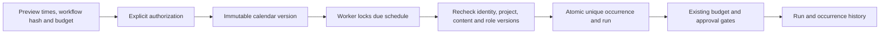

One unfinished run per schedule prevents overlap, including approval gates and uncertain child charges. Missed opportunities catch up only the latest or skip late triggers; older ranges are coalesced. Paused intervals never backfill. User resumption confirms current authorization; Admin resumption retains the original identity and requires scope, recent MFA, CAS and a reason, rejecting revoked authorization. End times are exclusive; projects allow 50 non-retired schedules. This is not a hard real-time SLA. Fourteen additional database/API/calendar test groups cover concurrency and thousand-day downtime; Delivery `qa:schedules` separately waits on the real clock.

## 0.5.0 company identity and unified sign-in

OIDC uses code + PKCE S256, signature verification, state/nonce and a fixed callback. An existing registered account and active workspace membership are required. First binding requires a separate CopyPaste work-email code; domains never auto-enroll users. Configuration changes, disablement or unlinking revoke all linked users’ CopyPaste browser/native/refresh sessions and prior execution authorization. Administrator email and TOTP remain separate.

Global `admin.tenants.sso.write` is one of 68 actions, built into super/security roles only. Writes require recent MFA, reason, CAS and idempotency. Save disables the connection and clears prior verification; discovery/JWKS/PKCE checks do not qualify the client secret or a real company account. Pinned MIT `openid-client` 6.8.8 enables asymmetric ID-token signature checks.

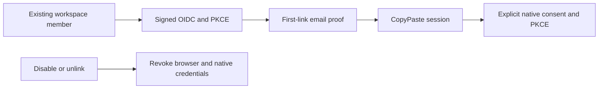

Deployment: use exact HTTPS `SSO_ALLOWED_ORIGINS`. Default callback is `WEB_ORIGIN/v1/auth/sso/callback` through the Web API proxy; `SSO_CALLBACK_ORIGIN=API_ORIGIN` is supported when Web uses that cross-origin `VITE_API_BASE`. Production rejects `SSO_ALLOW_LOCALHOST=true`. For the native fixture only, start the development controller with this environment flag, run `qa:federation`, then stop and restart without it.

Migration 010 invalidates legacy native codes without a source session. Exchanges recheck source expiry/revocation and user revision; refresh inherits federation identity/revision. Revoking a previously listed device session also revokes its rotated credential family. Tests use actual PostgreSQL and signed code/token/JWKS exchanges. SAML/SCIM, mandatory SSO policy and real company-IdP qualification remain outside this increment.


## Implementation repairs in progress

Current source adds a labelled synthetic dependency mode, irreversible erasure journals and physical/runtime cleanup, 90/30 day online retention, seven day replay-result cleanup, resumable 4 MiB parts, streamed downloads, durable SSE and recovery of tasks that failed before execution was claimed. Applied migrations are forward-only with recorded digest validation. The master design and remaining gaps are in docs/technical/17-erasure-transfer-retention-events.md. Existing 0.5.0 archives do not include unpublished source changes.

With the native database configured, set `$env:DEMO_MODE='true'` for the API process and run `npm run dev`, or use `npm run demo` in the independent delivery repository. Synthetic mode is forbidden in production and on non-loopback hosts. The one-time demo gift is not a payment; the Codex kernel and business operations still run.

## Persistent cloud files (current source)

Shared project and private conversation workspaces now support pinned file references, search, moves, erasure and explicit publication of independent copies. In private conversations, Codex source tools read, compare hashes, persist updates and package actual working files. The asset.read capability provides authorized node/version reads. Forward migrations 023/024 add the model; Admin content management includes nodes.

The current 139-test regression passes, including five cloud-file integration groups. Synthetic dependencies do not qualify live providers or professional roles. Source limits are 500 files / 20 MB, with 1 MB per file. Removing an entry preserves independent source assets; permanent asset deletion is separate. See the master technical/18-persistent-cloud-files.md for detailed behavior and limits.

## Project Skill lifecycle (current source)

Project methods now have exact installation and specialist/task bindings. Ordinary disable affects new work; uninstall and permanent security revocation block subsequent calls, including old tasks. Reinstallation creates a new identity and requires explicit adoption by a new specialist version. Current plan access is checked before tools and final output; measured usage settles against the original reservation.

Historical platform regression: **185/185**. `npm run qa:skills` in the delivery repository passed three browser groups; 31 captured HTTP request/response payloads passed the strict design schemas. Custom package review/publication and complete live-role qualification remain pending. Existing 0.5.0 installers are historical.

## Default assistant and in-app notifications (current source)

The built-in assistant uses fixed Codex, the internal text profile and delivery-core; it is separate from the 18 professional roles. POST /delegations atomically creates a private conversation, message, task, exact method bindings and reservation. Repeating client_message_id returns the accepted result. Ordinary writes/deletion cannot alter the shared default. Owner/Admin explicitly adopt reinstalled methods through a checked new version; moderation cannot be bypassed by automatic recreation.

Forward migrations 026/027 add the behavior. Notifications observe final task state at transaction commit, recheck current recipient/private/project access, support microsecond cursors and read updates, and expire after 30 days. Titles come from the currently authorized task. GET/PATCH /v1/notifications and compatible tenant routes are available; no external messages are sent.

Six assistant and four notification integration groups are in the 139-test regression. Web assistant/inbox journeys each pass four groups; Chrome passes eight and source Desktop eight, using real Codex with clearly synthetic dependencies. Full template APIs, paid-step checkpoint continuation and live-role qualification remain unfinished. See master technical/20 and technical/21.

```mermaid
flowchart LR
  Submit[Explicit submission and stable ID] --> Atomic[Private conversation / message / task / budget]
  Atomic --> Codex[Fixed Codex and controlled methods]
  Codex --> Commit[Final state at commit]
  Commit --> Inbox[Authorized recipient inbox]
  Inbox --> Original[Original project and private task]
```

## Explicit inputs before execution (current source)

Migration 028 introduces an explicit file/connection checkpoint before the first model turn. A task keeps its original private conversation, ID and single budget reservation while `needs_input`; it has no worker outbox entry or model charge until every required input is selected. Resolution uses current project access, current file versions, a declared connection provider, CAS and idempotency. Shared tasks cannot consume even their creator’s private files. Candidate search is paginated and never exposes credentials.

Resource revocation before claim returns ordinary tasks to the checkpoint. An approved plan cannot silently accept replacement sources: changed inputs invalidate approval or cancel unstarted execution. Admin retries inherit private ownership and inputs; separately authorized, audited body reads include input metadata. Ten dependency integration groups and one retry group contribute to the 139 passing tests. Three dependency response samples and two scoped Admin cleanup pages contribute to 17 strict runtime-schema checks. This covers declared initial prerequisites; automatic discovery, paid-step continuation and device dependencies remain unfinished.

```mermaid
flowchart LR
  Submit[Explicit input requirements] --> Hold[One task and one reservation]
  Hold --> Wait[Wait without a model call]
  Wait --> Select[User selects authorized current resources]
  Select --> Recheck[CAS and resource recheck]
  Recheck --> Queue[Queue original task once]
  Queue --> Codex[Controlled Codex execution]
```

## Execution capacity and fair dispatch (current source)

Migration 029 atomically checks global, workspace, current-user and capability limits across native Workers. Defaults are 10 handlers, two workspace slots, two image slots and two media slots, with one media slot per workspace. Started reconciliation keeps its slot. Active-work admission is separate from actual execution capacity. A busy task retains its ID, attempt zero and single budget hold; a delayed outbox retries it automatically. Dispatch interleaves workspace queue positions. Seven isolated-database/native-queue groups pass. Full NFR load qualification and per-provider request limits remain unfinished.

## Admin records and repeatable native integration tests

Cleanup pages now filter state/type/literal IDs within current authorization before counting and pagination. Admin lists default to 50, capped at 100. Migration 030 adds query indexes; applied migration bytes remain immutable. Per-page progress uses batched queries. Ordinary pages exclude object locators and lease credentials; direct read-only retries return 403.

Application integration suites and migration checks each create a native `copypaste_suite_<random UUID>` PostgreSQL database and an owned `.data/test-runs/<random UUID>` directory, apply all migrations and close the application before removing only that fixture. A local native PostgreSQL server and loopback `OWNER_DATABASE_URL` are required. Neither the demonstration database nor historical `copypaste_test` is reset. Reconciliation fixtures cannot consume the next run's execution slots. Delivery evidence preserves the original failure and repair verification.

## Persisted role templates and Codex versions

Migration 031 adds real template, Codex-profile and internal-capability identities. The canonical template directory, detail, preflight and instance APIs enforce current project access, plan, methods and implemented tools. A five-minute preflight receipt creates no task, installation or wallet hold. Instance creation rechecks dependencies and atomically pins versions; kernel, gateway and Skill identity overrides are rejected. Stale bindings fail before a new budget reservation and are checked again at claim, tools and publication. Legacy records retain their original history; complete publication and upgrade flows remain pending.

```mermaid
flowchart LR
  Template[Reviewed template version] --> Check[Current project preflight]
  Check --> Create[Recheck and create idempotently]
  Create --> Pins[Template / Skill / Codex / capability versions]
  Pins --> Guard[Submit / claim / tool / publication guards]
```

Six new platform groups and eight real Web/Electron journeys passed; 21 captured HTTP responses passed strict schemas. All 18 professional presets still require live business qualification. The minimum of 12 qualified roles remains unchanged. Unsupported tools are explicit dependencies.


## PDF review delivery (current source)

The canvas and Codex `design_render` produce actual single-page PDFs. Editable layers remain in the source project or separate editable JSON; PDFs are raster review copies. `layout.render`, `document.render` and `video.render` independently restrict formats. Visible-version checks refuse stale exports, and lost accepted replies retry with the same key and original source snapshot.

The historical native regression passed **185/185**. Seven delivery Web/current-source Electron groups cover downloads, native saves, independent pypdf/Poppler parsing/rendering and file hashes. Models remain simulated while file logic is real. Complete review packages, print standards and at least 12 qualified live roles remain pending.


## Marketing CSV, exact metrics and provenance (current source)

Preview and confirm the account, currency, timezone, entity level, attribution and conversion definitions before import. Generic CSV and candidate Google/Meta-style headers support explicit column mapping. Actual UTF-8/BOM source bytes, SHA-256, definitions and computed results are retained. Duplicate requests, including a lost accepted response, return one project snapshot. Quarantine prevents reimport bypass. Unknown conversions stay unknown; exact decimal CTR/CPC/CPM/CVR/CPA/ROAS use aggregate totals and historical results are frozen.

Download the original CSV, normalized CSV, JSON calculation report with 11 evidence references and an actual SVG chart. Data dates are shown; upload time is not presented as the platform extraction cutoff. Official account sync, cross-platform conversion deduplication, FX and complete AI narrative acceptance remain pending. The marketing role is still unqualified. Authorized model dependencies are simulated; database and file behavior are real. Historical installers have not been rebuilt.

Migrations 032/033 add provenance and frozen metrics while preserving older migration bytes. That historical checkpoint passed **185/185**, including four documented metric vectors, four CSV checks and four PostgreSQL integration groups. Administrative source inspection retains scoped body permission and audit; erasure clears source, facts, definitions and metrics. See the delivery root's docs/technical/27-marketing-import-metrics-and-evidence.md.

```mermaid
flowchart LR
  CSV[Source and explicit mapping] --> Validate[Authorization and row validation]
  Validate --> Identity[Atomic project deduplication]
  Identity --> Snapshot[Immutable source and frozen metrics]
  Snapshot --> Evidence[Exact values and evidence]
  Evidence --> Files[Authorized CSV / JSON / SVG]
```


## Private AnalysisSpec reports (current source)

Select saved snapshots, a business question, current/comparison dates, metrics, dimensions and a maximum HKD budget in Marketing insights. Preview neither calls a model nor reserves credit. Explicit confirmation atomically creates a private Codex task, frozen calculations/evidence and one reservation. Sources, accounts, currencies, timezones and attribution stay independent; identical facts deduplicate, conflicts reject, and zero/missing comparison values retain reasons. Retrying a lost accepted response returns the same report.

Real Codex reads paginated frozen evidence. The server validates evidence placeholders and numeric literals before publishing an immutable HTML asset; JSON preserves full calculations. Natural-language meaning and professional quality still require acceptance. Model dependencies are explicitly simulated. Source quarantine/erasure and project revocation block reads and downloads. All 102 complete acceptance cases, official connectors, live-role qualification and production release remain pending. Historical installers have not been rebuilt.

Forward migration 034 adds database guards for reports, source dependencies, Snapshot/Evidence, restricted specialists and private artifacts. Canonical `POST /v1/reports`, `GET /v1/reports/:report`, `GET /v1/snapshots/:snapshot` and `GET /v1/evidence/:evidence` require current identity and tenant headers; writes also require CSRF/idempotency. Native regression: **185/185**, **247** actual method/path pairs, **35** migrations. Route counts are not full contract acceptance. `node --env-file=.env --import tsx scripts/verify-analysis-index.ts` compares the lookup index to existing frozen metrics without recalculation.

```mermaid
flowchart LR
  Confirm[Explicit scope and budget] --> Atomic[Private task / frozen facts / one reservation]
  Atomic --> Codex[Authorized paginated facts / real Codex]
  Codex --> Validate[References and numeric literals]
  Validate --> Asset[Immutable HTML version / JSON export]
```


## File-backed CSV/XLSX and correction history (current source)

Marketing inputs are uploaded as immutable shared project-file versions before reviewing the sheet, header row, mapping and account definitions. Google/Meta use canonical `POST /v1/dataset-imports`; generic tables use the compatible nested endpoint. Preview calls no model and reserves no credit. Duplicate content and retries after a lost accepted reply reuse the snapshot. Original CSV/XLSX downloads verify actual bytes and SHA-256.

The bounded read-only XLSX parser accepts up to 5,000,000 bytes, 50 worksheets, 100 columns and 10,000 data rows. Multiple visible sheets require explicit selection; header rows range from 1 to 100. Shared/inline strings, XML Unicode references, exact decimals and 1900/1904 dates are supported. Money inputs allow six decimal places; frozen metric values retain eight. Formulas, including cached results, macros, external links, encrypted files and merged data cells are rejected. Errors identify actual worksheet cells. The UI explains that a failed preview still retains the explicitly uploaded original project file.

Corrections create new immutable snapshots and a complete ancestor chain; prior metrics and reports retain their original values. AnalysisSpec rejects selecting an ancestor with its correction before creating a task or budget hold. Source quarantine/erasure prevents dependent data, reports and downloads. Recovery closes only unclaimed unavailable tasks and releases unused holds; started or uncertain charges keep reconciliation rules. Private files require explicit publication as a shared copy first.

```mermaid
flowchart LR
  File[CSV / XLSX] --> Version[Immutable shared file version]
  Version --> Preview[Sheet / header / mapping / uncharged preview]
  Preview --> Confirm[Current authorization and explicit confirmation]
  Confirm --> Snapshot[Idempotent snapshot / frozen metrics]
  Snapshot --> Correction[New correction / preserved ancestors]
  Version --> Lifecycle[Source quarantine and erasure guards]
```

The full platform regression passes **185/185**; strict captured HTTP samples pass **31/31**. Four file-import and six existing CSV Web/source Electron groups pass, along with native type checks and four unit tests. Model/media dependencies are authorized synthetic data; database, Codex, files and authorization are real. All 102 complete acceptance cases, the complete official export matrix, live connectors, professional qualification and production release remain pending. Historical 0.5.0 installers have not been rebuilt. See master `docs/technical/29-file-imports-and-correction-lineage.md` for detailed limits.

Migration 035 binds source versions and correction ancestry. The actual route inventory has 247 method/path pairs and 35 forward-only migrations. Eight workbook parser groups and five isolated native-database groups cover this increment.


Current source supports pause/resume at the initial unclaimed checkpoint, sharing domain guards with Admin. It retains the original task/reservation and rechecks beneficiary access, inputs and versions; running or uncertain operations cannot replay. Real Codex continuation tests preserve thread history/tools across processes, charge incremental usage, and retain measured spend on interruption or receipt I/O failure. Paid-step continuation is not connected to the business Worker. Full regression: 185/185. See master `docs/technical/31-task-controls-and-native-continuation.md`.

## Cross-client session revocation repair

`GET /v1/me/sessions` distinguishes Web, Desktop and Extension, marks the current session and retains devices with expired access but valid refresh credentials. It returns no credentials. `POST /v1/auth/native/revoke` uses the matching client_id and refresh proof to revoke the whole family without valid access or token rotation. Unknown/already revoked credentials receive the same receipt. Refresh/logout/revocation use the same user-first lock order; an older inventory ID still revokes its rotated family. Removing a company membership denies new calls to that company; refresh cannot restore the removed authority.

`tests/auth-sessions.test.ts` exercises native isolated databases, expiry/replay, actual refresh/revocation races, ownership/CSRF, invitations and removed-member browser/native/device ingress, with no model calls. This implemented endpoint does not rewrite the canonical contract or close complete identity/production gates.

## Admin membership control

Canonical membership changes return durable 202 AdminOperation resources. Current scope/MFA, admin suspension, revisions, last-owner protection and invitation revocation share domain guards. Privileged changes require independent approval by default. Each new operation pins a real immutable policy snapshot; historical unrecorded policy IDs are never fabricated. Delivery retains database and real HTTP evidence. Full Admin/native and production acceptance remain pending.

```mermaid
flowchart LR
  CurrentScope --> RecentMFA --> FrozenPreview --> Policy
  Policy --> DirectApply
  Policy --> IndependentReview --> Recheck --> DirectApply
  DirectApply --> MembershipAndAudit
```

Final stable-source platform regression: **233/233**, including **13/13** Admin membership groups. Current real Admin membership HTTP checks: **5/5**; captured original-contract samples: **43/43**. Delivery `evidence/` retains original receipts. Current UI, production and complete native gates remain separate.


## Account lifecycle and cancellation charges (current source)

Four canonical POST commands manage global user profile/state, all-session revocation and workspace state, returning strict 202 AdminOperation responses; obsolete PATCH routes are removed. Migration 039 adds real revisions, labels and a distinct closure marker. Commands recheck current scope/denies, recent MFA, CSRF, idempotency and revision. Closure/reopening defaults to independent review tied to the original session, frozen target, deadline and immutable actual policy. Global suspension revokes sessions, refresh credentials, pending native codes and relevant unused invitations; workspace suspension preserves access elsewhere. Batch state jobs cannot reopen closed accounts through a review bypass.

User, Admin and account cancellation share one domain guard. Attempted work or external charges retain their reservation for reconciliation; a non-running state does not prove zero cost. Twelve isolated native PostgreSQL groups exercise scopes, credentials, revisions, approval changes, concurrent workspace creation and cancellation accounting. Delivery receipts describe the cumulative regression. Canonical list/detail, financial/VIP flows and full acceptance remain outstanding.


## Canonical user and workspace directory increment

`GET /v1/admin/users`, `GET /v1/admin/users/{user_id}` and `GET /v1/admin/tenants` now return the original strict DTOs. Users are deduplicated by global identity. Canonical q/limit/cursor queries support user, workspace, project, state, effective VIP and confirmed-charge period filters. Contact, usage and VIP fields independently intersect current scope and explicit denies, including search and filter inference protection. Signed cursors bind the actor, session, permissions and filters, preserve timestamp microseconds and expire after 15 minutes. Lists do not invent total counts.

Migration 040 persists a separate wallet account UUID. Successful email and enterprise federation sign-ins update last_login_at; native token refresh does not. Confirmed charges come from actual charge ledger entries, scoped through their tasks and a half-open settlement interval, with decimal micros strings. Missing authorization is not represented as zero. The scoped management-context supplement supplies rich detail display without changing canonical response shapes.

Run `node --env-file=.env --import tsx --test --test-concurrency=1 tests/admin-directory.test.ts` against native PostgreSQL: eleven directory/export groups pass, comparing all seven fixture schemas and the original OpenAPI digest. No Docker/WSL. Complete financial/VIP write contracts, consumption drilldown and full product acceptance remain outstanding.

```mermaid
flowchart LR
  Session[Current AdminSession and MFA] --> Scope[Action / field / workspace / project scope]
  Scope --> Cursor[Signed cursor and deduplicated directory]
  Cursor --> DTO[Strict AdminUser / AdminTenant]
  Scope --> Ledger[Confirmed charge ledger]
  Ledger --> DTO
  DTO --> Audit[Read audit and dashboard]
```

User export now consumes canonical user cursors. It rejects collections above the existing synchronous 500-row bound instead of silently truncating, and rechecks the full current authorization digest under MFA/access locks before sending. Added coverage checks actual redacted CSV, 501-row refusal and revoked download rights; the complete canonical asynchronous export workflow remains outstanding.


## Personal and enterprise billing subjects

Migrations 042–044 give existing enterprise wallets and separately provisioned personal wallets genuine account identities. Personal configured-service and simulated accounts are separate and initially unfunded. Tasks can freeze an explicitly authorized payer through `X-Billing-Account-ID` on direct task creation; the payer is part of idempotency. Other workflows reject this header until their payer context is implemented. User selection interfaces remain pending.

`GET /v1/me/billing-accounts` exposes only the current user’s account in the active mode. The three canonical Admin account/list/ledger reads use the unchanged original strict schemas, real paid/promotional lots, reserved funds and actual debt. Whole enterprise finance needs a global or enterprise grant; project grants cannot expose the aggregate, and overlapping project denies block it. Personal finance requires a global grant and respects every overlapping membership deny. Existing enterprise billing lists exclude personally funded charges.

Immutable financial actors, operations and journal rows retain actual users, administrators, system services and source references. New holds, consumption, unused releases and credit-limit changes have persistent events. Registration timestamps do not invent old creation dates. Historical unknown provenance is explicit; it is not filled with fabricated policy or actor IDs. Database guards prevent reassigning accounts, task payers, reservations, funding identities or journal provenance.

Eight new account groups, eleven directory groups and twelve settlement groups passed together in an isolated native PostgreSQL database. Raw initial failures and the final focused TAP are retained in the delivery repository; the latest complete regression receipt is authoritative. Three canonical financial commands, independent review and the actual Admin forms are described below. Payment evidence and confirmation, cash/refund reconciliation, product refunds, immutable plan versions, full entitlement grants and remaining client consumers still require implementation and acceptance.

## Canonical fees and actual approval requests

Account gift/debit/credit-limit commands now bind pure previews, exact amounts, account/source versions, Hong Kong daily limits separated by execution mode, idempotent receipts and independent review. Migration 047 persists distinct real requests and immutable decisions. The normative approval endpoint uses the actual request UUID; journals retain the original administrator and real policy. Legacy paths for these three commands cannot bypass the guards. Audit failures roll back the financial change.

Sixteen focused fee/migration groups pass. The final full-source result is Delivery's `evidence/alignment-platform.json/.tap`, with before/after source and verifier hashes. The initial 045 preview-field error is repaired by new migration 046, retaining old SQL and failure evidence. Both native databases apply 001–047; historical unknown execution digests for 001–015 remain unknown.

These three commands do not accept full payments, refunds, VIP, financial outbox or the complete approval directory. Actual Admin browser consumers and exact-money tests are included. Central scope: `docs/technical/41-canonical-fee-commands-and-independent-approvals.md`.

## Shared approval requests (2026-10-20)

Existing fee, membership, account and legacy pending operations now use distinct persisted approval requests. The normative directory uses scoped signed cursors; decisions require the actual request revision, hash, reason and idempotency key and return 202 AdminOperation. The transaction checks current business and approval authority, recent MFA, the exact original session, policy and target snapshot. Business changes, decisions, audit and receipts commit together; maintenance persists expiry. Migration 048 preserves original financial request/decision identities and records cancellation of old commands whose original authority was never captured.

```mermaid
flowchart LR
  Command[Frozen business operation] --> Request[Distinct approval request]
  Request --> Review[Different authorized reviewer]
  Review --> Checks[Current authority MFA original session revision hash]
  Checks --> Commit[Atomic business decision audit receipt]
  Request --> Expiry[Persisted expiry and system audit]
```

The original OpenAPI and migrations 001–047 retain their bytes. The old operation decision endpoint refuses to invent a reviewed version. Complete payments, evidence, refunds, VIP, notifications and full Admin acceptance remain tracked.

The stage 43 full platform regression passed **303/303** with all 669 source hashes unchanged. Raw TAP SHA-256: `1615f06e75496988f37cb30872ee35ba7f981c23c7e8d98b3f8e409f16df612f`. The separate 53/53 approval/upgrade run is retained and is not added again to the platform total.

## Manual payment evidence and exact posting (2026-10-20)

The original payment list/create/confirmation contracts now retain actual evidence versions and digests. A different authorized administrator verifies the receipt; neither registration nor verification credits a wallet. Exact top-ups use an unposted verified receipt from the same subject and mode, with existing preview, MFA, limits and independent approval rules. Posting, actual credit-debt repayment, source linkage, audit and idempotent receipt commit atomically. Payment facts and operation intent are immutable; the old top-up bypass is blocked.

```mermaid
flowchart LR
  Evidence[Original evidence version] --> Record[Record received payment]
  Record --> Verify[Independent administrator verification]
  Verify --> Preview[Exact source and account preview]
  Preview --> Checks[Current authority MFA limits and review]
  Checks --> Post[Atomic posting debt repayment audit and receipt]
```

Both native databases contain appended migrations 049–052. Original failed migration bytes and failure receipts remain; 051/052 repair the preview-field and historical-alias defects. The financial suite passes 21/21 and actual browser groups 5/5; use the latest Delivery JSON/TAP for the full platform result. This does not establish payment-provider, complete refund/VIP or all 102 acceptance conditions. Central specification: `docs/technical/44-manual-payment-evidence-and-exact-posting.md`.

The final current-source regression passes **310/310**, with all 676 participating source/verifier files unchanged. Raw TAP SHA-256: `5b499c16a50ec57427ed7ff7cf4681ba2e0cef0330e97159dde7e9d25e291119`. The four updated-journey and 21 financial checks overlap the full suite and are not added twice. The original 306/310 failure and 303-test historical snapshot remain unchanged.

## Original-source refunds and cash evidence (2026-10-20, later increment)

Consumption compensation restores original promotional/paid funding or the actual credit repayment source, preserves gift expiry and cancels only the original unpaid obligation. Cash refunds reserve unspent verified original payments. A different administrator records each actual payout, remaining non-payment or unknown/mismatched result; a partial payout never becomes a false full success. Missing legacy repayment provenance requires reconciliation.

Current Platform regression passes 324/324 with 683 unchanged source files. Actual financial/refund UI passes 8/8 with 47 unchanged sources; 100/100 original response schemas and 14/14 supplemental refund checks pass separately. The 50 focused cases overlap the full run. SQL 053–055 are applied to both native databases; 001–052 remain unchanged. Synthetic model/media/payment fixtures do not qualify live providers. Legacy credit reconciliation, full payment/VIP/outbox, system and complete acceptance remain outstanding. Earlier counts describe their historical stages.

```mermaid
flowchart LR
  Intent[Original transaction and preview] --> Review[Current authority and required independent approval]
  Review --> Sources[Restore original consumption sources]
  Review --> Hold[Reserve refundable original payment]
  Hold --> Other[Another administrator verifies actual outcome]
  Other --> Paid[Debit verified payout only]
  Other --> Unpaid[Release confirmed unpaid remainder]
  Other --> Unknown[Keep unknown or mismatch reconciling]
```

After the refund increment, current-source Web membership passes 6/6 (169 sources), Admin membership 6/6 (196), and Web/source Electron/MV3 authentication 12/12 (775), with unchanged source hashes and owned credential/process cleanup. The initial Electron debugging connection timeout is retained; the same source passed the rerun. Frameless Desktop and native Side Panel preview bytes are unchanged. Full packaged authentication and system acceptance remain separate.

Current-source verification after the immutable-plan increment (2026-10-20): Web membership 6/6 (172 source files), Admin membership 6/6 (200), and Web/source Electron/MV3 authentication 12/12 (779). Source digests match before and after each run; owned browsers, Electron and extension instances are closed and test credentials cleared. Immutable definitions and frozen legacy bindings do not change the native preview packages. Complete VIP/quota behavior, packaged authentication and system acceptance remain tracked in the main documentation.

## Canonical VIP lifecycle and effective access (stage 47)

Admin now uses the original grant and revision commands for personal or workspace VIP. The fixed plan UUID, source, original interval, actor and operation remain intact. Extensions, suspension, resumption, revocation and scheduled replacement append immutable revisions. Frozen previews, current MFA and whole-subject permissions, explicit denies, independent review, version conflicts, durable retry, audit rollback and the notification outbox share the same controls. Paid grants require an independently verified matching payment and finance permission. Granting VIP posts neither credit nor a charge; the old generic write path cannot bypass this controller.

```mermaid
flowchart LR
  Admin[Authorized administrator] --> Preview[Frozen command and subject version]
  Preview --> Guard[Current permissions MFA policy and state]
  Guard --> Review[Independent review when required]
  Guard --> Commit[Atomic commit]
  Review --> Commit
  Commit --> Facts[Grant revision audit operation and outbox]
  Facts --> Effective[Server-time personal and workspace access]
  Effective --> Runtime[Resource role capability budget and local consent]
```

The original `GET /v1/plans` and `GET /v1/effective-entitlements` are implemented. Active features and roles form a union, comparable quotas use their maximum, and explicit grants do not gain extra free-plan features. Server time controls activation, replacement and expiry even when workers fail. Supplementary notifications remain restricted to the current user's mode and subjects.

The complete platform regression passes 354/354 with 694 source files unchanged. Focused VIP tests overlap that total. The original OpenAPI and all eleven VIP schema dependencies are unchanged. Migrations 001–056 match stage 46 Git bytes; applied 057 is immutable. Initial native startup migrated the primary before its row snapshot, so that pre-upgrade proof is unavailable. The test database has a complete 056→057 comparison. Original failures and this limitation remain documented; fifteen legacy migration digests remain unknown/null.

Run `npm run build` and `npm test`; actual page and native checks live in the separate Delivery repository. Complete seat/storage enforcement, atomic VIP plus credit, installer/SSO/system matrices and all 102 original acceptance conditions remain separate. Earlier results are historical. See the main project document `docs/technical/47-canonical-vip-lifecycle-and-effective-entitlements.md` for current scope.

## Enterprise seat and storage enforcement (stage 48)

Workspace plans now enforce active membership seats and logical retained asset bytes plus pending upload reservations. Personal VIP does not enlarge shared workspace capacity. Database guards cover invitation acceptance, member restoration, independent admin approvals, asset copies/derived versions and reservation conversion. Downgrades preserve existing resources and block additional allocation. Retained bytes are released only after successful erasure.

Supplemental GET `/v1/tenants/:tenant/resource-usage` and `/v1/admin/tenants/:tenant/resource-usage` return decimal byte strings without changing the original strict `EffectiveEntitlements`. Admin aggregation needs both whole-workspace permissions and reveals no private file rows. Native PostgreSQL upgrades 058 and 059 independently compared 23 original business tables in each of two databases. Applied SQL remains immutable. The original private-attachment deletion regression is preserved; forward migration 059 fixes it without weakening the existing deletion test.


