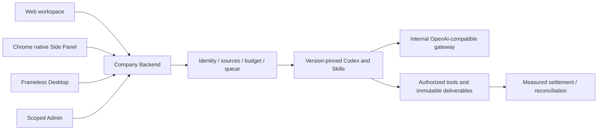

# Workmate · CopyPaste Backend

[中文](README.md) · [Documentation](https://github.com/copypasteltd/workmate/blob/docs/docs/README.en.md)

[Backend](https://github.com/copypasteltd/workmate/tree/backend) · [Web](https://github.com/copypasteltd/workmate/tree/web) · [Admin Dashboard](https://github.com/copypasteltd/workmate/tree/admin) · [Desktop](https://github.com/copypasteltd/workmate/tree/desktop) · [Chrome Extension](https://github.com/copypasteltd/workmate/tree/extension) · [Delivery](https://github.com/copypasteltd/workmate/tree/delivery)

A cloud Agent product for Hong Kong enterprises. This repository owns **Backend** and publishes to `backend`.

## Architecture and constraints

Codex is the only Agent kernel. All AI calls use the company's internal OpenAI-compatible server. Web, Desktop, extension and Admin share server identity, permissions, sources and billing controls. UI follows CopyPaste brand assets, colors, typography and bilingual patterns.



## Service structure and execution

| Module | Source | Implemented responsibility |
| --- | --- | --- |
| Identity and workspaces | Identity/member/session modules in `src/` | Email codes, Admin MFA, native PKCE, tenant/project/private-owner scope |
| Agent execution | `src/worker.ts`, Codex runtime, `catalog/`, `skills/` | Frozen Codex/skill/model versions, controlled tools, leases, fencing and events |
| Continuation | `src/paid-task-inputs.ts`, `src/task-tool-reuse.ts` | Measured completed-turn input waits, same-task/thread recovery and authorized result reuse |
| Billing and access | Billing/wallet/VIP/plan/approval modules | Integer HKD micros, holds, cumulative settlement, manual postings, gifts, refunds and separate VIP/credit |
| Creative and analytics | Design/video/marketing/SEO modules | Internal Images, editable layouts, FFmpeg template videos, CSV/XLSX, ad metrics, synchronized connections and website evidence |
| Content and Admin | Admin/source/erasure modules | Scoped metadata/body rights, quarantine, retention, audit, independent review and controlled erasure |
| Persistence | `migrations/`, PostgreSQL, pg-boss, storage | FORCE RLS, idempotent transactions, immutable facts, queue and asset versions |

Web sessions use HttpOnly cookies, Origin and CSRF checks. Native clients use browser authorization, PKCE and rotating refresh tokens. Administrator identities are separate from customer identities. Reads and tools recheck current tenant, project, private scope and source status.

A model describes missing inputs but cannot choose resource IDs. Completed fully measured turns retain the original budget hold. Human selection of an authorized current version allows a new execution attempt to resume the original Codex thread. Limits are eight rounds and thirty-two dependencies. Cancellation settles known usage; unknown effects remain in reconciliation.

## Initialize and run

```powershell
npm ci
npm run setup:local
npm run db:local
```

Keep the database terminal open. In another terminal:

```powershell
npm run db:migrate
npm run dev
```

Full integration tests require the documented sibling docs/contracts and complete workspace. A standalone backend checkout can run typechecking and compilation first.

API: `http://localhost:4310`. Native PostgreSQL: `127.0.0.1:55432`. `setup:local` generates local passwords and a durable MASTER_KEY only when configuration is absent. Preserve existing configuration/data. `db:migrate` prepares development and test databases. Owner migrations and application/control/queue identities remain separate.

Bootstrap an administrator with `npm run admin:create -- admin@your-company.example super_admin`. Import the local enrolment TOTP configuration into an authenticator and clear the sensitive file according to the runbook. There are no shared default Admin credentials.

## Internal AI gateway

Configure server-only `AI_BASE_URL`, `AI_ALLOWED_HOSTS`, `AI_API_KEY`, `AI_MODEL`, contracted HKD rates and qualification flags. Codex uses the company's OpenAI-compatible Responses interface; Image 2 uses internal Images generation/editing. Run `npm run codex:probe`, then qualify real tool turns, usage and failures. Synthetic responses do not qualify a live model or price.

`.env.example` is a secret-free reference. Production requires HTTPS, SMTP, durable encryption keys, restricted egress, storage and rehearsed backup/restore. The native local database launcher refuses production.

## Interfaces and data

`contracts/implemented-routes.json` inventories implemented routes. Runtime contracts/catalogs and the normative API retain distinct scopes. Canonical TaskDTO/task creation is incomplete; route counts are not contract acceptance. Applied SQL001–091 retain exact bytes; fixes require forward migrations.

Code tools read, hash-edit and package authorized code without running untrusted customer code or claiming unexecuted tests passed. Creative outputs include editable data, SVG/PNG and template MP4. AI video/speech and complete independent role qualification remain tracked.

## Checkout and prerequisites

Clone this branch into a fresh working directory; update an existing repository without reinitializing it.

```powershell
git clone --single-branch --branch backend git@github.com:copypasteltd/workmate.git copypaste-platform
cd copypaste-platform
```

Use Node.js ≥22.14, npm and Git with pinned lockfiles. The qualified local environment is Windows x64. Backend/full delivery also needs native PostgreSQL launcher resources, pinned Codex `0.163.0-alpha.10.2` and FFmpeg/FFprobe. No local Docker, WSL or virtualization. Run components in separate directories; see [workspace](https://github.com/copypasteltd/workmate/blob/docs/docs/governance/04-git-branches-and-publication.md).

## Checks and evidence scope

```powershell
npm run typecheck
npm run build
npm test
```

**782/782** Platform and **34/34** focused tests, plus **13 checks** across six repositories for types/build/existing client suites. The actual packaged Desktop and native Side Panel journey passes **32** checks, retaining every prior named test among 765. Actual Codex child-process tool/thread/usage behavior is tested through a synthetic internal API. UI turns/business data in these demonstrations are synthetic as authorized. All 102 original requirements remain: 81 partially verified, 21 without proven completion and zero fully accepted. Screenshots and test counts do not establish whole-product acceptance.

Canonical TaskDTO/task creation, arbitrary in-flight pause, unknown-effect recovery, independent complete role workflows, GEO, live suppliers and production/signing/store qualification remain tracked.

## Actual screens and interactions

This service has no independent customer page. The following captures show the actual Web client connected to the service.

Actual recordings preserve capture timing. AI turns/business data are explicitly synthetic. Admin form demonstrations do not claim a financial commit.


[MP4](assets/screenshots/workmate-06-interaction.mp4) · [Capture/source evidence](https://github.com/copypasteltd/workmate/blob/docs/docs/quality/workmate-media-06.json)

## Detailed design and updates

- [Product](https://github.com/copypasteltd/workmate/blob/docs/docs/product/01-prd.md)
- [Architecture](https://github.com/copypasteltd/workmate/blob/docs/docs/technical/01-architecture-and-stack.md)
- [Identity and permissions](https://github.com/copypasteltd/workmate/blob/docs/docs/technical/07-security-and-permissions.md)
- [Task continuation](https://github.com/copypasteltd/workmate/blob/docs/docs/technical/66-paid-native-input-checkpoints.md)
- [Admin](https://github.com/copypasteltd/workmate/blob/docs/docs/product/08-admin-dashboard.md)
- [Native clients](https://github.com/copypasteltd/workmate/blob/docs/docs/technical/30-native-window-and-browser-sidepanel.md)
- [Release notes](https://github.com/copypasteltd/workmate/blob/docs/docs/changes/2026-10-22-workmate-publication.en.md)

Every later change updates both READMEs, affected actual captures/GIFs, release notes and its mapped branch. Verify remote SHAs through Delivery publishing; do not force-push collaborator history. Keep environment secrets, databases, sessions, dependencies and installers out of Git. Exact historical README bytes are retained in [archive](https://github.com/copypasteltd/workmate/blob/docs/docs/quality/history/stage66-before-workmate-readmes/manifest.json).
