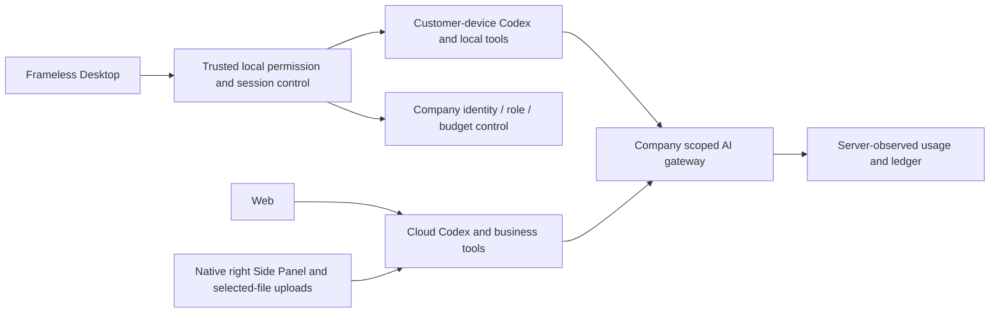

# Workmate · CopyPaste Admin Dashboard

[中文](README.md) · [Documentation](https://github.com/copypasteltd/workmate/blob/docs/docs/README.en.md)

[Backend](https://github.com/copypasteltd/workmate/tree/backend) · [Web](https://github.com/copypasteltd/workmate/tree/web) · [Admin Dashboard](https://github.com/copypasteltd/workmate/tree/admin) · [Desktop](https://github.com/copypasteltd/workmate/tree/desktop) · [Chrome Extension](https://github.com/copypasteltd/workmate/tree/extension) · [Delivery](https://github.com/copypasteltd/workmate/tree/delivery)

A cloud Agent product for Hong Kong enterprises. This repository owns **Admin Dashboard** and publishes to `admin`.

<!-- client01-direction -->
## Current client direction and qualified scope

CLIENT01 (2026-10-22) requires **Desktop to run Codex on the customer's computer**, with a real user-opt-in **full local access** mode and Codex Desktop as the operation benchmark. The **Extension uses a ChatGPT-style conversation and attachment layout in Chrome's native right Side Panel**, reads user-selected files and uploads them for cloud Codex execution. All product AI calls still use the company gateway.

**Current implementation:** Desktop runs Codex on the customer device with explicit full access, local files/terminal, persistent threads, native questions and company tools/billing. The video role now supports private projects, actual composition/playback, native saves, version edits and stop/revocation fencing. Qualification covers 830 platform tests, 58 overlapping focused tests, 17 real-native tests, 47 client tests and 18 actual packaged-journey checks; counts overlap and are not additive. Seventeen native role admissions are not full professional acceptance. Workflow tools, complete browser/application automation, all eighteen roles/twenty-nine Skills and production acceptance remain open. Model/image responses and native-dialog choices are explicit fixtures. Extension retains right Side Panel cloud conversations and selected-file uploads. See [design](https://github.com/copypasteltd/workmate/blob/docs/docs/technical/75-desktop-private-video.md) and [source/media checkpoint](https://github.com/copypasteltd/workmate/blob/docs/docs/quality/desktop-video-checkpoint.json).

Desktop runs the native Agent locally; the Web and Extension run cloud Codex. The linked stage 73 proof states the tested scope.

Native supervisor scope, actual permission checks and remaining integration: [implementation details](https://github.com/copypasteltd/workmate/blob/docs/docs/technical/70-desktop-native-codex-supervisor.md).

<!-- /client01-direction -->

## Architecture and constraints

Codex is the only Agent kernel. All AI calls use the company's internal OpenAI-compatible server. Web, Desktop, extension and Admin share server identity, permissions, sources and billing controls. UI follows CopyPaste brand assets, colors, typography and bilingual patterns.



## Administration and operator flow

1. Enroll through trusted CLI or an administrator invitation. Sign in with a separate administrator email code and TOTP. Customer sessions cannot enter Admin directly.
2. Filter users, workspaces, projects, account state, VIP and charge periods within current scope. Usage is attributed to its actual initiator; holds and reconciliation remain separate.
3. User details expose workspace membership, plans, access, funding context and authorized management actions for accounts, sessions, membership, VIP and fees.
4. Sensitive writes first preview target, version, payload and impact, then commit idempotently. Policy thresholds require independent review. MFA freshness and anti-self-grant rules continue to apply.
5. Content metadata, private body access, downloads, quarantine/restore, share revocation and erasure have distinct permissions and audit. Ordinary workspace administration does not automatically grant another person's private conversation body.

## Permissions and control plane

Eight built-in administrative roles and sixty-eight normative permission keys support global/workspace/project scope, explicit denies, amount/duration/batch limits and bounded delegation. Finance, VIP, membership, identities, content, plans, model/rate configuration, provider requests, approvals, exports and audit use separate domain controls.

VIP and wallet credit are separate. Fees support manually confirmed postings, gifts, source-bound refunds and reconciliation; online payment acquiring is not integrated. Frozen policy/plan versions, target-version checks and idempotency prevent duplicate actions.

## Source structure

`src/main.tsx` implements navigation and user details. `src/directory.tsx` implements directory/period filters. Domain components implement approvals, fees, entitlements, content and configuration. Backend API authorization and ledger entries are authoritative; hidden UI buttons are not security boundaries.

## Run

```powershell
npm ci
npm run dev
```

Open `http://localhost:4318` after starting backend and enrolling an administrator. `npm run build` produces static deployment files. Production needs a dedicated Admin origin, HTTPS, email, MFA, assigned permissions, recovery administrators and audit retention.

## Demonstration scope

The actual recording establishes a separate session through Backend email OTP and TOTP, then shows directory filtering, customer usage and VIP/credit forms. Opening forms is not represented as a financial posting. Retained database/API and Admin evidence covers write, approval, concurrency and authorization behavior.

## Checkout and prerequisites

Clone this branch into a fresh working directory; update an existing repository without reinitializing it.

```powershell
git clone --single-branch --branch admin git@github.com:copypasteltd/workmate.git copypaste-admin
cd copypaste-admin
```

Use Node.js ≥22.14, npm and Git with pinned lockfiles. The qualified local environment is Windows x64. Backend/full delivery also needs native PostgreSQL launcher resources, cloud-pinned Codex `0.163.0-alpha.10.2` and FFmpeg/FFprobe; Desktop independently pins `0.163.0-alpha.11` in its runtime manifest. No local Docker, WSL or virtualization. Run components in separate directories; see [workspace](https://github.com/copypasteltd/workmate/blob/docs/docs/governance/04-git-branches-and-publication.md).

## Checks and evidence scope

```powershell
npm run typecheck
npm test
npm run build
```

Historical-source **802/802** full Platform tests and **52/52** focused task tests pass, with **13 checks** across six repositories and **32** actual packaged Desktop/native Side Panel checks. All prior 782 named regression cases remain. Task checks exercise actual PostgreSQL, identity, ledger and Worker; separate real Codex child processes use a synthetic internal gateway. UI turns/business data are synthetic as authorized. The original 102 requirements remain: 81 partially verified, 21 without proven completion and zero fully accepted.

Canonical TaskDTO/task creation, arbitrary in-flight pause, unknown-effect recovery, independent complete role workflows, GEO, live suppliers and production/signing/store qualification remain tracked.

This revision adds canonical task APIs and atomic original-task inputs. Current UIs continue to use their existing project/conversation interfaces over the same execution domain. The refreshed actual recordings verify compatibility; they do not claim migration of every UI to canonical task APIs. See [the implementation and limits](https://github.com/copypasteltd/workmate/blob/docs/docs/technical/68-canonical-task-contracts-and-input-transactions.md) for exact money, idempotency, source revocation and unsupported business parameters.

## Actual screens and interactions

Actual recordings preserve capture timing. AI turns/business data are explicitly synthetic. Admin form demonstrations do not claim a financial commit.


[MP4](assets/screenshots/workmate-10-interaction.mp4) · [Capture/source evidence](https://github.com/copypasteltd/workmate/blob/docs/docs/quality/workmate-media-10.json)

## Detailed design and updates

- [Product](https://github.com/copypasteltd/workmate/blob/docs/docs/product/01-prd.md)
- [Architecture](https://github.com/copypasteltd/workmate/blob/docs/docs/technical/01-architecture-and-stack.md)
- [Identity and permissions](https://github.com/copypasteltd/workmate/blob/docs/docs/technical/07-security-and-permissions.md)
- [Task continuation](https://github.com/copypasteltd/workmate/blob/docs/docs/technical/66-paid-native-input-checkpoints.md)
- [Admin](https://github.com/copypasteltd/workmate/blob/docs/docs/product/08-admin-dashboard.md)
- [Native clients](https://github.com/copypasteltd/workmate/blob/docs/docs/technical/30-native-window-and-browser-sidepanel.md)
- [Canonical task update](https://github.com/copypasteltd/workmate/blob/docs/docs/changes/2026-10-22-canonical-task-repair.en.md)
- [Local Codex update](https://github.com/copypasteltd/workmate/blob/docs/docs/changes/2026-10-22-native-codex-supervisor.en.md)

Every later change updates both READMEs, affected actual captures/GIFs, release notes and its mapped branch. Verify remote SHAs through Delivery publishing; do not force-push collaborator history. Keep environment secrets, databases, sessions, dependencies and installers out of Git. Exact historical README bytes are retained in [archive](https://github.com/copypasteltd/workmate/blob/docs/docs/quality/history/stage66-before-workmate-readmes/manifest.json).

Stage 73 Desktop local execution: [design](https://github.com/copypasteltd/workmate/blob/docs/docs/technical/73-desktop-native-company-tools.md) · [source-bound proof](https://github.com/copypasteltd/workmate/blob/docs/docs/quality/desktop-company-tools-checkpoint.json). Prior recordings below retain their original source scopes.

Stage 73 company-tool update: [release notes](https://github.com/copypasteltd/workmate/blob/docs/docs/changes/2026-10-23-desktop-company-tools.en.md) · [source-bound checkpoint](https://github.com/copypasteltd/workmate/blob/docs/docs/quality/desktop-company-tools-checkpoint.json). Earlier reports and media retain their historical source scopes.

Stage 74 native-input update: [release notes](https://github.com/copypasteltd/workmate/blob/docs/docs/changes/2026-10-23-desktop-native-input.en.md) · [current checkpoint](https://github.com/copypasteltd/workmate/blob/docs/docs/quality/desktop-native-input-checkpoint.json). Earlier reports/media retain their original source scopes.

Stage 75 private-video update: [release notes](https://github.com/copypasteltd/workmate/blob/docs/docs/changes/2026-10-23-desktop-private-video.en.md) · [current checkpoint](https://github.com/copypasteltd/workmate/blob/docs/docs/quality/desktop-video-checkpoint.json). Earlier reports retain their actual source scopes; platform/main-process qualification and later UI qualification are explicitly separated.
