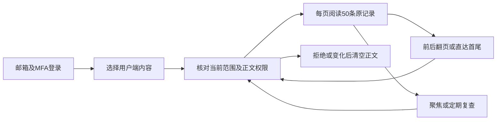
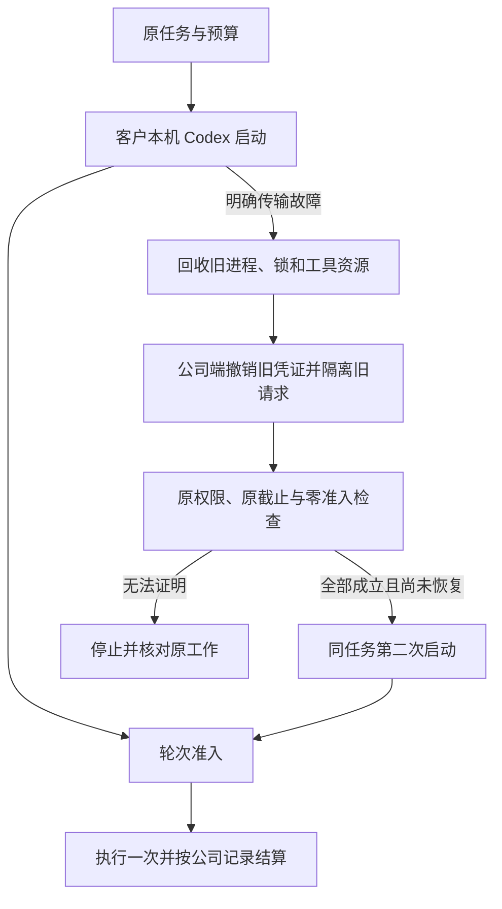
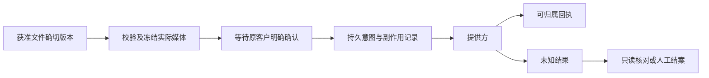
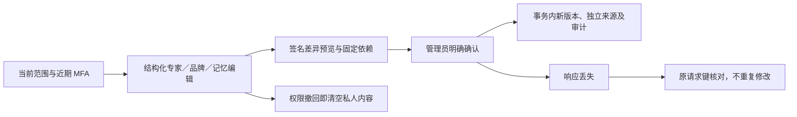
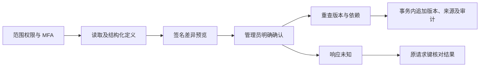
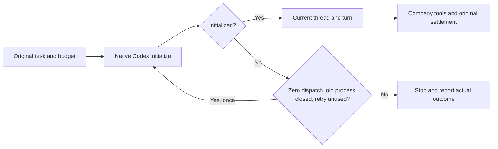
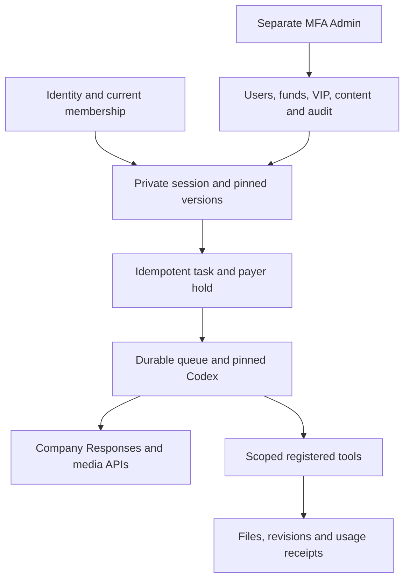

# Workmate · CopyPaste Enterprise Agent · platform

<!-- content-history-stage132 -->
## 后台完整内容历史 · 阶段132

从「用户端内容 → 阅读正文」进入会话、专家或记忆，每页最多50条，可前后翻页或直达首尾。专家和记忆从最新版本开始，区分「客户版本」与「管理员修订」，展开后可查看完整版本记录。

每次请求复核当前MFA会话、两项正文读取权限、企业／项目范围及显式拒绝。签名游标拒绝旧版本继续翻页。阅读器在可见时每15秒及重新聚焦时复查；权限失效或可读来源变化后清空正文。关闭或切换内容会取消旧请求，迟到响应不能覆盖新内容。正文和游标不写入浏览器存储；助手来源不可用时隐藏正文。

新增GET `/v1/admin/content/:kind/:id/history`，使用`edge=first|last`或服务器返回的`cursor`，固定每页50条。SQL134维护消息历史修订号。旧正文接口保留原限制并增加`truncated`与`history_url`。普通客户会话仍保留既有80条输入限制。

54项后端相关测试及9项实际后台旅程通过。真实API创建205版专家、205版记忆及66条客户消息，实际运行原生PostgreSQL、邮箱/MFA、管理员修订、来源撤回、权限拒绝、迟到响应及375/768/1440布局。业务数据和保留的助手结果明确为合成数据，模型没有运行。原始失败及对应源码保留；本轮通过旅程留有5张截图和2组实时GIF/MP4。所有所属测试资源已关闭。



[实现方案](https://github.com/copypasteltd/workmate/blob/main/docs/technical/132-admin-content-history.md) · [Checkpoint](https://github.com/copypasteltd/workmate/blob/main/docs/quality/content-history-checkpoint-132.json) · [完整编号待办](https://github.com/copypasteltd/workmate/blob/main/docs/quality/remaining-work-stage132.md) · [API supplement](https://github.com/copypasteltd/workmate/blob/backend/contracts/admin-content-history-route-additions.json)


[Oldest memory version](https://github.com/copypasteltd/workmate/blob/admin/assets/screenshots/workmate-content-history-132-02-oldest-memory-en.png) · [Administrator provenance](https://github.com/copypasteltd/workmate/blob/admin/assets/screenshots/workmate-content-history-132-02-administrator-provenance-en.png) · [中文页面](https://github.com/copypasteltd/workmate/blob/admin/assets/screenshots/workmate-content-history-132-02-memory-history-zh.png) · [Permission denied](https://github.com/copypasteltd/workmate/blob/admin/assets/screenshots/workmate-content-history-132-02-permission-withdrawn-en.png) · [Navigation MP4](https://github.com/copypasteltd/workmate/blob/admin/assets/screenshots/workmate-content-history-132-02-complete-version-navigation.mp4) · [Withdrawal MP4](https://github.com/copypasteltd/workmate/blob/admin/assets/screenshots/workmate-content-history-132-02-permission-withdrawal.mp4)

仍有89条必需、12条未确认建议及1条可选完整验收记录开放；它们不是102个未编码模块。本轮仅验收限定历史阅读范围，完整后台运营、全部角色、生产模型/连接器及签名安装继续按编号推进。下方历史章节保留其原始范围。

---

[简体中文](README.md) · [English](README.en.md)

<!-- startup-recovery-stage128 -->
## 本机启动安全恢复 · 阶段128

Desktop 在客户电脑运行固定版本 Codex。客户选择目录并主动授权后，初始化或打开会话若发生明确的传输故障，主进程先回收旧进程和锁，再请求公司服务检查原任务。只有轮次尚未准入、没有任何模型/输入计数/公司工具准入，且身份、权限与原截止仍有效，才允许恢复一次。最多两次启动，沿用原任务、原预算预留和 worker attempt，不延长原截止。

界面显示「正在重连」。连接结果未确认时，「重试连线」仅取回原请求结果；可能已执行的工作需先核对本机文件及费用。撤权、协议拒绝、清理失败、已提交轮次和结果未知均禁止自动重做。推理凭证仅传给可信本机运行器，不写入本机恢复日志或渲染页面。



服务端通过 SQL133 升级；应先使用所有者执行完整迁移，再启动相应 API。新客户端声明 `desktop-startup-recovery-v1`；`/startup-recovery` 使用原绑定、固定契约摘要和原恢复请求键，`/turn-admission` 在 `turn/start` 前登记。旧客户端保持原执行流程，不能取得新的恢复许可。

本轮检查点记录控制层、实际固定 Codex、原生 SQL 与实际未签名打包客户端的限定验证。模型回答和对话框选择按用户要求使用假数据；尚不代表正式模型、签名安装、全部崩溃组合或专业角色整体验收。各旧阶段的包和画面仍对应其原源码。

本轮限定检查通过：91项相关控制层、43项真实固定版本Codex、30项原生数据库/API、3项当前编译和6项实际未签名打包界面检查。实际旅程验证了登录、授权、一次启动恢复、原任务的一次收费、单次回答、待响应时撤权，以及1000/1240/1440三个原生窗口宽度。当前截图、GIF和MP4来自成功的04次运行；失败的01—03次运行及原始记录均完整保留。发布入口为V11，远端状态以最终推送回执和SHA回读为准。

[方案与接口](https://github.com/copypasteltd/workmate/blob/docs/docs/technical/128-desktop-startup-recovery.md) · [匹配源码与验证](https://github.com/copypasteltd/workmate/blob/docs/docs/quality/startup-recovery-checkpoint-128.json) · [编号待办](https://github.com/copypasteltd/workmate/blob/docs/docs/quality/remaining-work-stage128.md)


[Original receipt](https://github.com/copypasteltd/workmate/blob/desktop/assets/screenshots/workmate-startup-recovery-128-04-original-local-receipt.png) · [Withdrawal screenshot](https://github.com/copypasteltd/workmate/blob/desktop/assets/screenshots/workmate-startup-recovery-128-04-permission-revoked-before-turn.png) · [Withdrawal GIF](https://github.com/copypasteltd/workmate/blob/desktop/assets/screenshots/workmate-startup-recovery-128-04-revoke-pending-startup.gif) · [Recovery MP4](https://github.com/copypasteltd/workmate/blob/desktop/assets/screenshots/workmate-startup-recovery-128-04-startup-and-original-receipt.mp4) · [Withdrawal MP4](https://github.com/copypasteltd/workmate/blob/desktop/assets/screenshots/workmate-startup-recovery-128-04-revoke-pending-startup.mp4)

<!-- native-publishing-stage126 -->
## 原生 Codex 发布工具修复 · 阶段126

新版社交内容角色可通过正常模板入口创建。已修复工具登记遗漏和预览来源记录的版本ID错误；严格素材版本、SHA-256、权限和数据库约束继续执行。

客户先登录、选择项目、连接并启用账户／策略，再选择固定素材和内容。真实Codex加载绑定Skill并依次调用 publication_accounts → publication_preview → publication_prepare → publication_status。准备操作停在 awaiting_confirmation，原客户在发布页复核并明确确认后才允许发送。咨询和计划模式保持只读。

~~~mermaid
flowchart LR
    A[客户登录与项目] --> B[创建社交内容角色]
    B --> C[Codex加载绑定Skill]
    C --> D[当前账户与确切素材预览]
    D --> E[准备并读取待确认操作]
    E --> F[客户在发布页明确确认]
    F --> G[现有受控发送与回执]
~~~

当前云端Worker原生专项09通过5/5：实际四工具调用、PNG／派生JPEG、原版本来源和哈希、调用ID、客户／项目归属、一次费用预留与计费、只读模式、拒绝自行确认，以及未确认操作不派发。完整16文件相关回归10通过155/155，源码未变，所属原生数据库和夹具已清理。模型与账户明确模拟；Codex、鉴权、SQL、文件、工具和费用逻辑真实执行。

启动恢复补齐thread/start和thread/resume，仅在未提交轮次且关闭网关后模型请求为零时允许重启一次。原60秒RPC截止、15分钟共享截止、最多两个进程、原任务／权限／费用预留保持执行；明确拒绝、取消、清理失败及已提交／未知操作不自动重放。独立真实原生故障03通过9/9，完整相关回归另核对恢复后只结算一次。Desktop本机恢复和四工具组合需要独立资格。

旧回归06中断而缺少最终／清理回执；08为132通过、1失败，发现零模型请求的线程创建超时。故障探针red01复现旧恢复缺口，green02为7通过、1失败，原因在测试辅助器进程创建时间检查，修正后green03通过。全部原件保留；底层偶发原生／Windows延迟原因仍未证明。

在按标准开发流程启动的原生测试数据库环境中，可执行：

~~~powershell
$env:CODEX_BIN = (Resolve-Path "../copypaste-desktop/.data/runtime/windows-x64/codex.exe").Path
$env:CODEX_VERSION = (Get-Content "../copypaste-desktop/contracts/local-codex-runtime.json" -Raw | ConvertFrom-Json).runtime_version
node --env-file=.env scripts/run-tests-owned.mjs tests/publication-native-tools-v3.test.ts
node --env-file=.env scripts/run-tests-owned.mjs tests/runtime-pre-turn.test.ts tests/runtime-startup.test.ts tests/runtime-startup-billing.test.ts tests/runtime.test.ts
~~~

需要固定版本及哈希的真实Codex可执行文件，具体原生依赖按下方启动说明配置。本地候选工作区的隔离资格脚本是开发验收记录，不作为任意检出路径的通用安装命令。

[方案与范围](https://github.com/copypasteltd/workmate/blob/docs/docs/technical/126-native-publication-tools.md) · [本轮更新](https://github.com/copypasteltd/workmate/blob/docs/docs/changes/126-native-publication-tools.md) · [本轮检查点](https://github.com/copypasteltd/workmate/blob/docs/docs/quality/native-publication-checkpoint-126.json) · [未完成项](https://github.com/copypasteltd/workmate/blob/docs/docs/quality/remaining-work-stage126.md)

界面截图与GIF见下方阶段125实际界面记录；本轮修改后端逻辑，没有新增UI／视频播放／签名安装／十二专业角色或完整产品验收。

<!-- controlled-publications-stage125 -->
## 受控社交发布 · 阶段125

新增账户授权、来源版本冻结、实际媒体预览、逐次客户确认、持久执行与未知结果核对。支持 Facebook 文字／图片／相簿／视频，以及 Instagram 图片／Reel／轮播／Story；每种格式独立校验素材与账户能力。Instagram 图片按要求生成 JPEG，Facebook 可以保留合格 PNG。



所有项目路由以 `/v1/tenants/:tenant/projects/:project/publications` 为前缀。预览和准备不会发布；客户确认绑定实际内容摘要、账户及当前版本。取消仅适用于尚未发送的操作；未知结果不得自动重发，人工结案也不证明发布失败。独立回执、备份恢复重放栅栏、账户与来源撤权、预算及配额约束在服务端执行。

Codex 工具为 `publication_accounts`、`publication_preview`、`publication_prepare`、`publication_status`。`prepare` 只能产生待确认记录。Desktop 仍由本机 Codex 发起公司工具调用。

Admin 新权限为 `admin.publication.read`、`admin.publication.policy.write`、`admin.publication.resolve`；私有正文及媒体还要求独立的 `admin.content.body.read`。旧管理员不会自动升级。已完成设置且有效的永久全局超级管理员，可由本地运营执行：

```powershell
npm run admin:enable-publications -- admin@example.com --acknowledge-global-publication-authority
```

新授权原子撤销旧会话并审计，需重新登录；重复／并发执行不重复授权或撤销新会话。命令不附带正文读取权限，且拒绝冲突角色和相关显式 deny。

阶段125历史相关后端117/117、授权CLI 5/5、分析专项12/12及实际Web/Admin 14/14通过。实际打包Desktop／Chrome原生右侧栏新增发布旅程10/10通过；这些不代表完整产品或至少十二个专业角色已验收，四个新增工具的实际Codex调用仍待验证。继续使用明确模拟数据。此前失败保留。

<!-- admin-profile-revisions-124 -->
## 专家、品牌及记忆修订 · 阶段 124

管理员现可在内容列表修订客户专家、品牌资料及全部五种范围的记忆，沿用当前范围的三项内容权限、近期 MFA、签名预览、明确确认、原请求核对和审计。既有团队、共享说明与方法修订继续保留；六个操作路径仍为 `/v1/admin/content-revisions/{kind}/{id}`，`kind` 闭集现在包括 `agents`、`brand_profiles`、`memories`、`agent_groups`、`project_configurations`、`solutions`。

| 内容 | 本次允许修改 | 版本与权限边界 |
| --- | --- | --- |
| 客户专家 | 名称、工作说明、固定角色允许的工具子集 | 保留 Codex、模型、Skill、模板和品牌版本；默认助手不可修订，旧会话保留原版本 |
| 品牌资料 | 色系、语气、核准文案、字型来源/使用依据、共享 PNG Logo、产品价格及促销 | 校验实际文件字节、确切资料版本和使用范围；旧工作保留旧品牌；港币等货币精确存储 |
| 记忆 | 名称、内容和有效期限 | 保留原范围、客户拥有者、项目、品牌和私人对话；企业范围记忆须具备企业权限，并受项目显式拒绝约束 |

迁移 [131](migrations/131-admin-profile-revisions.sql) 只追加结构，不改 SQL001–130。管理员版本使用独立来源字段，不伪装客户创建；`cp_app`/`cp_queue` 不可创建管理员事实。不可变事实、实际版本和审计必须同一事务提交，审计失败全部回滚。私人记忆永久删除时清除各版本正文及定义快照，保留管理与账务元数据。普通客户后续版本仍记录真实客户来源。



**验证：** 五个完整相关后端文件 **68/68**（包含25项新修订检查）、后台单元 **11/11**、实际后台流程 **8/8**、四档宽度 **14次**边界观察通过；8张 PNG 和3组实际 GIF/MP4 已保留。真实邮箱挑战/MFA、Hong Kong时区、HK$128.90精确显示、真正丢失的已提交响应和实时撤权均走实际实现；本编辑流程 AI 调用、任务与费用预留增量为零。历史失败和旧媒体保留，所属浏览器、API、预览及原生数据库已关闭。当前限定验证不替代全量后端、真实供应商或完整产品验收。

实现见 [领域逻辑](src/admin-profile-content.ts)、[修订服务](src/admin-content-revisions.ts)、[相关测试](tests/admin-profile-revisions.test.ts)。[完整设计及证据](https://github.com/copypasteltd/workmate/blob/docs/docs/technical/124-admin-profile-revisions.md) · [实际页面与录制](https://github.com/copypasteltd/workmate/blob/admin/README.md)

<!-- admin-content-revisions-123 -->
## 管理员正文修订 · 阶段 123

提供专业团队、共享项目说明和业务方法的结构化修订：团队追加版本；项目说明追加发布版本并替换草稿；业务方法建立同族草稿，保留客户试运行和发布要求。已有任务继续使用原来固定的版本。

操作必须同时具备当前对象范围的 `admin.content.read`、`admin.content.body.read`、`admin.content.version.create`，显式拒绝优先，并重查当前管理员会话及近期 MFA。预览签名绑定原版本、依赖、前后摘要、原因、管理员和会话，五分钟后失效。确认在同一事务追加版本、独立管理员来源和审计；不创建任务、不调用模型、不产生 AI 费用。客户创建流程保留原有读取权限，不授予修改模板的数据库权限。

六个接口统一位于 `/v1/admin/content-revisions/{kind}/{id}`：读取编辑内容、`GET /options?q=`、`GET /history`、`POST /previews`、`POST /apply` 和 `POST /requests/{key}`。`kind` 只允许 `agent_groups`、`project_configurations`、`solutions`。未知提交使用原幂等键核对；恢复回执只返回摘要和结果元数据。



实现见 [修订服务](src/admin-content-revisions.ts)、[迁移 130](migrations/130-admin-content-revisions.sql) 和 [专项测试](tests/admin-content-revisions.test.ts)。五个完整相关文件共 **75/75** 测试通过，其中新增修订专项 16 项；实际管理员登录、三类编辑、断线恢复、撤权及无费用副作用的 **7 项页面流程**通过。375/768/1024/1440px 的弹窗和输入边界另有实际检查。浏览器、所属服务及原生测试数据库均已关闭；假模型授权继续有效。原完整产品和生产验收单独跟踪。

[完整方案及证据](https://github.com/copypasteltd/workmate/blob/docs/docs/technical/123-admin-content-revisions.md) · [实际页面及 GIF/MP4](https://github.com/copypasteltd/workmate/blob/admin/README.md)

<!-- runtime-startup-122 -->

账务集成场景见 [runtime-startup-billing.test.ts](tests/runtime-startup-billing.test.ts)：先准备真实私有来源和原费用预留，再在保留的 120 秒上限内验证恢复及账本。两次初始失败及后续独立通过分别保留，最终完整相关文件计数以本轮 checkpoint 为准；此前失败根因仍未证明。

最终五个完整相关文件共 79 项通过，失败／取消／跳过均为 0；源码前后一致，私有夹具与原生数据库已回收并核对端口关闭。这是账务、网关、请求控制、SEO 和恢复集成的限定回归，未重新执行全部后端文件。最终恢复／账本核心断言约 79.7 秒，保留 120 秒上限。

## Codex 启动与轮次隔离 · 阶段 122

云端 Codex 初始化发生超时或断线时，仅在确认没有模型请求、旧进程及网关已关闭后恢复一次。60 秒 RPC 期限保持；两次启动共享原任务的 15 分钟期限、权限和预算。进入线程或模型调用后的失败不会自动重放。工具、输出和完成通知必须匹配当前线程与轮次。

12 项实际原生运行检查通过，包含真正等待 60 秒超时、恢复上限、取消、明确拒绝、清理失败及错误轮次拒绝。模型响应为明确假数据；历史偶发超时根因仍未证明。原生检查需要锁定的可执行文件与并列 Desktop 合约。



[完整方案 / Behavior and verification](https://github.com/copypasteltd/workmate/blob/docs/docs/technical/122-codex-startup-and-turn-isolation.md)

## 产品与边界

首批面向现有客户的 marketing 团队，完整范围包含生图、设计/字体、视频/特效、广告和网站分析、SEO/GEO、企业重复流程及软件开发。目录已有 18 个精确 Skill 绑定的候选角色；至少十二个逐一完成专业任务、修改及异常处理的角色仍是验收要求。设计师由 Codex、设计 Skill 与公司 Image 2 组合。Agent 内核唯一使用 Codex；全部 AI 请求走公司 OpenAI 兼容后端。当前开发使用已授权假数据，不代表真实模型专业质量已经验收。

使用 TypeScript、Fastify 和原生 PostgreSQL。应用身份不持有数据库 owner/BYPASSRLS 权限；HTTP、worker、下载和来源重用继续检查当前授权。任务账本、预留、实际消耗和未知费用分别记录，停止不伪造零费用。公司端配置模型、媒体能力、精确费率和允许地址；后端不允许客户端注入任意供应商密钥或任意模型地址。

## 仓库与执行位置

| Branch | Directory | Runtime |
| --- | --- | --- |
| [backend](https://github.com/copypasteltd/workmate/tree/backend) | `dev/copypaste-platform` | Fastify / PostgreSQL / cloud Codex |
| [web](https://github.com/copypasteltd/workmate/tree/web) | `dev/copypaste-web` | React / Vite / cloud workspace |
| [admin](https://github.com/copypasteltd/workmate/tree/admin) | `dev/copypaste-admin` | React / separate Admin identity |
| [desktop](https://github.com/copypasteltd/workmate/tree/desktop) | `dev/copypaste-desktop` | Electron / customer-local Codex |
| [extension](https://github.com/copypasteltd/workmate/tree/extension) | `dev/copypaste-extension` | Chrome MV3 / native Side Panel / cloud Codex |
| [delivery](https://github.com/copypasteltd/workmate/tree/delivery) | `dev/copypaste-delivery` | Native development, QA and publication tools |

各组件为独立 Git 仓库，保留上述并列布局。项目仅使用原生工具；禁止 Docker、WSL 和虚拟机。

## 使用逻辑

1. 校验登录、成员资格与项目范围，创建私有会话并固定角色、Skill、品牌和输入版本。
2. 以同一请求身份建立任务与费用预留，再由持久队列领取；每次工具、推理和下载重新核对当前授权。
3. 固定 Codex 调用公司 Responses API；文件、分析、媒体、审批与结果由注册工具提供，不能换用另一个内核。
4. 记录真实文件、事件、来源、实际消耗与未知费用；继续修改沿用原任务关系，结果未知的外部写入进入对账。
5. 通过独立 Admin 身份处理用户、内容、人工费用与 VIP；后台权限不替代客户本机授权。



## 启动与使用

### 本地启动

以下命令在已检出的对应仓库内执行。完整工作区将六个独立仓库并列放在 `dev/`，见[分支与检出布局](https://github.com/copypasteltd/workmate/blob/docs/docs/governance/04-git-branches-and-publication.md)。使用 Windows x64、Node.js >=22.14、npm/Git，以及文档约束的原生 PostgreSQL、FFmpeg/FFprobe 与固定 Codex 资源；保留已有本地配置和数据，不使用 Docker/WSL/虚拟机。

```powershell
Set-Location 'D:/dev/copypasted/自有agent/dev/copypaste-platform'
npm ci
npm run setup:local
npm run db:local
```

保持数据库终端开启，在同一仓库的第二个终端运行 `npm run db:migrate`，再运行 `npm run dev`。API 为 `http://localhost:4310`。升级后端前应用 SQL104。后台管理员按现有 `admin:create` 流程创建并登记 MFA，不提供共用默认后台账号。

### 当前使用流程

1. 完成登录、企业成员/邀请和项目选择。原生端通过浏览器 PKCE 登录；Admin 使用独立 MFA 身份。过期、撤销、换企业不应静默切换身份和资料范围。
2. 选择专业角色，提供工作说明及明确获准的资料/账号。缺少必要输入时请求客户补齐。项目负责人可以保存草稿、核对依赖、预览并明确发布不可变共享指引；发布不启动 AI、不增加权限。
3. 新任务固定当时接受的角色、Skill、品牌、资料和指引版本。既有工作保留原版，包括原先没有共享配置的状态。来源被隔离、删除或撤权后隐藏失效正文并阻断后续使用；历史内容不是越权入口。
4. 确认预算和必要的操作/媒体授权，查看真实状态、进度、文件与原费用回执。修改沿原工作谱系继续。未知用量保持原预留供对账，不能当作免费或盲目重新执行。
5. Admin 可按独立权限管理用户/企业状态、查看获准消耗，预览并确认人工费用/赠额和 VIP 权益/到期。余额、实收记录、授信、预算和 VIP 分别保存；同一确认幂等，操作保留审计，不能因重放重复赠额。

## 配置、权限与费用

本候选要求完整 SQL001–133 增量历史。API/Worker 准入拒绝缺失、变更或不支持的版本，并独立检查恢复环境身份。公司模型别名、已验证媒体能力、精确费率及供应商密钥只在后端配置；未配置能力保持不可用。当前开发继续使用已授权假数据。

Web/Admin 使用 `VITE_API_BASE` 或同源代理，开发端口为 4317/4318。Desktop/Extension 构建时固定 `COPYPASTE_API_ORIGIN`、`COPYPASTE_WEB_ORIGIN`，Desktop 另固定 `COPYPASTE_EXTENSION_ID`。除获准回环开发场景外使用 HTTPS；渲染器与扩展不持有公司供应商密钥。

文件默认私有，项目共享需要客户明确操作。新请求、Worker 领取、工具及下载重新核验权限；旧历史不能绕过撤权或正文治理。金额使用精确港币微单位；预算、余额、授信、实收与 VIP 分开记录。稳定请求身份防止重复赠额、建任务和预留；未知费用或物理清理保留待核对。

迁移完成后使用 `npm run admin:create -- <email> [role]` 创建管理员。一次性 MFA 登记写入自有 `.data/enrolment/`，不提供共享默认管理员。当前配置与接口见 `.env.example`、`contracts/`、`migrations/`。

## 预设角色与 Skill

目录定义 18 个专业预设及默认助手，每次执行固定 Skill 版本和注册工具。模板数量不等于至少十二个角色已通过完整专业资格验收。

| ID | Role | Required Skill bindings |
| --- | --- | --- |
| R01 | 全栈开发工程师 | `fullstack-engineering@1.0.0`, `frontend-implementation@1.0.0`, `backend-api@1.0.0`, `qa-testing@1.0.0`, `delivery-core@1.0.0` |
| R02 | 前端开发工程师 | `frontend-implementation@1.0.0`, `ui-system@1.0.0`, `qa-testing@1.0.0`, `delivery-core@1.0.0` |
| R03 | 后端与 API 工程师 | `backend-api@1.0.0`, `qa-testing@1.0.0`, `delivery-core@1.0.0` |
| R04 | 软件测试工程师 | `qa-testing@1.0.0`, `frontend-implementation@1.0.0`, `delivery-core@1.0.0` |
| R05 | UI/UX 设计师 | `ux-research@1.0.0`, `ui-system@1.0.0`, `frontend-implementation@1.0.0`, `delivery-core@1.0.0` |
| R06 | 设计师 | `creative-direction@1.0.0`, `image-art-direction@1.0.0`, `image2-production@1.0.0`, `typography-layout@1.0.0`, `delivery-core@1.0.0` |
| R07 | 品牌视觉设计师 | `brand-system@1.1.0`, `image-art-direction@1.0.0`, `image2-production@1.0.0`, `typography-layout@1.0.0`, `delivery-core@1.0.0` |
| R08 | 广告创意设计师 | `ad-creative@1.0.0`, `image-art-direction@1.0.0`, `image2-production@1.0.0`, `typography-layout@1.0.0`, `delivery-core@1.0.0` |
| R09 | 电商商品设计师 | `ecommerce-visual@1.0.0`, `image-art-direction@1.0.0`, `image2-production@1.0.0`, `typography-layout@1.0.0`, `delivery-core@1.0.0` |
| R10 | 社媒内容设计师 | `social-content@1.0.0`, `image2-production@1.0.0`, `typography-layout@1.0.0`, `delivery-core@1.0.0` |
| R11 | 插画与 IP 设计师 | `illustration-ip@1.0.0`, `image-art-direction@1.0.0`, `image2-production@1.0.0`, `delivery-core@1.0.0` |
| R12 | 字体与版式设计师 | `typography-layout@1.0.0`, `image-art-direction@1.0.0`, `image2-production@1.0.0`, `delivery-core@1.0.0` |
| R13 | 演示文稿设计师 | `presentation-production@1.1.0`, `typography-layout@1.0.0`, `dataviz@1.1.0`, `delivery-core@1.0.0`, `deterministic-metrics@1.1.0` |
| R14 | 网页与落地页设计师 | `landing-page@1.0.0`, `ui-system@1.0.0`, `frontend-implementation@1.0.0`, `image2-production@1.0.0`, `delivery-core@1.0.0` |
| R15 | 信息图与数据可视化设计师 | `dataviz@1.1.0`, `deterministic-metrics@1.1.0`, `typography-layout@1.0.0`, `delivery-core@1.0.0` |
| R16 | 视频与动效设计师 | `video-storyboard@1.0.0`, `template-video-composition@1.0.0`, `video-generation@1.1.0`, `speech-production@1.2.0`, `delivery-core@1.0.0` |
| R17 | 营销数据分析师 | `ads-analysis@1.1.0`, `deterministic-metrics@1.1.0`, `dataviz@1.1.0`, `delivery-core@1.0.0` |
| R18 | 企业流程自动化顾问 | `workflow-design@1.1.0`, `workflow-execution@1.1.0`, `delivery-core@1.0.0` |

设计师组合为 Codex＋设计 Skill＋公司 Image 2。可选 R19 云端电脑操作员必须绑定另行确认的租约与 AI 预算；本机 Desktop 不提供该创建入口，继续由客户本机执行。

[Role contract](https://github.com/copypasteltd/workmate/blob/backend/catalog/role-preset-catalog.json) · [Skill packages](https://github.com/copypasteltd/workmate/blob/backend/catalog/skill-packages.json)

## 可选专属云电脑

先核对不可变方案/报价、付款方、固定时长、确切私有文件及终端/可视/Agent 独立范围，Agent 默认未授权。明确同意后预留资源费，后续 Codex 指令另有精确 AI 上限。无自动续期。停止、到期或撤权阻断后续操作；实际用量和清理证据齐全才结算，未知进入核对。

Linux 物理节点源码使用原生 Node22/systemd、cgroup、XFS project quota 和有界桌面工具。本地 Windows 核查未启动 Linux 主机。Delivery 中以新编号运行 `node native/build-package.mjs NN` 构建源码包；安装前核对外部固定摘要，默认不启动服务，恢复要求确切安装 UUID。

## 实际界面与交互录制

下列为真实产品界面截图和按墙上时间录制的交互。客户、模型、媒体响应明确使用假数据；所注明的原生 Codex、文件、数据库和账务路径实际运行。假节点画面不代表真实 Linux 远端桌面已验收。

此无界面组件引用 admin 的实际产品交互，展示配套集成流程；不是独立 platform 页面。


[Original MP4](https://github.com/copypasteltd/workmate/blob/admin/assets/screenshots/workmate-12-dedicated-cloud-plan.mp4)

## 验证与交付状态

整合后的客户端/工具共 338 项通过：Web 20、Admin 9、Extension 63、Desktop 180、实际本机 Codex 22、Delivery 44，对应类型/构建通过。Desktop、Web/Admin、原生侧栏各有 8 项限定实际 UI 检查，共 29 张截图与 5 组 GIF/MP4。后端完整成功须有最终完整清单回执，检查点记录实际结果并保留失败。

安装原生前置依赖后执行本仓库 `npm run typecheck`、`npm run build` 及测试脚本。Delivery 默认 `npm test` 仅覆盖原生界面完整性，完整单元清单使用 `node --test --test-concurrency=1 tests/*.test.mjs`。`node scripts/qualify-delivered-clients-v1.mjs NN` 在 Delivery 使用新两位编号及并列布局检查完整客户端清单；历史候选专项执行器保留原目录要求。

完整产品验收仍开放：至少十二个专业角色资格、全权限/业务/兼容矩阵、真实服务质量、签名安装更新、生产负载恢复及客户业务接受。以编号清单管理完成条件，不以测试数量推算完成率；使用后清理自建浏览器/进程，保留用户资源。

[Implementation / 方案](https://github.com/copypasteltd/workmate/blob/docs/docs/technical/121-dedicated-cloud-and-client-execution.md) · [Checkpoint / 证据](https://github.com/copypasteltd/workmate/blob/docs/docs/quality/dedicated-cloud-checkpoint.json) · [Open requirements / 未完成项](https://github.com/copypasteltd/workmate/blob/docs/docs/quality/remaining-work-2026-10-29.md) · [Branch layout / 检出布局](https://github.com/copypasteltd/workmate/blob/docs/docs/governance/04-git-branches-and-publication.md)
