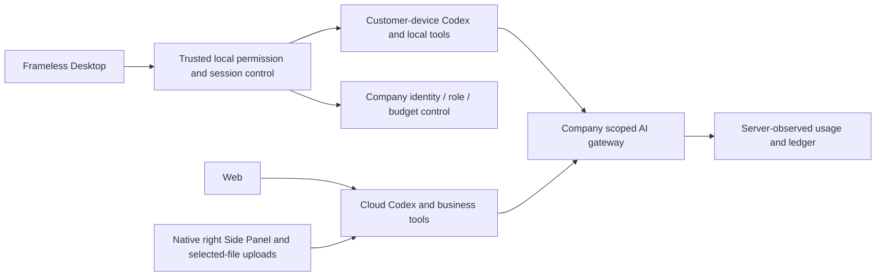
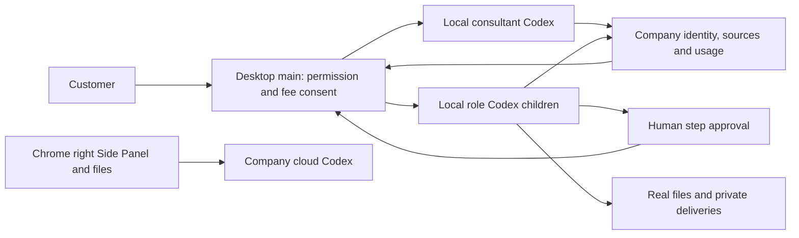

# Workmate · CopyPaste Delivery

[English](README.en.md) · [主文档](https://github.com/copypasteltd/workmate/blob/docs/docs/README.md)

[Backend](https://github.com/copypasteltd/workmate/tree/backend) · [Web](https://github.com/copypasteltd/workmate/tree/web) · [Admin Dashboard](https://github.com/copypasteltd/workmate/tree/admin) · [Desktop](https://github.com/copypasteltd/workmate/tree/desktop) · [Chrome Extension](https://github.com/copypasteltd/workmate/tree/extension) · [Delivery](https://github.com/copypasteltd/workmate/tree/delivery)

面向香港企业的云端 Agent 产品。当前仓库负责 **Delivery**；当前远程分支为 `delivery`.

<!-- client01-direction -->
## 当前客户端方向与实现差异

CLIENT01（2026-10-22）要求 **Desktop 在客户本机运行 Codex Agent**，提供客户可主动授予的 **完整本机权限**，操作能力对标 Codex Desktop。**Extension 在 Chrome 原生右侧栏采用 ChatGPT 式对话/附件结构**，获取、读取用户获选文件并上传，由云端 Codex 执行。全部产品 AI 请求仍走公司内部网关。

**当前实现：** Desktop 在客户本机运行 Codex，提供明确完整授权、本机文件/终端、同线程继续、原生追问及公司图片/设计/视频工具。流程顾问现可使用不可变私有流程、追加子步骤费用确认、人工逐步审批和真实本机角色子 Codex；支持真实 SOP/JSON/恢复说明下载、Stop/撤权及内容来源治理。当前验证为平台 848 项、重叠定向 75 项、真实父子流程 3 项、本机内核回归 17 项、客户端 56 项和实际打包旅程 19 项；这些范围分别报告，不相加。18 个角色已通过本机协议准入，全部 18 角色/29 Skill 的完整专业交付、浏览器/第三方应用操作与 Codex Desktop 全面能力对齐、真实模型及生产验收继续跟踪。模型响应与系统窗口决定明确模拟。Extension 保持 ChatGPT 式原生右侧栏、获选文件读取上传和云端 Agent，无需 Desktop；本轮未重新执行 Extension UI。见 [实现方案](https://github.com/copypasteltd/workmate/blob/docs/docs/technical/76-desktop-native-workflows.md)、[源码与媒体检查点](https://github.com/copypasteltd/workmate/blob/docs/docs/quality/desktop-workflow-checkpoint.json)。

Desktop 在客户本机运行 Codex；Web 和 Extension 由公司云端执行。下方架构图按这一执行边界呈现。

本机 supervisor 的实现及历史原生权限测试见 [技术说明](https://github.com/copypasteltd/workmate/blob/docs/docs/technical/70-desktop-native-codex-supervisor.md)。

<!-- /client01-direction -->

本次原生侧栏会话复验：在保持 Platform `.env` 和原生运行资源已配置的前提下，执行 `node scripts/run-extension-chat.mjs NN`，使用尚未占用的两位编号。检查器先确认 4310、4317、55432 空闲，运行 32 项扩展测试、类型/构建，再启动自己的原生 PostgreSQL、Web 预览和浏览器；最终关闭本次实例并核验隔离数据清理。模型回合明确模拟，真实侧栏、上传、云端 Worker 与账本均实际执行。最新记录见 [Extension 检查点](https://github.com/copypasteltd/workmate/blob/docs/docs/quality/extension-chat-checkpoint.json)。

## 架构与约束

仅使用 Codex，全部 AI 请求经公司内部 OpenAI 兼容服务器。Web、Desktop、扩展和 Admin 共用服务端身份、权限、来源与计费控制。设计沿用 CopyPaste 的品牌素材、色系、字体和中英界面。



## 职责与目录

本仓库统一启动原生开发服务、执行跨端验证、保留原始结果、检查安装包字节、录制实际交互，并按分支映射同步发布。它通过同级独立仓库运行产品，不包含另一套业务内核。

| 目录 | 用途 |
| --- | --- |
| `scripts/` | bootstrap、原生进程控制、数据库核对、客户端/API/权限/媒体验证、录制、发布 |
| `tests/` | 原生包与 Side Panel 验证器本身的完整性检查 |
| `evidence/` | 分次执行的原始 TAP、日志、源码绑定、清理和实际截图摘要 |
| `assets/screenshots/` | README 展示用实际截图、MP4、GIF |
| `.data/` | 忽略的自有进程状态、浏览器配置、原始录制和临时文件 |

## 工作区布局

将 docs 分支放在项目根目录，其余分支分别放在 `dev/copypaste-platform`、`copypaste-web`、`copypaste-admin`、`copypaste-desktop`、`copypaste-extension` 和本仓库 `copypaste-delivery`。不要把不同分支依次 checkout 到同一个工作目录来同时启动各端。

## 安装、启动与停止

```powershell
npm ci
npm run bootstrap
npm run demo
```

Web `4317`、Admin `4318`、API `4310`、控制器 `4319`、原生 PostgreSQL `55432`。`npm run stop` 仅关闭控制器启动的进程并请求数据库正常 checkpoint；端口被占用时保留原进程并报错。

`demo` 使用明确的本地模拟模式；生产和非 loopback 主机拒绝启用。AI/业务数据模拟授权不代表模型质量、真实费率或生产服务验收。原始错误和失败记录保留，不覆盖或改写为通过。

## 实际交互录制

```powershell
node scripts/run-paid-input-native.mjs NN --media
```

复录须选择新的两位编号，避免覆盖原始证据。该命令建立自有原生数据库、隔离夹具、Web/Admin 预览、真实 unpacked Desktop 和原生 Chrome Side Panel；结束后关闭全部自有浏览器/预览并回收隔离夹具。先按打包文档重建脚本指定的本地 Desktop/Extension 预览；源码分支不随附安装包或 dist。

将 `NN` 换成尚未使用的两位编号。`qa-workmate-media.ts` 使用真实 UI 操作钩子；`record-workmate-media.ts` 按真实捕获时间编码 MP4/GIF。侧栏从已确认的原生 SIDE_PANEL 文档直接捕获视口，不含浏览器工具栏；同次旅程独立验证右侧位置、主页面缩窄及没有 popup/额外标签页。保留模拟模型回合说明、源码/媒体摘要和退出回执。

## 分支发布

提交六个组件后，在主文档根目录执行 `python docs/tools/finalize_workmate_manifest.py --update` 明确刷新组件 SHA，再核对媒体编号、同步更新说明并提交主文档。发布器兼容本地 `codex/*` 工作分支及按 README 新检出的同名发布分支。所有仓库干净后运行：

```powershell
node scripts/publish-workmate.mjs --check
node scripts/publish-workmate.mjs --push
```

发布器只推送映射的八个分支，使用原子提交、远端祖先检查和推送后 SHA 核对；不强推、不删除其他分支。预检调用主文档中的历史对象、凭据、README 链接和媒体校验器。运行回执位于忽略的 `.data/publication/`，失败保留并报错。

当前清单生成器绑定保留的阶段 66/旅程 06 证据。产品源码变化后，须重新验证并更新相应报告选择；不能只改组件 SHA 复用旧源码的通过结论。

## 验证边界

`npm run typecheck`、`npm test` 检查本仓库。平台完整验证在 backend；跨端和原生脚本依据各自前置条件运行。已应用迁移原字节不可修改；升级前摘要、首次失败和后续只读修正分别保留。所有测试及录制禁止 Docker/WSL/虚拟化。

## 初次检出与环境

新工作副本可单独检出本分支；已有本地仓库直接更新，不重新初始化。

```powershell
git clone --single-branch --branch delivery git@github.com:copypasteltd/workmate.git copypaste-delivery
cd copypaste-delivery
```

Node.js ≥22.14、npm 和 Git；锁文件固定依赖。当前验收环境为 Windows x64。后端/完整交付还需要原生 PostgreSQL 启动资源、云端锁定 Codex `0.163.0-alpha.10.2` 与 FFmpeg/FFprobe；Desktop 独立锁定 `0.163.0-alpha.11`，以其运行时清单为准。禁止本地 Docker、WSL 和虚拟化。跨端运行使用多个独立工作目录；布局见 [workspace](https://github.com/copypasteltd/workmate/blob/docs/docs/governance/04-git-branches-and-publication.md).

## 检查与验证范围

```powershell
npm run typecheck
npm test
```

历史源码的平台完整 **802/802**、任务专项 **52/52**，六仓库 **13 项**类型/构建/既有客户端测试检查、真实打包程序和原生侧栏旅程 **32 项**通过。保留原 782 项命名回归测试。任务专项调用实际 PostgreSQL、身份、账本与 Worker；另有实际 Codex 子进程连接模拟内部网关的续接验证。UI 回合及业务数据按授权模拟。原 102 项需求仍为 81 项局部验证、21 项未证明完成、0 项完整验收。

完整规范 TaskDTO/任务创建、任意执行中暂停、未知外部结果恢复、全角色独立业务、GEO、真实供应商和生产/签名/商店验收仍继续跟踪。

本次同步补充统一任务接口和原任务输入事务。当前用户界面继续通过既有项目/会话接口使用同一执行域；下方重新录制的实际交互验证该流程的兼容性，并非声称界面已经切换到全部规范任务接口。接口边界、精确金额、幂等回执、来源撤销和未接入业务参数见 [方案细则](https://github.com/copypasteltd/workmate/blob/docs/docs/technical/68-canonical-task-contracts-and-input-transactions.md)。

## 实际页面与交互

本服务没有独立用户页面；以下为连接本服务的实际 Desktop 界面，来源明确保留。

实际录制，保留原捕获时间；AI 回合与业务数据为明确模拟。Admin 演示表单不代表财务提交。


[MP4](assets/screenshots/workmate-10-interaction.mp4) · [录制与源码回执](https://github.com/copypasteltd/workmate/blob/docs/docs/quality/workmate-media-10.json)

## 方案细则与更新

- [Product](https://github.com/copypasteltd/workmate/blob/docs/docs/product/01-prd.md)
- [Architecture](https://github.com/copypasteltd/workmate/blob/docs/docs/technical/01-architecture-and-stack.md)
- [Identity and permissions](https://github.com/copypasteltd/workmate/blob/docs/docs/technical/07-security-and-permissions.md)
- [Task continuation](https://github.com/copypasteltd/workmate/blob/docs/docs/technical/66-paid-native-input-checkpoints.md)
- [Admin](https://github.com/copypasteltd/workmate/blob/docs/docs/product/08-admin-dashboard.md)
- [Native clients](https://github.com/copypasteltd/workmate/blob/docs/docs/technical/30-native-window-and-browser-sidepanel.md)
- [Canonical task update](https://github.com/copypasteltd/workmate/blob/docs/docs/changes/2026-10-22-canonical-task-repair.md)
- [Local Codex update](https://github.com/copypasteltd/workmate/blob/docs/docs/changes/2026-10-22-native-codex-supervisor.md)

后续修改需要同步中英 README、受影响的实际截图/GIF、更新说明和对应分支。提交后通过 Delivery 发布流程核对远程 SHA；不强推覆盖协作者。`.env`、数据库、会话、依赖和安装产物不进入 Git。历史 README 原字节见 [archive](https://github.com/copypasteltd/workmate/blob/docs/docs/quality/history/stage66-before-workmate-readmes/manifest.json).

任务接口验证 / Canonical task verification:

```powershell
node scripts/run-canonical-task-checks.mjs NN
node scripts/run-canonical-task-checks.mjs NN --full
```

每次使用尚未存在的两位编号；保留原始失败，原生数据库及隔离资源均实际关闭后才通过。

本机内核验证：先设置任务专用 `COPYPASTE_LOCAL_CODEX_TEST_BIN` 为本机运行锁匹配的原生程序绝对路径，再运行 `node scripts/run-local-codex-checks.mjs NN`。该命令单独验证本机 supervisor，不启动云端任务、数据库或浏览器；真实终端仅处理自有隔离文件。历史云端/文件桥兼容 UI 验证 `node scripts/run-paid-input-native.mjs NN --media` 使用 Desktop 的 `release/client-direction-70-01/` 候选包，须先在 Desktop 执行 `npm run build` 与 `node scripts/package-client-direction.mjs`；保留旧包。该 UI 旅程当前仍测试云端/文件桥接兼容性，与本机完整 Agent 验收分开记录。

阶段 73 Desktop 本机执行：[具体方案](https://github.com/copypasteltd/workmate/blob/docs/docs/technical/73-desktop-native-company-tools.md) · [源码与真实旅程证据](https://github.com/copypasteltd/workmate/blob/docs/docs/quality/desktop-company-tools-checkpoint.json)；既有媒体保持原始源码范围。

## 本机 Desktop 验证

明确设置与运行锁一致的 `COPYPASTE_LOCAL_CODEX_BIN`、`COPYPASTE_LOCAL_CODEX_TEST_BIN`，用未用过的两位编号运行 `node scripts/run-desktop-execution-checks.mjs NN`、`node scripts/run-local-codex-checks.mjs NN`、`node scripts/run-desktop-local-ui.mjs NN`。报告禁止覆盖，绑定前后源码摘要并保留失败。UI 启动器在 Desktop `.data/local-candidates/` 新建未签名候选，使用隔离原生 PostgreSQL、真实 Electron 和自有浏览器，关闭并核对夹具回收；不接管占用端口的服务。授权决定及供应商文本是夹具，本机工具和费用真实执行。

## 本机公司工具契约

Agent 循环保持在客户电脑。主进程为锁定的原生运行时注册可信 `copypaste` 动态工具，绑定任务、调用、线程及回合，在效果前及返回前重验公司权限。本机唯读拒绝公司写入；原生 schema 投影不替代原始业务参数验证。同一调用重试复用持久结果，已接受而未知的图片操作阻断后续调用并保留费用核对。私有产物按明确版本下载，保存目标由系统窗口选择。

当前公司工具检查点选择 `node scripts/run-desktop-execution-checks.mjs NN --full-platform` 的完整平台回归，以及原生与实际打包 UI 启动器。使用新的编号、明确锁定二进制和空闲自有端口；保留失败回执。绑定运行期间不得修改覆盖源码。

长运行可能被执行环境中断时，本次检查点使用可恢复启动器：`node scripts/run-desktop-platform-resumable.mjs NN --init`，逐批执行 `--next`，最后 `--finish`。启动前固定全部 64 个测试文件与源码摘要，先验证六项恢复规则，再分 16 批独立运行。每个文件都须通过，并证明源码未变、独立完整 TAP、夹具清理和数据库关闭。中断记录不贡献覆盖，仅重跑未完成批；实际失败须复查并使用新资格编号。最终按完整清单汇总，不拼造单次 TAP。

阶段 73 公司工具历史更新：[更新说明](https://github.com/copypasteltd/workmate/blob/docs/docs/changes/2026-10-23-desktop-company-tools.md) · [源码检查点](https://github.com/copypasteltd/workmate/blob/docs/docs/quality/desktop-company-tools-checkpoint.json)；较早回执和媒体保持原始源码范围。

阶段 74 本机追问更新：[更新说明](https://github.com/copypasteltd/workmate/blob/docs/docs/changes/2026-10-23-desktop-native-input.md) · [当前源码检查点](https://github.com/copypasteltd/workmate/blob/docs/docs/quality/desktop-native-input-checkpoint.json)。较早报告及媒体保留原始源码范围。

阶段 75 私有视频更新：[更新说明](https://github.com/copypasteltd/workmate/blob/docs/docs/changes/2026-10-23-desktop-private-video.md) · [当前检查点](https://github.com/copypasteltd/workmate/blob/docs/docs/quality/desktop-video-checkpoint.json)。旧报告保留原始源码范围，平台/本机主进程验证与后续界面验证明确记录。

视频定向 58 项检查使用 `node scripts/run-desktop-video-checks.mjs NN`，每次使用新编号；与全量重叠，不相加。阶段 75 当时的平台完整清单为 64 文件/16 批次/830 项。实际窗口继续采用严格 800x600 断言；失败记录继续保留，不计成功旅程覆盖。

<!-- desktop-native-workflow-stage76 -->

## 本机流程与核查

选择「流程顾问」、本机目录并明确授予所需本机权限。描述要求并确认冻结的流程步骤；执行前另行查看每个子角色的预算和合计，批准具体版本后才预留费用、启动本机子 Codex。遇到人工审批步骤须再次明确批准，之后才运行下一角色。查看真实本机文件、私有 SOP/流程 JSON/恢复说明下载与公司用量记录；顾问对话及未完成步骤分别计费。Stop 或撤权会终止本机父子进程；已受理但结果未知的操作保留待对账状态，不会自动重放。

首个子集支持最多八步的顺序本机 Codex、人工审批及广告汇总。每个子角色使用独立的 Skills、公司工具和推理凭据，沿用客户当前明确授予的目录及本机权限。完整本机权限不扩大公司的客户数据、项目权限或预算；云端 Worker 与定时任务不能接管本机流程。每个流程版本从真实读取账本冻结外部来源，复用到新会话及派生 SOP 时仍保留；旧创建任务删除不会替代外部来源的有效性判断。来源停用同时约束首次读取、缓存、子任务启动和私有或明确发布的衍生成果；管理员继续遵守权限、MFA、原因及审计控制。关闭应用也会阻止仍等待日志落盘的请求稍后启动。

当前平台完整清单为 65 个实际测试文件、17 个完整批次、848 项通过，保留阶段 75 全部 830 项回归。SQL001–093 未改写；SQL094 增加本机流程来源与不可变版本。实际 428 条接口清单保留此前全部 415 条。原 102 REQ/102 TC、NFR 和 G01–G10 维持 81 项部分验证 / 21 项未证明 / 0 项完整验收；旧证据及媒体仅证明其原始源码。

按顺序运行各数据库核查，每次使用新的两位编号 NN，并设置绝对路径 `COPYPASTE_LOCAL_CODEX_TEST_BIN` 为固定摘要的真实 Codex。定向接口/来源检查：`node scripts/run-desktop-workflow-checks.mjs NN`；追加 `--native` 执行三项真实父子流程；`node scripts/run-local-codex-checks.mjs NN` 检查本机内核。完整清单使用 `node scripts/run-desktop-platform-resumable.mjs NN --init`，按计划逐批运行 `--next`，最后 `--finish`；期间不修改覆盖源码。实际打包旅程另设 `COPYPASTE_LOCAL_CODEX_BIN` 为相同二进制，运行 `node scripts/run-desktop-local-ui.mjs NN`。核查拒绝采用占用端口，仅回收其 UUID 夹具；失败证据不可覆盖。




[设计与生命周期](https://github.com/copypasteltd/workmate/blob/docs/docs/technical/76-desktop-native-workflows.md) · [绑定证据](https://github.com/copypasteltd/workmate/blob/docs/docs/quality/desktop-workflow-checkpoint.json) · [更新说明](https://github.com/copypasteltd/workmate/blob/docs/docs/changes/2026-10-23-desktop-native-workflows.md)
