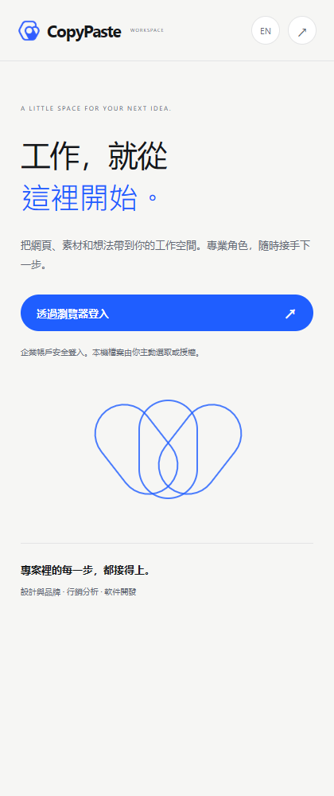
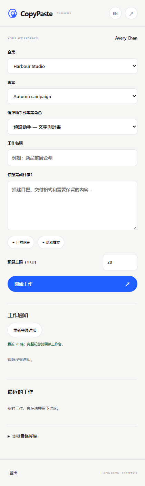
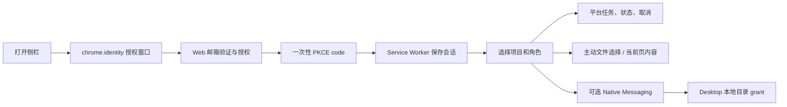
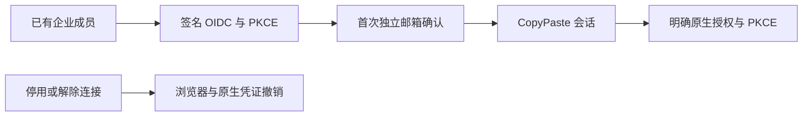
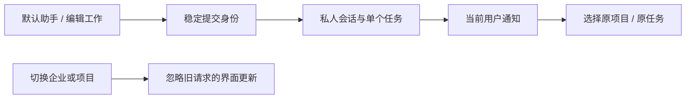
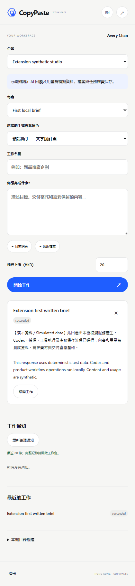
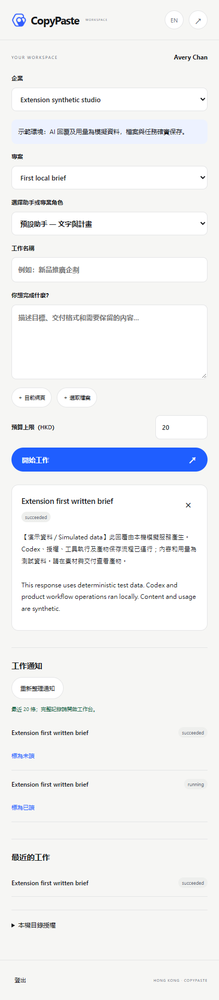
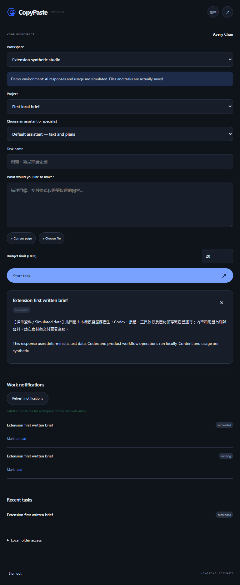

# CopyPaste Chrome Extension

[English](README.en.md) · Chrome MV3 侧栏与原生桥接 · 0.5.0

独立 Git 仓库。扩展让用户在 Chrome 选择工作区/项目、提交角色任务、主动提供本地文件或当前网页；持续目录操作通过已安装 Desktop 的原生桥接完成。模型执行与计费始终由平台承担，扩展不保存 AI key。




## 构建与加载

Node.js 22.14+、Chrome 120+，本次实际验收使用原生 Chromium。先运行 platform 和 Web：

```powershell
npm ci
npm run typecheck
npm run build
```

在 `chrome://extensions` 打开开发者模式，加载本仓库 `dist/`，再打开 CopyPaste 侧栏。固定 unpacked ID：`fffkcnmfdhahlnifgdilabheppkgnlok`。`manifest-key.txt` 仅含公开 SPKI 公钥，用于稳定 ID，不是模型密钥或商店私钥。平台 `EXTENSION_ID` 及 Desktop `deployment.json` 必须一致。

默认 API/Web 为 `http://localhost:4310` / `http://localhost:4317`。生产构建在 PowerShell 设置：

```powershell
$env:COPYPASTE_API_ORIGIN='https://api.your-company.example'
$env:COPYPASTE_WEB_ORIGIN='https://agent.your-company.example'
npm run build
```

只接受 HTTPS 公司 origin 或 localhost 开发地址；参数不能包含路径、凭证和查询。`dist/manifest.json` 的 host permission 只包含 API origin。未提交 Chrome Web Store，也未声称已获得上架授权。所有本机操作原生执行，禁止 Docker、WSL 和虚拟化环境。

## 登录与使用流程



登录在公司 Web 页面完成；回调地址严格绑定 Chrome identity URL。access/refresh 仅在受信 service worker 的 `chrome.storage.session` 保存，不在侧栏、localStorage 或 `storage.local` 保存。浏览器会话结束后需要重新登录；刷新轮换和退出由平台验证。扩展 local 存储只保存语言偏好。

文件必须通过用户手势选择，当前扩展限 5 MB；平台再次检查项目权限。当前网页抓取需要用户点击，使用 activeTab/scripting，排除表单、可编辑与隐藏内容，不后台全站采集。

## 与 Web / Desktop 的配合

0.2.0 使用同版平台身份、权限和任务接口，构建时从 package.json 写入 manifest 版本。侧栏提供轻量任务和素材入口；专属专家配置、完整私密会话和记忆管理在 Web 或 Desktop 工作区完成。私密成果须明确发布才成为可分享的项目素材。

## 原生本地目录

Chrome 扩展本身不能扫描任意本地路径。先安装 Desktop 的 Windows Setup 版，在设备页面点击连接 Chrome helper，经本机确认后仅注册当前 Windows 用户的官方扩展来源，再在扩展中授予可选 nativeMessaging 权限。

每个目录另行通过原生选择器授权，1 小时到期，默认只读；创建文件需要额外同意。支持列目录、预览、上传、仅创建新文本文件、撤销。禁止路径穿越、符号链接/junction、设备名、ADS、覆盖现有文件和远程 shell。Native Messaging 单条结果控制在 900 KB 内；更大文件使用显式文件选择器。

## 验证、代码与边界

- `src/background.ts`：PKCE、token 轮换、受限 API/原生消息、当前页抓取。
- `src/panel.ts`：项目/角色/任务、文件上传、目录工具与语言选择。
- `scripts/build.mjs`：公开部署 origin、固定 manifest、稳定扩展 ID。
- delivery `npm run qa:extension`：真实 MV3、chrome.identity 登录、上传、会话隐私和退出；创建的浏览器上下文在 finally 关闭。
- delivery `npm run qa:desktop`：实际打包 Windows native host 的长度帧、来源 allowlist、目录 grant 和本地文件流程。系统注册表安装本身由用户明确确认，不在 QA 中覆盖既有注册项。

扩展界面支持中/英切换，部分动态状态保留繁体中文；完整产品翻译仍需复核。公司 AI 网关未联调时不能提交可执行 AI 任务；缺少企业时先到 Web 初始化。云端每日/每周计划在 Web 或 Desktop 管理；完整 Desktop 自主操作与 AI 视频/语音仍按主文档待建设。素材与依赖见 [说明](THIRD_PARTY_NOTICES.md)。

## 0.5.0 企业身份与统一登录

OIDC 使用 code + PKCE S256、签章、state/nonce 与固定回调。先有注册账号及有效企业成员资格，再绑定企业身份；首次绑定需要独立的 CopyPaste 工作邮箱确认码，不按网域自动开户。配置改变、停用或本人解除连接会撤销关联用户的全部 CopyPaste Web/native/refresh 会话和旧执行授权。管理员登录仍独立使用邮箱与 TOTP。

企业身份复用系统浏览器授权页：点击登录后，在 Web 选择企业登入，完成身份验证及必要的邮箱确认，再明确授权 Chrome 回调。扩展保留独立 PKCE、短期 access token、轮换 refresh；服务端码绑定签发来源会话与用户版本。退出来源或撤销企业身份后，未交换旧码不能继续使用。本地文件及 Native Messaging 目录授权仍须明确操作。



## 默认助手与通知（当前源码）

侧栏可直接选择默认文字助手，也保留专业角色。提交使用稳定请求编号；未知响应重试复用原私人会话和任务。企业或项目切换后，旧请求不得覆盖新列表/任务。模拟企业持续显示假数据提示。通知列出当前接收者最近 20 条，支持已读切换及原项目/任务跳转；完整分页和会话继续在工作台处理。

Delivery `qa:extension` 七组真实 MV3 旅程已通过：PKCE、接受响应丢失后的真实重试与 Codex 文字文件、通知定位、320/420/768 宽度和两主题/语言、主动上传、凭证隐私/退出，以及接受响应延迟期间切换项目。模型为明确模拟依赖，未取得正式专业角色资格，旧发布 ZIP 未替换。






